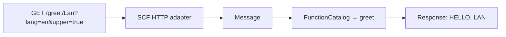

# Đọc query parameter qua header `http_request_param` trong Spring Cloud Function

## 1. Bài toán: cần cả payload lẫn tham số truy vấn

Trong **Spring Cloud Function (SCF)**, một nghiệp vụ được biểu diễn bằng `Supplier<O>`, `Function<I, O>` hoặc `Consumer<I>` và đăng ký vào `FunctionCatalog`. Logic có thể được kích hoạt qua HTTP, sự kiện trong Spring Cloud Stream hoặc adapter serverless. HTTP adapter đảm nhận việc nhận request, chuyển đổi payload và đưa dữ liệu phù hợp vào functional bean.

Ví dụ, hệ thống cần tạo lời chào theo tên người dùng và ngôn ngữ:

```http
GET /greet/Lan?lang=en&upper=true HTTP/1.1
Host: localhost:8080
```

Trong URL này có **ba loại thông tin khác nhau**:

- `greet` là **tên function** để adapter tra cứu trong `FunctionCatalog`.
- `Lan` là **đầu vào nghiệp vụ** lấy từ path item theo pattern `GET /{function}/{item}`.
- `lang=en` và `upper=true` là **query parameters**. Chúng mô tả tùy chọn xử lý của request, không phải các tham số Java riêng của `Function.apply()`.

Trong Spring MVC, người học có thể quen với `@RequestParam("lang")`. Nhưng một functional bean theo mô hình SCF không tự có `@RequestParam`. Để đọc query parameters, hàm có thể nhận `org.springframework.messaging.Message<T>` rồi tra cứu **message header** có key `http_request_param`.

Mục tiêu bài học:

1. Giải thích vì sao query parameter được đưa vào header của `Message`.
2. Viết `Function<Message<String>, String>` đọc payload và query parameters.
3. Sử dụng `HeaderUtils.HTTP_REQUEST_PARAM` thay vì lặp lại chuỗi key trong code.
4. Xử lý trường hợp thiếu tham số, tham số nhiều giá trị, URL encoding và dữ liệu không đáng tin cậy.
5. Giữ logic nghiệp vụ có thể tái sử dụng qua HTTP, sự kiện và serverless.

## 2. Query parameter được SCF chuyển đi đâu?

Theo mục **HTTP Request Parameters** trong tài liệu Spring Cloud Function, HTTP adapter xử lý query parameters gần giống HTTP headers: chúng được đặt trong `MessageHeaders` dưới key `http_request_param`, với giá trị là một **`Map` các tham số request**.



Nội dung `Message<String>` được hiểu như sau:

| Vị trí trong message | Ví dụ | Ý nghĩa |
| --- | --- | --- |
| `message.getPayload()` | `"Lan"` | Đầu vào chính, lấy từ `/{item}` với GET |
| `message.getHeaders().get("http_request_param")` | Map chứa `lang` và `upper` | Các query parameters từ URL |
| Các message headers khác | `contentType`, header HTTP được chuyển tiếp… | Metadata do adapter cung cấp; dạng và tên có thể phụ thuộc runtime |

**Phân biệt hai loại header:**

- `http_request_param` là **key trong `MessageHeaders` do adapter tạo** để gói query parameters.
- `X-Correlation-ID` hoặc `Accept` là các **HTTP request headers** có thể được adapter chuyển tiếp vào message.

Client cần truyền `?lang=en` trên URL. Việc tự gửi một HTTP header tên `http_request_param` không phải hợp đồng chuẩn để khai báo query parameter, và header do client cung cấp không được coi là dữ liệu đáng tin.

### Vì sao chữ ký phải nhận Message?

Hai chữ ký sau mang thông tin khác nhau:

```java
Function<String, String> simple;           // Nhận payload.
Function<Message<String>, String> inspect; // Nhận payload và metadata.
```

Với `Function<String, String>`, code chỉ có đối tượng `String`. Query parameters nằm trong metadata nên không tự trở thành đối số thứ hai của `apply()`. Với `Function<Message<String>, String>`, code đọc được `message.getPayload()` và `message.getHeaders()`.

SCF công bố hằng:

```java
import org.springframework.cloud.function.web.util.HeaderUtils;

String headerName = HeaderUtils.HTTP_REQUEST_PARAM;
// Giá trị tương ứng: "http_request_param".
```

Dùng hằng này khi code gắn trực tiếp với SCF HTTP adapter. Nếu muốn tránh phụ thuộc vào module web trong một thư viện nghiệp vụ thuần, có thể đọc header tại lớp adapter rồi chuyển tham số đã chuẩn hóa thành một DTO nghiệp vụ.

## 3. Ví dụ hoàn chỉnh: chào theo ngôn ngữ và tùy chọn viết hoa

### 3.1. Chuẩn bị dependency

Tạo dự án Spring Boot có Maven BOM Spring Cloud tương thích. Với ứng dụng MVC muốn xuất functional beans qua HTTP, dùng starter:

```xml
<dependency>
    <groupId>org.springframework.cloud</groupId>
    <artifactId>spring-cloud-starter-function-web</artifactId>
</dependency>
```

Starter này cung cấp tích hợp HTTP của SCF và các dependency cần thiết để chạy theo mô hình Spring MVC. Khi dùng WebFlux, chọn web starter tương ứng với release train và kiểm thử theo phiên bản. Không tự đặt phiên bản SCF ngẫu nhiên ngoài BOM đang dùng.

### 3.2. Khai báo functional bean

Tạo `src/main/java/demo/QueryParameterApplication.java`. Ví dụ dùng Java 17 trở lên:

```java
package demo;

import java.util.List;
import java.util.Locale;
import java.util.Map;
import java.util.Optional;
import java.util.function.Function;

import org.springframework.boot.SpringApplication;
import org.springframework.boot.autoconfigure.SpringBootApplication;
import org.springframework.cloud.function.web.util.HeaderUtils;
import org.springframework.context.annotation.Bean;
import org.springframework.messaging.Message;

@SpringBootApplication
public class QueryParameterApplication {

    public static void main(String[] args) {
        SpringApplication.run(QueryParameterApplication.class, args);
    }

    @Bean
    public Function<Message<String>, String> greet() {
        return message -> {
            String name = message.getPayload().trim();
            String language = firstQueryParam(message, "lang")
                    .orElse("vi");
            boolean uppercase = firstQueryParam(message, "upper")
                    .map("true"::equalsIgnoreCase)
                    .orElse(false);

            String greeting = "en".equalsIgnoreCase(language)
                    ? "Hello, " + name
                    : "Xin chào, " + name;

            return uppercase
                    ? greeting.toUpperCase(Locale.ROOT)
                    : greeting;
        };
    }

    /**
     * Đọc một giá trị của query parameter.
     *
     * HeaderUtils chỉ quy định key và Map; kiểu cụ thể
     * của giá trị có thể thay đổi theo adapter/phiên bản.
     */
    private static Optional<String> firstQueryParam(
            Message<?> message, String name) {

        Object header = message.getHeaders()
                .get(HeaderUtils.HTTP_REQUEST_PARAM);
        if (!(header instanceof Map<?, ?> parameters)) {
            return Optional.empty();
        }

        Object value = parameters.get(name);
        if (value instanceof String text) {
            return Optional.of(text);
        }
        if (value instanceof String[] values) {
            return values.length == 0
                    ? Optional.empty()
                    : Optional.ofNullable(values[0]);
        }
        if (value instanceof List<?> values) {
            return values.isEmpty() || values.get(0) == null
                    ? Optional.empty()
                    : Optional.of(values.get(0).toString());
        }

        // Không ép kiểu một giá trị chưa rõ dạng thành String.
        return Optional.empty();
    }
}
```

Điểm cần đọc trong ví dụ:

- `@Bean` đặt tên function là `greet`, nên URL mặc định theo tên bắt đầu bằng `/greet`.
- Payload của `Message<String>` là tên được truyền trong path item hoặc body.
- `HeaderUtils.HTTP_REQUEST_PARAM` là key để lấy Map query parameters.
- Hàm `firstQueryParam` xử lý **thiếu header**, **không phải Map**, giá trị `String`, `String[]` hoặc `List<?>`, tránh ép kiểu mù.
- `lang` mặc định là `vi`; `upper` mặc định là `false`.

Tài liệu SCF chỉ quy định giá trị của header là **Map**, không bảo đảm trong mọi adapter và phiên bản rằng từng phần tử trong Map luôn là `String` hay luôn là `String[]`. Vì thế ví dụ không thực hiện ép kiểu `(Map<String, String>) header` rồi gọi `get()` một cách chủ quan.

**Giới hạn của ví dụ:** giá trị khác `en` được xử lý như tiếng Việt, và tùy chọn `upper` chỉ bật khi giá trị bằng `true` (không phân biệt hoa/thường). Đây là quy tắc minh họa, chưa phải validation cho API production.

## 4. Thử các request GET có query parameters

Khởi động ứng dụng:

```bash
mvn spring-boot:run
```

Ứng dụng mặc định chạy ở `http://localhost:8080`. Các lệnh dưới dùng cú pháp Bash; trên PowerShell nên dùng `curl.exe` để gọi chương trình curl thực.

### 4.1. Gửi tham số `lang=en`

```bash
curl -i -H 'Accept: text/plain' \
  'http://localhost:8080/greet/Lan?lang=en'
```

HTTP response body dự kiến:

```text
Hello, Lan
```

Đường đi:

1. SCF tra cứu function `greet` trong catalog.
2. Path item `Lan` được dùng làm payload của message.
3. Query parameter `lang=en` được đặt trong Map dưới header `http_request_param`.
4. Function lấy `language="en"` và trả về `Hello, Lan`.

### 4.2. Kết hợp hai query parameters

```bash
curl -i -H 'Accept: text/plain' \
  'http://localhost:8080/greet/Lan?lang=en&upper=true'
```

Response body dự kiến:

```text
HELLO, LAN
```

Dấu `&` phân tách các cặp query parameter. Bọc URL trong dấu nháy đơn khi chạy trên Bash để shell không hiểu `&` là toán tử chạy nền.

### 4.3. Khi không gửi query parameter

```bash
curl -i 'http://localhost:8080/greet/Lan'
```

Vì method `firstQueryParam` trả `Optional.empty()` nếu thiếu header hoặc thiếu key, function sử dụng giá trị mặc định. Body dự kiến:

```text
Xin chào, Lan
```

Một ứng dụng thực tế có thể chọn quy tắc khác: bắt buộc có `lang`, từ chối ngôn ngữ không được hỗ trợ hoặc lấy mặc định theo tài khoản. Quan trọng là xử lý trường hợp vắng tham số **có chủ đích**, không dereference `null`.

### 4.4. Phân biệt query và path

| URL | Payload của `Message` | Query Map được đọc | Body dự kiến |
| --- | --- | --- | --- |
| `/greet/Lan` | `Lan` | Không có `lang` | `Xin chào, Lan` |
| `/greet/Lan?lang=vi` | `Lan` | `lang=vi` | `Xin chào, Lan` |
| `/greet/Lan?lang=en` | `Lan` | `lang=en` | `Hello, Lan` |
| `/greet/Lan?lang=en&upper=true` | `Lan` | `lang=en`, `upper=true` | `HELLO, LAN` |
| `/greet/Minh?upper=true` | `Minh` | `upper=true` | `XIN CHÀO, MINH` |

**Không đúng:** tự định nghĩa bean `Function<String, String> greet` rồi mong `?lang=en` trở thành biến Java `lang`. Chỉ khi nhận `Message<T>` hoặc có một adapter riêng, function mới có đường truy cập metadata đó.

## 5. Query parameters đi cùng POST body như thế nào?

Pattern `GET /{function}/{item}` phù hợp khi payload ngắn, đơn giản. Nhưng HTTP query parameters cũng có thể đi kèm request có **body**:

```bash
curl -i -X POST \
  'http://localhost:8080/greet?lang=en&upper=true' \
  -H 'Content-Type: text/plain; charset=UTF-8' \
  -H 'Accept: text/plain' \
  --data 'Lan'
```

Theo hợp đồng adapter:

- Payload của `Message<String>` được lấy từ **request body** là `Lan`.
- Query parameters được lưu trong header `http_request_param` tương tự như với GET.
- Function thực thi cùng một logic và trả kết quả nghiệp vụ `HELLO, LAN`.

Đối chiếu:

| Request | Payload từ đâu? | Query parameters từ đâu? |
| --- | --- | --- |
| `GET /greet/Lan?lang=en` | Segment `Lan` | Phần `?lang=en` |
| `POST /greet?lang=en` cùng body `Lan` | Request body | Phần `?lang=en` |
| `PUT /greet?lang=en` cùng body `Lan` | Request body | Phần `?lang=en` |

**Lưu ý:** Với SCF HTTP adapter, GET cho Function thường dùng pattern `/{function}/{item}`; không nên mặc định `GET /greet?name=Lan` sẽ tự đưa `name` vào payload. Query parameters là metadata, còn input chính phải được cung cấp theo hợp đồng HTTP tương ứng.

## 6. Nhiều giá trị cho cùng tên tham số

HTTP cho phép lặp lại query key:

```text
GET /greet/Lan?lang=en&lang=vi
```

Tài liệu SCF nêu giá trị header là Map nhưng không chuẩn hóa trong tài liệu công khai cách biểu diễn **một hay nhiều giá trị** ở mọi phiên bản. Một adapter có thể đưa dữ liệu vào `String[]` hoặc `List`; trường hợp một giá trị có thể xuất hiện như `String` tùy nguồn chuyển đổi.

Ví dụ `firstQueryParam` ở trên cố ý chọn **giá trị đầu tiên** khi gặp mảng hoặc list, phù hợp với mục đích học tập. Trong một hợp đồng API thực tế:

- Nếu tham số **chỉ được phép có một giá trị**, nên phát hiện và **từ chối giá trị trùng lặp** thay vì âm thầm chọn giá trị đầu tiên.
- Nếu tham số **cho phép nhiều giá trị**, hãy chuẩn hóa thành `List<String>` rồi validate từng giá trị; không ép thành một chuỗi có dấu phẩy nếu client không định nghĩa quy ước đó.
- Không dùng thứ tự giá trị đầu tiên/cuối cùng làm cơ chế xác thực hoặc quyết định phân quyền. Proxy và framework có thể có cách canonicalize khác nhau.

Ví dụ một API lọc nhãn:

```text
GET /search/books?tag=java&tag=spring&limit=10
```

Nếu cần nhận nhiều tag theo một hợp đồng ổn định, hãy đặt quy tắc rõ ràng về thứ tự, trùng lặp, giới hạn số phần tử và cách parse; một controller hoặc adapter chuyên biệt thường phù hợp hơn khi logic binding đã phức tạp.

## 7. Đọc `Map` an toàn và chuyển thành kiểu nghiệp vụ

### 7.1. Vì sao không ép kiểu trực tiếp?

Đoạn code dưới đây thiếu an toàn:

```java
// Tránh dùng trong code thực:
@SuppressWarnings("unchecked")
Map<String, String> params = (Map<String, String>)
        message.getHeaders().get("http_request_param");
String lang = params.get("lang");
```

Nó giả định header luôn tồn tại và mọi value luôn là `String`. Nếu adapter cung cấp `String[]`, ép kiểu generic có thể chỉ hỏng khi sử dụng giá trị; nếu header thiếu, sẽ gặp lỗi `NullPointerException`.

Phương pháp dùng `instanceof Map<?, ?>` cùng kiểm tra kiểu giá trị ở mục 3 giữ hành vi rõ ràng hơn. Trong production, sau khi phân tích dạng dữ liệu thực tế của adapter, nên thống nhất một DTO nội bộ và viết test hợp đồng dữ liệu.

### 7.2. Parse số nguyên từ query parameter

Giả sử function cần tham số `limit` để giới hạn số kết quả. Cách viết đơn giản:

```java
String rawLimit = firstQueryParam(message, "limit")
        .orElse("20");

int limit;
try {
    limit = Integer.parseInt(rawLimit);
} catch (NumberFormatException ex) {
    throw new IllegalArgumentException(
            "limit must be an integer", ex);
}

if (limit < 1 || limit > 100) {
    throw new IllegalArgumentException(
            "limit must be between 1 and 100");
}
```

Đây là đoạn minh họa để đặt **bên trong function** sau khi đã có `message` và helper `firstQueryParam`. Nó cho thấy query parameter vẫn bắt đầu như văn bản và phải parse, validate theo hợp đồng. Không mặc định `IllegalArgumentException` sẽ được SCF HTTP adapter tự chuyển thành `400 Bad Request`; nếu API đòi hỏi response lỗi cụ thể, cần xử lý lỗi ở HTTP boundary.

### 7.3. Cần phân biệt giá trị vắng và rỗng

Ba request sau có thể biểu diễn các trạng thái khác nhau:

```text
/greet/Lan
/greet/Lan?lang=
/greet/Lan?lang=en
```

- **Không có key:** helper trả `Optional.empty()`, từ đó áp dụng mặc định.
- **Có key với chuỗi rỗng:** helper có thể trả `Optional.of("")`; code phải quyết định xem rỗng có hợp lệ hay không.
- **Có key với giá trị:** parse và validate nội dung.

Đừng tự động trộn “vắng” và “rỗng” nếu chúng có ý nghĩa khác nhau theo hợp đồng API.

## 8. Mã hóa URI, Unicode và các ký tự đặc biệt

Query parameters nằm trong URL nên cần **percent-encoding**. Ví dụ một tên có khoảng trắng:

```bash
curl -i 'http://localhost:8080/greet/Lan?lang=en&note=hello%20world'
```

Ở đây `note=hello%20world` là metadata; function mẫu không dùng `note`. Dữ liệu path item có dấu cách cũng cần mã hóa:

```bash
curl -i 'http://localhost:8080/greet/Ngoc%20Lan?lang=en'
# Dự kiến: Hello, Ngoc Lan
```

Một số ký tự trong URL có ý nghĩa đặc biệt:

| Ký tự | Ý nghĩa/nguy cơ nếu không mã hóa đúng |
| --- | --- |
| `?` | Bắt đầu phần query, không còn là path item |
| `&` | Phân tách các cặp query parameter |
| `#` | Bắt đầu fragment; fragment thường không được gửi đến HTTP server |
| `=` | Phân tách tên và giá trị query parameter |
| `%` | Bắt đầu percent-encoded sequence |
| `+` | Có thể được diễn giải thành dấu cách trong biểu diễn form-encoded query |
| `/` | Phân tách path segments; encoded slash có thể bị proxy/container hạn chế |

Với ứng dụng Java, nên dùng **URI builder** hoặc API của HTTP client để xây dựng URI và encode từng thành phần đúng ngữ cảnh. Tránh nối thủ công chuỗi người dùng vào URL, đặc biệt khi chứa Unicode, `&`, `+` hoặc `%`.

Đối với payload lớn, nhiều dòng, JSON, token hoặc dữ liệu nhạy cảm, nên dùng request body cùng cơ chế xác thực phù hợp. Query parameters thường xuất hiện trong access log, lịch sử trình duyệt, proxy logs và công cụ quan sát hệ thống.

## 9. Phân biệt query header với các kiểu dữ liệu còn lại

| Thông tin | Ví dụ | Cách SCF chuyển vào function | Nên dùng khi |
| --- | --- | --- | --- |
| **Path item** | `GET /greet/Lan` | Payload `Lan` trong `Message<String>` | Một đầu vào ngắn, đơn giản |
| **Body text** | `POST /greet` với `Lan` | Payload `Lan` | Chuỗi tự do, có dấu cách hoặc ký tự khó đưa vào URL |
| **Body JSON** | `POST /quote` với DTO JSON | Payload được converter chuyển sang kiểu DTO | Dữ liệu nghiệp vụ nhiều trường |
| **Query parameter** | `?lang=en` | Trong Map ở `MessageHeaders["http_request_param"]` | Bộ lọc/tùy chọn xử lý |
| **HTTP header** | `X-Correlation-ID: abc` | HTTP adapter có thể chuyển vào `MessageHeaders` | Metadata theo quy ước giao thức |

Ví dụ hai hàm có cùng nghiệp vụ nhưng khác cách tiếp nhận:

```java
Function<String, String> standardize =
        value -> value.trim().toUpperCase(Locale.ROOT);

Function<Message<String>, String> adapter =
        message -> standardize.apply(message.getPayload());
```

Hàm `standardize` chỉ biết `String`, có thể tái sử dụng không cần HTTP. Hàm `adapter` biết thêm metadata của Spring Messaging. Khi ứng dụng còn tiêu thụ sự kiện hoặc triển khai serverless, có thể để lớp adapter chuyển các query/header cần thiết sang DTO nghiệp vụ, giúp phần cốt lõi không phụ thuộc vào `http_request_param`.

## 10. FunctionCatalog, composition và thay đổi tiền tố HTTP

Đọc query parameter không thay đổi quy tắc chọn bean:

- Khi catalog chỉ có một functional bean, tên bean có thể được bỏ khỏi URL.
- Khi có nhiều bean, đường dẫn theo tên như `/greet/Lan` giúp chọn đúng function.
- `spring.cloud.function.definition` có thể chỉ định một function/composition làm mặc định hoặc lọc danh sách hàm xuất.
- `spring.cloud.function.web.path` thay tiền tố HTTP, không đổi bản thân message header `http_request_param`.

Ví dụ:

```properties
spring.cloud.function.web.path=/api/functions
```

Khi đó client gọi:

```bash
curl -i 'http://localhost:8080/api/functions/greet/Lan?lang=en'
```

Tên `greet`, payload `Lan` và query map `lang=en` vẫn được diễn giải theo cùng một quy tắc. Nếu dùng Spring Cloud Stream để gọi cùng một function, adapter sự kiện **không tự tạo** HTTP query map; nếu nghiệp vụ yêu cầu ngôn ngữ, hãy chuyển thông tin từ event header/payload theo hợp đồng riêng.

## 11. Kiểm thử và chẩn đoán

### 11.1. Bộ request thử nhanh

```bash
# Có một query parameter:
curl -i 'http://localhost:8080/greet/Lan?lang=en'

# Có hai query parameters:
curl -i 'http://localhost:8080/greet/Lan?lang=en&upper=true'

# Không có query: dùng mặc định:
curl -i 'http://localhost:8080/greet/Lan'

# POST body + query:
curl -i -X POST 'http://localhost:8080/greet?lang=en' \
  -H 'Content-Type: text/plain' \
  -H 'Accept: text/plain' \
  --data 'Lan'

# Lặp cùng key (dùng để kiểm tra chính sách nhiều giá trị):
curl -i 'http://localhost:8080/greet/Lan?lang=vi&lang=en'

# Kiểm tra giá trị rỗng:
curl -i 'http://localhost:8080/greet/Lan?lang='
```

Cần quan sát cả HTTP status, response body và dữ liệu thực tế mà hàm nhìn thấy. Tài liệu demo tập trung vào logic nhận tham số; không nên suy luận rằng mọi phiên bản Spring Boot/SCF sẽ tạo response headers giống hệt nhau khi content negotiation khác.

### 11.2. Bảng xử lý sự cố

| Hiện tượng | Nguyên nhân cần kiểm tra | Hướng khắc phục |
| --- | --- | --- |
| `message.getHeaders().get("http_request_param")` là `null` | Không có query, không dùng HTTP adapter tương ứng hoặc metadata không được chuyển tiếp | Kiểm tra URL, adapter và xử lý trường hợp không có key |
| ClassCastException khi lấy Map | Ép kiểu value thành `String` trong khi adapter dùng list/mảng | Dùng `Map<?, ?>`, kiểm tra kiểu trước khi dùng |
| Tham số `lang` không đổi kết quả | Function chỉ nhận `String` hoặc đang đọc sai key | Đổi sang `Message<String>`, dùng `HeaderUtils.HTTP_REQUEST_PARAM` |
| `GET /greet?lang=en` không chạy | Thiếu `/{item}` theo GET mapping của Function | Gọi `GET /greet/Lan?lang=en` hoặc POST body |
| URL có `&` bị cắt khi chạy shell | Không bọc URL trong dấu nháy | Quote URL hoặc dùng client HTTP |
| Giá trị chứa `+` hoặc ký tự Unicode bị sai | Client hoặc gateway encode/decode không đúng | Dùng URI builder và test ký tự đặc biệt |
| `lang=en&lang=vi` tạo kết quả bất ngờ | Quy tắc chọn giá trị đầu/cuối chưa nhất quán | Định nghĩa rõ cách xử lý multi-value, từ chối trùng khi cần |
| `POST` trả 415/400 | Sai `Content-Type`, charset hoặc payload không tương thích | Gửi đúng `text/plain` hay JSON theo input type |
| `404 Not Found` | Sai function name, tiền tố, function filtering | Kiểm tra `@Bean`, `web.path`, `definition` |
| Event handler đọc không được `http_request_param` | Header thuộc hợp đồng HTTP adapter, không tự hiện diện ở event transport | Quy định event metadata riêng và chuyển vào DTO nghiệp vụ |

### 11.3. Bộ ca kiểm thử tối thiểu

Khi xây dựng test tích hợp cho HTTP adapter, nên có các trường hợp:

1. `GET /greet/Lan?lang=en` trả `Hello, Lan`.
2. `GET /greet/Lan?lang=en&upper=true` trả `HELLO, LAN`.
3. Không có `lang` thì function sử dụng mặc định `vi`.
4. `POST /greet?lang=en` với body `Lan` có kết quả tương đương GET mang cùng input.
5. Tham số rỗng, sai kiểu (khi có), lặp nhiều lần và ký tự percent-encoded được xử lý theo quy tắc đã định nghĩa.
6. Sau khi đổi `spring.cloud.function.web.path`, function vẫn nhận đúng query map.

Có thể dùng `MockMvc`, `WebTestClient` hoặc HTTP client thích hợp với phiên bản Spring Boot/Spring Web mà ứng dụng sử dụng. **Chỉ kiểm thử trực tiếp hàm Java không chứng minh HTTP adapter đã tạo đúng message header.**

## 12. Khi nào nên dùng controller/router thay thế?

Cách đọc `http_request_param` hữu ích khi muốn tiếp tục viết functional bean theo mô hình SCF nhưng vẫn cần tham số HTTP. Tuy nhiên, một API cần nhiều path variables, query DTO phức tạp, validation/response lỗi chi tiết, API documentation hoặc nhiều status code có thể phù hợp hơn với lớp Spring MVC/WebFlux controller/router:

```java
// Minh họa controller MVC; không phải chữ ký bắt buộc của SCF.
@GetMapping("/greetings/{name}")
public String greet(
        @PathVariable String name,
        @RequestParam(defaultValue = "vi") String lang) {
    return greetingService.greet(name, lang);
}
```

Controller chịu trách nhiệm bind và validate HTTP; service/functional bean thực hiện nghiệp vụ. Như vậy nghiệp vụ vẫn có thể được dùng bởi HTTP, hệ thống sự kiện hoặc serverless mà không lệ thuộc vào cách tham số được gửi trong URL.

## 13. Bài tập tự luyện

1. Từ request `GET /greet/Lan?lang=en&upper=true`, xác định tên function, payload, key message header và kết quả nghiệp vụ.
2. Vì sao `Function<String, String> greet` không đọc được `?lang=en` như một đối số Java thứ hai? Sửa chữ ký ra sao?
3. Viết code đọc `http_request_param` bằng `HeaderUtils.HTTP_REQUEST_PARAM` và xử lý trường hợp header vắng mặt.
4. So sánh `GET /greet/Lan?lang=en` với `POST /greet?lang=en` có body `Lan`: payload đến từ đâu, metadata đến từ đâu?
5. Vì sao ép `Map<String, String>` trực tiếp có thể rủi ro? Cách xử lý một tham số có nhiều giá trị là gì?
6. Cho query `?limit=200`, hãy xây dựng validation với miền cho phép từ 1 đến 100; giải thích tại sao vẫn cần xử lý lỗi HTTP ở boundary.
7. Với `?lang=vi&lang=en`, vì sao việc ngầm lấy giá trị đầu tiên có thể gây lỗi hợp đồng?
8. Đổi tiền tố thành `/v1/functions` và viết lại URL cho function `greet` mang `lang=en`.
9. Một function được dùng từ Spring Cloud Stream không nhận được header `http_request_param`. Giải thích vì sao và đề xuất cách thiết kế DTO để dùng chung nghiệp vụ.

## Tài liệu tham khảo chính thức

- [Spring Cloud Function — Standalone Web Applications](https://docs.spring.io/spring-cloud-function/reference/spring-cloud-function/standalone-web-applications.html): mục **HTTP Request Parameters**, key `http_request_param`, `HeaderUtils.HTTP_REQUEST_PARAM`, mapping `GET /{function}/{item}`, request headers và function mapping.
- [Spring Cloud Function — Programming Model](https://docs.spring.io/spring-cloud-function/reference/spring-cloud-function/programming-model.html): `FunctionCatalog`, `Supplier`, `Function`, `Consumer` và thông điệp có headers.
- [HeaderUtils Java API](https://www.javadoc.io/static/org.springframework.cloud/spring-cloud-function-parent/4.0.0/org/springframework/cloud/function/web/util/HeaderUtils.html): hằng `HTTP_REQUEST_PARAM` (ví dụ API, cần đối chiếu artifact đang chạy).
- [Spring Framework — Spring Messaging](https://docs.spring.io/spring-framework/reference/integration.html): abstraction `Message` và metadata của thông điệp.

> **Ghi nhớ:** `http_request_param` là **key nội bộ trong `MessageHeaders`** của SCF HTTP adapter, chứa một Map các HTTP query parameters. Muốn đọc chúng, dùng `Function<Message<T>, O>` và `message.getHeaders().get(HeaderUtils.HTTP_REQUEST_PARAM)`. Luôn kiểm tra kiểu, giá trị vắng, multi-value, URI encoding và giữ nghiệp vụ không phụ thuộc vào HTTP khi cần tái sử dụng.
