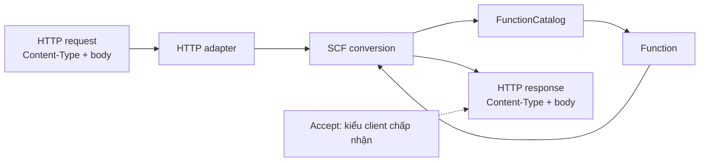

# Content-Type, Accept và thương lượng dạng dữ liệu trong Spring Cloud Function

## 1. Vấn đề cần giải quyết

**Spring Cloud Function (SCF)** cho phép đóng gói nghiệp vụ thành các bean Java kiểu `Supplier<O>`, `Function<I, O>` và `Consumer<I>`. `FunctionCatalog` quản lý và cung cấp chúng cho nhiều adapter: HTTP, sự kiện qua Spring Cloud Stream hoặc môi trường serverless. Vì vậy, một function tính báo giá không cần tự đọc `HttpServletRequest` để biết dữ liệu đi đến từ đâu.

Tuy nhiên, khi function được gọi qua HTTP, client có thể gửi cùng nội dung dưới dạng **văn bản thuần**, **JSON** hoặc dữ liệu khác. Server cần xác định:

1. **Client đã gửi dạng gì?** Header `Content-Type` mô tả cách diễn giải request body.
2. **Function cần kiểu Java nào?** Ví dụ `String`, `QuoteRequest` hoặc `Message<String>`. Kiểu đầu vào là một phần hợp đồng Java, không phải một HTTP header.
3. **Client muốn nhận dạng gì?** Header `Accept` mô tả media type mà client có thể sử dụng ở response.
4. **Adapter có bộ chuyển đổi phù hợp không?** HTTP runtime cùng SCF phải giải mã đầu vào, gọi function, rồi tạo response body/headers.

Đó là bài toán **content negotiation (thương lượng dạng dữ liệu)**. Ví dụ:

```http
POST /quote HTTP/1.1
Host: localhost:8080
Content-Type: application/json
Accept: application/json

{"sku":"BOOK-001","quantity":2}
```

Với bean `Function<QuoteRequest, QuoteResponse> quote`, HTTP adapter chuyển JSON thành `QuoteRequest`, chạy nghiệp vụ và đưa `QuoteResponse` thành JSON ở phản hồi. Nếu client gửi sai header hoặc dữ liệu không thể chuyển đổi, lỗi có thể xảy ra **trước khi** `quote.apply()` được gọi.

### Mục tiêu học tập

Sau bài này, bạn sẽ:

- Phân biệt chính xác vai trò của `Content-Type`, `Accept` và kiểu dữ liệu Java.
- Gọi `Function<String, String>` bằng `text/plain`, và `Function<DTO, DTO>` bằng `application/json`.
- Giải thích cách `MessageConverter` / `ConversionService` tham gia chuyển đổi trong SCF.
- Đọc và dự đoán các lỗi `400`, `406`, `415` và lỗi chuyển đổi/ngoại lệ khi test HTTP.
- Hiểu giới hạn của `Accept: text/event-stream`, HTTP headers và các trường hợp body nhiều phần tử.
- Giữ được logic độc lập với HTTP khi dùng chung function cho event hoặc serverless.

## 2. Content-Type không giống Accept

| Tiêu chí | `Content-Type` | `Accept` |
| --- | --- | --- |
| Bên gửi đặt ở request | Client | Client |
| Câu hỏi trả lời | **Body tôi gửi có dạng gì?** | **Tôi có thể nhận response ở dạng gì?** |
| Ví dụ | `Content-Type: text/plain` | `Accept: application/json` |
| Cách dùng | Hỗ trợ chọn bộ giải mã dữ liệu đầu vào | Hỗ trợ chọn bộ biểu diễn dữ liệu đầu ra |
| Gắn với | Request body | Response representation |
| Nếu thiếu | Framework có thể áp dụng mặc định; SCF dùng `application/json` làm gợi ý khi thiếu contentType ở tầng message conversion | Client không giới hạn rõ loại response; server lựa chọn định dạng phù hợp |
| Lỗi liên quan | `415 Unsupported Media Type` hoặc lỗi parse/conversion | `406 Not Acceptable` khi không thể đáp ứng một kiểu chấp nhận |

**Phân biệt thêm:** server trả `Content-Type` trong **response** để thông báo định dạng body **thực tế được gửi về**. Giá trị đó không phải lúc nào cũng bằng chuỗi client đưa vào `Accept`; `Accept` có thể chứa danh sách lựa chọn, wildcard hoặc trọng số ưu tiên.

Ví dụ đúng:

```http
POST /uppercase HTTP/1.1
Content-Type: text/plain; charset=UTF-8
Accept: text/plain

hello
```

Phản hồi điển hình:

```http
HTTP/1.1 200 OK
Content-Type: text/plain

HELLO
```

Thứ tự diễn ra là **giải mã request → chuyển về kiểu Java → chạy function → mã hóa response**. Đổi `Accept` không có nghĩa framework sẽ tự thay kiểu tham số Java của function.



**Ghi chú:** sơ đồ là luồng khái niệm; các bước parse và encode có thể do Spring MVC/WebFlux codecs, Spring Messaging converters hoặc SCF conversion đảm nhiệm tùy loại input và adapter.

## 3. Phạm vi định dạng được SCF HTTP adapter hỗ trợ

Tài liệu *Standalone Web Applications* của SCF mô tả hai nhóm nội dung cơ bản được hỗ trợ trực tiếp bởi web adapter:

- **Plain text:** `text/plain`, phù hợp với `Function<String, String>` và input/output văn bản.
- **JSON:** `application/json`, phù hợp với POJO, Java `record` hoặc DTO có cấu trúc khi có JSON converter phù hợp.

Ngoài ra, dữ liệu đầu ra **nhiều phần tử** có thể được client yêu cầu ở dạng **Server-Sent Events (SSE)** bằng `Accept: text/event-stream`, nếu loại function, adapter và runtime thực tế hỗ trợ.

SCF ở tầng conversion còn có cơ chế xử lý `application/octet-stream` với `byte[]` ở một số luồng MessageConverter. Điều này **không có nghĩa mọi endpoint SCF web đều là API upload/download nhị phân tùy ý**; trường hợp binary, multipart và streaming cần kiểm chứng riêng. Nếu yêu cầu HTTP quá chuyên biệt, Spring MVC/WebFlux controller hoặc router thường phù hợp hơn.

### Khi có cả media type và kiểu tham số

Giả sử client gửi:

```http
Content-Type: application/json

{"sku":"BOOK-001","quantity":2}
```

và function có chữ ký:

```java
Function<QuoteRequest, QuoteResponse> quote;
```

SCF nhận được **hai tín hiệu bổ sung cho nhau**: media type cho biết cách đọc raw payload, còn `QuoteRequest` xác định object cần tạo. Header `Content-Type: application/json` **không tự biến tất cả function thành kiểu JSON** nếu chữ ký không phù hợp; ngược lại, kiểu `QuoteRequest` cũng không biến một body bất kỳ thành JSON hợp lệ.

## 4. Mô hình chuyển đổi bên trong Spring Cloud Function

SCF dùng các cơ chế có sẵn của Spring để đưa dữ liệu đến đúng chữ ký function:

| Đường chuyển đổi | Cơ chế thường dùng | Khi nào gặp |
| --- | --- | --- |
| Raw dữ liệu đã được đặt trong Spring `Message<?>` | `MessageConverter` | HTTP adapter, messaging/event adapter, composition có message |
| Input không phải `Message` cần đổi kiểu | `ConversionService` | Các lệnh gọi và chuyển đổi đối tượng theo cơ chế Spring |
| HTTP bytes ↔ object của web layer | HTTP message converter/codec của MVC/WebFlux | Trước và sau bước xử lý SCF, tùy runtime |

Các converter phổ biến của SCF gồm:

- `JsonMessageConverter`: xử lý JSON ↔ POJO theo `application/json` và thư viện JSON có trên classpath.
- `StringMessageConverter`: xử lý các trường hợp chuyển sang `String` khi content type phù hợp, như `text/plain`.
- `ByteArrayMessageConverter`: xử lý các trường hợp `byte[]` như `application/octet-stream`.

Tài liệu cũng nhấn mạnh rằng `Content-Type` là **gợi ý để chọn converter**, không thay thế kiểu đích. Nếu không có converter đáp ứng được cả hai điều kiện, có thể phát sinh exception. Không nên dựa vào một converter tự viết hoặc cú pháp media type đặc biệt mà chưa kiểm thử trên dòng SCF đang chạy.

### Mặc định khi không truyền Content-Type

Ở tầng **SCF message conversion**, khi không có header `contentType`, SCF sử dụng giá trị mặc định `application/json`. Nhưng khi gọi **HTTP**, MVC/WebFlux, HTTP client và cách tạo `Message` có thể ảnh hưởng bước chuyển đổi trước đó. Vì vậy **đừng dựa vào thiếu header để ngầm chọn JSON hoặc text**. Hãy gửi rõ:

```text
Content-Type: text/plain       # nếu body là văn bản
Content-Type: application/json # nếu body là JSON
```

Đây cũng là lý do trong tài liệu SCF, khi POST text, việc cung cấp cả `Content-Type` và `Accept` là thực hành được khuyến nghị để tránh khác biệt negotiation giữa những phiên bản Spring Boot cũ và mới.

## 5. Ví dụ runnable: cùng ứng dụng nhận text và JSON

Ví dụ dùng **Java 17+**, Spring Boot và web starter của Spring Cloud Function. Dự án cần có **Spring Cloud dependencies BOM** phù hợp với Spring Boot đang dùng; không tự gán version SCF không tương thích.

Để xuất function qua HTTP với Spring MVC, khai báo dependency:

```xml
<dependency>
    <groupId>org.springframework.cloud</groupId>
    <artifactId>spring-cloud-starter-function-web</artifactId>
</dependency>
```

Nếu ứng dụng chạy WebFlux, hãy dùng SCF webflux starter theo release train tương ứng. Ví dụ dưới dùng một bộ functional bean độc lập với MVC/WebFlux, ngoại trừ phần adapter HTTP chịu trách nhiệm negotiation.

Tạo `src/main/java/demo/ContentNegotiationApplication.java`:

```java
package demo;

import java.math.BigDecimal;
import java.util.Locale;
import java.util.function.Consumer;
import java.util.function.Function;
import java.util.function.Supplier;

import org.springframework.boot.SpringApplication;
import org.springframework.boot.autoconfigure.SpringBootApplication;
import org.springframework.context.annotation.Bean;
import org.springframework.messaging.Message;
import org.springframework.messaging.MessageHeaders;

@SpringBootApplication
public class ContentNegotiationApplication {

    public static void main(String[] args) {
        SpringApplication.run(ContentNegotiationApplication.class, args);
    }

    // Text -> Text.
    @Bean
    public Function<String, String> uppercase() {
        return text -> text.toUpperCase(Locale.ROOT);
    }

    // JSON object -> JSON object.
    @Bean
    public Function<QuoteRequest, QuoteResponse> quote() {
        return input -> {
            if (input == null || input.sku() == null
                    || input.sku().isBlank()
                    || input.quantity() <= 0) {
                throw new IllegalArgumentException(
                        "SKU and quantity must be valid");
            }
            BigDecimal unitPrice = new BigDecimal("199000");
            BigDecimal total = unitPrice.multiply(
                    BigDecimal.valueOf(input.quantity()));
            return new QuoteResponse(
                    input.sku(), input.quantity(), total);
        };
    }

    // GET -> JSON object.
    @Bean
    public Supplier<ServiceStatus> serviceStatus() {
        return () -> new ServiceStatus("SPRING_CLOUD_FUNCTION", "READY");
    }

    // Nhận text và quan sát Content-Type được chuyển vào MessageHeaders.
    @Bean
    public Function<Message<String>, String> inspectContentType() {
        return message -> {
            Object type = message.getHeaders()
                    .get(MessageHeaders.CONTENT_TYPE);
            String reportedType =
                    type == null ? "missing" : type.toString();
            return "payload=" + message.getPayload()
                    + "; type=" + reportedType;
        };
    }

    // Consumer minh họa request/response khác Function.
    @Bean
    public Consumer<AuditEvent> auditEvent() {
        return event -> System.out.println(
                "Audit: " + event.type() + "/" + event.reference());
    }

    public record QuoteRequest(String sku, int quantity) {}
    public record QuoteResponse(
            String sku, int quantity, BigDecimal totalPrice) {}
    public record ServiceStatus(String service, String state) {}
    public record AuditEvent(String type, String reference) {}
}
```

Giá `199000` chỉ mang tính minh họa, không dùng làm bảng giá thật. Ứng dụng giả định có Jackson hoặc JSON codec tương thích trên classpath do web starter/BOM quản lý.

Chạy ứng dụng:

```bash
mvn spring-boot:run
```

Các lệnh curl dùng cú pháp Bash, URL mặc định `http://localhost:8080`. Trên Windows PowerShell, gọi `curl.exe` và thay cách xuống dòng phù hợp; không phụ thuộc alias `curl` của PowerShell.

## 6. Thực hành với Content-Type: text/plain

### 6.1. Function nhận và trả văn bản

```bash
curl -i -X POST 'http://localhost:8080/uppercase' \
  -H 'Content-Type: text/plain; charset=UTF-8' \
  -H 'Accept: text/plain' \
  --data 'hello spring cloud'
```

Phản hồi nghiệp vụ:

```http
HTTP/1.1 200 OK
Content-Type: text/plain

HELLO SPRING CLOUD
```

SCF dùng kiểu Java `Function<String, String>` để đưa body vào `String`. Client đã cung cấp `text/plain`, nên không cần giả định body là một JSON string. Chữ ký bean không phải `Function<byte[], byte[]>`; đừng coi input luôn giữ nguyên từng byte khi converter đã xử lý charset.

### 6.2. Kiểm tra metadata Content-Type

Bean `inspectContentType` nhận `Message<String>` để thấy payload và header `contentType`:

```bash
curl -i -X POST 'http://localhost:8080/inspectContentType' \
  -H 'Content-Type: text/plain' \
  -H 'Accept: text/plain' \
  --data 'hello'
```

Phản hồi có dạng:

```text
payload=hello; type=text/plain
```

Tùy phiên bản và codec, giá trị `MessageHeaders.CONTENT_TYPE` có thể chứa thông tin charset hoặc được biểu diễn thành `MimeType`. **Không nên assert toàn bộ response phải giống từng byte** nếu mục đích kiểm thử chỉ là xác nhận header được đưa vào message; hãy kiểm tra media type và payload theo ngữ nghĩa.

### 6.3. Nội dung nhiều dòng và UTF-8

Nếu body có xuống dòng, nên dùng phương thức truyền dữ liệu bảo toàn nội dung:

```bash
printf 'dòng một\ndòng hai\n' |
  curl -i -X POST 'http://localhost:8080/uppercase' \
    -H 'Content-Type: text/plain; charset=UTF-8' \
    -H 'Accept: text/plain' \
    --data-binary @-
```

Với input đã được giải mã thành `String`, kết quả phụ thuộc charset do client và server thống nhất. `--data-binary @-` đọc từ stdin để tránh các xử lý không phù hợp khi cần giữ nguyên newline từ nguồn nhập. Nếu là dữ liệu bí mật, cần ngăn ghi body vào log và sử dụng TLS.

## 7. Thực hành với Content-Type: application/json

### 7.1. JSON object chuyển thành DTO

Bean `quote` có chữ ký `Function<QuoteRequest, QuoteResponse>`. Client cần gửi JSON object:

```bash
curl -i -X POST 'http://localhost:8080/quote' \
  -H 'Content-Type: application/json' \
  -H 'Accept: application/json' \
  --data '{"sku":"BOOK-001","quantity":2}'
```

Phản hồi nghiệp vụ dự kiến:

```json
{
  "sku": "BOOK-001",
  "quantity": 2,
  "totalPrice": 398000
}
```

Nếu HTTP xử lý thành công, status thông thường là `200 OK` và response `Content-Type` tương thích với `application/json`. Whitespace, thứ tự trường JSON, cách biểu diễn số, charset và HTTP headers có thể khác; test nên parse JSON thay vì so sánh response nguyên văn.

### 7.2. Đọc đúng header nhưng sai body

Các request bên dưới **không tương đương**:

```bash
# Đúng: JSON object cùng header JSON.
curl -i -X POST 'http://localhost:8080/quote' \
  -H 'Content-Type: application/json' \
  --data '{"sku":"BOOK-001","quantity":2}'

# Sai: body không phải JSON hợp lệ.
curl -i -X POST 'http://localhost:8080/quote' \
  -H 'Content-Type: application/json' \
  --data '{"sku":"BOOK-001","quantity":'

# Sai hướng diễn giải: body JSON nhưng báo text/plain.
curl -i -X POST 'http://localhost:8080/quote' \
  -H 'Content-Type: text/plain' \
  --data '{"sku":"BOOK-001","quantity":2}'
```

Request thứ hai có lỗi **JSON syntax**; request thứ ba tạo xung đột giữa **media type** và kiểu Java đích. Tùy converter và HTTP adapter, phản hồi có thể là `400`, `415` hoặc lỗi chuyển đổi khác. Không khẳng định mọi cặp sai đều trả cùng một status trên tất cả phiên bản.

### 7.3. JSON hợp lệ nhưng nghiệp vụ sai

```bash
curl -i -X POST 'http://localhost:8080/quote' \
  -H 'Content-Type: application/json' \
  --data '{"sku":"BOOK-001","quantity":0}'
```

Body có thể được giải mã thành `QuoteRequest` thành công, nhưng `quote` ném `IllegalArgumentException` do `quantity <= 0`. **Lỗi validation nghiệp vụ khác với lỗi media type**. SCF HTTP adapter không bảo đảm tự chuyển mọi `IllegalArgumentException` thành `400 Bad Request`. Để có error response chuẩn, cần bổ sung exception handling ở HTTP boundary hoặc sử dụng controller/router.

## 8. Accept quyết định gì ở chiều response?

Khi gửi:

```http
Accept: application/json
```

client tuyên bố mình có thể nhận JSON. Với `Supplier<ServiceStatus> serviceStatus`:

```bash
curl -i 'http://localhost:8080/serviceStatus' \
  -H 'Accept: application/json'
```

Phản hồi điển hình:

```http
HTTP/1.1 200 OK
Content-Type: application/json

{"service":"SPRING_CLOUD_FUNCTION","state":"READY"}
```

Không có request body, nên bạn **không cần đặt `Content-Type` cho GET Supplier** để yêu cầu JSON trả về; đó là vai trò của `Accept`.

### 8.1. Accept không đổi kiểu trả về của function

Nếu bean trả về `QuoteResponse`, client gửi `Accept: text/plain` **không có nghĩa SCF phải tự động gọi `toString()` hoặc sinh CSV**. Hệ thống phải có HTTP converter/codec tạo được một representation phù hợp. Nếu không tìm được, HTTP runtime có thể trả `406 Not Acceptable` hoặc biểu hiện khác tùy cấu hình.

Vì thế, test bất lợi sau là **ca kiểm thử phải quan sát**, không nên gắn cứng kết quả lỗi trước khi chạy:

```bash
curl -i -X POST 'http://localhost:8080/quote' \
  -H 'Content-Type: application/json' \
  -H 'Accept: text/plain' \
  --data '{"sku":"BOOK-001","quantity":2}'
```

Nếu API đòi hỏi hỗ trợ `text/plain` cho báo giá, hãy chủ động viết một function trả `String` hoặc HTTP representation converter rõ ràng; không trông chờ chỉ thay `Accept` là đủ.

### 8.2. Accept có thể chứa nhiều lựa chọn

Theo ngữ nghĩa HTTP, client có thể gửi:

```http
Accept: application/json, text/plain;q=0.8, */*;q=0.1
```

Ý nghĩa:

- `application/json` được ưu tiên mặc định ở mức `q=1`.
- `text/plain;q=0.8` được chấp nhận với trọng số thấp hơn.
- `*/*;q=0.1` cho biết client cũng chấp nhận các dạng khác với mức ưu tiên thấp.

Tuy nhiên, HTTP runtime chỉ có thể chọn media type **mà các converter đã hỗ trợ**. Không có nghĩa mỗi function tự động hỗ trợ đồng thời mọi media type xuất hiện trong `Accept`. Đối với bài thực hành, dùng một lựa chọn cụ thể (`Accept: text/plain` hoặc `Accept: application/json`) để dễ quan sát.

## 9. So sánh các tổ hợp header thường gặp

| Function / tình huống | Request Content-Type | Request Accept | Hành vi kỳ vọng hoặc điều cần kiểm thử |
| --- | --- | --- | --- |
| `uppercase: String → String` | `text/plain` | `text/plain` | **Đúng:** nhận và trả text |
| `quote: DTO → DTO` | `application/json` | `application/json` | **Đúng:** JSON → DTO → JSON |
| `serviceStatus: Supplier<DTO>` | Không có request body nên không cần | `application/json` | **Đúng:** Supplier trả DTO dạng JSON |
| `quote` | `application/json` | `text/plain` | Kiểm tra khả năng mã hóa response; có thể không đáp ứng `Accept` |
| `quote` | `text/plain` | `application/json` | Không suy luận JSON body được giải mã đúng; có thể xảy ra lỗi converter |
| `quote` | `application/json` nhưng body JSON sai | `application/json` | Lỗi parse/conversion trước khi gọi function |
| `uppercase` | Không ghi Content-Type | Không ghi Accept | Không nên dựa vào mặc định; HTTP client và framework có thể tạo behavior khác |
| `auditEvent: Consumer<DTO>` | `application/json` | `application/json` | POST thành công thường **202 Accepted** và adapter phản chiếu input |

**Nguyên tắc kiểm thử:** với mỗi ca, xác minh đồng thời **HTTP status, response Content-Type, response body và việc function có thực sự chạy**. Status một mình không chứng minh converter đúng hay tác dụng phụ của Consumer đã được ghi bền vững.

## 10. Thương lượng dạng dữ liệu khi dùng Message<?>

Nếu bean cần quan sát metadata ngoài payload, bạn có thể dùng `org.springframework.messaging.Message<T>`. Ví dụ trong ứng dụng:

```java
@Bean
public Function<Message<String>, String> inspectContentType() {
    return message -> {
        Object contentType = message.getHeaders()
                .get(MessageHeaders.CONTENT_TYPE);
        return message.getPayload() + " / " + contentType;
    };
}
```

Tại HTTP boundary, request `Content-Type` thường được đưa vào message header `contentType`. Đây là **metadata** để SCF chọn converter; nó không phải một giá trị nghiệp vụ được tự động thêm vào tham số `String`.

Nếu function có chữ ký:

```java
Function<Message<QuoteRequest>, Message<QuoteResponse>> handle;
```

thì input/output Message có thể mang **payload và headers**. SCF hỗ trợ chuyển output message headers sang HTTP response headers; đồng thời theo tài liệu, nhiều HTTP request headers có thể được sao chép sang response theo mặc định. Cần chú ý:

- Header `Content-Type` ở **response** phải mô tả payload response thực, không chỉ sao chép sai từ request.
- Không xem `Accept` là cơ chế tự động điều chỉnh kiểu generic `QuoteResponse`.
- Tránh trả lại các header nhạy cảm như token/authorization hoặc metadata nội bộ không cần thiết.
- SCF cung cấp property `spring.cloud.function.http.ignored-headers` để loại một số HTTP headers khỏi cơ chế sao chép; bảo mật vẫn phải được kiểm soát ở lớp Security/Gateway.

Ví dụ cấu hình lọc một số headers:

```properties
spring.cloud.function.http.ignored-headers=X-Internal-Token,X-Debug-Secret
```

**Phạm vi:** đây là bộ lọc đối với header propagation do adapter thực hiện; không được coi là biện pháp thay thế cho việc tránh log và xử lý bí mật ở các hệ thống khác.

## 11. Content negotiation khi ghép hàm (composition)

Giả sử có hai hàm:

```java
@Bean
public Function<String, String> normalize() {
    return String::trim;
}

@Bean
public Function<String, String> uppercase() {
    return text -> text.toUpperCase(Locale.ROOT);
}
```

SCF có thể ghép:

```properties
spring.cloud.function.definition=normalize|uppercase
```

Khi HTTP adapter ánh xạ composition tại đường dẫn gốc, có thể gọi:

```bash
curl -i -X POST 'http://localhost:8080/' \
  -H 'Content-Type: text/plain' \
  -H 'Accept: text/plain' \
  --data '  hello  '
# Kết quả nghiệp vụ: HELLO
```

Với cặp `Function<String, String>` trên, hai hàm đã có kiểu tương thích. SCF cũng có khả năng dùng **conversion** để kết nối các hàm mà kiểu output/input không khớp trực tiếp, nếu converter phù hợp và thông tin content type đủ rõ.

Ví dụ về mặt khái niệm:

```text
Function<A, String>       -> "JSON object được mã hóa trong String"
Function<B, C>            -> cần B
SCF MessageConverter      -> có thể chuyển String thành B nếu đó là JSON hợp lệ
                                và contentType/kiểu đích cho phép
```

**Không bảo đảm mọi cặp function ghép được**: nếu payload không hợp lệ hoặc không có converter thích hợp, composition có thể lỗi. Khi dùng nhiều transport, thông tin content type và cách message headers được mang theo có thể khác nhau; hãy kiểm thử đường composition thực tế, không chỉ test từng `Function.apply()` riêng lẻ.

## 12. Dữ liệu nhiều phần tử và Server-Sent Events

Tài liệu SCF phân biệt **single-valued** và **multi-valued** response. Nếu function trả dữ liệu nhiều phần tử, client có thể yêu cầu dạng **SSE**:

```http
Accept: text/event-stream
```

Đây là yêu cầu về **cách truyền response**, không phải việc client gửi SSE trong request body. Luồng SSE thường dùng `Content-Type: text/event-stream` ở **response** và các sự kiện được gửi dần, thay vì một JSON object duy nhất.

Ví dụ minh họa lựa chọn header:

```bash
curl -i -N 'http://localhost:8080/streamUpdates' \
  -H 'Accept: text/event-stream'
```

**Lưu ý:** `streamUpdates` ở trên là **tên endpoint giả định**, không phải bean có trong ứng dụng ở mục 5. Lệnh này chỉ có ý nghĩa khi bạn đã khai báo một Supplier/Function trả dữ liệu nhiều phần tử và adapter/runtime đang triển khai hỗ trợ streaming. `-N` tắt buffering của curl để quan sát dữ liệu được gửi dần.

Không tự đổi mọi `Function<List<T>, List<R>>` thành luồng SSE chỉ vì client gửi `Accept: text/event-stream`. Khả năng stream, batch JSON, backpressure và xử lý client disconnect phụ thuộc kiểu return, converter và runtime MVC/WebFlux; cần test khi thiết kế API thực.

## 13. Lỗi 400, 406, 415 và các tình huống thực tế

| Phản hồi/triệu chứng | Nguyên nhân điển hình | Cách xử lý |
| --- | --- | --- |
| `400 Bad Request` | JSON malformed, dữ liệu không parse được theo quy tắc web | Kiểm tra body và lỗi parse; gửi JSON hợp lệ |
| `406 Not Acceptable` | Không tìm được representation phù hợp với `Accept` | Yêu cầu media type thực sự hỗ trợ hoặc bổ sung converter |
| `415 Unsupported Media Type` | Request body có media type không được endpoint/converter hỗ trợ | Chọn `Content-Type` đúng với body và kiểu Java |
| `500 Internal Server Error` | Converter hoặc code nghiệp vụ ném exception chưa được ánh xạ thành lỗi HTTP phù hợp | Xem log/stack trace nội bộ; bổ sung xử lý lỗi |
| Body thành chuỗi có dấu nháy JSON không mong muốn | Client gửi JSON string khác với plain text, converter chọn đường xử lý khác | Xác định input là `String` hay DTO; gửi đúng media type và body |
| Response không có kiểu client mong muốn | `Accept` không được đáp ứng hoặc return type không có encoder phù hợp | Kiểm tra response `Content-Type`, kiểu trả về và converter |
| Dữ liệu UTF-8 bị lỗi | Charset không nhất quán giữa client/web server/converter | Gửi rõ charset phù hợp và test ký tự tiếng Việt |
| Gửi `curl -d` nhưng media type lạ | curl có mặc định riêng nếu không set Content-Type | Luôn chỉ định `-H 'Content-Type: ...'` trong test |
| Gọi đúng headers nhưng `404` | Route theo tên function hoặc SCF base path sai | Kiểm tra `FunctionCatalog`, `spring.cloud.function.definition`, `spring.cloud.function.web.path` |

**Không cố định status cho mọi lỗi converter**: HTTP runtime, SCF adapter, Spring Boot version và cơ chế exception handling có thể khác nhau. Ví dụ body JSON hợp lệ nhưng `quantity=0` là **lỗi nghiệp vụ**, không nhất thiết tự chuyển thành `400`; còn `Accept` không phù hợp có thể được phản ánh bằng `406` khi tầng web thực sự áp dụng negotiation.

### Luồng chẩn đoán khuyến nghị

1. Gửi request bằng `curl -i`, đọc **status, request headers, response headers và body**.
2. Xác nhận **đúng URL và method**; lỗi `404`/`405` không phải lỗi Content-Type.
3. Xác nhận `Content-Type` mô tả **body thực** và body là JSON/text hợp lệ.
4. Kiểm tra kiểu input/output của bean trong `FunctionCatalog`.
5. Xác nhận `Accept` tương thích với kiểu output/converter hiện có.
6. Kiểm tra stack trace và thông tin codec ở log nội bộ (không trả trace ra client).
7. Thêm test tích hợp cố định hợp đồng header, status và body theo phiên bản triển khai.

## 14. Bộ ca thực hành với curl

Chạy ứng dụng mục 5 rồi lần lượt thử:

```bash
# 1. POST text/plain -> String.
curl -i -X POST 'http://localhost:8080/uppercase' \
  -H 'Content-Type: text/plain' \
  -H 'Accept: text/plain' \
  --data 'hello'

# 2. POST application/json -> QuoteResponse.
curl -i -X POST 'http://localhost:8080/quote' \
  -H 'Content-Type: application/json' \
  -H 'Accept: application/json' \
  --data '{"sku":"BOOK-001","quantity":2}'

# 3. GET Supplier<DTO>, chỉ yêu cầu JSON ở response.
curl -i 'http://localhost:8080/serviceStatus' \
  -H 'Accept: application/json'

# 4. Quan sát contentType trong MessageHeaders.
curl -i -X POST 'http://localhost:8080/inspectContentType' \
  -H 'Content-Type: text/plain' \
  -H 'Accept: text/plain' \
  --data 'hello'

# 5. Gửi body JSON không hợp lệ và quan sát status thực tế.
curl -i -X POST 'http://localhost:8080/quote' \
  -H 'Content-Type: application/json' \
  --data '{"sku":"BOOK-001","quantity":'

# 6. DTO trả về, nhưng chỉ chấp nhận text/plain:
#    đây là test bất lợi, không áp đặt trước status cụ thể.
curl -i -X POST 'http://localhost:8080/quote' \
  -H 'Content-Type: application/json' \
  -H 'Accept: text/plain' \
  --data '{"sku":"BOOK-001","quantity":2}'

# 7. Consumer nhận JSON và trả 202 nếu thành công.
curl -i -X POST 'http://localhost:8080/auditEvent' \
  -H 'Content-Type: application/json' \
  -H 'Accept: application/json' \
  --data '{"type":"ORDER_CREATED","reference":"ORD-100"}'
```

Ghi nhận vào bảng test:

| Lần thử | Status | Response Content-Type | Body/side effect cần kiểm chứng |
| --- | --- | --- | --- |
| 1 | 200 | `text/plain` (có thể kèm charset) | `HELLO` |
| 2 | 200 | `application/json` (có thể kèm charset) | `totalPrice=398000` |
| 3 | 200 | `application/json` | `state=READY` |
| 4 | 200 | Văn bản phù hợp | Có `payload=hello`, ghi nhận media type |
| 5 | Theo lỗi HTTP/runtime | Theo phản hồi lỗi | Function có thể chưa được gọi |
| 6 | Theo negotiation/runtime | Quan sát thực tế | Xác nhận client có nhận representation hợp lệ không |
| 7 | 202 | Theo converter | Input được chuyển vào Consumer; kiểm tra log, không suy ra đã lưu bền vững |

Khi viết test tự động, nên dùng `MockMvc` (nếu ứng dụng MVC) hoặc `WebTestClient` (nếu WebFlux) với dependency test tương ứng phiên bản Spring Boot đang chạy. Test gọi trực tiếp `quote.apply()` **không kiểm tra content negotiation HTTP**.

## 15. Bài tập tự luyện

1. Giải thích sự khác biệt giữa `Content-Type: application/json` và `Accept: application/json` trong request `POST /quote`.
2. Với `Function<String, String> uppercase`, viết request gửi văn bản `"hello"` và nhận `"HELLO"` mà không nhầm với JSON string.
3. Với `Function<QuoteRequest, QuoteResponse>`, hãy tính response khi `quantity=3` và đơn giá 199.000; các header nên gửi là gì?
4. Vì sao đặt `Accept: text/plain` không có nghĩa function trả DTO tự biến thành một chuỗi `toString()`?
5. So sánh lỗi **JSON sai cú pháp**, **media type sai** và **validation nghiệp vụ thất bại**; có nên mặc định cả ba đều là HTTP 400 không?
6. Tạo bean nhận `Message<String>` và in ra `MessageHeaders.CONTENT_TYPE`. Nó khác gì với `Content-Type` trong HTTP response?
7. Giải thích lý do `spring.cloud.function.web.path` thay URL nhưng không thay kiểu input/output và không tự thay Content-Type.
8. Nếu function trả `Flux<Update>`, mục đích của `Accept: text/event-stream` là gì? Cần kiểm thử những yếu tố nào về streaming?
9. Nếu hai function trong composition có kiểu output/input không tương thích trực tiếp, SCF có thể giúp bằng converter trong điều kiện nào? Vì sao không thể đảm bảo ghép được mọi cặp?
10. Hãy đề xuất test matrix (request body, Content-Type, Accept, status, response Content-Type) cho API công khai vừa nhận JSON DTO vừa cần tương thích các phiên bản HTTP client cũ.

## Tài liệu tham khảo chính thức

- [Spring Cloud Function — Standalone Web Applications](https://docs.spring.io/spring-cloud-function/reference/spring-cloud-function/standalone-web-applications.html): text/JSON, HTTP method, input/output, SSE, request/response headers, content negotiation và version-dependent behavior.
- [Spring Cloud Function — Programming Model: Type conversion (Content-Type negotiation)](https://docs.spring.io/spring-cloud-function/reference/spring-cloud-function/programming-model.html): quan hệ giữa `MessageConverter`, `ConversionService`, kiểu tham số và header `contentType`.
- [Spring Framework — HTTP Message Conversion](https://docs.spring.io/spring-framework/reference/web/webmvc/message-converters.html): HTTP message converter trong Spring MVC.
- [Spring Framework — WebFlux HTTP Message Codecs](https://docs.spring.io/spring-framework/reference/web/webflux/reactive-spring.html): nền tảng xử lý message ở reactive HTTP.
- [RFC 9110 — HTTP Semantics](https://www.rfc-editor.org/rfc/rfc9110.html): ý nghĩa của `Content-Type`, `Accept`, `406` và `415`.

> **Ghi nhớ:** `Content-Type` cho biết **body gửi lên thuộc dạng nào**, `Accept` cho biết **client muốn nhận dạng nào**, còn **kiểu Java của function** cho biết đối tượng cần chuyển thành. Ba yếu tố này phải tương thích với những converter có sẵn. Hãy gửi header rõ ràng, kiểm thử cả request và response, và giữ nghiệp vụ độc lập với HTTP để tái sử dụng trong event/serverless.
