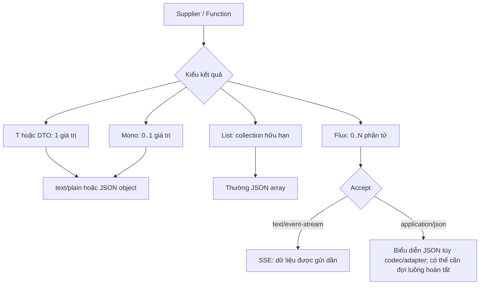

# Trả một giá trị, tập hợp hoặc luồng Server-Sent Events trong Spring Cloud Function

## 1. Ba cách biểu diễn kết quả HTTP của một function

**Spring Cloud Function (SCF)** khuyến khích viết logic nghiệp vụ bằng `Supplier<O>`, `Function<I, O>` và `Consumer<I>`. Các bean được đăng ký trong `FunctionCatalog` và có thể được gọi qua HTTP, sự kiện trong Spring Cloud Stream hoặc môi trường serverless. Cùng một hàm không phải tự biết nó đang chạy phía sau giao thức nào; adapter quyết định cách lấy input và biểu diễn output.

Với **SCF HTTP adapter**, điều quan trọng là **số lượng giá trị mà function tạo ra**:

1. **Một giá trị:** `String`, DTO/record Java hoặc `Mono<T>` mang tối đa một phần tử; client thường nhận một body văn bản hoặc một JSON object.
2. **Một tập hợp:** `List<T>` hoặc kiểu collection khác chứa nhiều phần tử; client có thể nhận một biểu diễn JSON dạng mảng nếu converter/runtime hỗ trợ.
3. **Một luồng:** `Flux<T>` có thể phát nhiều phần tử theo thời gian. Client có thể yêu cầu **Server-Sent Events (SSE)** qua `Accept: text/event-stream` để đọc dần từng sự kiện mà không đợi cả luồng hoàn tất.

Đây là ba **mô hình kết quả**, không phải ba loại Java functional interface riêng. `Supplier` có thể trả một DTO hoặc một `Flux`; `Function` có thể trả chuỗi, danh sách hoặc luồng; còn `Consumer` không có giá trị nghiệp vụ trả về từ `accept()`.

Ví dụ một hệ thống giá hàng hóa:

```text
GET  /status        -> 1 đối tượng trạng thái dịch vụ
GET  /priceCatalog  -> danh sách giá hiện tại, có điểm kết thúc
GET  /heartbeats    -> nhiều sự kiện được phát dần theo thời gian
POST /quote         -> 1 đối tượng báo giá cho 1 yêu cầu
```

Chủ đề này liên quan trực tiếp đến **hợp đồng HTTP**, **`Content-Type`**, **`Accept`**, **cách codec ghi response**, **kết thúc kết nối** và khả năng triển khai trên MVC/WebFlux.

### Mục tiêu học tập

Sau bài này, người học có thể:

- Phân biệt `T`, `List<T>`, `Mono<T>` và `Flux<T>` trong kết quả HTTP.
- Trả JSON object, JSON array và SSE từ functional beans được SCF HTTP adapter xuất ra.
- Gửi đúng `Accept`, đọc `Content-Type` và quan sát bằng `curl -N`.
- Giải thích cấu trúc `data: ...` của SSE, kết thúc luồng, kết nối bị hủy và hạn chế khi cần resume.
- Chọn kiểu đầu ra phù hợp với HTTP API, đồng thời giữ logic tái sử dụng được ở HTTP/event/serverless.

## 2. Đọc quy tắc chính thức của SCF HTTP adapter

Tài liệu *Standalone Web Applications* của SCF nêu nguyên tắc: khi **input đơn giá trị** và hàm đích rõ ràng là **đơn giá trị** (không trả collection hay `Flux`), response cũng chứa **một giá trị**. Với **response nhiều giá trị**, client có thể yêu cầu luồng server-sent events bằng header `Accept: text/event-stream`.

Bảng đối chiếu thực tế:

| Kiểu bean / kết quả | Số phần tử về mặt logic | HTTP method thường dùng | Cách nhận thông thường | Khi nào cần SSE? |
| --- | --- | --- | --- | --- |
| `Supplier<String>` | Một giá trị | `GET /{supplier}` | Văn bản, thường `text/plain` | Không cần |
| `Supplier<StatusDto>` | Một object | `GET /{supplier}` | JSON object | Không cần |
| `Function<Request, Response>` | Một kết quả / input | `POST /{function}` | JSON object hoặc text | Không cần |
| `Supplier<List<T>>` | Một collection gồm nhiều phần tử | `GET /{supplier}` | Thường là JSON array | Có thể yêu cầu, nhưng collection đã tạo sẵn không vì vậy mà trở thành luồng thời gian thực |
| `Supplier<Mono<T>>` | 0 hoặc 1 phần tử theo mô hình reactive | `GET /{supplier}` | Một giá trị khi publisher hoàn tất có dữ liệu | Thường không cần |
| `Supplier<Flux<T>>` | 0 đến nhiều phần tử, hữu hạn hoặc không kết thúc | `GET /{supplier}` | Có thể được tổng hợp tùy media type/adapter | **Phù hợp** khi muốn phát dần |
| `Function<Flux<I>, Flux<O>>` | Stream đầu vào → stream đầu ra | `POST /{function}` khi HTTP adapter hỗ trợ hợp đồng này | Tùy codec và input media type | Có thể có ích cho output nhiều giá trị |
| `Consumer<T>` | Không có kết quả nghiệp vụ | `POST /{consumer}` | Thường `202 Accepted`, có thể phản chiếu input | Không phải lựa chọn tự nhiên cho response SSE |

**Lưu ý về status:** `Supplier` và `Function` xử lý thành công thường có HTTP `200 OK`; với `Consumer`, `POST`/`PUT` thường `202 Accepted`, còn `DELETE` thường `204 No Content`. Với SSE, status `200 OK` mô tả việc kết nối/phản hồi HTTP được thiết lập; không có nghĩa tất cả sự kiện tương lai đều đã phát thành công.

**Lưu ý về phiên bản:** SCF có MVC HTTP adapter và các lựa chọn WebFlux theo dòng phiên bản. Một số chi tiết về buffering, JSON array, kết thúc response và streaming phụ thuộc vào web runtime/converter. Các ví dụ dưới đây là **hợp đồng cần kiểm thử trên phiên bản thực tế**, không khẳng định mọi bản SCF và mọi proxy có byte response giống nhau.

## 3. Phân biệt một giá trị, collection và Publisher

### 3.1. Một object không phải một luồng

Ví dụ:

```java
@Bean
public Supplier<ServiceStatus> status() {
    return () -> new ServiceStatus("READY", 3);
}
```

Mỗi lần `status.get()` được gọi, nó trả một đối tượng. Khi client gửi `Accept: application/json`, adapter có thể biểu diễn:

```json
{"state":"READY","activeWorkers":3}
```

Response hoàn tất sau khi object được viết xong. Không cần giữ kết nối mở để chờ giá trị thứ hai.

### 3.2. Collection là một kết quả chứa nhiều phần tử

```java
@Bean
public Supplier<List<PriceLine>> priceCatalog() {
    return () -> List.of(
        new PriceLine("BOOK-001", 120000),
        new PriceLine("PEN-002", 15000)
    );
}
```

Đây là **một lời gọi** tới `Supplier.get()`, trả về collection đã có sẵn hai phần tử. Với `Accept: application/json`, cách biểu diễn thông dụng là JSON array:

```json
[
  {"sku":"BOOK-001","unitPrice":120000},
  {"sku":"PEN-002","unitPrice":15000}
]
```

JSON array có thể chứa hàng trăm phần tử nhưng về giao thức vẫn có thể là **một response được viết xong rồi đóng**, không phải SSE. Collection lớn thường cần phân trang, giới hạn số phần tử và kiểm tra chi phí serialization.

### 3.3. Mono và Flux thuộc mô hình reactive

**Project Reactor** cung cấp các publisher phổ biến:

| Kiểu | Cardinality | Ý nghĩa |
| --- | --- | --- |
| `T` | Một object trả trực tiếp | Thực thi imperative |
| `List<T>` | Một container, bên trong 0..N phần tử | Tất cả phần tử có sẵn khi trả collection |
| `Mono<T>` | 0..1 phần tử (có thể chờ bất đồng bộ) | Một kết quả hoặc không có kết quả |
| `Flux<T>` | 0..N phần tử | Có thể phát dần, có thể vô hạn |

Một `Flux` không có nghĩa mọi phần tử đều đến cách nhau một khoảng thời gian: `Flux.just("a", "b", "c")` có thể phát ngay ba phần tử. Ngược lại, `Flux.interval(...)` tạo phần tử theo nhịp. Sự khác biệt giữa **nhiều phần tử** và **phát dần theo thời gian** cần được quan sát ở client.



## 4. Dự án mẫu: single, list và luồng hữu hạn

Ví dụ dùng **Java 17+**, Spring Boot cùng **Spring Cloud BOM tương thích**, và HTTP adapter của SCF. Với ứng dụng Spring MVC, khai báo starter:

```xml
<dependency>
    <groupId>org.springframework.cloud</groupId>
    <artifactId>spring-cloud-starter-function-web</artifactId>
</dependency>
```

Phần reactive dùng `reactor.core.publisher.Flux`; kiểm tra rằng `reactor-core` có mặt trên classpath từ dependency được quản lý. Không đặt phiên bản Reactor độc lập nếu BOM của dự án đã quản lý. Khi dự án chọn WebFlux, cần dùng starter SCF dành cho WebFlux tương ứng với release train; không ghép ngẫu nhiên các web starter rồi suy đoán HTTP runtime được chọn.

Tạo `src/main/java/demo/OutputFormsApplication.java`:

```java
package demo;

import java.math.BigDecimal;
import java.time.Duration;
import java.util.List;
import java.util.Locale;
import java.util.function.Function;
import java.util.function.Supplier;

import org.springframework.boot.SpringApplication;
import org.springframework.boot.autoconfigure.SpringBootApplication;
import org.springframework.context.annotation.Bean;
import reactor.core.publisher.Flux;

@SpringBootApplication
public class OutputFormsApplication {

    public static void main(String[] args) {
        SpringApplication.run(OutputFormsApplication.class, args);
    }

    // Một object => JSON object khi client chấp nhận JSON.
    @Bean
    public Supplier<ServiceStatus> status() {
        return () -> new ServiceStatus("READY", 3);
    }

    // Một chuỗi => văn bản.
    @Bean
    public Function<String, String> uppercase() {
        return value -> value.toUpperCase(Locale.ROOT);
    }

    // Một collection hữu hạn => biểu diễn JSON array thông thường.
    @Bean
    public Supplier<List<PriceLine>> priceCatalog() {
        return () -> List.of(
            new PriceLine("BOOK-001", 120000),
            new PriceLine("PEN-002", 15000)
        );
    }

    // Một JSON request => một JSON response.
    @Bean
    public Function<QuoteRequest, QuoteResponse> quote() {
        return req -> {
            if (req == null || req.sku() == null
                    || req.sku().isBlank()
                    || req.quantity() <= 0) {
                throw new IllegalArgumentException("Invalid quote request");
            }
            BigDecimal total = BigDecimal.valueOf(120000L)
                    .multiply(BigDecimal.valueOf(req.quantity()));
            return new QuoteResponse(req.sku(), req.quantity(), total);
        };
    }

    // Một Flux hữu hạn: tối đa năm heartbeat, mỗi giây một phần tử.
    // Không block thread trong luồng Reactor.
    @Bean
    public Supplier<Flux<Heartbeat>> heartbeats() {
        return () -> Flux.interval(Duration.ofSeconds(1))
            .take(5)
            .map(i -> new Heartbeat(i + 1, "alive"));
    }

    public record ServiceStatus(String state, int activeWorkers) {}
    public record PriceLine(String sku, int unitPrice) {}
    public record QuoteRequest(String sku, int quantity) {}
    public record QuoteResponse(
            String sku, int quantity, BigDecimal totalPrice) {}
    public record Heartbeat(long sequence, String state) {}
}
```

Những phần giá và trạng thái chỉ là **dữ liệu ví dụ**. `heartbeats` là một **cold publisher được tạo mới khi Supplier được gọi**. Cách HTTP adapter subscribe và quản lý thời điểm gọi Supplier là trách nhiệm runtime; ví dụ không giả định các request phải chia sẻ một subscription hay cùng một bộ đếm.

Chạy ứng dụng:

```bash
mvn spring-boot:run
```

Các lệnh `curl` bên dưới dùng cú pháp Bash và giả định server ở `http://localhost:8080`. Trên PowerShell, dùng `curl.exe` và điều chỉnh dấu xuống dòng theo shell.

## 5. Trả một giá trị: String hoặc DTO

### 5.1. Supplier trả JSON object

```bash
curl -i 'http://localhost:8080/status' \
  -H 'Accept: application/json'
```

Response điển hình:

```http
HTTP/1.1 200 OK
Content-Type: application/json

{"state":"READY","activeWorkers":3}
```

Client có thể parse JSON object và đọc các field. Cần phân biệt **một object với một JSON array gồm một object**: hai hình dạng có hợp đồng khác nhau, dù cùng chứa một bản ghi.

### 5.2. Function trả text

```bash
curl -i -X POST 'http://localhost:8080/uppercase' \
  -H 'Content-Type: text/plain' \
  -H 'Accept: text/plain' \
  --data 'hello'
```

Response nghiệp vụ: `HELLO`, thông thường status `200 OK`. Function nhận một input và trả một output; SCF không tự gói `HELLO` thành một JSON array chỉ vì có khả năng xử lý nhiều request.

### 5.3. Function trả DTO sau khi nhận JSON

```bash
curl -i -X POST 'http://localhost:8080/quote' \
  -H 'Content-Type: application/json' \
  -H 'Accept: application/json' \
  --data '{"sku":"BOOK-001","quantity":2}'
```

Phản hồi nghiệp vụ:

```json
{"sku":"BOOK-001","quantity":2,"totalPrice":240000}
```

**Một kết quả thành công không có nghĩa mọi input đều hợp lệ**. Nếu `quantity <= 0`, ví dụ ném ngoại lệ. SCF HTTP adapter không đảm bảo tự biến mọi ngoại lệ nghiệp vụ thành một status 4xx cụ thể; HTTP error contract cần được xây dựng riêng khi API yêu cầu.

## 6. Trả tập hợp: JSON array và giới hạn của collection

### 6.1. GET một Supplier<List<T>>

```bash
curl -i 'http://localhost:8080/priceCatalog' \
  -H 'Accept: application/json'
```

Khi codec biểu diễn kết quả thành một JSON array, body dự kiến:

```json
[
  {"sku":"BOOK-001","unitPrice":120000},
  {"sku":"PEN-002","unitPrice":15000}
]
```

HTTP status thành công thường là `200 OK`. Với serializer JSON, thứ tự field/whitespace có thể khác; tự động test nên **parse JSON và kiểm tra phần tử** thay vì so sánh chuỗi nguyên văn. Cần kiểm chứng SCF adapter thực tế có giữ collection thành một array hay thích ứng nó thành nhiều message/phần tử khi chạy trên phiên bản được chọn.

### 6.2. Một collection khác với nhiều HTTP response

Một lệnh `GET /priceCatalog` bình thường là **một request và một HTTP response**, dù body chứa nhiều object. Không có cơ chế mặc định mở nhiều HTTP connection hoặc gửi một HTTP status cho từng phần tử.

Điều này ảnh hưởng đến:

- **Bộ nhớ:** phương thức `get()` có thể tạo toàn bộ `List` trước khi adapter viết body.
- **Độ trễ:** client có thể phải chờ toàn bộ danh sách được chuẩn bị.
- **Giới hạn kích thước:** response lớn có thể gây bộ nhớ, băng thông và thời gian xử lý lớn.
- **Phân trang:** với bảng dữ liệu lớn, cần `page`, `size`, cursor hoặc giới hạn tương đương tại API boundary; đừng dùng `List` vô hạn.
- **Schema:** object đơn và mảng object là hai dạng hợp đồng khác nhau; thay đổi giữa chúng có thể làm client hỏng.

### 6.3. Nếu muốn SSE từ một List thì sao?

Tài liệu SCF cho biết response nhiều phần tử có thể được client yêu cầu với `Accept: text/event-stream`. Tuy nhiên, **List đã được tạo hoàn chỉnh trong bộ nhớ trước khi trả về** nên có thể không tạo lợi ích về thời gian phát sự kiện; client chỉ thấy lần lượt các phần tử mà server đã có.

Hãy kiểm thử cụ thể:

```bash
curl -i -N 'http://localhost:8080/priceCatalog' \
  -H 'Accept: text/event-stream'
```

Nếu adapter và codec chọn streaming cho collection, bạn có thể quan sát nhiều SSE record. Nếu nó tổng hợp/serialize khác, đừng tự suy ra đó là lỗi của `List`: khả năng streaming phụ thuộc SCF/web adapter, kiểu dữ liệu và media type. Khi **thật sự cần phát dần nhiều kết quả**, khai báo `Flux<T>` là một tín hiệu mô hình rõ ràng hơn.

## 7. Server-Sent Events (SSE) là gì?

**SSE** là cơ chế HTTP cho phép **server gửi dần một chuỗi sự kiện một chiều đến client qua một response kéo dài**. Client thường gọi HTTP GET, server trả header:

```http
HTTP/1.1 200 OK
Content-Type: text/event-stream
```

Sau đó các sự kiện được phân cách bằng **một dòng trống**. Ví dụ định dạng SSE minh họa:

```text
data: {"sequence":1,"state":"alive"}

data: {"sequence":2,"state":"alive"}

data: {"sequence":3,"state":"alive"}

```

Mỗi dòng `data:` mang dữ liệu sự kiện. Một event có thể có thêm `id:`, `event:` hoặc `retry:` theo chuẩn SSE, nhưng **SCF HTTP adapter không tự bảo đảm tự tạo những field này từ một DTO bất kỳ**. Ví dụ trên chỉ nhấn mạnh định dạng và không áp đặt thứ tự field JSON hoặc cách encoder chia chunk.

SSE phù hợp với báo tiến độ, thông báo trạng thái, cập nhật nhẹ theo thời gian hoặc các stream người dùng chỉ cần **nhận dữ liệu từ server**. Nếu cần giao tiếp hai chiều theo phiên hoặc client liên tục gửi dữ liệu, WebSocket hoặc API khác có thể phù hợp hơn.

### Phân biệt SSE, JSON array và WebSocket

| Tiêu chí | JSON array trong một HTTP response | SSE | WebSocket |
| --- | --- | --- | --- |
| Hướng truyền điển hình | Server → client | Server → client | Hai chiều |
| Cách nhận | Thường xử lý sau khi có JSON hoàn chỉnh | Xử lý từng event khi đến | Nhận từng frame/message |
| Media type giao tiếp | `application/json` | `text/event-stream` | Giao thức WebSocket sau handshake |
| Kết thúc | Response hoàn tất | Stream có thể hữu hạn hoặc giữ mở | Connection được đóng theo protocol |
| Tình huống | Snapshot, phân trang | Cập nhật, tiến độ, thông báo | Chat, phối hợp tương tác hai chiều |
| Hỗ trợ qua gateway | HTTP thông thường | Cần chú ý proxy buffering và timeout | Cần hỗ trợ nâng cấp kết nối |

## 8. Tạo luồng SSE từ Supplier<Flux<T>>

Bean `heartbeats` trong ứng dụng ở mục 4:

```java
@Bean
public Supplier<Flux<Heartbeat>> heartbeats() {
    return () -> Flux.interval(Duration.ofSeconds(1))
        .take(5)
        .map(i -> new Heartbeat(i + 1, "alive"));
}
```

Giải thích:

1. `Flux.interval(Duration.ofSeconds(1))` cung cấp một chuỗi chỉ số theo thời gian từ publisher Reactor.
2. `take(5)` **giới hạn** luồng còn năm phần tử và sau đó hoàn tất, tránh giữ connection vô hạn trong bài tập.
3. `map(...)` chuyển chỉ số thành DTO `Heartbeat`.
4. SCF HTTP adapter có thể biến các phần tử thành SSE khi client chọn `Accept: text/event-stream` và codec/runtime đáp ứng.

Gọi:

```bash
curl -i -N 'http://localhost:8080/heartbeats' \
  -H 'Accept: text/event-stream'
```

`-N` (hoặc `--no-buffer`) yêu cầu curl không giữ output trong buffer của chính nó, giúp thấy dữ liệu tới theo thời gian. Phản hồi kỳ vọng về **hình dạng**:

```http
HTTP/1.1 200 OK
Content-Type: text/event-stream

data: {"sequence":1,"state":"alive"}

data: {"sequence":2,"state":"alive"}

data: {"sequence":3,"state":"alive"}

data: {"sequence":4,"state":"alive"}

data: {"sequence":5,"state":"alive"}

```

Với ví dụ, các phần tử **dự kiến** phát cách nhau xấp xỉ một giây rồi luồng hoàn tất; thời gian thực tế còn phụ thuộc scheduler, HTTP runtime và kết nối. Không nên test bằng cách so sánh thời điểm chính xác đến mili-giây.

**Lưu ý nội dung:** format field, khoảng trắng và cách xuống dòng ở ví dụ là minh họa; codec có thể viết JSON chặt không có dấu cách, thêm ký tự escape hoặc dùng representation khác theo phiên bản. Test đúng nên parse từng **SSE event**, rồi đối chiếu `sequence` và `state`.

### 8.1. Không có Accept SSE thì sao?

Hãy so sánh:

```bash
# Client mong muốn response JSON.
curl -i 'http://localhost:8080/heartbeats' \
  -H 'Accept: application/json'

# Client yêu cầu từng event.
curl -i -N 'http://localhost:8080/heartbeats' \
  -H 'Accept: text/event-stream'
```

Với `application/json`, một số HTTP runtime có thể **đợi publisher hoàn tất rồi xuất JSON array**. Với `text/event-stream`, mục tiêu là **phát từng phần tử** khi có. Đừng khẳng định hai request đều nhận cùng body hay được hoàn tất cùng thời điểm; hãy kiểm tra response `Content-Type`, thời điểm client thấy từng phần tử và cách kết thúc.

Đặc biệt, nếu `Flux` **không bao giờ hoàn tất**, việc cố thu gom toàn bộ nó vào một JSON array sẽ không thể tạo một JSON response hữu hạn. Vì thế, với nguồn cập nhật liên tục, hãy thiết kế rõ lựa chọn SSE hoặc streaming protocol khác và chặn các `Accept` không phù hợp nếu cần.

### 8.2. Hữu hạn và vô hạn khác nhau thế nào?

```java
// Hữu hạn: sau 5 phần tử sẽ phát onComplete.
Flux<Long> finite = Flux.interval(Duration.ofSeconds(1))
        .take(5);

// Về mặt logic có thể phát mãi đến khi bị cancel/lỗi.
Flux<Long> ongoing = Flux.interval(Duration.ofSeconds(1));
```

Đây là ví dụ về kiểu dữ liệu, không phải hai bean `@Bean` cần thêm vào project. Một luồng hữu hạn có thể dùng cho progress của công việc hoàn tất. Luồng không có điểm kết thúc phù hợp với cập nhật liên tục, nhưng cần định nghĩa **timeout, hủy subscription, quota kết nối, giới hạn tài nguyên và chính sách client reconnect**.

## 9. Những điều SSE không tự đảm bảo

### 9.1. HTTP 200 không phải là bảo đảm mọi event đều thành công

Với JSON array, server thường có thể phát hiện lỗi trước khi hoàn thành body. Với SSE, response headers/status có thể đã được gửi từ đầu. Nếu publisher ném lỗi **sau** vài event, server thường không còn cách dễ dàng đổi status thành 500 cho request đã gửi `200`.

Ứng dụng cần chọn hợp đồng lỗi: đóng stream, phát một **event lỗi được chuẩn hóa** khi có thể, hoặc để client reconnect và truy vấn trạng thái riêng. Không coi SSE là một hàng đợi đáng tin cậy tự lưu mọi event.

### 9.2. SSE không mặc định phát lại event bị bỏ lỡ

Chuẩn SSE hỗ trợ `id:` và client có thể dùng `Last-Event-ID` khi reconnect. Nhưng `Supplier<Flux<T>>` tự thân không cung cấp **event store**, số thứ tự bền vững hoặc logic replay.

Nếu yêu cầu người dùng **không mất thông báo** sau gián đoạn, phải có nguồn lưu, offset/cursor, cơ chế phát lại và kiểm thử reconnect. Nếu chỉ cần chỉ số hoạt động không quan trọng, có thể chấp nhận mất một vài heartbeat.

### 9.3. SSE không giải quyết tự động backpressure ở mọi lớp

`Flux` hỗ trợ Reactive Streams backpressure trong những đoạn pipeline phù hợp, nhưng **đường đi trọn vẹn** qua HTTP encoder, proxy, mạng và client chậm vẫn cần kiểm soát. Một publisher tạo dữ liệu quá nhanh có thể gây buffer lớn hoặc ngắt kết nối.

Hãy xem xét:

- Tốc độ phát và kích thước từng event.
- Giới hạn bộ đệm và hành vi khi client đọc chậm.
- Số lượng stream đang mở cùng lúc.
- Timeout, keep-alive/heartbeat và cancellation.
- Cách theo dõi độ trễ, số kết nối mở, event lỗi.

### 9.4. Chặn luồng bằng Thread.sleep có thể gây hậu quả

Trong ứng dụng reactive, tránh đặt `Thread.sleep(...)` hoặc blocking I/O trực tiếp trong các callback đang chạy trên event-loop. Ví dụ dùng `Flux.interval` để tạo nhịp mà không chủ động chặn thread trong phép `map`. Với I/O chặn thật, phải dùng scheduler/thực thi phù hợp hoặc chuyển sang API bất đồng bộ.

Từ khóa `Flux` không bảo đảm tất cả database driver, HTTP client hoặc code bên trong đã non-blocking.

## 10. Kiểm thử SSE khi đi qua proxy hoặc API gateway

Một luồng hoạt động ở `localhost:8080` vẫn có thể bị ảnh hưởng khi triển khai sau Nginx, Spring Cloud Gateway hoặc hệ thống load balancer. Các tình huống cần quan sát:

| Vấn đề | Hiện tượng ở client | Gợi ý xử lý |
| --- | --- | --- |
| **Proxy buffering** | Server phát từng event nhưng client nhận nhiều event dồn một lúc | Cấu hình response buffering phù hợp ở proxy/gateway |
| **Idle timeout** | Kết nối đóng sau thời gian yên lặng | Điều chỉnh timeout và cân nhắc heartbeat hợp đồng |
| **Client disconnect** | Server vẫn làm việc hoặc rò rỉ tài nguyên nếu không hủy đúng | Kiểm tra việc cancellation truyền tới nguồn |
| **Slow consumer** | Bộ đệm tăng, latency tăng | Hạn chế tốc độ, giám sát và thiết kế backpressure |
| **Load balancing khi reconnect** | Client quay lại instance khác | Dùng event store/cursor chung nếu cần replay |
| **Auth token hết hạn** | Stream bị từ chối ở kết nối tiếp theo | Thiết kế chính sách xác thực/refresh và reconnect an toàn |
| **SSE bị cache** | Event bị giữ lại hoặc tái sử dụng sai | Kiểm tra Cache-Control và chính sách CDN/proxy |

Với browser, `EventSource` thường tạo HTTP GET và tự hỗ trợ cơ chế reconnect cơ bản. Tuy vậy, API `EventSource` truyền thống không hỗ trợ đặt tùy ý tất cả custom request headers như một HTTP client đầy đủ. Nếu API cần header `Authorization: Bearer ...`, hãy chọn kiến trúc xác thực phù hợp và tránh đặt token nhạy cảm vào query string.

## 11. Chọn output type theo mục tiêu sản phẩm

| Mục tiêu | Kiểu output gợi ý | Vì sao |
| --- | --- | --- |
| Trả kết quả của một yêu cầu báo giá | `QuoteResponse` | Một request, một kết quả rõ ràng |
| Đọc trạng thái hệ thống hiện tại | `ServiceStatus` | Snapshot đơn |
| Đọc danh sách nhỏ đã có sẵn | `List<PriceLine>` | JSON array tự nhiên, đóng response sau khi trả |
| Đọc danh sách lớn theo trang | DTO trang chứa `List<T>` và metadata | Tránh dồn dữ liệu vô hạn vào một response |
| Trả một kết quả bất đồng bộ | `Mono<T>` | Chờ 0..1 kết quả không chặn theo mô hình reactive |
| Xem tiến độ công việc qua HTTP một chiều | `Flux<ProgressEvent>` + SSE | Có thể nhận tiến độ từng bước |
| Theo dõi các cập nhật liên tục | `Flux<Event>` + SSE | Stream mở khi còn đăng ký |
| Cần gửi và nhận liên tục hai chiều | WebSocket/transport thích hợp | SSE chỉ truyền server → client |
| Cần bảo đảm event không mất và được xử lý lâu dài | Broker + lưu offset/event store; SSE chỉ là kênh hiển thị | HTTP stream không thay thế hệ thống sự kiện bền vững |

### Đặc biệt: `Flux` và `List` không thay thế nhau

Đổi kiểu `Supplier<List<T>>` thành `Supplier<Flux<T>>` có thể thay đổi thời điểm dữ liệu được tạo, thời điểm HTTP body hoàn tất, chi phí tài nguyên và xử lý lỗi. Cần chọn dựa trên **nhu cầu phát dần**, không vì muốn code trông “reactive”.

## 12. Quan hệ với FunctionCatalog, composition và các adapter khác

Các bean `status`, `priceCatalog`, `heartbeats` trong ví dụ đều là bean chức năng. Chúng được đăng ký và có thể được tra cứu qua `FunctionCatalog`. Tên bean quyết định phần path của SCF HTTP adapter:

```text
GET  /status
GET  /priceCatalog
GET  /heartbeats
POST /uppercase
POST /quote
```

Nếu cấu hình:

```properties
spring.cloud.function.web.path=/api/functions
```

thì URL đổi thành `/api/functions/heartbeats`, `/api/functions/priceCatalog`... nhưng kiểu output và ngữ nghĩa `Accept` không tự thay đổi.

Khi ghép nhiều hàm (`spring.cloud.function.definition=first|second`), kiểu output cuối của composition mới là kiểu cần được HTTP adapter biểu diễn. Nếu hàm trước tạo `Flux<T>` còn hàm sau chỉ nhận `T`, phải kiểm tra cơ chế thích ứng của `FunctionCatalog`, conversion và quy tắc invocation; **không mặc định mỗi phần tử được gọi một lần giống nhau ở mọi adapter**.

Trong Spring Cloud Stream, `Supplier<Flux<T>>` thường đại diện cho một **nguồn sự kiện** có thể được subscribe một lần để cung cấp stream. Ở HTTP, mỗi request và subscription có vòng đời riêng. Trong serverless, thời lượng thực thi, timeout và hỗ trợ streaming phụ thuộc nền tảng. **SSE là một cách biểu diễn HTTP, không phải thuộc tính bắt buộc của bản thân function**.

## 13. Bộ kiểm thử thủ công

Chạy ứng dụng ở mục 4 và kiểm tra:

```bash
# A. Một DTO.
curl -i 'http://localhost:8080/status' \
  -H 'Accept: application/json'

# B. Một chuỗi.
curl -i -X POST 'http://localhost:8080/uppercase' \
  -H 'Content-Type: text/plain' \
  -H 'Accept: text/plain' \
  --data 'hello'

# C. Một JSON object sau khi xử lý input JSON.
curl -i -X POST 'http://localhost:8080/quote' \
  -H 'Content-Type: application/json' \
  -H 'Accept: application/json' \
  --data '{"sku":"BOOK-001","quantity":2}'

# D. Một tập hợp.
curl -i 'http://localhost:8080/priceCatalog' \
  -H 'Accept: application/json'

# E. Một Flux hữu hạn với SSE.
curl -i -N 'http://localhost:8080/heartbeats' \
  -H 'Accept: text/event-stream'

# F. Cùng Flux nhưng yêu cầu JSON: ghi nhận sự khác biệt.
curl -i 'http://localhost:8080/heartbeats' \
  -H 'Accept: application/json'
```

### Bảng ghi kết quả

| Ca | Điều kỳ vọng chính | Điểm cần đo |
| --- | --- | --- |
| A | JSON object và 200 | `state`, `activeWorkers`, response Content-Type |
| B | `HELLO` và 200 | Kiểu `text/plain` |
| C | DTO có `totalPrice=240000` | JSON schema và số tiền |
| D | Danh sách hai phần tử | JSON array/đặc tính codec của adapter |
| E | SSE với năm giá trị logic | `text/event-stream`, tiến độ, kết thúc |
| F | Cách biểu diễn khi không yêu cầu SSE | Header thực, buffering, thời điểm kết thúc |

**Quan trọng:** để xác minh streaming, không chỉ đọc body cuối. Hãy quan sát **thời điểm từng event xuất hiện**. Một đoạn JSON array được tải hết sau năm giây và một SSE stream gửi năm bản ghi trong năm giây là hai hành vi khác nhau.

### Test tự động nên xác minh gì?

Một bộ test tích hợp (ví dụ `WebTestClient` với WebFlux hoặc HTTP client phù hợp MVC) nên kiểm tra:

1. JSON object có shape đúng và không bị gói thành array ngoài ý muốn.
2. JSON array có đúng số phần tử và DTO hợp lệ.
3. SSE response có media type `text/event-stream`.
4. `heartbeats` phát đúng **năm sequence** theo thứ tự, rồi hoàn tất.
5. Subscription bị hủy khi client ngắt kết nối; không tiếp tục tạo tài nguyên đắt tiền.
6. Response lỗi trong stream có hợp đồng phù hợp sau khi headers đã được gửi.
7. Cùng endpoints hoạt động khi có SCF web prefix và đi qua gateway.

Không cần kiểm tra khoảng thời gian mỗi event với độ chính xác cứng đến mili-giây; scheduler và mạng có thể dao động.

## 14. Các lỗi thiết kế và vận hành thường gặp

| Triệu chứng | Nguyên nhân cần xem xét | Giải pháp |
| --- | --- | --- |
| Client muốn SSE nhưng nhận JSON array | `Accept` sai, converter/runtime chọn JSON hoặc bean trả collection | Gửi `Accept: text/event-stream`, kiểm tra output và codec |
| Không thấy dữ liệu cho đến khi response hoàn tất | Proxy buffering, curl buffering hoặc output được tổng hợp | `curl -N`, kiểm tra proxy và môi trường |
| SSE không có điểm kết thúc | `Flux` là nguồn vô hạn | Thiết kế cancellation, timeout hoặc giới hạn bằng `take(n)` |
| Browser reconnect nhưng mất event | Không có event store/ID/replay | Dùng `id`, lưu lịch sử và triển khai cursor khi cần |
| Response 200 rồi stream bị ngắt | Lỗi xảy ra sau khi headers đã được ghi | Đặt hợp đồng lỗi/retry, giám sát và log |
| Tăng RAM khi thu thập stream | Gửi `Accept: application/json` cho Flux lớn/vô hạn | Thiết kế streaming hoặc phân trang thay vì cố gom toàn bộ |
| Event đến dồn thành đợt lớn | Proxy hoặc codec buffering | Kiểm tra flush, gateway và runtime |
| Số kết nối tăng không giới hạn | Nhiều client giữ SSE mở | Giới hạn quota, timeout, theo dõi connection |
| Dùng `Thread.sleep` làm chậm toàn bộ WebFlux | Blocking trên event-loop | Dùng toán tử Reactor và xử lý blocking phù hợp |
| Một API trả array nhưng client mong object | Hợp đồng schema không ổn định | Xác định rõ single/list output và dùng contract tests |
| SSE không hoạt động trong serverless | Platform không hỗ trợ streaming/timeout quá ngắn | Xem khả năng nền tảng, dùng broker/polling nếu cần |

### Checklist trước khi triển khai production

- Chọn `T`, `List<T>`, `Mono<T>` hoặc `Flux<T>` theo nhu cầu thực.
- Công bố rõ media type trong API contract; với SSE phải là `text/event-stream`.
- Giới hạn số phần tử, kích thước mỗi event và tổng thời gian kết nối.
- Kiểm tra proxy buffering, idle timeout, TLS, xác thực và rate limiting.
- Quy định hành vi lỗi sau khi stream đã bắt đầu.
- Nếu cần độ tin cậy cao, có event store/offset/replay; SSE chỉ là kênh phân phối tới client.
- Test trên đúng starter SCF, Spring Boot, Spring Cloud BOM và MVC/WebFlux runtime sẽ được triển khai.

## 15. Bài tập

1. Giải thích vì sao `Supplier<ServiceStatus>` và `Supplier<List<ServiceStatus>>` có hai hình dạng JSON response khác nhau dù đều gọi bằng GET.
2. Trong trường hợp nào `Supplier<Flux<Heartbeat>>` có lợi hơn `Supplier<List<Heartbeat>>`? Khi nào dùng List đơn giản hơn?
3. Với bean `heartbeats` ở mục 4, hãy viết lệnh curl nhận SSE, dự đoán số event và điều kiện kết thúc stream.
4. Client gửi `Accept: application/json` tới một `Flux` vô hạn. Phân tích rủi ro nếu adapter cố thu gom toàn bộ phần tử trước khi viết JSON.
5. Vì sao nhận `HTTP 200 OK` từ SSE không chứng minh mọi event đã được gửi đến client?
6. Từ format SSE, hãy giải thích vai trò của `data:`, dòng trống, `id:` và `Last-Event-ID`.
7. Một Nginx reverse proxy làm các event xuất hiện thành cụm 30 giây một lần dù server phát mỗi giây. Đề xuất cách chẩn đoán.
8. Thiết kế API hiển thị tiến độ xử lý đơn hàng: chọn kiểu function, media type, error event và cách client reconnect.
9. Vì sao không nên viết `Thread.sleep(1000)` trong callback Reactor nếu luồng chạy trên event-loop?
10. Nếu cùng bean được gọi từ HTTP và Spring Cloud Stream, điều gì thuộc logic function và điều gì chỉ thuộc HTTP SSE adapter?

## Tài liệu tham khảo chính thức

- [Spring Cloud Function — Standalone Web Applications](https://docs.spring.io/spring-cloud-function/reference/spring-cloud-function/standalone-web-applications.html): quy tắc response đơn giá trị, nhiều giá trị và `Accept: text/event-stream`; routing và HTTP method.
- [Spring Cloud Function — Programming Model](https://docs.spring.io/spring-cloud-function/reference/spring-cloud-function/programming-model.html): `Supplier<Flux<T>>`, `FunctionCatalog`, reactive function và lifecycle.
- [Project Reactor — Reference Guide](https://projectreactor.io/docs/core/release/reference/): `Flux`, `Mono`, cancellation, backpressure và các toán tử `interval`, `take`, `map`.
- [Spring Framework — WebFlux](https://docs.spring.io/spring-framework/reference/web/webflux.html): reactive HTTP, serialization và streaming.
- [MDN — Using server-sent events](https://developer.mozilla.org/en-US/docs/Web/API/Server-sent_events/Using_server-sent_events): cú pháp SSE, `EventSource`, reconnect và format event.

> **Ghi nhớ:** Một `T` hoặc DTO thường tạo **một response value**; `List<T>` biểu diễn **tập hợp hữu hạn**; `Flux<T>` biểu diễn **nhiều phần tử theo mô hình reactive**. Khi client yêu cầu `Accept: text/event-stream`, SCF HTTP adapter có thể công bố response nhiều phần tử thành **SSE**. Chọn đúng kiểu đầu ra, media type và runtime, đồng thời kiểm thử streaming thực tế thay vì suy luận chỉ từ chữ ký Java.
