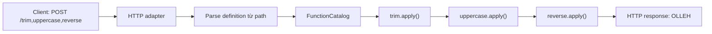

# Ánh xạ hàm ghép vào đường dẫn HTTP trong Spring Cloud Function

## 1. Bài toán: gọi một chuỗi xử lý bằng một HTTP request

**Spring Cloud Function (SCF)** cho phép viết nghiệp vụ dưới dạng các bean Java `Supplier<O>`, `Function<I, O>` và `Consumer<I>`. `FunctionCatalog` đăng ký, tra cứu và hỗ trợ **composition** (ghép nhiều hàm thành một luồng xử lý). Cùng các bean đó có thể được dùng qua HTTP, sự kiện trong Spring Cloud Stream hay môi trường serverless.

Giả sử ứng dụng có ba thao tác nhỏ:

1. `trim`: bỏ khoảng trắng ở hai đầu chuỗi.
2. `uppercase`: chuyển chuỗi thành chữ in hoa.
3. `reverse`: đảo thứ tự ký tự.

Thay vì viết thêm một controller gọi lần lượt từng hàm, SCF có thể ghép ba bean thành một function logic:

```text
input "  hello  "
       |
       v
     trim          -> "hello"
       |
       v
   uppercase       -> "HELLO"
       |
       v
    reverse        -> "OLLEH"
       |
       v
HTTP response "OLLEH"
```

HTTP adapter có thể tìm composition ngay từ **đường dẫn URL**:

```text
POST /trim,uppercase,reverse
```

Hoặc bạn có thể cấu hình **composition mặc định** để client gọi đường dẫn gốc:

```properties
spring.cloud.function.definition=trim|uppercase|reverse
```

```text
POST /
```

Hai cách trên gọi cùng chuỗi xử lý nhưng có ý nghĩa triển khai khác nhau. Bài này tập trung vào **quy tắc ánh xạ composition thành HTTP endpoint**, không chỉ cú pháp Java `Function.andThen(...)`.

### Mục tiêu học tập

Sau bài học, bạn có thể:

- Giải thích vai trò của `FunctionCatalog`, `spring.cloud.function.definition` và đoạn đường dẫn chứa danh sách tên hàm.
- Dùng dấu phẩy hoặc pipe để định danh composition; dự đoán chính xác thứ tự thực thi.
- Chọn composition mặc định tại root path, áp dụng function filtering bằng dấu chấm phẩy và đổi base path của HTTP adapter.
- Phân biệt kết quả ghép `Function → Function`, `Supplier → Function` và `Function → Consumer`.
- Gọi HTTP đúng method, kiểu input/output và phát hiện các lỗi routing, conversion, bảo mật.
- Viết các ca kiểm thử hợp đồng cho URL composition trước khi công bố cho client.

## 2. Ba lớp cần phân biệt: bean, composition và URL

SCF không buộc bạn phải khai báo thêm bean cho mỗi tổ hợp. `FunctionCatalog` có thể tra cứu và ghép các functional bean đã đăng ký theo một **definition string**.

| Thành phần | Ví dụ | Trách nhiệm |
| --- | --- | --- |
| Bean có tên | `uppercase`, `reverse` | Định nghĩa thao tác đơn lẻ |
| Composition definition | `uppercase|reverse` | Ghép theo thứ tự từ trái sang phải |
| HTTP path cho composition | `/uppercase,reverse` | Chỉ định composition được HTTP adapter tra cứu |
| Root mapping | `spring.cloud.function.definition=uppercase|reverse` | Chọn composition làm function mặc định ở đường dẫn gốc |
| Web base path | `spring.cloud.function.web.path=/api/functions` | Thay tiền tố của các endpoint SCF HTTP |
| Function filtering | `spring.cloud.function.definition=uppercase|reverse;greeting` | Chỉ công bố một danh sách được phép; không tự tạo root mapping |

Đường đi khái niệm của request:



**Điểm quan trọng:** tên trong URL là **tên bean mà catalog biết**, không phải tên Java class hay tên phương thức `apply()`. HTTP adapter chỉ làm tầng giao tiếp: code trong mỗi function vẫn độc lập với HTTP.

## 3. Dấu phân cách: pipe, dấu phẩy và chấm phẩy

SCF cho phép biểu diễn composition bằng **pipe** (`|`) hoặc **dấu phẩy** (`,`). Ví dụ hai định danh:

```text
uppercase|reverse
uppercase,reverse
```

đều mô tả việc gọi `uppercase` rồi đến `reverse` khi dùng ở ngữ cảnh composition được hỗ trợ.

Trong **URL**, tài liệu chính thức khuyên có thể dùng dấu phẩy vì pipe dù hợp lệ với routing của SCF nhưng bất tiện khi gõ trên command line:

```text
POST /uppercase,reverse
```

**Không nhầm ba ký tự:**

| Ký tự | Ví dụ | Ý nghĩa |
| --- | --- | --- |
| `|` | `trim|uppercase` | Ghép các function theo thứ tự |
| `,` | `/trim,uppercase` | Cách viết composition thuận tiện trên HTTP path |
| `;` | `spring.cloud.function.definition=trim|uppercase;greeting` | Liệt kê **những mục được công bố** trong chế độ filtering; không ghép liên tiếp |

Trong file `application.properties`, không cần URL-encode `|`. Tuy nhiên, ở Bash/PowerShell, pipe có thể bị shell hiểu là toán tử, nên khi truyền property bằng dòng lệnh phải đặt toàn bộ đối số trong dấu nháy:

```bash
java -jar app.jar '--spring.cloud.function.definition=trim|uppercase'
```

Tương tự, nếu có dấu `;`, hãy quote cả chuỗi để shell không tách lệnh:

```bash
java -jar app.jar '--spring.cloud.function.definition=trim|uppercase;greeting'
```

`app.jar` chỉ là tên artifact minh họa. Trong URL thực tế, ưu tiên **dấu phẩy** và luôn bọc URL trong dấu nháy khi dùng `curl`.

## 4. Tạo dự án Spring Cloud Function để thực hành

Ví dụ dùng **Java 17+**, Spring Boot với Spring Cloud BOM tương thích, và HTTP web starter. Trong dự án Maven đã quản lý version của Spring Cloud bằng BOM, khai báo:

```xml
<dependency>
    <groupId>org.springframework.cloud</groupId>
    <artifactId>spring-cloud-starter-function-web</artifactId>
</dependency>
```

Với lựa chọn WebFlux, phải dùng module/starter tương thích với dòng SCF và Spring Boot đang chạy; không thêm ngẫu nhiên hai web stack rồi suy đoán runtime được sử dụng.

Tạo `src/main/java/demo/CompositionHttpApplication.java`:

```java
package demo;

import java.util.Locale;
import java.util.function.Consumer;
import java.util.function.Function;
import java.util.function.Supplier;

import org.springframework.boot.SpringApplication;
import org.springframework.boot.autoconfigure.SpringBootApplication;
import org.springframework.context.annotation.Bean;

@SpringBootApplication
public class CompositionHttpApplication {

    public static void main(String[] args) {
        SpringApplication.run(CompositionHttpApplication.class, args);
    }

    @Bean
    public Function<String, String> trim() {
        return String::trim;
    }

    @Bean
    public Function<String, String> uppercase() {
        return text -> text.toUpperCase(Locale.ROOT);
    }

    @Bean
    public Function<String, String> reverse() {
        return text -> new StringBuilder(text).reverse().toString();
    }

    @Bean
    public Function<String, String> wrap() {
        return text -> "[" + text + "]";
    }

    @Bean
    public Supplier<String> greeting() {
        return () -> "  hello  ";
    }

    @Bean
    public Consumer<String> audit() {
        return text -> System.out.println("AUDIT: " + text);
    }
}
```

Điểm thiết kế:

- Mỗi thao tác nhỏ chỉ biết `String` và không cần `HttpServletRequest` hay `@RequestBody`.
- Các `Function<String, String>` có kiểu input/output **tương thích** để ghép theo nhiều thứ tự.
- `greeting` và `audit` cho phép minh họa composition làm **thay đổi kiểu hàm cuối**.
- Vì catalog có nhiều functional bean, các endpoint được truy cập theo **tên hoặc composition**; không có một hàm gốc tự được chọn chỉ vì bean đầu tiên được đăng ký.

Chạy ứng dụng:

```bash
mvn spring-boot:run
```

Những lệnh `curl` sau đây theo cú pháp Bash. Trên PowerShell, dùng `curl.exe` và dấu xuống dòng phù hợp; URL mặc định là `http://localhost:8080`.

## 5. Gọi composition trực tiếp qua HTTP path

### 5.1. Ghép hai Function

Thử `uppercase` và `reverse`:

```bash
curl -i -X POST 'http://localhost:8080/uppercase,reverse' \
  -H 'Content-Type: text/plain' \
  -H 'Accept: text/plain' \
  --data 'hello'
```

Luồng xử lý:

```text
input "hello"
    |
uppercase -> "HELLO"
    |
reverse   -> "OLLEH"
    |
response "OLLEH"
```

Khi xử lý thành công, phản hồi điển hình là:

```http
HTTP/1.1 200 OK
Content-Type: text/plain

OLLEH
```

HTTP adapter tra cứu biểu thức `uppercase,reverse` trong `FunctionCatalog`; nó không đòi hỏi có một bean tên **nguyên chuỗi** `uppercase,reverse` trong application context.

### 5.2. Ghép ba Function

```bash
curl -i -X POST \
  'http://localhost:8080/trim,uppercase,reverse' \
  -H 'Content-Type: text/plain' \
  -H 'Accept: text/plain' \
  --data '  hello  '
# Response body dự kiến: OLLEH
```

Đầu vào được truyền qua **request body** vì composition cuối vẫn là một `Function<String, String>`. Kết quả sẽ đi qua từng hàm theo thứ tự định nghĩa.

### 5.3. Đổi thứ tự có thể đổi kết quả

Composition không có tính giao hoán tổng quát. So sánh:

```bash
curl -i -X POST 'http://localhost:8080/trim,wrap' \
  -H 'Content-Type: text/plain' --data '  hello  '
# Dự kiến: [hello]

curl -i -X POST 'http://localhost:8080/wrap,trim' \
  -H 'Content-Type: text/plain' --data '  hello  '
# Dự kiến: [  hello  ]
```

Vì `trim` chỉ bỏ khoảng trắng **ở đầu và cuối toàn chuỗi**, khi `wrap` chạy trước thì các dấu ngoặc vuông ở ngoài đã khiến khoảng trắng nằm ở giữa, không còn được `trim` loại bỏ.

**Không nhầm:** `trim,wrap` là `wrap(trim(input))`, không phải `trim(wrap(input))`.

## 6. Ánh xạ composition vào đường dẫn gốc bằng definition

Khi có nhiều bean, HTTP adapter mặc định không biết phải chọn function nào tại `/`. Bạn có thể chỉ định một composition duy nhất làm **definition mặc định**.

Trong `src/main/resources/application.properties`:

```properties
spring.cloud.function.definition=trim|uppercase|reverse
```

Sau khi khởi động lại ứng dụng, gọi root path:

```bash
curl -i -X POST 'http://localhost:8080/' \
  -H 'Content-Type: text/plain' \
  -H 'Accept: text/plain' \
  --data '  hello  '
# Response body: OLLEH
```

Đây là cơ chế **định danh composition được gọi qua root**, không phải cấu hình alias của Java bean tên `/`. Trong tài liệu SCF, cùng property có thể được dùng làm **fallback** khi function không tìm thấy theo URL.

Ví dụ nếu application chỉ có `trim`, `uppercase`, `reverse` nhưng đã chọn definition trên, một URL không khớp tên function có thể vẫn được xử lý bằng composition đã chọn. Vì vậy:

> **Root mapping và fallback không phải cơ chế kiểm soát quyền truy cập.** Nếu API phải từ chối mọi path không nằm trong danh sách cho phép, cần áp dụng HTTP routing/security tại Spring MVC/WebFlux hoặc API gateway và kiểm thử các URL không hợp lệ.

### 6.1. Khi chỉ có một function

Nếu catalog **chỉ có duy nhất** `uppercase` thì tên path là tùy chọn: `POST /uppercase` và `POST /` có thể cùng gọi hàm ấy. Tuy nhiên, dự án ở mục 4 có sáu bean; vì thế **không thể** áp dụng nguyên tắc “một function” cho dự án này trước khi giới hạn catalog hoặc chọn definition.

### 6.2. Chọn composition bằng application.yml

Tương đương file properties:

```yaml
spring:
  cloud:
    function:
      definition: "trim|uppercase|reverse"
```

Chuỗi definition nên đặt trong dấu nháy để trực quan hơn với dấu đặc biệt. Không cần khai báo đồng thời YAML và properties; nếu nhiều nguồn cùng cấu hình key này, giá trị **hiệu lực** tuân theo thứ tự ưu tiên property sources của Spring Boot.

## 7. Function filtering: công bố một số composition, không tự tạo root

Property `spring.cloud.function.definition` còn có tác dụng **lọc các function được HTTP adapter công bố** khi giá trị chứa **nhiều mục**, phân cách bằng `;`.

Ví dụ:

```properties
spring.cloud.function.definition=trim|uppercase;greeting
```

Ở đây có **hai mục được công bố**:

1. Composition `trim|uppercase`.
2. Supplier đơn lẻ `greeting`.

Các URL dự kiến:

```text
POST /trim,uppercase
GET  /greeting
```

Với cấu hình lọc này:

- `POST /` **không tự động** trỏ đến `trim|uppercase`.
- `/reverse`, `/wrap` và các composition **không được liệt kê** không còn được HTTP adapter công bố theo cơ chế lọc.
- Dấu `;` **không** có nghĩa “chạy `trim|uppercase` rồi đến `greeting`”. Nó chỉ liệt kê hai mục được phép xuất.

Thử:

```bash
curl -i -X POST 'http://localhost:8080/trim,uppercase' \
  -H 'Content-Type: text/plain' \
  -H 'Accept: text/plain' \
  --data '  hello  '
# Dự kiến: HELLO

curl -i 'http://localhost:8080/greeting'
# Dự kiến: "  hello  " (Supplier trả String)
```

### Ma trận các cấu hình definition

Giả sử có các bean `trim`, `uppercase`, `reverse`, `wrap`, `greeting`, `audit` trong catalog:

| `spring.cloud.function.definition` | Endpoint theo tên / composition | Root `/` |
| --- | --- | --- |
| Không đặt | Các bean và composition có thể được tra cứu bằng tên trên URL | Không tự chọn một hàm mặc định khi có nhiều bean |
| `trim|uppercase` | Composition được chọn; kiểm tra route thực tế nếu có yêu cầu gọi tên khác | `POST /` gọi `trim → uppercase` |
| `trim|uppercase|reverse` | Composition đã chọn | `POST /` chạy ba bước |
| `trim;uppercase` | Chỉ hai function đơn lẻ được liệt kê | Không tự tạo root |
| `trim|uppercase;greeting` | `/trim,uppercase` và `/greeting` | Không tự tạo root |
| `trim|uppercase;wrap|reverse` | Hai composition đã liệt kê | Không tự tạo root |

**Cần phân biệt**: filtering theo definition giới hạn endpoint do SCF adapter công bố, nhưng không thay thế authentication/authorization. Nếu một endpoint mặc định, controller khác hoặc routing header vẫn cho phép đi đến logic nhạy cảm, cần kiểm tra và khóa ở tầng web/security.

## 8. Đổi tiền tố URL bằng spring.cloud.function.web.path

SCF HTTP adapter mặc định đặt base path là `/`. Để mọi function nằm dưới một tiền tố thống nhất:

```properties
spring.cloud.function.web.path=/api/functions
```

Khi đó:

```text
POST /api/functions/trim,uppercase
POST /api/functions/uppercase,reverse
GET  /api/functions/greeting
```

Nếu đồng thời chọn một definition mặc định:

```properties
spring.cloud.function.web.path=/api/functions
spring.cloud.function.definition=trim|uppercase
```

thì composition có thể được gọi tại **base path của adapter**:

```bash
curl -i -X POST 'http://localhost:8080/api/functions' \
  -H 'Content-Type: text/plain' \
  --data '  hello  '
# Dự kiến: HELLO
```

Nếu dùng `server.servlet.context-path=/order-service` trong ứng dụng Spring MVC, URL thực từ client có thể là:

```text
POST /order-service/api/functions
POST /order-service/api/functions/trim,uppercase
```

Nếu có API gateway, cần đối chiếu **URL công khai** và **URL backend thực nhận**. Gateway có thể rewrite prefix, nhưng không tự đổi thứ tự composition hay kiểu Java của các bean. Không đưa tiền tố gateway vào `web.path` lần nữa nếu gateway đã bóc phần đó; tránh đường dẫn bị nhân đôi.

### Dấu gạch chéo cuối đường dẫn

Một số web runtime phân biệt `/api/functions` và `/api/functions/`; chính sách trailing slash có thể khác nhau giữa các phiên bản Spring Framework và proxy. Hãy kiểm thử **URL chính thức** đã công bố và các biến thể cần hỗ trợ, đừng dựa vào suy đoán chúng luôn tương đương.

## 9. HTTP method và kiểu kết quả sau composition

Khi ghép hàm, **kiểu đầu vào của chuỗi** và **kiểu đầu ra của thành phần cuối** quyết định cách adapter nhận request và trả kết quả. Không phải composition nào cũng là một `Function<I, O>`.

### 9.1. Function → Function tạo Function

```text
Function<String,String> trim
    |
    v
Function<String,String> uppercase
    |
    v
Function<String,String> trim|uppercase
```

Gọi `POST /trim,uppercase` hoặc `PUT /trim,uppercase` với `text/plain` và nhận kết quả thành công thông thường `200 OK`.

Với function có input đơn giản, SCF còn có quy tắc GET với path item:

```text
GET /{function}/{item}
```

Ví dụ có thể thử:

```bash
curl -i 'http://localhost:8080/uppercase,reverse/hello'
# Dự kiến: OLLEH
```

Ở đây `uppercase,reverse` là **một composition definition**, còn `hello` là input path item. Cần URL-encode ký tự đặc biệt trong input; với JSON/DTO phức tạp, nên dùng request body.

### 9.2. Supplier → Function vẫn tạo Supplier

`greeting` là `Supplier<String>`, còn `trim` và `uppercase` là `Function<String, String>`. Khi ghép:

```text
greeting | trim | uppercase
```

kết quả tổng thể vẫn là **Supplier**: không cần input từ client, chỉ tạo output.

```bash
curl -i 'http://localhost:8080/greeting,trim,uppercase' \
  -H 'Accept: text/plain'
# Dự kiến: HELLO
```

Đây là trường hợp **GET**. Không gửi `POST` chỉ vì chuỗi ghép có chứa `Function` ở phía sau.

### 9.3. Function → Consumer tạo Consumer

Ghép `trim|audit` tạo luồng xử lý:

```text
POST body "  event  "
  |
trim -> "event"
  |
audit.accept("event")
  |
Consumer không tạo kết quả nghiệp vụ
```

Gọi:

```bash
curl -i -X POST 'http://localhost:8080/trim,audit' \
  -H 'Content-Type: text/plain' \
  --data '  event  '
```

Tổng thể là **Consumer**, nên HTTP adapter theo mapping mặc định thường trả `202 Accepted` và có thể phản chiếu input. Phần side effect của ví dụ là log `AUDIT: event`; phản hồi HTTP không phải bằng chứng dữ liệu đã được lưu bền vững.

### 9.4. Những kiểu ghép không hợp lệ hoặc không phù hợp HTTP

| Kiểu ghép | Kết quả tổng thể | Gợi ý |
| --- | --- | --- |
| `Function → Function` | Function | Nhận input, trả output |
| `Supplier → Function` | Supplier | GET lấy output đã biến đổi |
| `Function → Consumer` | Consumer | Nhận input để xử lý, không có output nghiệp vụ |
| `Supplier → Consumer` | `Runnable` | Không coi là endpoint nhận/trả body tiêu chuẩn; cần kiểm tra adapter tương ứng |
| `Consumer → Function` | Không thể compose theo hợp đồng `void` của Consumer | Consumer không trả dữ liệu để cung cấp cho Function tiếp theo |
| `Consumer → Supplier` | Không thể compose theo hợp đồng thông thường | Thiết kế lại thứ tự hoặc chia thành workflow khác |

## 10. Mapping composition cho một HTTP method cụ thể

SCF có property dạng `spring.cloud.function.http.<METHOD>` để chọn hàm hoặc composition được phép gọi qua một HTTP method, hữu ích khi muốn tạo các mapping giống CRUD đơn giản.

Ví dụ:

```properties
spring.cloud.function.http.GET=greeting;uppercase|reverse
spring.cloud.function.http.POST=trim|uppercase;reverse
spring.cloud.function.http.PUT=uppercase
```

Trong đó:

- `;` phân cách **các mục khác nhau** được ánh xạ tới method đó.
- `|` mô tả **composition** trong một mục.
- Những property này **không tự định nghĩa REST controller**, không thêm `@RequestMapping` và không kiểm chứng tính idempotent của PUT.

Ví dụ khi kiểm thử cấu hình trên, có thể thử:

```bash
# POST composition đã được liệt kê.
curl -i -X POST 'http://localhost:8080/trim,uppercase' \
  -H 'Content-Type: text/plain' \
  --data '  hello  '

# GET composition với path item.
curl -i 'http://localhost:8080/uppercase,reverse/hello'
```

**Quan trọng:** luôn kiểm chứng cách `spring.cloud.function.http.*` tương tác với `spring.cloud.function.definition` khi dùng cùng lúc. Trong ứng dụng có nhiều rule routing, không suy luận rằng một function được công bố qua mọi method chỉ vì catalog biết tên nó. Nếu cần hợp đồng REST có path variables và status code chi tiết, dùng Spring MVC/WebFlux controller hoặc router làm HTTP boundary.

## 11. Input/output và content negotiation khi ghép

Composition là một **pipeline có kiểu**. Nếu `A` trả dữ liệu mà `B` không nhận được, pipeline cần một phép chuyển đổi hợp lệ hoặc sẽ lỗi.

### 11.1. Ghép các hàm cùng kiểu

Trong ví dụ:

```text
trim:      String -> String
uppercase: String -> String
reverse:   String -> String
wrap:      String -> String
```

mọi cặp theo thứ tự đều có kiểu phù hợp. Với `POST /trim,uppercase`, gửi:

```http
Content-Type: text/plain
Accept: text/plain
```

và body là văn bản. Header `Content-Type` cho biết dạng request body, còn `Accept` chỉ định dạng response mà client chấp nhận.

### 11.2. Ghép hai hàm không cùng generic

Giả sử có:

```java
Function<OrderRequest, String> encode;
Function<OrderSummary, Receipt> generateReceipt;
```

Không thể suy ra kết quả `String` của `encode` sẽ tự thành `OrderSummary`. SCF có cơ chế chuyển đổi bằng `MessageConverter` hoặc `ConversionService` trong những trường hợp được hỗ trợ; tuy nhiên, converter phải hiểu dữ liệu, content type và kiểu Java đích.

Nếu output không hợp lệ hoặc không có converter phù hợp, việc gọi composition có thể lỗi **trước khi function tiếp theo chạy**. Không nên tạo route composition công khai rồi hy vọng adapter sẽ tự chuyển mọi cặp DTO.

### 11.3. Headers và Message<?>

Một function có thể nhận `Message<T>` để đọc payload và metadata HTTP như `Content-Type`, correlation ID hoặc query parameters. Khi composition chứa các hàm dùng `Message<?>`, adapter và catalog có thể mang headers theo quy tắc Spring Messaging.

**Ranh giới an ninh:** dữ liệu từ URL path, request headers và body là không đáng tin. Đừng cho phép client quyết định tùy ý một composition nhạy cảm, nhất là khi SCF còn hỗ trợ routing theo header và expression. Cần validate input, authentication, authorization, giới hạn độ dài và danh sách composition được công bố.

## 12. FunctionCatalog và HTTP mapping không giống routing động

SCF còn có `functionRouter` để chọn một function theo message headers, application properties hoặc routing expression. Cơ chế này **khác** với việc HTTP adapter phân tích một URL như `/trim,uppercase`.

| Cơ chế | Câu hỏi cần trả lời | Ví dụ |
| --- | --- | --- |
| HTTP path composition | Client gọi chuỗi hàm nào? | `POST /trim,uppercase` |
| `spring.cloud.function.definition` | Composition nào được mặc định/chọn hoặc danh sách nào được xuất? | `trim|uppercase` |
| `spring.cloud.function.http.POST` | Những composition nào được ánh xạ cho POST? | `trim|uppercase;reverse` |
| `functionRouter` | Một routing function sẽ chọn hàm nào theo ngữ cảnh? | Message header `spring.cloud.function.definition` |

Khi client bên ngoài có thể gửi HTTP headers tương ứng, adapter web có thể chuyển chúng thành message headers. Điều này có thể ảnh hưởng routing nếu ứng dụng sử dụng `functionRouter`. Với routing expression từ headers, SCF giới hạn ngữ cảnh đánh giá so với expression từ property, nhưng **không nên coi đó là authorization**.

Nếu chỉ cần một chuỗi xử lý cố định được công bố qua HTTP, **path composition hoặc definition tĩnh** thường đơn giản hơn router động. Với API công khai, nên định nghĩa chính xác các URL được phép và chặn truy cập vào functions nội bộ.

## 13. Các lỗi routing và composition thường gặp

| Hiện tượng | Nguyên nhân có thể | Cách kiểm tra |
| --- | --- | --- |
| `POST /trim,uppercase` trả 404 | Sai tên bean, chưa bật SCF HTTP web, composition bị filtering | Kiểm tra `@Bean`, `FunctionCatalog`, dependency web, `definition` |
| `POST /` không hoạt động khi có nhiều bean | Không có composition mặc định | Cấu hình một `definition` duy nhất hoặc gọi path theo tên |
| `POST /` không hoạt động với `definition=trim|uppercase;greeting` | Chế độ filtering không tự map root | Gọi `/trim,uppercase` hoặc bỏ danh sách lọc và chọn definition duy nhất |
| Chuỗi output khác mong muốn | Thứ tự composition sai | Phân biệt `trim,wrap` và `wrap,trim` |
| Dòng lệnh khởi động bị chia hoặc pipe sang lệnh khác | Không quote `|` hoặc `;` trong shell | Quote cả đối số `--spring.cloud.function.definition=...` |
| URL có `|` bị client/gateway xử lý lạ | Ký tự cần encode hoặc shell/URI parser diễn giải | Dùng dấu phẩy cho URL; test cả gateway |
| GET composition trả 405/404 | Dùng GET không đúng mapping `/{function}/{item}`, hoặc composition thành Consumer | Xác nhận kiểu kết quả và HTTP method |
| JSON vào composition gây lỗi conversion | Media type/kiểu generic không khớp giữa các hàm | Kiểm tra `Content-Type`, `Accept`, type conversion |
| URL cũ vẫn chạy dù không có bean đó | Definition fallback được kích hoạt | Kiểm thử path lạ, không dùng fallback như whitelist |
| URL bị nhân đôi `/api/functions` | Nhầm SCF base path với context path hoặc gateway rewrite | Quan sát request backend thực nhận |
| Không muốn công bố mọi bean | Chưa áp dụng filtering và security | Dùng `definition` có danh sách cho phép; bổ sung authorization |
| Client nhận 202 thay vì 200 | Chuỗi kết thúc bằng Consumer | Kiểm tra kiểu kết quả của composition, side effect và HTTP status |

### Quy trình chẩn đoán ngắn

1. Đọc giá trị **hiệu lực** của `spring.cloud.function.definition` và `spring.cloud.function.web.path`.
2. Xác minh tên bean và chữ ký input/output của từng thành phần trong `FunctionCatalog`.
3. Kiểm tra thứ tự composition và dấu phân cách `|`, `,`, `;`.
4. Kiểm tra đường dẫn SCF, context path, proxy/gateway rewrite.
5. Dùng `curl -i` ghi lại status, response headers, body; đối chiếu function thực sự được gọi.
6. Thử các URL không nằm trong danh sách cho phép để phát hiện fallback/routing ngoài ý muốn.

## 14. Bộ ca kiểm thử tích hợp

Chạy ứng dụng ở mục 4 **không** đặt `spring.cloud.function.definition` và `spring.cloud.function.web.path`:

```bash
# A. Chạy hai hàm.
curl -i -X POST 'http://localhost:8080/uppercase,reverse' \
  -H 'Content-Type: text/plain' \
  -H 'Accept: text/plain' \
  --data 'hello'

# B. Chạy ba hàm.
curl -i -X POST 'http://localhost:8080/trim,uppercase,reverse' \
  -H 'Content-Type: text/plain' \
  -H 'Accept: text/plain' \
  --data '  hello  '

# C. Chứng minh thứ tự quan trọng.
curl -i -X POST 'http://localhost:8080/trim,wrap' \
  -H 'Content-Type: text/plain' --data '  hello  '
curl -i -X POST 'http://localhost:8080/wrap,trim' \
  -H 'Content-Type: text/plain' --data '  hello  '

# D. Supplier composition.
curl -i 'http://localhost:8080/greeting,trim,uppercase' \
  -H 'Accept: text/plain'

# E. Function → Consumer composition.
curl -i -X POST 'http://localhost:8080/trim,audit' \
  -H 'Content-Type: text/plain' --data '  event  '

# F. Function composition với GET path item.
curl -i 'http://localhost:8080/uppercase,reverse/hello'
```

### Bảng kỳ vọng

| Ca | Output nghiệp vụ | HTTP status thường gặp | Điều cần xác nhận |
| --- | --- | --- | --- |
| A | `OLLEH` | 200 | `uppercase` chạy trước `reverse` |
| B | `OLLEH` | 200 | Ba bước thực thi đúng thứ tự |
| C1 | `[hello]` | 200 | `trim` chạy trước `wrap` |
| C2 | `[  hello  ]` | 200 | `wrap` chạy trước `trim` |
| D | `HELLO` | 200 | Composition cuối là Supplier |
| E | Log `AUDIT: event` | 202 | Composition cuối là Consumer, không tự tạo kết quả nghiệp vụ |
| F | `OLLEH` | 200 | GET đưa path item vào composition |

Sau đó test riêng hai kiểu cấu hình:

**Kiểu 1 — root default:**

```properties
spring.cloud.function.definition=trim|uppercase
```

```bash
curl -i -X POST 'http://localhost:8080/' \
  -H 'Content-Type: text/plain' --data '  hello  '
# Dự kiến: HELLO
```

**Kiểu 2 — filtering:**

```properties
spring.cloud.function.definition=trim|uppercase;greeting
```

```bash
curl -i -X POST 'http://localhost:8080/trim,uppercase' \
  -H 'Content-Type: text/plain' --data '  hello  '
# Dự kiến: HELLO

curl -i 'http://localhost:8080/greeting'
# Dự kiến: Supplier trả chuỗi hello có khoảng trắng
```

Khi chuyển cấu hình, **khởi động lại ứng dụng** và không trộn kết quả test của root default với filtering. Trong một pipeline CI, nên chạy test HTTP thực qua web adapter (MockMvc/WebTestClient hoặc HTTP client phù hợp), không chỉ gọi trực tiếp các lambda Java. Test cần kiểm tra **route nào được công bố, route nào bị từ chối, method, response body và side effect**.

## 15. Bài tập tự luyện

1. Trong `POST /uppercase,reverse`, tên nào là bean, ký tự nào tạo composition và thứ tự thực thi ra sao?
2. Với input `"  hello  "`, tính output của `trim|wrap` và `wrap|trim`. Tại sao khác nhau?
3. Catalog có nhiều bean; muốn `POST /` chạy `trim|uppercase` thì cấu hình nào cần dùng?
4. Vì sao `definition=trim|uppercase;greeting` **không** ánh xạ composition vào `/`? Viết hai endpoint được công bố.
5. Cùng câu 3, nếu thêm `spring.cloud.function.web.path=/v1/functions`, URL mặc định của composition là gì?
6. Viết lệnh curl gọi `GET /uppercase,reverse/hello` và giải thích sự khác biệt giữa `hello` với hai tên function.
7. Nếu `greeting` là Supplier và `uppercase` là Function, hãy cho biết kiểu kết quả và HTTP method của `greeting|uppercase`.
8. Nếu `trim` là Function còn `audit` là Consumer, tại sao composition có thể trả 202 thay vì 200?
9. Một client gửi request với path lạ nhưng vẫn nhận kết quả từ một composition. Hãy giải thích cơ chế fallback và lý do cần bảo vệ URL ở tầng security.
10. Đề xuất bộ contract tests để bảo đảm ứng dụng chỉ công bố hai composition `trim|uppercase` và `wrap|reverse`, không công bố các hàm còn lại.
11. Giải thích cách quote đối số CLI chứa `|` và `;` để shell không chia biểu thức composition.
12. Khi nên dùng `FunctionCatalog` + composition thuần, khi nào cần HTTP controller/router riêng để ánh xạ nhiều tài nguyên và status code?

## Tài liệu tham khảo chính thức

- [Spring Cloud Function — Standalone Web Applications](https://docs.spring.io/spring-cloud-function/reference/spring-cloud-function/standalone-web-applications.html): mục *Function Mapping rules*, *Function Filtering rules*, `spring.cloud.function.definition`, composition path và HTTP method mapping.
- [Spring Cloud Function — Programming Model](https://docs.spring.io/spring-cloud-function/reference/spring-cloud-function/programming-model.html): `FunctionCatalog`, declarative composition, phép ghép giữa `Supplier`/`Function`/`Consumer` và routing.
- [Spring Cloud Function — Functional Bean Definitions](https://docs.spring.io/spring-cloud-function/reference/functional.html): khai báo functional beans và áp dụng trong nhiều adapter.
- [Spring Framework — Web MVC](https://docs.spring.io/spring-framework/reference/web/webmvc.html): lựa chọn HTTP controller/router khi cần contract ngoài phạm vi web adapter của SCF.

> **Ghi nhớ:** Định danh `trim|uppercase` và path `/trim,uppercase` mô tả cùng composition; **thứ tự chạy từ trái sang phải**. Đặt **một** `spring.cloud.function.definition` có thể chọn composition cho root URL; dùng `;` để liệt kê nhiều mục thì kích hoạt **filtering**, không có root mapping tự động. HTTP method và response phụ thuộc kiểu **kết quả của cả composition**, không chỉ kiểu của từng bean riêng lẻ.
