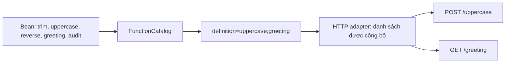
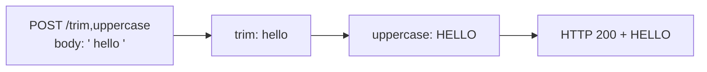

# Lọc các hàm được công bố bằng danh sách phân cách bởi dấu chấm phẩy trong Spring Cloud Function

## 1. Vấn đề: có nhiều bean nhưng chỉ muốn xuất một số HTTP endpoint

Spring Cloud Function (**SCF**) khuyến khích xây dựng logic nghiệp vụ bằng các bean Java `Supplier<O>`, `Function<I, O>` và `Consumer<I>`. Các bean có thể được đăng ký trong `FunctionCatalog`, sau đó sử dụng lại qua HTTP, sự kiện trong Spring Cloud Stream hoặc môi trường serverless mà không cần viết lại nghiệp vụ.

Khi bật **SCF HTTP adapter**, một ứng dụng có nhiều functional bean thường công bố chúng dưới các đường dẫn có tên bean:

```text
POST /uppercase
POST /reverse
POST /trim
GET  /greeting
POST /audit
```

Nhưng trong thực tế, không phải bean nào cũng cần trở thành endpoint HTTP công khai. Một số bước như `trim` chỉ nên chạy **bên trong composition**, còn `audit` có thể được hệ thống gọi nội bộ. Ta muốn giữ chúng trong catalog để tái sử dụng, đồng thời **chỉ xuất các endpoint được chỉ định**.

Spring Cloud Function hỗ trợ nhu cầu này bằng một **danh sách các hàm hoặc composition phân tách bởi dấu chấm phẩy**:

```properties
spring.cloud.function.definition=uppercase;greeting
```

Dòng này có nghĩa: chỉ công bố `uppercase` và `greeting` qua HTTP adapter. Dấu `;` **không** có nghĩa “chạy uppercase rồi đến greeting”.

### Mục tiêu học tập

Sau bài học, bạn có thể:

1. Phân biệt việc bean có trong `FunctionCatalog` với việc được công bố thành HTTP endpoint.
2. Cấu hình `spring.cloud.function.definition=foo;bar` để chỉ xuất danh sách được chọn.
3. Kết hợp một composition với một hàm khác bằng `foo|bar;baz`.
4. Phân biệt `;` (lọc danh sách), `|` (composition) và `,` (cách viết composition thuận tiện trong HTTP path).
5. Giải thích tại sao **không có root mapping tự động** khi definition chứa nhiều mục phân tách bằng `;`.
6. Kiểm thử endpoint được phép, không được phép và các giới hạn bảo mật của filtering.

## 2. Quy tắc công bố hàm của SCF HTTP adapter

Tài liệu chính thức *Standalone Web Applications* mô tả các trường hợp sau:

| Trạng thái | Quy tắc ánh xạ | Ví dụ |
| --- | --- | --- |
| Chỉ có **một** functional bean | Có thể bỏ tên khỏi URL | Chỉ có `uppercase`: `POST /uppercase` và `POST /` |
| Có **nhiều** bean, không đặt definition | Các hàm được xuất theo tên | `POST /uppercase`, `POST /reverse` |
| Đặt **một** definition | Có thể chọn function hoặc composition ở đường dẫn gốc | `spring.cloud.function.definition=uppercase\|reverse` |
| Đặt **nhiều** mục trong definition qua `;` | **Chỉ xuất các mục được liệt kê**, không tự tạo root | `spring.cloud.function.definition=uppercase;greeting` |

Việc “xuất” ở đây thuộc **HTTP adapter**. Những bean không có HTTP endpoint tương ứng vẫn có thể tồn tại trong Spring application context và `FunctionCatalog`; một thành phần khác trong ứng dụng vẫn có thể sử dụng chúng theo hợp đồng riêng.



**Lưu ý về phạm vi:** `spring.cloud.function.definition` là thuộc tính của Spring Cloud Function, không chỉ của module web. Spring Cloud Stream và những integration khác cũng có thể đọc nó để quyết định function được binding. Khi dùng nhiều adapter trong cùng ứng dụng, phải đánh giá ảnh hưởng trên từng adapter.

## 3. Phân biệt ký tự chấm phẩy, pipe và dấu phẩy

Đây là phần quan trọng nhất của bài.

| Ký tự | Ví dụ | Ý nghĩa |
| --- | --- | --- |
| `;` | `foo;bar` | Liệt kê **hai mục độc lập** cần công bố |
| `\|` | `foo\|bar` | **Ghép** `foo` rồi `bar` thành một composition |
| `,` | `/foo,bar` | Cách viết composition thuận tiện trên HTTP path |

Một vài ví dụ:

```properties
# Một function được chọn:
spring.cloud.function.definition=uppercase

# Một composition gồm hai bước:
spring.cloud.function.definition=trim|uppercase

# Hai function riêng lẻ được công bố:
spring.cloud.function.definition=trim;uppercase

# Một composition + một Supplier được công bố:
spring.cloud.function.definition=trim|uppercase;greeting

# Hai composition và một Supplier:
spring.cloud.function.definition=trim|uppercase;reverse|uppercase;greeting
```

Các dòng này là **những lựa chọn thay thế nhau**, không phải cấu hình để đặt đồng thời trong cùng file. Với một file thực tế, chỉ sử dụng một dòng `spring.cloud.function.definition` có giá trị mong muốn.

### 3.1. Vì sao `trim;uppercase` không phải composition?

Giả sử input là `"  hello  "`:

- `trim|uppercase`: một đường xử lý: `"  hello  "` → `"hello"` → `"HELLO"`.
- `trim;uppercase`: hai endpoint độc lập; client có thể gọi `/trim` hoặc `/uppercase`, **không có pipeline tự động** giữa chúng.

Nếu muốn client chỉ gọi chuỗi xử lý chuẩn hóa, dùng `trim|uppercase` như một **mục** trong danh sách và không đưa `trim`/`uppercase` vào danh sách dưới dạng endpoint riêng.

### 3.2. HTTP path gọi composition bằng dấu phẩy

Dù definition có thể dùng `|`, trong URL nên dùng dấu phẩy:

```text
POST /trim,uppercase
POST /reverse,uppercase
```

SCF cũng cho phép pipe khi biểu diễn composition, nhưng pipe bất tiện với shell và một số client/URL encoder. Khi dùng `curl`, dấu phẩy là lựa chọn dễ kiểm soát hơn.

### 3.3. Không biến danh sách phân cách bởi `;` thành một phần URL

Cấu hình:

```properties
spring.cloud.function.definition=trim|uppercase;greeting
```

không tạo một endpoint tên `/trim,uppercase;greeting`. Thay vào đó nó công bố **hai endpoint**:

```text
POST /trim,uppercase
GET  /greeting
```

Không có bước gọi `greeting` sau composition `trim|uppercase`.

## 4. Dự án Java minh họa

### 4.1. Dependency

Dùng Spring Boot và **Spring Cloud BOM tương thích**. Với một ứng dụng MVC xuất function qua HTTP, thêm starter Maven:

```xml
<dependency>
    <groupId>org.springframework.cloud</groupId>
    <artifactId>spring-cloud-starter-function-web</artifactId>
</dependency>
```

Không tự chỉ định version SCF khác dòng BOM. Nếu chọn WebFlux, cần dùng module/starter SCF phù hợp với web runtime và phiên bản đang triển khai; các test HTTP phải chạy trên chính runtime đó.

### 4.2. Khai báo sáu bean

Tạo file `src/main/java/demo/FunctionFilteringApplication.java`:

```java
package demo;

import java.util.Locale;
import java.util.function.Consumer;
import java.util.function.Function;
import java.util.function.Supplier;

import org.springframework.boot.SpringApplication;
import org.springframework.boot.autoconfigure.SpringBootApplication;
import org.springframework.context.annotation.Bean;

@SpringBootApplication
public class FunctionFilteringApplication {

    public static void main(String[] args) {
        SpringApplication.run(FunctionFilteringApplication.class, args);
    }

    @Bean
    public Function<String, String> trim() {
        return String::trim;
    }

    @Bean
    public Function<String, String> uppercase() {
        return value -> value.toUpperCase(Locale.ROOT);
    }

    @Bean
    public Function<String, String> reverse() {
        return value -> new StringBuilder(value).reverse().toString();
    }

    @Bean
    public Supplier<String> greeting() {
        return () -> "Hello from SCF";
    }

    @Bean
    public Consumer<String> audit() {
        return value -> System.out.println("AUDIT: " + value);
    }

    // Bean minh họa chỉ phục vụ dùng nội bộ.
    @Bean
    public Function<String, String> internalDecorate() {
        return value -> "[internal] " + value;
    }
}
```

Sáu bean có mặt trong application context. `internalDecorate` là ví dụ **vô hại** cho một hàm không định xuất HTTP; nó không xử lý secret hay dữ liệu nhạy cảm. Tất cả code vẫn có thể tái sử dụng trong môi trường sự kiện hoặc serverless qua adapter tương ứng.

Khởi động bằng:

```bash
mvn spring-boot:run
```

Các ví dụ `curl` theo cú pháp Bash, server mặc định `http://localhost:8080`. Nếu sử dụng PowerShell, gọi `curl.exe` và sửa cú pháp xuống dòng cho phù hợp.

## 5. Trước khi filtering: những URL nào có thể tồn tại?

Khi chưa đặt `spring.cloud.function.definition` và có nhiều functional bean, SCF HTTP adapter theo mặc định có thể xuất endpoint theo tên:

| Request | Bean được gọi | Output/side effect |
| --- | --- | --- |
| `POST /uppercase` với body `hello` | `uppercase` | `HELLO` |
| `POST /trim` với body `"  hello  "` | `trim` | `hello` |
| `POST /reverse` với body `hello` | `reverse` | `olleh` |
| `GET /greeting` | `greeting` | `Hello from SCF` |
| `POST /audit` với body `event` | `audit` | Log `AUDIT: event` |
| `POST /internalDecorate` với body `x` | `internalDecorate` | `[internal] x` |

Đây là lý do cần kiểm soát bề mặt HTTP công bố: **thêm một functional bean vào ứng dụng có thể tạo một endpoint mới** nếu adapter không có quy tắc giới hạn thích hợp.

Một ứng dụng có nhiều bean như ví dụ không tự chọn function cho `POST /` khi chưa định nghĩa mặc định.

## 6. Trường hợp A: chỉ công bố hai function

Trong `src/main/resources/application.properties`, thêm:

```properties
spring.cloud.function.definition=uppercase;greeting
```

Khởi động lại ứng dụng. Hai endpoint được công bố:

```bash
# Được công bố: Function, trả HTTP 200 và HELLO.
curl -i -X POST 'http://localhost:8080/uppercase' \
  -H 'Content-Type: text/plain' \
  -H 'Accept: text/plain' \
  --data 'hello'

# Được công bố: Supplier, trả HTTP 200 và lời chào.
curl -i 'http://localhost:8080/greeting' \
  -H 'Accept: text/plain'
```

Hãy so sánh với các request **không nằm trong danh sách**:

```bash
# Không được công bố:
curl -i -X POST 'http://localhost:8080/reverse' \
  -H 'Content-Type: text/plain' --data 'hello'

# Không được công bố:
curl -i -X POST 'http://localhost:8080/internalDecorate' \
  -H 'Content-Type: text/plain' --data 'hello'

# Composition này cũng không được liệt kê:
curl -i -X POST 'http://localhost:8080/uppercase,reverse' \
  -H 'Content-Type: text/plain' --data 'hello'
```

Theo **Function Filtering rules**, những function hoặc composition không liệt kê sẽ **không được xuất bởi SCF HTTP adapter**. Trong ứng dụng ví dụ không có handler khác, HTTP status thường là `404 Not Found`. Tuy nhiên, nếu URL được xử lý bởi một controller custom, proxy rewrite hoặc một cơ chế routing khác, status thực có thể khác: cần xác minh ở mức HTTP integration test.

### 6.1. Root path thì sao?

`uppercase;greeting` là danh sách **hai mục**. SCF không suy ra hàm đầu danh sách là mặc định. Vì vậy:

```text
POST /uppercase  -> có route SCF
GET  /greeting   -> có route SCF
POST /           -> KHÔNG tự tạo root mapping
```

Không nên dựa vào “thứ tự trước sau” của các phần tử trong danh sách để chọn hàm mặc định.

## 7. Trường hợp B: chỉ công bố composition và Supplier

Đổi cấu hình thành:

```properties
spring.cloud.function.definition=trim|uppercase;greeting
```

Ở đây có đúng **hai mục được công bố**:

- Composition `trim|uppercase` dưới URL `/trim,uppercase`.
- Supplier `greeting` dưới URL `/greeting`.

Gọi pipeline:

```bash
curl -i -X POST 'http://localhost:8080/trim,uppercase' \
  -H 'Content-Type: text/plain' \
  -H 'Accept: text/plain' \
  --data '  hello  '
# Kết quả nghiệp vụ: HELLO
```



Bảng kiểm tra:

| HTTP request | Có nằm trong danh sách? | Ý nghĩa |
| --- | --- | --- |
| `POST /trim,uppercase` | **Có** | Chạy trim rồi uppercase |
| `GET /greeting` | **Có** | Sinh lời chào |
| `POST /trim` | Không | Không xuất trim riêng lẻ |
| `POST /uppercase` | Không | Không xuất uppercase riêng lẻ |
| `POST /reverse` | Không | Không xuất reverse |
| `POST /uppercase,reverse` | Không | Composition này cũng không được xuất |
| `POST /internalDecorate` | Không | Không xuất bean dùng nội bộ |
| `POST /` | Không | Không tự tạo root mapping |

**Điểm quan trọng:** để chạy `trim|uppercase`, hai bean `trim` và `uppercase` vẫn phải tồn tại trong catalog. Chỉ **HTTP endpoint độc lập của chúng** không nằm trong danh sách công bố.

### 7.1. Chỉ công bố hai composition

Bạn có thể cấu hình:

```properties
spring.cloud.function.definition=trim|uppercase;reverse|uppercase
```

Khi đó có hai mục:

```text
POST /trim,uppercase
POST /reverse,uppercase
```

Ví dụ:

```bash
curl -i -X POST 'http://localhost:8080/reverse,uppercase' \
  -H 'Content-Type: text/plain' \
  --data 'hello'
# hello -> olleh -> OLLEH
```

Không cần khai báo thêm một Java bean có tên nguyên chuỗi `reverse,uppercase`; `FunctionCatalog` tạo composition từ các bean đã có.

## 8. Một definition và nhiều definition có hành vi root khác nhau

Hai cấu hình dưới **không tương đương**.

### Một mục: chọn composition mặc định

```properties
spring.cloud.function.definition=trim|uppercase
```

Chuỗi này là **một composition** được chọn. Theo quy tắc của SCF HTTP adapter, nó có thể được gọi tại URL gốc:

```bash
curl -i -X POST 'http://localhost:8080/' \
  -H 'Content-Type: text/plain' \
  --data '  hello  '
# Kết quả: HELLO
```

Tài liệu còn mô tả **fallback** khi không xác định được tên hàm từ URL: nếu đã chọn một definition đơn, một path không khớp cũng có thể được giải quyết qua definition đó. Điều này đặc biệt quan trọng khi kiểm tra route không mong muốn.

### Nhiều mục: lọc endpoint

```properties
spring.cloud.function.definition=trim|uppercase;greeting
```

Chuỗi này có **hai mục** được liệt kê. Quy tắc filtering của SCF:

1. Chỉ công bố những mục được liệt kê.
2. Không công bố những function và composition còn lại.
3. **Không tự ánh xạ endpoint gốc**.

### Ma trận dự đoán

Giả định catalog có đủ sáu bean ở mục 4:

| Definition | Những endpoint SCF được công bố điển hình | Root `/` |
| --- | --- | --- |
| Không đặt | Các bean và composition có thể được gọi theo tên | Không có mặc định duy nhất |
| `uppercase` | Chọn uppercase | Có thể gọi uppercase tại root |
| `trim\|uppercase` | Chọn composition | Có thể gọi trim → uppercase tại root |
| `uppercase;greeting` | `/uppercase`, `/greeting` | **Không** tự có |
| `trim\|uppercase;greeting` | `/trim,uppercase`, `/greeting` | **Không** tự có |
| `trim\|uppercase;reverse\|uppercase` | Hai composition được liệt kê | **Không** tự có |

Đây là bảng về **HTTP adapter**, không phải lời khẳng định không có bất kỳ URL nào khác trên toàn bộ Spring Boot application.

## 9. Kết hợp filtering với spring.cloud.function.web.path

Property `spring.cloud.function.web.path` thay **đường dẫn gốc của HTTP adapter**. Ví dụ:

```properties
spring.cloud.function.web.path=/api/functions
spring.cloud.function.definition=trim|uppercase;greeting
```

HTTP client cần gọi:

```bash
curl -i -X POST \
  'http://localhost:8080/api/functions/trim,uppercase' \
  -H 'Content-Type: text/plain' \
  --data '  hello  '

curl -i 'http://localhost:8080/api/functions/greeting'
```

Phân tích đường dẫn:

```text
/api/functions                 <- SCF adapter base path
/api/functions/trim,uppercase  <- composition được công bố
/api/functions/greeting        <- Supplier được công bố
```

Ngay cả khi đã đặt `web.path`, cấu hình lọc hai mục **không tự tạo root mapping tại `/api/functions`**.

### Servlet context path

Với Spring MVC, có thể đồng thời đặt:

```properties
server.servlet.context-path=/backend
spring.cloud.function.web.path=/api/functions
spring.cloud.function.definition=trim|uppercase;greeting
```

Khi đó URL nhìn từ client trực tiếp tới ứng dụng có dạng:

```text
POST /backend/api/functions/trim,uppercase
GET  /backend/api/functions/greeting
```

Nếu ứng dụng có API gateway/reverse proxy, URL công khai còn tùy rule rewrite. Không thêm prefix giống nhau vào context path, SCF web path và gateway nếu gateway đã đảm nhiệm một phần.

## 10. Các nguồn cấu hình và lỗi dấu phân cách trong shell

Spring Boot cho phép cấu hình cùng property bằng nhiều cách. Các ví dụ sau là **lựa chọn thay thế nhau**, không cần khai báo đồng thời.

### application.properties

```properties
spring.cloud.function.definition=trim|uppercase;greeting
```

### application.yml

```yaml
spring:
  cloud:
    function:
      definition: "trim|uppercase;greeting"
```

Đây là **một chuỗi duy nhất**, không phải một YAML sequence. SCF sẽ tự tách các mục theo `;`.

### Biến môi trường

```bash
export SPRING_CLOUD_FUNCTION_DEFINITION='trim|uppercase;greeting'
mvn spring-boot:run
```

Trong PowerShell:

```powershell
$env:SPRING_CLOUD_FUNCTION_DEFINITION = 'trim|uppercase;greeting'
mvn spring-boot:run
```

### Command-line argument

```bash
java -jar app.jar '--spring.cloud.function.definition=trim|uppercase;greeting'
```

`app.jar` chỉ là ví dụ artifact đã build. Trong nhiều shell, `|` là toán tử pipe và `;` là ký tự phân tách lệnh: hãy đặt **toàn bộ đối số** trong dấu nháy để giá trị được chuyển tới Spring Boot nguyên vẹn.

Một command-line argument hoặc environment variable có thể ghi đè cùng key trong file cấu hình theo thứ tự ưu tiên của Spring Boot. Khi điều tra sai lệch giữa local và production, phải kiểm tra **giá trị hiệu lực**.

## 11. Filtering không làm biến mất quy tắc HTTP method

Danh sách `spring.cloud.function.definition` quyết định **function/composition nào được xuất**. HTTP method và response vẫn phụ thuộc vào loại hàm:

| Mục được công bố | Kiểu | Method thông thường | Status thành công thông thường |
| --- | --- | --- | --- |
| `uppercase` | Function | POST/PUT, hoặc GET với path item | 200 OK |
| `greeting` | Supplier | GET | 200 OK |
| `audit` | Consumer | POST/PUT, DELETE | 202 (POST/PUT), 204 (DELETE) |
| `trim\|uppercase` | Function → Function | POST/PUT, hoặc GET với path item | 200 OK |
| `greeting\|uppercase` | Supplier → Function | GET | 200 OK |
| `trim\|audit` | Function → Consumer | POST/PUT | 202 Accepted |

Ví dụ nếu cấu hình:

```properties
spring.cloud.function.definition=greeting;trim|uppercase;trim|audit
```

thì có thể công bố ba endpoint với method thích hợp:

```text
GET  /greeting
POST /trim,uppercase
POST /trim,audit
```

Không mong đợi `trim|audit` trả một DTO do Consumer tạo ra: `Consumer.accept()` trả `void`. HTTP `202` cũng không chứng minh event đã được ghi bền vững vào database hoặc message broker.

### Method-specific mapping là tính năng riêng

SCF còn có:

```properties
spring.cloud.function.http.GET=greeting
spring.cloud.function.http.POST=trim|uppercase;reverse
```

Ở đây dấu `;` tiếp tục liệt kê nhiều mục, còn `|` biểu diễn composition, nhưng property này **chọn các mục theo từng HTTP method**. Không nhầm nó với danh sách xuất của `spring.cloud.function.definition`.

Nếu cần kết hợp các cấu hình routing, phải test trên phiên bản SCF được triển khai. Một composition có mặt trong catalog không có nghĩa mọi HTTP method đều được công bố.

## 12. Filtering trong HTTP không giống loại trừ khỏi FunctionCatalog

Ba khả năng dễ nhầm:

| Cơ chế | Ví dụ | Ý nghĩa |
| --- | --- | --- |
| **HTTP export filtering** | `spring.cloud.function.definition=foo;bar` | Công bố một danh sách function/composition qua adapter |
| **Loại bean khỏi catalog ứng viên** | `spring.cloud.function.ineligible-definitions=bean1,bean2` | Loại các bean Java Function không muốn trở thành ứng viên của FunctionCatalog |
| **Function routing** | `functionRouter` hoặc routing expression | Chọn hàm đích theo chỉ dẫn từ property/message |

Cơ chế thứ nhất giữ các bean nội bộ để composition có thể sử dụng. Cơ chế thứ hai có mục đích khác: nếu loại luôn `trim` khỏi catalog thì composition `trim|uppercase` có thể không còn tra cứu được. Cơ chế thứ ba quyết định đích thực thi **theo message hoặc điều kiện routing**, không phải danh sách URL HTTP mặc định.

Tài liệu *Programming Model* còn có một mục tên **Function Filtering**, mô tả cách tạo tuyến “go/discard” bằng router. Đó **không phải** cùng nghĩa với *Function Filtering rules* trong tài liệu **Standalone Web Applications**, nơi dấu `;` giới hạn **những HTTP endpoint được xuất**.

## 13. Không dùng filtering như cơ chế phân quyền

Filtering giúp thu hẹp bề mặt HTTP mà adapter công bố, nhưng **không thay thế authentication/authorization**.

Những tình huống phải xem xét:

- Bean không được HTTP adapter xuất vẫn có thể được code Java hoặc `FunctionCatalog` sử dụng nội bộ.
- Spring MVC/WebFlux controller hoặc API gateway có thể tạo route khác đến cùng nghiệp vụ.
- Một ứng dụng dùng `functionRouter` có thể nhận hướng dẫn routing qua `MessageHeaders` trong các trường hợp cấu hình cho phép. HTTP headers cũng có thể được adapter chuyển thành message headers.
- `spring.cloud.function.definition` có thể ảnh hưởng những adapter khác như Spring Cloud Stream.
- Một definition **đơn** có cơ chế fallback từ URL không khớp, khác chế độ filtering nhiều mục.

Với HTTP endpoint nhạy cảm, vẫn cần **Spring Security hoặc API gateway**, quy tắc quyền theo role/scope, kiểm soát HTTP method, validation, logging và giới hạn payload. Nếu cho phép client tự đưa routing instructions qua header, phải rà soát đặc biệt nguy cơ chọn nhầm function.

## 14. Kiểm thử cả endpoint được phép và không được phép

Chọn cấu hình cuối:

```properties
spring.cloud.function.web.path=/api/functions
spring.cloud.function.definition=trim|uppercase;greeting
```

Khởi động lại rồi gọi:

```bash
# 1. ĐƯỢC PHÉP: composition, 200 + HELLO.
curl -i -X POST 'http://localhost:8080/api/functions/trim,uppercase' \
  -H 'Content-Type: text/plain' \
  -H 'Accept: text/plain' \
  --data '  hello  '

# 2. ĐƯỢC PHÉP: Supplier, 200 + lời chào.
curl -i 'http://localhost:8080/api/functions/greeting' \
  -H 'Accept: text/plain'

# 3. KHÔNG CÔNG BỐ: trim độc lập.
curl -i -X POST 'http://localhost:8080/api/functions/trim' \
  -H 'Content-Type: text/plain' --data 'hello'

# 4. KHÔNG CÔNG BỐ: uppercase độc lập.
curl -i -X POST 'http://localhost:8080/api/functions/uppercase' \
  -H 'Content-Type: text/plain' --data 'hello'

# 5. KHÔNG CÔNG BỐ: composition khác.
curl -i -X POST 'http://localhost:8080/api/functions/uppercase,reverse' \
  -H 'Content-Type: text/plain' --data 'hello'

# 6. KHÔNG TỰ TẠO ROOT MAPPING.
curl -i -X POST 'http://localhost:8080/api/functions' \
  -H 'Content-Type: text/plain' --data 'hello'

# 7. KHÔNG CÔNG BỐ: bean nội bộ.
curl -i -X POST 'http://localhost:8080/api/functions/internalDecorate' \
  -H 'Content-Type: text/plain' --data 'hello'
```

### Ma trận xác nhận

| Ca | Điều kiện cần xác minh | Status thông thường trong ứng dụng mẫu |
| --- | --- | --- |
| 1 | Composition chạy đúng thứ tự, kết quả `HELLO` | 200 |
| 2 | Supplier trả `Hello from SCF` | 200 |
| 3–4 | Không xuất các bean riêng lẻ | Thường 404 |
| 5 | Không xuất composition chưa liệt kê | Thường 404 |
| 6 | Không có root mapping tự động | Thường 404 |
| 7 | Không xuất `internalDecorate` | Thường 404 |

**Kết quả 404 là kỳ vọng khi không có handler khác.** Trong hệ thống có controller, gateway hoặc routing khác, status thực tế có thể khác; hãy kiểm tra cả việc logic có bị gọi ngoài ý muốn không.

Lấy nhanh status:

```bash
curl -s -o /dev/null -w '%{http_code}\n' \
  -X POST 'http://localhost:8080/api/functions/uppercase' \
  -H 'Content-Type: text/plain' --data 'hello'
```

### Kiểm thử tích hợp nên bao gồm

1. Endpoint được liệt kê: đúng status, response `Content-Type`, body và side effect.
2. Endpoint không được liệt kê: không được adapter công bố.
3. Composition không nằm trong list: không thể gọi chỉ vì các thành phần còn trong catalog.
4. Không tự có root mapping khi list chứa nhiều mục.
5. Một definition đơn được test riêng về root và fallback.
6. Tiền tố `web.path`, Servlet context path và gateway rewrite không làm lộ URL cũ.
7. HTTP header liên quan routing không cho phép chọn function ngoài quyền.
8. Cấu hình hiệu lực đúng trong từng profile/deployment.

Test chỉ gọi trực tiếp `uppercase.apply()` không chứng minh HTTP filtering hoạt động. Cần HTTP integration test bằng `MockMvc`, `WebTestClient` hoặc HTTP client thực phù hợp với stack đã chọn.

## 15. Những lỗi cấu hình và cách khắc phục

| Triệu chứng | Nguyên nhân thường gặp | Cách khắc phục |
| --- | --- | --- |
| Muốn ghép nhưng nhận hai endpoint riêng | Dùng `trim;uppercase` | Dùng `trim\|uppercase` |
| Gọi `POST /` không hoạt động | Definition có nhiều mục với `;` | Gọi tên trong danh sách hoặc thiết kế root route riêng |
| Gọi `/trim` trả 404 dù bean tồn tại | Chỉ công bố `trim\|uppercase` | Thêm `;trim` nếu thật sự muốn công bố trim |
| `/trim,uppercase` không hoạt động | Sai tên bean, không được liệt kê, conversion lỗi | Kiểm tra definition, tên và kiểu I/O |
| Tên function ngoài list vẫn truy cập được | Property không hiệu lực, route khác, fallback hoặc router | Kiểm tra config runtime, controller, gateway và header |
| Command line lỗi khi có `;` hoặc `\|` | Shell tách hoặc pipe | Quote toàn bộ đối số |
| Dư dấu `;` | Có mục definition rỗng | Loại dấu thừa, kiểm tra chuỗi trong config |
| URL mới 404 | Quên `web.path` hoặc context path | Đối chiếu URL thực backend |
| Function khác xuất hiện sau deployment | Environment/profile override definition | Kiểm tra property source hiệu lực |
| Event flow không đúng sau khi sửa definition | `definition` còn dùng bởi integration khác | Kiểm thử riêng Spring Cloud Stream |
| Bean bị loại khỏi catalog nên composition lỗi | Nhầm `ineligible-definitions` với HTTP filtering | Giữ bean trong catalog nếu cần compose |
| Tưởng filtering là bảo mật | Không có authorization layer | Áp dụng policy tại gateway/Spring Security |

### Quy trình chẩn đoán

1. Xác nhận **tên và kiểu** các functional bean.
2. Xác định mục nào được công bố độc lập và mục nào là composition.
3. Tạo đúng chuỗi `spring.cloud.function.definition` với `;` và `|`.
4. Kiểm tra config hiệu lực, không chỉ giá trị trong file.
5. Tính thêm `spring.cloud.function.web.path`, context path và gateway rewrite.
6. Gửi `curl -i` đến URL được phép lẫn không được phép.
7. Kiểm tra các cơ chế routing/security khác trước khi khẳng định endpoint bị khóa.

## 16. Bài tập thực hành

1. Catalog có `uppercase`, `reverse`, `greeting`, `audit`. Với `definition=uppercase;greeting`, SCF HTTP adapter công bố những endpoint nào?
2. Tại sao `definition=trim;uppercase` không tạo composition `trim → uppercase`?
3. Viết một definition chỉ công bố `trim|uppercase` và `greeting`, không công bố `trim` hoặc `uppercase` riêng lẻ.
4. Với `definition=trim|uppercase;reverse|uppercase`, viết hai URL và tính output cho input `hello`.
5. Tại sao chế độ filtering chứa hai mục không tự tạo root mapping?
6. Sau khi đặt `spring.cloud.function.web.path=/v1/functions`, URL cho `trim|uppercase` là gì?
7. Vì sao bean bị ẩn khỏi HTTP adapter vẫn có thể được code Java khác tra cứu trong catalog?
8. So sánh `spring.cloud.function.ineligible-definitions` với việc liệt kê endpoint bằng `spring.cloud.function.definition`.
9. Tạo lệnh `curl` chứng minh `/trim,uppercase` được công bố, còn `/trim` không được công bố.
10. Một gateway có route đến một controller tự gọi `internalDecorate`. HTTP filtering có đủ để ngăn truy cập logic này không?
11. Vì sao cần quote giá trị `trim|uppercase;greeting` khi đặt từ Bash, PowerShell hoặc command-line argument?
12. Nếu cùng ứng dụng dùng Spring Cloud Stream, bạn cần test những gì khi đổi `spring.cloud.function.definition`?

## Tài liệu tham khảo

- [Spring Cloud Function — Standalone Web Applications](https://docs.spring.io/spring-cloud-function/reference/spring-cloud-function/standalone-web-applications.html): *Function Mapping rules*, *Function Filtering rules*, `foo;bar`, `foo|bar;baz` và root mapping.
- [Spring Cloud Function — Programming Model](https://docs.spring.io/spring-cloud-function/reference/spring-cloud-function/programming-model.html): `FunctionCatalog`, composition, `ineligible-definitions`, routing và ý nghĩa toàn cục của `definition`.
- [Spring Boot — Externalized Configuration](https://docs.spring.io/spring-boot/reference/features/external-config.html): cấu hình `application.properties`, YAML, environment variable, command-line arguments.
- [Spring Security — Authorize HTTP Requests](https://docs.spring.io/spring-security/reference/servlet/authorization/authorize-http-requests.html): bảo vệ request bằng authorization thay vì coi danh sách endpoint là chính sách bảo mật.

> **Ghi nhớ:** `spring.cloud.function.definition=foo;bar` công bố **hai function**; `foo|bar;baz` công bố **một composition và một function**. Dấu `;` là **tách danh sách**, dấu `|` là **ghép hàm**. Trong chế độ filtering có nhiều mục, SCF HTTP adapter **không tự tạo root mapping** và **không công bố** các function/composition không được liệt kê. Đây là cơ chế quản lý HTTP export, không thay thế bảo mật và phân quyền.
