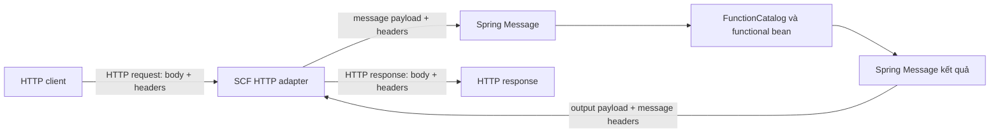

# Truyền và loại bỏ HTTP header ở phản hồi trong Spring Cloud Function

## 1. Bài toán: HTTP response đôi khi mang theo header từ request

**Spring Cloud Function (SCF)** cho phép xây dựng các nghiệp vụ tái sử dụng với `Supplier<O>`, `Function<I, O>` và `Consumer<I>`. Những bean này được đưa vào `FunctionCatalog` để sử dụng qua HTTP, hệ thống sự kiện hoặc môi trường serverless mà không gắn logic nghiệp vụ với một giao thức cụ thể.

Khi công bố bean bằng **SCF HTTP adapter**, một request không chỉ có body mà còn chứa các **HTTP headers**. Ví dụ:

```http
POST /uppercase HTTP/1.1
Host: localhost:8080
Content-Type: text/plain
Accept: text/plain
X-Demo-Client: mobile-app
X-Demo-Trace: req-100

hello
```

Client có thể mong response chỉ chứa `HELLO`, nhưng response headers còn phụ thuộc HTTP adapter. Tài liệu **Standalone Web Applications** của Spring Cloud Function quy định rằng **theo mặc định, phần lớn request HTTP headers được sao chép sang response HTTP headers**. Ứng dụng đôi khi cần giữ một số header để truy vết, nhưng **không nên phản chiếu các header không cần thiết hoặc nhạy cảm**.

SCF cung cấp property:

```properties
spring.cloud.function.http.ignored-headers=X-Demo-Client,X-Demo-Secret
```

Property này cho phép cấu hình **danh sách tên request headers cần bỏ qua khi HTTP adapter thực hiện propagation sang response**. Đó là trọng tâm của bài.

Mặt khác, nếu function nhận hoặc trả kiểu `Message<T>`, nó còn có thể **đọc message headers và chủ động tạo output message headers**. HTTP adapter có thể biến các output message headers thành HTTP response headers.

### Mục tiêu học tập

Sau bài này, bạn có thể:

1. Mô tả đường đi của HTTP request headers qua SCF HTTP adapter và `FunctionCatalog`.
2. Phân biệt **sao chép HTTP request headers sang response** với **chuyển tiếp Spring Messaging headers giữa các function**.
3. Viết `Function<Message<String>, Message<String>>` để đọc metadata đầu vào và tạo response header có chủ đích.
4. Dùng `spring.cloud.function.http.ignored-headers` với danh sách phân tách bằng dấu phẩy.
5. Kiểm tra header có hoặc không có trong response bằng `curl -i` và `curl -D -`.
6. Nhận diện rủi ro liên quan `Authorization`, `Cookie`, routing headers, CORS, proxy và HTTP-managed headers.

## 2. Ba lớp header trong một lần gọi SCF HTTP

Để không nhầm lẫn, hãy xem ba tầng dữ liệu:



Có ba nhóm thông tin cần xét:

| Nhóm | Ví dụ | Ai chịu trách nhiệm? |
| --- | --- | --- |
| **Request HTTP headers** | `Content-Type`, `Accept`, `X-Demo-Trace` | Client gửi và HTTP adapter tiếp nhận |
| **Spring `MessageHeaders`** | `contentType`, `X-Demo-Trace`, `http_request_param` | Adapter tạo metadata cho function; function có thể đọc qua `Message<T>` |
| **Response HTTP headers** | `Content-Type`, `X-Demo-Processed`, `Cache-Control` | SCF web adapter, output Message, web framework, security và proxy có thể cùng góp phần |

**Không phải mọi HTTP header đều là dữ liệu nghiệp vụ.** Một số header phục vụ content negotiation, framing, connection management hoặc bảo mật. Các tầng servlet container, MVC/WebFlux và reverse proxy có thể thêm, sửa hoặc loại header khi tạo response.

### 2.1. Hai luồng propagation khác nhau

Tài liệu SCF mô tả **hai cơ chế độc lập**:

- **HTTP-level propagation:** mặc định phần lớn request `HttpHeaders` được sao chép sang response `HttpHeaders`. Property `spring.cloud.function.http.ignored-headers` điều khiển nhóm header bị loại khỏi cơ chế này.
- **Function/message-level propagation:** một function nhận `Message<I>` có thể đọc headers; function trả `Message<O>` có thể chứa các headers mà adapter chuyển sang HTTP response. Ở mô hình catalog thuần, input Message headers không mặc nhiên luôn được giữ nguyên qua output của mọi hàm.

Như vậy, **bỏ một header khỏi cơ chế sao chép mặc định ở HTTP adapter không chứng minh header đó không thể được code Java khác chủ động tạo ra trong output Message**. Muốn kiểm soát chặt response, phải kiểm tra cả lớp ứng dụng và web/security/gateway.

## 3. Cơ chế mặc định: phần lớn request headers có thể được phản chiếu

Với một bean rất đơn giản:

```java
@Bean
public Function<String, String> uppercase() {
    return value -> value.toUpperCase(Locale.ROOT);
}
```

Gọi:

```bash
curl -i -X POST 'http://localhost:8080/uppercase' \
  -H 'Content-Type: text/plain' \
  -H 'Accept: text/plain' \
  -H 'X-Demo-Client: mobile-app' \
  -H 'X-Demo-Trace: req-100' \
  --data 'hello'
```

Response nghiệp vụ thông thường:

```http
HTTP/1.1 200 OK
Content-Type: text/plain

HELLO
```

**Ví dụ trên chỉ mô tả phần body và media type chính**, không phải danh sách response headers đầy đủ. Theo SCF, một số request headers, trong đó có thể có custom headers, có thể xuất hiện trong response nhờ cơ chế sao chép mặc định. Header nào thực tế xuất hiện phụ thuộc phiên bản SCF, web runtime, bộ lọc và proxy.

Điều cần quan sát:

- `X-Demo-Client` có xuất hiện trong **response** hay chỉ tồn tại ở request?
- `X-Demo-Trace` có được phản chiếu không?
- `Content-Type` phản ánh kiểu response thực tế hay bị hiểu nhầm là bản sao vô điều kiện của request?
- Có header nào do Spring Security, servlet container hoặc gateway tạo thêm không?

### Không khẳng định mọi header đều được sao chép

Tài liệu nói **“most” (phần lớn)**, không nói tất cả. Những header liên quan giao thức, cookie, connection hay content framing có thể được framework xử lý đặc biệt. Không viết test yêu cầu mọi request header phải có mặt trong response.

Ví dụ:

| Request header | Mục đích thông thường | Có nên mặc định phản chiếu sang response? |
| --- | --- | --- |
| `X-Demo-Trace` | Correlation/tracing | Có thể hữu ích, nhưng phải kiểm soát nội dung |
| `X-Demo-Client` | Metadata về client | Chỉ khi có yêu cầu API rõ ràng |
| `Authorization` | Chứng thực request | **Không** phản chiếu token |
| `Cookie` | Credential/session client gửi | **Không** sao chép nguyên sang response |
| `Content-Type` | Mô tả body request | Response cần media type của **body response** |
| `Content-Length` | Độ dài body | HTTP runtime phải tính đúng, không copy tùy ý |
| `Connection` | Quản lý kết nối | Thuộc nhóm connection/hop-by-hop; không xem là metadata nghiệp vụ |
| `Host` | Authority/host của request | Không có lý do nghiệp vụ chung để phản chiếu |

**Kết luận:** hành vi propagation mặc định là tiện ích của adapter, **không phải chính sách bảo mật** và không thay thế quy tắc response-header của API.

## 4. Cấu hình bỏ qua headers bằng spring.cloud.function.http.ignored-headers

Đây là property chính thức được nêu tại mục **Http Headers propagation** của SCF:

```properties
spring.cloud.function.http.ignored-headers=foo,bar
```

Danh sách được **phân tách bằng dấu phẩy**. Để minh họa rõ hơn:

```properties
spring.cloud.function.http.ignored-headers=X-Demo-Client,X-Demo-Secret
```

Ở mức HTTP adapter, cấu hình này yêu cầu **không phản chiếu hai request header được nêu tên** qua cơ chế copy mặc định.

### 4.1. Những điều property này thực hiện

1. Tập trung xử lý **header propagation của SCF HTTP adapter**.
2. Nhận tên một hoặc nhiều header, phân tách bằng `,`.
3. Giúp tránh đưa các custom headers **không cần thiết** từ request sang response.
4. Có thể dùng như một lớp **giảm nguy cơ rò rỉ metadata ngoài ý muốn** khi đã xác định những header cần loại.

### 4.2. Những điều property này không tự bảo đảm

- **Không** xóa request header trước khi bean đọc nó bằng `MessageHeaders`.
- **Không** tự xóa một response header do **chính function chủ động đặt** trong output `Message<?>` nếu đường xử lý của adapter không áp dụng filter tại bước đó; phải kiểm thử.
- **Không** ngăn filter/controller/Spring Security/gateway khác thêm cùng header vào response.
- **Không** cấu hình header forwarding của Spring Cloud Stream, Kafka/Rabbit hay các adapter serverless.
- **Không** thay thế chính sách loại token, cookie, session ID và header nội bộ tại boundary bảo mật.
- **Không** thay đổi HTTP method hoặc chọn function trong `FunctionCatalog`.

### 4.3. Phân biệt dấu phẩy với các dấu phân cách khác của SCF

| Thuộc tính | Giá trị minh họa | Dấu phân cách và mục đích |
| --- | --- | --- |
| `spring.cloud.function.http.ignored-headers` | `X-Demo-Client,X-Demo-Secret` | **Dấu phẩy** liệt kê **tên header cần bỏ qua** |
| `spring.cloud.function.definition` | `normalize\|uppercase;greeting` | `;` liệt kê function/composition; `\|` để compose |
| `spring.cloud.function.http.POST` | `normalize\|uppercase;quote` | Method-specific list và composition |
| `spring.cloud.function.web.path` | `/api/functions` | Tiền tố URL, không liên quan danh sách header |

**Sai lầm phổ biến:** viết `ignored-headers=foo;bar` do quen sử dụng dấu chấm phẩy của function filtering. Với ignored-headers, tài liệu yêu cầu **dấu phẩy**.

### 4.4. Có phân biệt chữ hoa/chữ thường không?

Theo ngữ nghĩa HTTP, **tên field không phân biệt chữ hoa/chữ thường**. Tuy nhiên, implementation cụ thể vẫn có quy tắc chuẩn hóa tên khi đưa vào `MessageHeaders`. Trong bài thực hành, sử dụng tên header nhất quán ở request và property, đồng thời kiểm thử trên đúng SCF/web version. Không xem khác biệt cách hiển thị chữ hoa trong `curl -i` là bằng chứng bộ lọc lỗi.

## 5. Dự án thực hành: function có và không có Message headers

Ví dụ sử dụng **Java 17+**, Spring Boot và Spring Cloud BOM tương thích với SCF HTTP adapter. Với ứng dụng Spring MVC, Maven cần dependency:

```xml
<dependency>
    <groupId>org.springframework.cloud</groupId>
    <artifactId>spring-cloud-starter-function-web</artifactId>
</dependency>
```

Không đặt version tùy ý nếu dự án đã import Spring Cloud BOM. Nếu dùng WebFlux hoặc release train khác, phải chọn web adapter tương thích và xác minh behavior trên runtime thực tế.

Tạo file `src/main/java/demo/HttpHeadersApplication.java`:

```java
package demo;

import java.util.List;
import java.util.Locale;
import java.util.Map;
import java.util.Optional;
import java.util.function.Consumer;
import java.util.function.Function;
import java.util.function.Supplier;

import org.springframework.boot.SpringApplication;
import org.springframework.boot.autoconfigure.SpringBootApplication;
import org.springframework.context.annotation.Bean;
import org.springframework.messaging.Message;
import org.springframework.messaging.support.MessageBuilder;

@SpringBootApplication
public class HttpHeadersApplication {

    public static void main(String[] args) {
        SpringApplication.run(HttpHeadersApplication.class, args);
    }

    // Không thao tác trực tiếp với MessageHeaders.
    @Bean
    public Function<String, String> uppercase() {
        return value -> value.toUpperCase(Locale.ROOT);
    }

    // Đọc một header client và chủ động đặt hai output Message headers.
    @Bean
    public Function<Message<String>, Message<String>> annotate() {
        return message -> {
            String trace = findHeader(message, "X-Demo-Trace")
                    .filter(value -> value.matches(
                            "[A-Za-z0-9_-]{1,48}"))
                    .orElse("not-provided");

            String result = message.getPayload()
                    .toUpperCase(Locale.ROOT);

            return MessageBuilder.withPayload(result)
                    .setHeader("X-Demo-Processed", "true")
                    .setHeader("X-Demo-Trace", trace)
                    .build();
        };
    }

    // GET Supplier: không cần request body.
    @Bean
    public Supplier<String> banner() {
        return () -> "SCF HTTP header demo";
    }

    // POST Consumer: xử lý input, không sinh kết quả nghiệp vụ.
    @Bean
    public Consumer<String> audit() {
        return value ->
                System.out.println("Audit received: " + value);
    }

    /**
     * Đọc custom header ở MessageHeaders một cách phòng thủ.
     * Một số adapter lưu header dưới dạng String, String[] hoặc List.
     */
    private static Optional<String> findHeader(
            Message<?> message, String name) {

        for (Map.Entry<String, Object> entry
                : message.getHeaders().entrySet()) {

            if (!entry.getKey().equalsIgnoreCase(name)) {
                continue;
            }

            Object value = entry.getValue();

            if (value instanceof String text) {
                return Optional.of(text);
            }

            if (value instanceof String[] items
                    && items.length == 1
                    && items[0] != null) {
                return Optional.of(items[0]);
            }

            if (value instanceof List<?> items
                    && items.size() == 1
                    && items.get(0) instanceof String text) {
                return Optional.of(text);
            }
        }

        return Optional.empty();
    }
}
```

Trong ví dụ:

- `uppercase` nhận `String` và trả `String`: nghiệp vụ không biết header.
- `annotate` nhận `Message<String>`, có thể đọc request metadata mà HTTP adapter chuyển thành message headers.
- `annotate` **không copy toàn bộ input headers** vào output Message; nó chỉ chọn một `X-Demo-Trace` đã được kiểm tra và tạo `X-Demo-Processed`.
- `banner` minh họa Supplier GET; `audit` minh họa Consumer POST.
- Hàm `findHeader` dùng so sánh tên không phân biệt hoa/thường và chỉ chấp nhận một giá trị rõ ràng. Khi value có nhiều phần tử hoặc kiểu khác, nó trả `Optional.empty()`.
- Regex của trace chỉ là **validation ví dụ** nhằm tránh phản chiếu chuỗi tùy ý; nó không phải chuẩn phổ quát cho correlation ID.

Chạy:

```bash
mvn spring-boot:run
```

Các ví dụ `curl` sử dụng cú pháp Bash, giả định server tại `http://localhost:8080`. Trong PowerShell, dùng `curl.exe` và cách xuống dòng thích hợp.

## 6. Bước 1: xem hành vi khi chưa cấu hình ignored-headers

Đầu tiên **chưa thêm** `spring.cloud.function.http.ignored-headers`.

### 6.1. Gửi custom headers đến Function<String, String>

```bash
curl -i -X POST 'http://localhost:8080/uppercase' \
  -H 'Content-Type: text/plain' \
  -H 'Accept: text/plain' \
  -H 'X-Demo-Client: mobile-app' \
  -H 'X-Demo-Secret: example-only-not-a-real-secret' \
  --data 'hello'
```

Body nghiệp vụ dự kiến:

```text
HELLO
```

Quan sát phần **response headers**. SCF có thể sao chép `X-Demo-Client` và `X-Demo-Secret` theo cơ chế mặc định. Một số header có thể bị web runtime hoặc middleware giữ lại/loại bỏ; điều cần làm là **ghi nhận baseline**, không gắn cứng toàn bộ danh sách response headers.

**Không gửi token/secret thật trong bài thử.** Chuỗi có chữ “Secret” ở đây chỉ là dữ liệu giả để kiểm tra một cơ chế propagation.

### 6.2. Gọi function trả Message<String>

```bash
curl -i -X POST 'http://localhost:8080/annotate' \
  -H 'Content-Type: text/plain' \
  -H 'Accept: text/plain' \
  -H 'X-Demo-Trace: req-100' \
  -H 'X-Demo-Client: mobile-app' \
  --data 'hello'
```

Phản hồi nghiệp vụ dự kiến có body:

```text
HELLO
```

Trong response headers, hãy tìm:

```text
X-Demo-Processed: true
X-Demo-Trace: req-100
```

Hai header này xuất phát từ **output Message do function tạo**. Nếu `X-Demo-Trace` không hiện đúng như kỳ vọng, trước tiên hãy kiểm tra kiểu/cách đặt tên của input message header và việc adapter chuyển output headers sang HTTP, thay vì lập tức kết luận regex hoặc Java lambda lỗi.

**Lưu ý:** Header `X-Demo-Client` có thể vẫn xuất hiện trong response do cơ chế sao chép request headers ở tầng HTTP, dù output Message **không** copy nó.

### 6.3. Đừng nhầm response headers với request headers của curl

`curl -i` in **response status + response headers + body**. Với `curl -v`, client còn hiển thị **request headers** kèm thông tin kết nối; cần phân biệt dòng `>` là gửi đi và dòng `<` là nhận về trong verbose output.

Trong hệ thống thật, hạn chế dùng `curl -v` khi có `Authorization` hoặc cookie nhạy cảm vì log terminal và công cụ thu thập output có thể ghi lại credential.

## 7. Bước 2: cấu hình bỏ qua request headers khi tạo response

Thêm vào `src/main/resources/application.properties`:

```properties
spring.cloud.function.http.ignored-headers=X-Demo-Client,X-Demo-Secret
```

Khởi động lại ứng dụng để bảo đảm property được đọc. Gửi **lại đúng request** ở mục 6:

```bash
curl -i -X POST 'http://localhost:8080/uppercase' \
  -H 'Content-Type: text/plain' \
  -H 'Accept: text/plain' \
  -H 'X-Demo-Client: mobile-app' \
  -H 'X-Demo-Secret: example-only-not-a-real-secret' \
  --data 'hello'
```

Kiểm chứng:

1. HTTP response vẫn có body `HELLO`.
2. Những request headers `X-Demo-Client` và `X-Demo-Secret` không được cơ chế propagation mặc định sao chép sang response.
3. Những headers cần thiết cho HTTP response (như `Content-Type`) vẫn được tạo đúng bởi web runtime.
4. Nếu thấy một header bị “lọc” vẫn xuất hiện, cần kiểm tra có function/filter/proxy nào **chủ động tạo** nó sau khi bộ lọc của SCF chạy.

### So sánh trước và sau

| Trường hợp | Trước khi đặt property | Sau khi đặt property |
| --- | --- | --- |
| Response body của `uppercase` | `HELLO` | `HELLO` |
| `X-Demo-Client` từ request | Có thể bị sao chép | Bị loại khỏi cơ chế sao chép mặc định |
| `X-Demo-Secret` từ request | Có thể bị sao chép | Bị loại khỏi cơ chế sao chép mặc định |
| `X-Demo-Processed` do `annotate` tạo | Không có ở `uppercase` | Không có ở `uppercase` |
| Response `Content-Type` | Theo body/codec | Vẫn phải theo body/codec |
| Authorization và bảo mật | Cần cấu hình riêng | **Vẫn cần cấu hình riêng** |

### Kiểm thử bằng chỉ headers, không in body

```bash
curl -s -D - -o /dev/null -X POST \
  'http://localhost:8080/uppercase' \
  -H 'Content-Type: text/plain' \
  -H 'Accept: text/plain' \
  -H 'X-Demo-Client: mobile-app' \
  -H 'X-Demo-Secret: example-only-not-a-real-secret' \
  --data 'hello'
```

Ở đây:

- `-D -`: xuất response headers ra stdout.
- `-o /dev/null`: bỏ response body.
- `-s`: giảm thông báo tiến trình của curl.

Khi chạy trên Windows, `/dev/null` có thể không có nghĩa như trên Unix; sử dụng cách đặt output sink phù hợp, hoặc chỉ dùng `curl.exe -i` để đọc status/headers/body.

## 8. Bước 3: output Message headers vẫn có vai trò riêng

Giữ property:

```properties
spring.cloud.function.http.ignored-headers=X-Demo-Client,X-Demo-Secret
```

Gọi `annotate`:

```bash
curl -i -X POST 'http://localhost:8080/annotate' \
  -H 'Content-Type: text/plain' \
  -H 'Accept: text/plain' \
  -H 'X-Demo-Trace: req-100' \
  -H 'X-Demo-Client: mobile-app' \
  -H 'X-Demo-Secret: example-only-not-a-real-secret' \
  --data 'hello'
```

Kỳ vọng **theo hợp đồng của ví dụ**:

- Payload `HELLO`.
- Output Message đặt `X-Demo-Processed: true`.
- Output Message đặt `X-Demo-Trace: req-100` nếu input header có kiểu/giá trị hợp lệ; nếu không sẽ đặt `not-provided`.
- Các header `X-Demo-Client` và `X-Demo-Secret` **không được copy mặc định** qua cơ chế HTTP propagation.

Đừng kết luận rằng property ignored-headers loại **mọi** header có cùng tên bất kể được tạo ở đâu. Nếu function chủ động làm:

```java
return MessageBuilder.withPayload("HELLO")
        .setHeader("X-Demo-Secret", "created-by-function")
        .build();
```

thì đây là một **output Message header mới**. Cần kiểm tra nó có được chuyển thành response hay bị một bước khác loại bỏ trên runtime thực tế. Muốn chắc chắn một header tuyệt đối không được trả ra ngoài, hãy triển khai chính sách tại **HTTP response boundary** và kiểm thử toàn tuyến.

### 8.1. Vì sao không nên copy tất cả headers trong code?

Mẫu code dưới đây dễ gây rò rỉ metadata:

```java
// Chỉ để minh họa rủi ro: KHÔNG nên dùng mù quáng.
return MessageBuilder.withPayload("HELLO")
        .copyHeaders(message.getHeaders())
        .build();
```

Nếu input chứa token, header routing, thông tin session hoặc header nội bộ, copy toàn bộ có thể khiến những giá trị đó đi tiếp đến output Message, event adapter hoặc HTTP response.

Cách an toàn hơn là **allowlist theo nhu cầu**:

```java
return MessageBuilder.withPayload("HELLO")
        .setHeader("X-Demo-Processed", "true")
        .build();
```

Nếu cần giữ correlation ID, hãy lấy nó từ nguồn đáng tin, kiểm tra định dạng và chiều dài trước khi phản chiếu.

## 9. Phân biệt HTTP ignored-headers và copy-input-headers của FunctionCatalog

Tài liệu **Programming Model** của SCF còn nêu cơ chế sao chép **input Spring Messaging headers** sang output:

```properties
spring.cloud.function.configuration.uppercase.copy-input-headers=true
```

Hai property dưới đây **không tương đương**:

| Property | Tầng hoạt động | Ý nghĩa |
| --- | --- | --- |
| `spring.cloud.function.http.ignored-headers` | **HTTP web adapter** | Không sao chép những request HTTP headers được chỉ định sang response HTTP headers trong propagation mặc định |
| `spring.cloud.function.configuration.<function>.copy-input-headers` | **SCF FunctionCatalog/function wrapper** | Khi bật cho một function phù hợp, có thể sao chép input **Message headers** sang output Message của function |

### 9.1. Tại sao cần phân biệt?

Xét luồng:

```text
HTTP request
  |
  +--> HTTP headers --------> HTTP adapter propagation --------> HTTP response
  |
  +--> Message headers -----> FunctionCatalog + function ------> output Message
                                                                     |
                                                                     v
                                                                HTTP response
```

Có thể tồn tại **hai đường** mang headers tới response. Nếu bạn bật tính năng copy input Message headers và đồng thời đặt ignored-headers, cần kiểm thử kết quả tổng hợp; không mặc định một property sẽ hủy bỏ mọi hiệu ứng của property còn lại.

### 9.2. Khi dùng composition

Giả sử:

```properties
spring.cloud.function.definition=normalize|uppercase
```

Trong một composition, output của `normalize` trở thành input của `uppercase`. Spring Messaging headers **có thể được giữ, bổ sung hoặc thay đổi** tùy chữ ký các function, wrapper conversion và cấu hình propagating headers.

Không suy ra việc request HTTP có `X-Demo-Trace` đồng nghĩa mọi bước trong pipeline nhận lại header ấy. Nếu nghiệp vụ cần correlation ID xuyên suốt, hãy:

1. Quy định nơi correlation ID được tạo và tin cậy.
2. Chỉ truyền những metadata thực sự cần qua `Message` hoặc DTO nghiệp vụ.
3. Tránh chuyển các credential như `Authorization` giữa những bước không cần.
4. Viết test composition qua cả HTTP lẫn adapter sự kiện nếu dùng chung.

## 10. HTTP header nào do function nên chủ động tạo?

Một API có thể cần response headers ngoài body. Các lựa chọn phổ biến:

| Header response | Khi nào sử dụng | Lưu ý |
| --- | --- | --- |
| `X-Demo-Processed` | Cờ minh họa cho xử lý thành công | Không thay thế HTTP status |
| `X-Request-ID` | Correlation/tracing nếu hệ thống chuẩn hóa | Validate/trust ID, tránh xung đột với tracing layer |
| `Cache-Control` | Quy tắc cache của API | Nên đặt tại web/security/gateway theo hợp đồng |
| `Location` | Resource mới được tạo, thường cùng status phù hợp | SCF function mặc định không tự thành `201 Created` |
| `ETag` | Caching và conditional requests | Cần tính toán và xử lý `If-None-Match`/`If-Match` đúng |
| `Content-Type` | Media type của **response body** | Nên để codec/web runtime xác định hoặc đặt có kiểm soát |
| `Vary` | Khác biệt representation theo request headers | Cần thiết kế nhất quán với cache/CDN |
| `Access-Control-Expose-Headers` | Cho phép browser JavaScript đọc một số custom response headers | CORS policy phải được cấu hình ở tầng web |
| `Set-Cookie` | Server đặt cookie | Không được tạo bằng cách phản chiếu request `Cookie` |

Không nên dùng output Message để tùy tiện ghi đè `Content-Length`, `Transfer-Encoding`, `Connection` hoặc các header chịu trách nhiệm framing/hop-by-hop. Spring web runtime/proxy phải kiểm soát chúng để response nhất quán.

### 10.1. Content-Type và Accept vẫn là hai vai trò khác nhau

Gọi:

```bash
curl -i -X POST 'http://localhost:8080/annotate' \
  -H 'Content-Type: text/plain' \
  -H 'Accept: text/plain' \
  --data 'hello'
```

- `Content-Type` ở request mô tả body client **gửi**.
- `Accept` mô tả kiểu response client **muốn nhận**.
- `Content-Type` ở response mô tả body server **thực tế trả**.

Đừng dùng ignored-headers để giải quyết lỗi JSON conversion, content negotiation, `406 Not Acceptable` hoặc `415 Unsupported Media Type`; chúng là vấn đề khác.

### 10.2. Consumer và 204 No Content

Khi gọi `POST /audit`, SCF HTTP adapter thường trả `202 Accepted` và có thể phản chiếu dữ liệu đầu vào. Nếu gọi Consumer qua `DELETE`, status thường là `204 No Content`.

**204 không có response body**, nhưng HTTP vẫn có thể có headers hợp lệ. Đừng tự coi Consumer phải tạo output Message chứa body; `Consumer.accept()` trả `void`. Nếu API cần các response headers/status chuyên biệt theo nghiệp vụ, hãy thiết kế HTTP boundary rõ ràng thay vì dựa hoàn toàn vào mapping mặc định.

## 11. CORS và browser: thấy header trong curl chưa chắc đọc được bằng JavaScript

Giả sử `curl -i` thấy:

```http
X-Demo-Processed: true
```

Browser `fetch()` gọi API **khác origin** có thể vẫn không cho JavaScript đọc header đó nếu CORS policy chưa khai báo nó là **exposed response header**.

Ví dụ khái niệm:

```http
Access-Control-Expose-Headers: X-Demo-Processed, X-Demo-Trace
```

**Đây không phải một property SCF ignored-headers.** CORS phải được xử lý tại Spring MVC/WebFlux, Spring Security hoặc gateway, bao gồm origin, allowed methods, allowed request headers và credentials. Không dùng `Access-Control-Allow-Origin: *` một cách mù quáng cho API có cookie/credentials.

Nhớ phân biệt:

- `X-Demo-Processed` có mặt trên HTTP response thực tế.
- Browser cho phép JavaScript đọc `X-Demo-Processed`.
- User có quyền truy cập chức năng API.

Ba điều trên là ba câu hỏi **khác nhau**.

## 12. Rủi ro bảo mật: đừng phản chiếu credential và routing headers

Theo nguyên tắc bảo mật HTTP, các headers sau thường cần kiểm soát cẩn thận:

- `Authorization`, `Proxy-Authorization` và `Cookie`: có thể mang credential hoặc session token.
- `X-API-Key`, `X-Internal-Token`: các tên custom có thể chứa secret tùy hệ thống.
- Header tenant/user/role do client gửi: **không được coi là bằng chứng quyền truy cập** khi chưa qua xác thực và kiểm chứng của gateway/security layer.
- `spring.cloud.function.definition` và `spring.cloud.function.routing-expression`: trong một số mô hình SCF, header có thể ảnh hưởng `functionRouter` và đích thực thi.

Tài liệu **Programming Model** nêu HTTP adapter có thể chuyển header `spring.cloud.function.definition` thành Message header; routing expression đến từ message header có ngữ cảnh đánh giá hạn chế hơn expression từ application property. Dù vậy, **giới hạn evaluation không thay cho authorization**.

### Quy tắc phòng thủ

1. **Không phản chiếu secret** vào response. Xác định những header phải loại ở web/server/gateway; ignored-headers chỉ là một phần.
2. **Không cho client tự chỉ định function nhạy cảm** qua routing headers trừ khi kiến trúc có allowlist và quyền truy cập chặt chẽ.
3. **Không copy toàn bộ input MessageHeaders** khi chỉ cần correlation ID.
4. **Không log nguyên bộ headers** nếu chúng có thể chứa token, cookie hoặc thông tin cá nhân.
5. **Không giả định** một URL không công bố sẽ tuyệt đối không thể gọi qua controller, event adapter hoặc router khác.
6. **Kiểm tra response cuối cùng** sau servlet filters, reverse proxy, API gateway và CDN.

## 13. Cấu hình ignored-headers trong nhiều môi trường

Các cách sau là **tương đương về ý định**, không cần đặt đồng thời.

### 13.1. application.properties

```properties
spring.cloud.function.http.ignored-headers=X-Demo-Client,X-Demo-Secret
```

### 13.2. application.yml

```yaml
spring:
  cloud:
    function:
      http:
        ignored-headers: X-Demo-Client,X-Demo-Secret
```

Hoặc dùng dấu nháy để nhấn mạnh đây là chuỗi:

```yaml
spring:
  cloud:
    function:
      http:
        ignored-headers: "X-Demo-Client,X-Demo-Secret"
```

### 13.3. Biến môi trường

Trong Bash:

```bash
export SPRING_CLOUD_FUNCTION_HTTP_IGNORED_HEADERS='X-Demo-Client,X-Demo-Secret'
mvn spring-boot:run
```

Trong PowerShell:

```powershell
$env:SPRING_CLOUD_FUNCTION_HTTP_IGNORED_HEADERS = 'X-Demo-Client,X-Demo-Secret'
mvn spring-boot:run
```

Cách diễn giải environment variable tuân theo relaxed binding của Spring Boot; nên xác minh property thực sự có hiệu lực trên phiên bản đang chạy.

### 13.4. Tham số dòng lệnh

```bash
java -jar app.jar \
  '--spring.cloud.function.http.ignored-headers=X-Demo-Client,X-Demo-Secret'
```

`app.jar` là artifact minh họa. Khi nhiều nguồn cùng đặt một property, thứ tự ưu tiên của **Spring Boot externalized configuration** quyết định giá trị hiệu lực. Nếu thay đổi file mà response vẫn giống trước, hãy kiểm tra environment variable, active profile và argument đang override.

### 13.5. Không nhầm với HTTP method mapping

Cả hai property đều bắt đầu bằng `spring.cloud.function.http`, nhưng:

```properties
spring.cloud.function.http.POST=uppercase
spring.cloud.function.http.ignored-headers=X-Demo-Client
```

- Dòng `POST` chọn function/composition cho HTTP method.
- Dòng `ignored-headers` chọn tên request headers cần loại khỏi cơ chế propagation.

Đặt cả hai không có nghĩa header filtering tự quyết định POST được phép hay không.

## 14. Test matrix: có/không có header và nhiều đường tạo response

Với ứng dụng ở mục 5, đặt:

```properties
spring.cloud.function.http.ignored-headers=X-Demo-Client,X-Demo-Secret
```

Sau đó thực hiện những ca kiểm thử sau.

| Ca | Request | Điều cần chứng minh |
| --- | --- | --- |
| A | POST `/uppercase` với `X-Demo-Client`, `X-Demo-Secret` | Không có sự sao chép mặc định của hai header bị bỏ qua |
| B | POST `/uppercase` không gửi custom header | Logic `HELLO` không phụ thuộc metadata |
| C | POST `/annotate` với `X-Demo-Trace: req-100` | Output Message đặt `X-Demo-Processed` và trace hợp lệ |
| D | POST `/annotate` với trace sai định dạng | Hàm dùng giá trị thay thế `not-provided` |
| E | POST `/annotate` có `X-Demo-Secret` | Secret giả không bị sao chép mặc định |
| F | GET `/banner` với custom headers | Theo dõi header propagation ở Supplier |
| G | POST `/audit` với custom headers | Kiểm tra 202 và headers, không suy ra event bền vững |
| H | DELETE `/audit` | Kiểm tra 204, không có response body |
| I | Test qua gateway/proxy | Quan sát response cuối cùng sau các lớp trung gian |

### 14.1. Lệnh kiểm tra nhanh

```bash
# A. Header bị ignore trên response propagation.
curl -i -X POST 'http://localhost:8080/uppercase' \
  -H 'Content-Type: text/plain' \
  -H 'Accept: text/plain' \
  -H 'X-Demo-Client: mobile-app' \
  -H 'X-Demo-Secret: example-only-not-a-real-secret' \
  --data 'hello'

# C. Output Message chủ động thêm response header.
curl -i -X POST 'http://localhost:8080/annotate' \
  -H 'Content-Type: text/plain' \
  -H 'Accept: text/plain' \
  -H 'X-Demo-Trace: req-100' \
  --data 'hello'

# D. Trace không hợp lệ: fallback, không phản chiếu ký tự tùy ý.
curl -i -X POST 'http://localhost:8080/annotate' \
  -H 'Content-Type: text/plain' \
  -H 'X-Demo-Trace: invalid trace with spaces' \
  --data 'hello'

# F. Supplier và header propagation.
curl -i 'http://localhost:8080/banner' \
  -H 'Accept: text/plain' \
  -H 'X-Demo-Client: mobile-app'

# G. Consumer và HTTP 202.
curl -i -X POST 'http://localhost:8080/audit' \
  -H 'Content-Type: text/plain' \
  -H 'X-Demo-Client: mobile-app' \
  --data 'event-100'
```

### 14.2. Nên assert điều gì ở integration test?

- **Logic:** status và response body đúng với function.
- **Header filtering:** những header được liệt kê không bị copy từ request sang response qua adapter.
- **Explicit output headers:** những header cần thiết, được function tạo có chủ đích, có mặt với giá trị hợp lệ.
- **Không rò rỉ:** credential và metadata bí mật không bị đưa ra response ngay cả khi có nhiều middleware.
- **Không sửa HTTP-managed headers sai cách:** `Content-Type` đúng với body; không có header framing mâu thuẫn.
- **CORS:** browser JavaScript có thể hoặc không thể đọc custom header đúng theo policy.
- **Gateway:** proxy không thêm lại header bị cấm.

Test chỉ gọi trực tiếp `annotate().apply(message)` **không chứng minh header có đến response HTTP**; test đó chỉ xác nhận output `MessageHeaders`. Nên dùng `MockMvc`, `WebTestClient` hoặc HTTP client tích hợp phù hợp với web runtime và starter SCF được triển khai.

## 15. Những lỗi thường gặp

| Hiện tượng | Nguyên nhân khả dĩ | Cách xử lý |
| --- | --- | --- |
| Header vẫn có trong response sau khi ignore | Output Message, filter hoặc proxy chủ động thêm header; property không được nạp | Đọc config hiệu lực, kiểm tra từng tầng response |
| Dùng `;` nhưng không lọc đúng | Sai dấu phân cách property | Dùng `,` theo tài liệu |
| Function không đọc được request header | Input là `String` thay vì `Message<String>`, tên header khác hoặc kiểu dữ liệu khác | Dùng Message, kiểm tra key/type thực |
| `X-Demo-Trace` bị mất | Không copy qua function output hoặc filter loại | Tạo output Message header có chủ đích và test |
| Trả token trong response | Copy toàn bộ input headers hoặc cấu hình security sai | Chặn tại web/security/gateway, allowlist header |
| Browser không đọc được custom response header | Chưa expose qua CORS | Cấu hình `Access-Control-Expose-Headers` và policy CORS |
| `Content-Type` không đúng | Nhầm header request với response; codec/media type không khớp | Kiểm tra `Content-Type`, `Accept` và output type |
| `HTTP 204` mà client cố parse body | Consumer DELETE không có response body | Không parse JSON từ 204 |
| Header khác nhau giữa MVC và WebFlux | Runtime, converter hoặc HTTP adapter khác | Chạy test với stack/version đang deploy |
| Không thấy header ở `curl -i` nhưng thấy ở verbose | Đang nhìn request header thay vì response | Phân biệt `>` và `<` khi dùng `curl -v` |
| Property thay đổi nhưng behavior không đổi | Bị CLI/env/profile override hoặc ứng dụng chưa restart | Kiểm tra property source hiệu lực |
| Header routing không mong muốn chọn function nội bộ | `functionRouter` và routing headers không được bảo vệ | Kiểm tra allowlist và authorization |

### Quy trình chẩn đoán

1. **Xác nhận request:** URL, method, `Content-Type`, `Accept` và custom headers.
2. **Xác nhận function:** signature là `Function<String,String>` hay `Function<Message<String>,Message<String>>`?
3. **Xác nhận property:** đúng `spring.cloud.function.http.ignored-headers`, dấu phẩy và nguồn cấu hình hiệu lực.
4. **Kiểm tra output Message:** có chủ động đặt cùng header đó không?
5. **Kiểm tra web filters, security và gateway:** có thêm hoặc ghi đè response header sau adapter không?
6. **Kiểm tra cuối tuyến:** dùng `curl -i` tới cả backend trực tiếp và URL công khai.
7. **Bổ sung test chống hồi quy:** khẳng định những header nhạy cảm không bị phát ra sau mỗi lần nâng cấp Spring Cloud Function.

## 16. Khi nào nên dùng controller, filter hoặc gateway để quản lý response headers?

Property ignored-headers hữu ích khi mục tiêu chỉ là **loại một số request headers khỏi cơ chế sao chép mặc định của SCF HTTP adapter**. Nó không phải công cụ đầy đủ để xây dựng mọi chính sách HTTP response.

Nên cân nhắc Spring MVC/WebFlux controller, filter, Spring Security hoặc gateway khi API cần:

- Loại **tất cả** header không được allowlist, thay vì chỉ ignore một số tên.
- Đặt security headers nhất quán như `Strict-Transport-Security`, `Content-Security-Policy` hoặc `X-Content-Type-Options`.
- Thiết lập CORS nhiều origin và `Access-Control-Expose-Headers` một cách có điều kiện.
- Kiểm soát `Cache-Control`, `Vary`, `ETag`, status và conditional requests.
- Chống rò rỉ token/cookie bất kể header được tạo bởi function, framework hay proxy.
- Kiểm soát output headers trong streaming/SSE sau khi response headers đã được commit.
- Bảo vệ API theo role/scope/HTTP method và chặn routing đến các function nhạy cảm.

**Thiết kế gợi ý:** giữ nghiệp vụ ở functional bean, xử lý HTTP-specific policy tại HTTP boundary. Cùng function vẫn có thể được dùng trong message broker hoặc serverless, nơi **HTTP response header không còn là khái niệm trực tiếp**.

## 17. Bài tập tự luyện

1. Vì sao `Function<String,String>` không cần biết request header để chuyển chữ hoa nhưng response vẫn có thể mang một số request headers?
2. Viết cấu hình bỏ qua `X-Internal-Token` và `X-Demo-Client` bằng `spring.cloud.function.http.ignored-headers`.
3. Phân biệt output `MessageHeaders` với HTTP response `HttpHeaders`.
4. Viết `Function<Message<String>,Message<String>>` trả text in hoa và đặt header `X-Processed-By: scf`.
5. Vì sao không nên dùng `.copyHeaders(message.getHeaders())` khi request có `Authorization`?
6. Một header đã nằm trong ignored-headers vẫn xuất hiện ở response. Hãy nêu ít nhất ba nguyên nhân khác nhau có thể dẫn đến hiện tượng này.
7. So sánh `spring.cloud.function.http.ignored-headers` với `spring.cloud.function.configuration.uppercase.copy-input-headers`.
8. Client gửi `X-Demo-Trace: req-100`. Bạn sẽ validate trước khi phản chiếu trong response như thế nào?
9. Browser đọc được response body nhưng không đọc được `X-Demo-Processed` dù curl có thấy header. Cần kiểm tra lớp nào?
10. HTTP `204 No Content` có cho phép response headers không? Có được parse JSON body không?
11. Vì sao `Content-Type` của response không được copy vô điều kiện từ request?
12. Đề xuất một bảng test cho các nguồn header: request copy mặc định, output Message, servlet filter và API gateway.
13. Một dịch vụ dùng `functionRouter` nhận routing expression từ HTTP headers. Cần thêm biện pháp bảo vệ nào ngoài ignored-headers?
14. Nếu cùng bean xử lý HTTP và sự kiện Kafka, tại sao không nên giả định property ignored-headers cũng lọc Kafka message headers?

## Tài liệu tham khảo chính thức

- [Spring Cloud Function — Standalone Web Applications](https://docs.spring.io/spring-cloud-function/reference/spring-cloud-function/standalone-web-applications.html): mục **Http Headers propagation**, `spring.cloud.function.http.ignored-headers`, request/output `Message<?>`, mapping HTTP và giới hạn HTTP adapter.
- [Spring Cloud Function — Programming Model](https://docs.spring.io/spring-cloud-function/reference/spring-cloud-function/programming-model.html): **Input Header propagation**, `copy-input-headers`, `FunctionCatalog`, message conversion và routing headers.
- [Spring Framework — Spring Messaging](https://docs.spring.io/spring-framework/reference/integration.html): abstraction `Message` và `MessageHeaders`.
- [Spring Boot — Externalized Configuration](https://docs.spring.io/spring-boot/reference/features/external-config.html): properties, YAML, environment variables và thứ tự ưu tiên nguồn cấu hình.
- [Spring Framework — CORS](https://docs.spring.io/spring-framework/reference/web/webmvc-cors.html): quy tắc CORS và việc expose custom response headers cho browser.
- [HTTP Semantics — RFC 9110](https://www.rfc-editor.org/rfc/rfc9110.html): định nghĩa HTTP field, media type, response và quản lý giao thức.

> **Ghi nhớ:** SCF HTTP adapter có thể sao chép **phần lớn request headers sang response**. Muốn loại các header không cần thiết khỏi cơ chế này, dùng `spring.cloud.function.http.ignored-headers=foo,bar` với **dấu phẩy**. Function nhận/trả `Message<?>` vẫn có thể đọc hoặc **chủ động tạo** headers riêng. Phải phân biệt các tầng propagation và kiểm thử **response cuối cùng**; ignored-headers không thay thế kiểm soát bí mật, CORS, security hay API gateway.
