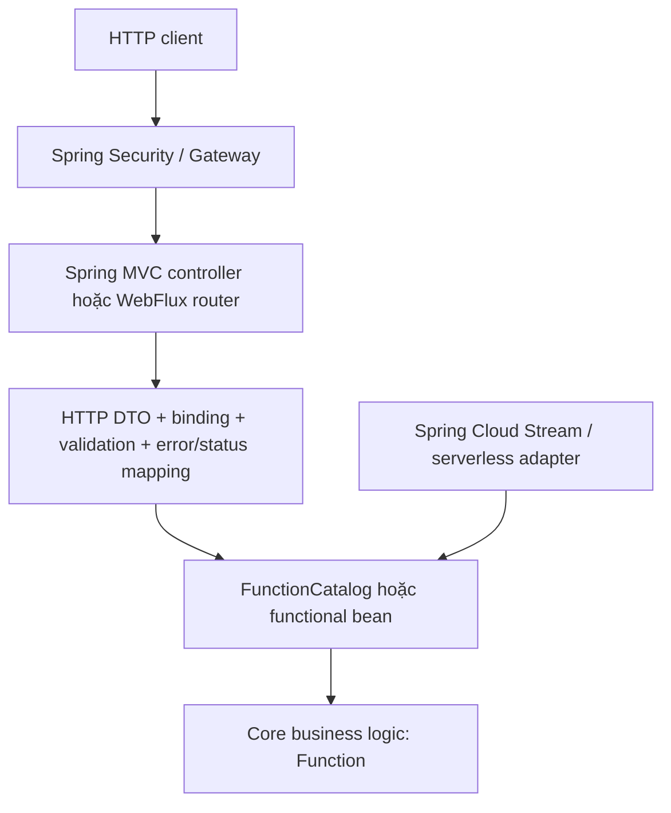
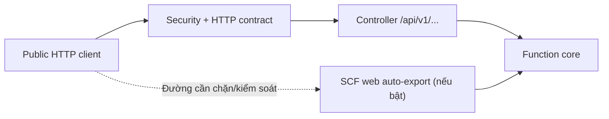

# Ranh giới giữa endpoint hàm và API web có hợp đồng phức tạp trong Spring Cloud Function

## 1. Đặt đúng câu hỏi: công bố hàm hay thiết kế một HTTP API?

**Spring Cloud Function (SCF)** cho phép đóng gói logic thành `Supplier<O>`, `Function<I, O>` và `Consumer<I>`. `FunctionCatalog` đăng ký, tra cứu, chuyển đổi dữ liệu và ghép các hàm. Tùy adapter, **cùng một logic** có thể được gọi qua HTTP, xử lý sự kiện hoặc chạy trên một nền tảng serverless.

Một nhu cầu đơn giản:

```text
POST /uppercase
Content-Type: text/plain

hello
```

Response body:

```text
HELLO
```

Với một hàm chuyển đổi không trạng thái, việc xuất thẳng bean bằng **SCF HTTP adapter** là tự nhiên. Tuy nhiên, yêu cầu của một API sản phẩm có thể khác hẳn:

```http
POST /api/v1/customers/cus-42/quotes?lang=vi HTTP/1.1
Content-Type: application/json
Accept: application/json
X-Request-ID: req-100

{"sku":"BOOK-001","quantity":2}
```

API này có thể phải xử lý **nhiều hợp đồng cùng lúc**: tài nguyên khách hàng, path variables, query parameters, schema DTO, Bean Validation, mã lỗi nhất quán, `Content-Type`/`Accept`, request ID, authorization theo khách hàng, caching, giới hạn số lượng, versioning và các quy tắc idempotency nếu có ghi dữ liệu.

Tài liệu chính thức **Standalone Web Applications** của Spring Cloud Function nói rõ rằng SCF có thể xuất functional beans thành REST endpoints nhưng **không phải giải pháp thay thế Spring MVC/WebFlux**; HTTP adapter chủ yếu phục vụ những mô hình serverless/stateless đơn giản.

### Thông điệp cốt lõi

**Không phải chọn một trong hai:** có thể **giữ nghiệp vụ trong function** để tái sử dụng, đồng thời dùng **Spring MVC/WebFlux ở HTTP boundary** để chịu trách nhiệm về hợp đồng web phức tạp.

### Kết quả cần đạt

Sau bài này, bạn sẽ:

1. Biết khi nào nên dùng SCF HTTP adapter trực tiếp, khi nào cần controller/router.
2. Phân biệt **hợp đồng hàm** (input/output Java) và **hợp đồng HTTP** (URL, method, headers, status, errors, security).
3. Thiết kế một `Function<QuoteCommand, QuoteOutcome>` tái sử dụng, nhưng công bố qua controller có DTO, validation và `ProblemDetail`.
4. Hiểu vai trò của `FunctionCatalog` so với inject trực tiếp một functional bean.
5. Tránh vô tình xuất thêm endpoint SCF bên cạnh controller.
6. Lập checklist và bộ contract tests cho một API cần vận hành lâu dài.

## 2. SCF HTTP adapter giải quyết phần nào?

Theo tài liệu SCF, khi module `spring-cloud-function-web` có mặt trong Spring Boot web app tương thích, functional beans có thể được tự động xuất qua HTTP, đường dẫn mặc định gắn với tên bean và tiền tố có thể đổi bằng `spring.cloud.function.web.path`.

Bảng mapping điển hình:

| Loại hàm | HTTP request | Phản hồi thông thường |
| --- | --- | --- |
| `Supplier<O>` | `GET /{supplier}` | 200 và giá trị do Supplier tạo |
| `Function<I,O>` | `POST /{function}` | 200 và kết quả từ `apply()` |
| `Function<I,O>` | `PUT /{function}` | 200 và kết quả từ `apply()` |
| `Function<I,O>` | `GET /{function}/{item}` | 200, `item` thành input |
| `Consumer<I>` | `POST`/`PUT /{consumer}` | 202 và thường phản chiếu input |
| `Consumer<I>` | `DELETE /{consumer}` | 204, không có response body |

SCF còn cung cấp:

- `FunctionCatalog` và composition, ví dụ `normalize|uppercase` được gọi qua `/normalize,uppercase`.
- `spring.cloud.function.definition` để chọn function/composition mặc định hoặc lọc các hàm được công bố.
- `spring.cloud.function.web.path` để thay tiền tố đường dẫn.
- `spring.cloud.function.http.GET`, `POST`... để giới hạn method mapping theo function.
- Chuyển đổi text/JSON bằng hệ thống converter phù hợp với kiểu Java.
- `Message<T>` để đọc payload, metadata, input/output headers.
- Phản hồi nhiều phần tử và yêu cầu SSE qua `Accept: text/event-stream` khi adapter/runtime phù hợp.

Những tính năng này **rất hữu ích**, nhưng không biến adapter thành framework đầy đủ cho mọi REST API.

### 2.1. Hợp đồng hàm khác hợp đồng web

| Khía cạnh | Hợp đồng functional bean | Hợp đồng HTTP API |
| --- | --- | --- |
| Định danh | Tên bean, definition hoặc composition | URL tài nguyên, version, method |
| Input | `I` của `Function<I,O>` | Path, query, headers, body, identity |
| Output | `O` của function | Status, media type, headers, body |
| Validation | Kiểm tra invariant nghiệp vụ | Parse request, Bean Validation, type/format, yêu cầu bắt buộc |
| Lỗi | Exception hoặc kết quả nghiệp vụ | `400`, `404`, `409`, `422`, `5xx`, body lỗi chuẩn |
| Quyền | Thường là logic độc lập transport | Authentication/authorization theo URL, method, chủ thể/tài nguyên |
| Tác dụng phụ | Do code nghiệp vụ quyết định | HTTP method phải phản ánh đúng ngữ nghĩa và retry contract |
| Vận hành | Invocation, composition, messaging | CORS, cache, conditional requests, rate limits, observability |

**Ví dụ:** `Function<QuoteCommand, QuoteOutcome>` biết cách tính giá. Nó không tự biết có nên trả `200 OK` hay `201 Created`, có phải đính kèm `Location` hay không, và người gọi có quyền báo giá cho `cus-42` không.

## 3. Ma trận quyết định: khi nào dùng gì?

| Nhu cầu | SCF HTTP adapter trực tiếp | Spring MVC/WebFlux controller/router |
| --- | --- | --- |
| Một hàm stateless, input/output rõ ràng | **Phù hợp** | Cũng làm được nhưng có thể không cần |
| Demo hoặc internal endpoint đơn giản | **Phù hợp**, cần kiểm soát truy cập | Tùy độ phức tạp |
| Composition đơn giản theo tên bean | **Mạnh**: FunctionCatalog và path composition | Có thể gọi composition qua catalog |
| API tài nguyên nhiều cấp như `/customers/{id}/orders/{orderId}` | Bắt đầu bất tiện | **Phù hợp** |
| Nhiều path variables, query DTO, phân trang/sắp xếp | Cần xử lý thủ công qua path/header | **Phù hợp** |
| Validation theo DTO, lỗi từng trường | Tự xây dựng boundary | **Phù hợp** |
| Response `201`/`202`/`204`, `Location`, `ETag` phức tạp | Không phải thế mạnh | **Phù hợp** |
| `ProblemDetail`/`application/problem+json` thống nhất | Cần bổ sung handling web | **Phù hợp** |
| Authorization theo tài nguyên, role/scope, tenant | Không tự giải quyết | **Cần HTTP Security ở mọi phương án** |
| Multipart upload, download, Range, file lớn | Không phải công cụ chính | **Phù hợp** |
| SSE đơn giản từ `Flux` | Có hỗ trợ theo adapter/runtime | WebFlux/WebMVC streaming cho hợp đồng chuyên sâu |
| WebSocket, conditional HTTP, CORS phức tạp | Không được thiết kế để thay thế web stack | **Phù hợp** |
| Một nghiệp vụ cần tái sử dụng qua Kafka/serverless | **Function là lõi hữu ích** | Controller chỉ làm adapter HTTP bao ngoài |

**Nguyên tắc chọn:** nếu các yêu cầu quan trọng nhất là “hàm nào, dữ liệu nào, output nào”, hãy cân nhắc xuất SCF trực tiếp. Nếu các yêu cầu quan trọng nhất là “tài nguyên nào, ai được phép, status nào, validation nào, header nào, retry và cache ra sao”, nên dùng **HTTP boundary chuyên trách**.

## 4. Mô hình kiến trúc khuyến nghị: functional core + HTTP adapter

Một kiến trúc cân bằng:



Trong đó:

- **Functional core** nhận command/DTO nghiệp vụ không mang HTTP request object; trả kết quả nghiệp vụ; quản lý invariant.
- **HTTP boundary** đọc URL, query, header, body; xác thực, validate; gọi function; ánh xạ kết quả hoặc lỗi sang HTTP status/body/headers.
- **Event/serverless adapter** chuyển event/request của môi trường thành cùng kiểu command, không cần mô phỏng HTTP.
- **FunctionCatalog** cung cấp tra cứu, composition và conversion đặc thù SCF khi cần; không bắt buộc controller nào cũng phải tự gọi catalog nếu đã có bean inject trực tiếp.

Đây không phải khẳng định mọi logic phải là pure function. Nếu nghiệp vụ cần database, transaction, external API hoặc xuất sự kiện, hãy để phần side effect nằm ở một application service/port được điều phối rõ ràng, không trộn với logic format HTTP.

### Một lỗi kiến trúc dễ gặp

Không nên đặt trong function nghiệp vụ:

```java
// Không phải hướng thiết kế tốt để tái sử dụng qua event/serverless:
Function<HttpServletRequest, ResponseEntity<?>> calculateQuote;
```

Vì khi đó mọi adapter ngoài HTTP phải tạo giả `HttpServletRequest` và hiểu `ResponseEntity`. Hãy chuyển HTTP request thành `QuoteCommand` trước khi gọi function.

## 5. Ví dụ Java: nghiệp vụ là Function, HTTP là Controller

Ta xây dựng API tính báo giá theo khách hàng, có:

- `POST /api/v1/customers/{customerId}/quotes`.
- Query parameter `lang` nhận `vi` hoặc `en`.
- Header `X-Request-ID` tùy chọn, được kiểm tra trước khi phản chiếu.
- JSON request có `sku` và `quantity`, dùng Bean Validation.
- JSON response có giá tính được, `Cache-Control: no-store`, request ID.
- Lỗi `400` khi binding/validation sai, `422` khi SKU không được hỗ trợ.
- **Không tạo resource thực**: trả `200 OK`, không phải `201 Created`.

### 5.1. Dependency của lựa chọn Controller

Khởi tạo dự án **Spring Boot Java 17+** với Spring Cloud BOM tương thích. Ví dụ dưới dùng **Spring MVC** và `jakarta.validation` theo hệ Spring Boot 3.x/Spring Framework 6.x. Khai báo những dependencies thích hợp:

```xml
<dependencies>
    <dependency>
        <groupId>org.springframework.boot</groupId>
        <artifactId>spring-boot-starter-web</artifactId>
    </dependency>
    <dependency>
        <groupId>org.springframework.boot</groupId>
        <artifactId>spring-boot-starter-validation</artifactId>
    </dependency>
    <dependency>
        <groupId>org.springframework.cloud</groupId>
        <artifactId>spring-cloud-function-context</artifactId>
    </dependency>
</dependencies>
```

Các version phải do Spring Boot parent/BOM và Spring Cloud BOM tương thích quản lý. **Cố ý không thêm `spring-cloud-starter-function-web`** trong ứng dụng controller này: nếu thêm SCF HTTP adapter, nó có thể đồng thời công bố functional bean dưới một URL khác ngoài API contract ta đang kiểm soát.

Nếu chỉ cần bean `Function` và không cần catalog, ứng dụng còn có thể khai báo nó bằng Spring Core thuần; `spring-cloud-function-context` được thêm ở đây để tiếp tục sử dụng mô hình SCF/FunctionCatalog.

### 5.2. File Java đầy đủ

Tạo file `src/main/java/demo/QuoteApplication.java`. Các lớp package-private đặt cùng file để ví dụ có thể đọc liên tục:

```java
package demo;

import java.math.BigDecimal;
import java.util.Set;
import java.util.UUID;
import java.util.function.Function;

import jakarta.validation.Valid;
import jakarta.validation.constraints.Max;
import jakarta.validation.constraints.Min;
import jakarta.validation.constraints.NotBlank;
import jakarta.validation.constraints.Pattern;

import org.springframework.beans.factory.annotation.Qualifier;
import org.springframework.boot.SpringApplication;
import org.springframework.boot.autoconfigure.SpringBootApplication;
import org.springframework.context.annotation.Bean;
import org.springframework.http.CacheControl;
import org.springframework.http.HttpStatus;
import org.springframework.http.MediaType;
import org.springframework.http.ProblemDetail;
import org.springframework.http.ResponseEntity;
import org.springframework.web.bind.MethodArgumentNotValidException;
import org.springframework.web.bind.annotation.ExceptionHandler;
import org.springframework.web.bind.annotation.PathVariable;
import org.springframework.web.bind.annotation.PostMapping;
import org.springframework.web.bind.annotation.RequestBody;
import org.springframework.web.bind.annotation.RequestHeader;
import org.springframework.web.bind.annotation.RequestMapping;
import org.springframework.web.bind.annotation.RequestParam;
import org.springframework.web.bind.annotation.RestController;
import org.springframework.web.bind.annotation.RestControllerAdvice;

@SpringBootApplication
public class QuoteApplication {
    public static void main(String[] args) {
        SpringApplication.run(QuoteApplication.class, args);
    }

    // Core nghiệp vụ không có kiểu dữ liệu nào của HTTP.
    @Bean
    public Function<QuoteCommand, QuoteOutcome> calculateQuote() {
        return command -> {
            if (command == null || command.quantity() <= 0) {
                throw new IllegalArgumentException(
                        "Quantity must be positive");
            }
            if (!"BOOK-001".equals(command.sku())) {
                throw new UnsupportedSkuException(command.sku());
            }

            BigDecimal price = BigDecimal.valueOf(120000L);
            BigDecimal total = price.multiply(
                    BigDecimal.valueOf(command.quantity()));

            return new QuoteOutcome(
                    command.sku(), command.quantity(), total);
        };
    }
}

// DTO nghiệp vụ: không có HTTP status, headers hoặc URL.
record QuoteCommand(String sku, int quantity) {}
record QuoteOutcome(String sku, int quantity, BigDecimal totalPrice) {}

// DTO dành riêng cho hợp đồng HTTP.
record QuoteRequest(
        @NotBlank
        @Pattern(regexp = "[A-Z0-9-]{1,32}")
        String sku,
        @Min(1) @Max(100)
        int quantity) {}

record QuoteResponse(
        String sku,
        int quantity,
        BigDecimal totalPrice,
        String currency) {}

final class UnsupportedSkuException extends RuntimeException {
    UnsupportedSkuException(String sku) {
        super("Unsupported SKU: " + sku);
    }
}

final class InvalidHttpRequestException extends RuntimeException {
    InvalidHttpRequestException(String detail) {
        super(detail);
    }
}

// HTTP boundary: kiểm tra URL, query, headers, body và status.
@RestController
@RequestMapping("/api/v1/customers/{customerId}/quotes")
class QuoteController {

    private final Function<QuoteCommand, QuoteOutcome> calculator;

    QuoteController(
            @Qualifier("calculateQuote")
            Function<QuoteCommand, QuoteOutcome> calculator) {
        this.calculator = calculator;
    }

    @PostMapping(
            consumes = MediaType.APPLICATION_JSON_VALUE,
            produces = MediaType.APPLICATION_JSON_VALUE)
    public ResponseEntity<QuoteResponse> calculate(
            @PathVariable("customerId") String customerId,
            @RequestParam(name = "lang", defaultValue = "vi") String lang,
            @RequestHeader(name = "X-Request-ID", required = false)
            String requestId,
            @Valid @RequestBody QuoteRequest request) {

        if (!customerId.matches("[a-z0-9-]{1,24}")) {
            throw new InvalidHttpRequestException(
                    "Invalid customer ID");
        }
        if (!Set.of("vi", "en").contains(lang)) {
            throw new InvalidHttpRequestException(
                    "Unsupported lang");
        }
        if (requestId != null
                && !requestId.matches("[A-Za-z0-9_-]{1,36}")) {
            throw new InvalidHttpRequestException(
                    "Invalid X-Request-ID");
        }

        String safeId = requestId == null
                ? UUID.randomUUID().toString()
                : requestId;

        // Không chuyển HttpServletRequest/ResponseEntity vào function.
        QuoteOutcome result = calculator.apply(
                new QuoteCommand(request.sku(), request.quantity()));

        QuoteResponse body = new QuoteResponse(
                result.sku(),
                result.quantity(),
                result.totalPrice(),
                "VND");

        return ResponseEntity.ok()
                .header("X-Request-ID", safeId)
                .cacheControl(CacheControl.noStore())
                .body(body);
    }
}

// HTTP error contract: không đặt ResponseEntity vào core Function.
@RestControllerAdvice
class QuoteErrors {

    @ExceptionHandler(InvalidHttpRequestException.class)
    ResponseEntity<ProblemDetail> invalid(
            InvalidHttpRequestException exception) {

        ProblemDetail problem =
                ProblemDetail.forStatusAndDetail(
                        HttpStatus.BAD_REQUEST,
                        exception.getMessage());
        problem.setTitle("Invalid HTTP request");

        return ResponseEntity.badRequest()
                .contentType(MediaType.APPLICATION_PROBLEM_JSON)
                .body(problem);
    }

    @ExceptionHandler(UnsupportedSkuException.class)
    ResponseEntity<ProblemDetail> unsupported(
            UnsupportedSkuException exception) {

        ProblemDetail problem =
                ProblemDetail.forStatusAndDetail(
                        HttpStatus.UNPROCESSABLE_ENTITY,
                        "The SKU is not supported");
        problem.setTitle("Unsupported SKU");

        return ResponseEntity.unprocessableEntity()
                .contentType(MediaType.APPLICATION_PROBLEM_JSON)
                .body(problem);
    }

    @ExceptionHandler(MethodArgumentNotValidException.class)
    ResponseEntity<ProblemDetail> invalidBody(
            MethodArgumentNotValidException exception) {

        ProblemDetail problem =
                ProblemDetail.forStatusAndDetail(
                        HttpStatus.BAD_REQUEST,
                        "sku and quantity do not satisfy the API contract");
        problem.setTitle("Request validation failed");

        return ResponseEntity.badRequest()
                .contentType(MediaType.APPLICATION_PROBLEM_JSON)
                .body(problem);
    }
}
```

**Điểm quan trọng của ví dụ:**

- `calculateQuote` là bean `Function<QuoteCommand, QuoteOutcome>`. Nó không biết về URI, HTTP headers, query string hay status.
- `QuoteRequest` là DTO HTTP có `@NotBlank`, `@Pattern`, `@Min` và `@Max`; Bean Validation hoạt động khi ứng dụng có provider phù hợp.
- `QuoteController` chỉ định URL, method, `consumes`, `produces`, validation, response headers và `ResponseEntity`.
- `QuoteErrors` quyết định mã lỗi và `ProblemDetail` cho ba nhóm lỗi ví dụ.
- Không có database hoặc kho báo giá bền vững, nên kết quả là **200 OK** cho một phép tính, **không** phải 201.
- Chưa có authorization theo `customerId`. Regex chỉ validate **hình dạng** ID; nếu endpoint dành cho người dùng thật, phải thêm Spring Security và kiểm tra quan hệ giữa caller với `customerId`.
- `lang` ở đây được **kiểm tra nhưng chưa làm thay đổi nghiệp vụ**; trong API production, hãy dùng nó cho localization nếu hợp đồng yêu cầu, hoặc bỏ query parameter không cần thiết.
- Giá `120000 VND` và SKU duy nhất là dữ liệu giả để minh họa kiến trúc.

### 5.3. Vì sao không viết ResponseEntity trong Function?

Đoạn sau tạo ràng buộc HTTP không cần thiết:

```java
// Phản ví dụ: function khó tái sử dụng qua Kafka/serverless.
Function<QuoteCommand, ResponseEntity<QuoteResponse>> quote;
```

Trong một sự kiện `QuoteRequested` gửi qua broker, người tiêu thụ không cần `HttpStatus`, `Location` hay `Cache-Control`. Do đó phần lõi nên trả `QuoteOutcome`; từng adapter tự xây response/event thích hợp.

## 6. Thử HTTP contract của controller

Khởi động ứng dụng với Maven/Gradle wrapper phù hợp với dự án (ví dụ Maven):

```bash
mvn spring-boot:run
```

Các lệnh `curl` dưới dùng Bash, server mặc định `http://localhost:8080`. Trên PowerShell hãy dùng `curl.exe` và ký hiệu xuống dòng tương ứng.

### 6.1. Gọi đúng: 200 + JSON + headers

```bash
curl -i -X POST \
  'http://localhost:8080/api/v1/customers/cus-42/quotes?lang=vi' \
  -H 'Content-Type: application/json' \
  -H 'Accept: application/json' \
  -H 'X-Request-ID: req-100' \
  --data '{"sku":"BOOK-001","quantity":2}'
```

Response điển hình:

```http
HTTP/1.1 200 OK
Content-Type: application/json
Cache-Control: no-store
X-Request-ID: req-100

{"sku":"BOOK-001","quantity":2,"totalPrice":240000,"currency":"VND"}
```

Header thực tế có thể kèm charset và những HTTP headers khác do web runtime tạo; thứ tự field JSON không có ý nghĩa. Kết quả nghiệp vụ: hai đơn vị nhân 120.000 = 240.000 VND.

### 6.2. Body không hợp lệ: 400 Bad Request

```bash
curl -i -X POST \
  'http://localhost:8080/api/v1/customers/cus-42/quotes' \
  -H 'Content-Type: application/json' \
  -H 'Accept: application/json' \
  --data '{"sku":"BOOK-001","quantity":0}'
```

`@Min(1)` làm validation thất bại trước khi business function được gọi. Advice trong ví dụ trả `400` và body theo media type `application/problem+json`.

Ví dụ body rút gọn:

```json
{
  "type": "about:blank",
  "title": "Request validation failed",
  "status": 400,
  "detail": "sku and quantity do not satisfy the API contract"
}
```

Khi API production cần trả lỗi từng field, có thể bổ sung properties được chuẩn hóa trong `ProblemDetail` và quy định giới hạn nội dung lỗi. Không nên trả nguyên stack trace, exception object hoặc dữ liệu nhạy cảm ra client.

### 6.3. Body đúng schema nhưng SKU không hỗ trợ: 422

```bash
curl -i -X POST \
  'http://localhost:8080/api/v1/customers/cus-42/quotes' \
  -H 'Content-Type: application/json' \
  -H 'Accept: application/json' \
  --data '{"sku":"BOOK-999","quantity":2}'
```

Bean `calculateQuote` nhận được command hợp lệ về hình thức nhưng ném `UnsupportedSkuException`; controller advice chuyển nó sang `422 Unprocessable Content` với `ProblemDetail`.

**Quy tắc 422 là lựa chọn của hợp đồng API mẫu**, không phải SCF tự sinh. Một hệ thống khác có thể chọn `404` cho SKU không tồn tại trong một tài nguyên đã được định danh, tùy định nghĩa API.

### 6.4. Path, query và header sai: 400

```bash
# lang không được hỗ trợ.
curl -i -X POST \
  'http://localhost:8080/api/v1/customers/cus-42/quotes?lang=fr' \
  -H 'Content-Type: application/json' \
  --data '{"sku":"BOOK-001","quantity":2}'

# X-Request-ID sai định dạng.
curl -i -X POST \
  'http://localhost:8080/api/v1/customers/cus-42/quotes' \
  -H 'Content-Type: application/json' \
  -H 'X-Request-ID: invalid value!' \
  --data '{"sku":"BOOK-001","quantity":2}'
```

Các request trên nhận `400` từ `InvalidHttpRequestException`. Việc kiểm tra `X-Request-ID` không chứng minh header là tin cậy cho bảo mật; correlation ID chỉ được sử dụng sau khi validate, còn identity phải đến từ cơ chế xác thực.

### 6.5. Sai Content-Type, Accept hoặc HTTP method

```bash
# Content-Type không khớp @PostMapping(consumes).
curl -i -X POST \
  'http://localhost:8080/api/v1/customers/cus-42/quotes' \
  -H 'Content-Type: text/plain' \
  --data 'hello'

# Client chỉ chấp nhận text/plain, không tương thích produces.
curl -i -X POST \
  'http://localhost:8080/api/v1/customers/cus-42/quotes' \
  -H 'Content-Type: application/json' \
  -H 'Accept: text/plain' \
  --data '{"sku":"BOOK-001","quantity":2}'

# Endpoint chỉ định POST, không đăng ký PUT.
curl -i -X PUT \
  'http://localhost:8080/api/v1/customers/cus-42/quotes' \
  -H 'Content-Type: application/json' \
  --data '{"sku":"BOOK-001","quantity":2}'
```

Trong một Spring MVC app thông thường, các trường hợp này có thể nhận lần lượt `415 Unsupported Media Type`, `406 Not Acceptable` và `405 Method Not Allowed`. Error body cụ thể phụ thuộc Spring Boot error handling, `@ControllerAdvice` và các bộ lọc đang chạy. Điểm khác biệt là **controller tuyên bố method, consumes và produces ngay trong route contract**.

## 7. FunctionCatalog vẫn hữu ích khi dùng controller

Trong ví dụ, controller inject trực tiếp:

```java
@Qualifier("calculateQuote")
Function<QuoteCommand, QuoteOutcome> calculator
```

Đây là cách đơn giản nếu chỉ cần gọi một bean đã biết kiểu. Nếu cần composition, conversion hoặc wrapper của SCF, có thể tra cứu qua catalog:

```java
import org.springframework.cloud.function.context.FunctionCatalog;

// Minh họa bên trong một bean/service Spring:
Function<QuoteCommand, QuoteOutcome> function =
        catalog.lookup("calculateQuote");

QuoteOutcome result = function.apply(
        new QuoteCommand("BOOK-001", 2));
```

SCF cung cấp wrapper của catalog cho những đặc tính như **composition và type conversion**. Khi inject trực tiếp `Function` từ Spring application context, bạn nhận bean như đã khai báo, **không mặc nhiên áp dụng đầy đủ wrapper của FunctionCatalog**.

**Không** nên gọi `catalog.lookup()` với một tên function đến trực tiếp từ path/query/header của người dùng mà chưa có allowlist. Nếu API nhận tên function tùy ý rồi chạy nó, bạn đã tạo thêm một hệ thống routing động có rủi ro bảo mật.

### Dùng chung qua HTTP, sự kiện và serverless

Cùng một `calculateQuote` có thể phục vụ:

```text
HTTP controller:
  QuoteRequest + URL metadata
    -> QuoteCommand
    -> calculateQuote
    -> QuoteResponse + HTTP status/headers

Spring Cloud Stream:
  QuoteRequested event
    -> QuoteCommand
    -> calculateQuote
    -> QuoteCalculated event

Serverless:
  Platform event
    -> QuoteCommand
    -> calculateQuote
    -> Platform response
```

**Tái sử dụng không đồng nghĩa giống hệt nhau về transaction/retry.** Event handler có thể có at-least-once delivery, serverless có timeout và HTTP client có retry riêng. Lớp nghiệp vụ có side effect phải làm rõ idempotency trên từng adapter.

## 8. Bẫy quan trọng: có thể vô tình tạo hai HTTP API

Giả sử ứng dụng vừa khai báo bean:

```java
@Bean
public Function<QuoteCommand, QuoteOutcome> calculateQuote() {
    // ...
}
```

vừa dùng `@RestController` ở `/api/v1/customers/{customerId}/quotes`.

Nếu bạn **thêm SCF web starter** vào cùng ứng dụng, nó có thể tự xuất thêm endpoint:

```text
POST /calculateQuote
```

Endpoint này có thể nhận dữ liệu trực tiếp theo kiểu `QuoteCommand` và trả `QuoteOutcome`, **bỏ qua validation/headers/path/authorization riêng đã viết trong QuoteController**. Đây là một dạng **bypass HTTP boundary** nếu chỉ bảo vệ controller chính.

### Cách tránh vô tình xuất route

**Lựa chọn 1 — Chỉ dùng controller HTTP:** giữ `spring-boot-starter-web` và `spring-cloud-function-context`; không thêm SCF web auto-export trong deployment này. Đây là lựa chọn của ví dụ.

**Lựa chọn 2 — Hai đường HTTP tách biệt rõ:** nếu cần cả SCF endpoint cho các caller tin cậy lẫn REST API công khai, đặt prefix SCF riêng:

```properties
spring.cloud.function.web.path=/internal-functions
```

Sau đó áp dụng **Spring Security/gateway deny-by-default**, network policy hoặc cấu hình tách deployment để tránh lộ `/internal-functions/**`. Chỉ đổi prefix **không** phải cơ chế bảo mật.

**Lựa chọn 3 — Tách runtime:** thư viện nghiệp vụ và SCF function dùng chung; API web chạy deployment riêng, event/serverless chạy adapter khác. Dùng khi security/lifecycle/resource scaling của các giao thức khác nhau rõ rệt.

Nếu đang dùng `spring.cloud.function.definition`, cần lưu ý **root mapping/fallback** khi chỉ có một definition và **function filtering** khi nhiều mục cách nhau bằng `;`. Đừng coi filtering là authorization. Đồng thời kiểm tra `functionRouter` và những routing headers có thể ảnh hưởng hàm đích.

### Sơ đồ tránh bypass



## 9. Validation: ranh giới giữa sai request và sai nghiệp vụ

HTTP input có **hai tầng kiểm tra**:

1. **Boundary validation:** JSON hợp lệ, field bắt buộc, format, length, parse số/ngày, path/query/header constraints.
2. **Business invariants:** SKU được hỗ trợ, quy tắc giá, hạn mức đơn hàng, trạng thái tài nguyên, quyền nghiệp vụ.

Ví dụ:

| Input | Tầng phát hiện | Response hợp đồng mẫu |
| --- | --- | --- |
| JSON bị thiếu dấu ngoặc | HTTP JSON converter | 400 |
| `quantity=0` | `@Min(1)` trên DTO | 400 |
| `sku=""` | `@NotBlank`/`@Pattern` | 400 |
| `lang=fr` | HTTP query validation | 400 |
| `sku=BOOK-999` hợp lệ về dạng, không hỗ trợ | Business function | 422 theo hợp đồng mẫu |
| Không được phép xem dữ liệu khách hàng khác | Security/authorization | 403, hoặc 404 tùy chính sách che giấu tài nguyên |
| Lỗi database/remote service | Infrastructure | 5xx hoặc lỗi được thiết kế, không rò rỉ stack trace |

Đừng dùng duy nhất `IllegalArgumentException` rồi kỳ vọng SCF web adapter tự đổi mọi lỗi thành `400`. Trong API chuyên nghiệp, phải có **error taxonomy** và ánh xạ rõ ở HTTP boundary.

### Error representation nhất quán

`ProblemDetail` trong Spring Framework hỗ trợ body phù hợp RFC 9457, thường trả với `application/problem+json`. Với API lớn, nên chuẩn hóa:

- `type` hoặc error code ổn định cho máy đọc.
- `title`, `status`, `detail` thân thiện nhưng không lộ bí mật.
- `instance`, correlation/request ID nếu cần.
- Validation errors ở danh sách field với giá trị đã được ẩn/lọc phù hợp.
- Quy tắc chuyển lỗi domain/concurrency/security sang HTTP status.

Không mặc định rằng mọi exception xảy ra bên trong SCF function sẽ tự được `@ControllerAdvice` bắt đúng nếu request đi **qua route SCF auto-export** chứ không đi qua controller; đó là một lý do cần integration test đúng tuyến.

## 10. Authorization và tenancy không thể suy ra từ đường dẫn

Giả sử API:

```text
GET /api/v1/customers/cus-42/orders/ord-7
```

Path variables chỉ định **tài nguyên**, không chứng minh người gọi có quyền với nó. Hệ thống cần:

- Authentication: ai đang gọi? JWT/session/mTLS/API key tùy kiến trúc.
- Authorization: principal có quyền xem/cập nhật `cus-42` và `ord-7`?
- Object-level authorization: kiểm tra trên **tài nguyên thực** sau khi xác định tenant/owner.
- Method-level rules: có quyền GET nhưng chưa chắc có quyền DELETE.
- Routing header controls: không để user tự chuyển đến function nội bộ qua `spring.cloud.function.definition` hoặc routing expression.
- Logging/observability: không log token, cookie, secret và PII thô.

Ngay cả khi một SCF function được gọi qua event, message broker cũng cần hợp đồng identity/trust riêng. Không bê nguyên `HttpServletRequest` hoặc JWT header vào domain command nếu chỉ cần actor ID và quyền đã được xác nhận bởi adapter.

## 11. HTTP status, cache và conditional requests

Một function có output Java nhưng **không tự quyết định đầy đủ HTTP response semantics**. API phức tạp thường cần:

| Tình huống | Status/headers có thể dùng | Yêu cầu bổ sung |
| --- | --- | --- |
| Tính báo giá và trả ngay | `200 OK` | Body JSON của kết quả |
| Tạo order được lưu bền vững | `201 Created` + `Location` | Resource ID và commit thành công |
| Nhận job xử lý bất đồng bộ | `202 Accepted` + URL theo dõi | Job tracking, timeout và trạng thái |
| Xóa/thay đổi thành công không trả body | `204 No Content` | Client không parse body |
| Không tìm thấy resource | `404 Not Found` | Quy tắc disclosure/authorization rõ |
| Xung đột version/state | `409 Conflict` hoặc `412 Precondition Failed` | Kiểm tra business state hoặc điều kiện ETag |
| Không có quyền | `401`/`403` | Security và challenge theo hợp đồng |
| Client nhận cache validation | `304 Not Modified` | `ETag`/`Last-Modified` và precondition |
| API response có thể cache | `Cache-Control`, `Vary` | Hiểu dữ liệu cá nhân, privacy và CDN |

Ví dụ Spring MVC trả `201` **chỉ khi đã có một operation tạo tài nguyên thật**:

```java
// Đoạn minh họa riêng; giả định orderService.create() lưu bền vững.
var saved = orderService.create(command);
URI location = URI.create("/api/v1/orders/" + saved.id());

return ResponseEntity.created(location).body(saved);
```

Đây **không phải** code thuộc ứng dụng báo giá ở mục 5 và không được dùng khi không có `orderService` thực. Đặt `201` chỉ vì HTTP method là POST là sai hợp đồng.

### Content-Type và Accept

`Content-Type` mô tả request body client gửi; `Accept` mô tả media type client chấp nhận ở response. `@PostMapping(consumes=..., produces=...)` làm hợp đồng này hiển thị ngay tại route.

Với SCF auto-export, text/JSON conversion căn cứ vào kiểu function, MessageConverter và web runtime; nó phù hợp với endpoint đơn giản, nhưng không thay thế cơ chế negotiation nhiều representation và lỗi chuẩn của API chuyên sâu.

## 12. Idempotency, transaction và retry nằm ở đâu?

HTTP method có ngữ nghĩa, nhưng chỉ **tên method không tạo ra idempotency**.

- `GET` nên safe: không làm thay đổi trạng thái tài nguyên theo ý nghĩa nghiệp vụ.
- `PUT` và `DELETE` được kỳ vọng idempotent xét về hiệu ứng mong muốn.
- `POST` thường không idempotent, có thể cần `Idempotency-Key` nếu client có khả năng retry tạo thanh toán/đơn hàng.
- `202 Accepted` **không bảo đảm** hệ thống đã xử lý xong hoặc đã lưu event bền vững.
- Một function được gọi qua event broker có thể nhận lại cùng thông điệp nhiều lần; đó là bài toán delivery semantics riêng.

Một API ghi dữ liệu cần thiết kế rõ:

1. Phạm vi transaction và thời điểm commit.
2. Cách phát hiện request trùng / retry (idempotency key, unique constraint, event ID).
3. Khóa lạc quan và điều kiện `If-Match` nếu có concurrent writes.
4. Error mapping (`409`, `412`, `429`, `5xx`) theo hợp đồng.
5. Quan sát idempotency sau crash, timeout hoặc client disconnect.

**SCF FunctionCatalog không thay thế transaction manager, persistence layer, outbox pattern hay security policy.** Giữ HTTP boundary và application service có trách nhiệm rõ hơn khi side effects phức tạp.

## 13. Pagination, multipart, file transfer, SSE và WebSocket

Một điểm nhầm phổ biến là “SCF hỗ trợ Flux và SSE nên tương đương toàn bộ WebFlux”. Hai khái niệm này không giống nhau.

### 13.1. Pagination và filter DTO

Ví dụ một API đọc danh sách:

```text
GET /api/v1/orders?cursor=abc&limit=20&sort=createdAt,desc
```

API cần parse query, validate `limit`, xác định thứ tự ổn định, trả metadata `nextCursor` và chống query vượt tải. SCF HTTP adapter đưa query parameters vào `MessageHeaders["http_request_param"]` khi function nhận `Message<T>`, nhưng khi query binding phức tạp, `@RequestParam` hoặc WebFlux functional router chuyên trách sẽ dễ kiểm soát hơn.

### 13.2. Multipart upload và file download

Tải file thường cần:

- Multipart form-data với nhiều phần và giới hạn dung lượng.
- Streaming upload/download, antivirus hoặc kiểm tra định dạng.
- `Content-Disposition`, `Content-Length`, HTTP Range và điều kiện cache.
- Kiểm soát file name/path traversal, timeout và resource cleanup.

Spring MVC/WebFlux cung cấp các abstraction phù hợp hơn cho hợp đồng này (ví dụ `MultipartFile` trong MVC hoặc `FilePart` trong WebFlux). Không mặc định SCF function nhận DTO là đủ để thay thế file API.

### 13.3. SSE và phản hồi nhiều phần tử

SCF có thể xuất multi-valued response dạng **SSE** khi client gửi:

```http
Accept: text/event-stream
```

Với `Supplier<Flux<T>>` hoặc reactive function, đây là lựa chọn hợp lý cho streaming đơn giản. Nếu API cần event ID, replay, cursor, per-client authorization, heartbeat, backpressure, client disconnect và giới hạn proxy/gateway, cần thiết kế HTTP streaming boundary đầy đủ; `Flux` tự thân không bảo đảm replay hoặc lưu sự kiện.

### 13.4. WebSocket và streaming hai chiều

SSE truyền **server → client**. Một ứng dụng cần tương tác liên tục hai chiều có thể chọn WebSocket hoặc transport chuyên biệt. Không nên cố dùng một `Function<String,String>` để mô phỏng mọi session/connection WebSocket.

## 14. Spring MVC Controller hay WebFlux RouterFunction?

Cả hai có thể giữ nghiệp vụ trong functional bean.

| Tiêu chí | Spring MVC Controller | Spring WebFlux Router/Handler |
| --- | --- | --- |
| Programming model | `@RestController`, `@GetMapping`... | `RouterFunction<ServerResponse>`, handler reactive |
| Binding & validation | Annotation/Bean Validation tiện lợi | Reactive request body + validation theo stack |
| Response status/headers | `ResponseEntity`, `ProblemDetail` | `ServerResponse`, reactive codecs |
| I/O thông thường | Servlet, có thể dùng blocking service | Reactive, tránh blocking trên event loop |
| Streaming | MVC có cơ chế async/SSE | WebFlux mạnh với `Flux`, backpressure |
| Gọi nghiệp vụ SCF | Inject `Function` hoặc `FunctionCatalog` | Tương tự, chú ý kiểu reactive và scheduler |

Ví dụ khái niệm về WebFlux routing, không phải phần của source MVC ở mục 5:

```java
// Minh họa trong một WebFlux application đã có Handler.
RouterFunction<ServerResponse> routes(QuoteHandler handler) {
    return RouterFunctions.route()
            .POST("/api/v1/quotes", handler::calculate)
            .build();
}
```

WebFlux **không tự biến một hàm blocking thành non-blocking**. Nếu handler gọi JDBC blocking hoặc `Function.apply()` tốn thời gian trên event-loop, cần kiến trúc scheduler/I/O phù hợp. Ngược lại, chỉ cần controller MVC không làm mất khả năng tái sử dụng của functional core.

## 15. Quy trình nâng cấp từ SCF HTTP endpoint sang API có hợp đồng đầy đủ

Giả sử hôm nay đang có:

```text
POST /calculateQuote
Content-Type: application/json
```

Ngày mai sản phẩm cần:

```text
POST /api/v1/customers/{customerId}/quotes
```

Lộ trình chuyển đổi:

1. **Đóng băng hợp đồng hiện tại:** liệt kê URL/method, input/output Java, JSON schema, status, headers, các consumer đang dùng.
2. **Định nghĩa DTO nghiệp vụ:** tách `QuoteCommand`/`QuoteOutcome` khỏi request/response HTTP.
3. **Viết controller/router mới:** ánh xạ path/query/header/body, validation, security, status, error contract.
4. **Gọi cùng core function:** inject bean hoặc tra cứu `FunctionCatalog` cho composition/conversion cần thiết.
5. **Bảo vệ route cũ:** không để auto-export tiếp tục lộ endpoint ngoài policy; nếu còn client cũ, chỉ giữ route tương thích trong một kế hoạch migration có thời hạn.
6. **Test song song:** golden cases về nghiệp vụ; contract tests riêng cho hai HTTP API; event/serverless contract riêng nếu có.
7. **Triển khai tăng dần:** API version, telemetry, deprecation, routing và rollback.
8. **Gỡ route cũ:** sau khi client được di chuyển và quyền truy cập được rà soát.

Không nên đổi response từ `200` sang `201`, thay JSON object thành array, hoặc đổi lỗi 4xx chỉ vì đổi URL; đây đều là **breaking changes** nếu contract cũ được client dựa vào.

## 16. Kiểm thử: function tests không đủ cho HTTP contract

Để bảo đảm hệ thống đúng, nên có **ba tầng kiểm thử**.

### 16.1. Unit test core function

Các ca đơn giản:

```java
Function<QuoteCommand, QuoteOutcome> calculator =
        new QuoteApplication().calculateQuote();

QuoteOutcome result =
        calculator.apply(new QuoteCommand("BOOK-001", 2));

assert result.totalPrice().compareTo(
        BigDecimal.valueOf(240000L)) == 0;
```

Ví dụ `assert` dùng Java assertion (cần bật `-ea` khi chạy nếu muốn assertion có hiệu lực); trong dự án thật nên dùng JUnit/AssertJ. Test này chỉ xác nhận tính toán, **không** chứng minh HTTP route hoặc validation đã hoạt động.

### 16.2. Integration test HTTP boundary

| Test case | Điều phải xác minh |
| --- | --- |
| POST hợp lệ | 200, JSON đúng, request ID đã được validate và response headers phù hợp |
| SKU không được hỗ trợ | 422, `application/problem+json`, body lỗi không lộ dữ liệu nội bộ |
| Số lượng 0 hoặc 101 | 400 từ Bean Validation, core không bị gọi |
| JSON malformed | 400 theo HTTP converter |
| `Content-Type: text/plain` | Không đi vào handler JSON, thường 415 |
| `Accept: text/plain` | Không đáp ứng representation đã công bố, thường 406 |
| PUT/DELETE tới POST-only route | Method không được phép, thường 405 |
| Sai `customerId`, `lang`, request ID | 400 theo hợp đồng |
| Truy cập customer khác | 403/404 theo policy đã chọn khi **đã triển khai security** |
| `POST /calculateQuote` ngoài ý muốn | Không được xuất bởi runtime controller-only |
| Headers, CORS và gateway | Kiểm tra response cuối tuyến, tránh phản chiếu credential |

Lệnh curl hỗ trợ kiểm thử thủ công:

```bash
# Thành công:
curl -i -X POST \
  'http://localhost:8080/api/v1/customers/cus-42/quotes' \
  -H 'Content-Type: application/json' \
  --data '{"sku":"BOOK-001","quantity":2}'

# Không được tạo SCF auto-export khi chỉ dùng controller.
curl -i -X POST 'http://localhost:8080/calculateQuote' \
  -H 'Content-Type: application/json' \
  --data '{"sku":"BOOK-001","quantity":2}'

# DTO không hợp lệ, cần 400.
curl -i -X POST \
  'http://localhost:8080/api/v1/customers/cus-42/quotes' \
  -H 'Content-Type: application/json' \
  --data '{"sku":"BOOK-001","quantity":0}'
```

Không coi một status `404` đơn lẻ là đủ để chứng minh logic không bị gọi qua các route khác; nếu có nhiều adapters, cần test các đường đi đó.

### 16.3. End-to-end và hợp đồng liên adapter

Nếu cùng nghiệp vụ nhận sự kiện:

- Event schema có tương thích `QuoteCommand` không?
- Idempotency/retry/dead-letter có được kiểm soát đúng?
- Không lẫn HTTP status hoặc headers vào event payload trừ khi có hợp đồng riêng?
- FunctionCatalog lookup/composition có nhận đúng kiểu dữ liệu?
- Security và identity của message producer có đủ tin cậy?
- Quan sát tracing/request ID liên adapter nhưng không phản chiếu token/secret?

Một ứng dụng có thể đạt toàn bộ unit tests của function mà vẫn có **lỗ hổng bypass route**, sai HTTP status hoặc lỗi authorization nếu thiếu test integration/E2E.

## 17. Những lỗi thiết kế thường gặp

| Mẫu sai | Vấn đề | Cách sửa |
| --- | --- | --- |
| Đưa `HttpServletRequest` vào `Function<I,O>` | Coupling chặt với Servlet | Chuyển request thành command nghiệp vụ ở boundary |
| Trả `ResponseEntity` từ core function | Lẫn HTTP status/header vào nghiệp vụ | Trả kết quả domain, controller tạo response |
| Dùng SCF auto-export cho mọi public REST API | Thiếu contract resource/status/security phức tạp | Chọn controller/router cho boundary |
| Vừa có controller vừa bật SCF web không kiểm soát | Lộ endpoint theo tên function | Loại web auto-export hoặc bảo vệ/tách deployment |
| Dùng function filtering như authorization | Lọc route không thay quyền theo user | Spring Security, gateway, object-level checks |
| Chỉ test `Function.apply()` | Không test HTTP binding, validation, errors | Test MockMvc/WebTestClient/HTTP real |
| Mặc định POST = 201 | POST có thể chỉ tính toán | Chỉ 201 khi đã tạo resource theo hợp đồng |
| Mặc định PUT = idempotent | Java code có thể gây side effect trùng | Bảo đảm bằng storage/transaction và contract |
| Đưa toàn bộ request headers vào domain | Truyền token/PII, phụ thuộc giao thức | Chọn metadata đã validate/normalize |
| Có `Flux` là coi như SSE production-ready | Chưa xử lý disconnect, replay, proxy | Thiết kế stream lifecycle và integration tests |
| Trả stack trace trong body lỗi | Rò rỉ chi tiết hệ thống | ProblemDetail chuẩn hóa, log nội bộ |
| Trộn MVC và WebFlux tùy ý | Behavior web runtime khó dự đoán | Chọn stack, BOM và test theo phiên bản |
| Cho client chọn `FunctionCatalog.lookup(name)` | Routing tới function ngoài quyền | Chọn tên cố định hoặc allowlist và authorization |

## 18. Checklist chọn phương án cho dự án mới

Trước khi quyết định xuất SCF function qua HTTP hay dùng controller/router, trả lời:

- [ ] API chỉ có một vài thao tác stateless, không cần URL tài nguyên phức tạp?
- [ ] Có phải chỉ cần nhận một body text/JSON và trả một body kết quả?
- [ ] Có cần nhiều path/query/header values theo contract?
- [ ] Có Bean Validation, ProblemDetail và mapping lỗi nhất quán?
- [ ] Có status 201/202/204, Location, ETag hoặc conditional requests?
- [ ] Có phân trang, nhiều media type, multipart hoặc file Range?
- [ ] Có authorization theo owner/tenant/resource?
- [ ] Có giao dịch, idempotency, retry và thao tác bất đồng bộ?
- [ ] Có WebSocket hoặc streaming kéo dài với reconnect/replay?
- [ ] Có nguy cơ lộ một SCF auto-export endpoint ngoài controller?
- [ ] Có cần dùng chung logic với Spring Cloud Stream/serverless?
- [ ] Đã có contract tests cho HTTP và cho event/serverless riêng?

**Cách dùng kết quả:** nếu phần lớn yêu cầu chỉ liên quan input/output của hàm, SCF auto-export có thể đủ. Nếu nhiều yêu cầu liên quan HTTP semantics, authorization, error handling hoặc vòng đời tài nguyên, hãy dùng **HTTP boundary chuyên dụng**, vẫn giữ function nghiệp vụ bên dưới.

## 19. Bài tập tự luyện

1. SCF công bố `POST /uppercase` cho `Function<String,String>`. Nếu muốn `POST /api/v1/users/{userId}/normalize`, bạn sẽ chọn SCF route hay MVC controller? Giải thích.
2. Nêu ít nhất năm trách nhiệm của HTTP controller/router mà `Function<I,O>` không nên biết.
3. Vì sao `POST /calculateQuote` qua SCF auto-export và `POST /api/v1/customers/{id}/quotes` qua controller có thể gọi cùng function nhưng trả hai HTTP contract khác nhau?
4. Chỉ ra ba nơi khác nhau trong ví dụ báo giá xử lý validation, business invariant và HTTP error mapping.
5. Vì sao DTO nghiệp vụ không nên chứa `ResponseEntity` hoặc `HttpServletRequest`?
6. Với `quantity=0` và `sku=BOOK-999`, giải thích nguyên nhân/status của hai lỗi trong ví dụ. Liệu mọi hệ thống đều buộc chọn cùng status không?
7. Nếu muốn tạo order thật, khi nào trả `201 Created`, đặt `Location` ra sao, và cần điều kiện gì về persistence?
8. Vì sao `PUT` mapping đến một function không tự bảo đảm idempotency nếu client retry?
9. Nếu ứng dụng vừa dùng `spring-cloud-starter-function-web` vừa có controller, cần kiểm tra gì để tránh bypass authorization?
10. Nêu lợi ích của `FunctionCatalog.lookup("calculateQuote")` so với inject trực tiếp `Function<QuoteCommand,QuoteOutcome>`.
11. Nếu API cần `GET /orders?cursor=...&limit=...`, phương án nào giúp binding/validation/query contract rõ hơn?
12. Một `Flux` trả cập nhật liên tục có thay thế được event store và replay sau disconnect không?
13. Đề xuất ba tầng kiểm thử cho nghiệp vụ dùng chung từ HTTP, Kafka và serverless.
14. Thiết kế một HTTP error contract chung cho `400`, `404`, `409` và `422` mà không làm domain function phụ thuộc HTTP.
15. Phân tích tại sao regex kiểm tra `customerId` không thể thay authorization theo tenant/owner.

## Tài liệu tham khảo chính thức

- [Spring Cloud Function — Standalone Web Applications](https://docs.spring.io/spring-cloud-function/reference/spring-cloud-function/standalone-web-applications.html): nêu rõ SCF HTTP export không thay thế Spring MVC/WebFlux; bảng method, routing, filtering, header propagation và cấu hình web.
- [Spring Cloud Function — Programming Model](https://docs.spring.io/spring-cloud-function/reference/spring-cloud-function/programming-model.html): `Supplier`, `Function`, `Consumer`, `FunctionCatalog`, composition, conversion và routing.
- [Spring Framework — Mapping Requests](https://docs.spring.io/spring-framework/reference/web/webmvc/mvc-controller/ann-requestmapping.html): `@GetMapping`, `@PostMapping`, path variables, query, headers và media types.
- [Spring Framework — @RequestBody](https://docs.spring.io/spring-framework/reference/web/webmvc/mvc-controller/ann-methods/requestbody.html): JSON binding, `@Valid` và 400 validation.
- [Spring Framework — ResponseEntity](https://docs.spring.io/spring-framework/reference/web/webmvc/mvc-controller/ann-methods/responseentity.html): status, headers và response body.
- [Spring Framework — Exception Handling](https://docs.spring.io/spring-framework/reference/web/webmvc/mvc-controller/ann-exceptionhandler.html): `@ExceptionHandler`, `@ControllerAdvice` và error representation.
- [Spring Framework — WebFlux](https://docs.spring.io/spring-framework/reference/web/webflux.html): reactive web stack và routing.
- [Spring Security — Authorize HTTP Requests](https://docs.spring.io/spring-security/reference/servlet/authorization/authorize-http-requests.html): authorization cho HTTP endpoints.
- [RFC 9457 — Problem Details for HTTP APIs](https://www.rfc-editor.org/rfc/rfc9457.html): chuẩn body lỗi.
- [RFC 9110 — HTTP Semantics](https://www.rfc-editor.org/rfc/rfc9110.html): HTTP methods, status, cache và conditional requests.

> **Ghi nhớ:** **SCF HTTP adapter** rất phù hợp để xuất một `Supplier`, `Function`, `Consumer` hoặc composition đơn giản. **Spring MVC/WebFlux** phù hợp hơn khi API cần hợp đồng về tài nguyên, status, validation, auth, header, lỗi, cache và retry. Hai cách **không loại trừ nhau**: giữ nghiệp vụ trong function tái sử dụng được, đặt HTTP contract tại controller/router, và kiểm soát để không vô tình xuất thêm SCF endpoint công khai.
