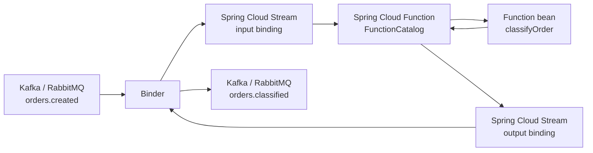

# Vai trò của FunctionCatalog trong mô hình lập trình Spring Cloud Stream

## 1. Bối cảnh và mục tiêu học tập

Giả sử dịch vụ bán hàng nhận sự kiện `orders.created` từ Kafka, tính mức ưu tiên cho từng đơn hàng rồi phát sự kiện `orders.classified`. Logic phân loại chỉ cần hiểu một `OrderCreated` và tạo ra một `OrderClassified`; bản thân logic không cần biết Kafka, RabbitMQ, HTTP hay môi trường serverless.

Đó là cách tiếp cận của **Spring Cloud Function**: viết nghiệp vụ bằng ba giao diện Java `Supplier<T>`, `Function<I, O>` và `Consumer<T>`, sau đó để các bộ thích ứng (adapter) quyết định cách kích hoạt hàm. Khi ứng dụng nhận hoặc phát sự kiện qua broker, **Spring Cloud Stream** là lớp kết nối phù hợp.

**FunctionCatalog** là cầu nối giữa hai lớp: nó tìm hàm theo tên hoặc biểu thức ghép hàm, chuẩn hóa cách gọi, rồi cung cấp hàm mà Spring Cloud Stream sử dụng để xử lý thông điệp.

Sau bài này, bạn có thể:

1. Phân biệt vai trò của `FunctionCatalog`, `ApplicationContext`, Spring Cloud Function, Spring Cloud Stream và binder.
2. Giải thích đường đi của một thông điệp từ broker tới `Function` và ngược lại.
3. Cấu hình `spring.cloud.function.definition`, composition và tên binding.
4. Nhận diện lỗi thường gặp khi có nhiều hàm, sai tên hàm hoặc sai kiểu dữ liệu.

## 2. FunctionCatalog đứng ở đâu trong kiến trúc?

`FunctionCatalog` thuộc **Spring Cloud Function**, thường được Spring tự cấu hình khi có các phụ thuộc tương ứng. Đây là một danh mục hàm có thể tra cứu tại thời điểm chạy, không phải một hàng đợi và cũng không phải API của Kafka/RabbitMQ.

| Thành phần | Trách nhiệm chính | Ví dụ |
| --- | --- | --- |
| `Supplier<T>` | Sinh dữ liệu, không cần dữ liệu đầu vào | Phát sự kiện theo lịch |
| `Function<I, O>` | Chuyển đổi một đầu vào thành một đầu ra | Phân loại đơn hàng |
| `Consumer<T>` | Nhận dữ liệu và xử lý, không tạo đầu ra trả về | Ghi log, cập nhật cơ sở dữ liệu |
| `FunctionCatalog` | Tìm, chuẩn hóa, ghép và chuẩn bị hàm để gọi | Tra `classifyOrder` theo tên |
| Spring Cloud Stream | Tạo input/output binding và điều phối thông điệp tới hàm được chọn | `classifyOrder-in-0` |
| Binder | Kết nối binding với middleware cụ thể | Kafka binder, RabbitMQ binder |



Sơ đồ trên thể hiện **trách nhiệm logic**, không có nghĩa mọi thông điệp đều gọi trực tiếp phương thức `lookup()` mỗi lần đi qua. Framework có thể tra cứu và chuẩn bị hàm khi thiết lập binding, rồi dùng hàm đó cho các lần xử lý tiếp theo.

Nếu thay Kafka bằng RabbitMQ, phần lớn thay đổi nằm ở binder và cấu hình đích; `Function<OrderCreated, OrderClassified>` có thể giữ nguyên. Cùng một logic còn có thể được công bố qua HTTP bằng adapter thích hợp của Spring Cloud Function hoặc dùng trong môi trường serverless mà không đưa mã giao thức vào hàm nghiệp vụ.

## 3. FunctionCatalog phát hiện và chuẩn hóa hàm như thế nào?

### 3.1. Từ Java bean tới catalog

Với mô hình lập trình hàm, ta khai báo các bean bằng `@Bean`:

```java
import java.util.function.Consumer;
import java.util.function.Function;
import java.util.function.Supplier;

import org.springframework.context.annotation.Bean;
import org.springframework.context.annotation.Configuration;

@Configuration
class FunctionalConfiguration {

    @Bean
    Function<String, String> uppercase() {
        return value -> value.toUpperCase();
    }

    @Bean
    Consumer<String> audit() {
        return value -> System.out.println("Đã nhận: " + value);
    }

    @Bean
    Supplier<String> heartbeat() {
        return () -> "alive";
    }
}
```

Các bean hàm được Spring Cloud Function phát hiện và đăng ký *lazily* trong `FunctionCatalog`. Tên bean mặc định (`uppercase`, `audit`, `heartbeat`) trở thành tên dùng để chọn hàm. Không cần một annotation như `@StreamListener` trên từng phương thức để chúng trở thành hàm được Spring Cloud Stream sử dụng.

Có thể lấy catalog từ context:

```java
import org.springframework.cloud.function.context.FunctionCatalog;
import org.springframework.context.ApplicationContext;

FunctionCatalog catalog = context.getBean(FunctionCatalog.class);

// Tra hàm được Spring Cloud Function chuẩn hóa theo tên:
Object selectedFunction = catalog.lookup("uppercase");
```

Đoạn trên minh họa **tra cứu**. Trong ứng dụng Spring Cloud Stream thông thường, bạn không cần tự gọi `lookup()`: cấu hình `spring.cloud.function.definition` cho framework biết phải lấy hàm nào.

### 3.2. Vì sao không lấy bean trực tiếp từ ApplicationContext?

`ApplicationContext.getBean("uppercase")` trả về bean nghiệp vụ gốc. `FunctionCatalog.lookup("uppercase")` trả về biểu diễn hàm đã được Spring Cloud Function chuẩn bị để hỗ trợ các khả năng của framework, gồm:

- **Chuẩn hóa chữ ký:** hỗ trợ các dạng `Supplier`, `Function`, `Consumer` và cả kiểu reactive như `Flux`/`Mono`.
- **Chuyển đổi dữ liệu:** kết hợp kiểu đầu vào/đầu ra khai báo trong hàm với thông tin thông điệp như `contentType` để đưa payload về kiểu phù hợp.
- **Ghép hàm:** tạo một hàm logic từ chuỗi các hàm, chẳng hạn `trim|uppercase`.
- **Định tuyến:** hỗ trợ chọn hàm đích qua cơ chế `RoutingFunction` khi ứng dụng thực sự cần xử lý nhiều loại thông điệp theo điều kiện.

Đây là lý do catalog không chỉ là một `Map<String, Function>`. Tuy vậy, catalog **không tự tạo topic, consumer group, kết nối broker, retry hay bảo đảm exactly-once**; những hành vi đó phụ thuộc Spring Cloud Stream, binder và cấu hình hệ thống.

## 4. Từ hàm trong catalog tới message binding

Spring Cloud Stream sử dụng tên được chọn trong `spring.cloud.function.definition` để xác định hàm và suy ra các binding cần tạo.

Với một hàm thông thường:

```java
@Bean
Function<String, String> uppercase() {
    return String::toUpperCase;
}
```

Các tên binding mặc định là:

| Kiểu hàm | Input binding | Output binding |
| --- | --- | --- |
| `Function<I, O> uppercase` | `uppercase-in-0` | `uppercase-out-0` |
| `Consumer<T> audit` | `audit-in-0` | Không có output binding tự động |
| `Supplier<T> heartbeat` | Không có input binding | `heartbeat-out-0` |

Số `0` là chỉ số đầu vào/đầu ra, không phải số partition hoặc số consumer. Các hàm có nhiều đầu vào/đầu ra sẽ có các chỉ số khác, nhưng trường hợp thông thường mỗi hàm chỉ có tối đa một đầu vào và một đầu ra.

Ví dụ cấu hình:

```yaml
spring:
  cloud:
    function:
      definition: uppercase
    stream:
      bindings:
        uppercase-in-0:
          destination: raw-text
          group: text-workers
        uppercase-out-0:
          destination: upper-text
```

Trong đó:

- `definition: uppercase`: chọn bean `uppercase` thông qua mô hình Spring Cloud Function.
- `uppercase-in-0`: tên binding **nội bộ** để nhận sự kiện; `raw-text`: tên destination **trên broker**.
- `uppercase-out-0`: tên binding **nội bộ** để phát kết quả; `upper-text`: destination đầu ra.
- `group: text-workers`: cấu hình consumer group phía input, do Spring Cloud Stream/binder xử lý.

Đừng nhầm tên hàm, tên binding và tên destination. Đổi topic từ `raw-text` sang `incoming-text` không bắt buộc đổi tên bean hay tên binding.

**Lưu ý:** Khi một ứng dụng chỉ có đúng một functional bean, Spring Cloud Stream có thể tự phát hiện bean đó. Dù vậy, khai báo `spring.cloud.function.definition` tường minh thường dễ hiểu và ổn định hơn, đặc biệt khi ứng dụng phát triển thêm bean mới.

## 5. Ví dụ hoàn chỉnh: phân loại đơn hàng qua Kafka

### 5.1. Hàm nghiệp vụ độc lập với transport

Giả sử hệ thống nhận JSON:

```json
{"orderId":"ORD-101","totalInCents":150000}
```

Hàm phân loại dựa trên số tiền; không gọi Kafka API và không tự đọc `MessageChannel`:

```java
import java.util.function.Function;

import org.springframework.boot.SpringApplication;
import org.springframework.boot.autoconfigure.SpringBootApplication;
import org.springframework.context.annotation.Bean;

@SpringBootApplication
public class OrderStreamApplication {

    public static void main(String[] args) {
        SpringApplication.run(OrderStreamApplication.class, args);
    }

    public record OrderCreated(String orderId, long totalInCents) {}
    public record OrderClassified(String orderId, String priority) {}

    @Bean
    Function<OrderCreated, OrderClassified> classifyOrder() {
        return order -> {
            String priority =
                    order.totalInCents() >= 100_000 ? "PRIORITY" : "STANDARD";
            return new OrderClassified(order.orderId(), priority);
        };
    }
}
```

Đây là `Function<OrderCreated, OrderClassified>`. Cùng một lambda có thể được gọi trong unit test mà không cần broker:

```java
var fn = new OrderStreamApplication().classifyOrder();
var result = fn.apply(
        new OrderStreamApplication.OrderCreated("ORD-101", 150_000)
);
// result.priority() == "PRIORITY"
```

### 5.2. Cấu hình để Spring Cloud Stream gọi hàm

Thêm phụ thuộc `spring-cloud-stream-binder-kafka` cùng các phụ thuộc Spring Boot và bộ Spring Cloud tương thích trong dự án, sau đó cấu hình kết nối Kafka. Ví dụ `application.yml`:

```yaml
spring:
  cloud:
    function:
      definition: classifyOrder
    stream:
      bindings:
        classifyOrder-in-0:
          destination: orders.created
          group: order-classifiers
          content-type: application/json
        classifyOrder-out-0:
          destination: orders.classified
          content-type: application/json
      kafka:
        binder:
          brokers: localhost:9092
```

Bản ghi `record` và hỗ trợ JSON cần có thư viện chuyển đổi tương ứng (thường là Jackson trong ứng dụng Spring Boot). Chú ý `localhost:9092` chỉ là địa chỉ minh họa; cần một broker Kafka đang hoạt động để chạy tích hợp thực tế.

Đường đi của một sự kiện:

1. Kafka binder nhận bản ghi ở destination `orders.created` qua consumer group `order-classifiers`.
2. Spring Cloud Stream chuyển bản ghi vào binding `classifyOrder-in-0`; lớp xử lý thông điệp phối hợp với Spring Cloud Function để chuyển payload JSON thành `OrderCreated`.
3. Theo `spring.cloud.function.definition`, framework chọn `classifyOrder` trong `FunctionCatalog` và gọi logic phân loại.
4. Kết quả `OrderClassified` được chuyển sang biểu diễn phù hợp (ở đây là JSON) và phát qua binding `classifyOrder-out-0` tới destination `orders.classified`.

Kết quả mong đợi của sự kiện mẫu:

```json
{"orderId":"ORD-101","priority":"PRIORITY"}
```

Nếu đổi input từ Kafka sang RabbitMQ, hàm `classifyOrder` vẫn không đổi. Ta thay binder, cấu hình kết nối và các destination phù hợp; chi tiết đảm bảo giao nhận phụ thuộc từng binder.

## 6. Chọn một hàm, ghép nhiều hàm và chạy nhiều pipeline

### 6.1. Một hàm

```yaml
spring:
  cloud:
    function:
      definition: uppercase
```

Ứng dụng dùng đúng bean `uppercase` và tạo các binding theo chữ ký của bean đó.

### 6.2. Composition: các hàm chạy nối tiếp

`FunctionCatalog` có thể chuẩn bị một chuỗi hàm thành một hàm logic duy nhất:

```java
@Bean
Function<String, String> trim() {
    return String::trim;
}

@Bean
Function<String, String> uppercase() {
    return String::toUpperCase;
}
```

```yaml
spring:
  cloud:
    function:
      definition: trim|uppercase
```

Với input `"  spring  "`, `trim` chạy trước, `uppercase` chạy sau và output là `"SPRING"`. Toán tử `|` diễn đạt **composition trong cùng ứng dụng**, không phải pipeline đi qua hai topic. Vì đây là một pipeline logic, Spring Cloud Stream nối đầu vào của hàm đầu tiên và đầu ra của hàm cuối cùng với broker; tên binding của hàm ghép được suy từ tên composition, vì vậy cần kiểm tra tên thực tế trước khi cấu hình destination tương ứng.

Các kiểu có thể ghép phải tương thích: `Function<A, B>` → `Function<B, C>` tạo ra `Function<A, C>`; `Function<A, B>` → `Consumer<B>` tạo ra hành vi consumer; `Supplier<A>` → `Function<A, B>` tạo ra hành vi supplier. Không thể tùy ý đặt `Consumer` ở giữa một chuỗi rồi đòi lấy output từ nó.

### 6.3. Nhiều hàm độc lập: dấu chấm phẩy

Khi cần **hai pipeline riêng biệt**, dùng dấu `;`:

```yaml
spring:
  cloud:
    function:
      definition: uppercase;audit
    stream:
      bindings:
        uppercase-in-0:
          destination: text.incoming
        uppercase-out-0:
          destination: text.uppercase
        audit-in-0:
          destination: audit.incoming
```

Ở đây `uppercase` và `audit` có input binding riêng; dữ liệu đến `audit.incoming` không tự động chạy qua `uppercase`. Dấu `;` có nghĩa chọn nhiều definition để bind độc lập, còn dấu `|` có nghĩa nối các hàm thành một definition.

Khi composition làm tên binding khó đọc, Spring Cloud Stream cho phép đổi tên binding ngầm định bằng `spring.cloud.stream.function.bindings.<implicit-name>=<explicit-name>`. Tuy nhiên, việc đổi tên tạo thêm một lớp ánh xạ cần theo dõi; với hàm đơn lẻ nên ưu tiên quy ước mặc định.

## 7. FunctionCatalog hỗ trợ Message và chuyển đổi kiểu

Mặc định, nghiệp vụ chỉ cần thao tác trên payload:

```java
@Bean
Function<String, String> uppercase() {
    return String::toUpperCase;
}
```

Nếu cần đọc metadata của sự kiện (chẳng hạn correlation ID), có thể khai báo `Message<T>`:

```java
import java.util.function.Function;

import org.springframework.context.annotation.Bean;
import org.springframework.messaging.Message;
import org.springframework.messaging.support.MessageBuilder;

@Bean
Function<Message<String>, Message<String>> addSource() {
    return incoming -> MessageBuilder.withPayload(incoming.getPayload())
            .copyHeaders(incoming.getHeaders())
            .setHeader("processedBy", "stream-service")
            .build();
}
```

Ở ví dụ này, logic nhận cả payload và headers; output cũng là một `Message`. Chỉ dùng `Message<T>` khi nghiệp vụ thực sự cần headers. Với nghiệp vụ thuần túy, kiểu `Function<T, R>` giúp code gọn hơn và dễ kiểm thử.

Đối với JSON:

- Kiểu tham số (`OrderCreated`) cho framework biết kiểu Java đích.
- Header hoặc cấu hình `contentType: application/json` cung cấp thông tin định dạng payload.
- Bộ chuyển đổi thông điệp tham gia khi payload thực tế chưa khớp kiểu đích.
- Nếu khai báo `Object` hoặc `Message<?>` quá chung chung, framework không có đủ gợi ý để tự biến payload thành POJO nghiệp vụ mong muốn.

**Phân biệt trách nhiệm:** khả năng chuẩn hóa invocation và chuyển đổi thuộc lớp Spring Cloud Function/Spring Cloud Stream; Kafka binder làm việc với bản ghi trên broker. `FunctionCatalog` không phải một JSON parser hoạt động độc lập hay một transport.

## 8. Định tuyến động và những điểm cần lưu ý

Spring Cloud Function cung cấp `RoutingFunction`, thường có tên `functionRouter` trong catalog. Đây là lựa chọn khi nhiều loại sự kiện cần được xử lý bởi các hàm khác nhau qua một điểm vào. Cấu hình hoặc metadata thông điệp có thể cung cấp thông tin chọn hàm, và routing có thể dùng biểu thức.

Phân biệt hai cơ chế:

- **Composition** (`trim|uppercase`): tất cả thông điệp đi qua cùng chuỗi xử lý theo thứ tự định sẵn.
- **Routing** (`functionRouter`): mỗi thông điệp có thể được chuyển tới một hàm đích khác nhau tùy thông tin định tuyến.

Với dữ liệu nhận từ bên ngoài, không nên trao quyền quyết định biểu thức thực thi tùy ý cho message header không đáng tin cậy. Cần giới hạn các đích hợp lệ và cách tính biểu thức. Với reactive function xử lý `Flux`, framework có thể gọi hàm một lần để thiết lập luồng, nên không thể mặc định áp dụng tư duy routing theo từng message giống imperative function.

Tương tự, `Supplier<T>` kiểu imperative thường được Spring Cloud Stream kích hoạt thông qua polling; `Supplier<Flux<T>>` và `Function<Flux<I>, Flux<O>>` cần hiểu theo vòng đời luồng reactive. Vai trò của catalog vẫn là tìm/chuẩn hóa hàm, còn cách phát và nhận trên broker do tầng Stream/binder tổ chức.

## 9. Lỗi thường gặp và cách chẩn đoán

| Hiện tượng | Nguyên nhân có thể | Cách kiểm tra hoặc xử lý |
| --- | --- | --- |
| Ứng dụng có nhiều bean hàm nhưng không có binding như mong đợi | Chưa chỉ rõ hàm cần bind | Đặt `spring.cloud.function.definition` trùng tên bean, hoặc khai báo các definition bằng `;` |
| Không tìm thấy hàm được cấu hình | Sai tên bean, chưa khai báo `@Bean`, sai package scan, hoặc chữ ký không phù hợp | Kiểm tra tên bean và thử `catalog.lookup("tên-hàm")` trong context thực tế |
| Có hàm và binding nhưng không nhận message | Sai tên destination, binder chưa kết nối, sai consumer group hoặc broker không chạy | Kiểm tra cấu hình `spring.cloud.stream.bindings.*`, log binder và hạ tầng message |
| Bị lỗi chuyển đổi payload | JSON không khớp kiểu Java, thiếu converter hoặc sai `contentType` | Kiểm tra payload mẫu, kiểu `Function<I, O>`, JSON serializer/deserializer và headers |
| Dùng `trim|uppercase` nhưng nghĩ là hai consumer độc lập | Nhầm composition với nhiều definition | Dùng `;` nếu cần bind riêng, `|` nếu muốn nối hàm |
| Đổi tên destination nhưng cấu hình vào sai binding | Nhầm tên hàm, tên binding, tên topic | Phân biệt `classifyOrder`, `classifyOrder-in-0` và `orders.created` |
| Hàm không cần nhận message lại bị tự bind | Chỉ có một functional bean nên bị auto-detect | Cấu hình `spring.cloud.function.definition` đúng ý định, hoặc xem `spring.cloud.stream.function.autodetect=false` |
| Tra bean trực tiếp và kỳ vọng có composition/conversion | Lấy bean gốc từ `ApplicationContext` | Để Stream sử dụng catalog hoặc tra cứu qua `FunctionCatalog` khi có lý do kỹ thuật rõ ràng |

Khi debug, nên đi từ **definition → tên binding → destination → kết nối binder → payload/headers → kết quả của hàm**. Cách kiểm tra theo từng lớp giúp xác định lỗi nằm ở chọn hàm, cấu hình transport hay bản thân nghiệp vụ.

## 10. Bài thực hành tự kiểm tra

Từ ví dụ `classifyOrder` ở trên, hãy thử ba thay đổi:

1. Gửi hai sự kiện với `totalInCents` lần lượt bằng `99_999` và `100_000`. Kết quả kỳ vọng là `STANDARD` và `PRIORITY`; ranh giới này hoàn toàn do hàm nghiệp vụ quyết định.
2. Thêm bean `Function<OrderCreated, OrderCreated> validateOrder` để kiểm tra `orderId` không trống, sau đó đổi definition thành `validateOrder|classifyOrder`. Giải thích vì sao trình tự này khác với `classifyOrder|validateOrder` và vì sao cấu hình binding cần được rà soát khi đổi composition.
3. Tạo thêm một `Consumer<OrderClassified> auditOrder` để ghi nhận sự kiện đã phân loại. Chọn giữa ghép `classifyOrder|auditOrder` và hai pipeline riêng `classifyOrder;auditOrder`, rồi giải thích sự khác biệt về việc có output binding hay không.

**Câu hỏi kiểm tra hiểu bài:**

- Vì sao tồn tại bean `classifyOrder` trong `ApplicationContext` vẫn chưa đủ để biết nó đang được bind tới topic nào?
- Thông tin `spring.cloud.function.definition` giúp Spring Cloud Stream chọn *cái gì*, còn `spring.cloud.stream.bindings.*.destination` chọn *cái gì*?
- Tại sao một hàm nghiệp vụ có thể được tái sử dụng qua HTTP, broker hoặc serverless?
- Khi JSON không chuyển được thành `OrderCreated`, bạn sẽ kiểm tra `FunctionCatalog`, định dạng thông điệp hay binder trước? Vì sao?

## 11. Tổng kết

`FunctionCatalog` là thành phần **khám phá, tra cứu và chuẩn hóa các functional bean** của Spring Cloud Function. Nó cho phép chọn hàm theo tên, ghép nhiều hàm và tích hợp chuyển đổi thông điệp để một logic Java có thể được gọi trong những môi trường khác nhau. Spring Cloud Stream dùng mô hình này để nối `Supplier`, `Function`, `Consumer` với binding và binder hướng sự kiện.

Ba tên cần nhớ khi đọc một ứng dụng Spring Cloud Stream:

- `classifyOrder`: tên hàm trong catalog.
- `classifyOrder-in-0` / `classifyOrder-out-0`: tên binding của ứng dụng.
- `orders.created` / `orders.classified`: destination trên middleware.

### Tài liệu tham khảo

- [Spring Cloud Function — Programming model](https://docs.spring.io/spring-cloud-function/reference/spring-cloud-function/programming-model.html)
- [Spring Cloud Stream — Producing and consuming messages](https://docs.spring.io/spring-cloud-stream/reference/spring-cloud-stream/producing-and-consuming-messages.html)
- [Spring Cloud Stream — Functional binding names](https://docs.spring.io/spring-cloud-stream/reference/spring-cloud-stream/functional-binding-names.html)
- [Spring Cloud Stream — Message conversion mechanics](https://docs.spring.io/spring-cloud-stream/reference/spring-cloud-stream/mechanics.html)
