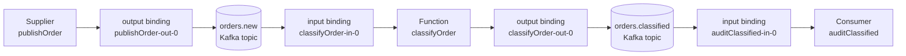
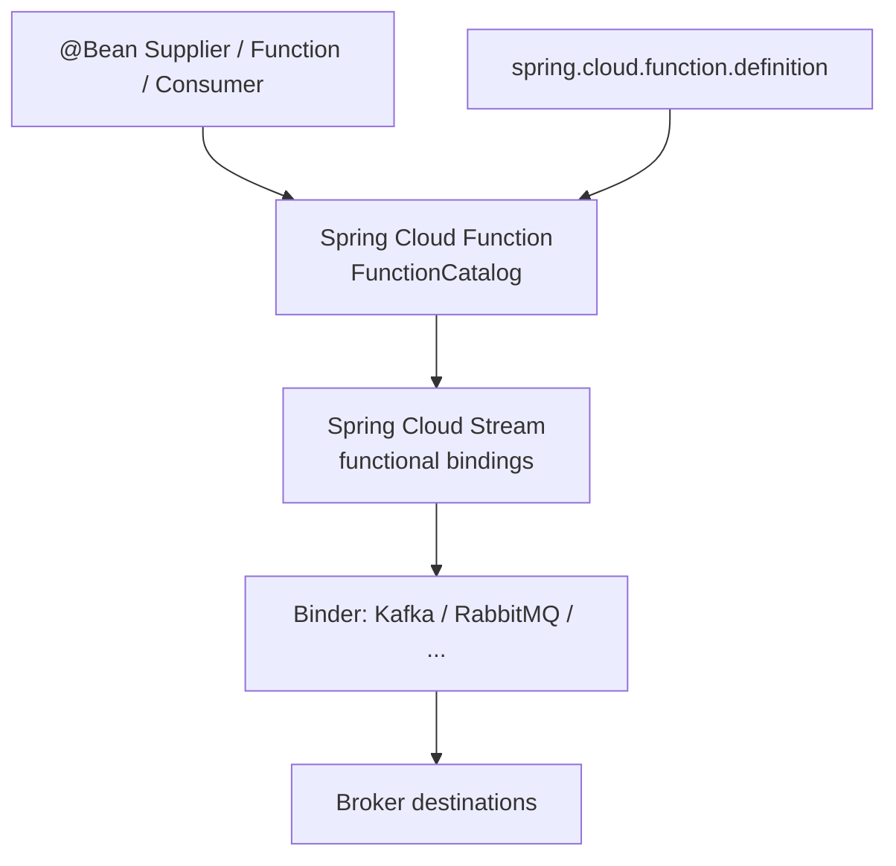

# Ánh xạ Supplier, Function, Consumer thành nguồn, bộ xử lý và đích nhận

## 1. Từ mô hình hàm đến mô hình xử lý sự kiện

Trong Spring Cloud Function, logic nghiệp vụ được mô tả qua ba giao diện Java chuẩn: `Supplier<T>`, `Function<I, O>` và `Consumer<T>`. Các hàm này không cần biết chúng sẽ được gọi qua HTTP, sự kiện hay môi trường serverless. Khi kết hợp với **Spring Cloud Stream**, ba giao diện lần lượt tương ứng với ba vai trò trong một hệ thống hướng sự kiện:

- **Nguồn (source):** sinh ra dữ liệu để phát đi, biểu diễn bằng `Supplier<T>`.
- **Bộ xử lý (processor):** nhận dữ liệu, chuyển đổi và phát kết quả, biểu diễn bằng `Function<I, O>`.
- **Đích nhận (sink):** nhận dữ liệu và thực hiện tác vụ cuối, biểu diễn bằng `Consumer<T>`.

Ví dụ, một hệ thống bán hàng có thể phát sự kiện đơn hàng mới, phân loại mức ưu tiên, sau đó ghi nhận kết quả phục vụ kiểm toán. Các vai trò nguồn, bộ xử lý và đích nhận có thể nằm trong cùng một ứng dụng hoặc triển khai thành các dịch vụ khác nhau.



**Cần phân biệt hai nghĩa của “đích”:** `Consumer<T>` là điểm cuối xử lý trong mã Java (sink); còn `destination` trong cấu hình Stream là tên topic, queue hoặc địa chỉ logic của middleware. Một `Consumer` nhận dữ liệu *từ* destination thông qua input binding, chứ không tự biến thành một topic có tên trùng với bean.

### Mục tiêu học tập

Sau bài này, bạn có thể:

1. Xác định chiều dữ liệu, cách kích hoạt và tên binding tương ứng với từng loại hàm.
2. Cấu hình một pipeline `Supplier → Function → Consumer` dùng Spring Cloud Stream và Kafka binder.
3. Phân biệt việc nối các hàm qua broker với composition trong Spring Cloud Function.
4. Hiểu vai trò của `FunctionCatalog`, chuyển đổi payload, consumer group và xử lý lỗi trong từng vai trò.
5. Viết unit test cho logic nghiệp vụ mà không cần khởi động message broker.

## 2. Bảng ánh xạ ba giao diện

| Giao diện Java | Vai trò trong Stream | Điểm kích hoạt | Binding mặc định | Ý nghĩa của kết quả |
| --- | --- | --- | --- | --- |
| `Supplier<T>` | Source | Poller hoặc cơ chế phát dữ liệu của luồng reactive | `<beanName>-out-0` | `T` được phát ra output destination |
| `Function<I, O>` | Processor | Một thông điệp/luồng đi vào input binding | `<beanName>-in-0` và `<beanName>-out-0` | `O` được chuyển sang output destination |
| `Consumer<T>` | Sink | Một thông điệp/luồng đi vào input binding | `<beanName>-in-0` | Không có output binding mặc định |

Các tên ở bảng là **quy ước của Spring Cloud Stream dành cho functional bean đơn giản**. Chỉ số `0` thể hiện cổng vào/ra thứ nhất; đây không phải số partition, số consumer hoặc số message. Với các hàm nhiều đầu vào/đầu ra hay composition, tên binding cần được xác nhận theo quy tắc của framework và cấu hình thực tế.

Ta có thể nhớ bằng chữ ký của hàm:

```text
Supplier<T>      () -> T        nguồn: không cần input, có output
Function<I, O>   I  -> O        bộ xử lý: có input, có output
Consumer<T>      T  -> void     đích nhận: có input, không có output
```

Khái niệm “không có input” ở đây nghĩa là **không có input binding do Spring Cloud Stream tự sinh cho bean đó**. Một supplier vẫn có thể tự đọc cơ sở dữ liệu, outbox, bộ nhớ hoặc API nội bộ để tạo giá trị. Tương tự, một consumer có thể ghi vào database, gọi dịch vụ khác hoặc chủ động phát một sự kiện mới bằng cơ chế khác, nhưng không có output binding được suy ra từ chữ ký `Consumer<T>`.

## 3. Supplier: ánh xạ hàm sinh dữ liệu thành source

### 3.1. Đặc điểm

`Supplier<T>` trả về một giá trị kiểu `T` mỗi khi được gọi. Trong mô hình Stream, kết quả của lời gọi trở thành thông điệp đầu ra:

```java
import java.util.concurrent.atomic.AtomicLong;
import java.util.function.Supplier;

@Bean
Supplier<OrderCreated> publishOrder() {
    AtomicLong sequence = new AtomicLong();

    return () -> new OrderCreated(
            "ORD-" + sequence.incrementAndGet(),
            150_000L
    );
}
```

Hàm này không nhận payload từ một input binding. Spring Cloud Stream tạo **output binding** `publishOrder-out-0` và đưa dữ liệu mà supplier phát ra tới destination đã cấu hình.

Ví dụ cấu hình:

```yaml
spring:
  cloud:
    function:
      definition: publishOrder
    stream:
      bindings:
        publishOrder-out-0:
          destination: orders.new
          content-type: application/json
```

Trong ví dụ, `publishOrder` là tên bean/hàm, `publishOrder-out-0` là tên binding nội bộ, còn `orders.new` là destination trên broker.

### 3.2. Supplier được gọi lúc nào?

Với **imperative supplier** dạng `Supplier<T>`, Spring Cloud Stream thường sử dụng *poller* để gọi hàm theo nhịp đã cấu hình. Mỗi lần poll có thể tạo ra dữ liệu mới; nếu nguồn không có dữ liệu mới, logic supplier cần được thiết kế phù hợp với ngữ nghĩa không phát thông điệp của phiên bản/framework đang dùng.

Điểm cần nhớ:

- Supplier không tự nhận message từ Kafka chỉ vì có một Kafka binder trong ứng dụng.
- Supplier không chỉ được gọi một lần lúc khởi động trong mô hình imperative mặc định; nó có thể được gọi lặp lại theo poller.
- Đoạn mã sinh đơn hàng ở trên chỉ dành cho minh họa. Nếu dùng nguyên trạng trong môi trường thật, poller có thể liên tục tạo đơn hàng giả. Nguồn thực tế thường là outbox, truy vấn dữ liệu chờ xử lý, một lịch phát có kiểm soát hoặc luồng sự kiện có vòng đời rõ ràng.
- Với `Supplier<Flux<T>>` (reactive supplier), cơ chế kích hoạt và vòng đời stream khác với supplier imperative: framework có thể lấy luồng reactive một lần và phát theo tín hiệu của luồng. Không nên suy diễn rằng mỗi phần tử trong `Flux` là một lần gọi supplier mới.

Nếu muốn chủ động phát message tại thời điểm một API nội bộ được gọi, có thể cân nhắc `StreamBridge` của Spring Cloud Stream. Đó là nhu cầu khác với cách một supplier được poll tự động.

## 4. Function: ánh xạ phép chuyển đổi thành processor

### 4.1. Đặc điểm

`Function<I, O>` nhận một đầu vào và tạo một kết quả, phù hợp với vai trò **processor**:

```java
import java.util.function.Function;

@Bean
Function<OrderCreated, OrderClassified> classifyOrder() {
    return order -> {
        String priority = order.totalInCents() >= 100_000L
                ? "PRIORITY"
                : "STANDARD";
        return new OrderClassified(order.orderId(), priority);
    };
}
```

Một processor có hai phía:

- **Input:** Stream lấy message từ một destination, chuẩn bị payload đúng kiểu `OrderCreated` rồi chuyển tới hàm.
- **Output:** kết quả `OrderClassified` được chuyển thành thông điệp và gửi qua output binding tới destination kế tiếp.

```yaml
spring:
  cloud:
    function:
      definition: classifyOrder
    stream:
      bindings:
        classifyOrder-in-0:
          destination: orders.new
          group: classify-workers
          content-type: application/json
        classifyOrder-out-0:
          destination: orders.classified
          content-type: application/json
```

Bộ xử lý không cần biết Kafka topic cụ thể. Đổi `orders.new` sang tên destination khác là thay đổi cấu hình binding, không buộc phải viết lại thuật toán phân loại.

### 4.2. Lưu ý về nghiệp vụ và lỗi

Một `Function` có thể chứa logic thuần túy: cùng một đầu vào tạo cùng một đầu ra và không có tác dụng phụ. Đây là kiểu dễ kiểm thử và tái sử dụng nhất. Nếu hàm ghi database hoặc gọi API bên ngoài, cần cân nhắc thêm về retry, trùng lặp sự kiện và idempotency.

Không mặc định rằng khi hàm ném exception, framework luôn bỏ qua message hoặc luôn retry vô hạn. Cơ chế retry, dead-letter destination, commit/acknowledgment và các đảm bảo giao nhận phụ thuộc binder và cấu hình cụ thể.

## 5. Consumer: ánh xạ tác vụ cuối thành sink

### 5.1. Đặc điểm

`Consumer<T>` nhận dữ liệu nhưng không trả về kết quả để Spring Cloud Stream tự phát tiếp:

```java
import java.util.function.Consumer;

@Bean
Consumer<OrderClassified> auditClassified() {
    return event -> System.out.printf(
            "Audit: order=%s priority=%s%n",
            event.orderId(),
            event.priority()
    );
}
```

Spring Cloud Stream tạo input binding `auditClassified-in-0`. Vì chữ ký không có kết quả, framework **không tạo** output binding `auditClassified-out-0` cho consumer thông thường.

```yaml
spring:
  cloud:
    function:
      definition: auditClassified
    stream:
      bindings:
        auditClassified-in-0:
          destination: orders.classified
          group: audit-workers
          content-type: application/json
```

Từ góc nhìn kiến trúc, sink có thể thực hiện nhiều kiểu tác vụ: lưu lịch sử xử lý, gửi thông báo, cập nhật read model hoặc tổng hợp thống kê. Trong ví dụ, in log là cách đơn giản nhất để quan sát kết quả; trong hệ thống thật nên dùng dịch vụ audit bền vững nếu cần truy vết.

### 5.2. Consumer group và tiêu thụ thông điệp

`group` được cấu hình cho **input binding**. Với Kafka, các instance cùng group thường cùng phân chia công việc trong phạm vi một topic (theo partition), trong khi hai group khác nhau có thể cùng nhận sự kiện để phục vụ hai mục đích khác nhau. `group` không biến consumer thành một output topic.

Ví dụ, thêm một dịch vụ email dùng group `notify-workers` để đọc `orders.classified` sẽ không làm mất khả năng nhận cùng sự kiện của group `audit-workers`, với điều kiện dữ liệu còn khả dụng theo cơ chế retention và vị trí đọc của từng group.

Consumer có side effect nên cần đặc biệt chú ý đến **xử lý lặp**. Nếu một event được giao lại, thao tác ghi database hoặc gửi thông báo có thể chạy lần thứ hai. Có thể dùng event ID, ràng buộc duy nhất hoặc chiến lược idempotency tương ứng với yêu cầu nghiệp vụ.

## 6. Ví dụ hoàn chỉnh: source → processor → sink trên Kafka

### 6.1. Ba functional bean trong một ứng dụng

Ví dụ sử dụng Java 17 trở lên cho `record`. Ba bean dưới đây đặt trong cùng ứng dụng Spring Boot để dễ học; chúng cũng có thể được chuyển sang ba ứng dụng độc lập với cùng cấu hình destination tương ứng.

```java
import java.util.concurrent.atomic.AtomicLong;
import java.util.function.Consumer;
import java.util.function.Function;
import java.util.function.Supplier;

import org.springframework.boot.SpringApplication;
import org.springframework.boot.autoconfigure.SpringBootApplication;
import org.springframework.context.annotation.Bean;

@SpringBootApplication
public class OrderEventsApplication {

    public static void main(String[] args) {
        SpringApplication.run(OrderEventsApplication.class, args);
    }

    public record OrderCreated(String orderId, long totalInCents) {}

    public record OrderClassified(String orderId, String priority) {}

    // Source: tạo đơn hàng mẫu khi được poll.
    @Bean
    Supplier<OrderCreated> publishOrder() {
        AtomicLong sequence = new AtomicLong();

        return () -> new OrderCreated(
                "ORD-" + sequence.incrementAndGet(),
                150_000L
        );
    }

    // Processor: chuyển đơn hàng thành kết quả phân loại.
    @Bean
    Function<OrderCreated, OrderClassified> classifyOrder() {
        return order -> new OrderClassified(
                order.orderId(),
                order.totalInCents() >= 100_000L
                        ? "PRIORITY"
                        : "STANDARD"
        );
    }

    // Sink: ghi nhận kết quả, không trả output.
    @Bean
    Consumer<OrderClassified> auditClassified() {
        return event -> System.out.printf(
                "Audit: %s -> %s%n",
                event.orderId(),
                event.priority()
        );
    }
}
```

Để chạy minh họa này, dự án cần Spring Boot, Spring Cloud Stream với **Kafka binder**, bộ quản lý phiên bản Spring Cloud tương thích và Jackson để xử lý JSON. Có thể bổ sung binder bằng dependency `org.springframework.cloud:spring-cloud-stream-binder-kafka` trong một dự án đã quản lý BOM phù hợp. Kafka phải đang hoạt động; ví dụ cấu hình tiếp theo giả định broker tại `localhost:9092`.

### 6.2. Chọn cả ba hàm và nối chúng qua destination

```yaml
spring:
  cloud:
    function:
      definition: publishOrder;classifyOrder;auditClassified
    stream:
      bindings:
        publishOrder-out-0:
          destination: orders.new
          content-type: application/json

        classifyOrder-in-0:
          destination: orders.new
          group: classify-workers
          content-type: application/json
        classifyOrder-out-0:
          destination: orders.classified
          content-type: application/json

        auditClassified-in-0:
          destination: orders.classified
          group: audit-workers
          content-type: application/json

      kafka:
        binder:
          brokers: localhost:9092
```

Trong `spring.cloud.function.definition`, dấu chấm phẩy `;` chọn **nhiều definition độc lập** để Spring Cloud Stream thiết lập các binding tương ứng. Ba bean không gọi trực tiếp nhau. Dữ liệu được chuyển giữa chúng nhờ các destination chung.

| Bước | Hàm được gọi | Input binding | Output binding | Destination liên quan |
| --- | --- | --- | --- | --- |
| 1. Phát đơn | `publishOrder` | Không có | `publishOrder-out-0` | Phát tới `orders.new` |
| 2. Phân loại | `classifyOrder` | `classifyOrder-in-0` | `classifyOrder-out-0` | Đọc `orders.new`, phát `orders.classified` |
| 3. Kiểm toán | `auditClassified` | `auditClassified-in-0` | Không có | Đọc `orders.classified` |

Một vòng dữ liệu kỳ vọng:

```text
poller gọi publishOrder()
    -> OrderCreated("ORD-1", 150000)
    -> publishOrder-out-0 -> orders.new
    -> classifyOrder-in-0 -> classifyOrder(...)
    -> OrderClassified("ORD-1", "PRIORITY")
    -> classifyOrder-out-0 -> orders.classified
    -> auditClassified-in-0 -> auditClassified(...)
    -> log: Audit: ORD-1 -> PRIORITY
```

Nếu source, processor và sink chạy trong cùng một JVM, chúng vẫn có thể trao đổi **qua Kafka** vì cấu hình ở trên nối bằng broker. Khi broker tạm ngừng hoặc message được giao lại, thứ tự thực thi và số lần xử lý thực tế sẽ phụ thuộc vào cơ chế của binder, partition và consumer group.

### 6.3. Trường hợp nào tách thành nhiều dịch vụ?

Ở môi trường phát triển, để ba bean chung một ứng dụng giúp quan sát luồng hoàn chỉnh. Khi triển khai thực tế, có thể tách ra nếu cần mở rộng bộ xử lý riêng, cách ly tác vụ phụ thuộc hệ thống ngoài hoặc giữ ranh giới nghiệp vụ rõ hơn.

Sau khi tách, mỗi dịch vụ thường chỉ chọn definition mà nó sở hữu:

```yaml
# Trong dịch vụ source:
spring.cloud.function.definition: publishOrder

# Trong dịch vụ processor (application.yml riêng):
spring.cloud.function.definition: classifyOrder

# Trong dịch vụ sink (application.yml riêng):
spring.cloud.function.definition: auditClassified
```

Đây là ba đoạn cấu hình cho **ba ứng dụng khác nhau**, không phải một file YAML duy nhất. Các destination liên kết vẫn là `orders.new` và `orders.classified`.

## 7. FunctionCatalog giữ vai trò gì trong quá trình ánh xạ?

Spring Cloud Function phát hiện các functional bean trong Spring context và cung cấp chúng qua **`FunctionCatalog`**. Spring Cloud Stream dựa vào mô hình này để chọn hàm theo `spring.cloud.function.definition`, chuẩn bị invocation và xác định binding theo chữ ký của hàm.



Những ranh giới cần ghi nhớ:

- `FunctionCatalog` phụ trách tra cứu, chuẩn hóa, composition và hỗ trợ xử lý kiểu dữ liệu theo mô hình Spring Cloud Function.
- Spring Cloud Stream quyết định binding input/output, cách kết nối và cách kích hoạt hàm trong bối cảnh message-driven.
- Binder quản lý tương tác với middleware cụ thể, chẳng hạn Kafka hoặc RabbitMQ.
- Logic trong `Supplier`, `Function` và `Consumer` quyết định giá trị hoặc tác dụng nghiệp vụ.

Không nên gọi `ApplicationContext.getBean("classifyOrder")` và kỳ vọng nó tự có message binding. Bean Java là logic; binding được Spring Cloud Stream thiết lập dựa vào functional definition và cấu hình.

Khi ứng dụng có nhiều functional bean, cấu hình `spring.cloud.function.definition` tường minh là quan trọng để chọn đúng bean. Nếu chỉ có một functional bean, một số cấu hình/version có thể tự phát hiện và bind bean đó. Dùng cấu hình rõ ràng giúp ứng dụng ổn định khi số lượng bean tăng lên.

## 8. Composition khác pipeline qua broker như thế nào?

Spring Cloud Function hỗ trợ **composition** bằng dấu `|`. Ví dụ có hai function:

```java
@Bean
Function<String, String> trim() {
    return String::trim;
}

@Bean
Function<String, String> uppercase() {
    return String::toUpperCase;
}
```

```yaml
spring:
  cloud:
    function:
      definition: trim|uppercase
```

Dữ liệu `"  spring  "` đi qua `trim` rồi `uppercase` để tạo `"SPRING"`. Hai bước là **một hàm logic được ghép**, còn Stream bind phần đầu vào và đầu ra của chuỗi như một đơn vị. Phải kiểm tra tên implicit binding của composition trước khi cấu hình destination hoặc ánh xạ sang tên tường minh bằng `spring.cloud.stream.function.bindings.*`.

So sánh:

| Tiêu chí | Composition `trim\|uppercase` | Nhiều definition `trim;uppercase` |
| --- | --- | --- |
| Quan hệ thực thi | Hàm sau nhận kết quả trực tiếp từ hàm trước | Hai hàm được bind riêng |
| Kênh truyền giữa hai hàm | Trong lời gọi hàm/chuỗi xử lý của ứng dụng | Phụ thuộc input/output binding và destination |
| Số pipeline logic | Một | Hai |
| Cấu hình broker trung gian | Không bắt buộc | Cần nếu muốn các pipeline trao đổi qua broker |
| Phù hợp khi | Các bước nhỏ, cùng vòng đời và kiểu dữ liệu tương thích | Các nguồn/đích độc lập, cần tách luồng hoặc dịch vụ |

Với ba vai trò, có thể ghép `Supplier<T>` với `Function<T, R>` để xây dựng một nguồn phát ra `R` nếu phiên bản framework và chữ ký hàm tương thích. Tương tự, ghép `Function<I, O>` với `Consumer<O>` cho một pipeline kết thúc bằng xử lý side effect, không còn output thông thường.

Tuy nhiên, **không nên xem `publishOrder;classifyOrder;auditClassified` là composition**. Dấu `;` khai báo ba hàm độc lập và luồng ví dụ chỉ hình thành khi destination của từng cặp khớp nhau. Sự khác biệt này quyết định nơi đặt retry, khả năng scale và ranh giới giao nhận.

## 9. Kiểu dữ liệu, Message và chuyển đổi payload

Mô hình chức năng ưu tiên kiểu dữ liệu nghiệp vụ:

```java
Function<OrderCreated, OrderClassified> classifyOrder()
```

Khi message đến qua Kafka, payload có thể được biểu diễn bằng bytes hoặc chuỗi JSON. Spring Cloud Stream phối hợp với cơ chế chuyển đổi thông điệp của Spring Cloud Function để cung cấp kiểu đầu vào phù hợp theo chữ ký hàm và thông tin `contentType`. Khi gửi kết quả, output có thể được chuyển thành định dạng tương ứng.

Có hai phong cách làm việc:

**Chỉ payload — lựa chọn mặc định nếu không cần metadata**

```java
@Bean
Function<String, String> normalize() {
    return value -> value.trim().toLowerCase();
}
```

**Payload kèm headers — khi cần correlation ID hoặc metadata**

```java
import java.util.function.Function;
import org.springframework.messaging.Message;
import org.springframework.messaging.support.MessageBuilder;

@Bean
Function<Message<String>, Message<String>> tagMessage() {
    return message -> MessageBuilder
            .withPayload(message.getPayload().trim())
            .copyHeaders(message.getHeaders())
            .setHeader("normalizedBy", "order-stream")
            .build();
}
```

Khi dùng `Message<T>`, cần hiểu header đến từ bên ngoài có thể bị thiếu hoặc không đáng tin cậy. Chỉ dựa vào header cho quyết định nghiệp vụ khi đã có quy tắc xác thực và dữ liệu phù hợp.

Một lỗi phổ biến là khai báo `Function<Object, Object>` rồi kỳ vọng framework luôn biết phải ánh xạ JSON vào record nào. Kiểu đầu vào càng cụ thể, framework càng có đủ thông tin hỗ trợ chuyển đổi. Khi gặp lỗi, kiểm tra schema JSON, `contentType`, hỗ trợ Jackson và kiểu Java trước khi sửa logic core.

## 10. Kiểm thử đúng tầng trách nhiệm

Đối với thuật toán phân loại, có thể kiểm thử trực tiếp function mà không tạo Kafka, topic hay binder:

```java
import static org.junit.jupiter.api.Assertions.assertEquals;
import org.junit.jupiter.api.Test;

class OrderEventsApplicationTest {

    @Test
    void classifyOrderUsesAmountThreshold() {
        var app = new OrderEventsApplication();
        var classify = app.classifyOrder();

        var below = classify.apply(
                new OrderEventsApplication.OrderCreated("ORD-1", 99_999L)
        );
        var atThreshold = classify.apply(
                new OrderEventsApplication.OrderCreated("ORD-2", 100_000L)
        );

        assertEquals("STANDARD", below.priority());
        assertEquals("PRIORITY", atThreshold.priority());
    }
}
```

Unit test này chứng minh quy tắc phân loại, **không** chứng minh broker đã kết nối hay cấu hình binding đúng. Với tích hợp Stream, nên kiểm tra riêng rằng source thực sự phát ra destination mong muốn, processor đọc và phát đúng topic, còn sink nhận được payload phù hợp. Có thể dùng Spring Cloud Stream test binder cho một số kịch bản; hành vi phụ thuộc Kafka thực tế thì cần kiểm thử tích hợp với broker tương ứng.

Cần phân biệt hai lỗi khác nhau:

- Unit test hàm thất bại: nhiều khả năng logic hoặc contract dữ liệu sai.
- Unit test hàm chạy đúng nhưng không thấy message: cần kiểm tra `definition`, tên binding, destination, group, binder, broker, serialization và consumer offset.

## 11. Sai lầm phổ biến khi ánh xạ ba vai trò

| Hiện tượng | Nguyên nhân thường gặp | Cách xử lý |
| --- | --- | --- |
| Supplier không phát ra topic | Sai tên `publishOrder-out-0`, destination hoặc binder | Kiểm tra bean name, `definition`, output binding và log binder |
| Supplier phát message liên tục ngoài dự tính | Supplier imperative được poll theo lịch, nhưng code luôn tạo dữ liệu | Thiết kế nguồn có điều kiện phát; kiểm soát poller và dữ liệu nguồn |
| Function không có kết quả ở output | Sai destination đầu vào, lỗi chuyển đổi hoặc function ném exception | Kiểm tra input group, payload JSON, kiểu Java, log và cơ chế error handling |
| Consumer không có `-out-0` | `Consumer<T>` không có giá trị trả về | Đây là hành vi đúng; dùng `Function` nếu cần biến đổi và phát tiếp |
| Cùng một event được xử lý lặp lại | Tái giao message, restart, retry hoặc side effect không idempotent | Dùng event ID và thiết kế thao tác lặp an toàn |
| Hai consumer không cùng nhận một event | Hai instance dùng chung group nên chia việc | Dùng group khác nhau nếu hai nghiệp vụ cần nhận bản sao độc lập |
| Đã khai báo đủ ba bean nhưng không thành chuỗi | Definition `a;b;c` chỉ tạo các pipeline riêng | Nối output/input qua cùng destination hoặc dùng composition có chủ đích |
| Nhầm tên bean với tên topic | `publishOrder`, `publishOrder-out-0` và `orders.new` là ba tên khác nhau | Tách kiểm tra chức năng, binding và transport |
| Test Java chạy đúng nhưng ứng dụng không tiêu thụ Kafka | Test không bao phủ wiring, conversion và broker | Bổ sung integration test cho kết nối/serialization |

Một cách debug có hệ thống là lần theo ba ranh giới: **logic function → binding → broker**. Nếu log có lỗi chọn hàm, kiểm tra `spring.cloud.function.definition`. Nếu không thấy topic mong muốn, xem cấu hình `spring.cloud.stream.bindings.*`. Nếu message có đến nhưng hàm không nhận đúng kiểu, kiểm tra `contentType` và payload.

## 12. Thực hành củng cố

### Bài tập 1: Nhận diện binding

Cho ba bean:

```java
Supplier<String> generate()
Function<String, Integer> length()
Consumer<Integer> store()
```

Hãy điền tên các input/output binding mặc định theo quy ước, rồi xác định bean nào không có input và bean nào không có output.

**Gợi ý đáp án:** `generate-out-0`; `length-in-0` và `length-out-0`; `store-in-0`.

### Bài tập 2: Nối pipeline bằng destination

Giả sử cần phát chữ vào `text.raw`, tính độ dài và phát kết quả vào `text.length`, sau đó consumer cuối đọc `text.length`. Hãy tạo YAML dùng `spring.cloud.function.definition: generate;length;store` và nối đúng các binding.

**Tiêu chí đạt:** `generate-out-0` và `length-in-0` cùng destination `text.raw`; `length-out-0` và `store-in-0` cùng destination `text.length`; hai input binding có group hợp lý.

### Bài tập 3: Chọn composition hay các pipeline riêng

Một dịch vụ cần chuẩn hóa email rồi băm dữ liệu trước khi phát thông điệp. Một hệ thống khác cần phân loại đơn hàng, nhưng bước kiểm toán phải triển khai và scale riêng. Hãy chọn giữa composition và pipeline qua broker; giải thích sự lựa chọn dựa trên vòng đời, khả năng scale, lỗi và yêu cầu giao nhận.

**Gợi ý:** chuẩn hóa và băm thường phù hợp composition khi kiểu và trách nhiệm rõ ràng; kiểm toán độc lập thường cần consumer/sink riêng, nối qua topic để tách vòng đời.

### Tự kiểm tra

1. Tại sao `Supplier<T>` không có `-in-0` nhưng vẫn có thể truy vấn database?
2. Khi hai ứng dụng sử dụng cùng `orders.classified` và cùng consumer group Kafka, có bảo đảm cả hai đều nhận toàn bộ sự kiện không?
3. Tại sao `Consumer<T>` không sinh output binding mặc định?
4. Phân biệt `spring.cloud.function.definition`, tên binding và `destination`.
5. Đổi Kafka sang RabbitMQ ảnh hưởng đến những lớp nào, và tại sao phần lớn code của các bean có thể giữ nguyên?

## 13. Kết luận

Ba functional interface tạo thành mô hình nhất quán cho Spring Cloud Stream:

- **`Supplier<T>` → source → output binding:** phát dữ liệu ra broker.
- **`Function<I, O>` → processor → input và output binding:** đọc, xử lý, phát kết quả.
- **`Consumer<T>` → sink → input binding:** đọc và hoàn thành tác vụ nghiệp vụ, không có output trả về mặc định.

`FunctionCatalog` cho phép Spring Cloud Function quản lý, tra cứu và ghép logic này; Spring Cloud Stream ánh xạ chúng thành các binding; binder kết nối các binding tới Kafka, RabbitMQ hoặc middleware phù hợp. Nhờ phân tách đó, cùng một hàm nghiệp vụ có thể được kiểm thử độc lập và tái sử dụng qua HTTP, môi trường sự kiện hoặc serverless khi có adapter và cấu hình thích hợp.

### Tài liệu tham khảo

- [Spring Cloud Function — Programming model](https://docs.spring.io/spring-cloud-function/reference/spring-cloud-function/programming-model.html)
- [Spring Cloud Stream — Producing and consuming messages](https://docs.spring.io/spring-cloud-stream/reference/spring-cloud-stream/producing-and-consuming-messages.html)
- [Spring Cloud Stream — Functional binding names](https://docs.spring.io/spring-cloud-stream/reference/spring-cloud-stream/functional-binding-names.html)
- [Spring Cloud Stream — Polling configuration and suppliers](https://docs.spring.io/spring-cloud-stream/reference/spring-cloud-stream/producing-and-consuming-messages.html)
