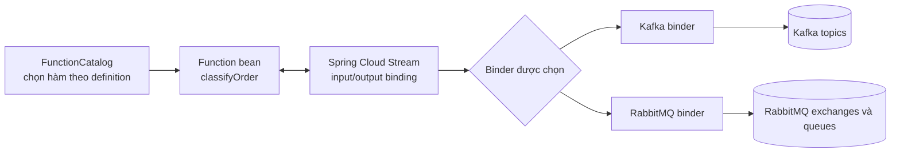
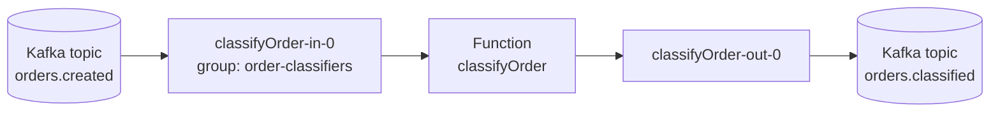
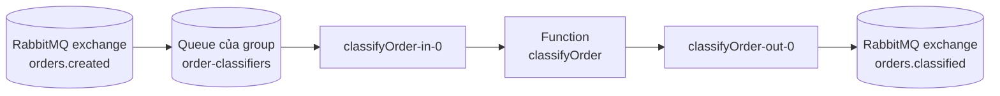
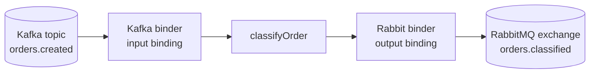

# Chọn binder Kafka hoặc RabbitMQ theo môi trường

## 1. Bối cảnh: thay broker mà vẫn tái sử dụng logic nghiệp vụ

Giả sử một dịch vụ nhận sự kiện `orders.created`, phân loại đơn hàng và phát kết quả `orders.classified`. Môi trường phát triển sử dụng RabbitMQ sẵn có, nhưng production có Kafka để lưu giữ và phát lại sự kiện. Nếu mã nghiệp vụ gọi trực tiếp Kafka consumer hoặc RabbitMQ listener, việc đổi middleware có thể kéo theo thay đổi lớn trong mã.

**Spring Cloud Function** cho phép biểu diễn logic bằng `Supplier<T>`, `Function<I, O>` và `Consumer<T>`, độc lập với cách kích hoạt qua HTTP, sự kiện hoặc serverless. **Spring Cloud Stream** sử dụng các hàm đó để tạo nguồn phát, bộ xử lý hoặc đích nhận trong mô hình message-driven. **Binder** là lớp tích hợp giữa các binding của Spring Cloud Stream với Kafka, RabbitMQ hoặc một middleware cụ thể; **FunctionCatalog** tìm và chuẩn hóa hàm đã được đăng ký.

Bài này tập trung vào hai quyết định liên quan nhưng khác nhau:

1. Chọn **Kafka hay RabbitMQ** theo nhu cầu về lưu giữ, phát lại, routing, throughput, độ tin cậy và vận hành.
2. Chọn **binder trong Spring Cloud Stream** qua dependency và cấu hình theo môi trường, trong khi vẫn giữ nguyên logic `Function`.

Sau bài học, bạn có thể cấu hình cùng một bean chạy với Kafka hoặc RabbitMQ, phân biệt destination và consumer group của hai broker, xử lý tình huống dùng nhiều binder, và biết những đặc tính không tự động tương đương khi chuyển broker.

## 2. Binder nằm ở đâu trong hệ thống?



Ví dụ hàm có tên `classifyOrder` với chữ ký `Function<OrderCreated, OrderClassified>`. Spring Cloud Stream thông thường suy ra hai binding:

- `classifyOrder-in-0`: nơi nhận thông điệp vào.
- `classifyOrder-out-0`: nơi phát thông điệp ra.

Cấu hình `destination: orders.created` định danh nguồn dữ liệu trên broker, còn `destination: orders.classified` định danh đích gửi kết quả. Các tên binding là khái niệm nội bộ của ứng dụng; destination là khái niệm của middleware được binder ánh xạ.

| Thành phần | Chức năng | Ví dụ |
| --- | --- | --- |
| Java functional bean | Xử lý nghiệp vụ | `classifyOrder` |
| `spring.cloud.function.definition` | Chọn bean hoặc composition từ FunctionCatalog | `classifyOrder` |
| Input/output binding | Cổng vào/ra được Stream quản lý | `classifyOrder-in-0` |
| Binder | Kết nối cổng đó với middleware | `kafka` hoặc `rabbit` |
| Destination | Nơi gửi hoặc nhận thông điệp | `orders.created` |
| Consumer group | Nhóm xử lý đầu vào | `order-classifiers` |

**Cảnh báo về thuật ngữ:** destination `orders.created` thường ứng với một **topic** trong Kafka, nhưng với RabbitMQ binder thường liên quan tới một **exchange** và queue được binding tới exchange đó. Hai broker không có topology vật lý giống nhau chỉ vì dùng cùng một tên destination.

## 3. So sánh Kafka và RabbitMQ theo yêu cầu thực tế

| Tiêu chí | Kafka | RabbitMQ |
| --- | --- | --- |
| Mô hình phổ biến | Distributed event log, topic, partition | Broker với exchange, queue và routing |
| Cách consumer nhận | Đọc record theo consumer group và offset | Đọc message từ queue đã được exchange định tuyến |
| Dữ liệu sau khi xử lý | Còn trong topic theo chính sách retention, độc lập với việc đã đọc | Message thường được gỡ khỏi queue sau khi ack thành công |
| Phát lại lịch sử | Có thể đọc lại record còn trong retention bằng offset/nhóm phù hợp | Không mặc định có replay đối với message đã ack; cần phương án lưu và phát lại riêng |
| Mức song song | Trong một group phụ thuộc số partition | Nhiều consumer có thể cạnh tranh lấy message trong cùng queue |
| Thứ tự | Thứ tự trong từng partition, không có thứ tự toàn cục giữa các partition | Phụ thuộc cách tiêu thụ, prefetch, concurrency và redelivery |
| Routing | Topic, key, partition và logic ứng dụng | Exchange, binding key và queue |
| Điểm mạnh thường gặp | Streaming, event log, nhiều nhóm độc lập, replay | Task queue, work distribution, định tuyến theo exchange |
| Quan sát vận hành | Lag, offset, partition, retention | Queue depth, unacked messages, exchange/queue, redelivery |

Bảng mô tả các mô hình thông thường. Kafka cũng có thể phân phối tác vụ và RabbitMQ có các biến thể stream; đây không phải giới hạn tuyệt đối của mỗi sản phẩm. Cần so sánh phiên bản broker, loại queue, topology, cấu hình và mục tiêu cụ thể.

### 3.1. Khi Kafka là ứng viên phù hợp

Hãy xem xét Kafka nếu:

- Nhiều hệ thống cần đọc cùng một dòng sự kiện nhưng xử lý độc lập, chẳng hạn billing, audit và analytics.
- Có yêu cầu **replay** để tái xây dựng dữ liệu trong khoảng retention còn hiệu lực.
- Dữ liệu có thể chia partition theo khóa (`orderId` hoặc `customerId`) để tăng thông lượng và giữ thứ tự theo khóa.
- Hạ tầng đã có công cụ vận hành Kafka, xử lý consumer lag, retention, bảo mật và schema evolution.

Ví dụ: các dịch vụ phát sự kiện thay đổi trạng thái đơn hàng và các nhóm phân tích cần đọc lại lịch sử trong thời gian lưu giữ.

### 3.2. Khi RabbitMQ là ứng viên phù hợp

Hãy xem xét RabbitMQ nếu:

- Hệ thống chủ yếu xử lý **task/command bất đồng bộ**, mỗi tác vụ cần một worker trong nhóm thực hiện.
- Cần định tuyến linh hoạt tới nhiều queue bằng exchange và routing key.
- Đội vận hành đã quản lý tốt queue, dead-letter, prefetch, ack và chính sách retry.
- Không có yêu cầu phát lại toàn bộ lịch sử các message đã ack thành công.

Ví dụ: phân phối yêu cầu gửi email, tạo hóa đơn PDF, xử lý tệp và các nhiệm vụ cần nhiều nhóm worker.

Không thể kết luận Kafka luôn nhanh hơn hay RabbitMQ luôn dễ vận hành hơn cho mọi ứng dụng. Quyết định cần đo theo lưu lượng, kích thước message, mô hình truy cập, lỗi dự kiến, nguồn lực vận hành và yêu cầu phục hồi.

## 4. Viết hàm nghiệp vụ độc lập với binder

Dùng Java 17+ để khai báo record và Java functional bean:

```java
import java.util.function.Function;

import org.springframework.boot.SpringApplication;
import org.springframework.boot.autoconfigure.SpringBootApplication;
import org.springframework.context.annotation.Bean;

@SpringBootApplication
public class OrderApplication {

    public static void main(String[] args) {
        SpringApplication.run(OrderApplication.class, args);
    }

    public record OrderCreated(String orderId, long totalInCents) {}

    public record OrderClassified(String orderId, String priority) {}

    @Bean
    Function<OrderCreated, OrderClassified> classifyOrder() {
        return order -> new OrderClassified(
                order.orderId(),
                order.totalInCents() >= 100_000L
                        ? "PRIORITY"
                        : "STANDARD"
        );
    }
}
```

Quy tắc phân loại không phụ thuộc Kafka, RabbitMQ, HTTP hay serverless. Khi Stream kích hoạt, FunctionCatalog cung cấp hàm đã đăng ký; lớp xử lý thông điệp kết hợp kiểu `OrderCreated` và thông tin như `contentType` để chuyển payload vào, rồi xử lý kết quả `OrderClassified`.

Với cùng input:

```json
{"orderId":"ORD-101","totalInCents":150000}
```

Output nghiệp vụ kỳ vọng:

```json
{"orderId":"ORD-101","priority":"PRIORITY"}
```

Cùng một bean cũng có thể được trình bày qua HTTP bằng adapter phù hợp của Spring Cloud Function hoặc triển khai serverless theo cấu hình tương ứng. Khi đổi adapter, phần logic thuần vẫn giữ được tính tái sử dụng; behavior vận chuyển, xác thực và lifecycle vẫn phụ thuộc môi trường.

## 5. Dependency: profile chỉ chọn được binder có trong ứng dụng

Để dùng Kafka binder hoặc RabbitMQ binder, dự án cần dependency tương ứng:

| Binder | Maven artifact |
| --- | --- |
| Kafka | `org.springframework.cloud:spring-cloud-stream-binder-kafka` |
| RabbitMQ | `org.springframework.cloud:spring-cloud-stream-binder-rabbit` |

Nếu **một file JAR** phải chọn được cả hai binder theo profile, có thể đóng gói cả hai dependency. Ví dụ trong dự án Maven đã có Spring Cloud BOM tương thích với Spring Boot:

```xml
<dependencies>
    <dependency>
        <groupId>org.springframework.cloud</groupId>
        <artifactId>spring-cloud-stream-binder-kafka</artifactId>
    </dependency>
    <dependency>
        <groupId>org.springframework.cloud</groupId>
        <artifactId>spring-cloud-stream-binder-rabbit</artifactId>
    </dependency>
</dependencies>
```

Không tự gán một version ngẫu nhiên cho binder. Chọn cặp Spring Boot/Spring Cloud được hỗ trợ bởi dự án và để BOM quản lý version. Nếu mỗi môi trường được build thành artifact riêng chỉ chứa một binder, việc đổi profile **không tự thêm dependency còn thiếu**.

Ngoài dependency, môi trường chạy phải có broker tương ứng và quyền truy cập, cấu hình mạng, tài nguyên broker phù hợp.

## 6. Cấu hình dùng chung cho hai binder

Các thuộc tính thuộc tầng logic nên được khai báo độc lập broker trong `application.yml`:

```yaml
spring:
  cloud:
    function:
      definition: classifyOrder
    stream:
      bindings:
        classifyOrder-in-0:
          destination: orders.created
          group: order-classifiers
          content-type: application/json
        classifyOrder-out-0:
          destination: orders.classified
          content-type: application/json
```

**Giải thích cấu hình:**

- `definition: classifyOrder` chọn đúng hàm cần bind qua mô hình Spring Cloud Function.
- `classifyOrder-in-0` và `classifyOrder-out-0` được suy ra từ một `Function<I, O>` thông thường.
- `orders.created` và `orders.classified` là **tên destination logic** do binder diễn giải.
- `group: order-classifiers` giúp Stream định danh nhóm nhận thông điệp. Cách hiện thực group khác giữa Kafka và RabbitMQ.
- `content-type: application/json` phục vụ xử lý payload JSON; record Java cần hỗ trợ JSON serialization/deserialization (thường là Jackson).

Khi một ứng dụng có nhiều functional bean, nên chỉ rõ `spring.cloud.function.definition`. Nếu không, cơ chế tự phát hiện có thể không chọn đúng luồng bạn cần.

## 7. Chọn Kafka bằng Spring profile

Tạo `application-kafka.yml` với cấu hình Kafka:

```yaml
spring:
  cloud:
    stream:
      defaultBinder: kafka
      kafka:
        binder:
          brokers: ${KAFKA_BROKERS:localhost:9092}
```

Kích hoạt profile:

```bash
java -jar order-service.jar --spring.profiles.active=kafka
```

Khi trên classpath có cả Kafka và RabbitMQ binder, `defaultBinder: kafka` cho biết các binding chưa khai báo `binder` riêng cần dùng Kafka. `brokers` cung cấp danh sách broker Kafka có thể kết nối. `localhost:9092` chỉ là ví dụ để thử nghiệm cục bộ; trên Docker/Kubernetes còn phải xét advertised listeners và mạng giữa ứng dụng với Kafka.

Luồng xử lý:



Các yếu tố đặc trưng Kafka:

- **Group và offset:** các consumer cùng group phân chia partition; một group khác có thể đọc cùng topic theo vị trí riêng.
- **Replay:** record đã xử lý có thể còn trên topic theo retention; muốn đọc lại phải có offset/nhóm và record còn khả dụng.
- **Parallelism:** tăng số instance vượt số partition được gán cho group không tự tăng khả năng xử lý song song.
- **Ordering:** Kafka giữ thứ tự trong từng partition; key và partitioning cần phù hợp thứ tự nghiệp vụ.
- **Error handling:** cần cấu hình retry/DLQ, commit offset và recovery đúng yêu cầu; không có bảo đảm exactly-once tùy ý chỉ nhờ dùng Kafka.

## 8. Chọn RabbitMQ bằng Spring profile

Tạo `application-rabbit.yml`:

```yaml
spring:
  rabbitmq:
    host: ${RABBITMQ_HOST:localhost}
    port: ${RABBITMQ_PORT:5672}
    username: ${RABBITMQ_USERNAME:guest}
    password: ${RABBITMQ_PASSWORD:guest}
    virtual-host: ${RABBITMQ_VHOST:/}
  cloud:
    stream:
      defaultBinder: rabbit
```

Kích hoạt profile:

```bash
java -jar order-service.jar --spring.profiles.active=rabbit
```

Trong cấu hình phổ biến, RabbitMQ binder sử dụng kết nối được thiết lập qua `spring.rabbitmq.*`. Tài khoản `guest` chỉ để minh họa trên broker thử nghiệm cục bộ; production nên lấy credential từ hệ thống quản lý secret, sử dụng quyền tối thiểu và cấu hình TLS nếu có yêu cầu.

Sơ đồ cấu trúc:



Đối với RabbitMQ binder, destination thường được ánh xạ tới exchange. Input group tham gia quy tắc tạo/chọn queue và ràng buộc queue với exchange. Tên queue cụ thể, routing key, durable queue và quyền khai báo cần kiểm tra với cấu hình binder.

**Khác biệt cốt lõi:** message được consumer ack thành công thường không còn trong queue đang nhận, nên không thể mặc định phát lại toàn bộ lịch sử như khi còn record trên Kafka topic. Nếu cần replay, phải có phương án lưu trữ và phát lại riêng hoặc kiến trúc queue/stream thích hợp.

Các tiêu chí thường cần thiết lập ở RabbitMQ là queue durability, consumer concurrency, prefetch, acknowledgement, redelivery, dead-letter, routing key và quyền tạo exchange/queue.

## 9. Cấu hình profile trong một file YAML

Nếu muốn dùng một file `application.yml` duy nhất, Spring Boot hỗ trợ các YAML document phân tách bằng `---`:

```yaml
# Phần cấu hình chung:
spring:
  cloud:
    function:
      definition: classifyOrder
    stream:
      bindings:
        classifyOrder-in-0:
          destination: orders.created
          group: order-classifiers
          content-type: application/json
        classifyOrder-out-0:
          destination: orders.classified
          content-type: application/json

---
spring:
  config:
    activate:
      on-profile: kafka
  cloud:
    stream:
      defaultBinder: kafka
      kafka:
        binder:
          brokers: ${KAFKA_BROKERS:localhost:9092}

---
spring:
  config:
    activate:
      on-profile: rabbit
  cloud:
    stream:
      defaultBinder: rabbit
  rabbitmq:
    host: ${RABBITMQ_HOST:localhost}
    port: ${RABBITMQ_PORT:5672}
    username: ${RABBITMQ_USERNAME:guest}
    password: ${RABBITMQ_PASSWORD:guest}
```

Đây là **một file** với ba document YAML. Các phần `spring.config.activate.on-profile` chỉ có hiệu lực khi profile tương ứng được bật. Không dùng đồng thời file tách profile và tài liệu profile trong `application.yml` nếu chưa kiểm soát thứ tự ghi đè.

Trong ví dụ single-binder này, nên kích hoạt **một** trong hai profile `kafka` hoặc `rabbit`. Nếu vô tình kích hoạt cả hai, giá trị `defaultBinder` có thể bị ghi đè theo thứ tự cấu hình.

| Thuộc tính | Nên đặt ở đâu | Ý nghĩa |
| --- | --- | --- |
| `spring.cloud.function.definition` | Chung | Chọn hàm Java |
| `spring.cloud.stream.bindings.*.destination` | Chung hoặc profile nếu tên môi trường khác | Chọn destination logic |
| `spring.cloud.stream.bindings.*.group` | Chung hoặc profile | Xác định nhóm nhận sự kiện |
| `spring.cloud.stream.bindings.*.content-type` | Chung | Hợp đồng payload |
| `spring.cloud.stream.defaultBinder` | Theo profile | Chọn binder Kafka/RabbitMQ |
| `spring.cloud.stream.kafka.binder.*` | Kafka profile | Kết nối, cấu hình Kafka binder |
| `spring.rabbitmq.*` | Rabbit profile | Kết nối RabbitMQ |

Cần cấp biến môi trường và credentials tương ứng khi chạy thật. Tránh commit password production hoặc broker endpoint nhạy cảm vào mã nguồn.

## 10. Khi cần nhiều binder đồng thời

Một tình huống khác với chuyển profile là **đọc Kafka nhưng phát ra RabbitMQ** trong cùng một ứng dụng. Ví dụ bridge mang thông điệp từ nền tảng event streaming sang hệ thống queue xử lý tác vụ.

Khi đó, cấu hình `binder` theo **từng binding**:

```yaml
spring:
  cloud:
    function:
      definition: classifyOrder
    stream:
      bindings:
        classifyOrder-in-0:
          binder: kafka
          destination: orders.created
          group: order-bridge
          content-type: application/json
        classifyOrder-out-0:
          binder: rabbit
          destination: orders.classified
          content-type: application/json
      kafka:
        binder:
          brokers: ${KAFKA_BROKERS:localhost:9092}
  rabbitmq:
    host: ${RABBITMQ_HOST:localhost}
    port: ${RABBITMQ_PORT:5672}
    username: ${RABBITMQ_USERNAME:guest}
    password: ${RABBITMQ_PASSWORD:guest}
```

Ví dụ giả định cả hai binder có mặt trên classpath và tên cấu hình binder được đăng ký là `kafka` và `rabbit`. Trong hệ thống khai báo các binder instance với tên riêng qua `spring.cloud.stream.binders.<name>`, thuộc tính `binder` phải trỏ tới **tên instance đã khai báo**. Không được giả định tên binder bất kỳ luôn trùng tên loại middleware.



Dù `classifyOrder` là hàm thuần túy, bridge vẫn cần giải quyết trường hợp message đã được publish sang RabbitMQ nhưng tiến trình chết trước khi Kafka input được xác nhận xử lý. Trong trường hợp đó, dữ liệu có thể được nhận lại và gửi trùng. Không có transaction phân tán tự động bao trùm cả hai broker chỉ từ việc chọn hai binder.

Hướng giải quyết thường gồm event ID, xử lý idempotent ở consumer đích, retry có giới hạn, quan sát dead-letter và quy trình khôi phục. Việc dùng hai binder nên dựa trên nhu cầu tích hợp rõ ràng vì sẽ tăng độ phức tạp vận hành.

## 11. Ý nghĩa của consumer group ở hai binder

`group` có tác động thực tế tới cách thông điệp được chia cho consumer, nhưng broker hiện thực khác nhau.

**Trong Kafka:** các instance cùng group nhận tập partition được phân công từ topic. Một message trong một partition thường được xử lý bởi một consumer được phân công trong group tại một thời điểm; các group độc lập có offset riêng và có thể đọc cùng record còn trong retention.

**Trong RabbitMQ:** Spring Cloud Stream Rabbit binder thường tạo/chọn queue theo group và bind queue với exchange. Các instance cùng group thường tiêu thụ cạnh tranh từ queue của group đó; group khác có thể dùng queue khác để nhận bản sao theo exchange binding tương ứng.

Ví dụ, `order-classifiers` và `order-auditors` là hai nhóm nghiệp vụ độc lập. Cả hai có thể nhận dữ liệu từ destination `orders.created` nếu cấu hình của từng broker bảo đảm phân phối tới hai group.

Điều không nên nhầm lẫn: Kafka consumer group không phải RabbitMQ queue, Kafka partition không phải RabbitMQ exchange, và thay đổi consumer group có thể làm thay đổi vị trí đọc hoặc topology. Khi đổi broker, cần chạy integration test riêng cho hành vi giao nhận dữ liệu.

## 12. Cấu hình lỗi, retry và DLQ theo từng binder

Một cấu hình chung như `content-type: application/json` không bảo đảm cùng hành vi khi gặp lỗi.

### Kafka binder

Các yếu tố cần xác minh: offset commit, retry, topic DLQ, key/partition của bản ghi, retention của DLQ và khả năng đọc lại. Ví dụ tùy chọn để kích hoạt DLQ cho một input binding:

```yaml
spring:
  cloud:
    stream:
      kafka:
        bindings:
          classifyOrder-in-0:
            consumer:
              enableDlq: true
```

Điều này chỉ minh họa thuộc tính riêng của Kafka binder. Trong môi trường thật, kiểm tra consumer group, topic DLQ, quyền tạo/ghi, tên DLQ và hành vi retry của phiên bản framework đang dùng.

### RabbitMQ binder

Các yếu tố cần xác minh: queue/exchange, acknowledgement, requeue, prefetch, dead-letter exchange/queue, quyền provision và khả năng tránh xử lý lỗi lặp vô hạn. Ví dụ tùy chọn:

```yaml
spring:
  cloud:
    stream:
      rabbit:
        bindings:
          classifyOrder-in-0:
            consumer:
              autoBindDlq: true
```

Đây là thuộc tính riêng Rabbit binder. Nếu production quản lý exchange/queue bằng infrastructure as code, hãy bảo đảm cấu hình binder và chính sách broker phù hợp; không mặc định ứng dụng có quyền tự tạo mọi tài nguyên.

| Yêu cầu khi lỗi | Kafka binder | RabbitMQ binder |
| --- | --- | --- |
| Xác nhận xử lý đầu vào | Offset/commit và consumer semantics | Ack/nack và queue semantics |
| Phát lại dữ liệu cũ | Offset trên topic còn retention | Cần lưu/phát lại riêng khi message đã ack |
| Message không xử lý được | Retry, DLQ topic tùy cấu hình | Retry, requeue, DLQ/Dead Letter Exchange tùy cấu hình |
| Giám sát backlog | Consumer lag/offset | Queue depth/unacked message |
| Bảo đảm không xử lý trùng | Cần idempotency và thiết kế giao nhận thích hợp | Cần idempotency và thiết kế giao nhận thích hợp |

Không hứa hẹn “exactly once” cho cả workflow chỉ nhờ chọn Kafka hoặc bật DLQ. Side effect tới database, HTTP hoặc một broker khác vẫn cần bảo đảm riêng.

## 13. Những phần giữ nguyên khi chuyển binder và những phần phải kiểm tra

**Thường giữ nguyên được:**

- Hàm `Function<OrderCreated, OrderClassified>` và các unit test của quy tắc phân loại.
- Tên hàm trong `spring.cloud.function.definition`.
- Quy ước tên binding `classifyOrder-in-0` và `classifyOrder-out-0`.
- Hợp đồng JSON nếu các thành phần hai phía cùng chấp nhận schema đó.
- Mô hình composition `validate|classifyOrder` nếu các hàm có kiểu tương thích.

**Cần kiểm tra và có thể phải thay đổi:**

1. Dependency của binder, cấu hình kết nối, TLS, credential và quyền truy cập.
2. Topic Kafka so với exchange và queue RabbitMQ, auto-provision và nguồn quản lý topology.
3. Consumer group, cách chia việc, ordering, concurrency, partition hoặc prefetch.
4. Offset, acknowledgement, retry, replay và chính sách dead-letter.
5. Dữ liệu đã tồn tại trên broker cũ: đổi profile không tự chuyển lịch sử hay queue đang tồn đọng sang broker mới.
6. Header, `contentType`, schema evolution và chuyển đổi payload.
7. Metrics, alert và quy trình xử lý sự cố phù hợp mỗi broker.

**Khuyến nghị cho môi trường:** staging nên kiểm thử bằng hạ tầng và semantics gần production. Dùng RabbitMQ để phát triển cục bộ có thể tiết kiệm công sức, nhưng không thay thế integration test trên Kafka nếu production yêu cầu partition, offset, replay hay Kafka-specific error handling.

## 14. Kiểm thử và xác minh lựa chọn binder

### 14.1. Unit test cho hàm nghiệp vụ

Test trực tiếp bean để bảo đảm logic không phụ thuộc broker:

```java
import static org.junit.jupiter.api.Assertions.assertEquals;
import org.junit.jupiter.api.Test;

class OrderApplicationTest {

    @Test
    void classifiesOrdersRegardlessOfBinder() {
        var fn = new OrderApplication().classifyOrder();

        var normal = fn.apply(
                new OrderApplication.OrderCreated("ORD-1", 99_999L)
        );
        var priority = fn.apply(
                new OrderApplication.OrderCreated("ORD-2", 100_000L)
        );

        assertEquals("STANDARD", normal.priority());
        assertEquals("PRIORITY", priority.priority());
    }
}
```

Test này chứng minh nghiệp vụ ở ngưỡng `100_000` nhưng **không chứng minh** broker đã kết nối, message đã được serialize, consumer đã ack/commit hoặc DLQ hoạt động.

### 14.2. Integration test với Kafka

1. Khởi động Kafka và cấu hình `KAFKA_BROKERS` có thể truy cập; bảo đảm các topic cần thiết tồn tại hoặc được provision đúng chính sách.
2. Chạy ứng dụng với profile `kafka` và kiểm tra log rằng các binding được gắn Kafka binder.
3. Gửi JSON `{"orderId":"ORD-101","totalInCents":150000}` tới topic `orders.created`.
4. Đọc topic `orders.classified`, xác nhận kết quả có `priority: PRIORITY`.
5. Kiểm tra group `order-classifiers` và consumer lag; thử restart, gửi message lỗi và quan sát retry/DLQ nếu đã cấu hình.

### 14.3. Integration test với RabbitMQ

1. Khởi động RabbitMQ, cấp connection/virtual host/credentials phù hợp.
2. Chạy ứng dụng với profile `rabbit`; kiểm tra exchange, queue của group, binding/routing trong RabbitMQ management hoặc công cụ tương ứng.
3. Publish message phù hợp vào exchange `orders.created`, quan sát message được xử lý rồi phát qua exchange `orders.classified`.
4. Dùng consumer thử nghiệm đúng queue/binding để kiểm tra kết quả; quan sát unacked, queue depth và redelivery.
5. Thử message lỗi trong môi trường riêng để xác minh cơ chế retry/requeue/DLQ.

Công cụ publish/consume của Kafka và RabbitMQ không thay thế cho nhau. Integration test phải bao phủ topology thật của broker đang dùng.

## 15. Bảng chẩn đoán lỗi thường gặp

| Hiện tượng | Nguyên nhân có thể | Hướng xử lý |
| --- | --- | --- |
| Có cả hai dependency nhưng app báo binder không xác định | Thiếu `defaultBinder` hoặc tên binder instance không khớp | Chọn đúng profile và tên binder, xem log khởi tạo |
| Chọn Rabbit nhưng không có Rabbit binder | Artifact chạy thiếu dependency | Kiểm tra dependency và package cuối cùng |
| Kafka không nhận message | Sai broker/advertised listeners, topic, group, offset hoặc quyền | Kiểm tra kết nối, topic, consumer lag, log Kafka |
| Rabbit exchange có message nhưng hàm không chạy | Queue chưa bind, sai routing key/group, thiếu quyền | Kiểm tra topology exchange → queue và consumer |
| JSON không chuyển thành `OrderCreated` | Sai schema, content type hoặc converter | Kiểm tra payload, headers và chữ ký hàm |
| Chuyển binder rồi message xử lý lặp | Retry/rebalance/redelivery hoặc thiếu idempotency | Dùng event ID và xử lý lặp an toàn |
| App chạy nhưng không thấy output | Sai output destination hoặc hàm ném exception | Kiểm tra binding `classifyOrder-out-0`, logs và DLQ |
| Kafka group mới không đọc lịch sử như kỳ vọng | Offset policy hoặc retention | Kiểm tra offset reset và record còn tồn tại |
| Rabbit consumer hoạt động nhưng không có khả năng replay | Message đã ack và bị xóa khỏi queue | Thiết kế lưu trữ/replay riêng nếu bắt buộc |
| Bridge Kafka → Rabbit phát trùng | Không có transaction chung qua hai broker | Thiết kế idempotent downstream và retry/recovery |

Điều tra theo thứ tự: **function definition → tên binding → binder được chọn → destination/topology → kết nối broker → payload/conversion → ack hoặc offset**. Cách này giúp khoanh vùng lỗi do cấu hình hay nghiệp vụ.

## 16. Bài tập áp dụng

### Bài tập 1: Chọn broker

Ba hệ thống có yêu cầu khác nhau:

1. Hệ thống phân tích cần nhiều nhóm đọc lại lịch sử các sự kiện đơn hàng trong thời gian retention.
2. Hệ thống xử lý yêu cầu tạo PDF, mỗi tác vụ nên được một worker hoàn tất và tác vụ lỗi đưa sang DLQ.
3. Hệ thống hiện đã có RabbitMQ, chỉ cần task queue và không yêu cầu replay.

Hãy đề xuất binder cho từng hệ thống và giải thích theo retention/replay, routing, scaling, hạ tầng và vận hành. Không chọn chỉ vì tên công nghệ phổ biến.

### Bài tập 2: Chuyển profile

Từ hàm `classifyOrder`, hãy tạo cấu hình chung cùng hai profile `kafka`/`rabbit`. Xác định giá trị của:

- `spring.cloud.function.definition`;
- `spring.cloud.stream.defaultBinder`;
- `classifyOrder-in-0.destination` và `classifyOrder-out-0.destination`;
- `spring.cloud.stream.bindings.classifyOrder-in-0.group`.

Đáp án đúng phải tách **bean name**, **binding name**, **destination** và **binder name**.

### Bài tập 3: Kafka vào, RabbitMQ ra

Cấu hình `classifyOrder-in-0.binder: kafka` và `classifyOrder-out-0.binder: rabbit`. Giả sử RabbitMQ đã nhận event nhưng tiến trình chết trước khi input Kafka được xác nhận; hãy giải thích rủi ro và đề xuất cơ chế chống xử lý lặp.

### Câu hỏi tự kiểm tra

1. Tại sao có thể đổi binder theo profile mà không đổi `Function<OrderCreated, OrderClassified>`?
2. Destination `orders.created` khác gì về thực thể vật lý giữa Kafka và RabbitMQ?
3. Group có vai trò gì ở Kafka consumer và RabbitMQ queue?
4. Khi nào replay là yêu cầu kiến trúc quan trọng?
5. Vì sao chạy integration test với RabbitMQ chưa xác minh được offset và partition behavior của Kafka?
6. Nếu một ứng dụng có cả Kafka và RabbitMQ binder, thuộc tính nào xác định binder riêng cho từng binding?

## 17. Tổng kết

**Kafka** thường được chọn cho event streaming với topic, partition, retention và replay. **RabbitMQ** thường phù hợp với mô hình queue, exchange routing và xử lý tác vụ bất đồng bộ. Việc lựa chọn vẫn phải căn cứ tải, SLA, vận hành và yêu cầu dữ liệu của từng môi trường.

Ở tầng ứng dụng, **Spring Cloud Function** giữ logic dưới dạng `Supplier`, `Function`, `Consumer`; **FunctionCatalog** tìm/chuẩn hóa hàm; **Spring Cloud Stream** tạo binding; **binder** chuyển message đến Kafka hoặc RabbitMQ. `spring.cloud.stream.defaultBinder` giúp chọn binder theo profile, còn `spring.cloud.stream.bindings.<binding>.binder` giúp chọn binder cho từng cổng khi cần kết hợp nhiều broker.

Điểm quan trọng nhất khi chuyển môi trường: giữ nguyên hàm nghiệp vụ là lợi thế lớn, nhưng **phải xác minh lại ngữ nghĩa giao nhận của broker**, đặc biệt là ordering, retry, replay, acknowledgment, group và idempotency.

### Tài liệu tham khảo

- [Spring Cloud Stream — Reference documentation](https://docs.spring.io/spring-cloud-stream/reference/)
- [Spring Cloud Stream — Producing and consuming messages](https://docs.spring.io/spring-cloud-stream/reference/spring-cloud-stream/producing-and-consuming-messages.html)
- [Spring Cloud Stream — Functional binding names](https://docs.spring.io/spring-cloud-stream/reference/spring-cloud-stream/functional-binding-names.html)
- [Spring Cloud Function — Reference documentation](https://docs.spring.io/spring-cloud-function/reference/)
- [Apache Kafka — Documentation](https://kafka.apache.org/documentation/)
- [RabbitMQ — Documentation](https://www.rabbitmq.com/docs)
