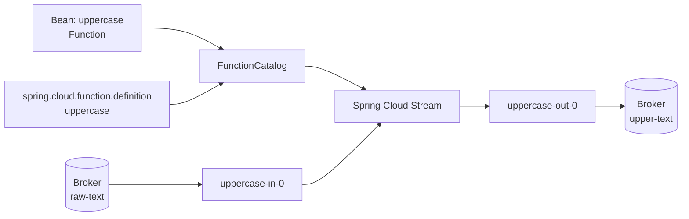
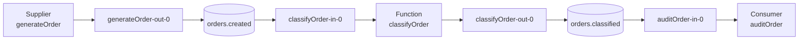

# Quy ước binding `<function>-in-0` và `<function>-out-0`

## 1. Vì sao cần hiểu tên binding?

Trong **Spring Cloud Function**, ta mô tả nghiệp vụ bằng `Supplier<T>`, `Function<I, O>` và `Consumer<T>` thay vì gắn chặt với một giao thức. Cùng một hàm có thể được kích hoạt qua HTTP, sự kiện hoặc môi trường serverless nếu có adapter thích hợp. Khi dùng **Spring Cloud Stream** để đưa hàm vào luồng sự kiện, framework tạo các điểm kết nối logic gọi là *binding*.

Giả sử khai báo:

```java
@Bean
Function<String, String> uppercase() {
    return String::toUpperCase;
}
```

Để nhận dữ liệu từ một Kafka topic rồi gửi kết quả tới topic khác, Spring Cloud Stream cần biết **đầu vào** và **đầu ra** của hàm `uppercase`. Theo quy ước mặc định:

- `uppercase-in-0` là **input binding**.
- `uppercase-out-0` là **output binding**.

Tên này xuất phát từ tên hàm và hướng truyền dữ liệu. Đây không phải tên topic Kafka, queue RabbitMQ hoặc endpoint HTTP. Ta ánh xạ từng binding tới destination thực tế bằng cấu hình.

**Mục tiêu bài học:**

1. Giải mã từng thành phần trong `<function>-in-0` và `<function>-out-0`.
2. Xác định đúng input/output binding của `Supplier`, `Function`, `Consumer`.
3. Phân biệt tên bean, tên binding, tên destination, consumer group và binder.
4. Cấu hình binding mặc định, đổi tên binding tường minh và áp dụng với composition hoặc nhiều hàm.
5. Chẩn đoán các lỗi thường gặp khi cấu hình sai tên hoặc sai hướng binding.

## 2. Công thức đặt tên mặc định

Với một functional bean thông thường, Spring Cloud Stream dùng quy ước:

```text
<functionName>-in-<index>
<functionName>-out-<index>
```

Ý nghĩa từng thành phần:

| Thành phần | Ý nghĩa | Ví dụ |
| --- | --- | --- |
| `<functionName>` | Tên functional bean/definition mà Stream chọn | `uppercase` |
| `-in-` | Binding nhận dữ liệu **vào** hàm | `uppercase-in-0` |
| `-out-` | Binding phát dữ liệu **ra** từ hàm | `uppercase-out-0` |
| `0` | Chỉ số của cổng vào/ra đầu tiên, bắt đầu từ 0 | `uppercase-in-0`, `uppercase-out-0` |

`0` ở cuối tên **không phải**:

- Số partition Kafka.
- Số consumer trong group.
- Số thứ tự message.
- Cấu hình ưu tiên hoặc số phiên bản của hàm.

Đối với hàm có một đầu vào và một đầu ra, chỉ số đều là `0`. Một số trường hợp nâng cao có nhiều đầu vào/đầu ra, như hàm reactive dùng cấu trúc tuple, có thể sinh `-in-1` hoặc `-out-1`; khi đó chỉ số thể hiện vị trí của từng cổng logic. Không nên suy ra nhiều binding chỉ từ việc hàm nhận một object chứa nhiều field.

### Tên hàm đến từ đâu?

Với cấu hình sau:

```java
@Bean
Function<String, String> normalizeText() {
    return text -> text.trim().toLowerCase();
}
```

Tên bean mặc định là `normalizeText`, nên binding thường là `normalizeText-in-0` và `normalizeText-out-0`.

Có thể đặt tên bean tường minh:

```java
@Bean("cleanText")
Function<String, String> normalizeText() {
    return text -> text.trim().toLowerCase();
}
```

Lúc này tên bean được công bố là `cleanText`. Khi chọn `spring.cloud.function.definition: cleanText`, tên binding mặc định tương ứng là `cleanText-in-0` và `cleanText-out-0`. Đừng chỉ nhìn tên phương thức Java mà bỏ qua tên bean tường minh.

**Nguyên tắc:** dùng chính xác tên functional definition mà Spring Cloud Function và Spring Cloud Stream nhận diện; phân biệt chữ hoa/chữ thường và không tự sửa sang một cách viết khác.

## 3. Spring Cloud Function, FunctionCatalog và Stream phối hợp thế nào?

`FunctionCatalog` thuộc Spring Cloud Function, cho phép tìm, chuẩn hóa và ghép các functional bean. Spring Cloud Stream sử dụng hàm được chọn để thiết lập binding và xử lý message trên middleware.



Trong mô hình này:

- `uppercase` là **tên bean/hàm** trong catalog.
- `uppercase-in-0` và `uppercase-out-0` là **tên binding của ứng dụng**.
- `raw-text` và `upper-text` là **destination trên broker**.
- Kafka binder, RabbitMQ binder hoặc binder khác thực hiện kết nối binding tới hạ tầng tương ứng.

`FunctionCatalog` không tự tạo Kafka topic hay RabbitMQ queue. Việc chọn binder và tạo/tiêu thụ message là trách nhiệm của Spring Cloud Stream và binder, chịu ảnh hưởng bởi cấu hình hạ tầng.

## 4. Ba giao diện hàm sinh ra binding nào?

| Functional bean | Vai trò thường gặp | Input binding mặc định | Output binding mặc định |
| --- | --- | --- | --- |
| `Supplier<T> publishEvent` | Source | Không có | `publishEvent-out-0` |
| `Function<I,O> transformEvent` | Processor | `transformEvent-in-0` | `transformEvent-out-0` |
| `Consumer<T> auditEvent` | Sink | `auditEvent-in-0` | Không có |

Lý do rất trực tiếp từ chữ ký Java:

```text
Supplier<T>      () -> T       chỉ phát dữ liệu
Function<I, O>   I  -> O       nhận và chuyển đổi dữ liệu
Consumer<T>      T  -> void    chỉ nhận dữ liệu
```

### 4.1. Supplier chỉ có output binding

```java
@Bean
Supplier<String> publishEvent() {
    return () -> "new-order";
}
```

Spring Cloud Stream có thể tạo `publishEvent-out-0` để phát dữ liệu tới một destination. **Không có `publishEvent-in-0` mặc định** vì `Supplier` không nhận message đầu vào từ Stream.

Supplier imperative thường được kích hoạt qua poller; mỗi lần được gọi có thể phát một kết quả. Ví dụ trên luôn trả một chuỗi nên không phù hợp chạy vô hạn trong production nếu chưa kiểm soát nhu cầu phát. Với `Supplier<Flux<T>>`, cần hiểu vòng đời và cách phát của luồng reactive thay vì giả định framework gọi lại supplier cho từng phần tử.

### 4.2. Function có cả input và output binding

```java
@Bean
Function<String, String> transformEvent() {
    return text -> text.trim().toUpperCase();
}
```

Framework nhận message qua `transformEvent-in-0`, gọi hàm và phát kết quả qua `transformEvent-out-0`. Cả hai binding thuộc cùng một functional definition.

### 4.3. Consumer chỉ có input binding

```java
@Bean
Consumer<String> auditEvent() {
    return value -> System.out.println("Audit: " + value);
}
```

Framework nhận message qua `auditEvent-in-0`. Vì `Consumer<T>` không trả dữ liệu cho Stream, **không có `auditEvent-out-0` mặc định**.

Nếu consumer chủ động ghi database hoặc dùng API khác để phát message, đó là side effect do code quyết định, không làm chữ ký consumer tự sinh output binding.

## 5. Cấu hình tối thiểu với một Function

Ví dụ ứng dụng xử lý chuỗi viết hoa:

```java
import java.util.function.Function;

import org.springframework.boot.SpringApplication;
import org.springframework.boot.autoconfigure.SpringBootApplication;
import org.springframework.context.annotation.Bean;

@SpringBootApplication
public class UppercaseApplication {

    public static void main(String[] args) {
        SpringApplication.run(UppercaseApplication.class, args);
    }

    @Bean
    Function<String, String> uppercase() {
        return String::toUpperCase;
    }
}
```

Với Kafka binder trên classpath và broker phù hợp, ta khai báo `application.yml`:

```yaml
spring:
  cloud:
    function:
      definition: uppercase
    stream:
      bindings:
        uppercase-in-0:
          destination: raw-text
          group: uppercase-workers
          content-type: text/plain
        uppercase-out-0:
          destination: upper-text
          content-type: text/plain
      kafka:
        binder:
          brokers: localhost:9092
```

Giải thích một message đi qua:

1. Kafka binder nhận record từ destination `raw-text` cho group `uppercase-workers`.
2. Stream đưa dữ liệu vào binding `uppercase-in-0` rồi chuyển thành input phù hợp cho `Function<String,String>`.
3. Hàm `uppercase` đổi `"spring"` thành `"SPRING"`.
4. Stream đưa output qua `uppercase-out-0` tới destination `upper-text`.

Không có lý do phải đặt tên topic thành `uppercase-in-0`; destination có thể là tên bất kỳ phù hợp với hạ tầng. Tên binding tồn tại để **liên kết cấu hình với cổng logic của hàm**.

**Điều kiện chạy ví dụ:** phải có dependency Spring Cloud Stream Kafka binder tương thích với Spring Boot/Spring Cloud của ứng dụng và một Kafka broker thực sự truy cập được tại `localhost:9092`. Ví dụ chỉ mô tả cấu hình, không giả định broker đã tồn tại.

## 6. Năm loại tên dễ bị nhầm lẫn

| Khái niệm | Ví dụ | Nơi khai báo hoặc xuất hiện |
| --- | --- | --- |
| **Tên hàm** | `uppercase` | Tên bean `@Bean` và `spring.cloud.function.definition` |
| **Input binding** | `uppercase-in-0` | Khóa dưới `spring.cloud.stream.bindings` |
| **Output binding** | `uppercase-out-0` | Khóa dưới `spring.cloud.stream.bindings` |
| **Destination** | `raw-text`, `upper-text` | Giá trị `destination` của từng binding |
| **Consumer group** | `uppercase-workers` | Giá trị `group` của input binding |
| **Binder** | `kafka` hoặc `rabbit` | Binder mặc định hoặc thuộc tính `binder` của binding |

Ví dụ sau **không đúng** nếu bạn tưởng `raw-text` là tên input binding:

```yaml
spring:
  cloud:
    stream:
      bindings:
        raw-text:
          group: uppercase-workers
```

Nếu chọn hàm `uppercase`, Stream sẽ tìm cấu hình cho `uppercase-in-0` theo quy ước. Đặt `raw-text` làm khóa chỉ phù hợp khi bạn **đã khai báo alias** tương ứng hoặc tự tạo binding có tên đó bằng cơ chế khác.

Cấu hình đúng theo tên mặc định:

```yaml
spring:
  cloud:
    stream:
      bindings:
        uppercase-in-0:
          destination: raw-text
          group: uppercase-workers
```

Tương tự, thêm `group` cho output binding không biến output thành một consumer group. Group là khái niệm thuộc phía nhận thông điệp.

## 7. Một ví dụ hoàn chỉnh: Supplier → Function → Consumer

Giả sử hệ thống phát sự kiện đơn hàng, phân loại ưu tiên và ghi nhận kết quả. Ba bean nằm trong một ứng dụng để minh họa quy ước tên; ở hệ thống thật có thể tách thành các ứng dụng riêng.

```java
import java.util.concurrent.atomic.AtomicLong;
import java.util.function.Consumer;
import java.util.function.Function;
import java.util.function.Supplier;

import org.springframework.boot.SpringApplication;
import org.springframework.boot.autoconfigure.SpringBootApplication;
import org.springframework.context.annotation.Bean;

@SpringBootApplication
public class OrderEventsApplication {

    public static void main(String[] args) {
        SpringApplication.run(OrderEventsApplication.class, args);
    }

    public record OrderCreated(String id, long totalInCents) {}

    public record OrderClassified(String id, String priority) {}

    // Source: chỉ có output binding.
    @Bean
    Supplier<OrderCreated> generateOrder() {
        AtomicLong sequence = new AtomicLong();
        return () -> new OrderCreated(
                "ORD-" + sequence.incrementAndGet(), 150_000L);
    }

    // Processor: có input và output binding.
    @Bean
    Function<OrderCreated, OrderClassified> classifyOrder() {
        return order -> new OrderClassified(
                order.id(),
                order.totalInCents() >= 100_000L
                        ? "PRIORITY" : "STANDARD");
    }

    // Sink: chỉ có input binding.
    @Bean
    Consumer<OrderClassified> auditOrder() {
        return event -> System.out.printf(
                "Audit %s: %s%n", event.id(), event.priority());
    }
}
```

Cấu hình mô tả ba pipeline logic độc lập, được kết nối qua broker bằng các destination chung:

```yaml
spring:
  cloud:
    function:
      definition: generateOrder;classifyOrder;auditOrder
    stream:
      bindings:
        generateOrder-out-0:
          destination: orders.created
          content-type: application/json

        classifyOrder-in-0:
          destination: orders.created
          group: classifiers
          content-type: application/json
        classifyOrder-out-0:
          destination: orders.classified
          content-type: application/json

        auditOrder-in-0:
          destination: orders.classified
          group: auditors
          content-type: application/json
```

Sơ đồ luồng:



| Bean | Binding nhận | Binding phát | Destination |
| --- | --- | --- | --- |
| `generateOrder` | Không có | `generateOrder-out-0` | Phát `orders.created` |
| `classifyOrder` | `classifyOrder-in-0` | `classifyOrder-out-0` | Đọc `orders.created`, phát `orders.classified` |
| `auditOrder` | `auditOrder-in-0` | Không có | Đọc `orders.classified` |

Dấu chấm phẩy `;` trong `definition` chọn **nhiều hàm độc lập**, không tự làm đầu ra của bean này trở thành đầu vào của bean kia. Trong ví dụ, các destination chung mới tạo ra đường đi của thông điệp.

**Lưu ý thực hành:** `generateOrder` tạo event mới trong mỗi lần được poll, nên chỉ dùng như nguồn demo. Khi triển khai thực tế cần nguồn dữ liệu có kiểm soát và chính sách phát phù hợp để tránh sinh đơn hàng vô hạn.

## 8. Đổi tên binding bằng thuộc tính function.bindings

Quy ước `uppercase-in-0` và `uppercase-out-0` đơn giản, dễ dự đoán. Tuy nhiên, đôi khi hệ thống muốn dùng tên binding có ý nghĩa nghiệp vụ hơn, ví dụ `incomingText` và `outgoingText`.

Spring Cloud Stream cho phép **ánh xạ tên implicit binding sang tên explicit binding** bằng `spring.cloud.stream.function.bindings`:

```yaml
spring:
  cloud:
    function:
      definition: uppercase
    stream:
      function:
        bindings:
          uppercase-in-0: incomingText
          uppercase-out-0: outgoingText

      bindings:
        incomingText:
          destination: raw-text
          group: uppercase-workers
          content-type: text/plain
        outgoingText:
          destination: upper-text
          content-type: text/plain
```

Ở cấu hình này:

1. Bean vẫn tên `uppercase`.
2. Quy ước nội bộ vẫn xác định đầu vào `uppercase-in-0` và đầu ra `uppercase-out-0`.
3. Thuộc tính `function.bindings` chuyển chúng thành hai tên binding được công bố trong cấu hình: `incomingText` và `outgoingText`.
4. Các thuộc tính `destination`, `group` và `content-type` được đặt dưới **tên explicit** sau ánh xạ.

Đây là **đổi tên binding**, không phải đổi tên Kafka topic. Việc đặt `destination: raw-text` vẫn giữ tên topic là `raw-text`.

### Khi nào nên đổi tên?

Thường nên giữ quy ước mặc định vì đọc code là biết ngay tên binding. Alias có ích khi:

- Dự án đã có một quy ước tên binding ổn định cần duy trì.
- Chuỗi composition dài và tên implicit quá khó dùng trong file cấu hình.
- Một công cụ triển khai cần tên binding dễ đọc và có ý nghĩa.

Đổi tên làm xuất hiện thêm một lớp ánh xạ. Khi debug, phải theo dõi cả tên hàm, tên binding implicit, tên binding explicit và destination. Không đổi tên chỉ vì muốn đổi topic.

## 9. Composition ảnh hưởng đến tên binding như thế nào?

Spring Cloud Function cho phép ghép các hàm bằng toán tử `|`. Chẳng hạn:

```java
@Bean
Function<String, String> trim() {
    return String::trim;
}

@Bean
Function<String, String> uppercase() {
    return String::toUpperCase;
}
```

```yaml
spring:
  cloud:
    function:
      definition: trim|uppercase
```

`trim` chạy trước, `uppercase` chạy sau. Từ góc nhìn Spring Cloud Stream, đây là **một functional pipeline đã ghép**: input ở đầu chuỗi và output ở cuối chuỗi. Tên binding implicit của composition được suy từ **toàn bộ chuỗi definition**, ví dụ `trim|uppercase-in-0` và `trim|uppercase-out-0`.

Không nên khai báo destination riêng cho `trim-out-0` rồi kỳ vọng thông điệp phải đi qua broker trước khi tới `uppercase-in-0`. Trong composition, hai function chạy nối tiếp trong cùng một pipeline logic.

Để tránh tên có ký tự `|` trong phần cấu hình binding, có thể đặt alias:

```yaml
spring:
  cloud:
    function:
      definition: trim|uppercase
    stream:
      function:
        bindings:
          "trim|uppercase-in-0": cleanInput
          "trim|uppercase-out-0": cleanOutput
      bindings:
        cleanInput:
          destination: raw-text
          group: clean-workers
        cleanOutput:
          destination: upper-text
```

Dấu ngoặc kép quanh key chứa `|` giúp biểu diễn YAML rõ ràng. Tên alias `cleanInput` và `cleanOutput` là tên binding để gắn thuộc tính; `raw-text` và `upper-text` vẫn là destination.

### So sánh `|` và `;`

| Cấu hình `definition` | Ý nghĩa | Hệ quả đối với binding |
| --- | --- | --- |
| `trim|uppercase` | Ghép hai hàm thành một pipeline | Input của hàm đầu và output của hàm cuối được bind như một đơn vị |
| `trim;uppercase` | Chọn hai hàm độc lập | Mỗi hàm có binding riêng theo quy ước |
| `trim` | Chỉ chọn một hàm | `trim-in-0` và `trim-out-0` |

Nhớ rằng composition đòi hỏi kiểu dữ liệu tương thích. Ví dụ `Function<A,B>` rồi `Function<B,C>` cho ra `Function<A,C>`. Nếu kết thúc bằng `Consumer<B>` thì pipeline kết thúc ở sink, không có output bình thường để Stream bind.

## 10. Nhiều functional bean và lựa chọn definition

Trong ứng dụng chứa nhiều bean `Supplier`, `Function` hoặc `Consumer`, việc cấu hình `spring.cloud.function.definition` tường minh giúp Stream biết hàm nào cần bind:

```yaml
spring:
  cloud:
    function:
      definition: classifyOrder;auditOrder
```

Từ đó phát sinh:

- `classifyOrder-in-0` và `classifyOrder-out-0` cho `Function`.
- `auditOrder-in-0` cho `Consumer`.

Không tự có `auditOrder-out-0` vì `Consumer` không trả output.

Nếu một ứng dụng chỉ có đúng một functional bean, một số cấu hình Spring Cloud Stream có thể tự phát hiện và bind bean đó. Dù vậy, việc khai báo definition rõ ràng tránh thay đổi hành vi khi thêm bean mới. Nếu muốn tắt chức năng tự phát hiện, tham khảo `spring.cloud.stream.function.autodetect=false` phù hợp phiên bản đang sử dụng.

Đừng nhầm việc Spring đã tạo bean trong `ApplicationContext` với việc Stream nhất thiết đang tạo binding cho bean đó. Bean cần được chọn theo cơ chế function definition hoặc auto-detection phù hợp.

## 11. Có trường hợp nào xuất hiện -in-1 hoặc -out-1 không?

Với `Function<OrderCreated, OrderClassified>`, mặc định chỉ có một cổng vào và một cổng ra, dù `OrderCreated` có nhiều field.

Một số dạng **reactive function nhiều cổng** sử dụng tuple để mô tả nhiều luồng vào hoặc nhiều luồng ra. Khi framework hỗ trợ chữ ký và số cổng đó, tên binding có thể bao gồm:

```text
aggregate-in-0
aggregate-in-1
aggregate-out-0

split-in-0
split-out-0
split-out-1
```

Đây là chỉ số **cổng logic**, không có nghĩa cùng một message được nhân bản tự động. Một hàm nhiều input có thể cần xử lý tính thời điểm, đồng bộ hoặc kết hợp các luồng theo semantics reactive; một hàm nhiều output cần xác định rõ dữ liệu nào được phát vào từng cổng.

Các khả năng nhiều input/output phụ thuộc mô hình hàm reactive và hỗ trợ của phiên bản Spring Cloud Stream. Không tự đặt `classifyOrder-in-1` vào YAML cho một `Function<OrderCreated,OrderClassified>` thông thường rồi kỳ vọng framework tự tạo cổng thứ hai.

Một hàm `Function<Flux<Order>, Flux<Result>>` vẫn thường chỉ có **một luồng input và một luồng output**; việc một `Flux` mang nhiều phần tử theo thời gian không làm xuất hiện `-in-1` hoặc `-out-1`.

## 12. Binding và giao thức/binder là hai trục độc lập

Một ưu điểm của Spring Cloud Function là nghiệp vụ không phụ thuộc transport. Với Spring Cloud Stream, tên binding vẫn theo tên functional definition, dù ta đổi broker từ Kafka sang RabbitMQ:

```yaml
spring:
  cloud:
    function:
      definition: classifyOrder
    stream:
      defaultBinder: kafka
      bindings:
        classifyOrder-in-0:
          destination: orders.created
          group: classifiers
        classifyOrder-out-0:
          destination: orders.classified
```

Nếu chuyển `defaultBinder` sang `rabbit` và bổ sung đúng dependency/kết nối broker, tên `classifyOrder-in-0` và `classifyOrder-out-0` không cần đổi. Tuy nhiên, Kafka topic/partition/offset và RabbitMQ exchange/queue/ack có hành vi khác nhau, nên phải kiểm thử riêng retry, replay, ordering và khả năng xử lý trùng.

Khi ứng dụng **dùng nhiều binder đồng thời**, có thể chọn binder ở cấp binding:

```yaml
spring:
  cloud:
    stream:
      bindings:
        classifyOrder-in-0:
          binder: kafka
          destination: orders.created
          group: classifiers
        classifyOrder-out-0:
          binder: rabbit
          destination: orders.classified
```

Ví dụ giả định cả hai binder có mặt trên classpath và đã được cấu hình kết nối. Nó biểu diễn luồng Kafka → hàm → RabbitMQ. Nếu có các binder instance đặt tên riêng, `binder` phải khớp tên instance. Việc bridge hai broker không tạo transaction phân tán tự động; cần xem xét redelivery và idempotency.

## 13. Binding của StreamBridge khác binding suy ra từ hàm

Không phải mọi binding của Spring Cloud Stream đều sinh từ `Supplier`, `Function` hoặc `Consumer`. Nếu ứng dụng muốn chủ động phát sự kiện khi một API được gọi, có thể dùng `StreamBridge`:

```java
import org.springframework.cloud.stream.function.StreamBridge;

@Service
class NotificationPublisher {
    private final StreamBridge streamBridge;

    NotificationPublisher(StreamBridge streamBridge) {
        this.streamBridge = streamBridge;
    }

    void publish(String text) {
        streamBridge.send("notifications-out-0", text);
    }
}
```

Có thể khai báo binding đầu ra tường minh:

```yaml
spring:
  cloud:
    stream:
      output-bindings: notifications-out-0
      bindings:
        notifications-out-0:
          destination: notifications
          content-type: text/plain
```

Ở đây `notifications-out-0` là tên **do người viết chọn** cho StreamBridge; nó không nhất thiết được suy từ một bean tên `notifications`. Thuộc tính `output-bindings` khai báo binding đầu ra khi không có functional definition tương ứng. Tùy cách sử dụng, StreamBridge cũng có thể tạo binding động khi gọi `send`.

Vì thế, khi gặp chuỗi `-out-0` trong cấu hình, hãy xem **binding được suy từ function hay được khai báo tường minh**. Đừng kết luận chắc chắn rằng có một `@Bean Supplier` hoặc `Function` trùng tên.

## 14. Liên hệ giữa binding, payload và Message headers

Spring Cloud Function có thể sử dụng cả kiểu payload thuần và `Message<T>`:

```java
@Bean
Function<String, String> uppercase() {
    return String::toUpperCase;
}
```

Hoặc khi cần metadata:

```java
import org.springframework.messaging.Message;
import org.springframework.messaging.support.MessageBuilder;

@Bean
Function<Message<String>, Message<String>> tagUppercase() {
    return incoming -> MessageBuilder
            .withPayload(incoming.getPayload().toUpperCase())
            .copyHeaders(incoming.getHeaders())
            .setHeader("processedBy", "tagUppercase")
            .build();
}
```

Hai chữ ký đều có **một input binding và một output binding**. Việc dùng `Message<T>` không sinh thêm binding chỉ để chứa headers.

Có thể cấu hình:

```yaml
spring:
  cloud:
    function:
      definition: tagUppercase
    stream:
      bindings:
        tagUppercase-in-0:
          destination: raw-text
          content-type: text/plain
        tagUppercase-out-0:
          destination: tagged-text
          content-type: text/plain
```

`content-type` định hướng chuyển đổi dữ liệu; kiểu tham số `String` hoặc record Java cung cấp thông tin về kiểu đích. Nếu dùng `Function<Object,Object>` hoặc payload JSON sai schema, framework có thể không có đủ thông tin để convert về kiểu nghiệp vụ mong đợi.

Nếu một hàm phát ra `Message<T>` và thêm header, header có thể được binder hỗ trợ ánh xạ sang metadata truyền qua broker theo cơ chế riêng. Cần kiểm tra khả năng tương thích header, serialization và giới hạn của transport; tên binding vẫn theo chữ ký hàm.

## 15. Cách đọc cấu hình từ trái sang phải

Giả sử bạn thấy:

```yaml
spring:
  cloud:
    function:
      definition: classifyOrder
    stream:
      bindings:
        classifyOrder-in-0:
          destination: orders.created
          group: classify-workers
          content-type: application/json
        classifyOrder-out-0:
          destination: orders.classified
          content-type: application/json
```

Hãy tự trả lời theo thứ tự:

1. **Hàm nào?** `classifyOrder`, được tìm qua mô hình Spring Cloud Function/FunctionCatalog.
2. **Chữ ký nào?** `Function<I,O>` có một cổng vào và một cổng ra.
3. **Đầu vào nào?** `classifyOrder-in-0` nhận từ `orders.created`.
4. **Group nào?** `classify-workers` chỉ định danh nhóm nhận đầu vào.
5. **Đầu ra nào?** `classifyOrder-out-0` phát tới `orders.classified`.
6. **Binder nào?** Cần xem default binder, binder trên từng binding và dependency đang chạy.
7. **Payload nào?** `application/json`; kiểu Java của hàm quy định kết quả chuyển đổi mong muốn.

Nếu một bước sai, sửa đúng lớp cấu hình đó. Ví dụ, đổi tên Kafka topic mà không đổi bean thì chỉ cần đổi `destination`; đổi tên bean thì cần kiểm tra `definition` và các tên binding (hoặc alias).

## 16. Lỗi thường gặp và cách khắc phục

| Hiện tượng | Nguyên nhân có thể | Cách kiểm tra và sửa |
| --- | --- | --- |
| Bean `uppercase` hoạt động nhưng không thấy input | Khóa cấu hình đặt là `raw-text` thay vì `uppercase-in-0` | Dùng đúng implicit binding hoặc khai báo alias |
| Đổi tên `@Bean("cleanText")` nhưng vẫn cấu hình `normalizeText-in-0` | Tên bean/definition thay đổi | Đồng bộ `definition` và binding |
| `Consumer<T>` không có output binding | Consumer không trả kết quả | Đây là hành vi mặc định; dùng `Function` nếu cần output được bind |
| `Supplier<T>` không có input binding | Supplier không nhận input từ Stream | Đây là hành vi đúng; cấu hình output và nguồn/poller phù hợp |
| Dùng `-in-1` cho hàm một đầu vào | Nhầm chỉ số binding với partition | Chỉ dùng `-in-1` khi chữ ký hỗ trợ cổng thứ hai |
| `trim|uppercase` không dùng `trim-out-0` | Hai hàm đang composition thành một pipeline | Dùng tên binding của composition hoặc đặt alias |
| `trim;uppercase` không nối chuỗi như dự kiến | Dấu `;` chọn hai hàm độc lập | Nối qua destination hoặc dùng `|` nếu muốn composition |
| Đặt `group` ở output | Nhầm nhóm consumer với producer | Đặt `group` dưới input binding |
| Đã alias sang `incomingText` nhưng vẫn đặt destination dưới `uppercase-in-0` | Tên explicit và implicit bị trộn | Gắn cấu hình `bindings.*` dưới tên alias thực tế |
| Binding đúng tên nhưng không có message | Sai destination, group, broker, offset, routing hoặc quyền | Kiểm tra binder và broker sau khi xác minh definition |
| Hàm nhận JSON nhưng bị lỗi kiểu | `content-type`/schema không tương thích với kiểu Java | Kiểm tra JSON, converter, headers và chữ ký hàm |

Một quy trình debug hiệu quả là **kiểm tra tên bean → definition → tên binding → alias (nếu có) → destination → binder/broker → payload và headers**. Theo thứ tự này có thể phân biệt lỗi chọn hàm, lỗi cấu hình transport và lỗi nghiệp vụ.

## 17. Bài tập thực hành

### Bài tập 1: Điền tên binding

Cho ba bean:

```java
@Bean
Supplier<String> sendPing() { return () -> "ping"; }

@Bean
Function<String, Integer> countChars() { return String::length; }

@Bean
Consumer<Integer> saveLength() {
    return length -> System.out.println(length);
}
```

**Yêu cầu:** viết tất cả tên binding mặc định và chỉ rõ bean nào không có input hoặc output.

**Đáp án tham khảo:** `sendPing-out-0`; `countChars-in-0` và `countChars-out-0`; `saveLength-in-0`. Không có `sendPing-in-0` hoặc `saveLength-out-0` mặc định.

### Bài tập 2: Nối pipeline qua destination

Giả sử ba bean `sendPing;countChars;saveLength` cần thực hiện theo chuỗi nhờ broker. Hãy ánh xạ:

- `sendPing-out-0` và `countChars-in-0` cùng destination `ping.raw`.
- `countChars-out-0` và `saveLength-in-0` cùng destination `ping.length`.
- `countChars-in-0` và `saveLength-in-0` có group khác nhau, đặt tên gợi ý là `char-counters` và `length-storers`.

Hãy giải thích vì sao hai hàm không tự nối với nhau chỉ nhờ dấu `;`.

### Bài tập 3: Sửa lỗi cấu hình

Xem đoạn sau:

```yaml
spring:
  cloud:
    function:
      definition: uppercase
    stream:
      bindings:
        raw-text:
          group: upper-workers
        upper-text:
          destination: output
```

**Yêu cầu:** sửa lại để input binding `uppercase-in-0` đọc destination `raw-text` và output binding `uppercase-out-0` phát destination `upper-text`.

**Gợi ý:** khóa dưới `bindings` là **tên binding**; giá trị `destination` là **tên topic/queue logic**.

### Bài tập 4: Đặt alias cho composition

Với `definition: trim|uppercase`, hãy tạo ánh xạ để cấu hình chỉ sử dụng hai tên tường minh `cleanInput` và `cleanOutput`. Giải thích công dụng của `spring.cloud.stream.function.bindings`, và vì sao đổi alias không đổi tên hàm `trim` hay `uppercase`.

### Tự kiểm tra

1. `0` trong `classifyOrder-in-0` có phải số Kafka partition không?
2. Một `Consumer<T>` có mặc định tồn tại `<name>-out-0` không? Vì sao?
3. Thêm `Message<T>` vào chữ ký có tạo thêm một binding cho headers không?
4. Muốn đổi topic, cần đổi `function.definition` hay `bindings.<name>.destination`?
5. Vì sao `trim|uppercase` và `trim;uppercase` tạo những nhóm binding khác nhau?
6. Khi đọc một binding tên `notifications-out-0`, làm sao phân biệt nó được suy từ hàm hay được tạo tường minh bởi StreamBridge?

## 18. Tổng kết

Quy ước **`<function>-in-0` và `<function>-out-0`** giúp Spring Cloud Stream đặt tên ổn định cho các cổng logic của functional bean:

- `Supplier<T>` thường chỉ có `<name>-out-0`.
- `Function<I,O>` thường có cả `<name>-in-0` và `<name>-out-0`.
- `Consumer<T>` thường chỉ có `<name>-in-0`.

Tên hàm xác định logic được lấy từ **FunctionCatalog**; tên binding xác định điểm vào/ra trong **Spring Cloud Stream**; `destination` xác định địa chỉ logic trên **Kafka, RabbitMQ hoặc middleware khác**. Khi đổi broker, tên binding thường giữ nguyên; khi đổi bean name, composition hay alias, phải đối chiếu lại tên binding được dùng trong cấu hình.

Nắm được sự phân tách đó giúp cấu hình rõ ràng, debug nhanh, kiểm thử đúng tầng và tái sử dụng cùng một nghiệp vụ Spring Cloud Function qua các adapter HTTP, sự kiện hoặc serverless khi phù hợp.

### Tài liệu tham khảo

- [Spring Cloud Stream — Functional binding names](https://docs.spring.io/spring-cloud-stream/reference/spring-cloud-stream/functional-binding-names.html)
- [Spring Cloud Stream — Producing and consuming messages](https://docs.spring.io/spring-cloud-stream/reference/spring-cloud-stream/producing-and-consuming-messages.html)
- [Spring Cloud Stream — Function composition](https://docs.spring.io/spring-cloud-stream/reference/spring-cloud-stream/producing-and-consuming-messages.html)
- [Spring Cloud Stream — StreamBridge](https://docs.spring.io/spring-cloud-stream/reference/spring-cloud-stream/producing-and-consuming-messages.html)
- [Spring Cloud Function — Reference documentation](https://docs.spring.io/spring-cloud-function/reference/)
