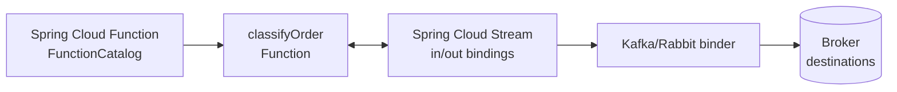
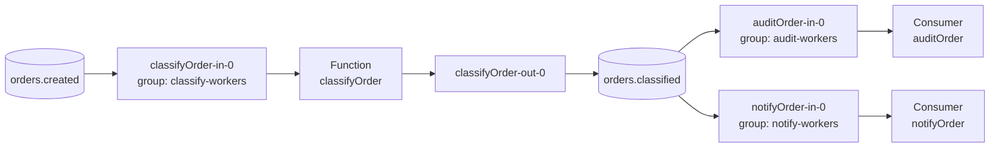
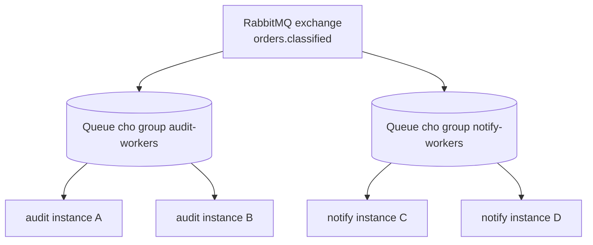

# Ánh xạ binding tới destination và consumer group

## 1. Bài toán: một luồng sự kiện, nhiều nhu cầu xử lý

Giả sử dịch vụ đơn hàng nhận sự kiện `orders.created`, phân loại mức ưu tiên, rồi phát sự kiện `orders.classified`. Hai bộ phận khác nhau cần đọc kết quả:

- Dịch vụ **kiểm toán** lưu lịch sử phân loại để truy vết.
- Dịch vụ **thông báo** gửi tin cho khách hàng khi đơn hàng được ưu tiên.

Cả hai cần thấy sự kiện đã phân loại. Đồng thời, nếu có ba instance của dịch vụ kiểm toán, ta thường muốn các instance **chia nhau xử lý** trong cùng một nhóm, thay vì mỗi instance đều ghi một bản audit giống hệt nhau.

Spring Cloud Stream giải quyết hai nhu cầu này bằng cách kết hợp:

- **Binding**: cổng vào hoặc ra của hàm trong ứng dụng.
- **Destination**: địa chỉ logic trên hệ thống truyền thông điệp, thường là topic Kafka hoặc exchange RabbitMQ.
- **Consumer group**: danh tính một nhóm nhận thông điệp; các thành viên cùng nhóm chia công việc, các nhóm độc lập có thể nhận riêng dữ liệu từ cùng destination.

Các hàm nghiệp vụ vẫn dùng mô hình của **Spring Cloud Function**: `Supplier<T>`, `Function<I, O>` và `Consumer<T>`. `FunctionCatalog` tìm và chuẩn hóa hàm; Spring Cloud Stream tạo binding; binder kết nối các binding với Kafka hoặc RabbitMQ. Nhờ đó, cùng một logic Java có thể được tái sử dụng với adapter HTTP, sự kiện hoặc môi trường serverless khi có cấu hình tương ứng.

Sau bài này, bạn sẽ:

1. Phân biệt rõ tên hàm, binding, destination, group và binder.
2. Ánh xạ input/output binding tới destination bằng YAML.
3. Giải thích hai mẫu phân phối: **cùng group chia việc**, **khác group nhận độc lập**.
4. Hiểu cách Kafka và RabbitMQ hiện thực destination và group.
5. Nhận diện vấn đề với group mặc định, offset, partition, retry và các sai sót cấu hình.
6. Xây dựng và kiểm thử một ví dụ Java/Spring Cloud Stream hoàn chỉnh.

## 2. Năm khái niệm cần tách biệt

| Khái niệm | Ví dụ | Trách nhiệm |
| --- | --- | --- |
| **Functional bean** | `classifyOrder` | Logic Java được Spring Cloud Function đăng ký |
| **Binding** | `classifyOrder-in-0`, `classifyOrder-out-0` | Cổng nhận/phát dữ liệu của hàm trong Spring Cloud Stream |
| **Destination** | `orders.created`, `orders.classified` | Địa chỉ logic của thông điệp trên broker |
| **Consumer group** | `classify-workers`, `audit-workers` | Xác định một nhóm người tiêu thụ trên **input binding** |
| **Binder** | `kafka`, `rabbit` | Bộ tích hợp kết nối binding với broker cụ thể |

Một chuỗi tên quen thuộc:

```text
Bean: classifyOrder
Input binding: classifyOrder-in-0
    destination = orders.created
    group       = classify-workers

Output binding: classifyOrder-out-0
    destination = orders.classified
```

**Binding và destination không phải là một.** Tên `classifyOrder-in-0` chỉ có ý nghĩa trong cấu hình Spring Cloud Stream. Broker nhìn thấy destination `orders.created`, được binder ánh xạ vào thực thể tương ứng.

**Consumer group cũng không phải destination.** Group xác định cách một input binding tham gia tiêu thụ dữ liệu tại destination. Một destination có thể được đọc bởi nhiều group; một group có thể có nhiều instance tiêu thụ.

## 3. Binding được sinh từ chữ ký hàm như thế nào?

Với một hàm thông thường, tên binding ngầm định (*implicit binding name*) được tạo theo quy ước:

```text
<function-name>-in-0
<function-name>-out-0
```

Chỉ số `0` là cổng đầu tiên của hàm. Nó không phải số partition, vị trí offset, consumer group hay số lượng instance.

| Giao diện | Vai trò | Input binding | Output binding |
| --- | --- | --- | --- |
| `Supplier<OrderCreated> publishOrder` | Phát sự kiện | Không có | `publishOrder-out-0` |
| `Function<OrderCreated, OrderClassified> classifyOrder` | Phân loại sự kiện | `classifyOrder-in-0` | `classifyOrder-out-0` |
| `Consumer<OrderClassified> auditOrder` | Ghi kiểm toán | `auditOrder-in-0` | Không có |

`Supplier` không nhận input message từ Spring Cloud Stream nên không có input binding mặc định. `Consumer` không trả một output nghiệp vụ nên không có output binding mặc định. `Function` có cả hai chiều.

Một bean nhận `Message<T>` thay vì `T` vẫn thường có một input binding: headers và payload là thành phần của cùng message, không phải hai cổng khác nhau. Chỉ số `-in-1` hoặc `-out-1` chỉ xuất hiện ở các mô hình nhiều cổng được hỗ trợ, chẳng hạn một số chữ ký reactive nhiều luồng; một POJO có nhiều field không tự tạo nhiều cổng.

### Vai trò của FunctionCatalog

`FunctionCatalog` là danh mục thuộc Spring Cloud Function, giúp tìm `classifyOrder` từ tên bean, chuẩn hóa lời gọi và hỗ trợ composition. Spring Cloud Stream dựa vào definition đã chọn để tạo và gắn binding. Catalog không tự quyết định topic Kafka, queue RabbitMQ, offset hoặc consumer group.



## 4. Cú pháp ánh xạ binding tới destination

Tất cả binding thông thường được cấu hình dưới `spring.cloud.stream.bindings`. Chìa khóa trong map là **tên binding**; thuộc tính `destination` chỉ ra địa chỉ logic cần đọc hoặc ghi:

```yaml
spring:
  cloud:
    function:
      definition: classifyOrder
    stream:
      bindings:
        classifyOrder-in-0:
          destination: orders.created
          group: classify-workers
          content-type: application/json
        classifyOrder-out-0:
          destination: orders.classified
          content-type: application/json
```

Tương ứng:

| Đường dẫn cấu hình | Giá trị | Công dụng |
| --- | --- | --- |
| `spring.cloud.function.definition` | `classifyOrder` | Chọn functional bean |
| `spring.cloud.stream.bindings.classifyOrder-in-0.destination` | `orders.created` | Đọc message từ destination đầu vào |
| `spring.cloud.stream.bindings.classifyOrder-in-0.group` | `classify-workers` | Tham gia nhóm consumer tên `classify-workers` |
| `spring.cloud.stream.bindings.classifyOrder-out-0.destination` | `orders.classified` | Phát output tới destination đầu ra |
| `spring.cloud.stream.bindings.*.content-type` | `application/json` | Cung cấp thông tin định dạng payload |

Nếu không chỉ định destination, tên binding có thể được dùng làm tên destination mặc định theo cơ chế của Spring Cloud Stream. Điều này hữu ích cho demo ngắn nhưng dễ dẫn tới trường hợp ứng dụng lặng lẽ sử dụng destination `classifyOrder-in-0` thay vì topic nghiệp vụ `orders.created`. Trong ví dụ thực tế, nên khai báo destination tường minh.

**Không đặt `group` vào output binding rồi kỳ vọng producer gửi tới nhóm đó.** Group có ý nghĩa ở phía consumer; producer phát ra destination và các input group tự tổ chức cách nhận.

## 5. Sơ đồ phân phối: cùng destination, nhiều group

Sau khi phân loại, cả kiểm toán và thông báo đều cần nhận message từ `orders.classified`.



Hai consumer đầu cuối đều được ánh xạ tới **destination `orders.classified`**, nhưng có **group khác nhau**. Từ đó, mỗi nhóm có cơ hội đọc các sự kiện phù hợp với cơ chế của binder và trạng thái lưu giữ/đọc dữ liệu.

Ngược lại, nếu dịch vụ `auditOrder` chạy nhiều instance đều cùng group `audit-workers`, các instance ấy thường cùng chia việc; không phải mỗi instance đều cần nhận một bản sao.

### Ma trận phân phối

| Destination | Group | Số instance minh họa | Ý nghĩa |
| --- | --- | --- | --- |
| `orders.classified` | `audit-workers` | 3 | Ba instance kiểm toán cùng chia tải trong một nhóm |
| `orders.classified` | `notify-workers` | 2 | Hai instance thông báo cùng chia tải trong nhóm thứ hai |
| `orders.classified` | `analytics-workers` | 1 | Nhóm analytics độc lập với hai nhóm trên |

**Một nhóm có nhiều instance: cạnh tranh/chia việc. Nhiều nhóm khác nhau: tiêu thụ độc lập.** Đây là quy tắc tư duy quan trọng, nhưng cơ chế hiện thực bằng partition/offset hay queue/exchange tùy binder. Không có bảo đảm rằng mọi group luôn nhận toàn bộ lịch sử: còn phụ thuộc thời điểm tạo group, offset ban đầu, retention, topology và các giới hạn broker.

## 6. Ví dụ Java: một processor, hai sink

Dùng Java 17+ để khai báo record và Spring Boot ứng dụng minh họa:

```java
import java.util.function.Consumer;
import java.util.function.Function;

import org.springframework.boot.SpringApplication;
import org.springframework.boot.autoconfigure.SpringBootApplication;
import org.springframework.context.annotation.Bean;

@SpringBootApplication
public class OrderStreamApplication {

    public static void main(String[] args) {
        SpringApplication.run(OrderStreamApplication.class, args);
    }

    public record OrderCreated(String orderId, long totalInCents) {}

    public record OrderClassified(String orderId, String priority) {}

    @Bean
    Function<OrderCreated, OrderClassified> classifyOrder() {
        return event -> new OrderClassified(
                event.orderId(),
                event.totalInCents() >= 100_000L
                        ? "PRIORITY" : "STANDARD"
        );
    }

    @Bean
    Consumer<OrderClassified> auditOrder() {
        return event -> System.out.printf(
                "AUDIT: %s -> %s%n",
                event.orderId(),
                event.priority()
        );
    }

    @Bean
    Consumer<OrderClassified> notifyOrder() {
        return event -> System.out.printf(
                "NOTIFY: order=%s, priority=%s%n",
                event.orderId(),
                event.priority()
        );
    }
}
```

Các bean này không dùng trực tiếp Kafka consumer API, Rabbit listener hoặc HTTP request. Khi dùng Spring Cloud Stream, ta chọn từng functional definition và cấu hình destination của binding.

### Cấu hình ba hàm trong cùng một ứng dụng

```yaml
spring:
  cloud:
    function:
      definition: classifyOrder;auditOrder;notifyOrder
    stream:
      bindings:
        classifyOrder-in-0:
          destination: orders.created
          group: classify-workers
          content-type: application/json
        classifyOrder-out-0:
          destination: orders.classified
          content-type: application/json

        auditOrder-in-0:
          destination: orders.classified
          group: audit-workers
          content-type: application/json

        notifyOrder-in-0:
          destination: orders.classified
          group: notify-workers
          content-type: application/json

      kafka:
        binder:
          brokers: localhost:9092
```

Ví dụ giả định dự án có Spring Boot, Spring Cloud BOM tương thích, dependency `spring-cloud-stream-binder-kafka`, hỗ trợ chuyển đổi JSON (thường dùng Jackson) và Kafka broker tại `localhost:9092`. Cần cấu hình quyền và tạo topic phù hợp với môi trường thực tế.

Dấu `;` trong `definition` yêu cầu bind **ba functional definition độc lập**. Nó không tự nối chúng trong một lời gọi Java; kết nối xảy ra qua destination:

- `classifyOrder` đọc `orders.created`, phát `orders.classified`.
- `auditOrder` đọc `orders.classified` với group `audit-workers`.
- `notifyOrder` đọc `orders.classified` với group `notify-workers`.

Nếu nhận payload:

```json
{"orderId":"ORD-101","totalInCents":150000}
```

Hàm xử lý cho kết quả:

```json
{"orderId":"ORD-101","priority":"PRIORITY"}
```

Trong một lần chạy ổn định với message mới được broker phân phối cho cả hai nhóm, có thể quan sát:

```text
AUDIT: ORD-101 -> PRIORITY
NOTIFY: order=ORD-101, priority=PRIORITY
```

Không nên phụ thuộc vào thứ tự xuất hiện hai dòng log: các nhóm xử lý độc lập và không có quy tắc bắt buộc `auditOrder` chạy trước `notifyOrder`.

**Lưu ý kiến trúc:** đặt ba bean trong một JVM thuận tiện cho việc học. Khi tách thành các dịch vụ riêng, mỗi dịch vụ chọn `definition` của chính mình, còn các destination và group phù hợp vẫn giữ quan hệ logic như trên.

## 7. Nguồn phát cũng dùng destination, nhưng không dùng consumer group

Nếu sự kiện đầu vào được tạo bằng một `Supplier<OrderCreated>`, tên binding mặc định chỉ có phía output:

```java
@Bean
Supplier<OrderCreated> publishOrder() {
    return () -> new OrderCreated("ORD-DEMO", 150_000L);
}
```

Ví dụ cấu hình khi ứng dụng chọn supplier làm nguồn:

```yaml
spring:
  cloud:
    function:
      definition: publishOrder
    stream:
      bindings:
        publishOrder-out-0:
          destination: orders.created
          content-type: application/json
```

Do supplier không tiêu thụ từ input binding, nó không có group. `Supplier<T>` dạng imperative thường được Stream kích hoạt qua poller; ví dụ trên sẽ liên tục tạo cùng một sự kiện nếu được poll lặp lại, nên chỉ thích hợp minh họa, không nên triển khai production nguyên trạng.

Khi cần chủ động phát một message tại thời điểm xử lý API, có thể cân nhắc `StreamBridge`; đó là hướng phát chủ động, không có group ở phía output. Group chỉ có ý nghĩa khi có input binding nhận message.

## 8. Consumer group trong Kafka: phân chia partition và offset

Với Kafka binder, `destination: orders.classified` thường ánh xạ tới topic Kafka `orders.classified`. `group: audit-workers` thường ứng với một Kafka consumer group tên `audit-workers`.

Hình dung topic có ba partition và ứng dụng audit có hai instance cùng group:

```text
Kafka topic: orders.classified
    partition 0 ----+
    partition 1 ----+---- group audit-workers
    partition 2 ----+       instance A / instance B
                    |
                    +---- group notify-workers
                           instance C / instance D
```

Trong cùng group, mỗi partition tại một thời điểm thường được gán cho một consumer của group. Vì vậy:

- Nếu nhóm có nhiều instance, dữ liệu trong topic được phân chia theo phân công partition.
- Nếu nhóm có nhiều instance hơn số partition, một số instance có thể không nhận partition để xử lý.
- Hai group khác nhau có vị trí đọc (*offset*) riêng và có thể cùng đọc các record đang còn trong retention.
- Thứ tự record được Kafka duy trì trong **một partition**, không bảo đảm thứ tự toàn cục trên mọi partition.

### Offset là gì và liên quan thế nào tới group?

Kafka dùng offset để xác định vị trí record trong partition. Consumer group có trạng thái offset tiêu thụ/commit tương ứng. Khi ứng dụng restart, vị trí đọc tiếp phụ thuộc offset đã lưu và cấu hình khởi động.

Ví dụ: group `audit-workers` đã đọc một record; group `notify-workers` chưa đọc. Hai group không chia chung offset, nên tiến độ xử lý của audit không tự làm notify bỏ qua record đó.

Tuy nhiên, group được tạo mới **không mặc nhiên nhận toàn bộ lịch sử**. Điểm bắt đầu đọc có thể phụ thuộc cấu hình start offset, trạng thái group và record còn tồn tại trong retention. Nếu nghiệp vụ cần replay, phải thiết kế thời điểm đọc và retention rõ ràng.

### Khi nào cần nhiều group?

Một hệ thống có thể dùng cùng topic `orders.classified` cho:

- `audit-workers`: ghi lịch sử vào kho audit.
- `notify-workers`: gửi thông báo.
- `analytics-workers`: tổng hợp dữ liệu.
- `fraud-workers`: kiểm tra rủi ro.

Các nhóm có mục tiêu khác nhau, có thể scale và khôi phục độc lập. Nếu tất cả cùng dùng một group, chúng trở thành những consumer cạnh tranh trong một nhóm, làm sai mục tiêu “mỗi nghiệp vụ đều nhận sự kiện”.

## 9. Consumer group trong RabbitMQ: exchange, queue và binding

Với RabbitMQ binder, destination thường được ánh xạ thành **exchange**. Input binding của một group được nối tới queue mà binder tạo/chọn theo group và các quy tắc đặt tên cụ thể.



Đây là mô hình logic, không phải cam kết về mọi tên queue/routing key. Kiểu exchange, tên queue, binding key, durability và cơ chế khai báo tài nguyên tùy thuộc Rabbit binder và cấu hình broker.

Điểm cần hiểu:

- Consumer trong **cùng group** thường lấy message từ cùng queue của nhóm và cạnh tranh để xử lý.
- **Group khác** thường có queue khác được bind với exchange, nhờ đó mỗi nhóm có thể nhận message phù hợp với quy tắc routing.
- Khi message đã được xử lý và ack thành công, nó thường được loại khỏi queue đó.
- Khả năng **replay message đã ack** không tương đương cách Kafka giữ record theo retention và offset. Nếu cần lịch sử, phải thiết kế lưu giữ/phát lại riêng.

Ví dụ một ứng dụng audit và một ứng dụng notify dùng hai group khác nhau, cả hai cùng khai báo destination `orders.classified`. RabbitMQ binder có thể tạo/chọn hai queue khác nhau gắn vào exchange đó. Để chắc chắn chúng nhận đủ message, cần kiểm tra exchange type, routing, queue binding và quyền provision trong môi trường đang chạy.

## 10. Group đặt tên tường minh và group mặc định

Spring Cloud Stream hỗ trợ consumer có group tường minh và cách nhận không khai báo group, thường được xem là **anonymous consumer group** ở lớp trừu tượng Stream. Hành vi chi tiết của anonymous group phụ thuộc binder và phiên bản.

Đối với các dịch vụ cần tính ổn định qua restart và cần scale nhiều instance, nên khai báo group tường minh:

```yaml
spring:
  cloud:
    stream:
      bindings:
        auditOrder-in-0:
          destination: orders.classified
          group: audit-workers
```

### Vì sao tên group quan trọng?

Giả sử có ba deployment cùng làm một nghiệp vụ audit:

| Deployment | Group | Hành vi mong muốn |
| --- | --- | --- |
| audit instance A | `audit-workers` | Cùng nhóm audit |
| audit instance B | `audit-workers` | Chia việc với A |
| audit instance C | `audit-workers` | Chia việc với A và B |
| notify instance D | `notify-workers` | Nhóm độc lập, không tranh việc với audit |

Nếu A, B, C vô tình dùng ba group khác nhau, cùng sự kiện có thể bị audit ba lần. Nếu notify vô tình dùng group `audit-workers`, thông báo có thể bị tính là một thành viên cạnh tranh của audit, khiến mỗi nghiệp vụ không nhận đầy đủ dữ liệu như mong đợi.

**Group là hợp đồng triển khai**, không chỉ là một nhãn để log dễ đọc.

### Đặt group thế nào?

Đặt group theo **nghiệp vụ consumer**, không đặt tùy ý theo số pod hoặc hostname khi các instance thực hiện cùng công việc. Ví dụ:

- `order-classifiers`;
- `order-auditors`;
- `order-notifiers`.

Với môi trường độc lập, có thể cần tách group/destination hoặc tách broker để dữ liệu thử nghiệm không ảnh hưởng production. Nếu nhiều ứng dụng dùng cùng group trên cùng destination mà logic khác nhau, việc chia việc có thể trở thành lỗi nghiệp vụ khó phát hiện.

## 11. Cùng destination nhưng khác group: các trường hợp dễ nhầm

### Trường hợp A: hai nghiệp vụ cùng muốn nhận sự kiện

```yaml
spring:
  cloud:
    stream:
      bindings:
        auditOrder-in-0:
          destination: orders.classified
          group: audit-workers
        notifyOrder-in-0:
          destination: orders.classified
          group: notify-workers
```

Hai input binding đọc cùng destination nhưng dùng group riêng. Đây là cách đúng khi audit và notify cần nhận sự kiện độc lập.

### Trường hợp B: nhiều instance thực hiện cùng nghiệp vụ

Mỗi instance của audit dùng cấu hình:

```yaml
spring:
  cloud:
    stream:
      bindings:
        auditOrder-in-0:
          destination: orders.classified
          group: audit-workers
```

Các instance cùng nhóm xử lý chia việc theo cơ chế binder. Việc mở rộng số instance không tương đương “mỗi instance nhận toàn bộ sự kiện”.

### Trường hợp C: hai function cùng tên group nhưng đọc destination khác

```yaml
spring:
  cloud:
    stream:
      bindings:
        auditOrder-in-0:
          destination: orders.classified
          group: audit-workers
        auditRefund-in-0:
          destination: refunds.classified
          group: audit-workers
```

Cùng giá trị group nhưng **destination khác nhau** không làm hai hàm cùng tranh nhau một bản ghi từ một topic. Với Kafka, group có thể tham gia đọc nhiều topic, mỗi topic/partition có offset riêng. Với RabbitMQ, queue cho mỗi destination/group có topology riêng theo binder. Vẫn cần kiểm tra mục đích đặt tên và chi tiết deployment để tránh gây nhầm lẫn khi vận hành.

### Trường hợp D: producer đặt group

```yaml
spring:
  cloud:
    stream:
      bindings:
        classifyOrder-out-0:
          destination: orders.classified
          group: audit-workers
```

Ở đây `group` trên output binding không giúp producer “phát riêng cho audit”. Muốn một nhóm chỉ nhận subset message, cần thiết kế destination, routing hoặc filtering phù hợp, không phụ thuộc `group` của producer.

## 12. Đổi tên binding không làm thay đổi ý nghĩa của group

Nếu muốn đổi tên binding mặc định `classifyOrder-in-0` thành `incomingOrders`, Spring Cloud Stream có cơ chế ánh xạ tên binding qua `spring.cloud.stream.function.bindings`:

```yaml
spring:
  cloud:
    function:
      definition: classifyOrder
    stream:
      function:
        bindings:
          classifyOrder-in-0: incomingOrders
          classifyOrder-out-0: outgoingOrders

      bindings:
        incomingOrders:
          destination: orders.created
          group: classify-workers
          content-type: application/json
        outgoingOrders:
          destination: orders.classified
          content-type: application/json
```

Sau khi ánh xạ:

- Hàm vẫn mang tên `classifyOrder`.
- Input binding tường minh là `incomingOrders`, có destination `orders.created` và group `classify-workers`.
- Output binding tường minh là `outgoingOrders`, phát tới `orders.classified`.

Điều quan trọng là đặt `destination` và `group` dưới tên **binding sau ánh xạ**. Alias có thể giúp cấu hình dễ đọc, nhưng cũng tạo thêm một tầng tên cần kiểm tra khi debug.

Với composition như `validateOrder|classifyOrder`, Spring Cloud Function ghép các hàm thành một pipeline logic trước khi Spring Cloud Stream gắn input/output. Nếu cần đổi tên binding của composition, phải ánh xạ **tên implicit của composition** đang được framework dùng, không tự giả định các binding của từng hàm thành phần vẫn tồn tại độc lập.

## 13. Destination và group dưới nhiều binder/môi trường

Binding là lớp trừu tượng dùng được với Kafka và RabbitMQ. Có thể giữ nguyên bean `classifyOrder`, rồi chọn binder theo profile:

```yaml
# Các thuộc tính dùng chung:
spring:
  cloud:
    function:
      definition: classifyOrder
    stream:
      bindings:
        classifyOrder-in-0:
          destination: orders.created
          group: classify-workers
        classifyOrder-out-0:
          destination: orders.classified
```

Ví dụ profile Kafka, khi có Kafka binder trên classpath:

```yaml
spring:
  cloud:
    stream:
      defaultBinder: kafka
      kafka:
        binder:
          brokers: localhost:9092
```

Hoặc profile RabbitMQ, khi có Rabbit binder trên classpath:

```yaml
spring:
  rabbitmq:
    host: localhost
    port: 5672
    username: guest
    password: guest
  cloud:
    stream:
      defaultBinder: rabbit
```

Đây là **các đoạn thuộc những file profile khác nhau**, không phải YAML được dán chồng lên cùng một vị trí. Kafka dùng topic, partition và group/offset; RabbitMQ dùng exchange, queue và acknowledgement. Logic `classifyOrder` thường giữ nguyên, nhưng topology và retry/replay cần kiểm thử lại.

Nếu dùng **cả hai binder đồng thời**, có thể chọn binder theo từng binding:

```yaml
spring:
  cloud:
    stream:
      bindings:
        classifyOrder-in-0:
          binder: kafka
          destination: orders.created
          group: classify-workers
        classifyOrder-out-0:
          binder: rabbit
          destination: orders.classified
```

Ví dụ này chỉ minh họa ánh xạ: khi chạy thật, phải có cả hai binder trên classpath và cấu hình kết nối. Nếu khai báo binder instance theo tên riêng, giá trị `binder` phải dùng đúng tên instance đã đăng ký. Một bridge Kafka → RabbitMQ không được tự động bảo đảm transaction phân tán giữa hai broker.

## 14. Vận hành: retry, xử lý lặp và quan sát group

Group quyết định phân phối công việc nhưng **không tự bảo đảm xử lý mỗi sự kiện đúng một lần trên toàn hệ thống**.

Một chuỗi sự cố điển hình:

1. Consumer nhận `OrderClassified("ORD-101", "PRIORITY")`.
2. Consumer đã ghi database hoặc gửi thông báo.
3. Ứng dụng gặp lỗi trước khi việc xử lý được broker ghi nhận hoàn tất.
4. Broker có thể giao lại sự kiện; side effect của bước 2 có nguy cơ chạy hai lần.

Nên xây dựng idempotency (chẳng hạn event ID, unique constraint hoặc trạng thái xử lý) cho side effect. Retry, dead-letter destination, ack/commit và replay cần được thiết kế theo binder đang sử dụng.

### Quan sát ở Kafka và RabbitMQ

| Cần quan sát | Kafka | RabbitMQ |
| --- | --- | --- |
| Độ tồn đọng của group | Consumer lag, offset, partition | Queue depth, số message unacked |
| Group/instance | Consumer group và phân công partition | Queue, consumer count, connection/channel |
| Message lỗi | Retry/error handling, DLQ topic nếu cấu hình | Requeue, retry, dead-letter exchange/queue nếu cấu hình |
| Dữ liệu còn đọc lại được | Retention và offset | Nội dung queue/stream và chính sách lưu giữ tương ứng |
| Triệu chứng scale không tăng | Số partition hạn chế | Prefetch, concurrency, backlog, tốc độ xử lý hoặc tài nguyên |

Đừng mặc định một consumer group độc lập là một cơ chế sao chép dữ liệu vĩnh viễn. Kafka group không thể đọc record đã hết retention; RabbitMQ group không mặc định giữ message đã ack. Kiểm tra cả cấu hình broker và tiến độ consumer.

## 15. Quy trình kiểm tra khi message không tới consumer

Khi `auditOrder` không nhận `orders.classified`, nên khoanh vùng theo các lớp:

1. **Bean/definition:** ứng dụng có bean `auditOrder` và definition đã chọn nó chưa? Với nhiều bean, dùng `spring.cloud.function.definition` rõ ràng.
2. **Binding:** tên input có đúng `auditOrder-in-0` hoặc alias đã cấu hình không?
3. **Destination:** input có đọc đúng `orders.classified` không? Producer có thực sự phát tới destination đó không?
4. **Group:** có vô tình dùng chung group với một nghiệp vụ khác không? Nhóm mới có kỳ vọng replay sai không?
5. **Binder:** ứng dụng có dependency binder, địa chỉ broker và quyền đọc/ghi phù hợp không?
6. **Broker:** topic có record mới không? Exchange/queue đã bind đúng chưa? Có partition/consumer/queue đang nhận message không?
7. **Payload:** JSON, `content-type` và kiểu Java của hàm có tương thích không?
8. **Error handling:** message có bị retry, chuyển vào DLQ hoặc dừng xử lý do exception không?

### Một số lỗi phổ biến

| Hiện tượng | Nguyên nhân có thể | Hướng xử lý |
| --- | --- | --- |
| Không đọc từ `orders.created` | Đặt `destination` sai hoặc bỏ qua khiến binder dùng tên binding mặc định | Cấu hình `classifyOrder-in-0.destination: orders.created` |
| Chỉ một trong hai nghiệp vụ nhận message | Hai nghiệp vụ vô tình dùng cùng group trên cùng destination | Tách group theo từng nghiệp vụ |
| Mỗi instance audit đều xử lý cùng một event | Mỗi instance dùng một group khác nhau | Cho các instance cùng nghiệp vụ dùng chung tên group |
| Consumer mới không đọc lịch sử Kafka | Retention/offset khởi đầu hoặc group state khác kỳ vọng | Kiểm tra offset, start offset và retention |
| RabbitMQ nhận message vào exchange nhưng không tới consumer | Sai hoặc thiếu queue/exchange binding, routing key hay quyền | Kiểm tra topology và cấu hình Rabbit binder |
| Consumer nhận message trùng | Redelivery sau lỗi hoặc retry | Áp dụng idempotency và quan sát retry |
| Producer gửi dữ liệu nhưng `Consumer` không có output | `Consumer<T>` không trả giá trị | Không mong đợi `<consumer>-out-0` mặc định |
| Đổi alias làm mất destination | `bindings.*` vẫn dùng tên implicit cũ | Đặt destination và group dưới tên alias thực |
| Dữ liệu được chuyển vào DLQ | Conversion/logic lỗi hoặc retry hết giới hạn | Kiểm tra payload, headers, exception và DLQ |
| Group có thêm instance nhưng throughput không tăng | Kafka bị giới hạn partition hoặc Rabbit prefetch/concurrency, CPU/IO | Đo bottleneck, điều chỉnh topology và năng lực xử lý |

## 16. Kiểm thử nghiệp vụ và kiểm thử wiring

### 16.1. Unit test hàm nghiệp vụ

Logic phân loại có thể được kiểm thử độc lập, không cần Kafka hoặc RabbitMQ:

```java
import static org.junit.jupiter.api.Assertions.assertEquals;
import org.junit.jupiter.api.Test;

class OrderStreamApplicationTest {

    @Test
    void classifiesOrdersByThreshold() {
        var fn = new OrderStreamApplication().classifyOrder();

        var normal = fn.apply(
                new OrderStreamApplication.OrderCreated("ORD-1", 99_999L)
        );
        var priority = fn.apply(
                new OrderStreamApplication.OrderCreated("ORD-2", 100_000L)
        );

        assertEquals("STANDARD", normal.priority());
        assertEquals("PRIORITY", priority.priority());
    }
}
```

Unit test xác minh quy tắc nghiệp vụ. Nó không xác minh `destination`, `group`, binder connection hoặc ngữ nghĩa chia tải.

### 16.2. Integration test với broker

Để kiểm tra chính xác destination và group, nên thử các tình huống có broker thật hoặc môi trường tích hợp tương đương:

1. Publish hai message JSON hợp lệ tới `orders.created`.
2. Xác nhận `orders.classified` có hai output tương ứng.
3. Khởi động audit và notify bằng **hai group khác nhau**; gửi message mới, kiểm tra mỗi nghiệp vụ nhận phù hợp.
4. Khởi động thêm audit instance với **cùng group**; gửi nhiều message và kiểm tra phân phối trong nhóm theo semantics binder.
5. Khởi động consumer với group mới; kiểm tra điều kiện đọc lịch sử phù hợp với Kafka offset/retention hoặc Rabbit queue provisioning.
6. Tạo lỗi xử lý trong môi trường thử nghiệm và xác minh retry, redelivery, DLQ và khả năng xử lý lặp.

Spring Cloud Stream test binder có thể hỗ trợ kiểm tra routing và chuyển đổi ở mức framework. Nhưng để xác nhận Kafka partition/offset hoặc Rabbit exchange/queue/ack, cần kiểm thử với broker tương ứng.

## 17. Bài tập thực hành

### Bài tập 1: Phân biệt bốn tên

Đọc cấu hình:

```yaml
spring:
  cloud:
    function:
      definition: reserveStock
    stream:
      bindings:
        reserveStock-in-0:
          destination: orders.accepted
          group: inventory-workers
        reserveStock-out-0:
          destination: inventory.reserved
```

Hãy trả lời:

- Tên functional bean là gì?
- Input binding, output binding là gì?
- Destination đầu vào, đầu ra là gì?
- Group thuộc binding nào?
- Đổi tên Kafka topic đầu vào có nhất thiết phải đổi tên bean không?

**Gợi ý:** `reserveStock`, `reserveStock-in-0`, `reserveStock-out-0`; destination lần lượt là `orders.accepted` và `inventory.reserved`; group chỉ ở input.

### Bài tập 2: Tách group để hai nghiệp vụ đều nhận

Có hai consumer `auditOrder` và `notifyOrder` cùng đọc `orders.classified`, ban đầu cả hai đều cấu hình group `order-workers`. Sau khi chạy, không phải sự kiện nào cũng có log audit và log notify.

Hãy giải thích vấn đề và chỉnh YAML để mỗi nghiệp vụ đọc độc lập. Kiểm tra lại bằng message mới và đúng cơ chế của binder.

**Gợi ý:** dùng `audit-workers` cho audit và `notify-workers` cho notify; cùng destination, khác group.

### Bài tập 3: Scale trong cùng một group

Một Kafka topic có bốn partition. Ứng dụng audit có sáu instance cùng group `audit-workers`. Hãy giải thích vì sao tăng số instance chưa chắc giúp chạy đồng thời trên cả sáu instance. Nếu một ứng dụng khác dùng group `analytics-workers`, liệu analytics có tự chia offset với audit không?

**Gợi ý:** số partition giới hạn số consumer trong cùng group có thể nhận phân công partition hữu ích; group khác theo dõi vị trí đọc riêng.

### Bài tập 4: Đổi từ Kafka sang RabbitMQ

Giữ nguyên `classifyOrder-in-0.destination: orders.created` và `group: classify-workers`, sau đó đổi sang Rabbit binder. Hãy mô tả những thực thể hạ tầng cần kiểm tra và những hành vi không thể giả định là tương đương.

**Gợi ý:** từ Kafka topic/partition/group offset sang Rabbit exchange/queue/binding/ack; kiểm tra routing, replay và retry.

### Câu hỏi tự đánh giá

1. Vì sao một destination có thể xuất hiện trong cấu hình nhiều input binding khác nhau?
2. Cùng destination, cùng group và cùng destination, khác group khác nhau ra sao?
3. `group` có ý nghĩa ở output binding không?
4. Nếu không chỉ định destination, tại sao ứng dụng có thể chạy nhưng đọc sai topic mong đợi?
5. Tại sao consumer group Kafka không bảo đảm đọc lại mọi message trong lịch sử?
6. RabbitMQ binder ánh xạ group vào topology như thế nào?
7. Khi dùng alias cho input binding, phải đặt `destination` và `group` dưới tên nào?
8. Tại sao cần kiểm thử broker thật để đánh giá redelivery và độ song song?

## 18. Tổng kết

**Binding** là cổng logic của hàm, **destination** là nơi thông điệp được gửi/nhận, còn **consumer group** cho biết các instance nào cùng chia công việc tiêu thụ. Trong Spring Cloud Stream:

- `spring.cloud.function.definition` chọn hàm trong mô hình Spring Cloud Function/FunctionCatalog.
- `spring.cloud.stream.bindings.<binding>.destination` ánh xạ từng input/output binding tới destination.
- `spring.cloud.stream.bindings.<input-binding>.group` xác định nhóm consumer.
- Cùng group thường chia công việc; khác group có thể tiêu thụ độc lập từ cùng destination.
- Kafka dùng topic, partition và offset; RabbitMQ dùng exchange, queue và acknowledgement. Vì vậy việc giữ nguyên tên binding **không có nghĩa** hai broker có cùng ngữ nghĩa giao nhận.

Phân biệt đúng ba lớp **hàm → binding → destination/group** giúp tái sử dụng logic `Supplier`, `Function`, `Consumer` qua nhiều môi trường, cấu hình rõ ràng và chẩn đoán lỗi khi sự kiện không tới đúng dịch vụ.

### Tài liệu tham khảo

- [Spring Cloud Stream — Reference documentation](https://docs.spring.io/spring-cloud-stream/reference/)
- [Spring Cloud Stream — Producing and consuming messages](https://docs.spring.io/spring-cloud-stream/reference/spring-cloud-stream/producing-and-consuming-messages.html)
- [Spring Cloud Stream — Functional binding names](https://docs.spring.io/spring-cloud-stream/reference/spring-cloud-stream/functional-binding-names.html)
- [Spring Cloud Function — Reference documentation](https://docs.spring.io/spring-cloud-function/reference/)
- [Apache Kafka — Documentation](https://kafka.apache.org/documentation/)
- [RabbitMQ — Documentation](https://www.rabbitmq.com/docs)
