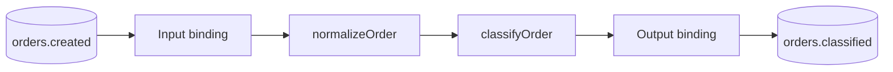
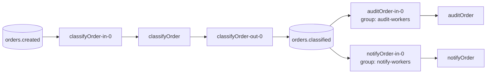
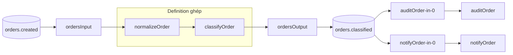

# Cấu hình một hàm ghép và nhiều định nghĩa độc lập

## 1. Bối cảnh: cùng nhiều hàm nhưng có thể tạo hai kiến trúc khác nhau

Giả sử ứng dụng đơn hàng có các bước xử lý:

1. Chuẩn hóa dữ liệu đơn hàng (`normalizeOrder`).
2. Phân loại đơn hàng (`classifyOrder`).
3. Ghi kiểm toán (`auditOrder`).
4. Gửi thông báo (`notifyOrder`).

Hai bước đầu thường cần chạy nối tiếp trong cùng một nghiệp vụ. Hai bước sau có thể cần tiêu thụ cùng một sự kiện nhưng hoạt động độc lập, vì lỗi ở dịch vụ thông báo không nên làm ngừng toàn bộ công việc kiểm toán.

Spring Cloud Function biểu diễn logic bằng các bean `Supplier<T>`, `Function<I, O>` và `Consumer<T>`. Khi dùng Spring Cloud Stream, ta khai báo `spring.cloud.function.definition` để lựa chọn cách kết hợp các bean với hạ tầng sự kiện. Hai ký hiệu rất dễ nhầm là:

- **`|` (pipe):** ghép nhiều hàm thành **một definition có trình tự thực thi**.
- **`;` (semicolon):** chọn **nhiều definition độc lập** để Spring Cloud Stream thiết lập binding riêng cho từng definition.

Ví dụ:

```yaml
spring:
  cloud:
    function:
      definition: normalizeOrder|classifyOrder
```

Cấu hình trên tạo một pipeline xử lý nối tiếp. Trong khi đó:

```yaml
spring:
  cloud:
    function:
      definition: classifyOrder;auditOrder;notifyOrder
```

lựa chọn ba pipeline riêng biệt, **không tự gọi nhau**. Nếu muốn chúng truyền dữ liệu cho nhau, ta phải nối các input/output binding tới cùng destination trên broker hoặc dùng composition phù hợp.

Mục tiêu của bài học là hiểu ranh giới giữa hai mô hình, cấu hình đúng tên binding, biết cách ghép `Function` với `Supplier`/`Consumer`, và xác minh được dữ liệu thực sự đi qua đâu.

## 2. Tách ba lớp: FunctionCatalog, binding và destination

`FunctionCatalog` thuộc **Spring Cloud Function**. Nó phát hiện các functional bean đã đăng ký trong `ApplicationContext` và hỗ trợ tra cứu, chuẩn hóa lời gọi, chuyển đổi thông điệp và composition. Spring Cloud Stream dựa vào functional definition để tạo input/output binding, sau đó binder kết nối các binding này với Kafka hoặc RabbitMQ.

| Lớp | Nhiệm vụ | Ví dụ |
| --- | --- | --- |
| Functional bean | Chứa logic nghiệp vụ | `normalizeOrder`, `classifyOrder` |
| `FunctionCatalog` | Tra cứu hoặc ghép hàm | `normalizeOrder|classifyOrder` |
| `spring.cloud.function.definition` | Chỉ định definition cần đưa vào ứng dụng Stream | `normalizeOrder|classifyOrder` |
| Spring Cloud Stream binding | Cổng logic nhận/phát thông điệp | `ordersInput`, `ordersOutput` |
| Destination | Địa chỉ trên middleware | `orders.created`, `orders.classified` |
| Binder | Kết nối binding với broker | Kafka binder, RabbitMQ binder |

Lưu ý: `FunctionCatalog` có thể được dùng ngoài Stream, chẳng hạn khi công bố hàm qua HTTP hoặc adapter serverless. Việc một hàm được catalog nhận diện **không có nghĩa** nó đã có một Kafka consumer, một RabbitMQ queue hoặc một HTTP endpoint. Adapter và cấu hình triển khai quyết định cách kích hoạt hàm.

Đối với Spring Cloud Stream thông thường, tên binding suy từ definition theo quy ước:

```text
<function-definition>-in-0
<function-definition>-out-0
```

Một `Function<I,O>` thường có một input và một output; `Supplier<T>` chỉ có output; `Consumer<T>` chỉ có input. Chỉ số `0` là cổng đầu tiên, không phải số partition hoặc consumer group.

## 3. Cú pháp và ý nghĩa của hai toán tử

| `spring.cloud.function.definition` | Kết quả | Dữ liệu truyền thế nào? |
| --- | --- | --- |
| `normalizeOrder` | Một function | Input của hàm → output của hàm |
| `normalizeOrder|classifyOrder` | Một function được ghép từ hai bước | Output của `normalizeOrder` được đưa thẳng vào `classifyOrder` |
| `normalizeOrder;classifyOrder` | Hai definition độc lập | Mỗi definition có binding riêng; không có kết nối tự động giữa chúng |
| `normalizeOrder|classifyOrder;auditOrder` | Một pipeline ghép và một consumer độc lập | Pipeline và consumer chỉ nối nhau khi binding/destination phù hợp |
| `auditOrder;notifyOrder` | Hai consumer độc lập | Mỗi consumer có input binding và có thể dùng group/destination riêng |

Spring Cloud Function cũng hỗ trợ dấu phẩy `,` để viết composition. Trong bài này nên dùng `|` vì dễ đọc và phân biệt rõ với `;`. Hai dấu này có ý nghĩa khác nhau và không nên thay thế cho nhau.

### 3.1. Composition chạy theo thứ tự

Với `normalizeOrder|classifyOrder`, `normalizeOrder` chạy trước, kết quả của nó trở thành đầu vào của `classifyOrder`. Các kiểu Java phải tương thích. Nếu `normalizeOrder` trả ra `OrderCreated`, bước tiếp theo cần nhận được `OrderCreated` hoặc kiểu tương thích.

Về mặt ý tưởng:

```java
Function<A, B> first = ...;
Function<B, C> second = ...;

Function<A, C> pipeline = first.andThen(second);
```

Spring Cloud Function thực hiện thêm các bước chuẩn hóa và tích hợp với hệ thống thông điệp, nên composition trong framework có khả năng phong phú hơn một lời gọi `andThen` đơn thuần. Tuy nhiên, nguyên tắc thứ tự dữ liệu vẫn giữ nguyên.

### 3.2. Nhiều definition không tạo quan hệ nhân quả

Với `normalizeOrder;classifyOrder`, Spring Cloud Stream thiết lập hai pipeline riêng. Chúng có thể cùng lắng nghe hai destination khác nhau hoặc cùng một destination nếu cấu hình như vậy. Chỉ vì `normalizeOrder` đứng trước `classifyOrder` trong chuỗi definition, **không có bảo đảm** nó sẽ chạy trước trên cùng một message.

Dấu `;` là phép chọn danh sách, không phải toán tử “sau đó”. Khi cần hai dịch vụ xử lý cùng sự kiện, nên thiết kế destination và consumer group theo nhu cầu; khi cần chuyển đổi liên tiếp mà không cần broker ở giữa, nên dùng composition.

## 4. Ví dụ Java: các bean có thể ghép hoặc chạy riêng

Một ứng dụng minh họa dùng Java 17+ với hai record, hai `Function` và hai `Consumer`:

```java
import java.util.function.Consumer;
import java.util.function.Function;

import org.springframework.boot.SpringApplication;
import org.springframework.boot.autoconfigure.SpringBootApplication;
import org.springframework.context.annotation.Bean;

@SpringBootApplication
public class OrderFunctionsApplication {

    public static void main(String[] args) {
        SpringApplication.run(OrderFunctionsApplication.class, args);
    }

    public record OrderCreated(String orderId, long totalInCents) {}

    public record OrderClassified(String orderId, String priority) {}

    // Chuẩn hóa, kiểm tra dữ liệu nhưng vẫn giữ cùng kiểu đầu ra.
    @Bean
    Function<OrderCreated, OrderCreated> normalizeOrder() {
        return order -> {
            if (order.orderId() == null ||
                    order.orderId().isBlank()) {
                throw new IllegalArgumentException(
                        "orderId không được rỗng");
            }
            if (order.totalInCents() < 0) {
                throw new IllegalArgumentException(
                        "totalInCents không được âm");
            }
            return new OrderCreated(
                    order.orderId().strip(),
                    order.totalInCents());
        };
    }

    // Nhận OrderCreated và tạo sự kiện đã phân loại.
    @Bean
    Function<OrderCreated, OrderClassified> classifyOrder() {
        return order -> new OrderClassified(
                order.orderId(),
                order.totalInCents() >= 100_000L
                        ? "PRIORITY"
                        : "STANDARD");
    }

    // Consumer: ghi nhận kết quả, không có output binding mặc định.
    @Bean
    Consumer<OrderClassified> auditOrder() {
        return event -> System.out.printf(
                "AUDIT %s: %s%n",
                event.orderId(),
                event.priority());
    }

    @Bean
    Consumer<OrderClassified> notifyOrder() {
        return event -> System.out.printf(
                "NOTIFY %s: %s%n",
                event.orderId(),
                event.priority());
    }
}
```

Đây là ví dụ sư phạm: việc in log chưa đủ để triển khai audit hoặc thông báo bền vững. Trong hệ thống thật, hai consumer có thể gọi repository hoặc dịch vụ nghiệp vụ; khi ấy phải xét idempotency và redelivery.

Dữ liệu đầu vào:

```json
{"orderId":" ORD-101 ","totalInCents":150000}
```

Sau `normalizeOrder`:

```json
{"orderId":"ORD-101","totalInCents":150000}
```

Sau `classifyOrder`:

```json
{"orderId":"ORD-101","priority":"PRIORITY"}
```

Bằng cách tách bean, ta có thể dùng chính logic đó trong unit test, HTTP adapter, serverless hoặc message-driven adapter mà không đưa Kafka/RabbitMQ API vào các phương thức nghiệp vụ.

## 5. Cấu hình trường hợp A: một hàm ghép duy nhất

Chọn composition của hai `Function`:

```yaml
spring:
  cloud:
    function:
      definition: normalizeOrder|classifyOrder
```

Framework xem chuỗi này là **một functional definition**. Từ bên ngoài, pipeline có chữ ký:

```text
Function<OrderCreated, OrderClassified>
```

Đầu vào của pipeline nhận `OrderCreated`; bước thứ nhất chuẩn hóa/kiểm tra; bước thứ hai phân loại; output của pipeline là `OrderClassified`.



**Không có broker trung gian giữa hai bean** trong composition trên. Spring Cloud Stream chỉ cần kết nối input của toàn pipeline và output của toàn pipeline; việc nối `normalizeOrder` với `classifyOrder` thuộc lớp hàm.

### 5.1. Tên binding ngầm định của composition

Với functional composition thông thường, tên binding suy theo **toàn bộ definition**:

```text
normalizeOrder|classifyOrder-in-0
normalizeOrder|classifyOrder-out-0
```

Không nên cấu hình `normalizeOrder-out-0` và `classifyOrder-in-0` rồi kỳ vọng chúng là hai cổng nối qua broker trong cấu hình composition: các cổng giữa hai hàm đã được nối bên trong pipeline.

Nếu chọn dùng trực tiếp tên implicit, có thể cấu hình:

```yaml
spring:
  cloud:
    function:
      definition: normalizeOrder|classifyOrder
    stream:
      bindings:
        "normalizeOrder|classifyOrder-in-0":
          destination: orders.created
          group: classify-workers
          content-type: application/json
        "normalizeOrder|classifyOrder-out-0":
          destination: orders.classified
          content-type: application/json
```

Các key chứa `|` được đặt trong dấu ngoặc kép để YAML rõ ràng. `orders.created` và `orders.classified` là **destination trên broker**, không phải tên hàm hoặc tên binding.

### 5.2. Đặt tên binding tường minh cho composition

Khi composition dài, tên implicit khó duy trì. Spring Cloud Stream cho phép ánh xạ sang tên dễ đọc:

```yaml
spring:
  cloud:
    function:
      definition: normalizeOrder|classifyOrder
    stream:
      function:
        bindings:
          "normalizeOrder|classifyOrder-in-0": ordersInput
          "normalizeOrder|classifyOrder-out-0": ordersOutput

      bindings:
        ordersInput:
          destination: orders.created
          group: classify-workers
          content-type: application/json
        ordersOutput:
          destination: orders.classified
          content-type: application/json
```

Tại đây:

- `normalizeOrder|classifyOrder` vẫn là **functional definition**.
- `ordersInput` và `ordersOutput` là **tên binding tường minh** dùng trong cấu hình Stream.
- `orders.created` và `orders.classified` vẫn là **destination**.
- `classify-workers` là consumer group cho input binding.

Sau khi alias, cần đặt các thuộc tính `destination`, `group`, `content-type` dưới **tên binding tường minh**. Không gắn một phần dưới tên implicit và phần khác dưới alias.

### 5.3. Ranh giới lỗi của pipeline ghép

Nếu `normalizeOrder` ném `IllegalArgumentException` vì `orderId` rỗng, `classifyOrder` sẽ không được gọi cho đầu vào đó. Nếu `classifyOrder` ném exception, toàn pipeline cũng thất bại đối với message tương ứng. Spring Cloud Stream/binder quyết định retry, acknowledgement/offset và dead-letter theo cấu hình.

Composition phù hợp khi các bước cần một ranh giới xử lý và triển khai chung, các kiểu đầu vào/đầu ra tương thích, và không cần một topic hay queue riêng ở giữa.

## 6. Cấu hình trường hợp B: nhiều definition độc lập

Giờ chọn ba bean riêng:

```yaml
spring:
  cloud:
    function:
      definition: classifyOrder;auditOrder;notifyOrder
```

Cấu hình này có **ba functional definition**, mỗi definition được Spring Cloud Stream bind độc lập:

| Definition | Input binding | Output binding |
| --- | --- | --- |
| `classifyOrder` | `classifyOrder-in-0` | `classifyOrder-out-0` |
| `auditOrder` | `auditOrder-in-0` | Không có |
| `notifyOrder` | `notifyOrder-in-0` | Không có |

Để các bean tạo thành luồng nghiệp vụ, cần ánh xạ destination thích hợp:

```yaml
spring:
  cloud:
    function:
      definition: classifyOrder;auditOrder;notifyOrder
    stream:
      bindings:
        classifyOrder-in-0:
          destination: orders.created
          group: classify-workers
          content-type: application/json
        classifyOrder-out-0:
          destination: orders.classified
          content-type: application/json

        auditOrder-in-0:
          destination: orders.classified
          group: audit-workers
          content-type: application/json

        notifyOrder-in-0:
          destination: orders.classified
          group: notify-workers
          content-type: application/json
```

Đường đi dữ liệu:



**Ba definition không gọi trực tiếp nhau.** `classifyOrder` phát tới `orders.classified`; hai consumer lắng nghe destination đó với group riêng. Cùng destination và **khác group** là cách thông dụng để audit và notify mỗi bên nhận sự kiện theo cơ chế binder.

Nếu audit chạy ba instance cùng group `audit-workers`, các instance thường chia việc của nhóm. Nếu audit và notify vô tình dùng cùng group tại cùng destination, chúng có thể trở thành những consumer cạnh tranh, làm sai mục tiêu “mỗi nghiệp vụ đều nhận sự kiện”.

### 6.1. Vai trò của dấu chấm phẩy

Dấu `;` chỉ liệt kê **nhiều definition** để bind. Không thể dựa vào thứ tự viết:

```text
classifyOrder;auditOrder;notifyOrder
```

để suy ra “classify trước, audit sau, notify cuối”. Thứ tự thực tế được quyết định bởi message broker, các binding/destination, group, concurrency, trạng thái xử lý và thiết kế hệ thống. Hai consumer đầu cuối cũng không có thứ tự bắt buộc với nhau.

### 6.2. Mỗi definition có thể triển khai ở ứng dụng riêng

Khi tách thành ba dịch vụ, mỗi ứng dụng thường chỉ chọn bean nó cần:

```yaml
# Trong order-classifier/application.yml:
spring:
  cloud:
    function:
      definition: classifyOrder
```

```yaml
# Trong order-audit/application.yml:
spring:
  cloud:
    function:
      definition: auditOrder
```

```yaml
# Trong order-notifier/application.yml:
spring:
  cloud:
    function:
      definition: notifyOrder
```

Các file trên là ba ví dụ cấu hình **cho ba ứng dụng khác nhau**. Chúng còn cần các `bindings.*`, destination, group và kết nối binder tương ứng. Cách tách này cho phép scale và phát hành từng consumer độc lập; đổi lại, ta phải vận hành các luồng message, retry và theo dõi lỗi giữa các dịch vụ.

## 7. Cấu hình trường hợp C: ghép một pipeline và thêm các definition độc lập

Trong thực tế, ta thường muốn **ghép bước chuẩn hóa với phân loại**, nhưng vẫn cần **audit và notify độc lập**. Có thể phối hợp hai toán tử:

```yaml
spring:
  cloud:
    function:
      definition: normalizeOrder|classifyOrder;auditOrder;notifyOrder
    stream:
      function:
        bindings:
          "normalizeOrder|classifyOrder-in-0": ordersInput
          "normalizeOrder|classifyOrder-out-0": ordersOutput
      bindings:
        ordersInput:
          destination: orders.created
          group: classify-workers
          content-type: application/json
        ordersOutput:
          destination: orders.classified
          content-type: application/json

        auditOrder-in-0:
          destination: orders.classified
          group: audit-workers
          content-type: application/json

        notifyOrder-in-0:
          destination: orders.classified
          group: notify-workers
          content-type: application/json
```

Sơ đồ diễn giải:



Có **ba đơn vị được bind**: một pipeline `normalizeOrder|classifyOrder` và hai consumer `auditOrder`, `notifyOrder`. Bước chuẩn hóa và phân loại không trao đổi qua broker; hai consumer tiếp tục nhận kết quả qua broker.

### Kiểm tra cấu hình theo từng tên

| Thành phần | Giá trị | Cách hiểu |
| --- | --- | --- |
| Definition ghép | `normalizeOrder|classifyOrder` | Một pipeline từ hai `Function` |
| Input binding implicit của composition | `normalizeOrder|classifyOrder-in-0` | Cổng vào toàn pipeline |
| Input binding explicit | `ordersInput` | Alias của cổng vào |
| Output binding explicit | `ordersOutput` | Alias của cổng ra |
| Input destination | `orders.created` | Nơi nhận sự kiện cần phân loại |
| Output destination | `orders.classified` | Nơi phát kết quả |
| Definition độc lập 1 | `auditOrder` | Sink đọc `orders.classified` |
| Definition độc lập 2 | `notifyOrder` | Sink đọc `orders.classified` |

Như vậy, dấu `|` có phạm vi **trong một definition**, còn dấu `;` tách các definition **trong ứng dụng**.

## 8. Ghép Supplier, Function và Consumer: kết quả cuối quyết định hướng binding

Spring Cloud Function không chỉ ghép `Function` với `Function`. Tuy nhiên, **loại hàm ở đầu và cuối chuỗi quyết định kết quả**:

| Composition | Loại hàm logic kết quả | Binding thường có |
| --- | --- | --- |
| `Function<A,B>|Function<B,C>` | `Function<A,C>` | Input và output |
| `Supplier<A>|Function<A,B>` | `Supplier<B>` | Output |
| `Function<A,B>|Consumer<B>` | `Consumer<A>` | Input |
| `Supplier<A>|Consumer<A>` | `Runnable` theo mô hình Spring Cloud Function | Không nên mặc định suy ra input/output như `Function` |
| `Consumer<A>|Function<A,B>` | Không hợp lệ để ghép theo trình tự | Không có pipeline hợp lệ |

Ví dụ supplier phát trạng thái đơn hàng, sau đó processor chuẩn hóa:

```java
@Bean
Supplier<String> source() {
    return () -> "  ready  ";
}

@Bean
Function<String, String> normalize() {
    return String::trim;
}
```

```yaml
spring:
  cloud:
    function:
      definition: source|normalize
```

Kết quả là một source logic có output; nó không có input binding tự động chỉ vì composition có hai bean.

Với consumer ở cuối:

```java
@Bean
Function<String, String> uppercase() {
    return String::toUpperCase;
}

@Bean
Consumer<String> audit() {
    return value -> System.out.println("Audit: " + value);
}
```

```yaml
spring:
  cloud:
    function:
      definition: uppercase|audit
```

Đây là một pipeline kiểu consumer: nhận chuỗi, đổi thành chữ hoa và ghi log; mặc định **không có output binding** để phát kết quả đi tiếp.

Không thể đặt một `Consumer` ở giữa chuỗi và kỳ vọng lấy output từ nó cho hàm sau. Nếu cần phát tiếp sau bước cập nhật dữ liệu, thiết kế lại contract bằng `Function` trả một kết quả phù hợp hoặc dùng hai pipeline tách nhau qua broker.

### Các bước cần tương thích kiểu dữ liệu

`Function<A,B>` ghép với `Function<B,C>` có kết quả `Function<A,C>`. Với đầu ra khác kiểu đầu vào của bước sau, có thể xuất hiện lỗi tra cứu/composition hoặc lỗi chuyển đổi lúc runtime. Không nên chỉ nhìn `definition` rồi giả định framework có thể tự biến đổi mọi kiểu.

Với payload JSON, cần khai báo kiểu Java đủ cụ thể và `content-type` phù hợp. Tách rõ lỗi *không tìm thấy bean*, lỗi *không ghép được kiểu*, và lỗi *không deserialize được message* khi debug.

## 9. Composition khác với routing và fan-out

Ba yêu cầu này không tương đương:

| Yêu cầu | Mô hình phù hợp | Tính chất |
| --- | --- | --- |
| Luôn chạy `normalize` rồi `classify` | Composition `normalize|classify` | Thực thi nối tiếp các hàm trong cùng pipeline |
| Chạy `audit` và `notify` trên các group độc lập | `audit;notify` và cùng destination với group riêng | Hai consumer độc lập qua broker |
| Chọn một hàm khác nhau cho từng message | Routing function/chiến lược định tuyến | Đích xử lý phụ thuộc nội dung hoặc metadata message |

Spring Cloud Function cung cấp `RoutingFunction` cho định tuyến khi ứng dụng cần chọn hàm dựa trên điều kiện. Đây là cơ chế khác composition cố định. Không dùng dấu `;` để giả vờ tạo định tuyến theo từng message.

Nếu hai consumer cùng đọc một destination nhưng **cùng group**, chúng có thể chia nhau message thay vì mỗi người nhận một bản sao. Muốn fan-out tới hai nghiệp vụ, thông thường cần hai group riêng và topology broker phù hợp.

## 10. Sự khác nhau về lỗi, retry, mở rộng và vận hành

### 10.1. Trong một pipeline composition

Nếu hai bước `normalizeOrder|classifyOrder` nằm trong cùng pipeline, chúng chia cùng một input binding và cùng một output binding. Một message lỗi ở bước đầu khiến bước sau không chạy; framework/binder xử lý lỗi ở phạm vi pipeline đó.

Composition thường phù hợp khi:

- Các bước nhỏ và gắn chặt với nhau về nghiệp vụ.
- Muốn giữ logic thuần túy, dễ unit test và không cần broker trung gian.
- Muốn tránh thêm serialization, latency và vận hành topic/queue giữa các bước.
- Các bước có chung vòng đời triển khai và yêu cầu scale.

Đổi lại, không thể scale bước chuẩn hóa và phân loại thành hai consumer group riêng chỉ bằng thay cấu hình của pipeline ghép. Nếu một bước chậm, toàn pipeline chịu tác động.

### 10.2. Giữa các definition độc lập nối qua broker

Khi phân loại, audit và notify là các pipeline khác nhau, mỗi consumer group có tiến độ xử lý, cơ chế retry và năng lực scale riêng theo broker. Message phải được publish/consume qua destination, nên có thêm serialization, networking, tài nguyên broker và khả năng xử lý lặp.

Điều này thường phù hợp khi:

- Tác vụ kiểm toán và gửi thông báo cần triển khai/scale riêng.
- Mỗi consumer cần chính sách lỗi, SLA và tốc độ xử lý khác nhau.
- Có nhiều nhóm nghiệp vụ cần đọc cùng sự kiện.
- Hệ thống cần lưu trữ và phát lại sự kiện theo khả năng của broker.

**Chú ý:** Dùng Kafka hay RabbitMQ không tự bảo đảm “exactly once” cho toàn workflow. Khi message được giao lại sau lỗi, side effect có thể chạy hai lần; consumer nên được thiết kế idempotent.

### Bảng ra quyết định

| Tiêu chí | Một composition | Nhiều definition qua broker |
| --- | --- | --- |
| Kết nối giữa các bước | Gọi hàm nối tiếp trong ứng dụng | Input/output binding và destination |
| Bắt buộc có topic/queue trung gian | Không | Có nếu muốn các pipeline truyền message |
| Scale từng bước | Chung trong một pipeline | Có thể scale riêng theo consumer group |
| Kiểm tra đầu-cuối | Unit test logic dễ; cần test binding ngoài cùng | Cần thêm test destination, group, serialization |
| Retry/error boundary | Theo pipeline | Theo từng consumer/binding và broker |
| Nguy cơ duplicate message | Vẫn có ở input/output broker | Có thêm ranh giới giao nhận giữa các pipeline |
| Phù hợp | Chuỗi biến đổi gắn kết | Nhiều tác vụ/tổ chức xử lý độc lập |

## 11. Broker, consumer group và tên destination

Một ví dụ chạy Kafka có thể thêm cấu hình broker:

```yaml
spring:
  cloud:
    stream:
      kafka:
        binder:
          brokers: localhost:9092
```

Để chạy, dự án phải có Spring Boot, Spring Cloud Stream Kafka binder và bộ quản lý version Spring Cloud tương thích. Kafka broker phải truy cập được; `localhost:9092` chỉ là địa chỉ minh họa.

Với RabbitMQ binder, destination thường là exchange và consumer group tham gia quyết định queue được tạo/chọn. Logic `normalizeOrder`, `classifyOrder`, `auditOrder`, `notifyOrder` có thể giữ nguyên, nhưng topology và hành vi ack/retry khác Kafka.

### Vì sao group quan trọng trong ví dụ nhiều definition?

`auditOrder` và `notifyOrder` cùng đọc `orders.classified` nhưng có group khác:

```yaml
auditOrder-in-0:
  destination: orders.classified
  group: audit-workers

notifyOrder-in-0:
  destination: orders.classified
  group: notify-workers
```

Với Kafka, hai group có vị trí đọc/offset riêng và có thể cùng đọc record còn trong retention. Trong một group, các consumer chia partition. Với RabbitMQ, hai group thường tương ứng hai queue riêng bind với exchange; các instance trong một group thường cạnh tranh tiêu thụ từ queue của group đó.

Nếu không khai báo destination cho một binding, tên binding có thể được dùng làm destination mặc định. Điều này dễ khiến ứng dụng vô tình đọc `auditOrder-in-0` thay vì `orders.classified`. Vì thế, trong ví dụ có nhiều pipeline, nên khai báo destination tường minh cho từng binding.

## 12. Chuyển đổi thông điệp và headers trong composition

Có thể viết hàm với payload thuần:

```java
@Bean
Function<String, String> uppercase() {
    return String::toUpperCase;
}
```

Hoặc làm việc với `Message<T>` khi cần headers:

```java
import org.springframework.messaging.Message;
import org.springframework.messaging.support.MessageBuilder;

@Bean
Function<Message<String>, Message<String>> tagSource() {
    return incoming -> MessageBuilder
            .withPayload(incoming.getPayload())
            .copyHeaders(incoming.getHeaders())
            .setHeader("processedBy", "order-service")
            .build();
}
```

Hai dạng vẫn có một input và một output thông thường. Header là metadata của message, không tạo thêm một binding.

Khi ghép hàm có `Message<T>` với hàm chỉ xử lý payload, cần hiểu rõ **contract kiểu dữ liệu** mà mỗi bước nhận và trả. Spring Cloud Function hỗ trợ chuẩn hóa invocation/chuyển đổi, nhưng không thể bảo đảm mọi tổ hợp tùy ý đều hợp lệ. Kiểm thử composition với payload và headers thực tế, đặc biệt nếu các bước phụ thuộc header correlation ID, content type hoặc routing metadata.

### Reactive function là trường hợp riêng

Với một bean `Function<Flux<OrderCreated>, Flux<OrderClassified>>`, function có thể được gọi một lần để thiết lập pipeline reactive, rồi xử lý nhiều phần tử qua luồng. Vì vậy, không được mặc định rằng framework gọi lambda một lần cho **từng message**, hay retry/exception luôn tương đương `Function<OrderCreated,OrderClassified>` imperative.

Composition giữa reactive và imperative function có các quy tắc riêng về kiểu và vòng đời luồng. Khi dùng reactive functions, kiểm thử cả backpressure, lỗi của stream và cách binder tích hợp với quá trình xử lý reactive.

## 13. Kiểm thử: chứng minh thứ tự ghép và sự độc lập của definition

### 13.1. Unit test thứ tự composition

Logic Java thuần có thể được kiểm thử mà không cần broker. Ví dụ ghép hai bean thành một hàm bằng Java `andThen` để kiểm chứng contract:

```java
import static org.junit.jupiter.api.Assertions.assertEquals;
import static org.junit.jupiter.api.Assertions.assertThrows;

import java.util.function.Function;
import org.junit.jupiter.api.Test;

class OrderFunctionsApplicationTest {

    @Test
    void normalizesBeforeClassifying() {
        var application = new OrderFunctionsApplication();

        Function<OrderFunctionsApplication.OrderCreated,
                 OrderFunctionsApplication.OrderClassified> pipeline =
                application.normalizeOrder()
                           .andThen(application.classifyOrder());

        var result = pipeline.apply(
                new OrderFunctionsApplication.OrderCreated(
                        " ORD-101 ", 150_000L)
        );

        assertEquals("ORD-101", result.orderId());
        assertEquals("PRIORITY", result.priority());
    }

    @Test
    void rejectsInvalidOrdersBeforeClassification() {
        var application = new OrderFunctionsApplication();
        var pipeline = application.normalizeOrder()
                .andThen(application.classifyOrder());

        assertThrows(IllegalArgumentException.class,
                () -> pipeline.apply(
                        new OrderFunctionsApplication.OrderCreated(
                                " ", 10L)));
    }
}
```

Hai test này kiểm chứng logic và thứ tự bước xử lý. Chúng **không tự kiểm chứng** Spring đã chọn đúng `definition`, đặt đúng tên binding hay kết nối thành công với broker.

### 13.2. Kiểm thử composition với Spring Cloud Stream

Trong integration test, chọn `normalizeOrder|classifyOrder`, publish JSON vào `orders.created` và kiểm tra `orders.classified`. Dữ liệu `" ORD-101 "` phải thành `"ORD-101"` và `"PRIORITY"`. Tạo message có `orderId` trống để quan sát xử lý lỗi theo cấu hình retry/DLQ của binder.

Có thể dùng Spring Cloud Stream test binder để kiểm tra luồng và conversion ở mức framework, đồng thời dùng Kafka/RabbitMQ thật hoặc môi trường container để kiểm tra đúng hành vi broker.

### 13.3. Kiểm thử nhiều definition độc lập

Chọn `classifyOrder;auditOrder;notifyOrder` hoặc cấu hình kết hợp ở mục 7. Với một sự kiện mới được publish:

1. Xác minh pipeline phân loại phát kết quả ra destination `orders.classified`.
2. Xác minh audit và notify đều nhận event qua **group khác nhau**.
3. Tăng thêm instance audit cùng `audit-workers` rồi kiểm tra cách chia việc.
4. Gây lỗi cho consumer notify trong môi trường thử nghiệm và xác minh audit vẫn có thể tiếp tục xử lý theo cơ chế broker/configuration.
5. Kiểm tra retry, redelivery, DLQ và idempotency nếu các consumer có side effect.

Không suy ra thứ tự audit rồi notify từ việc hai tên xuất hiện lần lượt trong `definition`.

## 14. Các lỗi cấu hình thường gặp

| Triệu chứng | Nguyên nhân thường gặp | Cách khắc phục |
| --- | --- | --- |
| Có bean nhưng Stream không bind đúng hàm | Có nhiều bean nhưng thiếu `spring.cloud.function.definition` | Chọn definition tường minh |
| `normalizeOrder|classifyOrder` không chuyển được dữ liệu | Các kiểu đầu ra/đầu vào không tương thích hoặc conversion sai | Kiểm tra chữ ký Java, payload và content type |
| Composition không nhận message ở topic dự kiến | Dùng `normalizeOrder-in-0` thay cho binding của composition | Kiểm tra tên implicit composition hoặc alias |
| Đã alias nhưng destination không có tác dụng | `bindings.*` vẫn đặt dưới tên implicit cũ | Gắn cấu hình dưới tên explicit sau ánh xạ |
| `classifyOrder;auditOrder` không chạy theo thứ tự | `;` là nhiều definition độc lập | Nối qua destination hoặc dùng composition |
| Chỉ một trong hai sink nhận message | Audit và notify dùng chung group trên một destination | Dùng group riêng cho từng nghiệp vụ |
| Hai instance cùng nghiệp vụ xử lý trùng | Mỗi instance dùng group khác nhau hoặc redelivery | Đồng bộ group và thiết kế idempotency |
| Không có `auditOrder-out-0` | `auditOrder` là `Consumer<T>` | Đây là hành vi mặc định; dùng `Function` nếu cần output |
| Input Kafka không đọc lịch sử như kỳ vọng | Offset của group/retention không như dự tính | Kiểm tra group offset và chính sách replay |
| RabbitMQ không tới đúng queue | Exchange/queue binding, routing hoặc quyền sai | Kiểm tra topology và binder |
| Function ném lỗi nhưng không thấy output | Cả pipeline thất bại trước khi tạo kết quả | Kiểm tra exception, retry/DLQ và nội dung input |
| Chuyển sang reactive thấy số lần gọi khác | Vòng đời `Flux` khác imperative | Kiểm thử subscription, lỗi và backpressure |

### Quy trình debug gợi ý

Theo thứ tự: **tên bean → `definition` → ranh giới `|`/`;` → tên binding implicit → alias → destination → group → binder/broker → payload và lỗi runtime**.

Nếu kết quả sai dù message đến đúng function, kiểm tra logic và kiểu dữ liệu. Nếu function đúng trong unit test nhưng không có message, kiểm tra tên binding/destination và trạng thái broker. Nếu audit/notify nhận thiếu, kiểm tra consumer group và topology trước khi thay đổi code nghiệp vụ.

## 15. Bài tập thực hành

### Bài tập 1: Xác định kiến trúc qua definition

Cho hai cấu hình:

```yaml
# A
spring.cloud.function.definition: sanitize|uppercase

# B
spring.cloud.function.definition: sanitize;uppercase
```

Hãy cho biết cấu hình nào tạo một pipeline nối tiếp, cấu hình nào tạo hai pipeline riêng. Nếu input là `"  java  "`, ở cấu hình nào có thể chắc chắn `sanitize` chạy trước `uppercase` trên cùng message mà không thêm broker trung gian?

**Gợi ý:** chỉ cấu hình A có ràng buộc thứ tự composition.

### Bài tập 2: Hoàn thành binding của pipeline ghép

Sử dụng `definition: normalizeOrder|classifyOrder`. Đặt alias `ordersInput`, `ordersOutput`, nối lần lượt với `orders.created` và `orders.classified`, và đặt group input là `classify-workers`.

**Tiêu chí đạt:** alias nằm dưới `spring.cloud.stream.function.bindings`, còn `destination` và `group` nằm dưới `spring.cloud.stream.bindings.ordersInput`/`ordersOutput`.

### Bài tập 3: Hai sink độc lập

Thêm `auditOrder` và `notifyOrder` nhận từ `orders.classified`. Hãy viết `spring.cloud.function.definition` để giữ nguyên pipeline ghép và bổ sung hai definition độc lập. Tạo hai consumer group khác nhau và giải thích điều gì xảy ra nếu dùng chung group.

**Gợi ý:** `normalizeOrder|classifyOrder;auditOrder;notifyOrder` và group `audit-workers`/`notify-workers`.

### Bài tập 4: Ghép đúng kiểu

Cho:

```java
Function<String, Integer> parseLength = String::length;
Function<Integer, Boolean> isLong = n -> n > 10;
Consumer<Boolean> auditResult = System.out::println;
```

Hãy xác định kiểu logic kết quả của `parseLength|isLong` và `parseLength|isLong|auditResult`. Trong hai trường hợp, Stream sẽ cần input và output binding như thế nào?

**Gợi ý:** hai function đầu tạo `Function<String,Boolean>`; khi thêm consumer cuối, pipeline trở thành `Consumer<String>`.

### Bài tập 5: Chọn phương án phù hợp

Dịch vụ cần chuẩn hóa đơn hàng, phân loại, gửi thông báo và ghi báo cáo. Chuẩn hóa và phân loại luôn triển khai chung, còn báo cáo cần scale độc lập và có thể tạm ngừng để bảo trì. Hãy đề xuất composition, definition độc lập, destination và group; giải thích ranh giới lỗi và khả năng xử lý lặp.

### Câu hỏi tự đánh giá

1. `spring.cloud.function.definition` có bắt buộc chỉ chứa một tên bean không?
2. Vì sao dấu `;` không tạo pipeline nối tiếp?
3. Tên binding của `validate|classify` khác tên binding của `validate` như thế nào?
4. Sau khi đặt alias cho composition, cấu hình `destination` thuộc tên nào?
5. `Function<A,B>|Consumer<B>` có output binding mặc định không?
6. Khi audit và notify cùng đọc `orders.classified`, tại sao nên dùng group khác nhau?
7. Tại sao unit test `andThen` chưa đủ để kết luận cấu hình Spring Cloud Stream chạy đúng?
8. Khi nào nhiều definition độc lập có lợi hơn một composition dài?

## 16. Tổng kết

**Composition `|`** biến các hàm tương thích thành **một pipeline logic**; Spring Cloud Stream thường bind ở đầu vào và đầu ra của pipeline đó. **Dấu `;`** cho phép chọn **nhiều definition độc lập**; muốn chúng trao đổi dữ liệu thì phải cấu hình binding/destination hoặc dùng một cơ chế tích hợp rõ ràng.

Trong Spring Cloud Function, `FunctionCatalog` quản lý việc tìm và ghép `Supplier`, `Function`, `Consumer`. Spring Cloud Stream kết nối các hàm đã chọn với Kafka/RabbitMQ qua binder. Vì logic được tách khỏi transport, cùng hàm có thể được dùng lại qua HTTP, sự kiện hoặc serverless khi có adapter thích hợp.

Với hệ thống đơn hàng, một lựa chọn hợp lý là ghép `normalizeOrder|classifyOrder` cho xử lý đồng bộ về mặt nghiệp vụ, đồng thời cấu hình `auditOrder` và `notifyOrder` làm các consumer độc lập qua broker. Cách này giữ phần xử lý lõi dễ kiểm thử và cho phép các chức năng hậu xử lý mở rộng theo nhu cầu riêng.

### Tài liệu tham khảo

- [Spring Cloud Function — Programming model và function composition](https://docs.spring.io/spring-cloud-function/reference/spring-cloud-function/programming-model.html)
- [Spring Cloud Stream — Producing and consuming messages, multiple functions](https://docs.spring.io/spring-cloud-stream/reference/spring-cloud-stream/producing-and-consuming-messages.html)
- [Spring Cloud Stream — Functional binding names](https://docs.spring.io/spring-cloud-stream/reference/spring-cloud-stream/functional-binding-names.html)
- [Spring Cloud Stream — Reference documentation](https://docs.spring.io/spring-cloud-stream/reference/)
