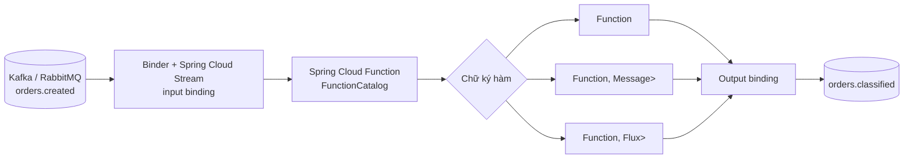
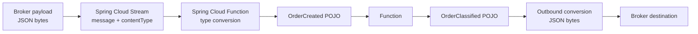

# Nhận gửi POJO, Message và dữ liệu phản ứng

## 1. Bài toán: một nghiệp vụ, ba hình thức dữ liệu

Một dịch vụ nhận sự kiện đơn hàng từ `orders.created`, phân loại theo tổng tiền và phát kết quả tới `orders.classified`. Logic nghiệp vụ có thể được viết đơn giản như sau:

```java
OrderClassified classify(OrderCreated order) {
    String priority = order.totalInCents() >= 100_000L
            ? "PRIORITY" : "STANDARD";
    return new OrderClassified(order.orderId(), priority);
}
```

Tuy nhiên, luồng sự kiện thực tế không chỉ có payload. Một message có thể kèm `correlationId`, `contentType`, thông tin truy vết hoặc metadata do binder cung cấp. Có trường hợp ứng dụng còn muốn xử lý cả một **luồng dữ liệu liên tục** với Reactor `Flux` thay vì một giá trị mỗi lần gọi hàm.

Trong **Spring Cloud Function**, ba kiểu giao tiếp thường gặp là:

1. **POJO / payload thuần** — `Function<OrderCreated, OrderClassified>`: nghiệp vụ chỉ biết đối tượng Java.
2. **Message có headers** — `Function<Message<OrderCreated>, Message<OrderClassified>>`: nghiệp vụ được đọc/ghi cả payload lẫn metadata.
3. **Reactive stream** — `Function<Flux<OrderCreated>, Flux<OrderClassified>>` hoặc `Function<Flux<Message<OrderCreated>>, Flux<Message<OrderClassified>>>`: logic xây dựng một pipeline xử lý các phần tử bất đồng bộ.

**Spring Cloud Stream** nhận và phát các dữ liệu này qua binding với Kafka, RabbitMQ hoặc binder tương ứng. **FunctionCatalog** tìm/chuẩn hóa các bean `Supplier`, `Function`, `Consumer` và hỗ trợ composition; adapter Stream quyết định cách đưa message tới hàm.

Sau bài học, bạn có thể chọn đúng chữ ký hàm, cấu hình input/output binding và `content-type`, xử lý headers có chủ đích, giải thích vòng đời reactive function, tránh nhầm `Flux` với JSON array, đồng thời kiểm thử nghiệp vụ độc lập với broker.

## 2. Nhìn tổng thể: payload, message và luồng

Ba kiểu không phải ba công nghệ broker khác nhau. Chúng là **ba cách biểu diễn và xử lý dữ liệu ở ranh giới hàm**.

| Tiêu chí | POJO / `T` | `Message<T>` | Reactive `Flux<T>` hoặc `Flux<Message<T>>` |
| --- | --- | --- | --- |
| Đầu vào của hàm | Đối tượng nghiệp vụ | Payload và headers | Một chuỗi phần tử theo thời gian |
| Chữ ký điển hình | `Function<OrderCreated, OrderClassified>` | `Function<Message<OrderCreated>, Message<OrderClassified>>` | `Function<Flux<OrderCreated>, Flux<OrderClassified>>` |
| Truy cập headers | Không trực tiếp | `message.getHeaders()` | Nếu phần tử là `Message<T>` |
| Cách xử lý | Một lần gọi xử lý một payload trong mô hình imperative | Một lần gọi xử lý một message trong mô hình imperative | Hàm thiết lập pipeline; các phần tử tiếp tục đi qua pipeline |
| Độ phức tạp | Thấp | Trung bình | Cao hơn, cần hiểu Reactor và vòng đời stream |
| Phù hợp | Biến đổi nghiệp vụ không cần metadata | Correlation, tracing, routing metadata | Xử lý bất đồng bộ, kết hợp dòng dữ liệu, non-blocking I/O khi có API phù hợp |
| Lỗi cần lưu ý | Conversion và exception mỗi lần gọi | Header/type conversion và exception | Tín hiệu `onError` có thể kết thúc stream, cần xử lý lỗi reactive rõ ràng |



Sơ đồ cho thấy ranh giới trách nhiệm, không hàm ý ba bean đều được kích hoạt cùng lúc. Thông thường, ta chọn một definition cho một pipeline qua `spring.cloud.function.definition`. Cả ba chữ ký đều có thể đưa dữ liệu qua **một input binding và một output binding**; `Flux` là luồng nhiều phần tử chứ không mặc định tạo thêm binding.

## 3. Ví dụ nền: dùng record Java để biểu diễn POJO nghiệp vụ

Dùng Java 17+ và Spring Boot. `record` ở đây là một đối tượng dữ liệu Java đơn giản, tương đương vai trò của POJO/DTO trong ứng dụng; framework cần thư viện JSON và các phiên bản hỗ trợ record thích hợp.

```java
public record OrderCreated(String orderId, long totalInCents) {}

public record OrderClassified(String orderId, String priority) {}
```

Một JSON đầu vào:

```json
{
  "orderId": "ORD-101",
  "totalInCents": 150000
}
```

Kết quả mong đợi:

```json
{
  "orderId": "ORD-101",
  "priority": "PRIORITY"
}
```

Nếu nghiệp vụ chỉ cần `orderId` và `totalInCents`, hãy để hàm nhận `OrderCreated`. Đưa trực tiếp đối tượng Kafka `ConsumerRecord` hoặc RabbitMQ `Delivery` vào logic phân loại làm giảm khả năng tái sử dụng hàm cho HTTP hoặc serverless.

## 4. Nhận và gửi POJO bằng Function<I, O>

### 4.1. Khai báo hàm

```java
import java.util.function.Function;

import org.springframework.context.annotation.Bean;
import org.springframework.context.annotation.Configuration;

@Configuration
class PojoFunctions {

    record OrderCreated(String orderId, long totalInCents) {}
    record OrderClassified(String orderId, String priority) {}

    @Bean
    Function<OrderCreated, OrderClassified> classifyPojo() {
        return order -> {
            if (order.orderId() == null || order.orderId().isBlank()) {
                throw new IllegalArgumentException("orderId không hợp lệ");
            }

            String priority = order.totalInCents() >= 100_000L
                    ? "PRIORITY" : "STANDARD";

            return new OrderClassified(order.orderId(), priority);
        };
    }
}
```

Bean `classifyPojo` nhận một `OrderCreated` và trả về `OrderClassified`. Nó không biết message đến từ broker nào và cũng không tự tạo topic/queue.

### 4.2. Ánh xạ tới broker bằng binding

Ví dụ `application.yml` khi chỉ chọn function này:

```yaml
spring:
  cloud:
    function:
      definition: classifyPojo
    stream:
      bindings:
        classifyPojo-in-0:
          destination: orders.created
          group: order-classifiers
          content-type: application/json
        classifyPojo-out-0:
          destination: orders.classified
          content-type: application/json
```

**Điều gì xảy ra khi có message?**

1. Binder đọc message từ destination `orders.created`.
2. Spring Cloud Stream phối hợp với Spring Cloud Function để chuẩn bị payload phù hợp kiểu `OrderCreated`.
3. Framework gọi `classifyPojo.apply(order)`.
4. `OrderClassified` trả về được chuyển sang biểu diễn đầu ra phù hợp và gửi qua `classifyPojo-out-0` tới `orders.classified`.

Khi payload là JSON, Spring thường cần bộ chuyển đổi JSON như Jackson. Điều kiện chuyển đổi thực tế phụ thuộc kiểu payload nhận được, `contentType`, cấu hình binder và phiên bản framework. `content-type: application/json` là gợi ý định dạng, không tự bổ sung thư viện JSON còn thiếu.

**Nhận và gửi POJO không có nghĩa broker vận chuyển trực tiếp một Java object trong mọi trường hợp.** Trên wire, dữ liệu thường là bytes hoặc một định dạng serialization; binder và các converter/serializer phù hợp xử lý ranh giới đó.

### 4.3. Kiểm thử nhanh hàm POJO

```java
import static org.junit.jupiter.api.Assertions.assertEquals;

import org.junit.jupiter.api.Test;

class PojoFunctionsTest {

    @Test
    void classifiesOrderWithoutBroker() {
        var function = new PojoFunctions().classifyPojo();

        var result = function.apply(
                new PojoFunctions.OrderCreated("ORD-101", 150_000L));

        assertEquals("ORD-101", result.orderId());
        assertEquals("PRIORITY", result.priority());
    }
}
```

Unit test này chứng minh quy tắc phân loại mà không khởi động Kafka/RabbitMQ. Nó chưa chứng minh dữ liệu đã được nhận hoặc phát ở đúng destination; kiểm thử binding là bước khác.

## 5. Khi nào cần Message<T> thay vì chỉ payload?

`Message<T>` của **Spring Messaging** đóng gói:

- **Payload**: nội dung nghiệp vụ kiểu `T`.
- **Headers**: tập thông tin kèm theo message, ví dụ `correlationId`, `contentType`, loại sự kiện hoặc metadata vận hành.

```text
Message<OrderCreated>
├── payload
│   ├── orderId: "ORD-101"
│   └── totalInCents: 150000
└── headers
    ├── correlationId: "req-789"
    ├── contentType: application/json
    └── ...metadata do framework/binder cung cấp
```

Đây là một **message với một payload và một bộ headers**, không phải nhiều input binding. Khi hàm nhận `Message<T>`, tên binding vẫn thường là `<name>-in-0` và `<name>-out-0`.

Nên chọn `Message<T>` khi logic cần trả lời một câu hỏi liên quan metadata: “Đơn hàng này đến từ yêu cầu nào?”, “Thông điệp thuộc loại sự kiện nào?”, “Cần giữ correlation ID nào khi phát kết quả?”.

Nếu không cần metadata, `Function<T,R>` dễ đọc và dễ kiểm thử hơn.

## 6. Nhận Message<OrderCreated> và phát Message<OrderClassified>

### 6.1. Ví dụ xử lý headers có chủ đích

```java
import java.util.function.Function;

import org.springframework.context.annotation.Bean;
import org.springframework.context.annotation.Configuration;
import org.springframework.messaging.Message;
import org.springframework.messaging.support.MessageBuilder;

@Configuration
class MessageFunctions {

    record OrderCreated(String orderId, long totalInCents) {}
    record OrderClassified(String orderId, String priority) {}

    @Bean
    Function<Message<OrderCreated>, Message<OrderClassified>> classifyMessage() {
        return inbound -> {
            OrderCreated order = inbound.getPayload();

            var classified = new OrderClassified(
                    order.orderId(),
                    order.totalInCents() >= 100_000L
                            ? "PRIORITY" : "STANDARD"
            );

            // Chỉ chuyển tiếp metadata thực sự cần thiết cho nghiệp vụ.
            Object correlationId = inbound.getHeaders().get("correlationId");

            var builder = MessageBuilder.withPayload(classified)
                    .setHeader("processedBy", "order-stream");

            if (correlationId != null) {
                builder.setHeader("correlationId", correlationId);
            }

            return builder.build();
        };
    }
}
```

Trong ví dụ này:

- `inbound.getPayload()` trả về `OrderCreated`.
- `inbound.getHeaders()` trả về metadata của thông điệp vào.
- `MessageBuilder.withPayload(...)` tạo message mới có payload `OrderClassified`.
- `processedBy` được bổ sung để đánh dấu service xử lý.
- `correlationId` được chuyển tiếp khi tồn tại, giúp theo dõi một yêu cầu qua các dịch vụ.

Chọn lọc header là cách làm dễ kiểm soát. Nếu thật sự cần giữ mọi header, `MessageBuilder.copyHeaders(inbound.getHeaders())` có thể dùng, nhưng không nên sao chép mù quáng header transport hoặc thông tin không đáng tin cậy sang một message mới. Một số header mang nghĩa hệ thống hoặc phụ thuộc binder; cần kiểm tra cách ánh xạ của transport.

### 6.2. Binding vẫn có một input và một output

```yaml
spring:
  cloud:
    function:
      definition: classifyMessage
    stream:
      bindings:
        classifyMessage-in-0:
          destination: orders.created
          group: order-classifiers
          content-type: application/json
        classifyMessage-out-0:
          destination: orders.classified
          content-type: application/json
```

Đổi chữ ký từ `Function<OrderCreated,OrderClassified>` sang `Function<Message<OrderCreated>,Message<OrderClassified>>` **không tự tạo thêm cổng để chuyên chở headers**. Nó chỉ thay đổi đối tượng Java được đưa vào hàm và đối tượng hàm trả về.

### 6.3. Headers có luôn đến đích giống nhau không?

Không nên giả định tất cả headers đều được bảo toàn qua mọi broker. Kafka, RabbitMQ và các adapter HTTP/serverless có cơ chế mang metadata khác nhau. Spring Cloud Stream binder có thể ánh xạ hoặc lọc một số header theo cấu hình, định dạng và khả năng hạ tầng.

Ví dụ `correlationId` có thể là `String` tại một bước nhưng được nhận thành dạng khác ở bước tiếp theo tùy cách header được serialize. Cần kiểm tra hợp đồng headers trong integration test, đặc biệt khi tích hợp ứng dụng không dùng Spring.

## 7. Content type và quá trình chuyển đổi payload

`content-type` thường gây nhầm lẫn vì vừa liên quan cấu hình binding, vừa có thể có mặt trong message header.

### 7.1. Trình tự chuyển đổi điển hình



Với `Function<OrderCreated,OrderClassified>`, generic type của hàm cho framework biết kiểu Java mong đợi. `content-type: application/json` cho biết định dạng wire mà converter có thể dùng. Bản thân `FunctionCatalog` không phải broker serializer và không bảo đảm tự chuyển thành mọi kiểu nếu thiếu converter cần thiết.

### 7.2. Header và cấu hình có thể khác nhau

Trong Spring Cloud Stream, giá trị `contentType` ở message header (khi được cung cấp và sử dụng) thường có độ ưu tiên trước content type gắn ở binding; sau đó mới đến cơ chế mặc định. Vì vậy, một producer gắn `contentType` sai có thể làm consumer chuyển đổi payload sai dù YAML trông hợp lệ.

Với message đầu ra, nếu thay payload từ text sang object JSON mà vẫn giữ một header `contentType` cũ, cần rà soát và đặt lại content type tương ứng. Không nên sao chép nguyên mọi header của input sang output khi thay đổi loại dữ liệu.

### 7.3. Những lỗi JSON thường gặp

| Hiện tượng | Nguyên nhân có thể | Hướng xử lý |
| --- | --- | --- |
| Hàm kỳ vọng `OrderCreated` nhưng nhận `byte[]` hoặc `String` | Conversion không diễn ra theo mong đợi | Kiểm tra generic type, `contentType`, converter và native decoding |
| JSON thiếu trường bắt buộc | Producer/consumer khác schema | Kiểm tra contract, validation và khả năng tương thích schema |
| Hàm dùng `Object` và không có POJO mong muốn | Type hint quá chung chung | Dùng kiểu Java cụ thể như `OrderCreated` |
| Header `contentType` không phù hợp payload | Metadata sai hoặc header cũ được chuyển tiếp | Sửa hợp đồng message; đặt content type phù hợp |
| Test Java chạy đúng nhưng Kafka consumer lỗi | Unit test bỏ qua serialization/binder | Bổ sung integration test với broker và dữ liệu thật |

Nếu bật cơ chế serialization/deserialization **native của binder**, đường đi conversion có thể khác cơ chế Spring Cloud Function/Stream thông thường. Vì thế, tránh coi một cấu hình `content-type` là lời hứa rằng mọi binder sẽ tự serialize giống nhau.

## 8. POJO, Message và Supplier/Consumer ở hai đầu luồng

Ba giao diện Java tương ứng ba vai trò trong Spring Cloud Stream:

| Giao diện | Chữ ký ví dụ | Binding mặc định | Công dụng |
| --- | --- | --- | --- |
| `Supplier<OrderCreated>` | `() -> OrderCreated` | `<name>-out-0` | Phát payload mới |
| `Supplier<Message<OrderCreated>>` | `() -> Message<OrderCreated>` | `<name>-out-0` | Phát payload kèm headers |
| `Function<OrderCreated,OrderClassified>` | `OrderCreated -> OrderClassified` | Cả `-in-0` và `-out-0` | Chuyển đổi payload |
| `Consumer<OrderClassified>` | `OrderClassified -> void` | `<name>-in-0` | Nhận và thực hiện side effect |
| `Consumer<Message<OrderClassified>>` | `Message<OrderClassified> -> void` | `<name>-in-0` | Side effect kèm xử lý metadata |

### 8.1. Supplier có thể tạo Message<T>

```java
import java.util.UUID;
import java.util.function.Supplier;

import org.springframework.context.annotation.Bean;
import org.springframework.messaging.Message;
import org.springframework.messaging.support.MessageBuilder;

@Bean
Supplier<Message<String>> createHeartbeat() {
    return () -> MessageBuilder.withPayload("alive")
            .setHeader("eventId", UUID.randomUUID().toString())
            .build();
}
```

Ví dụ phù hợp để minh họa đầu ra có headers. Với supplier imperative, Stream thường kích hoạt bằng poller; một hàm luôn trả message sẽ liên tục phát dữ liệu theo lịch poll. Production cần chính sách phát phù hợp để không sinh event vô hạn.

### 8.2. Consumer có thể đọc Message<T>

```java
import java.util.function.Consumer;

import org.springframework.context.annotation.Bean;
import org.springframework.messaging.Message;

@Bean
Consumer<Message<String>> auditHeartbeat() {
    return message -> System.out.printf(
            "eventId=%s payload=%s%n",
            message.getHeaders().get("eventId"),
            message.getPayload());
}
```

Consumer thường có input binding và **không có output binding tự động** vì chữ ký trả `void`. Khi side effect là ghi database hoặc gửi thông báo, cần thiết kế xử lý trùng, vì broker có thể giao lại một message sau lỗi.

### 8.3. Phát chủ động bằng StreamBridge

Không phải mọi nguồn phát đều phù hợp với supplier được poll. Nếu HTTP request hoặc logic nội bộ quyết định thời điểm phát sự kiện, có thể sử dụng `StreamBridge` để gửi qua một output binding:

```java
import org.springframework.cloud.stream.function.StreamBridge;
import org.springframework.messaging.support.MessageBuilder;
import org.springframework.stereotype.Service;

@Service
class EventPublisher {

    private final StreamBridge streamBridge;

    EventPublisher(StreamBridge streamBridge) {
        this.streamBridge = streamBridge;
    }

    boolean publish(String orderId) {
        var message = MessageBuilder.withPayload(orderId)
                .setHeader("eventType", "ORDER_CREATED")
                .build();

        return streamBridge.send("ordersOut", message);
    }
}
```

```yaml
spring:
  cloud:
    stream:
      output-bindings: ordersOut
      bindings:
        ordersOut:
          destination: orders.created
          content-type: text/plain
```

`ordersOut` là tên binding chủ động do ứng dụng khai báo; nó không nhất thiết suy từ một bean `Supplier`. `StreamBridge` cho phép phát message tại thời điểm code gọi `send`; việc này khác về lifecycle so với một `Supplier` imperative được poll.

## 9. Reactive là gì trong Spring Cloud Function và Spring Cloud Stream?

Trong Reactor, `Flux<T>` đại diện cho một Publisher có thể phát **0 đến nhiều phần tử**, kèm tín hiệu hoàn tất hoặc lỗi; `Mono<T>` đại diện cho tối đa một phần tử. Reactor triển khai các khái niệm của Reactive Streams, gồm subscription và yêu cầu dữ liệu (*backpressure*) ở những ranh giới hỗ trợ nó.

Một function reactive thường có chữ ký:

```java
Function<Flux<OrderCreated>, Flux<OrderClassified>>
```

**Điểm khác quan trọng:** với functional binding reactive, framework có thể gọi function **một lần để thiết lập pipeline xử lý**, rồi chuyển các message tiếp theo thành phần tử của luồng đó. Không được giả định mỗi message mới làm framework gọi lại toàn bộ `apply(Flux)`.

So sánh:

```text
Imperative Function<OrderCreated, OrderClassified>:
  message 1 -> apply(order1) -> result1
  message 2 -> apply(order2) -> result2

Reactive Function<Flux<OrderCreated>, Flux<OrderClassified>>:
  apply(inputFlux) -> outputFlux được thiết lập
  inputFlux: order1 --- order2 --- order3 --- ...
  outputFlux: result1 -- result2 -- result3 -- ...
```

`Flux` trong hàm reactive **không mặc định là một JSON array** được gửi trong một broker message. Stream nhận nhiều message và biểu diễn chúng thành các phần tử của một luồng. Việc đầu ra được phát thành các message hay batch theo cơ chế cụ thể còn tùy hàm và binder.

## 10. Nhận và gửi dữ liệu phản ứng với Function<Flux<I>, Flux<O>>

### 10.1. Biến đổi từng phần tử bằng map

```java
import java.util.function.Function;

import org.springframework.context.annotation.Bean;
import org.springframework.context.annotation.Configuration;
import reactor.core.publisher.Flux;

@Configuration
class ReactiveFunctions {

    record OrderCreated(String orderId, long totalInCents) {}
    record OrderClassified(String orderId, String priority) {}

    @Bean
    Function<Flux<OrderCreated>, Flux<OrderClassified>> classifyReactive() {
        return orders -> orders.map(order -> {
            String priority = order.totalInCents() >= 100_000L
                    ? "PRIORITY" : "STANDARD";

            return new OrderClassified(order.orderId(), priority);
        });
    }
}
```

`map` là toán tử chuyển đổi đồng bộ từng phần tử. Ở đây, hàm không cần gọi `subscribe()` vì nó **trả về Flux** cho framework quản lý việc đăng ký nhận dữ liệu và phát kết quả theo cơ chế binding.

Chữ ký này vẫn thường tương ứng:

- `classifyReactive-in-0`: input binding.
- `classifyReactive-out-0`: output binding.

```yaml
spring:
  cloud:
    function:
      definition: classifyReactive
    stream:
      bindings:
        classifyReactive-in-0:
          destination: orders.created
          group: reactive-classifiers
          content-type: application/json
        classifyReactive-out-0:
          destination: orders.classified
          content-type: application/json
```

Thư viện Reactor phải có trong ứng dụng (được Spring Cloud/Spring Boot đưa vào theo dependency phù hợp). Một reactive signature không tự biến mọi thao tác bên trong thành non-blocking: nếu gọi JDBC blocking hoặc `Thread.sleep` trong `map`, vẫn có thể chặn thread thực thi và làm giảm throughput.

### 10.2. Khi cần thao tác bất đồng bộ

Nếu có API trả về `Mono<R>`, có thể dùng `flatMap` hoặc `concatMap` để kết hợp kết quả bất đồng bộ:

```java
// Giả sử enrichAsync(OrderCreated) trả về Mono<OrderClassified>.
Function<Flux<OrderCreated>, Flux<OrderClassified>> pipeline =
        input -> input.concatMap(this::enrichAsync);
```

`concatMap` xử lý và phát kết quả theo thứ tự các phần tử đầu vào, thường đánh đổi khả năng song song. `flatMap` cho phép nhiều tác vụ bất đồng bộ diễn ra đồng thời và có thể làm thay đổi thứ tự output. Chọn toán tử dựa vào yêu cầu ordering và giới hạn tài nguyên, không chỉ dựa vào mong muốn tăng throughput.

`enrichAsync` trong ví dụ là phương thức minh họa cần do ứng dụng tự triển khai bằng một API reactive phù hợp; không phải phương thức có sẵn của Spring Cloud Function.

### 10.3. Filter trong luồng làm giảm số output

```java
@Bean
Function<Flux<OrderCreated>, Flux<OrderCreated>> largeOrders() {
    return orders -> orders.filter(
            order -> order.totalInCents() >= 100_000L);
}
```

Một message input có thể **không tạo ra message output** nếu bị filter. Điều đó không có nghĩa input binding đã mất message: filter là quyết định nghiệp vụ của pipeline. Cần định nghĩa rõ chính sách loại bỏ dữ liệu khi mọi sự kiện đều phải được ghi nhận.

## 11. Reactive Message: giữ metadata theo từng phần tử

Khi pipeline reactive cần correlation ID, dùng `Flux<Message<T>>` thay vì `Flux<T>`:

```java
import java.util.function.Function;

import org.springframework.context.annotation.Bean;
import org.springframework.messaging.Message;
import org.springframework.messaging.support.MessageBuilder;
import reactor.core.publisher.Flux;

@Bean
Function<Flux<Message<OrderCreated>>,
         Flux<Message<OrderClassified>>> classifyReactiveMessage() {

    return messages -> messages.map(inbound -> {
        OrderCreated order = inbound.getPayload();
        var result = new OrderClassified(
                order.orderId(),
                order.totalInCents() >= 100_000L
                        ? "PRIORITY" : "STANDARD"
        );

        Object correlationId = inbound.getHeaders().get("correlationId");
        var builder = MessageBuilder.withPayload(result)
                .setHeader("processedBy", "reactive-order-service");

        if (correlationId != null) {
            builder.setHeader("correlationId", correlationId);
        }

        return builder.build();
    });
}
```

Đoạn trên giả định các record `OrderCreated` và `OrderClassified` đã được khai báo giống ví dụ ở mục 3. Với mỗi phần tử của `Flux`:

1. Hàm lấy payload Java.
2. Tạo `OrderClassified`.
3. Tạo message đầu ra có header nghiệp vụ đã chọn.
4. Phát message đầu ra khi luồng downstream có thể tiếp nhận.

**Phân biệt:** `Flux<Message<T>>` là một luồng của **nhiều message độc lập**, mỗi message có headers riêng. Nó khác `Message<Flux<T>>`, tức là **một message có payload là một Flux**. Với Spring Cloud Stream reactive functional binding thông thường, `Flux<Message<T>>` mới là hình thức cần cân nhắc khi xử lý metadata trên từng event. Không mặc định binder sẽ serialize cả `Flux` thành một payload.

## 12. Supplier và Consumer trong thế giới reactive

### 12.1. Reactive Supplier

Một `Supplier<Flux<T>>` cung cấp một Publisher, có thể phát nhiều phần tử theo thời gian:

```java
import java.time.Duration;
import java.util.function.Supplier;

import org.springframework.context.annotation.Bean;
import reactor.core.publisher.Flux;

@Bean
Supplier<Flux<String>> demoHeartbeatStream() {
    return () -> Flux.interval(Duration.ofSeconds(1))
            .map(index -> "heartbeat-" + index);
}
```

`Flux.interval` tạo luồng liên tục để minh họa; không dùng nguyên trạng trong production nếu chưa kiểm soát lịch phát, giới hạn tốc độ và nhu cầu message. Spring Cloud Stream thường lấy Publisher của reactive supplier để đăng ký theo vòng đời luồng, khác với cách poll một `Supplier<String>` imperative cho mỗi lần phát.

Binding đầu ra thông thường là `demoHeartbeatStream-out-0`. Mỗi phần tử được phát ra sẽ được đưa qua cơ chế phát của binder; không mặc nhiên gom toàn bộ `Flux` thành một JSON list.

### 12.2. Reactive Consumer là trường hợp cần cân nhắc kỹ

Với `Consumer<Flux<T>>`, chữ ký `Consumer` trả `void` nên không trả Publisher kết quả cho framework như `Function<Flux<I>,Flux<O>>`. Việc subscription, hoàn tất và báo lỗi có thể trở nên khó quản lý hơn. Không nên sao chép mẫu imperative `Consumer<T>` thành `Consumer<Flux<T>>` rồi mặc định rằng xử lý mỗi event, acknowledgement và retry vẫn giống hệt.

Nếu chỉ cần ghi một event vào database, `Consumer<T>` imperative thường dễ hiểu hơn. Nếu muốn xây dựng một pipeline reactive có kết quả, hãy cân nhắc `Function<Flux<I>,Flux<O>>`; nếu có side effect bất đồng bộ, cần thiết kế rõ cách subscription và trạng thái hoàn tất thay vì tự gọi `subscribe()` tùy tiện rồi bỏ qua lỗi.

### 12.3. So sánh lifecycle

| Bean | Khi nào được gọi? | Điều cần lưu ý |
| --- | --- | --- |
| `Supplier<T>` | Thường được poll theo lịch | Mỗi lần poll có thể tạo một message |
| `Supplier<Flux<T>>` | Cung cấp luồng reactive cho framework | Vòng đời Publisher, subscription và tốc độ phát |
| `Function<T,R>` | Khi có một payload cần xử lý theo mô hình imperative | Exception thường gắn với một lần xử lý message |
| `Function<Message<T>,Message<R>>` | Khi có một message cần xử lý | Có thể đọc/ghi headers |
| `Function<Flux<T>,Flux<R>>` | Thiết lập pipeline reactive; phần tử đi qua luồng sau đó | Không giả định `apply` gọi mỗi message; lỗi có thể kết thúc luồng |
| `Consumer<T>` | Khi có message cần xử lý | Side effect, idempotency, retry và ack |

Đây là mô hình tư duy thực tế. Cách poll, subscription và quản lý lỗi cụ thể phụ thuộc phiên bản Spring Cloud Stream, binder và cấu hình ứng dụng.

## 13. Xử lý lỗi trong pipeline reactive

### 13.1. Khác biệt giữa exception của imperative và onError của reactive

Với `Function<OrderCreated,OrderClassified>`, lỗi thường phát sinh trong một lần `apply(order)`. Framework có thể phối hợp error handling, retry hoặc DLQ ở ranh giới message theo binder và cấu hình.

Với `Function<Flux<OrderCreated>,Flux<OrderClassified>>`, nếu `map` ném exception, Reactor có thể phát tín hiệu **`onError` và chấm dứt luồng**. Vì một functional reactive pipeline có thể sống lâu qua nhiều message, không thể mặc định retry theo từng message giống mô hình imperative.

Ví dụ sau có thể kết thúc pipeline khi gặp message không hợp lệ:

```java
@Bean
Function<Flux<OrderCreated>, Flux<OrderClassified>> fragilePipeline() {
    return orders -> orders.map(order -> {
        if (order.orderId() == null) {
            throw new IllegalArgumentException("orderId thiếu");
        }
        return new OrderClassified(order.orderId(), "STANDARD");
    });
}
```

### 13.2. Xử lý lỗi theo từng phần tử khi có chính sách rõ ràng

Khi nghiệp vụ **cho phép bỏ qua event không hợp lệ** và đã có cơ chế ghi nhận/quarantine lỗi, có thể chuyển thao tác cho từng message thành `Mono` riêng:

```java
import reactor.core.publisher.Mono;

@Bean
Function<Flux<OrderCreated>, Flux<OrderClassified>> validatedPipeline() {
    return orders -> orders.concatMap(order ->
            Mono.fromCallable(() -> {
                if (order.orderId() == null ||
                        order.orderId().isBlank()) {
                    throw new IllegalArgumentException("orderId thiếu");
                }
                return new OrderClassified(order.orderId(), "STANDARD");
            })
            .onErrorResume(error -> {
                // DEMO: ghi nhận lỗi; production cần nơi lưu/quarantine bền vững.
                System.err.println("Bỏ qua event lỗi: " + error.getMessage());
                return Mono.empty();
            }));
}
```

`onErrorResume` được đặt **bên trong xử lý mỗi phần tử** để điều khiển lỗi tại phần tử đó. Mẫu này **cố ý bỏ qua** message không hợp lệ, nên chỉ phù hợp khi yêu cầu nghiệp vụ cho phép. Nếu không thể mất sự kiện, phải có dead-letter/quarantine hoặc cơ chế báo lỗi phù hợp trước khi phát tín hiệu hoàn tất.

Không dùng `onErrorContinue` hay `retry()` vô điều kiện trên toàn `Flux` như giải pháp chung. Các toán tử này có thể tạo hành vi bất ngờ, lặp lại side effect hoặc thay đổi ranh giới xử lý. Đặc biệt, retry ở cấp toàn bộ stream khác với retry một message broker đã giao.

### 13.3. Backpressure không thay thế bảo đảm giao nhận

Reactive Streams có cơ chế demand giữa Publisher và Subscriber ở những ranh giới hỗ trợ. Tuy nhiên, backpressure trong Reactor **không tự bảo đảm** Kafka/RabbitMQ chỉ cung cấp dữ liệu ở đúng tốc độ nghiệp vụ, không làm mất message, hoặc thực hiện exactly-once.

Cần kiểm tra:

- Tốc độ producer và consumer, bộ đệm, prefetch/poll và concurrency.
- Broker acknowledgement hoặc offset commit diễn ra khi nào.
- Trường hợp mất kết nối, restart, rebalance, retry hoặc DLQ.
- Khả năng xử lý trùng khi consumer side effect đã xảy ra nhưng broker giao lại message.

Với tác vụ phải ghi database hoặc gọi API bên ngoài, cần idempotency dựa trên event ID, unique constraint hoặc chiến lược phù hợp.

## 14. Kiểm thử POJO, Message và reactive

### 14.1. Unit test POJO

```java
var fn = new PojoFunctions().classifyPojo();
var result = fn.apply(new PojoFunctions.OrderCreated("ORD-101", 150_000L));

// result.priority() == "PRIORITY"
```

Test này nhanh và độc lập broker.

### 14.2. Unit test Message<T> và headers

```java
import static org.junit.jupiter.api.Assertions.assertEquals;

import org.junit.jupiter.api.Test;
import org.springframework.messaging.support.MessageBuilder;

class MessageFunctionsTest {

    @Test
    void preservesCorrelationId() {
        var function = new MessageFunctions().classifyMessage();

        var incoming = MessageBuilder
                .withPayload(new MessageFunctions.OrderCreated(
                        "ORD-101", 150_000L))
                .setHeader("correlationId", "req-789")
                .build();

        var outgoing = function.apply(incoming);

        assertEquals("PRIORITY", outgoing.getPayload().priority());
        assertEquals("req-789",
                outgoing.getHeaders().get("correlationId"));
        assertEquals("order-stream",
                outgoing.getHeaders().get("processedBy"));
    }
}
```

Test chứng minh hàm đọc/ghi headers như mong đợi ở mức Java. Nó **không xác nhận** binder cụ thể có vận chuyển header đó qua broker hay không.

### 14.3. Unit test Reactive bằng StepVerifier

Với dependency `reactor-test` trong test scope:

```java
import org.junit.jupiter.api.Test;
import reactor.core.publisher.Flux;
import reactor.test.StepVerifier;

class ReactiveFunctionsTest {

    @Test
    void classifiesMultipleEvents() {
        var function = new ReactiveFunctions().classifyReactive();

        var input = Flux.just(
                new ReactiveFunctions.OrderCreated("ORD-1", 99_999L),
                new ReactiveFunctions.OrderCreated("ORD-2", 100_000L));

        StepVerifier.create(function.apply(input))
                .expectNextMatches(event ->
                        event.orderId().equals("ORD-1") &&
                        event.priority().equals("STANDARD"))
                .expectNextMatches(event ->
                        event.orderId().equals("ORD-2") &&
                        event.priority().equals("PRIORITY"))
                .verifyComplete();
    }
}
```

`StepVerifier` kiểm tra các phần tử của Publisher theo thứ tự kỳ vọng và tín hiệu hoàn tất. Với `Flux.interval` hoặc luồng vô hạn, không dùng `verifyComplete()` nếu luồng không có kết thúc; thay vào đó thiết kế test giới hạn số sự kiện hoặc dùng virtual time phù hợp.

### 14.4. Kiểm thử Spring Cloud Stream binding

Sau unit test, cần kiểm thử tích hợp để xác minh:

1. `spring.cloud.function.definition` đã chọn đúng bean.
2. Input binding nhận JSON có `contentType` phù hợp và convert thành POJO đúng.
3. Output binding phát JSON đúng destination, đúng kiểu.
4. Với `Message<T>`, correlation header đi qua binder thực tế theo hợp đồng.
5. Với reactive, nhiều message liên tiếp đều được xử lý; lỗi một phần tử có tác động đúng thiết kế.
6. Sau restart hoặc broker redelivery, side effect không bị nhân đôi trái yêu cầu nghiệp vụ.

Spring Cloud Stream test binder có thể hỗ trợ kiểm tra logic wiring/message conversion ở tầng framework. Để kiểm tra Kafka offset, partition, RabbitMQ queue/ack, header mapping và retry/DLQ thực tế, dùng integration test với broker tương ứng.

## 15. Đặt ba kiểu hàm trong cùng ứng dụng và chọn một kiểu

Một ứng dụng có thể định nghĩa nhiều bean:

```java
@Bean
Function<OrderCreated, OrderClassified> classifyPojo() { /* ... */ }

@Bean
Function<Message<OrderCreated>, Message<OrderClassified>>
classifyMessage() { /* ... */ }

@Bean
Function<Flux<OrderCreated>, Flux<OrderClassified>>
classifyReactive() { /* ... */ }
```

Đoạn trên minh họa **các chữ ký**, không phải một file Java tự chạy: phần body và các kiểu dữ liệu được triển khai theo các ví dụ trước. Khi có nhiều functional bean, phải chỉ rõ definition cần đưa vào Stream. Các lựa chọn sau là **ba cấu hình thay thế**, không nên bật cùng lúc khi chưa chủ ý tạo nhiều consumer group đọc một topic.

**Chọn POJO:**

```yaml
spring:
  cloud:
    function:
      definition: classifyPojo
    stream:
      bindings:
        classifyPojo-in-0:
          destination: orders.created
          group: order-classifiers
        classifyPojo-out-0:
          destination: orders.classified
```

**Chọn Message:**

```yaml
spring:
  cloud:
    function:
      definition: classifyMessage
    stream:
      bindings:
        classifyMessage-in-0:
          destination: orders.created
          group: order-classifiers
        classifyMessage-out-0:
          destination: orders.classified
```

**Chọn reactive:**

```yaml
spring:
  cloud:
    function:
      definition: classifyReactive
    stream:
      bindings:
        classifyReactive-in-0:
          destination: orders.created
          group: order-classifiers
        classifyReactive-out-0:
          destination: orders.classified
```

Khi payload dùng JSON, có thể bổ sung `content-type: application/json` trên input/output binding tương ứng. Kafka và RabbitMQ còn cần binder dependency, cấu hình kết nối, credential và destination phù hợp.

Chọn bean khác làm đổi **tên binding mặc định** vì tên bean khác. Có thể dùng `spring.cloud.stream.function.bindings` để đặt alias, nhưng cần cập nhật toàn bộ cấu hình `destination`/`group` dưới tên binding explicit.

## 16. Chọn kiểu dữ liệu dựa trên yêu cầu

| Tình huống | Kiểu nên cân nhắc | Lý do |
| --- | --- | --- |
| Chỉ phân loại, tính toán, chuyển đổi dữ liệu | `Function<T,R>` | Logic rõ ràng, dễ tái sử dụng và test |
| Cần correlation ID, event type hoặc header nghiệp vụ | `Function<Message<T>,Message<R>>` | Truy cập metadata theo từng message |
| Xử lý chuỗi dữ liệu bằng Reactor, non-blocking I/O hoặc toán tử luồng | `Function<Flux<T>,Flux<R>>` | Mô hình pipeline với xử lý bất đồng bộ |
| Cần cả reactive và headers trên từng sự kiện | `Function<Flux<Message<T>>,Flux<Message<R>>>` | Mỗi phần tử có payload/headers riêng |
| Cần phát khi lịch/poller gọi nguồn | `Supplier<T>` hoặc `Supplier<Message<T>>` | Phát dữ liệu không cần input binding |
| Cần phát dòng sự kiện reactive | `Supplier<Flux<T>>` | Publisher phát nhiều phần tử theo vòng đời luồng |
| Chỉ lưu kết quả hoặc gọi tác vụ cuối | `Consumer<T>` / `Consumer<Message<T>>` | Sink có side effect, không có output mặc định |
| Cần phát ngay khi code nhận một HTTP request | `StreamBridge` | Chủ động gửi qua output binding |

Reactive không mặc nhiên tốt hơn imperative trong mọi nghiệp vụ. Nếu thao tác đơn giản, đồng bộ và ít phụ thuộc I/O, POJO `Function` thường là lựa chọn ít phức tạp. Chỉ thêm `Message` hoặc `Flux` khi bài toán cần đúng khả năng đó.

## 17. Sai lầm thường gặp và cách khắc phục

| Hiện tượng | Nguyên nhân điển hình | Cách kiểm tra |
| --- | --- | --- |
| Hàm POJO không deserialize được JSON | `contentType`/schema/converter không phù hợp | Kiểm tra payload, type hint, Jackson và binder native conversion |
| Đổi sang `Message<T>` nhưng tạo thêm `-in-1` | Nhầm headers với cổng binding thứ hai | Dùng một `-in-0` cho message thông thường |
| Header correlation biến mất | Không chuyển tiếp header hoặc binder không mapping như kỳ vọng | Kiểm tra code tạo message, headers đầu ra và broker |
| Trả `Message<T>` nhưng dữ liệu ra sai format | Giữ content type cũ khi payload đã đổi | Đặt đúng content type và kiểm tra conversion |
| `Flux` bị hiểu thành một JSON array | Nhầm Publisher với payload duy nhất | Kiểm tra chữ ký reactive và cách Stream bind từng phần tử |
| Chỉ phần tử đầu được xử lý hoặc pipeline ngừng | `onError` đã kết thúc stream | Theo dõi Reactor signal và chính sách xử lý lỗi |
| `Function<Flux<T>,Flux<R>>` có số lần `apply` ít hơn message | Reactive function được dùng để thiết lập luồng | Test output theo phần tử, không đếm invocation per message |
| Gọi `subscribe()` trong function rồi trả Publisher khác | Subscription bị tách khỏi vòng đời framework | Trả Publisher đã mô tả toàn bộ pipeline |
| `map` chậm dù dùng Flux | Thực hiện blocking I/O trên thread xử lý | Chọn API non-blocking hoặc bố trí scheduler đúng cách |
| `Consumer<Flux<T>>` không báo lỗi như mong đợi | Không có Publisher kết quả; quản lý subscription khó | Ưu tiên `Consumer<T>` hoặc pipeline reactive có contract hoàn tất rõ |
| Message bị xử lý trùng | Retry, re-delivery hoặc restart | Idempotency và kiểm tra ack/offset |
| Unit test thành công nhưng broker không nhận | Sai binding/destination/group/binder hoặc conversion | Integration test với broker thực tế |

Khi debug, đi theo thứ tự **definition → tên binding → binder/destination → payload wire format → content type → kiểu Java → headers → lifecycle reactive/error handling**. Tách rõ lỗi conversion, lỗi xử lý nghiệp vụ và lỗi giao nhận của broker giúp tránh sửa sai tầng.

## 18. Thực hành củng cố

### Bài tập 1: POJO hay Message?

Một hàm chỉ cần chuyển `OrderCreated` sang `OrderClassified`. Một hàm khác cần giữ `correlationId` từ input sang output. Hãy chọn chữ ký cho từng hàm và giải thích vì sao hai hàm có thể dùng cùng mẫu input/output binding.

**Gợi ý:** dùng `Function<OrderCreated,OrderClassified>` cho hàm thứ nhất và `Function<Message<OrderCreated>,Message<OrderClassified>>` cho hàm thứ hai; cả hai vẫn thường có một input và một output.

### Bài tập 2: Chuyển đổi JSON

Một producer gửi:

```json
{"orderId":"ORD-202","totalInCents":50000}
```

Consumer khai báo `Function<OrderCreated,OrderClassified>`. Hãy mô tả các bước từ bytes/JSON đến Java record và output JSON. Nếu nhận lỗi kiểu dữ liệu, bạn sẽ kiểm tra những cấu hình nào trước?

**Gợi ý:** kiểm tra `contentType`, converter, record fields, type hint, native serialization và dependency JSON.

### Bài tập 3: Reactive filter

Viết `Function<Flux<OrderCreated>,Flux<OrderCreated>>` chỉ phát đơn hàng có `totalInCents >= 100_000`. Với ba input có số tiền `50_000`, `100_000` và `150_000`, dự đoán số output. Giải thích tại sao `Flux` không đồng nghĩa với ba input bindings.

### Bài tập 4: Xử lý lỗi per-event

Một reactive pipeline dừng khi message thứ hai thiếu `orderId`. Hãy thiết kế chính sách **không mất sự kiện**: lưu hoặc chuyển riêng message lỗi tới nơi cách ly bền vững, đồng thời tiếp tục xử lý message hợp lệ. Chỉ rõ cách bạn xác nhận việc ghi nhận lỗi thành công trước khi bỏ qua phần tử đó.

### Bài tập 5: Kiểm thử headers

Tạo message có header `correlationId: req-789` và payload `OrderCreated("ORD-101",150000)`. Viết unit test kiểm tra function trả payload có priority `PRIORITY` và header correlation ID vẫn đúng. Sau đó nêu một integration test cần thiết để xác nhận binder thật đã vận chuyển header.

### Câu hỏi tự đánh giá

1. `Message<OrderCreated>` có bao nhiêu payload và bao nhiêu input binding mặc định?
2. Một `Function<Flux<OrderCreated>,Flux<OrderClassified>>` có tự động gửi cả Flux thành một JSON array không?
3. Khi nào nên chọn `Message<T>` thay vì `T`?
4. Vì sao `flatMap` có thể thay đổi thứ tự output trong luồng?
5. Tại sao exception trong `map` reactive nguy hiểm nếu không có chiến lược `onError`?
6. `content-type` trong binding có thay thế hoàn toàn schema validation hoặc serializer native không?
7. Tại sao tự gọi `subscribe()` trong reactive function có thể gây khó khăn cho việc theo dõi lỗi và lifecycle?
8. Unit test Reactor bằng `StepVerifier` chứng minh điều gì, và điều gì vẫn cần broker integration test?

## 19. Tổng kết

Trong Spring Cloud Stream, **POJO, Message và reactive stream** là ba lựa chọn ở ranh giới xử lý dữ liệu:

- **`Function<T,R>`** nhận và phát payload Java, thích hợp cho phần lớn logic chuyển đổi thuần túy.
- **`Function<Message<T>,Message<R>>`** nhận và phát message có headers, cần thiết khi logic sử dụng correlation ID hoặc metadata.
- **`Function<Flux<T>,Flux<R>>`** xử lý một dòng phần tử theo mô hình Reactor; chú ý subscription, tín hiệu lỗi, backpressure và ranh giới acknowledgement với broker.
- **`Function<Flux<Message<T>>,Flux<Message<R>>>`** kết hợp xử lý luồng với metadata theo từng message.

Spring Cloud Function và `FunctionCatalog` giúp nghiệp vụ độc lập giao thức; Spring Cloud Stream cùng binder kết nối dữ liệu qua destination của Kafka, RabbitMQ hoặc middleware phù hợp. Chọn kiểu dữ liệu dựa trên yêu cầu nghiệp vụ, giữ contract JSON/headers rõ ràng và kiểm thử riêng logic hàm, wiring và hành vi broker. Nhờ vậy, cùng một logic có thể được tái sử dụng qua HTTP, sự kiện hoặc môi trường serverless khi triển khai bằng adapter tương thích.

### Tài liệu tham khảo

- [Spring Cloud Function — Programming model](https://docs.spring.io/spring-cloud-function/reference/spring-cloud-function/programming-model.html)
- [Spring Cloud Stream — Producing and consuming messages](https://docs.spring.io/spring-cloud-stream/reference/spring-cloud-stream/producing-and-consuming-messages.html)
- [Spring Cloud Stream — Content type negotiation](https://docs.spring.io/spring-cloud-stream/reference/spring-cloud-stream/mechanics.html)
- [Spring Cloud Stream — Functional binding names](https://docs.spring.io/spring-cloud-stream/reference/spring-cloud-stream/functional-binding-names.html)
- [Project Reactor — Reference Guide](https://projectreactor.io/docs/core/release/reference/)
