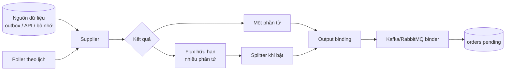

# Polling Supplier và tách tập hợp phần tử

## 1. Bài toán: định kỳ lấy nhiều bản ghi nhưng phát từng sự kiện

Giả sử một dịch vụ đơn hàng lưu các sự kiện cần phát trong bảng *outbox*. Mỗi vài giây, ứng dụng đọc một nhóm bản ghi mới và đưa chúng tới Kafka hoặc RabbitMQ để các dịch vụ khác xử lý. Một lần truy vấn có thể trả về ba đơn hàng:

```json
[
  {"orderId":"ORD-101","totalInCents":150000},
  {"orderId":"ORD-102","totalInCents":80000},
  {"orderId":"ORD-103","totalInCents":220000}
]
```

Có ít nhất hai cách biểu diễn đầu ra:

- **Một message chứa cả danh sách** ba đơn hàng. Consumer cần hiểu định dạng batch và tự duyệt các phần tử.
- **Ba message độc lập**, mỗi message chứa một đơn hàng. Consumer có thể xử lý, retry, phân chia tải hoặc định tuyến theo từng sự kiện.

Trong **Spring Cloud Function**, `Supplier<T>` là một hàm nguồn: nó tạo dữ liệu mà không cần input. Trong **Spring Cloud Stream**, một `Supplier` có thể được kích hoạt bằng *poller* (bộ gọi theo lịch) rồi phát kết quả qua output binding tới broker. Nếu dữ liệu đầu ra là một tập hợp phần tử, ta còn phải quyết định **có tách tập hợp thành nhiều message hay không**.

Hai câu hỏi này độc lập:

1. **Polling**: khi nào và bao nhiêu lần cần gọi nguồn dữ liệu?
2. **Splitting**: một lần nguồn trả về nhiều phần tử thì phát một message tập hợp hay nhiều message riêng?

Điểm cốt lõi của bài là phân biệt `Supplier<T>` imperative, `Supplier<Flux<T>>` reactive và `@PollableBean(splittable = true)` cho luồng hữu hạn cần được poll nhiều lần.

**Mục tiêu học tập:** Sau bài này, bạn có thể cấu hình nhịp poller, hiểu giới hạn `maxMessagesPerPoll`, chọn cách phát từng phần tử, viết một `@PollableBean`, cấu hình output binding, kiểm thử số message đầu ra và xác định rủi ro giao nhận trùng khi đọc dữ liệu theo lô.

## 2. Những thành phần liên quan

| Thành phần | Vai trò | Ví dụ |
| --- | --- | --- |
| `Supplier<T>` | Hàm nguồn trả một giá trị khi được gọi | `Supplier<OrderCreated>` |
| `Supplier<Flux<T>>` | Hàm nguồn cung cấp một Publisher gồm nhiều phần tử | `Supplier<Flux<OrderCreated>>` |
| `FunctionCatalog` | Tra cứu, chuẩn hóa và hỗ trợ ghép functional bean | Tìm bean `publishPendingOrders` |
| Spring Cloud Stream poller | Kích hoạt nguồn theo lịch khi mô hình nguồn yêu cầu polling | Cứ 5 giây kích hoạt supplier |
| Splitter | Phân rã kết quả gồm nhiều phần tử thành nhiều message | 3 phần tử → 3 message |
| Output binding | Cổng phát dữ liệu của supplier | `publishPendingOrders-out-0` |
| Binder | Chuyển message giữa binding và middleware | Kafka binder, RabbitMQ binder |
| Destination | Địa chỉ logic của output trên middleware | `orders.pending` |

Một `Supplier` thông thường không có input binding vì nó không được kích hoạt từ message đầu vào. Nó được kết nối ra ngoài qua `<supplierName>-out-0`.



Sơ đồ thể hiện dòng xử lý tổng quát. Một reactive supplier cung cấp luồng liên tục không có cùng vòng đời poller như một supplier imperative; các mục sau giải thích khác biệt đó.

## 3. Đừng nhầm một lần poll với một message đầu ra

Ví dụ có một nhóm năm bản ghi trong nguồn dữ liệu và poller chạy một lần:

| Hình thức source | Kết quả một lần lấy dữ liệu | Cách hiểu về output |
| --- | --- | --- |
| `Supplier<OrderCreated>` | Một `OrderCreated` | Thông thường phát một message đơn hàng |
| `Supplier<List<OrderCreated>>` | Một `List` gồm 5 đơn hàng | Đây là **một giá trị kiểu List**; không được mặc định nó sẽ thành 5 message |
| `Supplier<Flux<OrderCreated>>` reactive thông thường | Một `Flux` | Publisher có thể phát nhiều phần tử trong suốt vòng đời subscription; không tự có poll lặp |
| `@PollableBean(splittable=true)` trên `Supplier<Flux<OrderCreated>>` | Một `Flux` hữu hạn gồm 5 phần tử ở mỗi lần poll | Spring Cloud Stream có thể tách thành **5 message riêng** ở output |
| `@PollableBean(splittable=false)` | Một `Flux` hữu hạn khi được poll | Không áp dụng cơ chế tách phần tử của annotation; cần xác minh cách biểu diễn và xử lý Publisher downstream |

Một phép tính đơn giản giúp thấy khác biệt:

```text
1 lần poll
    -> nguồn trả 5 phần tử
    -> splittable = true
    -> tối đa 5 message dữ liệu từ nhóm đó

maxMessagesPerPoll = 1
    ≠ giới hạn số phần tử của Flux bằng 1
    ≠ bảo đảm mỗi chu kỳ chỉ có 1 message sau khi split
```

`maxMessagesPerPoll` điều chỉnh số message/lượt lấy được poller xử lý theo cơ chế polling, **không** phải tham số cắt một `Flux` sau phần tử đầu tiên và cũng không thay đổi kích thước lô dữ liệu do repository trả về.

## 4. Supplier imperative: mỗi lần gọi get() tạo một giá trị

### 4.1. Bean đơn giản

```java
import java.util.concurrent.atomic.AtomicLong;
import java.util.function.Supplier;

import org.springframework.context.annotation.Bean;
import org.springframework.context.annotation.Configuration;

@Configuration
class SimpleSupplierConfiguration {

    @Bean
    Supplier<String> orderNumbers() {
        AtomicLong counter = new AtomicLong();
        return () -> "ORD-" + counter.incrementAndGet();
    }
}
```

Với Spring Cloud Stream, `orderNumbers` là tên bean để chọn trong `spring.cloud.function.definition`. Nếu được bind làm nguồn, Stream dùng poller để gọi `get()` theo lịch và phát kết quả ra output binding `orderNumbers-out-0`.

Ví dụ cấu hình:

```yaml
spring:
  cloud:
    function:
      definition: orderNumbers
    stream:
      bindings:
        orderNumbers-out-0:
          destination: orders.generated
          content-type: text/plain
```

Mỗi lần gọi `get()` thành công, supplier trong ví dụ tạo **một String mới**. Nó không đọc Kafka hay RabbitMQ input; broker chỉ nhận message đã được sản xuất.

### 4.2. Nếu nguồn chưa có dữ liệu?

Ví dụ một repository có thể không có bản ghi chờ phát:

```java
@Bean
Supplier<OrderCreated> nextOrder(OutboxRepository repository) {
    return () -> repository.findNextPending().orElse(null);
}
```

Đây là mã minh họa dựa trên interface `OutboxRepository` do ứng dụng tự định nghĩa. Trong mô hình nguồn polled, việc trả `null` thể hiện không có message để phát tại lần poll đó. Cần kiểm tra hành vi thực tế của phiên bản framework và converter nếu sử dụng các kiểu kết quả đặc biệt.

**Quan trọng:** đọc một bản ghi và đánh dấu nó đã gửi ngay trong `get()` có thể làm mất dữ liệu nếu broker publish thất bại sau đó. Trong ứng dụng outbox thật, nên tách việc lấy/đánh dấu bản ghi, xác nhận gửi thành công và phục hồi lỗi bằng một quy trình giao nhận có thiết kế rõ ràng. Không nên coi ví dụ `findNextPending()` là một triển khai outbox bền vững hoàn chỉnh.

## 5. Poller mặc định và cấu hình nhịp gọi

Trong mô hình Spring Cloud Stream functional Supplier, poller mặc định thường gọi supplier imperative khoảng **mỗi giây một lần**. Theo tài liệu Spring Cloud Stream, các giá trị mặc định điển hình của default poller là `fixedDelay = 1000 ms` và `maxMessagesPerPoll = 1`; hãy đối chiếu lại với phiên bản framework đang dùng khi cần bảo đảm chính xác lịch chạy.

### 5.1. Cấu hình poller chung

Ví dụ muốn tăng khoảng nghỉ giữa các lượt poll:

```yaml
spring:
  integration:
    poller:
      fixed-delay: 5000
      max-messages-per-poll: 1
```

`spring.integration.poller.fixed-delay` được đo bằng mili giây theo mặc định. Giá trị `5000` tương ứng khoảng nghỉ cố định 5 giây theo lịch poller; **không phải cam kết** broker sẽ thấy message chính xác mỗi 5 giây, vì còn thời gian xử lý, scheduling, tải và kết nối.

`max-messages-per-poll` điều khiển số lần nhận/xử lý message tối đa trong mỗi đợt poll của default poller, chứ không tự đặt batch size cho một `Flux`. Nếu nguồn không có dữ liệu, một đợt poll không bắt buộc phát được message nào.

Các thuộc tính khác có thể sử dụng theo phiên bản:

| Thuộc tính với tiền tố `spring.integration.poller.` | Vai trò |
| --- | --- |
| `fixed-delay` | Khoảng nghỉ cố định giữa các lượt poll |
| `max-messages-per-poll` | Giới hạn số message được poller nhận trong một trigger |
| `initial-delay` | Khoảng trễ trước khi kích hoạt lần đầu |
| `cron` | Lịch theo biểu thức cron |
| `time-unit` | Đơn vị thời gian dùng cho các giá trị delay |

Không cấu hình cả nhiều kiểu trigger với kỳ vọng chúng tự cộng dồn; chọn một chính sách lịch phù hợp và kiểm tra thứ tự ưu tiên của phiên bản.

### 5.2. Cấu hình poller riêng cho một output binding

Khi một ứng dụng có nhiều source với nhịp khác nhau, có thể cấu hình poller ở cấp producer binding:

```yaml
spring:
  cloud:
    function:
      definition: orderNumbers
    stream:
      bindings:
        orderNumbers-out-0:
          destination: orders.generated
          producer:
            poller:
              fixed-delay: 3000
              max-messages-per-poll: 1
```

Đường dẫn tương đương:

```properties
spring.cloud.stream.bindings.orderNumbers-out-0.producer.poller.fixed-delay=3000
```

Cấu hình cấp binding cho phép một supplier phát mỗi 3 giây trong khi supplier khác sử dụng lịch mặc định hoặc lịch được cấu hình riêng. Cần đảm bảo tên `orderNumbers-out-0` khớp với functional definition và chưa được alias sang tên khác.

**Phân biệt lịch và kích thước batch:** giảm `fixed-delay` làm tăng tần suất gọi nguồn; tăng số record một lần truy vấn cần cấu hình ở repository/logic nguồn; việc gửi từng record thành message riêng lại do cách biểu diễn đầu ra và splitter quyết định.

## 6. Supplier reactive: một Publisher có thể sống lâu

Xem `Supplier<Flux<String>>` không dùng `@PollableBean`:

```java
import java.time.Duration;
import java.util.function.Supplier;

import org.springframework.context.annotation.Bean;
import reactor.core.publisher.Flux;

@Bean
Supplier<Flux<String>> liveHeartbeat() {
    return () -> Flux.interval(Duration.ofSeconds(2))
            .map(index -> "heartbeat-" + index);
}
```

Đây là một reactive supplier cung cấp một luồng có thể tiếp tục phát phần tử. Trong Spring Cloud Stream, nguồn reactive như vậy thường được **gọi một lần để lấy Publisher**, sau đó framework subscribe và chuyển tiếp các phần tử được luồng phát ra.

```text
Ứng dụng khởi động
      |
      v
liveHeartbeat.get()  ----> Flux đang hoạt động
                               |
                           heartbeat-0
                           heartbeat-1
                           heartbeat-2
                           ...
```

Không có lý do để framework gọi lại `get()` mỗi hai giây: chính `Flux.interval` tạo tín hiệu. Đây là điểm khác biệt so với `Supplier<String>` được gọi bởi default poller.

### Khi Flux hữu hạn thì sao?

```java
@Bean
Supplier<Flux<String>> oneShotMessages() {
    return () -> Flux.just("A", "B", "C");
}
```

`Flux.just` là luồng **hữu hạn**. Nếu không có cơ chế yêu cầu poll lặp lại, reactive supplier kiểu này thường được khởi tạo/subscribe rồi hoàn tất một lần. Không thể chỉ thêm `spring.integration.poller.fixed-delay` mà mặc định nó sẽ tự chạy lại `Flux.just(...)` mỗi chu kỳ.

Để dùng một Publisher hữu hạn **mỗi lần poll**, Spring Cloud Function cung cấp `@PollableBean` và Spring Cloud Stream có thể diễn giải marker đó.

## 7. @PollableBean: đánh dấu nguồn reactive hữu hạn cần poll

`org.springframework.cloud.function.context.PollableBean` là annotation thuộc Spring Cloud Function. Nó được dùng trên phương thức cung cấp functional bean và là **marker** để framework tích hợp nhận biết rằng nguồn reactive trả một luồng hữu hạn cần được gọi theo lịch.

Điểm cần phân biệt:

- Spring Cloud Function cung cấp annotation và metadata `splittable`.
- Bản thân **Spring Cloud Function không tự triển khai cơ chế polling** chỉ nhờ có annotation.
- Spring Cloud Stream, khi dùng nó làm nguồn được bind, tổ chức poller và thực hiện tách phần tử theo `splittable`.

Ví dụ cơ bản:

```java
import java.util.function.Supplier;

import org.springframework.cloud.function.context.PollableBean;
import reactor.core.publisher.Flux;

@PollableBean(splittable = true)
public Supplier<Flux<String>> batchLetters() {
    return () -> Flux.just("A", "B", "C");
}
```

Đoạn trên là **phương thức bean** cần đặt trong lớp cấu hình Spring phù hợp. Trong các phiên bản Spring Cloud Function được hỗ trợ, `@PollableBean` đóng vai trò annotation bean chuyên dụng; không cần đặt thêm `@Bean` lên cùng phương thức.

Khi định nghĩa `batchLetters` được Spring Cloud Stream chọn và poll:

```text
Poll #1: batchLetters.get() -> Flux(A, B, C)
                            -> message "A"
                            -> message "B"
                            -> message "C"

Poll #2: batchLetters.get() -> Flux(A, B, C)
                            -> message "A"
                            -> message "B"
                            -> message "C"
```

Ví dụ chỉ dùng chuỗi cố định để dễ quan sát; nó **cố ý phát lặp lại** cùng phần tử sau mỗi lần poll. Nguồn thực tế phải có cơ chế theo dõi những bản ghi đã lấy, xử lý việc phát trùng và quản lý trạng thái giao nhận.

### 7.1. Tác dụng của splittable

| Annotation | Hàm được gọi theo poller? | Output từ một Flux hữu hạn |
| --- | --- | --- |
| `@PollableBean(splittable = true)` | Có, khi được Spring Cloud Stream bind | Các phần tử được tách để phát như các message riêng |
| `@PollableBean` | Có | `splittable` mặc định là `true` trong các phiên bản tài liệu hiện hành |
| `@PollableBean(splittable = false)` | Có | Tắt xử lý tách phần tử do annotation; cần xem cách Publisher nguyên vẹn được downstream/binder tiếp nhận |
| `@Bean Supplier<Flux<T>>` không có `@PollableBean` | Thông thường được lấy Publisher một lần | Luồng phát phần tử theo subscription, không phải poll lại theo từng chu kỳ |

**Không nhầm `splittable=false` với “gửi một JSON array”.** Annotation chỉ điều khiển tách output của Publisher; cách một `Flux` không tách được xử lý/serialize phụ thuộc integration layer và binder. Nếu hợp đồng đích là **một batch JSON**, hãy chủ động tạo payload kiểu `List<T>` hoặc một DTO batch và kiểm thử conversion, thay vì dựa vào việc gửi nguyên một Publisher.

### 7.2. Không phải mọi collection được tách tự động

`Supplier<List<OrderCreated>>` và `Supplier<Flux<OrderCreated>>` có **kiểu dữ liệu và lifecycle khác nhau**. Đừng đặt `@PollableBean(splittable=true)` lên bất kỳ kiểu `Supplier<List<T>>` nào rồi mặc định sẽ có đúng cơ chế reactive splitting như ví dụ tài liệu. Khi cần chắc chắn mỗi phần tử là một message, dùng mô hình được hỗ trợ rõ ràng như `Supplier<Flux<T>>` với `@PollableBean(splittable=true)`, hoặc lặp chủ động từng phần tử qua `StreamBridge` trong một tác vụ được điều phối phù hợp.

## 8. Ví dụ hoàn chỉnh: mỗi lần poll lấy một nhóm ba đơn hàng

Ví dụ sau tạo ba sự kiện mẫu **mới** ở mỗi lần poll. Mỗi sự kiện được gửi riêng khi bật `splittable=true`. Đoạn này mô phỏng nguồn dữ liệu hữu hạn, không kết nối database.

```java
import java.util.List;
import java.util.concurrent.atomic.AtomicLong;
import java.util.function.Supplier;

import org.springframework.boot.SpringApplication;
import org.springframework.boot.autoconfigure.SpringBootApplication;
import org.springframework.cloud.function.context.PollableBean;
import reactor.core.publisher.Flux;

@SpringBootApplication
public class PollingOrdersApplication {

    public static void main(String[] args) {
        SpringApplication.run(PollingOrdersApplication.class, args);
    }

    public record OrderCreated(String orderId, long totalInCents) {}

    @PollableBean(splittable = true)
    public Supplier<Flux<OrderCreated>> publishPendingOrders() {
        AtomicLong nextId = new AtomicLong(0);

        return () -> {
            long base = nextId.getAndAdd(3);

            List<OrderCreated> batch = List.of(
                    new OrderCreated("ORD-" + (base + 1), 150_000L),
                    new OrderCreated("ORD-" + (base + 2), 80_000L),
                    new OrderCreated("ORD-" + (base + 3), 220_000L)
            );

            return Flux.fromIterable(batch);
        };
    }
}
```

Phân tích:

1. `@PollableBean(splittable=true)` thông báo một reactive source hữu hạn cần được poll và tách phần tử.
2. `publishPendingOrders` là tên functional bean được chọn trong definition.
3. Mỗi lời gọi `get()` tạo một `List<OrderCreated>` mới gồm ba đơn hàng.
4. `Flux.fromIterable(batch)` biến nhóm thành luồng hữu hạn rồi hoàn tất.
5. Spring Cloud Stream split kết quả để mỗi `OrderCreated` có thể thành một message trên output binding.
6. `AtomicLong` chỉ giúp minh họa ID khác nhau trong **một tiến trình**. Nó không phải bộ cấp ID phân tán, không bền qua restart và không giải quyết duplicate delivery của broker.

### 8.1. application.yml

Giả sử dự án có Spring Cloud Stream Kafka binder tương thích với phiên bản Spring Boot/Spring Cloud, và broker Kafka đang chạy:

```yaml
spring:
  cloud:
    function:
      definition: publishPendingOrders
    stream:
      bindings:
        publishPendingOrders-out-0:
          destination: orders.pending
          content-type: application/json
          producer:
            poller:
              fixed-delay: 5000
              max-messages-per-poll: 1
      kafka:
        binder:
          brokers: localhost:9092
```

Cấu hình này có nghĩa:

- Chọn bean `publishPendingOrders` trong `FunctionCatalog`.
- Phát qua output binding `publishPendingOrders-out-0` đến Kafka topic logic `orders.pending`.
- Dùng JSON cho payload `OrderCreated` khi converter tương thích có mặt, thường thông qua Jackson.
- Dùng poller riêng của producer binding, với `fixed-delay: 5000` (mili giây).
- `max-messages-per-poll: 1` không giới hạn số phần tử được splitter phát từ mỗi `Flux` về một.

### 8.2. Kết quả kỳ vọng

Một lần poll với `base = 0` có thể tạo:

```json
{"orderId":"ORD-1","totalInCents":150000}
```

```json
{"orderId":"ORD-2","totalInCents":80000}
```

```json
{"orderId":"ORD-3","totalInCents":220000}
```

Đây là **ba payload message độc lập**, không phải một JSON array. Nếu poller chạy tiếp và ứng dụng vẫn hoạt động, các lô sau chứa ID `ORD-4`, `ORD-5`, v.v.

**Không nên suy ra** broker sẽ ghi ba record theo cùng một transaction, mọi consumer sẽ xử lý đúng thứ tự hoặc ba message sẽ xuất hiện cùng một thời điểm. Những bảo đảm đó phụ thuộc binder, partitioning, transport, producer configuration và trạng thái runtime.

## 9. Cấu hình sink để kiểm chứng số message

Để quan sát số sự kiện phát ra từ source, một ứng dụng consumer khác có thể định nghĩa:

```java
import java.util.function.Consumer;
import org.springframework.context.annotation.Bean;
import org.springframework.context.annotation.Configuration;

@Configuration
class OrderConsumerConfiguration {

    public record OrderCreated(String orderId, long totalInCents) {}

    @Bean
    Consumer<OrderCreated> auditOrder() {
        return order -> System.out.printf(
                "Received order=%s amount=%d%n",
                order.orderId(),
                order.totalInCents()
        );
    }
}
```

Cấu hình consumer trong **ứng dụng riêng**:

```yaml
spring:
  cloud:
    function:
      definition: auditOrder
    stream:
      bindings:
        auditOrder-in-0:
          destination: orders.pending
          group: order-auditors
          content-type: application/json
```

Khi nguồn tạo một nhóm ba đơn hàng và splitter hoạt động đúng, consumer có thể quan sát ba lần xử lý payload đơn hàng riêng biệt.

Nếu chạy nhiều instance consumer cùng `group: order-auditors`, các instance có thể chia việc theo mô hình của broker; không cần tất cả instance đều nhìn thấy cả ba message. Nếu muốn hai nghiệp vụ cùng xử lý mọi sự kiện, dùng hai consumer group độc lập hoặc topology tương ứng, không đặt tên group ngẫu nhiên cho mỗi pod.

## 10. Luồng hữu hạn và luồng liên tục: chọn đúng kiểu source

Một bẫy thường gặp là dùng `Supplier<Flux<T>>` cho cả hai nhu cầu sau nhưng không phân biệt vòng đời:

| Nhu cầu | Ví dụ | Cách triển khai phù hợp |
| --- | --- | --- |
| Liên tục nhận event từ một Publisher đang hoạt động | Sensor stream hoặc nguồn reactive có kết nối dài | `@Bean Supplier<Flux<T>>`, framework subscribe luồng |
| Mỗi vài giây lấy tối đa N bản ghi rồi xử lý hết nhóm | Poll database/outbox hữu hạn | `@PollableBean(splittable=true) Supplier<Flux<T>>` |
| Mỗi vài giây lấy đúng một bản ghi | Một sự kiện mới từ hàng đợi nội bộ | `@Bean Supplier<T>` imperative |
| Phát khi người dùng bấm nút hoặc HTTP request đến | Giao dịch ứng dụng tạo một event | `StreamBridge`, được gọi theo sự kiện của code |
| Thực sự muốn gửi một batch dưới dạng payload duy nhất | API downstream nhận JSON array/batch DTO | Tạo `BatchCreated` hoặc `List<T>` làm payload; không dùng splitting |

### Vì sao không dùng Flux.interval cho mọi trường hợp?

Có thể tự viết một `Supplier<Flux<T>>` với `Flux.interval` để định kỳ query database trong pipeline reactive, nhưng lúc đó lịch đọc là **do Reactor tạo ra**, không phải poller của `@PollableBean`. Nếu bạn đặt cả timer Reactor và poller bao ngoài mà không hiểu lifecycle, có thể tạo nhiều subscription hoặc phát lặp ngoài ý định.

Với các tác vụ DB thông thường, hãy chọn một cơ chế lên lịch chính. Nếu dùng reactive timer, cần xem xét backpressure, concurrency, non-blocking I/O và cách quản lý trạng thái. Nếu dùng framework poller, nên để nó điều khiển thời điểm supplier tạo lô hữu hạn.

## 11. Điều gì xảy ra với List<T> nếu không split?

Một `List<OrderCreated>` là **một giá trị Java**:

```java
@Bean
Supplier<List<OrderCreated>> pendingBatch() {
    return () -> List.of(
            new OrderCreated("ORD-1", 150_000),
            new OrderCreated("ORD-2", 80_000)
    );
}
```

Với nguồn kiểu này, người viết phải xác định rõ **hợp đồng payload**. Trong cấu hình thông thường, không nên kỳ vọng Spring Cloud Stream tự biến một `List` thành nhiều message riêng chỉ vì đó là collection. Nếu được serialize thành JSON với converter phù hợp, kết quả có thể là **một message chứa JSON array**; nhưng cần kiểm tra hành vi framework và converter thực tế.

So sánh hai kiểu wire format:

**Một message chứa batch:**

```json
[
  {"orderId":"ORD-1","totalInCents":150000},
  {"orderId":"ORD-2","totalInCents":80000}
]
```

**Hai message riêng sau splitting:**

```json
{"orderId":"ORD-1","totalInCents":150000}
```

```json
{"orderId":"ORD-2","totalInCents":80000}
```

Hai hình thức khác nhau về consumer contract, retry, partitioning, kích thước message và độ chi tiết của việc theo dõi lỗi.

### Tại sao batch payload vẫn có ích?

Batch payload phù hợp nếu consumer chủ ý xử lý tất cả phần tử như một đơn vị (chẳng hạn một API bulk insert). Nó có thể giảm overhead từng message nhưng làm tăng kích thước payload và phạm vi xử lý lại khi lỗi. Hãy dùng DTO rõ ràng nếu dữ liệu có metadata theo nhóm:

```java
record OrderBatch(String batchId, List<OrderCreated> orders) {}
```

Nếu business requirement là **mỗi đơn hàng được partition, retry và kiểm toán riêng**, splitting từng phần tử thường dễ vận hành hơn. Lựa chọn này cần xuất phát từ contract nghiệp vụ, không chỉ từ kiểu `List` sẵn có trong repository.

## 12. Thêm header cho từng phần tử sau khi split

Nếu muốn mỗi event mang `batchId` và `eventId`, supplier có thể trả về luồng `Message<OrderCreated>`:

```java
import java.util.List;
import java.util.UUID;
import java.util.function.Supplier;

import org.springframework.cloud.function.context.PollableBean;
import org.springframework.messaging.Message;
import org.springframework.messaging.support.MessageBuilder;
import reactor.core.publisher.Flux;

@PollableBean(splittable = true)
public Supplier<Flux<Message<OrderCreated>>> publishWithHeaders() {
    return () -> {
        String batchId = UUID.randomUUID().toString();

        List<OrderCreated> orders = List.of(
                new OrderCreated("ORD-101", 150_000L),
                new OrderCreated("ORD-102", 80_000L)
        );

        return Flux.fromIterable(orders)
                .map(order -> MessageBuilder
                        .withPayload(order)
                        .setHeader("batchId", batchId)
                        .setHeader("eventId", order.orderId())
                        .build());
    };
}
```

Đoạn này là phương thức bean minh họa trong lớp đã có `record OrderCreated` và Spring configuration tương ứng. Mỗi phần tử của `Flux` là một `Message` có payload và headers; không cần tạo riêng một output binding cho header.

Khi đi qua Kafka/RabbitMQ binder, khả năng ánh xạ và chuyển đổi headers phụ thuộc transport và cấu hình. Cần integration test để xác nhận `batchId`/`eventId` vẫn đến consumer dưới kiểu dữ liệu mong muốn. Không nên sao chép tùy tiện các header hệ thống khi tái tạo message.

Trong production, event ID nên ổn định theo bản ghi nguồn, không thay đổi mỗi lần retry cùng event. `UUID.randomUUID()` ở đây chỉ dùng minh họa `batchId`, còn `eventId` dựa trên ID nghiệp vụ; nếu có bản ghi có thể phát lại, phải bảo đảm event ID đủ duy nhất và bất biến.

## 13. Polling dữ liệu thật: outbox, offset và độ tin cậy

Một source polled hữu hạn có thể được dựng từ repository:

```java
@PollableBean(splittable = true)
public Supplier<Flux<OrderCreated>> pendingFromOutbox(
        OutboxRepository repository) {

    return () -> Flux.fromIterable(
            repository.findPendingBatch(50)
    );
}
```

Trong ví dụ trên, `OutboxRepository` là interface do dự án tự xây dựng, và `findPendingBatch(50)` đọc tối đa 50 bản ghi theo một thứ tự/tiêu chí ổn định. Đây là **phác thảo cách đọc batch**, chưa có quản lý acknowledgement, claim/lease hoặc đánh dấu gửi thành công.

### 13.1. Rủi ro nếu xóa bản ghi ngay khi đọc

Ví dụ thao tác sai:

```text
1. Poll -> đọc 50 bản ghi.
2. Xóa hoặc đánh dấu SENT toàn bộ 50 bản ghi.
3. Bắt đầu phát 50 message lên broker.
4. Publish message thứ 27 thất bại.
5. 24 bản ghi chưa gửi có thể đã bị xóa/đánh dấu SENT.
```

Mục tiêu của outbox là tránh mất sự kiện khi chuyển giữa giao dịch dữ liệu và broker. Nếu cập nhật trạng thái quá sớm, mục tiêu này bị phá vỡ.

### 13.2. Hướng thiết kế an toàn hơn

Nên đánh giá một quy trình có trạng thái và phục hồi rõ ràng:

1. Lưu event vào bảng outbox trong cùng giao dịch với thay đổi nghiệp vụ.
2. Poll nhóm bản ghi chưa phát, có thể claim/lease để tránh nhiều instance lấy cùng một bản ghi.
3. Phát message với event ID ổn định, có khả năng quan sát kết quả gửi.
4. Chỉ chuyển trạng thái bản ghi phù hợp sau khi đã xác nhận broker chấp nhận phát theo mức bảo đảm đã chọn.
5. Nếu xảy ra lỗi giữa bước gửi và bước cập nhật outbox, cho phép retry; consumer dùng **idempotency** để tránh side effect trùng.
6. Khi source chết, lease hết hạn cần được khôi phục, và bản ghi treo có thể được lấy lại.

Việc chỉ đổi `splittable=true` **không thực hiện** transaction giữa database và broker. Cách kết nối callback xác nhận gửi, marking và transaction cụ thể phải được thiết kế riêng theo binder và storage. Với yêu cầu exactly-once xuyên hệ thống, cần đánh giá sâu về transaction/outbox, vì không thể suy ra từ cơ chế splitter.

### 13.3. Không tăng tần suất poll vô hạn để giảm độ trễ

Tăng tần suất poll làm tăng lưu lượng truy vấn, số lần không có dữ liệu, contention và áp lực CPU/broker. Đối với outbox lớn, nên cân nhắc:

- Giới hạn kích thước batch tại repository (ví dụ 50 bản ghi).
- Sắp xếp theo key/created time và có cơ chế claim phù hợp.
- Đo số pending record, thời gian từ khi ghi tới khi phát, số bản ghi retry.
- Giới hạn số poll đồng thời giữa nhiều instance.
- Theo dõi publishing error và consumer lag/queue depth.
- Tạo cảnh báo cho bản ghi tồn đọng lâu hoặc lặp retry bất thường.

`fixed-delay` điều chỉnh nhịp poll **trong ứng dụng**; nó không thay thế thiết kế hàng đợi bền vững, index DB hoặc cơ chế chia tải giữa các process.

## 14. Polling Supplier khác PollableMessageSource

Hai khái niệm có chữ “poll” nhưng hướng dữ liệu khác nhau:

| Cơ chế | Vị trí | Ai gọi lấy dữ liệu? | Có output/input binding nào? |
| --- | --- | --- | --- |
| Polled `Supplier<T>` | **Nguồn phát** từ ứng dụng ra broker | Spring Cloud Stream poller gọi `get()` | Output binding của supplier |
| `@PollableBean Supplier<Flux<T>>` | **Nguồn phát** lô hữu hạn ra broker | Poller gọi supplier, splitter phát phần tử | Output binding của supplier |
| `PollableMessageSource` | **Consumer chủ động đọc** message đã có từ broker | Code ứng dụng gọi `poll(...)` | Pollable input binding |

`PollableMessageSource` là một cơ chế riêng của Spring Cloud Stream cho người tiêu thụ chủ động poll message từ broker. Nó không phải cách đánh dấu `Supplier` tạo nguồn. Khi tài liệu hoặc config nói đến `spring.cloud.stream.pollable-source`, hãy kiểm tra xem đó là **polled consumer** hay bài toán **polled supplier**.

Bài này tập trung vào **polling phía nguồn `Supplier`**, nơi không có input binding mặc định và mỗi giá trị được phát tới output destination.

## 15. Khi nào nên dùng StreamBridge thay cho polling Supplier?

Nếu dữ liệu xuất hiện vì HTTP request hoặc callback sự kiện đã có sẵn, không nhất thiết cần default poller. Spring Cloud Stream cung cấp `StreamBridge` để phát chủ động:

```java
import org.springframework.cloud.stream.function.StreamBridge;
import org.springframework.stereotype.Service;

@Service
class OrderPublisher {

    private final StreamBridge streamBridge;

    OrderPublisher(StreamBridge streamBridge) {
        this.streamBridge = streamBridge;
    }

    void publishOrders(List<OrderCreated> orders) {
        for (OrderCreated order : orders) {
            streamBridge.send("ordersOut", order);
        }
    }
}
```

```yaml
spring:
  cloud:
    stream:
      output-bindings: ordersOut
      bindings:
        ordersOut:
          destination: orders.pending
          content-type: application/json
```

Đoạn này phát từng `OrderCreated` bằng một lời gọi `send` riêng, do code tự duyệt collection. Nó không dùng `@PollableBean` và không được tự gọi theo lịch.

**Lưu ý độ tin cậy:** `send` được gọi tuần tự không đồng nghĩa với transaction atomically send toàn bộ batch. Mã ví dụ còn thiếu kiểm tra kết quả `send`, handling exception, retry và idempotency; hãy thêm chúng nếu triển khai trong môi trường production.

StreamBridge phù hợp với nguồn do code kích hoạt chủ động. `@PollableBean` phù hợp với nguồn cần quét định kỳ và mỗi lượt trả một nhóm phần tử hữu hạn. Cả hai vẫn sử dụng output binding và binder của Spring Cloud Stream.

## 16. Kiểm thử: đếm số lần poll và số message được phát

### 16.1. Unit test nguồn trả Flux hữu hạn

Từ ví dụ `PollingOrdersApplication` ở mục 8:

```java
import static org.junit.jupiter.api.Assertions.assertEquals;
import org.junit.jupiter.api.Test;
import reactor.core.publisher.Flux;
import reactor.test.StepVerifier;

class PollingOrdersApplicationTest {

    @Test
    void eachCallReturnsThreeOrders() {
        var supplier = new PollingOrdersApplication()
                .publishPendingOrders();

        Flux<PollingOrdersApplication.OrderCreated> firstBatch =
                supplier.get();

        StepVerifier.create(firstBatch)
                .expectNextCount(3)
                .verifyComplete();

        Flux<PollingOrdersApplication.OrderCreated> secondBatch =
                supplier.get();

        StepVerifier.create(secondBatch)
                .assertNext(order ->
                        assertEquals("ORD-4", order.orderId()))
                .expectNextCount(2)
                .verifyComplete();
    }
}
```

Test dùng `reactor-test` và chứng minh **mỗi lần gọi supplier trả ba phần tử**. Nó không tự chứng minh framework đã poll theo lịch hoặc splitter đã phát ba message thật trên broker.

### 16.2. Integration test với Spring Cloud Stream

Để xác minh đúng yêu cầu “mỗi phần tử thành một message”, cần test ở ranh giới Stream. Một kịch bản tối thiểu:

1. Khởi động ứng dụng với bean `publishPendingOrders` được chọn, `splittable=true` và poller có nhịp đủ chậm để dễ quan sát.
2. Gửi output tới một binder test hoặc Kafka/RabbitMQ thử nghiệm.
3. Sau một lượt poll, kiểm tra có **ba message** được đọc ở output destination, mỗi message có một payload `OrderCreated`.
4. Kiểm tra message đầu tiên, thứ hai, thứ ba có ID theo bộ giá trị tạo từ cùng một lần poll.
5. Sau lượt poll kế tiếp, kiểm tra output có thêm ba message mới thay vì một JSON array.
6. Chạy consumer `auditOrder` để chứng minh downstream nhận các payload riêng.
7. Tạo trường hợp nguồn trả `Flux.empty()` và xác minh không phát message từ batch rỗng.
8. Thử lỗi một phần tử/broker và kiểm tra hành vi retry/duplicate phù hợp thiết kế.

**Phân biệt phép kiểm:** unit test kiểm tra nguồn; integration test mới kiểm tra việc poll theo lịch, splitting, content conversion, binding và binder.

### 16.3. Test batch rỗng

Một source có thể trả `Flux.empty()` khi repository không có dữ liệu:

```java
@PollableBean(splittable = true)
public Supplier<Flux<String>> noPendingMessages() {
    return Flux::empty;
}
```

Ở mỗi lần poll, luồng rỗng hoàn tất mà không có phần tử. Với splitting, không có payload phần tử để phát. Đây là lựa chọn tự nhiên cho nguồn quét dữ liệu không phải lúc nào cũng có bản ghi mới.

**Lưu ý:** ví dụ này mô tả bean độc lập cho mục đích học; không nên bật đồng thời nhiều supplier nếu chưa khai báo chính xác các definition cần bind.

## 17. Rủi ro và lỗi thường gặp

| Hiện tượng | Nguyên nhân có thể | Hướng kiểm tra và xử lý |
| --- | --- | --- |
| `Supplier<String>` phát liên tục dù không có event mới | Mỗi lần poll trả cùng một giá trị | Kiểm soát nguồn, trả không có dữ liệu khi phù hợp, thiết kế idempotency |
| `Supplier<Flux<T>>` hữu hạn chỉ chạy một lần | Không có `@PollableBean`; reactive supplier thường được lấy Publisher một lần | Dùng `@PollableBean` cho nguồn hữu hạn cần poll lặp |
| Một batch bị gửi thành một JSON array | Source trả `List<T>` hoặc không có cơ chế splitting như mong đợi | Dùng `@PollableBean(splittable=true) Supplier<Flux<T>>` và kiểm thử số message |
| Đã có `splittable=true` nhưng không thấy message | Sai tên bean/definition, output binding, destination hoặc binder | Kiểm tra tên `<supplier>-out-0`, log khởi tạo và broker |
| Có ba message dù `max-messages-per-poll=1` | Nhầm số lượt poll với số phần tử trong Flux | Hiểu splitter tách nhiều phần tử từ một kết quả |
| Poller chạy quá nhanh hoặc quá chậm | Sai `fixed-delay`, dùng đơn vị thời gian sai hoặc scheduler đang bận | Kiểm tra thuộc tính global/per-binding và đo nhịp thực |
| Tăng `fixed-delay` mà nguồn vẫn phát liên tục | Supplier reactive tự điều khiển bằng `Flux.interval` | Tách rõ timer Reactor và framework poller |
| `splittable=false` cho output không đọc được | Tắt splitting nhưng downstream không hỗ trợ Publisher nguyên dạng | Tạo payload batch thật và cấu hình converter rõ ràng |
| Message bị trùng sau restart | Outbox chưa ack/publish hoàn tất, lease hết hạn hoặc retry | Dùng event ID ổn định, idempotent consumer và state machine |
| Message bị mất khi broker lỗi | Đánh dấu/xóa dữ liệu nguồn trước khi broker chấp nhận | Thiết kế outbox với xác nhận phát và recovery |
| Source đọc chồng batch giữa nhiều instance | Không có claim/lease hoặc phân vùng nguồn | Dùng cơ chế đồng bộ/claim trong persistence |
| Flux lỗi ở giữa batch rồi dừng | `onError` kết thúc luồng, không có policy retry/quarantine | Xác định lỗi mỗi phần tử và cơ chế tái phát/ghi nhận |
| Dùng API blocking trong pipeline reactive vô hạn | Blocking trên luồng xử lý không phù hợp | Chọn API reactive thật hoặc scheduler phù hợp, đo hiệu năng |
| Producer phát đúng nhưng consumer không thấy | Sai destination/group/offset, conversion hoặc quyền broker | Debug từ binding tới broker và consumer |
| Header theo từng phần tử biến mất | Tạo message không có header hoặc binder không chuyển header | Kiểm tra `Message<T>`, serializer và integration test |

Một thứ tự debug hữu ích là: **định nghĩa bean → kiểu Supplier → có @PollableBean không → lịch poller → giá trị trả về → splittable → output binding → destination/binder → payload và headers → trạng thái xử lý ở consumer**.

## 18. Bài tập thực hành

### Bài tập 1: Dự đoán số message

Nguồn dùng:

```java
@PollableBean(splittable = true)
public Supplier<Flux<Integer>> numbers() {
    return () -> Flux.just(10, 20, 30, 40);
}
```

Nếu một lượt poll gọi nguồn một lần, về mặt splitting có bao nhiêu phần tử và bao nhiêu message đầu ra được dự kiến? Vì sao `maxMessagesPerPoll=1` không làm output còn một message?

**Gợi ý:** bốn phần tử dẫn tới bốn message từ một lần trả về Flux, nếu pipeline không có filter/lỗi.

### Bài tập 2: Sửa nguồn reactive chỉ chạy một lần

Ứng dụng khai báo `@Bean Supplier<Flux<String>>` trả `Flux.just("A","B")` nhưng chỉ phát hai event khi khởi động. Yêu cầu là cứ 10 giây phát một nhóm mới.

Hãy thay annotation và cấu hình poller. Chỉ rõ giá trị `splittable` và tên binding dự kiến khi bean tên `batchSource`.

**Gợi ý:** `@PollableBean(splittable=true)` và `batchSource-out-0.producer.poller.fixed-delay: 10000`.

### Bài tập 3: Từ List sang message riêng

Repository trả về `List<OrderCreated>` gồm tối đa 20 bản ghi. Hãy viết `Supplier<Flux<OrderCreated>>` dùng `Flux.fromIterable(...)` rồi cấu hình Spring Cloud Stream để phát mỗi đơn hàng thành một message riêng. Nêu ít nhất ba lý do tại sao cần kiểm tra retry/duplicate trước khi triển khai production.

### Bài tập 4: Thiết kế batch payload thật

Một API downstream cần nhận một JSON array gồm tối đa 50 đơn hàng trong **một** message. Bạn sẽ chọn kiểu payload nào và vì sao không nên dựa vào `Supplier<Flux<T>>` chưa tách để tạo JSON array? Hãy so sánh cách xử lý lỗi khi một phần tử trong batch không hợp lệ.

### Bài tập 5: Polling outbox an toàn

Giả sử poller lấy 50 bản ghi và lần gửi thứ 27 thất bại. Hãy đề xuất trạng thái outbox, cơ chế retry và event ID để các bản ghi chưa gửi không bị mất, còn các bản ghi đã gửi không gây side effect trùng khi bị phát lại.

### Câu hỏi tự đánh giá

1. Vì sao `Supplier<T>` thường chỉ có output binding?
2. Điểm khác biệt giữa `@Bean Supplier<Flux<T>>` và `@PollableBean Supplier<Flux<T>>` là gì?
3. `splittable=true` giải quyết vấn đề nào? Nó có thay thế poller không?
4. `maxMessagesPerPoll` có phải batch size của repository hoặc số phần tử tối đa của Flux không?
5. Với `Flux.empty()` ở một lượt poll, output mong đợi là gì?
6. Khi nào nên dùng `Supplier<List<T>>` để gửi batch, khi nào cần message từng phần tử?
7. Vì sao tăng số instance source có thể làm phát trùng cùng bản ghi outbox?
8. Cần test nào để xác minh thực sự có ba message trên Kafka thay vì một JSON array?
9. Khi nào `StreamBridge` thích hợp hơn nguồn được poll theo lịch?
10. Làm thế nào để tách việc phát thành công từ việc đánh dấu bản ghi đã gửi?

## 19. Tổng kết

Trong Spring Cloud Function, `Supplier<T>` định nghĩa cách cung cấp dữ liệu độc lập giao thức. Spring Cloud Stream sử dụng **poller** để kích hoạt nguồn imperative khi cần và dùng **output binding** để gửi dữ liệu tới broker. Với nguồn reactive:

- `Supplier<Flux<T>>` thông thường cung cấp một Publisher được lấy/subscribe theo vòng đời stream, không tự được poll lại mỗi chu kỳ.
- `@PollableBean` đánh dấu nguồn reactive hữu hạn cần được Spring Cloud Stream poll lặp lại.
- `@PollableBean(splittable = true)` yêu cầu tách các phần tử của kết quả để phát **từng message riêng**.
- `splittable=false` tắt cơ chế tách này; không mặc định biến Publisher thành một payload batch JSON.
- `fixed-delay` điều khiển nhịp poll, còn số phần tử một batch do nguồn dữ liệu quyết định.
- Khi cần phát sự kiện từ callback hoặc HTTP request, `StreamBridge` là một lựa chọn chủ động không phụ thuộc poller.

`FunctionCatalog`, composition và conversion giúp các functional bean còn có thể tái sử dụng qua HTTP, sự kiện hoặc serverless khi có adapter tương thích. Trong bài toán dữ liệu định kỳ, lựa chọn đúng mô hình Supplier và splitting giải quyết **cấu trúc message**; thiết kế outbox, ack/offset, retry và idempotency mới quyết định **độ tin cậy giao nhận** của toàn hệ thống.

### Tài liệu tham khảo

- [Spring Cloud Stream — Producing and Consuming Messages: Suppliers, Polling, Splitting](https://docs.spring.io/spring-cloud-stream/reference/spring-cloud-stream/producing-and-consuming-messages.html)
- [Spring Cloud Function — Programming Model: Supplier và @PollableBean](https://docs.spring.io/spring-cloud-function/reference/spring-cloud-function/programming-model.html)
- [Spring Cloud Stream — Functional Binding Names](https://docs.spring.io/spring-cloud-stream/reference/spring-cloud-stream/functional-binding-names.html)
- [Project Reactor — Reactor Core Reference Guide](https://projectreactor.io/docs/core/release/reference/)
- [Spring Integration — Polling Consumer](https://docs.spring.io/spring-integration/reference/endpoint/polling-consumer.html)
