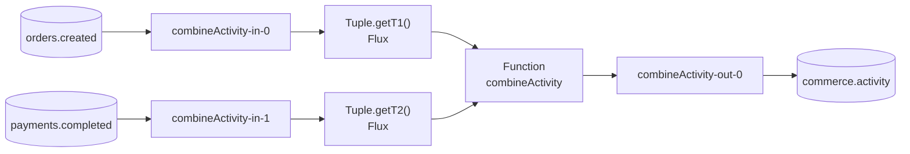
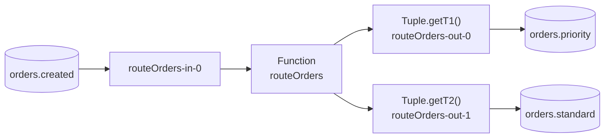
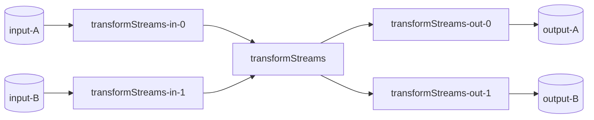

# Nhiều đầu vào đầu ra và thứ tự chỉ số binding

## 1. Vấn đề: một hàm cần nhiều luồng dữ liệu

Trong các bài toán xử lý sự kiện, một hàm không phải lúc nào cũng chỉ có một nguồn vào và một nơi gửi ra. Chẳng hạn, dịch vụ thương mại điện tử có thể cần:

- Nhận các sự kiện **đơn hàng mới** từ `orders.created`.
- Nhận các sự kiện **thanh toán hoàn tất** từ `payments.completed`.
- Chuẩn hóa hai loại sự kiện và gửi về một luồng hoạt động chung `commerce.activity`.

Ở hướng ngược lại, một dịch vụ có thể đọc `orders.created` và phân loại:

- Đơn hàng **ưu tiên** gửi tới `orders.priority`.
- Đơn hàng **thông thường** gửi tới `orders.standard`.

Đây là hai mẫu thiết kế khác nhau:

1. **Nhiều đầu vào, một đầu ra** — hợp nhất hoặc kết hợp nhiều dòng dữ liệu.
2. **Một đầu vào, nhiều đầu ra** — chia một dòng dữ liệu thành nhiều kênh phát.

Spring Cloud Function cho phép mô tả nghiệp vụ như hàm Java, có thể tái sử dụng qua HTTP, môi trường sự kiện hoặc serverless bằng adapter tương ứng. **Spring Cloud Stream** sử dụng functional bean và `FunctionCatalog` để kết nối các hàm đó với broker. Với trường hợp nhiều cổng, Stream dựa vào **kiểu dữ liệu, số phần tử trong tuple và thứ tự các phần tử** để suy ra tên binding.

**Mục tiêu học tập:** Sau bài này, bạn có thể đọc đúng `-in-0`, `-in-1`, `-out-0`, `-out-1`; cấu hình destination và consumer group cho từng cổng; viết hàm nhiều cổng sử dụng Reactor `Flux` và `Tuple2`; phân biệt vị trí cổng với thứ tự message; kiểm thử định tuyến và xử lý các rủi ro về subscription, lỗi và backpressure.

## 2. Ôn lại quy ước tên binding

Với mô hình hàm thông thường, Spring Cloud Stream dùng:

```text
<function-name>-in-<index>
<function-name>-out-<index>
```

| Thành phần | Ý nghĩa | Ví dụ |
| --- | --- | --- |
| `<function-name>` | Tên bean/functional definition được chọn | `combineActivity` |
| `-in-` | Cổng nhận dữ liệu vào hàm | `combineActivity-in-0` |
| `-out-` | Cổng phát kết quả từ hàm | `combineActivity-out-0` |
| `0`, `1`, ... | **Vị trí cổng**, đếm từ 0 ở mỗi chiều | `combineActivity-in-1` |

Một `Function<OrderCreated, OrderClassified>` thường chỉ có `classifyOrder-in-0` và `classifyOrder-out-0`. Một `Supplier<T>` thường chỉ có output binding; một `Consumer<T>` thường chỉ có input binding.

**Chỉ số của binding không phải** số Kafka partition, consumer group, offset, bản ghi thứ mấy hay thứ tự dữ liệu đến broker. Khi `-in-1` xuất hiện, nó chỉ rằng hàm có **cổng input logic thứ hai**. `-out-1` biểu thị **cổng output logic thứ hai**. Input và output có bộ chỉ số **độc lập**, đều bắt đầu từ `0`.

Ví dụ:

```text
combineActivity-in-0   <-- orders.created
combineActivity-in-1   <-- payments.completed
combineActivity-out-0  --> commerce.activity

routeOrders-in-0       <-- orders.created
routeOrders-out-0      --> orders.priority
routeOrders-out-1      --> orders.standard
```

Không cần tạo `combineActivity-out-1` nếu hàm chỉ trả **một** dòng kết quả. Tương tự, `routeOrders` không có `-in-1` chỉ vì mỗi đối tượng Order có nhiều field.

## 3. Nhiều cổng khác nhiều thuộc tính của một POJO thế nào?

So sánh các chữ ký:

```java
// Một input logic: một OrderCreated với nhiều trường dữ liệu.
Function<OrderCreated, OrderClassified> classifyOrder;

// Một input logic: một đối tượng chứa hai danh sách.
Function<OrderBatch, BatchResult> processBatch;

// Hai input logic thực sự: hai Publisher độc lập.
Function<Tuple2<Flux<OrderCreated>, Flux<PaymentReceived>>,
         Flux<ActivityRecord>> combineActivity;

// Một input logic, hai output logic.
Function<Flux<OrderCreated>,
         Tuple2<Flux<OrderCreated>, Flux<OrderCreated>>> routeOrders;
```

Chỉ hai chữ ký cuối mô tả **nhiều binding** theo cơ chế nhiều cổng của Spring Cloud Stream.

Spring Cloud Stream hỗ trợ multi-input/multi-output ở mô hình functional từ phiên bản 3.0, ban đầu tập trung vào **reactive function** với `TupleN<Flux<...>>`. Kiểu tuple của Reactor cho framework biết:

- **Arity**: có bao nhiêu đầu vào hoặc đầu ra.
- **Type**: kiểu phần tử trong mỗi dòng.
- **Position**: vị trí của từng cổng để đặt tên `-in-0`, `-in-1`, v.v.

Một `List<T>`, JSON array hoặc `Tuple2<OrderCreated, PaymentReceived>` không phải cách tương đương để khai báo hai stream bindings. Nếu chỉ cần xử lý hai trường đã được đóng gói trong một message, hãy dùng một DTO bình thường. Nếu thực sự cần hai topic hoặc hai queue đầu vào độc lập, dùng chữ ký nhiều cổng phù hợp.

## 4. Vì sao cần Reactor Flux và Tuple?

`Flux<T>` của Project Reactor biểu diễn một dòng chứa từ 0 đến nhiều phần tử. Với mô hình reactive function, `Function` thường được gọi để **thiết lập pipeline**; các message sau đó đi qua dòng dữ liệu mà không nhất thiết gọi lại `apply` cho từng message như hàm imperative.

`Tuple2<A,B>` lưu hai giá trị có kiểu riêng:

```java
import reactor.util.function.Tuple2;
import reactor.util.function.Tuples;

Tuple2<String, Integer> pair = Tuples.of("orders", 42);

String first = pair.getT1();   // "orders"
Integer second = pair.getT2(); // 42
```

Reactor đặt tên phần tử là `T1`, `T2`, v.v. **T1 là phần tử thứ nhất**, nhưng tên binding tương ứng lại dùng **chỉ số từ 0**:

| Vị trí trong Tuple | Binding input tương ứng | Binding output tương ứng |
| --- | --- | --- |
| `getT1()` | `<function>-in-0` | `<function>-out-0` |
| `getT2()` | `<function>-in-1` | `<function>-out-1` |
| `getT3()` trong `Tuple3` | `<function>-in-2` | `<function>-out-2` |

Đây là quy tắc quan trọng nhất khi viết cấu hình. **`T1 ↔ index 0`, `T2 ↔ index 1`**. Không đảo thứ tự chỉ vì bộ đếm trong Java tuple bắt đầu từ 1 còn binding bắt đầu từ 0.

## 5. Ví dụ 1: hai đầu vào, một đầu ra

### 5.1. Bài toán hợp nhất sự kiện

Có hai luồng độc lập:

- `Flux<OrderCreated>`: sự kiện từ `orders.created`.
- `Flux<PaymentReceived>`: sự kiện từ `payments.completed`.

Ta muốn chuyển cả hai sang một contract thống nhất `ActivityRecord` rồi phát về `commerce.activity`.



Với kiến trúc này, mỗi input là một dòng message từ destination riêng. Hàm không cần Kafka consumer API hay RabbitMQ listener API.

### 5.2. Java bean

```java
import java.util.function.Function;

import org.springframework.boot.SpringApplication;
import org.springframework.boot.autoconfigure.SpringBootApplication;
import org.springframework.context.annotation.Bean;

import reactor.core.publisher.Flux;
import reactor.util.function.Tuple2;

@SpringBootApplication
public class CommerceStreamApplication {

    public static void main(String[] args) {
        SpringApplication.run(CommerceStreamApplication.class, args);
    }

    public record OrderCreated(String orderId, long totalInCents) {}

    public record PaymentReceived(String orderId, String paymentId) {}

    public record ActivityRecord(
            String orderId,
            String eventType,
            String description) {}

    @Bean
    Function<Tuple2<Flux<OrderCreated>, Flux<PaymentReceived>>,
             Flux<ActivityRecord>> combineActivity() {

        return sources -> {
            // T1 ánh xạ tới combineActivity-in-0.
            Flux<ActivityRecord> orders = sources.getT1()
                    .map(order -> new ActivityRecord(
                            order.orderId(),
                            "ORDER_CREATED",
                            "amount=" + order.totalInCents()
                    ));

            // T2 ánh xạ tới combineActivity-in-1.
            Flux<ActivityRecord> payments = sources.getT2()
                    .map(payment -> new ActivityRecord(
                            payment.orderId(),
                            "PAYMENT_RECEIVED",
                            "paymentId=" + payment.paymentId()
                    ));

            // Một output stream chung.
            return Flux.merge(orders, payments);
        };
    }
}
```

**Diễn giải chữ ký:**

```text
Input  : Tuple2<Flux<OrderCreated>, Flux<PaymentReceived>>
           |                   |
           |                   +--> combineActivity-in-1
           +----------------------> combineActivity-in-0

Output : Flux<ActivityRecord>
           +----------------------> combineActivity-out-0
```

`Flux.merge` hợp nhất các phần tử từ hai luồng thành một output. Nó **không bảo đảm** rằng event đơn hàng sẽ luôn xuất hiện trước event thanh toán của cùng một `orderId`. Hai nguồn có độ trễ, consumer group, partition và thời điểm phát khác nhau.

### 5.3. Cấu hình application.yml

```yaml
spring:
  cloud:
    function:
      definition: combineActivity
    stream:
      bindings:
        combineActivity-in-0:
          destination: orders.created
          group: activity-orders
          content-type: application/json

        combineActivity-in-1:
          destination: payments.completed
          group: activity-payments
          content-type: application/json

        combineActivity-out-0:
          destination: commerce.activity
          content-type: application/json
```

Đường dẫn cấu hình của mỗi binding:

| Binding | Vai trò | Destination | Group |
| --- | --- | --- | --- |
| `combineActivity-in-0` | Nhận `OrderCreated` | `orders.created` | `activity-orders` |
| `combineActivity-in-1` | Nhận `PaymentReceived` | `payments.completed` | `activity-payments` |
| `combineActivity-out-0` | Phát `ActivityRecord` | `commerce.activity` | Không áp dụng cho producer |

**Group được đặt trên input binding**, không phải output. Hai group ở đây có nhiệm vụ riêng: nhận đơn hàng và nhận thanh toán. Đừng nhầm tên group với thứ tự `in-0`/`in-1`; đổi tên group không tự thay thứ tự tuple.

Ví dụ yêu cầu Spring Boot, Spring Cloud Function/Stream, Reactor và binder Kafka hoặc RabbitMQ tương thích. Nếu dùng Kafka, cần dependency `spring-cloud-stream-binder-kafka` và cấu hình broker; nếu dùng RabbitMQ, cần binder tương ứng và cấu hình connection/queue/exchange. Cấu hình ở trên chỉ cho thấy **binding tới destination**, chưa thay thế cấu hình hạ tầng thật.

### 5.4. Các message ví dụ

Message vào `orders.created`:

```json
{"orderId":"ORD-101","totalInCents":150000}
```

Message vào `payments.completed`:

```json
{"orderId":"ORD-101","paymentId":"PAY-9001"}
```

Các output có thể là:

```json
{"orderId":"ORD-101","eventType":"ORDER_CREATED","description":"amount=150000"}
```

```json
{"orderId":"ORD-101","eventType":"PAYMENT_RECEIVED","description":"paymentId=PAY-9001"}
```

**Không được suy ra thứ tự giữa hai output** từ thứ tự `T1`, `T2` trong tuple. Vị trí cổng là cố định; thời điểm message đi qua `Flux.merge` phụ thuộc tín hiệu thực tế của mỗi nguồn.

## 6. “Merge” không phải “join theo khóa nghiệp vụ”

Đây là bẫy phổ biến của multi-input. Hãy phân biệt:

- **Merge**: nhận sự kiện từ hai luồng và đưa tất cả vào một dòng chung.
- **Zip**: ghép phần tử thứ nhất của luồng A với phần tử thứ nhất của luồng B, phần tử thứ hai với phần tử thứ hai, v.v.
- **Join/correlation theo key**: kết hợp sự kiện khi chúng có cùng `orderId`, trong giới hạn thời gian hoặc trạng thái được thiết kế.
- **Combine latest**: kết hợp các giá trị gần nhất của các nguồn khi có sự kiện mới, không mặc định là join theo business key.

Ví dụ sai về mặt nghiệp vụ:

```java
// NGUY HIỂM nếu mong ghép theo orderId.
Flux.zip(orderFlux, paymentFlux)
        .map(pair -> process(pair.getT1(), pair.getT2()));
```

Nếu order đầu tiên là `ORD-101` còn payment đầu tiên là `ORD-205`, `zip` vẫn có thể ghép chúng theo vị trí, không theo `orderId`. Nó không hiểu khóa nghiệp vụ.

Đối với một pipeline cần kết quả “đơn hàng đã được thanh toán”, nên thiết kế cách lưu trạng thái/ghép khóa, timeout, late event, retry, memory bounds hoặc một kho lưu trạng thái tương ứng. Không thể chỉ thêm `Tuple2` vào chữ ký và coi đó là event join.

`Flux.merge` trong `combineActivity` ở mục trước phù hợp vì yêu cầu chỉ là **chuẩn hóa sự kiện để ghi log hoạt động**, không phải chứng minh đơn hàng nào đã được thanh toán.

## 7. Ví dụ 2: một đầu vào, hai đầu ra

### 7.1. Bài toán chia đơn hàng thành hai dòng

Một input `orders.created` chứa cả đơn hàng ưu tiên và thông thường. Ta muốn:

- `routeOrders-out-0` đưa đơn hàng từ ngưỡng 100.000 trở lên vào `orders.priority`.
- `routeOrders-out-1` đưa đơn hàng dưới ngưỡng vào `orders.standard`.



Hai output là hai luồng độc lập. Trong ví dụ này, mỗi đơn hàng được **chọn đúng một nhánh theo ngưỡng**, chứ không được gửi vào cả hai destination.

### 7.2. Java bean có nguồn chung được chia thành hai nhánh

Có thể thêm bean sau vào `CommerceStreamApplication` ở mục 5:

```java
import java.util.function.Function;

import org.springframework.context.annotation.Bean;
import reactor.core.publisher.Flux;
import reactor.util.function.Tuple2;
import reactor.util.function.Tuples;

@Bean
Function<Flux<OrderCreated>,
         Tuple2<Flux<OrderCreated>, Flux<OrderCreated>>> routeOrders() {

    return orders -> {
        // Multicast cùng một nguồn cho hai subscriber của hai output.
        Flux<OrderCreated> shared = orders.publish().autoConnect(2);

        // getT1() -> routeOrders-out-0.
        Flux<OrderCreated> priority = shared.filter(
                order -> order.totalInCents() >= 100_000L);

        // getT2() -> routeOrders-out-1.
        Flux<OrderCreated> standard = shared.filter(
                order -> order.totalInCents() < 100_000L);

        return Tuples.of(priority, standard);
    };
}
```

**Vì sao phải chia sẻ nguồn?** Nếu chỉ tạo hai nhánh độc lập bằng `orders.filter(...)` rồi trả về tuple, việc subscribe mỗi nhánh có thể tạo **hai subscription** lên cùng Publisher. Với một nguồn cold, các side effect có thể bị chạy hai lần; với một nguồn hot, các nhánh có thể nhìn thấy tập phần tử khác nhau. `publish().autoConnect(2)` cho phép một subscription upstream được dùng chung sau khi **hai downstream subscriber** đã kết nối.

Có hai lưu ý quan trọng:

1. Cấu hình `autoConnect(2)` phụ thuộc việc **cả hai output được subscribe**. Nếu một output không được kích hoạt hoặc lỗi lifecycle, luồng có thể không bắt đầu phát. Đây là ví dụ để giải thích semantics; production cần kiểm thử khi một nhánh chậm, lỗi hoặc bị ngắt kết nối.
2. Các nhánh chia sẻ cùng upstream nên backpressure và lỗi có thể ảnh hưởng lẫn nhau. Không suy ra rằng hai output là hai transaction hoặc hai bộ xử lý hoàn toàn cách ly chỉ vì có hai binding.

Không nên tự gọi `subscribe()` trên từng nhánh rồi trả về một tuple khác không liên quan: khi đó framework mất khả năng quản lý lifecycle và lỗi của subscription.

### 7.3. Cấu hình destination cho từng output

```yaml
spring:
  cloud:
    function:
      definition: routeOrders
    stream:
      bindings:
        routeOrders-in-0:
          destination: orders.created
          group: route-workers
          content-type: application/json

        routeOrders-out-0:
          destination: orders.priority
          content-type: application/json

        routeOrders-out-1:
          destination: orders.standard
          content-type: application/json
```

Bảng ánh xạ:

| Cổng | Vị trí trong hàm | Destination | Vai trò |
| --- | --- | --- | --- |
| `routeOrders-in-0` | `Flux<OrderCreated>` đầu vào | `orders.created` | Đọc tất cả đơn hàng |
| `routeOrders-out-0` | `Tuple.getT1()` | `orders.priority` | Phát đơn hàng ưu tiên |
| `routeOrders-out-1` | `Tuple.getT2()` | `orders.standard` | Phát đơn hàng thông thường |

Nếu đảo `Tuples.of(priority, standard)` thành `Tuples.of(standard, priority)` **mà không sửa YAML**, `routeOrders-out-0` sẽ chuyển thành dòng thông thường nhưng destination vẫn là `orders.priority`. Đây là lỗi cấu hình–mã nguồn nguy hiểm: ứng dụng có thể vẫn chạy mà message đi sai nghiệp vụ.

### 7.4. Thử ba đơn hàng

Input:

```json
{"orderId":"ORD-101","totalInCents":150000}
```

```json
{"orderId":"ORD-102","totalInCents":80000}
```

```json
{"orderId":"ORD-103","totalInCents":220000}
```

Output mong đợi:

| Destination | Sự kiện dự kiến |
| --- | --- |
| `orders.priority` | `ORD-101`, `ORD-103` |
| `orders.standard` | `ORD-102` |

Hai output là **hai đường truyền khác nhau**. Không nên so sánh “message thứ nhất ở out-0” với “message thứ nhất ở out-1” rồi cho rằng chúng là cùng một bản ghi. Nếu hai nhánh phát với tốc độ khác nhau, chúng cũng không có quan hệ thứ tự liên-broker hoặc liên-topic được bảo đảm.

## 8. Trường hợp cả nhiều input lẫn nhiều output

Một function có thể đồng thời nhận nhiều dòng và trả nhiều dòng theo kiểu reactive:

```java
Function<Tuple2<Flux<String>, Flux<Integer>>,
         Tuple2<Flux<String>, Flux<String>>> transformStreams;
```

Tên binding theo quy ước:

```text
transformStreams-in-0    -> Tuple.getT1() (Flux<String>)
transformStreams-in-1    -> Tuple.getT2() (Flux<Integer>)

transformStreams-out-0   -> return.getT1() (Flux<String>)
transformStreams-out-1   -> return.getT2() (Flux<String>)
```

Bảng chỉ số:

| Đầu vào | Chỉ số | Đầu ra | Chỉ số |
| --- | --- | --- | --- |
| `getT1()` của input tuple | `in-0` | `getT1()` của output tuple | `out-0` |
| `getT2()` của input tuple | `in-1` | `getT2()` của output tuple | `out-1` |

Có thể hình dung sơ đồ:



Đó vẫn chỉ là **một functional bean**. Có bốn binding không đồng nghĩa có bốn `@Bean Function`. Việc tính toán bên trong có thể dùng `merge`, `filter`, `groupBy`, `flatMap` hoặc nhiều toán tử Reactor khác, nhưng phải xác định rõ hành vi khi dữ liệu tới từ hai đầu vào không đồng thời.

## 9. Thứ tự chỉ số không phải thứ tự xử lý sự kiện

Cần tách ba loại thứ tự:

1. **Thứ tự cổng:** `T1 ↔ in-0/out-0` và `T2 ↔ in-1/out-1`. Đây là ánh xạ cấu trúc, xác định từ chữ ký hàm và tuple.
2. **Thứ tự phần tử trong một luồng:** phụ thuộc nguồn, partition, concurrency và toán tử Reactor. Với `Flux.map` hoặc `concatMap`, thứ tự trong một dòng có thể được bảo toàn theo tính chất toán tử; với `flatMap` concurrent, thứ tự phát có thể thay đổi.
3. **Thứ tự giữa các luồng:** hai input ở hai topic/queue khác nhau không có một thứ tự chung chỉ nhờ dùng `Tuple2`.

Ví dụ:

```text
in-0: ORD-1 -------- ORD-3 ------------ ORD-5
in-1: PAY-9 -- PAY-7 ---------- PAY-8

T1 luôn là in-0; T2 luôn là in-1.
Nhưng phần tử PAY-9 có thể đến trước ORD-1.
```

Nếu dùng `Flux.merge`, sự kiện hai luồng đan xen theo thời điểm phát. Nếu dùng `Flux.zip`, phần tử ghép theo vị trí, không theo cùng khóa. Nếu yêu cầu xử lý theo thời gian nghiệp vụ, cần thiết kế ordering/window/partitioning và cơ chế trạng thái phù hợp.

### Vì sao phân biệt quan trọng?

Trong hệ thống thanh toán, gán nhầm `combineActivity-in-0` cho `payments.completed` trong khi code gọi `sources.getT1()` như `OrderCreated` có thể dẫn tới lỗi deserialization hoặc sai dữ liệu. Trong bài toán chia đơn, đảo `Tuples.of` có thể lặng lẽ gửi đơn hàng sai destination.

Cách phòng tránh tốt nhất là đặt tên biến có nghĩa, bổ sung bảng mapping và test cả payload **lẫn destination của từng binding**.

## 10. Thay tên binding ngầm định bằng alias tường minh

Với nhiều cổng, `combineActivity-in-0` và `combineActivity-in-1` có thể khó đọc. Spring Cloud Stream cho phép đặt tên binding tường minh bằng `spring.cloud.stream.function.bindings`:

```yaml
spring:
  cloud:
    function:
      definition: combineActivity
    stream:
      function:
        bindings:
          combineActivity-in-0: orderEventsInput
          combineActivity-in-1: paymentEventsInput
          combineActivity-out-0: activityOutput

      bindings:
        orderEventsInput:
          destination: orders.created
          group: activity-orders
          content-type: application/json

        paymentEventsInput:
          destination: payments.completed
          group: activity-payments
          content-type: application/json

        activityOutput:
          destination: commerce.activity
          content-type: application/json
```

Sau ánh xạ:

- `getT1()` của input vẫn đại diện cho **cổng input thứ nhất**, nhưng binding trong cấu hình có tên `orderEventsInput`.
- `getT2()` vẫn là **cổng input thứ hai**, có tên `paymentEventsInput`.
- Output duy nhất có tên `activityOutput`.
- `orders.created`, `payments.completed` và `commerce.activity` vẫn là destination trên broker.

**Alias không đổi thứ tự tuple.** Chỉ đổi tên `combineActivity-in-0` sang `paymentEventsInput` không khiến `getT1()` chuyển thành input thứ hai. Để thay đổi ý nghĩa cổng, phải đồng bộ mã Java với mapping và test.

Khi dùng alias, cấu hình `destination`/`group`/`content-type` nên nằm dưới **tên binding đã đổi**. Đặt một phần dưới tên implicit và một phần dưới alias dễ gây lỗi khó nhận ra.

## 11. Kết nối mỗi cổng tới binder khác nhau

Multi-input/multi-output là khái niệm của **Spring Cloud Stream**, còn binder quyết định kết nối tới middleware. Khi có nhiều binder, có thể chọn binder riêng ở từng cổng:

```yaml
spring:
  cloud:
    function:
      definition: combineActivity
    stream:
      bindings:
        combineActivity-in-0:
          binder: kafka
          destination: orders.created
          group: activity-orders

        combineActivity-in-1:
          binder: rabbit
          destination: payments.completed
          group: activity-payments

        combineActivity-out-0:
          binder: kafka
          destination: commerce.activity
```

Đây là **ví dụ cấu hình phân vai**, không phải cấu hình hoàn chỉnh để chạy ngay: ứng dụng phải có cả Kafka binder và RabbitMQ binder trên classpath, cấu hình kết nối cho cả hai, và tên binder phải khớp với các binder instance được đăng ký. Khi dùng các binder instance đặt tên riêng, thuộc tính `binder` phải tham chiếu đúng tên đó.

Ý nghĩa:

- Input thứ nhất có thể đọc Kafka topic.
- Input thứ hai có thể đọc RabbitMQ exchange/queue.
- Output có thể phát Kafka topic.

Tuy nhiên, **không tồn tại transaction phân tán tự động** chỉ vì hai input cùng được gom trong `Tuple2`. Kafka offset, RabbitMQ ack, side effect và publish output là những ranh giới giao nhận khác nhau. Phải thiết kế retry, idempotency, dead-letter và recovery rõ ràng.

## 12. Nhiều cổng khác nhiều functional definition độc lập

Hai cấu hình có vẻ giống nhau về số binding nhưng kiến trúc khác nhau.

**Một bean nhiều cổng:**

```java
@Bean
Function<Tuple2<Flux<String>, Flux<Integer>>, Flux<String>>
combineActivity() { /* ... */ }
```

```yaml
spring:
  cloud:
    function:
      definition: combineActivity
```

Spring Cloud Stream có hai input bindings và một output binding cho **một functional definition**. Hàm có thể nhìn thấy và biến đổi cả hai luồng.

**Hai bean đơn input/output:**

```java
@Bean
Function<String, String> normalizeText() {
    return String::trim;
}

@Bean
Function<Integer, String> formatNumber() {
    return Object::toString;
}
```

```yaml
spring:
  cloud:
    function:
      definition: normalizeText;formatNumber
```

Trong cấu hình này, Stream thiết lập các pipeline riêng, ví dụ `normalizeText-in-0`/`normalizeText-out-0` và `formatNumber-in-0`/`formatNumber-out-0`. **Không có `-in-1`** cho `normalizeText` chỉ vì ứng dụng có hai bean.

| Tiêu chí | Một function nhiều cổng | Nhiều definition `a;b` |
| --- | --- | --- |
| Đơn vị logic | Một bean nhìn thấy nhiều luồng | Nhiều bean độc lập |
| Tên binding | `f-in-0`, `f-in-1`, ... | `a-in-0`, `b-in-0`, ... |
| Có sẵn khả năng phối hợp các luồng trong một bean | Có, thông qua Reactor | Không tự động; cần broker/composition |
| Ranh giới lỗi và lifecycle | Liên quan đến pipeline reactive chung | Theo từng definition/binding |
| Khi nào chọn | Merge, correlate, split streams có chủ đích | Các nghiệp vụ độc lập, scale riêng |

Còn `a|b` là **composition**, nối output của hàm trước với input của hàm sau thành một pipeline logic. Dấu `;` không giống dấu `|`, và cả hai không tạo chỉ số `-in-1`/`-out-1` một cách ngẫu nhiên. Với composition liên quan hàm nhiều cổng, cần kiểm tra rõ hỗ trợ và tính tương thích kiểu của framework trước khi triển khai.

## 13. Một source nhiều message không đồng nghĩa nhiều output bindings

Đối chiếu ba trường hợp:

```java
// Một nguồn phát dòng gồm nhiều phần tử.
Supplier<Flux<OrderCreated>> events;

// Một function nhận dòng và phát dòng.
Function<Flux<OrderCreated>, Flux<OrderCreated>> normalize;

// Một function nhận một dòng nhưng phân thành hai output streams.
Function<Flux<OrderCreated>,
         Tuple2<Flux<OrderCreated>, Flux<OrderCreated>>> routeOrders;
```

`Supplier<Flux<OrderCreated>>` thông thường có **một output binding** vì nó chỉ trả một Publisher. Mỗi phần tử `OrderCreated` do luồng phát ra có thể trở thành một message, nhưng điều đó **không tạo** `events-out-1`.

`Function<Flux<OrderCreated>,Flux<OrderCreated>>` có **một input và một output binding**, dù trong đời sống của Flux có hàng triệu phần tử.

Chỉ khi chữ ký mô tả **nhiều dòng đầu vào/đầu ra**, chẳng hạn `Tuple2<Flux<...>, Flux<...>>`, mới có thêm chỉ số tương ứng. Cơ chế tách một tập hợp phần tử (`splittable` của pollable supplier), batch mode hoặc JSON array cũng không tự biến thành multi-output function.

## 14. Payload, content type và headers ở từng cổng

Mỗi input/output binding có thể có cấu hình riêng:

```yaml
spring:
  cloud:
    stream:
      bindings:
        combineActivity-in-0:
          destination: orders.created
          content-type: application/json

        combineActivity-in-1:
          destination: payments.completed
          content-type: application/json

        combineActivity-out-0:
          destination: commerce.activity
          content-type: application/json
```

Framework sử dụng thông tin kiểu từ chữ ký `Tuple2<Flux<OrderCreated>,Flux<PaymentReceived>>` để hỗ trợ chuyển payload đầu vào sang đúng Java record. Khi hai input có các schema khác nhau, **không nên gộp cả hai thành `Flux<Object>`** nếu muốn tận dụng chuyển đổi type an toàn.

### Khi cần Message<T>

Nếu cần correlation ID hoặc headers theo từng event, đầu vào có thể là:

```java
Function<
    Tuple2<Flux<Message<OrderCreated>>,
           Flux<Message<PaymentReceived>>>,
    Flux<Message<ActivityRecord>>
> combineWithHeaders;
```

Đây là **một chữ ký minh họa**, cần viết body để tạo `Message<ActivityRecord>` và chọn những header thực sự cần chuyển tiếp. Chữ ký vẫn có hai input và một output; thêm `Message<T>` không tạo cổng riêng cho headers.

Các header đi qua Kafka/RabbitMQ có thể bị chuyển đổi hoặc giới hạn theo binder và transport. Một source mới có thể không có correlation ID hoặc dùng kiểu header khác. Kiểm thử tích hợp phải xác minh output schema và header contract, không chỉ kiểm thử Java function.

## 15. Bản chất reactive: subscription, backpressure và lỗi

Hàm nhiều cổng tập trung vào **các stream**, không chỉ một message. Điều đó mang lại sức mạnh nhưng cũng tạo ra rủi ro cần thiết kế.

### 15.1. Lifecycle khác imperative

Với `Function<OrderCreated,OrderClassified>` thông thường, mỗi message được gọi vào function theo cơ chế imperative. Với `Function<Tuple2<Flux<OrderCreated>, Flux<PaymentReceived>>, Flux<ActivityRecord>>`, function thường được gọi để thiết lập luồng, còn message tiếp tục phát qua Publisher sau đó.

Không nên viết code có side effect ngay trong lần gọi `apply` rồi kỳ vọng side effect đó tự chạy một lần cho mỗi message. Nếu dùng `doOnNext`, side effect xảy ra theo subscription và có thể chạy lại khi Publisher được subscribe lại. Với thao tác quan trọng, cần thiết kế idempotency và lifecycle đúng cách.

### 15.2. Khi một input bị lỗi

`Flux.merge` có thể phát `onError` nếu một input gặp lỗi không được xử lý, làm **chấm dứt output stream** và ảnh hưởng tới cả pipeline. Không mặc định rằng framework sẽ retry đúng một message trên từng cổng như với `Function<T,R>` imperative. Chính sách xử lý lỗi trong reactive stream và cơ chế retry/ack của binder phải được đánh giá riêng.

Ví dụ:

```java
return Flux.merge(
        sources.getT1().map(this::convertOrder),
        sources.getT2().map(this::convertPayment)
);
```

Nếu `convertPayment` ném exception, toàn `Flux.merge` có thể nhận tín hiệu lỗi. Để không dừng cả pipeline vì một message, cần quyết định rõ liệu message lỗi được quarantine/DLQ, ghi nhận hoặc khôi phục thế nào; không được mặc định “bỏ qua lỗi” là an toàn.

### 15.3. Backpressure của hai output

Ở ví dụ `routeOrders`, hai output chia sẻ cùng upstream. Nếu output ưu tiên hoạt động chậm, hành vi backpressure của pipeline có thể ảnh hưởng cả luồng chuẩn. Khả năng broker áp dụng backpressure thực tế phụ thuộc binder, buffer, concurrency và cấu hình.

Không nên tin rằng `publish().autoConnect(2)` biến hai nhánh thành hai bộ xử lý hoàn toàn độc lập. Nó giải quyết **việc chia sẻ subscription**, không tự tạo isolation, transaction, guaranteed delivery hay dead-letter queue.

### 15.4. Độ tin cậy khi phát nhiều output

Khi một input đi vào hai output, ví dụ fan-out, publish thành công ở `out-0` không bảo đảm publish ở `out-1` đã thành công. Hai output thường là các đường gửi độc lập. Nếu nghiệp vụ yêu cầu “cả hai destination hoặc không destination nào”, phải có thiết kế transaction/outbox hoặc cơ chế phục hồi tương ứng với broker và ứng dụng. Không suy ra atomicity từ việc cùng một Java function trả `Tuple2`.

## 16. Kiểm thử đúng ánh xạ giữa Tuple và binding

Có hai tầng kiểm thử quan trọng:

- **Unit test logic Reactor**: xác minh `getT1()`/`getT2()` làm đúng nhiệm vụ và output được phát đúng nhánh.
- **Integration test Spring Cloud Stream**: xác minh `-in-0`/`-in-1` nhận đúng destination, `-out-0`/`-out-1` gửi đúng destination, converter và broker hoạt động.

### 16.1. Unit test cho hai input, một output

Dùng `reactor-test` và JUnit 5:

```java
import static org.junit.jupiter.api.Assertions.assertEquals;
import static org.junit.jupiter.api.Assertions.assertTrue;

import java.util.List;
import org.junit.jupiter.api.Test;
import reactor.core.publisher.Flux;
import reactor.test.StepVerifier;
import reactor.util.function.Tuples;

class CombineActivityTest {

    @Test
    void combinesBothSourcesWithoutAssumingGlobalOrder() {
        var app = new CommerceStreamApplication();
        var function = app.combineActivity();

        var inputs = Tuples.of(
                Flux.just(new CommerceStreamApplication.OrderCreated(
                        "ORD-101", 150_000L)),
                Flux.just(new CommerceStreamApplication.PaymentReceived(
                        "ORD-101", "PAY-9001"))
        );

        StepVerifier.create(function.apply(inputs).collectList())
                .assertNext(events -> {
                    assertEquals(2, events.size());

                    assertTrue(events.stream().anyMatch(event ->
                            "ORDER_CREATED".equals(event.eventType())));

                    assertTrue(events.stream().anyMatch(event ->
                            "PAYMENT_RECEIVED".equals(event.eventType())));
                })
                .verifyComplete();
    }
}
```

Tại sao không kiểm tra `ORDER_CREATED` luôn là phần tử đầu? Vì `Flux.merge` không hứa thứ tự giữa hai Publisher bất đồng bộ. Test này tập trung đúng hợp đồng: nhận cả hai loại sự kiện với schema mong muốn.

### 16.2. Unit test cho một input, hai output

`routeOrders` dùng `publish().autoConnect(2)`, nên test phải **subscribe cả hai output**. Có thể dùng `Flux.zip` trong test để tiêu thụ cả hai nhánh cùng lúc; đây chỉ là cách kiểm tra, **không phải thiết kế join các event nghiệp vụ**.

```java
import static org.junit.jupiter.api.Assertions.assertEquals;
import org.junit.jupiter.api.Test;
import reactor.core.publisher.Flux;
import reactor.test.StepVerifier;

class RouteOrdersTest {

    @Test
    void assignsPriorityAndStandardToCorrectTuplePositions() {
        var app = new CommerceStreamApplication();
        var function = app.routeOrders();

        var input = Flux.just(
                new CommerceStreamApplication.OrderCreated("ORD-1", 50_000L),
                new CommerceStreamApplication.OrderCreated("ORD-2", 150_000L),
                new CommerceStreamApplication.OrderCreated("ORD-3", 80_000L),
                new CommerceStreamApplication.OrderCreated("ORD-4", 220_000L)
        );

        var outputs = function.apply(input);

        StepVerifier.create(Flux.zip(
                    outputs.getT1(), outputs.getT2()))
                .assertNext(pair -> {
                    assertEquals("ORD-2", pair.getT1().orderId());
                    assertEquals("ORD-1", pair.getT2().orderId());
                })
                .assertNext(pair -> {
                    assertEquals("ORD-4", pair.getT1().orderId());
                    assertEquals("ORD-3", pair.getT2().orderId());
                })
                .verifyComplete();
    }
}
```

Khi test chỉ subscribe `outputs.getT1()`, pipeline dùng `autoConnect(2)` có thể **không phát bất cứ phần tử nào** vì đang chờ subscriber thứ hai. Đây là điểm cần hiểu khi kiểm thử nhiều đầu ra dùng chung nguồn. Với tập dữ liệu thực tế có số phần tử hai nhánh khác nhau, không dùng `Flux.zip` để đếm đầy đủ; cần một test harness subscribe hai nhánh và thu thập từng luồng độc lập.

### 16.3. Integration test Spring Cloud Stream

Ở mức framework, hãy chọn definition `combineActivity` rồi phát message test vào hai input bindings tương ứng:

```text
InputDestination:
  combineActivity-in-0 <- {"orderId":"ORD-101","totalInCents":150000}
  combineActivity-in-1 <- {"orderId":"ORD-101","paymentId":"PAY-9001"}

OutputDestination:
  combineActivity-out-0 -> hai ActivityRecord đúng loại
```

Với `routeOrders`:

```text
InputDestination:
  routeOrders-in-0 <- ORD-101 (150000)
  routeOrders-in-0 <- ORD-102 (80000)

OutputDestination:
  routeOrders-out-0 -> ORD-101 (ưu tiên)
  routeOrders-out-1 -> ORD-102 (thông thường)
```

Test binder của Spring Cloud Stream có thể hữu ích để xác minh mapping và conversion ở mức framework. Để kiểm chứng Kafka partition/offset, RabbitMQ queue/ack, retry và lỗi publish thực tế, vẫn cần integration test với broker tương ứng. Theo yêu cầu bài học, không đánh đồng một test logic Reactor thành bảo đảm end-to-end.

## 17. Cấu hình hai function trong cùng ứng dụng

Nếu muốn ứng dụng vừa chuẩn hóa các sự kiện thương mại, vừa chia đơn hàng thành hai nhánh, có thể chọn hai definition độc lập:

```yaml
spring:
  cloud:
    function:
      definition: combineActivity;routeOrders
    stream:
      bindings:
        combineActivity-in-0:
          destination: orders.created
          group: activity-orders
        combineActivity-in-1:
          destination: payments.completed
          group: activity-payments
        combineActivity-out-0:
          destination: commerce.activity

        routeOrders-in-0:
          destination: orders.created
          group: order-router
        routeOrders-out-0:
          destination: orders.priority
        routeOrders-out-1:
          destination: orders.standard
```

Trong ví dụ này:

- `combineActivity` có **hai input và một output**.
- `routeOrders` có **một input và hai output**.
- Tổng cộng ứng dụng có ba input bindings và ba output bindings, nhưng **không có `combineActivity-in-2`** hoặc `routeOrders-out-2`.
- `combineActivity-in-0` và `routeOrders-in-0` cùng đọc `orders.created` với **group khác nhau**, vì mỗi nghiệp vụ cần nhận riêng message phù hợp với cơ chế của binder.

Dấu `;` chỉ chọn hai definition riêng. Nó không tạo một function duy nhất có ba input và ba output. Số cổng và chỉ số binding phải được tính **cho từng functional definition**, không cộng dồn chỉ số của toàn bộ ứng dụng.

## 18. Sai lầm thường gặp và cách khắc phục

| Hiện tượng | Nguyên nhân thường gặp | Cách xử lý |
| --- | --- | --- |
| Không thấy `combineActivity-in-1` | Chữ ký chỉ là một POJO hoặc không có Tuple of Flux | Kiểm tra chữ ký multi-input reactive |
| `getT1()` nhận Payment thay vì Order | Destination gắn nhầm `-in-0` và `-in-1` | Đồng bộ thứ tự tuple và YAML |
| `routeOrders-out-0` phát đơn thông thường | Thứ tự trong `Tuples.of(...)` bị đảo | Kiểm tra `getT1()`/`getT2()` với mapping output |
| Có hai field trong Order nên tưởng cần `-in-1` | Nhầm số field POJO với số cổng input | POJO một tham số vẫn chỉ là một input |
| Dùng `List<Order>` mà kỳ vọng hai output bindings | Batch/list là một payload | Dùng `Tuple2<Flux<...>,Flux<...>>` khi thật sự có hai luồng |
| Nhiều message trong Flux tạo thêm `-out-1` | Nhầm số phần tử với số cổng | Một Publisher vẫn là một output binding |
| `routeOrders` không phát khi chỉ test một nhánh | `autoConnect(2)` đang đợi subscriber thứ hai | Subscribe và kiểm thử cả hai nhánh |
| Một nhánh chậm kéo theo nhánh kia | Shared source và backpressure | Đo tải, xem lại isolation/buffering hoặc kiến trúc |
| Event order bị đảo khi dùng `Flux.merge` | Hai nguồn phát không đồng bộ | Không giả định thứ tự liên-input; thiết kế correlation rõ |
| `Flux.zip` ghép nhầm Order và Payment | Ghép theo vị trí chứ không theo `orderId` | Dùng xử lý stateful/join theo key khi cần |
| Trường hợp lỗi làm dừng cả output | Reactive `onError` kết thúc pipeline | Thiết kế error handling per-event và recovery |
| Alias được khai báo nhưng binding không có destination | Cấu hình vẫn nằm dưới tên implicit cũ | Đặt destination dưới alias thực tế |
| Dùng `a;b` nhưng tưởng `a-in-1` xuất hiện | Hai definition độc lập, không phải một function nhiều cổng | Tính chỉ số riêng cho từng bean |
| Một output publish thành công nhưng output khác thất bại | Không có transaction atomically bao trùm hai output | Recovery, idempotency, outbox hoặc thiết kế phù hợp |
| JSON vào nhầm kiểu | Content type/schema/binder converter không phù hợp | Kiểm tra generic type của từng cổng và wire payload |
| Chuyển Kafka sang Rabbit nhưng mong ordering giống nhau | Broker có topology và semantics khác nhau | Integration test cho topic/partition vs exchange/queue |

Thứ tự debug gợi ý: **definition → chữ ký Tuple/Flux → số input/output → index và thứ tự T1/T2 → alias → destination/group → binder → payload/conversion → subscription/error**.

## 19. Bài tập thực hành

### Bài tập 1: Điền tên binding

Cho bean:

```java
@Bean
Function<Tuple2<Flux<String>, Flux<Integer>>, Flux<String>> gather() {
    return tuple -> Flux.merge(
            tuple.getT1(),
            tuple.getT2().map(String::valueOf));
}
```

Hãy viết tên các input và output binding, sau đó giải thích `getT1()` và `getT2()` ứng với cổng nào.

**Gợi ý:** `gather-in-0`, `gather-in-1`, `gather-out-0`. `getT1()` ↔ `in-0`; `getT2()` ↔ `in-1`.

### Bài tập 2: Cấu hình YAML cho hai nguồn

Hàm `gather` nhận chuỗi từ `text.raw` và số nguyên từ `numbers.raw`, rồi phát kết quả tới `mixed.output`. Hãy đặt group `text-workers` và `number-workers` cho từng input. Dùng `content-type` phù hợp với định dạng wire mà producer thực sự gửi, không mặc định tất cả là JSON.

### Bài tập 3: Chia output theo ngưỡng

Cho `routeOrders` trả `Tuples.of(priority, standard)`. Hãy ghi tên binding và destination tương ứng của hai nhánh. Nếu đổi thứ tự thành `Tuples.of(standard, priority)` thì cấu hình cần thay đổi ra sao?

**Gợi ý:** output index bám vị trí trong tuple, không bám tên biến `priority` hay `standard`.

### Bài tập 4: Bốn cổng

Cho chữ ký:

```java
Function<
    Tuple2<Flux<OrderCreated>, Flux<PaymentReceived>>,
    Tuple2<Flux<ActivityRecord>, Flux<String>>
> enrichAndAlert;
```

Hãy liệt kê đầy đủ binding. Chỉ rõ vì sao `enrichAndAlert-in-2` và `enrichAndAlert-out-2` **không tồn tại** trong cấu trúc này.

### Bài tập 5: Phân biệt merge và join

Luồng Order phát `ORD-101` rồi `ORD-102`. Luồng Payment phát `ORD-102` rồi `ORD-101`. Hãy giải thích tại sao `Flux.zip` có thể ghép sai thông tin và tại sao `Flux.merge` cũng chưa giải quyết bài toán “chỉ phát khi đơn hàng có thanh toán tương ứng”.

### Bài tập 6: Một ứng dụng có hai definition

Ứng dụng khai báo `combineActivity;routeOrders`. Hãy tính tổng số input/output bindings, rồi liệt kê tên **từng binding**. Giải thích vì sao không thể đánh số từ 0 đến 2 cho toàn ứng dụng.

### Bài tập 7: Kiểm thử Subscription

Dùng unit test cho `routeOrders` với `publish().autoConnect(2)`. Hãy mô tả vì sao chỉ subscribe `getT1()` có thể khiến test không nhận dữ liệu; thiết kế test đăng ký cả hai luồng và xác minh mỗi đơn hàng được định tuyến đúng.

### Câu hỏi tự đánh giá

1. Tại sao `Tuple2<Flux<A>,Flux<B>>` có hai input bindings nhưng `Flux<Tuple2<A,B>>` chỉ có một input?
2. `getT2()` tương ứng với `-in-1` hay `-in-2`?
3. Thứ tự input binding có bảo đảm message đến theo cùng thứ tự hay không?
4. Đổi destination của `-in-0` có làm `getT1()` trở thành `getT2()` không?
5. Khi nào nên chọn `Flux.merge`, khi nào cần event correlation theo business key?
6. Vì sao multi-output không mặc định cung cấp atomic publish qua hai destination?
7. Nếu `a;b` được chọn, tại sao `a-in-1` không tự xuất hiện?
8. Với một input và hai output, tại sao phải kiểm thử cả hai branch khi có chia sẻ subscription?
9. Muốn đổi tên binding trong YAML, dùng thuộc tính nào và đặt `destination` ở đâu?
10. Cần kiểm thử broker thật ở những điểm nào ngoài unit test Reactor?

## 20. Tổng kết

Spring Cloud Stream ánh xạ các cổng của functional bean theo quy tắc **`<function>-in-<index>`** và **`<function>-out-<index>`**, trong đó chỉ số bắt đầu từ 0 và **đếm riêng cho mỗi chiều của từng function**.

Với multi-input/multi-output, mô hình thường sử dụng **reactive function** và các tuple của Reactor:

- `Tuple.getT1()` tương ứng với input/output `-0`.
- `Tuple.getT2()` tương ứng với input/output `-1`.
- `Function<Tuple2<Flux<A>,Flux<B>>,Flux<C>>` có **hai input và một output binding**.
- `Function<Flux<A>,Tuple2<Flux<B>,Flux<C>>>` có **một input và hai output bindings**.
- Số lượng phần tử trong một `Flux`, số field trong POJO hoặc số function được chọn bằng `;` **không quyết định số binding của một function**.

`FunctionCatalog` hỗ trợ quản lý và tra cứu hàm, Spring Cloud Stream thiết lập các binding, còn binder kết nối chúng với Kafka, RabbitMQ hoặc middleware phù hợp. Thứ tự cổng là một **hợp đồng cấu trúc ổn định**, nhưng không thay thế việc thiết kế ordering, join, backpressure, retry, idempotency hoặc transaction ở mức hệ thống.

### Tài liệu tham khảo

- [Spring Cloud Stream — Producing and Consuming Messages: Functions with multiple input and output arguments](https://docs.spring.io/spring-cloud-stream/reference/spring-cloud-stream/producing-and-consuming-messages.html)
- [Spring Cloud Stream — Functional binding names](https://docs.spring.io/spring-cloud-stream/reference/spring-cloud-stream/functional-binding-names.html)
- [Spring Cloud Function — Programming model](https://docs.spring.io/spring-cloud-function/reference/spring-cloud-function/programming-model.html)
- [Project Reactor — Reference Guide](https://projectreactor.io/docs/core/release/reference/)
- [Project Reactor — Tuple API](https://projectreactor.io/docs/core/release/api/reactor/util/function/Tuple2.html)
