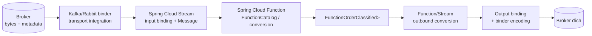
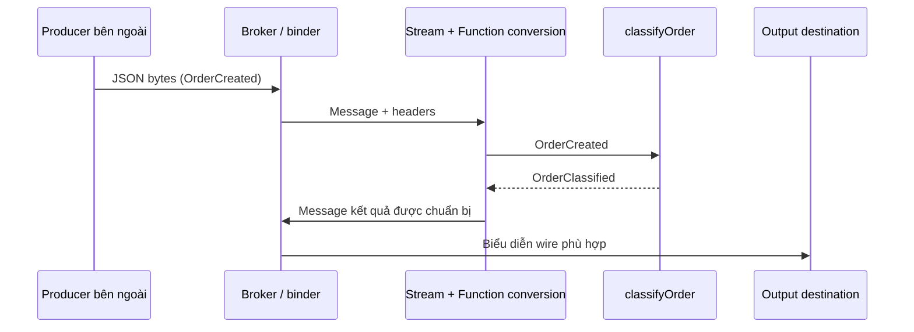
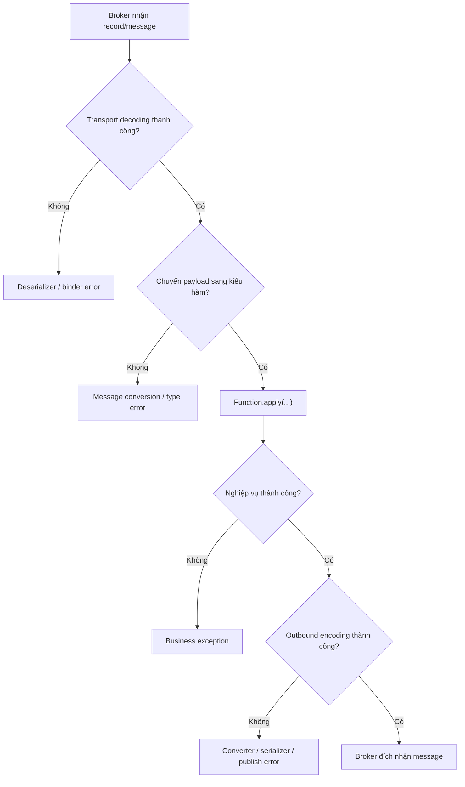

# Phân chia trách nhiệm chuyển đổi kiểu giữa Function và binder

## 1. Vấn đề: ai biến JSON thành đối tượng Java?

Một dịch vụ nhận sự kiện đơn hàng từ Kafka hoặc RabbitMQ. Message bên ngoài chứa payload JSON:

```json
{"orderId":"ORD-101","totalInCents":150000}
```

Logic nghiệp vụ được viết bằng Spring Cloud Function:

```java
@Bean
Function<OrderCreated, OrderClassified> classifyOrder() {
    return order -> new OrderClassified(
            order.orderId(),
            order.totalInCents() >= 100_000L
                    ? "PRIORITY" : "STANDARD");
}
```

Một câu hỏi rất quan trọng: message trên broker thường là bytes hoặc dữ liệu do client broker giải mã, nhưng `Function` nhận một `OrderCreated`. **Thành phần nào chịu trách nhiệm biến dữ liệu truyền tải thành kiểu Java?** Và khi hàm trả một `OrderClassified`, thành phần nào đưa kết quả trở lại dạng broker có thể vận chuyển?

Trong **Spring Cloud Function**, ta phát triển logic độc lập giao thức bằng `Supplier<T>`, `Function<I,O>`, `Consumer<T>`. `FunctionCatalog` quản lý tra cứu/chuẩn hóa các hàm và có thể cung cấp lớp thích ứng để chúng được gọi với message. **Spring Cloud Stream** tạo binding, nối các hàm với middleware qua **binder** Kafka, RabbitMQ hoặc công nghệ khác.

Để hiểu đúng, phải tách ba loại trách nhiệm:

1. **Transport encoding/decoding**: giao tiếp broker, bytes, serializer/deserializer, header, acknowledgement, offset và topology.
2. **Message-to-function type conversion**: dùng content type và chữ ký Java để đưa payload của message vào `Function<T,R>` dưới kiểu mà hàm mong đợi, rồi biểu diễn kết quả cho output.
3. **Business transformation**: nhận đối tượng miền đã phù hợp kiểu, thực thi nghiệp vụ và tạo đối tượng kết quả.

Hai lớp đầu có thể phối hợp và thay đổi theo cấu hình *native encoding/decoding*; không nên mô tả “Function luôn tự JSON deserialize” hoặc “binder luôn chuyển JSON thành POJO”.

**Mục tiêu bài học:** Sau bài này, bạn có thể xác định đúng chủ sở hữu của từng bước chuyển đổi, thiết lập `content-type`, phân biệt Spring Cloud Function wrapper với broker serializer, dùng `Message<T>` và headers có chủ đích, hiểu chế độ native của Kafka, kiểm thử wiring và chẩn đoán lỗi phát sinh trước hoặc sau khi hàm được gọi.

## 2. Sơ đồ trách nhiệm end-to-end



Đường đi trên là **mô hình khái niệm**, không phải cam kết rằng mọi binder và mọi cấu hình sẽ tạo chính xác cùng chuỗi converter nội bộ. Trong Spring Cloud Stream sử dụng mô hình functional, Spring Cloud Function tham gia đáng kể vào việc chuẩn hóa lời gọi và chuyển đổi payload dựa trên kiểu hàm. Binder thực hiện việc thích ứng với giao thức broker; trong chế độ **native** của binder, serializer/deserializer của client broker có thể đảm nhận chuyển đổi ở sát transport.

| Lớp | Biết thông tin gì? | Thường chịu trách nhiệm gì? | Không nên giao việc gì? |
| --- | --- | --- | --- |
| **Functional bean** | `OrderCreated`, `OrderClassified` và quy tắc nghiệp vụ | Kiểm tra nghiệp vụ, phân loại, tính toán | Mã hóa bytes Kafka, tạo queue RabbitMQ |
| **FunctionCatalog / function invocation wrapper** | Tên hàm, kiểu tham số/return, `Message<T>`, content type | Tra cứu, composition, thích ứng message và type conversion theo khả năng framework | Tự bảo đảm network, offset, broker transaction |
| **Spring Cloud Stream** | Binding, destination, group, producer/consumer properties | Tổ chức đường vào/ra và phối hợp invocation với binder | Quyết định logic phân loại đơn hàng |
| **Binder** | Broker, destination, headers và cấu hình transport | Kết nối broker, tiếp nhận/phát message, chính sách transport; hỗ trợ native codec theo binder | Tự hiểu business rule `PRIORITY` |
| **Serializer/deserializer của broker client** | `byte[]`, `String`, Avro/JSON bytes và config riêng | Native decoding/encoding nếu được kích hoạt và cấu hình | Tự bảo đảm DTO đúng schema nghiệp vụ |
| **Consumer cuối** | Contract event và side effect | Dùng kết quả đúng mục đích, idempotency | Giả định message chỉ được giao đúng một lần |

Một trường hợp dễ nhầm là serializer mặc định của Kafka. Kafka client cần biến giá trị gửi thành bytes; nhưng điều đó **không đồng nghĩa** mọi `Function<OrderCreated,...>` bắt buộc cấu hình Kafka `JsonDeserializer`. Ở đường chuyển đổi dựa trên Spring messaging, framework có thể chuyển JSON bytes thành DTO **trước khi hàm chạy**, còn tầng Kafka chỉ cần vận chuyển biểu diễn phù hợp.

## 3. Ba từ dễ nhầm: serialization, conversion, transformation

### 3.1. Serialization / deserialization

Serialization biến một giá trị thành biểu diễn có thể gửi hoặc lưu. Deserialization thực hiện chiều ngược lại. Ví dụ JSON:

```text
OrderCreated("ORD-101", 150000)
        |
        | serialize JSON
        v
{"orderId":"ORD-101","totalInCents":150000}
        |
        | encode UTF-8
        v
byte[]
```

Ở môi trường Kafka, serializer/deserializer của Kafka client có thể tham gia trực tiếp tại transport. Trong RabbitMQ, Spring AMQP và converter tương ứng có cách đóng gói metadata/payload khác. Đường chạy thực tế phụ thuộc bạn chọn conversion của framework hay native codec.

### 3.2. Type conversion ở ranh giới Function

Type conversion đưa dữ liệu **đã nhận** về kiểu mà chữ ký hàm yêu cầu. Ví dụ:

```text
Message<byte[]> + contentType application/json
             |
             | framework conversion khi được bật và có converter
             v
OrderCreated(orderId="ORD-101", totalInCents=150000)
             |
             | Function.apply(...)
             v
OrderClassified(orderId="ORD-101", priority="PRIORITY")
```

`FunctionCatalog` và cơ chế invocation của Spring Cloud Function có thể dùng thông tin kiểu của hàm và message converter để xử lý payload. Quá trình này không thay thế việc validating mọi điều kiện nghiệp vụ hoặc bảo đảm producer gửi đúng schema.

### 3.3. Transformation trong nghiệp vụ

Transformation là phép biến đổi mà **ứng dụng chủ ý định nghĩa**:

```java
String priority = order.totalInCents() >= 100_000L
        ? "PRIORITY" : "STANDARD";
```

JSON parser không quyết định ngưỡng `100_000L`, còn Kafka binder không nên biết các giá trị `PRIORITY` và `STANDARD`. Nhờ ranh giới này, hàm có thể tái sử dụng qua adapter HTTP, message-driven hoặc serverless của Spring Cloud Function, dù từng adapter có cách nhận/ghi wire format riêng.

## 4. Chữ ký hàm là hợp đồng kiểu quan trọng nhất

Ba kiểu functional bean cơ bản:

| Bean | Đầu vào Java | Đầu ra Java | Binding Stream thông thường |
| --- | --- | --- | --- |
| `Supplier<OrderCreated>` | Không có | `OrderCreated` | Chỉ `<name>-out-0` |
| `Function<OrderCreated,OrderClassified>` | `OrderCreated` | `OrderClassified` | `<name>-in-0` và `<name>-out-0` |
| `Consumer<OrderClassified>` | `OrderClassified` | `void` | Chỉ `<name>-in-0` |

Chữ ký cụ thể giúp framework biết phải tạo/đưa loại đối tượng gì. Chẳng hạn:

```java
Function<OrderCreated, OrderClassified> classifyOrder
```

cung cấp nhiều thông tin hơn:

```java
Function<Object, Object> classifyOrder
```

Với `Object`, framework không luôn có đủ thông tin để suy ra `OrderCreated`. Nếu payload là JSON, chương trình có thể nhìn thấy `Map`, `String`, `byte[]` hoặc kiểu đã được một converter tạo ra, tùy đường xử lý. Đừng dùng generic type quá rộng rồi mong conversion tự chọn DTO chính xác.

### 4.1. Message<T> không tạo thêm binding

Hai chữ ký:

```java
Function<OrderCreated, OrderClassified>

Function<Message<OrderCreated>, Message<OrderClassified>>
```

đều thường có **một input và một output**. Sự khác nhau là chữ ký thứ hai trao quyền truy cập headers và cho phép hàm tạo message đầu ra với metadata mới. Một message không tự trở thành hai binding chỉ vì nó có payload và headers.

### 4.2. Flux<T> không phải một JSON array

```java
Function<Flux<OrderCreated>, Flux<OrderClassified>>
```

là một reactive function xử lý dòng phần tử. Framework có thể gọi hàm để thiết lập pipeline rồi truyền nhiều message lần lượt qua dòng. Một `Flux<T>` không mặc định là một mảng JSON trong một broker message. Khi dùng reactive, lifecycle và xử lý lỗi khác imperative, nhưng **sự phân chia trách nhiệm conversion/transport/logic vẫn cần rõ ràng**.

## 5. Ví dụ hoàn chỉnh: POJO Function không phụ thuộc broker

### 5.1. Mã Java

```java
import java.util.function.Function;

import org.springframework.boot.SpringApplication;
import org.springframework.boot.autoconfigure.SpringBootApplication;
import org.springframework.context.annotation.Bean;

@SpringBootApplication
public class OrderConversionApplication {

    public static void main(String[] args) {
        SpringApplication.run(OrderConversionApplication.class, args);
    }

    public record OrderCreated(String orderId, long totalInCents) {}

    public record OrderClassified(String orderId, String priority) {}

    @Bean
    Function<OrderCreated, OrderClassified> classifyOrder() {
        return order -> {
            if (order.orderId() == null ||
                    order.orderId().isBlank()) {
                throw new IllegalArgumentException(
                        "orderId không hợp lệ");
            }
            if (order.totalInCents() < 0) {
                throw new IllegalArgumentException(
                        "totalInCents phải không âm");
            }

            String priority = order.totalInCents() >= 100_000L
                    ? "PRIORITY" : "STANDARD";

            return new OrderClassified(
                    order.orderId(), priority);
        };
    }
}
```

Lớp trên dùng Java 17+ cho `record`. Bean `classifyOrder` chỉ nhận đối tượng miền. Không có import Kafka, RabbitMQ hoặc Spring Messaging trong phương thức nghiệp vụ.

### 5.2. Cấu hình Stream

```yaml
spring:
  cloud:
    function:
      definition: classifyOrder
    stream:
      bindings:
        classifyOrder-in-0:
          destination: orders.created
          group: order-classifiers
          content-type: application/json
        classifyOrder-out-0:
          destination: orders.classified
          content-type: application/json
```

Mỗi phần có vai trò riêng:

- `definition: classifyOrder`: tìm/chọn bean qua mô hình Spring Cloud Function.
- `classifyOrder-in-0`: cổng logic nhận vào.
- `destination: orders.created`: nguồn message trên broker.
- `group: order-classifiers`: danh tính nhóm nhận, do binder hiện thực theo broker.
- `content-type: application/json`: mô tả định dạng payload dành cho cơ chế message conversion.
- `classifyOrder-out-0`: cổng logic phát ra.
- `destination: orders.classified`: nơi broker nhận event kết quả.

`content-type` không phải tên topic, không phải Java class và không phải thông tin đủ để khởi động Kafka hay RabbitMQ. Để chạy cần dependency binder, kết nối broker, quyền truy cập và converter phù hợp.

### 5.3. Quy trình một event đi qua ứng dụng



Đây là luồng logic với **framework conversion**, tức chưa bật `useNativeDecoding`/`useNativeEncoding`. Một converter JSON phù hợp có thể chuyển payload vào `OrderCreated`, sau đó kết quả được chuẩn bị cho output. Đích cuối cùng thấy một message mới với nội dung tương đương:

```json
{"orderId":"ORD-101","priority":"PRIORITY"}
```

Hãy phân biệt output được tạo bằng rule nghiệp vụ với bytes/headers được binder ghi ra broker. Kết quả cuối cùng còn phụ thuộc cấu hình conversion, serializer, schema và header của producer.

## 6. Vai trò của contentType: dữ kiện để chọn converter

### 6.1. Đặt content type ở binding

```yaml
spring:
  cloud:
    stream:
      bindings:
        classifyOrder-in-0:
          destination: orders.created
          content-type: application/json
        classifyOrder-out-0:
          destination: orders.classified
          content-type: application/json
```

Với đường conversion của framework, `application/json` hướng dẫn việc diễn giải payload. Kiểu Java `OrderCreated` cho biết kết quả conversion cần đạt là DTO nào. Hai dữ kiện bổ sung cho nhau:

```text
payload: byte[] hoặc String JSON
            +
contentType: application/json
            +
target type: OrderCreated
            |
            v
       OrderCreated
```

Một MIME type không thay thế cho schema. JSON `{"orderId":7}` và `{"orderId":"ORD-101","totalInCents":150000}` đều có thể được mô tả là `application/json`, nhưng chỉ một trong hai có contract phù hợp với DTO nghiệp vụ.

### 6.2. Header contentType và cấu hình binding

Spring Cloud Stream hỗ trợ thông tin content type trong message header và binding property. Ở đường xử lý thông thường, một **header `contentType` được cung cấp trên message** có thể được ưu tiên khi chọn converter, trước giá trị cấu hình binding. Vì vậy cần kiểm tra **cả header và YAML**, không chỉ nhìn một phía.

Ví dụ lỗi:

```text
Header: contentType = text/plain
Body:   {"orderId":"ORD-101","totalInCents":150000}
Target: OrderCreated
```

Nếu framework áp dụng conversion như text thay vì JSON, hàm có thể không nhận được DTO mong muốn. Thay `content-type` trong YAML chưa chắc sửa được nếu message header sai vẫn được ưu tiên trong đường chạy đó.

Đừng cố đoán chính xác mọi lớp converter theo một sơ đồ cố định; hành vi còn chịu ảnh hưởng bởi serializer native, binder version, metadata từ transport và cấu hình ứng dụng.

### 6.3. Content type thường dùng

| Content type | Cách hiểu thông thường | Lưu ý |
| --- | --- | --- |
| `application/json` | JSON object, array, scalar theo schema | Cần JSON converter và target type tương thích |
| `text/plain` | Nội dung văn bản | Thường phù hợp `String`; encoding quan trọng |
| `application/octet-stream` | Bytes chưa có contract nội dung cụ thể | Phù hợp cho payload binary; ứng dụng phải biết cách diễn giải |
| MIME type riêng (ví dụ của tổ chức) | Format theo hợp đồng chuyên biệt | Có thể cần converter/codec tùy chỉnh |

Không phải cứ gán một MIME type là framework biết cách xử lý mọi định dạng, chẳng hạn Avro/Protobuf tùy ý. Những format đó thường cần serializer/deserializer, converter, schema registry và version tương thích.

## 7. Message<T>: phân biệt payload và metadata

Khi ứng dụng cần correlation ID hoặc headers nghiệp vụ, có thể dùng `Message<T>`.

```java
import java.util.function.Function;

import org.springframework.context.annotation.Bean;
import org.springframework.context.annotation.Configuration;
import org.springframework.messaging.Message;
import org.springframework.messaging.support.MessageBuilder;

@Configuration
class OrderMetadataFunctions {

    @Bean
    Function<
            Message<OrderConversionApplication.OrderCreated>,
            Message<OrderConversionApplication.OrderClassified>
    > classifyWithMetadata() {

        return inbound -> {
            var order = inbound.getPayload();

            var result = new OrderConversionApplication.OrderClassified(
                    order.orderId(),
                    order.totalInCents() >= 100_000L
                            ? "PRIORITY"
                            : "STANDARD");

            var builder = MessageBuilder
                    .withPayload(result)
                    .setHeader("processedBy", "classification-service");

            Object correlationId =
                    inbound.getHeaders().get("correlationId");

            if (correlationId != null) {
                builder.setHeader("correlationId", correlationId);
            }

            return builder.build();
        };
    }
}
```

Đây là một **definition thay thế** cho `classifyOrder`. Khi muốn dùng nó, chọn `spring.cloud.function.definition: classifyWithMetadata` rồi cấu hình `classifyWithMetadata-in-0` và `classifyWithMetadata-out-0`.

### 7.1. Ai tạo Message<T>?

Ở đường message-driven, binder tiếp nhận dữ liệu/metadata của transport và Spring Cloud Stream cùng Spring Cloud Function đưa một `Message` phù hợp đến hàm. Khi chữ ký là `Message<OrderCreated>`, phần **payload** cần phù hợp với `OrderCreated`; phần **headers** giữ metadata để hàm có thể quyết định sử dụng.

Một header không phải Java field của `OrderCreated`. Nếu producer đặt `correlationId` vào headers, bean sẽ không tự nhìn thấy nó qua `order.correlationId()` trừ khi contract payload cũng định nghĩa field đó.

### 7.2. Không copyHeaders một cách mù quáng

Có thể viết:

```java
MessageBuilder.withPayload(result)
        .copyHeaders(inbound.getHeaders())
        .build();
```

nhưng đây **không phải mặc định tốt nhất cho mọi hệ thống**. Header input có thể bao gồm metadata của consumer, partition, delivery tag hoặc `contentType` cũ không còn phù hợp với payload mới. Một số header mang ý nghĩa nội bộ hoặc không được phép chuyển sang broker khác.

Nên chuyển tiếp có chọn lọc như `correlationId`, event ID và trace metadata đã được phê duyệt, đồng thời bảo đảm output content type tương ứng với `OrderClassified`. Binder có thể map hoặc lọc header theo hạ tầng; Kafka record headers và RabbitMQ message properties không hoàn toàn giống nhau.

### 7.3. Chữ ký Message không giải quyết mọi conversion

`Message<OrderCreated>` giúp hàm đọc metadata, nhưng **không buộc broker gửi sẵn một `OrderCreated`**. Nếu producer gửi JSON bytes sai schema, lỗi conversion vẫn có thể xảy ra trước khi `apply` được gọi. Hãy xác minh kiểu payload trong integration test, nhất là khi các dịch vụ sử dụng các framework khác nhau.

## 8. Native encoding/decoding: khi serializer của binder tham gia chính

Một nguyên tắc quan trọng: Spring Cloud Stream cho phép sử dụng cơ chế **native encoding/decoding** của một số binder.

- `useNativeDecoding` trên **consumer binding**: thay đổi cách giá trị được giải mã từ transport trước khi đưa đến hàm.
- `useNativeEncoding` trên **producer binding**: thay đổi cách giá trị được mã hóa để xuất ra broker.
- Các serializer/deserializer native thường được cấu hình ở phần riêng của binder, chứ **không phải** bằng Java generic type của Function.

Đây là lựa chọn **theo từng binding**, không tự ảnh hưởng toàn bộ ứng dụng. Native mode có thể bỏ qua một phần đường conversion do Spring Cloud Stream/Function quản lý; không nên mặc định một `content-type: application/json` sẽ sửa mọi lỗi codec trong native mode.

### 8.1. Khi không dùng native

```text
Kafka record bytes
     ↓
Binder + message abstraction
     ↓
Framework conversion theo contentType + target type
     ↓
Function<OrderCreated,OrderClassified>
     ↓
Outbound conversion theo binding/headers
     ↓
Binder ghi bytes ra Kafka
```

Trong đường này, phần ứng dụng tập trung vào DTO, còn framework và binder phối hợp xử lý wire format. Đây thường là lựa chọn khởi đầu dễ tái sử dụng khi ứng dụng chủ yếu trao đổi JSON và không cần codec broker chuyên biệt.

### 8.2. Khi dùng native

```text
Kafka record bytes
     ↓
Kafka native Deserializer
     ↓
Java value được client/binder cung cấp
     ↓
Function nhận kiểu phù hợp
     ↓
Java result
     ↓
Kafka native Serializer
     ↓
Kafka record bytes
```

Trong native mode, loại Java được deserializer trả về cần tương thích với chữ ký hàm; output cần tương thích với serializer. Nếu deserializer trả `String` nhưng hàm muốn `OrderCreated` mà không có cơ chế chuyển tiếp thích hợp, có thể xuất hiện lỗi kiểu. Native codec không tự thực thi validation nghiệp vụ.

**Quan trọng:** native Kafka codec và JSON converter Spring không phải hai cái tên cho cùng một thành phần. Hãy quyết định rõ đường nào đang chịu trách nhiệm. Không trộn hai cơ chế chỉ vì một ví dụ cấu hình có cả `content-type` và `value.deserializer`.

## 9. Ví dụ Kafka native: StringDeserializer và StringSerializer

Để minh họa tách trách nhiệm, dùng một hàm đơn giản nhận và trả `String`:

```java
import java.util.function.Function;

import org.springframework.context.annotation.Bean;
import org.springframework.context.annotation.Configuration;

@Configuration
class TextFunctions {

    @Bean
    Function<String, String> normalizeText() {
        return value -> value.strip().toUpperCase();
    }
}
```

Khi ứng dụng sử dụng Kafka binder và muốn native String codec, có thể cấu hình theo binding:

```yaml
spring:
  cloud:
    function:
      definition: normalizeText
    stream:
      bindings:
        normalizeText-in-0:
          destination: text.raw
          group: text-normalizers
          consumer:
            useNativeDecoding: true

        normalizeText-out-0:
          destination: text.normalized
          producer:
            useNativeEncoding: true

      kafka:
        binder:
          brokers: localhost:9092
        bindings:
          normalizeText-in-0:
            consumer:
              configuration:
                value.deserializer: org.apache.kafka.common.serialization.StringDeserializer
          normalizeText-out-0:
            producer:
              configuration:
                value.serializer: org.apache.kafka.common.serialization.StringSerializer
```

Đây là ví dụ **chỉ dành cho Kafka binder** và cần dependency, version Spring Cloud Stream/Spring Kafka tương thích. Một bản triển khai cụ thể có thể sử dụng các thuộc tính native codec do binder cung cấp theo phiên bản đang dùng; hãy đối chiếu với reference của phiên bản đó trước khi triển khai production.

Trong ví dụ:

- Kafka `StringDeserializer` tạo `String` từ bytes ở phía nhận.
- `normalizeText` chỉ thực hiện `strip().toUpperCase()`.
- Kafka `StringSerializer` chuyển `String` kết quả thành bytes ở phía gửi.
- `useNativeDecoding`/`useNativeEncoding` nói rõ ta muốn đường native ở từng phía.

Đừng giữ đồng thời một `JsonDeserializer<OrderCreated>` và `Function<String,String>` rồi kỳ vọng code vẫn đúng nếu không có conversion rõ ràng. Khi chuyển đổi kiểu native, phải kiểm tra cả serializer và deserializer, không chỉ một phía.

### 9.1. Native JSON thì sao?

Có thể dùng các Kafka JSON serializer/deserializer hoặc codec Avro/Protobuf của hệ sinh thái phù hợp, nhưng cấu hình cần xét:

- Kiểu Java đích thực sự do deserializer tạo ra.
- Headers/type information của JSON serializer, schema và version.
- Vấn đề an toàn khi cho phép deserialize những class không tin cậy.
- Tương thích giữa producer ngoài Spring và consumer Spring.
- Quy tắc schema evolution, payload size và lỗi parse.

Không nên dùng cấu hình trusted packages quá rộng hay mở quyền deserialize kiểu tùy ý chỉ để “cho ví dụ chạy”. Trong hệ thống liên ngôn ngữ, schema rõ ràng và kiểm soát kiểu thường đáng tin cậy hơn việc phụ thuộc metadata Java class đi kèm message.

## 10. Kafka binder và RabbitMQ binder không thực hiện cùng một chuỗi codec

Hai binder cùng có thể kết nối Spring Cloud Function với message broker, nhưng cơ chế transport khác nhau.

| Điểm so sánh | Kafka binder | RabbitMQ binder |
| --- | --- | --- |
| Đơn vị truyền | Record trong topic/partition | Message qua exchange/queue |
| Native codec phổ biến | Kafka `Serializer` / `Deserializer` cho key/value | Cơ chế Spring AMQP/Rabbit-specific message conversion và properties |
| Metadata transport | Kafka headers, key, partition, timestamp, offset ở phía consumer | AMQP properties, routing key, delivery tag, exchange/queue |
| Nhóm tiêu thụ | Consumer group và offset | Queue/binding theo group, acknowledgements |
| Lỗi chuyển đổi | Có thể xuất hiện ở deserializer hoặc framework converter | Có thể xuất hiện ở AMQP conversion hoặc framework converter |
| Xử lý lại dữ liệu | Offset/retention và error handling | Ack/requeue/dead-letter và error handling |

Nếu di chuyển cùng `Function<OrderCreated,OrderClassified>` từ Kafka sang RabbitMQ, **logic nghiệp vụ** vẫn có thể giữ nguyên, nhưng không có nghĩa config Kafka `value.serializer` sẽ có tác dụng trong Rabbit binder. Các property bản địa là đặc thù từng binder.

Ví dụ cấu hình chọn Rabbit binder trong một profile:

```yaml
spring:
  rabbitmq:
    host: localhost
    port: 5672
  cloud:
    stream:
      defaultBinder: rabbit
```

Khi làm việc với RabbitMQ, cần xem cơ chế content conversion, header mapping và codec của binder đúng phiên bản. Đừng sao chép native Kafka serialization properties sang Rabbit binder.

## 11. Conversion giữa các function trong composition

Spring Cloud Function hỗ trợ ghép hàm:

```java
@Bean
Function<String, String> sanitize() {
    return String::strip;
}

@Bean
Function<String, String> uppercase() {
    return String::toUpperCase;
}
```

```yaml
spring:
  cloud:
    function:
      definition: sanitize|uppercase
```

Pipeline logic có đầu vào `String` và đầu ra `String`. Khi dùng Spring Cloud Stream, binding thường được gắn tại **đầu và cuối composition**, không tạo topic trung gian giữa hai hàm.

Với typed functions:

```java
Function<OrderCreated, OrderCreated> validate
Function<OrderCreated, OrderClassified> classify
```

composition `validate|classify` có kiểu logic `Function<OrderCreated,OrderClassified>`. Đừng lấy khả năng JSON conversion ở ranh giới message để kết luận mọi cặp hàm bất kỳ đều có thể ghép. Nếu output của một hàm và input của hàm sau không tương thích, cần một bước chuyển đổi rõ ràng hoặc sử dụng contract đúng kiểu.

### 11.1. Message<T> trong composition

Khi một bước dùng `Message<T>`, cần kiểm tra tác động lên payload/headers giữa các bước. Một hàm có thể trả payload thuần; hàm khác cần correlation ID. Spring Cloud Function hỗ trợ cơ chế thích ứng khi invocation, nhưng không thay thế việc thiết kế một hợp đồng metadata rõ ràng.

**Ví dụ thực tế:** `validateOrder` nên trả một `OrderCreated` sạch; `classifyOrder` nhận `OrderCreated` và trả `OrderClassified`. Nếu bước sau thực sự cần header transport, cân nhắc đưa metadata nghiệp vụ đã xác thực vào DTO hoặc thiết kế `Message<T>` nhất quán tại nơi cần thiết. Không chuyển ngầm Kafka header vào business rule nếu mục tiêu còn dùng hàm qua HTTP/serverless.

### 11.2. Khi nào dùng một function convert tường minh?

Không phải mọi chuyển đổi đều là kỹ thuật serialization. Ví dụ `amountInCents` từ `String` sang `long` có thể là một yêu cầu semantic và validation:

```java
record RawOrder(String orderId, String amountInCents) {}

record OrderCreated(String orderId, long totalInCents) {}

@Bean
Function<RawOrder, OrderCreated> parseBusinessOrder() {
    return raw -> new OrderCreated(
            raw.orderId(),
            Long.parseLong(raw.amountInCents()));
}
```

Hàm này **không phải Kafka deserializer**; nó là bước chuyển đổi contract nghiệp vụ có thể unit test. Nếu parse thất bại, cần xử lý invalid data theo chính sách của ứng dụng, không nên hy vọng một `content-type` khác tự sửa dữ liệu sai.

## 12. Khi nào function nên nhận byte[] hoặc String?

Đôi khi ứng dụng **chủ đích** xử lý dữ liệu dạng thô:

```java
@Bean
Function<byte[], byte[]> echoBytes() {
    return bytes -> bytes;
}
```

hoặc:

```java
@Bean
Function<String, String> normalizeText() {
    return text -> text.trim();
}
```

Đây là lựa chọn hợp lý nếu contract thực sự là binary hoặc plain text. Tuy nhiên, nếu logic cuối cùng vẫn cần `OrderCreated`, việc nhận `byte[]` rồi tự viết:

```java
OrderCreated order = objectMapper.readValue(bytes, OrderCreated.class);
```

trong mọi bean sẽ lặp lại mã serialization, gắn nghiệp vụ với JSON và gây khó tái sử dụng khi đưa cùng hàm qua HTTP hoặc serverless.

Nên ưu tiên typed POJO với framework conversion khi:

- Transport gửi định dạng có converter phù hợp.
- Hàm chỉ quan tâm đối tượng nghiệp vụ.
- Mục tiêu là tái sử dụng logic qua các adapter.
- Không có yêu cầu codec native, binary streaming hoặc tối ưu hóa đặc thù.

Ngược lại, giữ bytes hoặc native type khi định dạng/thư viện vận chuyển chính là một phần yêu cầu kỹ thuật có chủ đích. Luôn bảo đảm interface công bố đúng contract của nó.

## 13. Lỗi xuất hiện ở tầng nào?

Lỗi có thể xảy ra **trước khi hàm chạy**, **trong hàm**, hoặc **sau khi hàm trả kết quả**.



| Thời điểm | Ví dụ | Vì sao quan trọng |
| --- | --- | --- |
| **Native deserialization** | Kafka deserializer ném lỗi khi parse bytes | Bean `Function` có thể chưa được gọi |
| **Framework conversion** | JSON field sai kiểu hoặc content type sai | Lỗi nằm ở ranh giới message → Java |
| **Business transformation** | `orderId` rỗng, amount âm | Đây là validation nghiệp vụ, không phải lỗi serializer |
| **Outbound conversion** | DTO không serialize được, header/content type sai | Hàm đã chạy nhưng output chưa gửi thành công |
| **Broker publish** | Network/ACL/topic không tồn tại | Kết quả Java đúng vẫn có thể không tới destination |
| **Downstream conversion** | Consumer khác không hiểu schema mới | Contract producer–consumer chưa tương thích |

### 13.1. Vì sao try/catch trong Function không bắt được mọi lỗi?

```java
@Bean
Function<OrderCreated, OrderClassified> classifyOrder() {
    return order -> {
        try {
            return classify(order);
        } catch (RuntimeException ex) {
            // Chỉ bao quanh lỗi sinh ra khi code ở đây chạy.
            throw ex;
        }
    };
}
```

Nếu Kafka native deserializer ném exception **trước** khi một `OrderCreated` được tạo, `classifyOrder.apply(...)` không được gọi. Tương tự, nếu publisher không serialize được `OrderClassified` **sau** khi hàm đã trả, `try/catch` bên trong hàm không bao phủ lỗi đó.

Chiến lược retry, DLQ, deserialization error handler, ack/offset và observability cần được cấu hình tại tầng tương ứng, tùy binder và phiên bản Spring Cloud Stream.

### 13.2. Không nhầm retry với việc sửa dữ liệu sai

Một JSON có `totalInCents: "not-a-number"` thường sẽ lỗi lặp lại qua nhiều lần thử nếu không có consumer version hỗ trợ giá trị đó. Retry không giới hạn có thể làm tắc partition/queue. Nên phân loại:

- **Transient**: network, broker tạm unavailable, database chập chờn.
- **Poison message/permanent**: schema không tương thích, content type sai, class không hợp lệ, dữ liệu nghiệp vụ bị từ chối.
- **Unknown**: cần telemetry và ngưỡng retry thận trọng trước khi quyết định DLQ/quarantine.

DLQ phải có quy trình giám sát và tái xử lý an toàn. Đừng coi “đưa vào DLQ” là hoàn thành toàn bộ nghiệp vụ.

## 14. Headers: metadata do binder mang và dữ liệu do ứng dụng quyết định

Cùng một event có thể có:

```text
Payload: {"orderId":"ORD-101","totalInCents":150000}

Application header:
  correlationId = "REQ-789"

Content metadata:
  contentType = "application/json"

Transport-specific metadata:
  Kafka: key / partition / offset ...
  RabbitMQ: routing key / delivery tag ...
```

**Phân chia trách nhiệm:**

- Producer nghiệp vụ quyết định những metadata nào cần công bố thành **hợp đồng sự kiện** (ví dụ `eventId`, `correlationId`).
- Binder/chuyển đổi transport ánh xạ một số metadata giữa broker và Spring `MessageHeaders`.
- Function có thể dùng headers qua `Message<T>`, nhưng không nên phụ thuộc vào header nội bộ của broker nếu muốn tái sử dụng qua các adapter.
- Downstream consumer xác minh loại dữ liệu và ý nghĩa của header; không nên tin tuyệt đối header do bên ngoài tự điền.

### 14.1. Khi thay đổi payload, hãy kiểm tra content type đầu ra

Nếu đầu vào là plain text nhưng output là một DTO JSON, việc copy nguyên header `contentType: text/plain` có thể khiến output conversion sai. Cách dễ kiểm soát là tạo message đầu ra với payload mới và chỉ giữ các header nghiệp vụ cần thiết, sau đó thiết lập content type phù hợp ở output binding hoặc header theo thiết kế.

### 14.2. Correlation ID không phải bảo đảm thứ tự

`correlationId` giúp truy vết, không tự bảo đảm ordering, exactly-once hoặc atomic publish. Với Kafka, key/partition ảnh hưởng thứ tự trong một partition; với RabbitMQ, routing/queue/concurrency ảnh hưởng cách xử lý. Đừng dùng một header nghiệp vụ như một cơ chế thay thế cho semantics của broker.

## 15. Kiểm thử riêng từng tầng conversion

Một bài test tốt không chỉ xác nhận output JSON đúng; nó giúp xác định lỗi thuộc tầng nào.

### 15.1. Unit test business function

```java
import static org.junit.jupiter.api.Assertions.assertEquals;
import org.junit.jupiter.api.Test;

class OrderConversionApplicationTest {

    @Test
    void classifiesOrderWithoutTransport() {
        var function = new OrderConversionApplication().classifyOrder();

        var output = function.apply(
                new OrderConversionApplication.OrderCreated(
                        "ORD-101", 150_000L));

        assertEquals("ORD-101", output.orderId());
        assertEquals("PRIORITY", output.priority());
    }
}
```

Test này chứng minh rule nghiệp vụ, không kiểm tra JSON decoder, binder hoặc broker.

### 15.2. Test Message<T> và headers ở mức Java

```java
import static org.junit.jupiter.api.Assertions.assertEquals;
import org.junit.jupiter.api.Test;
import org.springframework.messaging.support.MessageBuilder;

class OrderMetadataFunctionsTest {

    @Test
    void retainsSelectedCorrelationHeader() {
        var function = new OrderMetadataFunctions()
                .classifyWithMetadata();

        var incoming = MessageBuilder.withPayload(
                new OrderConversionApplication.OrderCreated(
                        "ORD-101", 150_000L))
                .setHeader("correlationId", "REQ-789")
                .build();

        var output = function.apply(incoming);

        assertEquals("PRIORITY",
                output.getPayload().priority());
        assertEquals("REQ-789",
                output.getHeaders().get("correlationId"));
        assertEquals("classification-service",
                output.getHeaders().get("processedBy"));
    }
}
```

Test này không bảo đảm Kafka/RabbitMQ binder thực tế sẽ chuyển toàn bộ headers theo kiểu như vậy. Cần integration test cho message qua broker.

### 15.3. Spring Cloud Stream test binder

Test binder giúp xác minh wiring qua `definition`, input/output binding và message conversion trong một môi trường kiểm thử của framework. Với `classifyOrder`:

1. Gửi message có payload JSON bytes vào input binding `classifyOrder-in-0`.
2. Gắn content type `application/json` theo contract kiểm thử.
3. Nhận message từ output binding `classifyOrder-out-0`.
4. Kiểm tra payload kết quả khi được diễn giải là JSON có `priority: PRIORITY`.
5. Thử một JSON lỗi schema và quan sát xử lý lỗi phù hợp tầng framework.

Việc chỉ gọi `function.apply(new OrderCreated(...))` sẽ không kiểm thử được các bước này.

### 15.4. Integration test với Kafka/RabbitMQ thật

Cần broker tương ứng nếu muốn xác minh:

- Kafka `value.serializer`/`value.deserializer` trong native mode.
- RabbitMQ exchange/queue và message properties.
- Mapping `contentType` và `correlationId` qua transport.
- Sự tương thích với producer/consumer không dùng Spring.
- Offset, acknowledgment, retry, redelivery và DLQ.
- Hành vi khi outbound conversion thành công nhưng publish network thất bại.

**Quan trọng:** cùng một POJO Function có thể chạy trong cả hai binder, nhưng passing test trên RabbitMQ không chứng minh Kafka native deserializer đã đúng, và ngược lại.

## 16. Bảng quyết định: đặt conversion ở đâu?

| Nhu cầu | Nơi nên xử lý chính | Lý do |
| --- | --- | --- |
| JSON bytes → `OrderCreated` khi dùng đường conversion framework | Spring Cloud Function/Stream message conversion theo type + content type | Giữ bean nghiệp vụ thuần Java |
| `OrderCreated` → `OrderClassified` | Java functional bean | Đây là business transformation |
| Kafka record bytes → `String` trong native mode | Kafka `StringDeserializer` | Đây là native transport decoding |
| `String` → Kafka record bytes trong native mode | Kafka `StringSerializer` | Đây là native transport encoding |
| Chuyển metadata `correlationId` có chọn lọc | Logic dùng `Message<T>` | Ứng dụng quyết định metadata nghiệp vụ |
| Mapping Kafka/Rabbit headers | Binder và adapter | Phụ thuộc semantics broker |
| Avro/Protobuf và schema registry | Codec/converter tích hợp schema tương ứng | Không thể chỉ thay `application/json` |
| Chuẩn hóa chuỗi tiền sang `long` hợp lệ | Hàm chuyển đổi/validation nghiệp vụ | Đây là contract semantic |
| Retry/DLQ khi deserialize thất bại | Error handling ở tầng consumer/binder phù hợp | Hàm có thể chưa được gọi |
| Idempotency khi consumer xử lý trùng | Ứng dụng/DB và thiết kế event ID | Codec không giải quyết duplicate side effect |

**Nguyên tắc thiết kế:** mỗi lớp nên làm việc nó hiểu nhất. Không đặt business rule vào Kafka deserializer; không đặt quản lý offset vào hàm phân loại; không đặt parse JSON thủ công trong mọi function nếu framework có cơ chế conversion phù hợp và rõ hợp đồng.

## 17. Kịch bản kết hợp nhiều nguồn và nhiều kiểu payload

Một hệ thống có thể có ba pipeline độc lập:

- `normalizeText` đọc `text.raw` dạng plain text.
- `classifyOrder` đọc `orders.created` dạng JSON DTO.
- `auditEvent` ghi nhận một `Message<OrderClassified>` có correlation header.

Nếu cấu hình:

```yaml
spring:
  cloud:
    function:
      definition: normalizeText;classifyOrder;auditEvent
    stream:
      bindings:
        normalizeText-in-0:
          destination: text.raw
          group: text-workers
          content-type: text/plain
        normalizeText-out-0:
          destination: text.normalized
          content-type: text/plain

        classifyOrder-in-0:
          destination: orders.created
          group: classify-workers
          content-type: application/json
        classifyOrder-out-0:
          destination: orders.classified
          content-type: application/json

        auditEvent-in-0:
          destination: orders.classified
          group: audit-workers
          content-type: application/json
```

dấu `;` chọn các definition **độc lập**, không tự ghép output của `normalizeText` vào `classifyOrder`. Destination và consumer group quyết định sự phân phối.

Nếu muốn `sanitize|uppercase` trở thành một composition, kiểu Java giữa các hàm cần tương thích. Conversion ở biên broker–Function là một vấn đề khác với việc hai hàm Java có contract đúng để ghép nối hay không.

### 17.1. Một message có thể được xử lý bởi hai nhóm độc lập

Có thể có `audit-workers` và `notify-workers` cùng đọc `orders.classified`. Nếu Kafka, hai consumer group có offset riêng; nếu RabbitMQ, thường có queue riêng theo group. Đây là behavior binder/broker, **không được quyết định bởi JSON converter hoặc `FunctionCatalog`**.

### 17.2. Đổi binder nhưng giữ contract hàm

Ứng dụng có thể đổi `spring.cloud.stream.defaultBinder` giữa Kafka và RabbitMQ theo profile. `Function<OrderCreated,OrderClassified>` vẫn là hàm có cùng kiểu dữ liệu. Tuy nhiên, tên destination và topology, native codec, header mapping, offset/ack và retry cần xem lại. “Hàm không đổi” không đồng nghĩa “mọi cấu hình serialization và delivery bảo đảm tương đương”.

## 18. Bảng chẩn đoán lỗi thường gặp

| Hiện tượng | Lớp nên kiểm tra trước | Câu hỏi cụ thể |
| --- | --- | --- |
| Function không được gọi, log báo không deserialize được bytes | Native decoder hoặc framework converter | `useNativeDecoding` có bật? Deserializer hay content type có đúng không? |
| Hàm nhận `LinkedHashMap` thay vì DTO | Type conversion/target type | Chữ ký có dùng `Object` hoặc raw type không? |
| `ClassCastException` trước hoặc tại invocation | Type mismatch | Native deserializer trả kiểu gì? Chữ ký cần kiểu gì? |
| Chuỗi JSON được nhận như văn bản | Content type / conversion | Header `contentType` có đang ghi `text/plain` không? |
| Unit test Java đúng, broker trả dữ liệu sai | Serializer/converter hoặc destination | Output content type và native encoding đang cấu hình gì? |
| Kafka phát message nhưng Rabbit consumer không hiểu headers | Transport header mapping | Có phụ thuộc header đặc thù Kafka hay copy header mù quáng không? |
| Output là DTO nhưng broker nhận bytes không thể parse | Outbound encoding | Có đặt `value.serializer` hoặc converter đúng contract không? |
| `orderId` rỗng sau khi parse JSON thành công | Business validation | Đã có kiểm tra dữ liệu đầu vào ở hàm chưa? |
| Retry nhiều lần nhưng luôn lỗi parse | Poison message/schema mismatch | Có cần DLQ/quarantine, sửa producer contract không? |
| Copy headers từ String sang DTO rồi nhận sai format | Content type header cũ | Đã đặt lại output content type phù hợp chưa? |
| Đổi sang native encoding rồi gặp lỗi serializer | Native producer codec | Serializer có nhận đúng Java type của output không? |
| Chuyển broker, hàm vẫn biên dịch nhưng không chạy | Binder transport/connection | Dependency, destination, group và quyền đã đúng chưa? |
| Test binder chạy nhưng production Kafka không nhận | Native Kafka config/chính sách broker | Đã test `StringDeserializer`/`StringSerializer` với Kafka thật chưa? |
| Consumer xử lý message trùng | Redelivery/offset/ack | Có event ID và idempotency không? |

Cách debug nhất quán:

1. Xác nhận **functional definition và chữ ký Java**.
2. Xác nhận **input binding, destination và binder**.
3. Kiểm tra dữ liệu thực nhận từ transport: bytes, String hay đối tượng Java?
4. Xác định **native mode có bật không**.
5. Kiểm tra **contentType ở message và binding** nếu dùng framework conversion.
6. Kiểm tra converter/codec có hỗ trợ format và target type không.
7. Xác nhận hàm có được gọi; phân biệt lỗi trước/đang/sau invocation.
8. Kiểm tra output serializer, headers, error handling và broker publish.

## 19. Bài tập thực hành

### Bài tập 1: Phân chia trách nhiệm

Cho sự kiện JSON `{"orderId":"ORD-101","totalInCents":150000}` và `Function<OrderCreated,OrderClassified>`. Hãy giải thích lớp nào quyết định topic/queue, lớp nào quyết định convert JSON thành DTO và lớp nào tính `PRIORITY`. Trường hợp nào khiến hàm không được gọi dù message đã tới broker?

**Gợi ý:** binder phụ trách kết nối transport; FunctionCatalog/invocation và conversion theo message type là biên kiểu Java; business function chịu trách nhiệm rule; lỗi native decoding hoặc conversion có thể xảy ra trước invocation.

### Bài tập 2: Chuyển đổi String bằng native Kafka

Viết `Function<String,String> normalizeText` đổi text sang chữ hoa. Cấu hình Kafka `StringDeserializer` và `StringSerializer` kèm `useNativeDecoding/useNativeEncoding` đúng chiều. Giải thích vì sao trong tình huống này không nên thêm `JsonDeserializer<OrderCreated>`.

### Bài tập 3: Giữ correlation ID

Hãy viết `Function<Message<OrderCreated>,Message<OrderClassified>>` giữ `correlationId` và thêm `processedBy`. Tại sao phải cân nhắc trước khi gọi `copyHeaders`? Đặt output `content-type` là gì khi trả DTO?

### Bài tập 4: Bắt lỗi ở đúng lớp

Phân loại các lỗi sau:

- Kafka `StringDeserializer` không đọc được dữ liệu được producer gửi dưới format khác.
- JSON parse được nhưng `totalInCents < 0`.
- Function trả DTO hợp lệ nhưng serializer producer không hỗ trợ kiểu đó.
- Kafka topic không có quyền ghi.
- Consumer nhận sự kiện bị giao lại và ghi database trùng.

Với mỗi trường hợp, đề xuất nơi cấu hình logging, retry/DLQ hoặc idempotency.

### Bài tập 5: Thiết kế contract liên ngôn ngữ

Một dịch vụ Java phát event cho một dịch vụ Python. Hãy đề xuất contract payload, content type, field bắt buộc, event version và cách xử lý schema evolution. Vì sao không nên buộc Python phụ thuộc header chứa tên Java class của Kafka JsonSerializer?

### Bài tập 6: So sánh hai đường conversion

Hãy vẽ hai sơ đồ:

1. JSON bytes → binder → framework conversion → `OrderCreated` → `Function` → outbound conversion → broker.
2. JSON bytes → native deserializer → `OrderCreated` → `Function` → native serializer → bytes.

Chỉ rõ điểm nào cần test với binder thật và điểm nào có thể unit test không cần broker.

### Câu hỏi tự đánh giá

1. `content-type: application/json` có phải là Java class name hay là MIME type?
2. `FunctionCatalog` có chịu trách nhiệm xác nhận Kafka offset không?
3. Nếu Kafka native deserializer ném lỗi, code trong `Function<OrderCreated,...>` có luôn bắt được exception đó không?
4. Tại sao `Message<T>` hữu ích cho correlation ID nhưng không tạo thêm input binding?
5. Vì sao có thể test function thuần mà không cần Kafka/RabbitMQ?
6. Khi đổi `useNativeEncoding`, loại serializer nào cần kiểm tra?
7. Sự khác nhau giữa serialize một DTO thành JSON và phân loại đơn hàng là gì?
8. Vì sao không nên copy `contentType` cũ khi đổi payload từ plain text sang JSON object?
9. Native Kafka serializer có thể dùng nguyên cho RabbitMQ binder không?
10. Vì sao chính sách exactly-once/idempotency không thể được giải quyết chỉ bằng JSON converter?

## 20. Tổng kết

Phân chia trách nhiệm chuyển đổi kiểu giúp Spring Cloud Function giữ được mục tiêu quan trọng: **logic nghiệp vụ tái sử dụng, độc lập giao thức**.

- **Functional bean** quyết định biến đổi nghiệp vụ và hợp đồng kiểu `T → R`.
- **FunctionCatalog và cơ chế invocation/conversion của Spring Cloud Function** hỗ trợ tìm hàm và thích ứng message với chữ ký Java, phối hợp với Spring Cloud Stream ở đường vào/ra.
- **Spring Cloud Stream** tạo input/output binding, quản lý ánh xạ destination và phối hợp message processing.
- **Binder** tích hợp Kafka/RabbitMQ và thực hiện trách nhiệm transport; khi chọn native mode, serializer/deserializer hoặc codec bản địa có vai trò trực tiếp hơn.
- **`contentType`, Java generic type, serializer, schema và headers** cùng xác định khả năng tương thích dữ liệu; thiếu một yếu tố có thể làm message không tới đúng kiểu hàm.
- **Retry, DLQ, offset/ack, idempotency** là các mối quan tâm về độ tin cậy, không phải chức năng của một JSON parser.

Một thiết kế dễ duy trì thường có contract message rõ ràng, hàm nghiệp vụ typed POJO, conversion được đặt tại đúng ranh giới, metadata được truyền có chọn lọc và integration test trên binder thực tế. Nhờ vậy cùng hàm có thể vận hành qua HTTP, sự kiện hoặc môi trường serverless phù hợp mà không sao chép logic nghiệp vụ vào codec của từng giao thức.

### Tài liệu tham khảo

- [Spring Cloud Function — Programming model](https://docs.spring.io/spring-cloud-function/reference/spring-cloud-function/programming-model.html)
- [Spring Cloud Function — Reference documentation](https://docs.spring.io/spring-cloud-function/reference/)
- [Spring Cloud Stream — Reference documentation](https://docs.spring.io/spring-cloud-stream/reference/)
- [Spring Cloud Stream — Content type negotiation and conversion](https://docs.spring.io/spring-cloud-stream/reference/spring-cloud-stream/mechanics.html)
- [Spring Cloud Stream — Producing and consuming messages](https://docs.spring.io/spring-cloud-stream/reference/spring-cloud-stream/producing-and-consuming-messages.html)
- [Apache Kafka — Serialization and deserialization](https://kafka.apache.org/documentation/)
- [Spring for Apache Kafka — Serialization, Deserialization, and Message Conversion](https://docs.spring.io/spring-kafka/reference/kafka/serdes.html)
- [RabbitMQ — Documentation](https://www.rabbitmq.com/docs)
