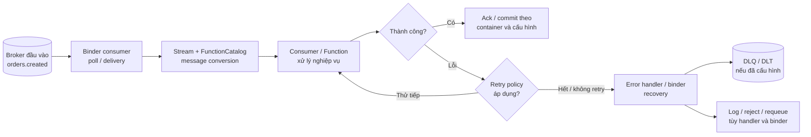
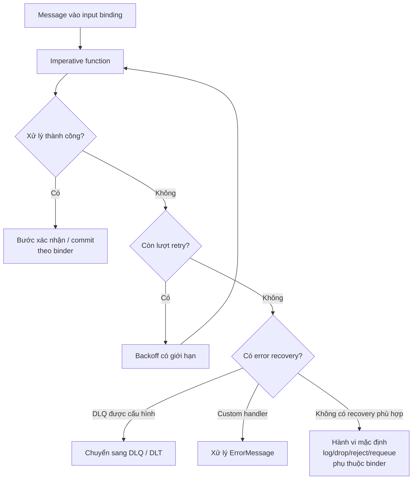
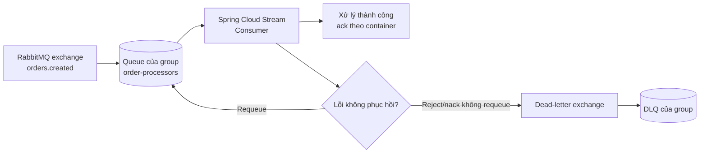
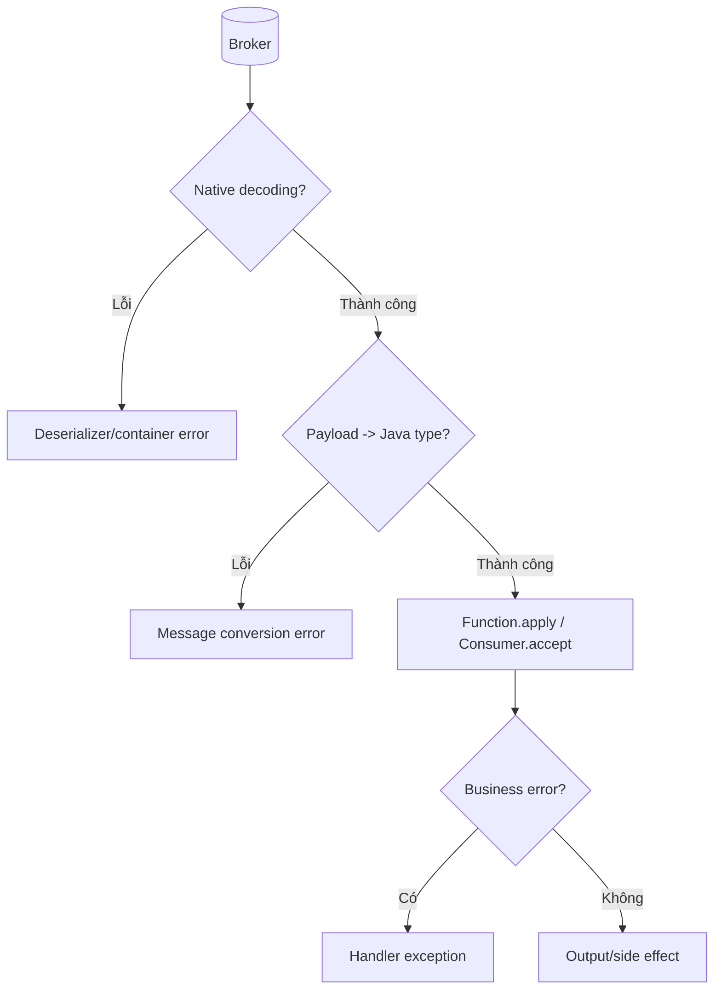
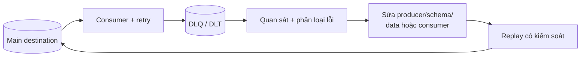

# Ranh giới hỗ trợ retry, xác nhận thông điệp và hàng đợi lỗi

## 1. Vì sao một Function chạy đúng vẫn có thể xử lý trùng hoặc mất sự kiện?

Giả sử một dịch vụ nhận sự kiện `OrderCreated` từ `orders.created`, kiểm tra đơn hàng rồi ghi kết quả vào cơ sở dữ liệu. Khi kết nối database chập chờn, message có thể thất bại ngay trong lúc xử lý. Nếu ứng dụng restart sau khi ghi database nhưng trước khi broker ghi nhận đã xử lý, cùng sự kiện có thể được giao lần nữa. Nếu ứng dụng bỏ qua lỗi và báo thành công quá sớm, sự kiện lại có nguy cơ **không được xử lý**.

Trong **Spring Cloud Function**, logic nghiệp vụ có thể là một `Consumer<OrderCreated>` hoặc `Function<OrderCreated, OrderClassified>` thuần Java. Một hàm không trực tiếp quản lý Kafka offset hay RabbitMQ delivery tag. **Spring Cloud Stream** và binder kết nối hàm với broker, đồng thời cung cấp một số cơ chế xử lý lỗi theo programming model và khả năng của binder.

Ba khái niệm phải tách biệt:

- **Retry (thử lại):** gọi lại một thao tác thất bại theo chính sách số lần thử, loại lỗi và backoff.
- **Acknowledgement/offset commit (xác nhận tiến độ tiêu thụ):** cho broker hoặc consumer group biết bản ghi nào được xem là đã xử lý theo chế độ được cấu hình.
- **DLQ/DLT (nơi cách ly message lỗi):** chuyển bản ghi không thể xử lý theo cách thông thường sang một destination khác để điều tra, sửa chữa hoặc tái xử lý.

Chúng tương tác với nhau nhưng **không đồng nghĩa**. Có retry nhưng chưa có DLQ; có DLQ nhưng việc gửi tới DLQ cũng có thể thất bại; có acknowledgement nhưng side effect nghiệp vụ chưa chắc được ghi an toàn. Bài này tập trung vào **ranh giới framework – function – binder – broker**, không chỉ học thuộc tên thuộc tính YAML.

Sau bài học, bạn sẽ có thể:

1. Xác định lỗi nào xảy ra trước, trong hoặc sau khi gọi hàm.
2. Cấu hình retry và backoff cho input binding imperative.
3. Phân biệt Kafka offset với RabbitMQ ack/nack và producer acknowledgement.
4. Thiết lập DLQ/DLT cho Kafka và RabbitMQ ở đúng namespace cấu hình.
5. Giải thích vì sao retry/DLQ của imperative function không tự áp dụng giống hệt cho reactive function.
6. Thiết kế idempotency, kiểm thử lỗi có chủ đích và vận hành quy trình replay an toàn.

## 2. Bản đồ trách nhiệm từ broker đến nghiệp vụ



Sơ đồ là **mô hình khái niệm**, không khẳng định các bước diễn ra tuần tự tuyệt đối trong mọi phiên bản và mọi binder. Việc commit offset, xử lý lỗi không thể deserialize, gửi tới DLT và retry của container có các nhánh riêng. Đặc biệt, một bản ghi được gửi tới DLQ thành công không có nghĩa side effect nghiệp vụ ban đầu đã được hoàn tất.

| Thành phần | Hiểu gì? | Trách nhiệm thường gặp | Không tự bảo đảm |
| --- | --- | --- | --- |
| `Supplier`, `Function`, `Consumer` | DTO và quy tắc nghiệp vụ | Xử lý dữ liệu, trả kết quả hoặc thực hiện side effect | Transaction với broker, offset commit, queue provisioning |
| `FunctionCatalog` | Tên, loại và composition của hàm | Tra cứu, chuẩn hóa invocation và conversion | Quyết định DLQ của Kafka/RabbitMQ |
| Spring Cloud Stream | Input/output binding, consumer properties, function definition | Kết nối invocation với binder, cung cấp cơ chế retry/error handling cho handler phù hợp | Exactly-once toàn workflow |
| Kafka binder | Topic, partition, consumer group, Kafka client | Tiêu thụ/phát record; phối hợp retry, DLT và offset theo cấu hình | Transaction database bên ngoài |
| RabbitMQ binder | Exchange, queue, delivery, ack/nack, DLX | Điều phối consumer, requeue/dead-letter và republish theo cấu hình | Replay kiểu Kafka offset |
| Database/API downstream | Trạng thái nghiệp vụ | Ghi bền, kiểm tra trùng, tính nhất quán | Broker tự động biết side effect đã commit |

**Nguyên tắc:** giữ hàm nghiệp vụ độc lập giao thức; cấu hình retry/DLQ/ack ở binding và binder khi có thể; nhưng idempotency và ranh giới transaction vẫn cần được thiết kế trong ứng dụng.

## 3. Phân loại lỗi trước khi chọn retry

Không phải lỗi nào cũng nên thử lại.

| Loại lỗi | Ví dụ | Retry thường có ích? | Hướng xử lý |
| --- | --- | --- | --- |
| **Transient** | Database timeout, API tạm quá tải, mất kết nối ngắn | Có, với giới hạn và backoff | Retry có kiểm soát, quan sát số lần thử |
| **Permanent / poison message** | JSON hỏng, schema sai, giá trị bị cấm, event không thể hợp lệ | Thường không | Cách ly, DLQ/quarantine, sửa contract |
| **Business rejection có chủ đích** | Đơn hàng thiếu `orderId`, amount âm | Không nên lặp vô hạn | Từ chối rõ lý do; tùy contract có thể ghi business rejection event |
| **Lỗi downstream sau side effect** | Đã ghi DB nhưng response bị timeout | Có nguy cơ trùng khi retry | Idempotency và xác minh trạng thái trước khi ghi lại |
| **Lỗi output publish** | Function đã tạo kết quả nhưng broker đích không nhận | Chính sách riêng phía producer | Producer retry/outbox, xác nhận gửi |
| **Lỗi deserialization trước function** | Kafka deserializer không tạo được DTO | Không giống exception trong `apply` | Deserializer error handler / binder-specific recovery |

Một thông điệp sai schema không trở nên hợp lệ sau 100 lần retry. Ngược lại, một database có thể phục hồi sau vài giây. Vì vậy, chính sách retry cần xét **loại exception**, số lần thử, khoảng nghỉ và cách xử lý cuối cùng.

### Vòng lặp lỗi cần tránh

```text
message không hợp lệ
   -> consumer xử lý lỗi
   -> broker requeue ngay lập tức
   -> consumer nhận lại
   -> lỗi y hệt
   -> requeue ngay lập tức
   -> ... không giới hạn
```

Vòng lặp này có thể chiếm CPU, tạo log vô hạn và chặn thông điệp hợp lệ. Một DLQ có giám sát hoặc một trạng thái quarantine rõ ràng thường hữu ích hơn việc requeue không giới hạn.

## 4. Retry trong Spring Cloud Stream: phạm vi áp dụng

Trong mô hình functional của Spring Cloud Stream, một **imperative message handler** được framework gọi khi có từng message. Ví dụ:

```java
@Bean
Consumer<OrderCreated> processOrder() {
    return event -> orderService.process(event);
}
```

Khi handler ném exception, framework/binder có cơ chế áp dụng retry theo chính sách consumer được hỗ trợ. Với cấu hình phổ biến, `maxAttempts` mặc định là **3 lần thử tổng cộng**, **bao gồm lần xử lý đầu tiên**. Đặt `maxAttempts: 1` có nghĩa không dùng vòng retry này.

> Đây là retry ở ranh giới **một input binding xử lý message imperative**. Nó không phải Kafka producer retry, không phải transaction retry của database và không nên giả định sẽ hoạt động như vậy bên trong `Function<Flux<T>,Flux<R>>`.

### 4.1. Các thuộc tính consumer chung

| Thuộc tính | Ý nghĩa | Giá trị mặc định thường được tài liệu nêu |
| --- | --- | --- |
| `maxAttempts` | Tổng số lần xử lý message, tính cả lần đầu | `3` |
| `backOffInitialInterval` | Khoảng nghỉ trước retry đầu tiên | `1000 ms` |
| `backOffMultiplier` | Hệ số tăng khoảng nghỉ giữa các lần thử | `2.0` |
| `backOffMaxInterval` | Trần khoảng nghỉ retry | `10000 ms` |
| `defaultRetryable` | Có retry exception chưa được liệt kê cụ thể hay không | `true` |
| `retryableExceptions` | Map loại exception và quyết định retry/không retry | Tùy cấu hình |

Đường dẫn chuẩn:

```text
spring.cloud.stream.bindings.<input-binding-name>.consumer.maxAttempts
spring.cloud.stream.bindings.<input-binding-name>.consumer.backOffInitialInterval
spring.cloud.stream.bindings.<input-binding-name>.consumer.backOffMultiplier
spring.cloud.stream.bindings.<input-binding-name>.consumer.backOffMaxInterval
```

Ví dụ:

```yaml
spring:
  cloud:
    stream:
      bindings:
        processOrder-in-0:
          consumer:
            maxAttempts: 3
            backOffInitialInterval: 1000
            backOffMultiplier: 2.0
            backOffMaxInterval: 10000
```

Với ba lần xử lý thất bại liên tiếp, mô hình backoff điển hình là lần đầu, nghỉ khoảng 1 giây, thử lần hai, nghỉ khoảng 2 giây, thử lần ba. Lịch thực tế phụ thuộc scheduler, phiên bản và cơ chế binder. `maxAttempts` không bảo đảm thời gian xử lý đúng một con số tuyệt đối.

### 4.2. Phân loại exception retryable

Nếu muốn retry lỗi tạm thời nhưng không retry lỗi dữ liệu nghiệp vụ, có thể dùng cấu hình kiểu:

```yaml
spring:
  cloud:
    stream:
      bindings:
        processOrder-in-0:
          consumer:
            maxAttempts: 3
            defaultRetryable: true
            retryableExceptions:
              java.lang.IllegalArgumentException: false
              java.lang.IllegalStateException: true
```

Đây là **minh họa map loại exception**, không phải quy ước mọi `IllegalStateException` đều là lỗi tạm thời. Trong ứng dụng thực, nên có exception nghiệp vụ riêng (ví dụ `TransientDownstreamException` và `InvalidOrderException`), để chính sách không phụ thuộc vào loại exception quá chung. Khi một exception được bọc trong exception khác, cần kiểm tra cách framework phân loại nguyên nhân.

**Lưu ý:** thuộc tính này chỉ có tác dụng tại cơ chế retry phù hợp với binder và programming model. Một exception xảy ra trước khi có message handler, chẳng hạn native deserialization, có thể đi theo tuyến xử lý lỗi khác.

## 5. Ví dụ Java: Consumer có lỗi tạm thời và lỗi vĩnh viễn

Sử dụng Java 17+ và Spring Boot. Bean sau là ví dụ học tập: nó cố tình ném lỗi dựa trên một field để minh họa retry/DLQ, không thực hiện database transaction.

```java
import java.util.function.Consumer;

import org.springframework.boot.SpringApplication;
import org.springframework.boot.autoconfigure.SpringBootApplication;
import org.springframework.context.annotation.Bean;

@SpringBootApplication
public class OrderProcessingApplication {

    public static void main(String[] args) {
        SpringApplication.run(OrderProcessingApplication.class, args);
    }

    public record OrderCreated(
            String eventId,
            String orderId,
            long totalInCents) {}

    @Bean
    Consumer<OrderCreated> processOrder() {
        return order -> {
            if (order.eventId() == null ||
                    order.eventId().isBlank() ||
                    order.orderId() == null ||
                    order.orderId().isBlank() ||
                    order.totalInCents() < 0) {
                throw new IllegalArgumentException(
                        "Sự kiện đơn hàng không hợp lệ");
            }

            // DEMO: luôn lỗi để quan sát retry rồi đưa sang DLQ.
            if ("SIMULATE-FAIL".equals(order.orderId())) {
                throw new IllegalStateException(
                        "Mô phỏng phụ thuộc downstream lỗi");
            }

            System.out.printf(
                    "Processed event=%s order=%s amount=%d%n",
                    order.eventId(),
                    order.orderId(),
                    order.totalInCents());
        };
    }
}
```

Hai message test:

**Hợp lệ:**

```json
{
  "eventId": "evt-101",
  "orderId": "ORD-101",
  "totalInCents": 150000
}
```

**Lỗi giả lập để quan sát đường retry:**

```json
{
  "eventId": "evt-102",
  "orderId": "SIMULATE-FAIL",
  "totalInCents": 80000
}
```

Nếu binding được cấu hình retry ba lần, message `evt-102` có thể khiến `processOrder` được gọi ba lần rồi đi vào error/recovery path. **Không nên** giả định message tự động có DLQ nếu chưa bật chức năng DLQ của binder.

Nếu message là JSON bị hỏng đến mức không tạo được `OrderCreated`, lỗi có thể xuất hiện trước `processOrder.apply(...)`. Khi đó số lần log của function không phản ánh đầy đủ số lần hệ thống cố gắng decode hoặc xử lý record.

## 6. Một lỗi, nhiều tuyến recovery: retry hết rồi xảy ra gì?

Một cách đọc luồng lỗi phổ biến:



Có ba giới hạn cần ghi nhớ:

1. **Mỗi binder có tập thuộc tính khác nhau.** Kafka DLT và RabbitMQ DLQ có topology và metadata khác nhau.
2. **Không bật DLQ không đồng nghĩa broker sẽ retry vô hạn**, và cũng không nên mặc định message được bảo toàn. Error handler mặc định có thể log rồi bỏ qua trong các cấu hình Spring Cloud Stream thông thường. Phải xác minh hành vi của phiên bản và binder đang dùng.
3. **Custom error handler có thể thay thế đường recovery mặc định.** Tài liệu Spring Cloud Stream mô tả `error-handler-definition` là cơ chế độc lập với error handler mặc định/binder-specific; khi cung cấp custom error handler, không nên kỳ vọng DLQ vẫn tự chạy song song chỉ vì đã bật thuộc tính DLQ.

### ErrorMessage handler do ứng dụng định nghĩa

Khi cần tự xử lý lỗi ở mức message, có thể định nghĩa một consumer chuyên nhận `ErrorMessage`:

```java
import java.util.function.Consumer;

import org.springframework.context.annotation.Bean;
import org.springframework.messaging.support.ErrorMessage;

@Bean
Consumer<ErrorMessage> recordProcessingError() {
    return error -> {
        // DEMO: production cần ghi vào nơi bền vững, có giám sát.
        System.err.println(
                "Processing error: " + error.getPayload().getMessage());
    };
}
```

Và cấu hình cho **binding thực tế**:

```yaml
spring:
  cloud:
    stream:
      bindings:
        processOrder-in-0:
          error-handler-definition: recordProcessingError
```

Đây là ví dụ **thay thế đường xử lý lỗi mặc định**, không phải cấu hình cần dán đồng thời với hai ví dụ DLQ bên dưới. Nếu muốn tự ghi dữ liệu lỗi, phải bảo đảm handler tự xử lý thất bại của chính nó, độ bền của storage và khả năng quan sát. Chỉ log error không bảo đảm bảo toàn message.

## 7. Kafka: group, partition, offset và DLT

Với Kafka binder, `destination: orders.created` thường là Kafka topic `orders.created`; `group: order-processors` tương ứng consumer group. Record có offset theo từng partition và consumer group lưu trạng thái vị trí đọc/commit.

Ví dụ:

```text
Kafka topic: orders.created
  partition-0: offset 20, 21, 22, 23 ...
  partition-1: offset 10, 11, 12 ...

consumer group: order-processors
  tiến độ đọc/commit được quản lý theo topic + partition
```

**Một record đã được xử lý trong Java không đồng nghĩa Kafka ngay lập tức commit offset tương ứng.** Thời điểm commit phụ thuộc Kafka listener container, `ackMode`, batch/record processing, retry/recovery và transaction configuration.

Trong Kafka, DLQ thường được gọi là **dead-letter topic (DLT)**. Đây là một topic Kafka khác, không phải RabbitMQ queue. Việc chuyển record sang DLT **không xóa record gốc khỏi Kafka topic** theo nghĩa vật lý; record gốc vẫn chịu chính sách retention của topic.

### 7.1. Cấu hình Kafka retry và DLQ

Giả sử có Kafka binder trên classpath và broker tại `localhost:9092`:

```yaml
spring:
  cloud:
    function:
      definition: processOrder
    stream:
      bindings:
        processOrder-in-0:
          destination: orders.created
          group: order-processors
          content-type: application/json
          consumer:
            maxAttempts: 3
            backOffInitialInterval: 1000
            backOffMultiplier: 2.0
            backOffMaxInterval: 10000

      kafka:
        binder:
          brokers: localhost:9092
        bindings:
          processOrder-in-0:
            consumer:
              enableDlq: true
              dlqName: orders.created.errors
```

**Hai namespace khác nhau:**

- `spring.cloud.stream.bindings.processOrder-in-0.consumer.*`: retry/backoff ở mức consumer binding.
- `spring.cloud.stream.kafka.bindings.processOrder-in-0.consumer.*`: tính năng DLQ, topic lỗi và các thuộc tính riêng của Kafka binder.

`enableDlq` thường **không bật mặc định**. Một **group có tên** là điều kiện quan trọng cho khả năng DLQ của Kafka binder; anonymous group không được hỗ trợ tương tự. `dlqName` tùy chọn để đặt DLT, và nếu không đặt, Kafka binder có convention topic lỗi theo destination/group.

**Điều kiện vận hành:** topic lỗi phải có partition, quyền ghi và serializer phù hợp. Kafka binder có thể có cơ chế provision topic tùy quyền và cấu hình; trong môi trường khóa quyền tự tạo topic, hãy provision trước. Mặc định DLT thường cố gắng giữ partition tương ứng với record gốc, vì vậy cần chú ý số partition DLT nếu triển khai thủ công.

### 7.2. Serialization của DLT không phải chuyện phụ

Khi lỗi xảy ra trong handler, binder cần gửi record gốc hoặc payload lỗi sang DLT. Nếu đang dùng native decoding hoặc payload không còn là `byte[]`, **serializer của DLT producer phải tương thích với kiểu thực tế được gửi**.

Ví dụ một consumer xử lý `String` dùng native Kafka `StringDeserializer` có thể cần thêm:

```yaml
spring:
  cloud:
    stream:
      bindings:
        processText-in-0:
          consumer:
            useNativeDecoding: true

      kafka:
        bindings:
          processText-in-0:
            consumer:
              enableDlq: true
              dlqName: text.raw.errors
              configuration:
                value.deserializer: org.apache.kafka.common.serialization.StringDeserializer
              dlqProducerProperties:
                configuration:
                  value.serializer: org.apache.kafka.common.serialization.StringSerializer
```

Đây là **ví dụ riêng** cho bean `processText` giả định có chữ ký `Consumer<String>`, không phải phần cấu hình bổ sung bắt buộc cho `processOrder`. Không dùng `StringSerializer` cho một giá trị `OrderCreated` nếu đường DLQ thực tế đưa DTO thay vì `String`. Với POJO, cần xác minh đường chuyển đổi cụ thể, dữ liệu được ghi vào DLT và codec hỗ trợ bằng integration test.

### 7.3. Điều gì xảy ra với offset sau khi đưa vào DLT?

Khi recovery thành công và binder coi record lỗi đã được xử lý theo chính sách DLT, tiến độ consumer thường được phép đi tiếp. Nhưng **đừng coi câu đó là một quy tắc offset commit áp dụng cho mọi ack mode hay version**. Nếu DLT publish thất bại, framework/binder có thể phản ứng khác; phải kiểm tra log và chính sách error handler.

Gửi vào DLT là một hành động recovery, **không phải phép commit transaction với database**. Việc một record không còn được consumer chính xử lý ngay không chứng minh service downstream đã hoàn thành nghiệp vụ đó.

## 8. Kafka acknowledgement: commit offset khác producer acks

Kafka có ít nhất hai khái niệm dễ bị gọi chung là “ack”:

1. **Producer `acks`**: yêu cầu broker xác nhận việc ghi record của producer theo cấu hình như `acks=all`.
2. **Consumer acknowledgement/offset commit**: cập nhật tiến độ đọc của consumer group; có thể do listener container quản lý hoặc do ứng dụng xác nhận thủ công theo `ackMode`.

Hai hoạt động này không tự tạo một transaction end-to-end.

### 8.1. Chế độ container quản lý acknowledgement

Trong phần lớn ứng dụng Spring Cloud Stream imperative, có thể để binder/container quản lý ack/commit theo configuration và error handling. Khi function xử lý thành công, consumer pipeline tiến tới bước hoàn tất; thời điểm offset commit thực tế phụ thuộc chế độ ack.

Với Kafka, `ackMode` do Kafka binder dùng dựa trên Spring Kafka listener container. Các chế độ có thể bao gồm `RECORD`, `BATCH`, `MANUAL`, `MANUAL_IMMEDIATE` và một số chế độ theo thời gian/số lượng theo phiên bản Spring Kafka.

Không nên dựa vào một default bất biến khi thiết kế recovery: default và các thuộc tính deprecated đã thay đổi qua phiên bản. Hãy ghi rõ chế độ cần thiết và kiểm tra tài liệu của binder/dependency đang chạy.

### 8.2. Manual acknowledgement qua Message headers

Khi thật sự muốn điều khiển thời điểm acknowledge Kafka, Kafka binder hỗ trợ `MANUAL` hoặc `MANUAL_IMMEDIATE` theo phiên bản có hỗ trợ. Trong chế độ phù hợp, message có header `KafkaHeaders.ACKNOWLEDGMENT`:

```java
import java.util.function.Consumer;

import org.springframework.context.annotation.Bean;
import org.springframework.kafka.support.Acknowledgment;
import org.springframework.kafka.support.KafkaHeaders;
import org.springframework.messaging.Message;

@Bean
Consumer<Message<String>> manualProcess() {
    return message -> {
        String payload = message.getPayload();

        // DEMO: xử lý đồng bộ phải hoàn thành trước ack.
        System.out.println("Processed: " + payload);

        Acknowledgment acknowledgment = message.getHeaders()
                .get(KafkaHeaders.ACKNOWLEDGMENT, Acknowledgment.class);

        if (acknowledgment == null) {
            throw new IllegalStateException(
                    "Thiếu Kafka acknowledgment header");
        }

        acknowledgment.acknowledge();
    };
}
```

```yaml
spring:
  cloud:
    function:
      definition: manualProcess
    stream:
      bindings:
        manualProcess-in-0:
          destination: text.raw
          group: manual-workers
          content-type: text/plain
      kafka:
        bindings:
          manualProcess-in-0:
            consumer:
              ackMode: MANUAL
```

**Đây là ví dụ Kafka-specific và là một cấu hình độc lập**, không phải một phần tự động nối với ví dụ `processOrder`. Header acknowledgement thuộc vận chuyển; nếu muốn giữ cùng hàm xử lý được qua HTTP hoặc RabbitMQ, hãy tách logic xử lý payload thành service riêng, còn adapter Kafka mới đọc header/ack.

**Không gọi `acknowledge()` trước khi side effect quan trọng hoàn tất.** Cũng không nên giữ acknowledgement lâu tùy ý trong một task bất đồng bộ rồi assume container sẽ duy trì cùng vòng đời. Ack manual, retry, rebalancing và DLT recovery cần integration test; một `try/catch` bắt lỗi rồi không rethrow có thể khiến framework xem message đã thành công ngoài ý định.

## 9. RabbitMQ: delivery acknowledgement, requeue và dead-letter exchange

RabbitMQ binder có mô hình khác Kafka:

- Destination thường được binder ánh xạ thành một **exchange**.
- Consumer group thường có một **queue** gắn với exchange.
- Broker giao message cho consumer; consumer/container có thể **ack**, **reject** hoặc **nack** theo chế độ.
- RabbitMQ có **dead-letter exchange (DLX)** và **dead-letter queue (DLQ)** cho message bị từ chối hoặc hết hạn theo topology đã cấu hình.



Sơ đồ trên diễn tả đường **broker dead-lettering**. Một đường khác là binder **republish** message lỗi tới DLQ kèm headers giải thích exception.

### 9.1. Cấu hình RabbitMQ retry và DLQ

Ví dụ dùng Rabbit binder, RabbitMQ đang chạy tại `localhost:5672`:

```yaml
spring:
  rabbitmq:
    host: localhost
    port: 5672
    username: guest
    password: guest

  cloud:
    function:
      definition: processOrder
    stream:
      bindings:
        processOrder-in-0:
          destination: orders.created
          group: order-processors
          content-type: application/json
          consumer:
            maxAttempts: 3
            backOffInitialInterval: 1000
            backOffMultiplier: 2.0
            backOffMaxInterval: 10000

      rabbit:
        bindings:
          processOrder-in-0:
            consumer:
              autoBindDlq: true
              republishToDlq: true
              requeueRejected: false
```

Ở đây:

- `autoBindDlq: true` yêu cầu Rabbit binder thiết lập DLQ/DLX và binding cần thiết nếu có quyền provision.
- `republishToDlq: true` khiến binder republish message lỗi với thêm metadata exception khi sử dụng đường recovery đó.
- `requeueRejected: false` giúp tránh vòng reject → requeue vô hạn trong trường hợp binder sử dụng reject/nack và topology DLX phù hợp.
- `maxAttempts: 3` quy định số lượt xử lý imperative ở cơ chế retry chung.

Đây là cấu hình **thay thế** cho ví dụ Kafka, không dán hai đoạn cấu hình binder khác nhau vào một profile mà chưa chủ ý triển khai multi-binder.

**Group tường minh rất quan trọng** để tạo queue bền vững và naming DLQ dễ quản trị. Tên queue chính xác, exchange type, routing key và dead-letter topology cần kiểm tra theo Rabbit binder và cấu hình hiện hữu; không nên lấy tên Kafka topic lỗi áp vào Rabbit queue một cách máy móc.

### 9.2. Requeue khác retry tại framework

Hai tình huống không tương đương:

- **Framework retry:** cùng một lần delivery đang được xử lý lại trong phạm vi listener/binder theo `maxAttempts` và backoff.
- **RabbitMQ requeue:** message bị trả lại broker và có thể được giao lại sau đó cho cùng hoặc một consumer khác.

Nếu `requeueRejected: true` mà không có giới hạn, broker có thể giao lại liên tục message hỏng. Khi muốn DLQ, cần chắc chắn hành vi reject/republish tương ứng sẽ đưa message tới đích lỗi thay vì tạo vòng lặp.

### 9.3. Republish không phải broker tự dead-letter

Khi `republishToDlq` bật, binder có thể tạo message mới hướng tới DLQ, đính kèm các headers như thông tin exception. Nếu tắt republish, message có thể đi theo đường reject/nack để broker dead-letter qua DLX.

Hai đường này có thể khác nhau về headers, khả năng giữ payload, xác nhận publish và xử lý khi DLQ unavailable. Với message lớn, stack trace trong headers cũng có thể đụng giới hạn AMQP frame; cần tính đến truncation/configuration khi vận hành.

## 10. Bảng đối chiếu Kafka và RabbitMQ

| Câu hỏi | Kafka binder | RabbitMQ binder |
| --- | --- | --- |
| Cần cấu hình gì để đọc message? | Topic, group, broker | Exchange/queue, group, broker |
| Xác nhận tiêu thụ là gì? | Tiến độ offset/ack mode của consumer group | Ack/nack/reject delivery trên queue |
| Sau xử lý thành công? | Container/consumer commit offset theo cấu hình | Container/consumer ack theo chế độ |
| Retry mức handler? | Có cơ chế retry/error handling theo phiên bản và chế độ | Có cơ chế retry/error handling theo phiên bản và chế độ |
| Destination lỗi thường là gì? | Dead-letter **topic** (DLT) | Dead-letter **queue** (DLQ) qua DLX hoặc republish |
| Bật đích lỗi theo binding? | `enableDlq` | `autoBindDlq` và/hoặc `republishToDlq` |
| Xem tiến độ/lỗi ở đâu? | Consumer lag, offset, DLT partitions | Queue depth, unacked, dead-letter queue |
| Replay message đã hoàn tất? | Có thể đọc lại record còn trong retention nếu điều chỉnh offset/group | Message đã ack không tự nằm lại queue; cần lưu/replay riêng |
| Có exactly-once với DB bên ngoài? | Không tự động | Không tự động |

**Không sao chép nguyên cấu hình error/ack giữa hai binder.** Một tên thuộc tính giống về ý nghĩa ở tầng Stream không bảo đảm phương thức thực hiện giống nhau ở broker.

## 11. Ack thành công không đồng nghĩa side effect được bảo đảm đúng một lần

Giả sử consumer ghi database:

```text
1. Nhận event evt-101.
2. UPDATE/INSERT dữ liệu nghiệp vụ.
3. Database COMMIT thành công.
4. Ứng dụng crash trước khi commit offset/ack broker.
5. Broker giao lại evt-101.
```

Khi chạy lại, thao tác ghi có thể bị thực hiện **lần thứ hai**. Đây là một trường hợp thường gặp của mô hình **at-least-once delivery**. Nếu consumer không idempotent, có thể phát sinh hai dòng hóa đơn, hai email hoặc hai lần tính phí.

Ngược lại:

```text
1. Nhận event evt-101.
2. Ack/commit broker quá sớm.
3. Ứng dụng crash trước khi COMMIT database.
4. Broker/consumer group có thể xem event đã tiêu thụ.
```

Khi đó có nguy cơ bỏ sót side effect.

### 11.1. Ma trận thời điểm crash

| Thời điểm crash | Trạng thái nghiệp vụ | Trạng thái broker | Rủi ro |
| --- | --- | --- | --- |
| Trước khi ghi DB | Chưa ghi | Chưa ghi nhận xử lý thành công | Có thể giao lại |
| Sau commit DB, trước ack/offset | Đã ghi | Có thể chưa commit tiến độ | Giao lại, dẫn đến duplicate |
| Sau ack/offset, trước commit DB | Chưa ghi | Có thể đã coi như xong | Mất tác động nghiệp vụ |
| Sau ghi DB và broker ack | Đã ghi | Đã xác nhận theo mô hình được cấu hình | Vẫn cần xét lỗi output, side effect khác và upstream |

Không phải cứ dùng một `@Transactional` ở method Java là transaction được kéo qua cả database, Kafka offset và Rabbit queue. Cần hiểu rõ transaction manager nào đang tham gia và các khả năng, giới hạn của broker.

### 11.2. Thiết kế idempotency

Một cách phổ biến là dùng `eventId` bất biến để bảo đảm **mỗi event chỉ tạo side effect nghiệp vụ một lần**.

Ví dụ lược đồ ý tưởng:

```sql
CREATE TABLE processed_event (
    consumer_name VARCHAR(120) NOT NULL,
    event_id VARCHAR(120) NOT NULL,
    processed_at TIMESTAMP NOT NULL,
    PRIMARY KEY (consumer_name, event_id)
);
```

Trong cùng transaction với side effect nghiệp vụ:

```text
BEGIN TRANSACTION

  INSERT INTO processed_event(consumer_name, event_id, ...)
  Nếu bản ghi (consumer_name, event_id) đã tồn tại:
      bỏ qua side effect trùng theo hợp đồng.

  Nếu đây là lần đầu:
      thực hiện thay đổi nghiệp vụ.

COMMIT TRANSACTION
Sau khi xử lý thành công -> để consumer/binder xác nhận message.
```

Cách này cần xử lý xung đột unique key đúng, dùng transaction database bền vững và đảm bảo marker + side effect cùng ranh giới commit. Nếu side effect là gửi email hoặc gọi API ngoài, riêng database idempotency chưa chắc đủ; cần outbox, deduplication downstream hoặc API có idempotency key tương ứng.

**Event ID phải ổn định qua các lần retry và replay.** Không tạo UUID mới mỗi lần consumer nhận lại cùng sự kiện rồi hy vọng phát hiện được duplicate.

## 12. Lỗi xảy ra trước Function: conversion và deserialization

Không phải mọi lỗi đều do `Consumer<T>` ném exception:



Ví dụ `OrderCreated` cần `totalInCents` là số. JSON chứa chuỗi `"not-a-number"` có thể thất bại trong quá trình chuyển đổi **trước khi Java consumer chạy**. Vì vậy:

- `try/catch` bên trong `processOrder` không bắt được mọi deserialization failure.
- Retry ở mức handler có thể không phải đường khôi phục phù hợp.
- Kafka native deserializer có thể cần error-handling deserializer/container configuration; Rabbit có converter/AMQP recovery khác.
- DLQ cho lỗi chuyển đổi cần được kiểm chứng bằng integration test đúng đường dữ liệu đang dùng, nhất là với `useNativeDecoding`.

`content-type: application/json` chỉ là thông tin định dạng, không tự sửa dữ liệu hỏng. Khi payload là poison message, cách xử lý tốt thường là giữ bản gốc, ghi nguyên nhân và cách ly để sửa schema/producer.

### 12.1. Lỗi phát output sau khi Function trả

Một `Function<T,R>` có thể tính ra `R` đúng, nhưng output publish thất bại vì ACL, network hoặc serializer. Lỗi này xuất hiện ở **đường producer/output binding**, khác với exception trong business function. Không thể mặc định `consumer.maxAttempts` sẽ retry toàn bộ cuộc gửi theo cách an toàn cho side effect đã thực hiện.

Với workflow quan trọng, cân nhắc mô hình **outbox** hoặc cơ chế transactional messaging phù hợp; thiết kế rõ việc xác nhận input và ghi output. Khi bridge Kafka → RabbitMQ, không có distributed transaction tự động chỉ vì cùng một Java function.

## 13. Reactive function: ranh giới hỗ trợ là điểm bắt buộc hiểu

Đây là sự khác biệt lớn của Spring Cloud Stream.

Với **imperative function**:

```java
Function<OrderCreated, OrderClassified>
Consumer<OrderCreated>
```

framework có thể gọi handler theo từng message, quan sát exception và áp dụng cơ chế retry/error handling theo binding.

Với **reactive function**:

```java
Function<Flux<OrderCreated>, Flux<OrderClassified>>
```

framework thường gọi function **một lần để thiết lập pipeline Publisher**. Sau đó các phần tử và tín hiệu lỗi đi qua Reactor stream. Framework **không nhìn thấy từng lời gọi xử lý** như ở handler imperative, nên không nên kỳ vọng `maxAttempts`, error handler và DLQ dành cho imperative hoạt động giống hệt bên trong luồng reactive.

### 13.1. Vì sao onError có thể dừng cả stream?

```java
@Bean
Function<Flux<OrderCreated>, Flux<OrderClassified>> classifyReactive() {
    return orders -> orders.map(order -> {
        if (order.orderId() == null) {
            throw new IllegalArgumentException("Thiếu orderId");
        }
        return new OrderClassified(
                order.orderId(),
                order.totalInCents() >= 100_000L
                        ? "PRIORITY" : "STANDARD");
    });
}
```

Nếu `map` ném exception, Reactor có thể phát tín hiệu `onError` và kết thúc pipeline. Một record lỗi có thể ảnh hưởng cả dòng xử lý, chứ không chỉ lần gọi `apply` của một message. Phải thiết kế rõ cách một nguồn sống lâu được khởi tạo lại hoặc phục hồi, và khi nào nó an toàn để ack.

### 13.2. Xử lý từng phần tử khi được phép cách ly event

Ví dụ sau mô tả cách xử lý per-item ở lớp Reactor. Đây **không phải** cấu hình tự động bật Kafka/Rabbit DLQ:

```java
import java.util.function.Function;

import org.springframework.context.annotation.Bean;
import reactor.core.publisher.Flux;
import reactor.core.publisher.Mono;

@Bean
Function<Flux<OrderCreated>, Flux<OrderClassified>> classifySafely() {
    return orders -> orders.concatMap(order ->
            Mono.fromCallable(() -> {
                if (order.orderId() == null ||
                        order.orderId().isBlank()) {
                    throw new IllegalArgumentException(
                            "Thiếu orderId");
                }
                return new OrderClassified(
                        order.orderId(),
                        order.totalInCents() >= 100_000L
                                ? "PRIORITY" : "STANDARD");
            })
            .onErrorResume(error -> {
                // CHỈ MINH HỌA: log rồi bỏ qua phần tử lỗi.
                // Production cần quarantine / error event bền vững.
                System.err.println("Bad event: " + error.getMessage());
                return Mono.empty();
            }));
}
```

`concatMap` giữ trình tự xử lý các phần tử trong một nguồn và cho phép quản lý lỗi ở từng `Mono`. Tuy nhiên, `Mono.empty()` **cố ý bỏ qua** output cho sự kiện lỗi. Không được dùng mẫu này khi yêu cầu là “không mất bất kỳ sự kiện nào” mà chưa lưu bản lỗi vào nơi bền vững thành công.

Trong reactive pipeline, toán tử như `onErrorResume`, `retryWhen`, `doOnError` là công cụ, không phải bảo đảm. `retryWhen` trên **toàn Flux** có thể resubscribe nguồn và chạy lại các side effect đã xảy ra; nó không tương đương với retry một record broker duy nhất.

### 13.3. Backpressure không thay thế ack

Reactive backpressure là cơ chế điều chỉnh nhu cầu giữa Publisher và Subscriber hỗ trợ nó. Nó **không tự bảo đảm** rằng Kafka offset đã commit đúng, Rabbit delivery đã ack, hoặc side effect đã được ghi đúng một lần. Cần kiểm thử thêm khi stream lỗi, restart, rebalance, pause/resume hoặc mất broker.

## 14. Supplier và StreamBridge: retry phía nguồn không phải retry consumer

**Supplier<T>** tạo message đầu ra, **Consumer<T>** xử lý message đầu vào. Nếu source đang phát qua Kafka/RabbitMQ:

```java
@Bean
Supplier<OrderCreated> publishOrder() {
    return () -> new OrderCreated("evt-demo", "ORD-1", 150_000L);
}
```

thì thông thường chỉ có `publishOrder-out-0`. Nó không có input binding để dùng `publishOrder-in-0.consumer.maxAttempts`. Việc poll supplier, phát output, xác nhận producer và xử lý lỗi gửi là các cơ chế khác.

Ví dụ source ở trên cũng nguy hiểm nếu được poll lặp lại: nó phát **cùng event ID mãi mãi**. Một ứng dụng thực phải giới hạn nguồn dữ liệu, bảo đảm ID ổn định cho retry nhưng không dùng lại ID cho sự kiện mới và thiết kế quy trình đánh dấu đã phát.

### 14.1. StreamBridge phát chủ động

```java
import org.springframework.cloud.stream.function.StreamBridge;
import org.springframework.stereotype.Service;

@Service
class OrderPublisher {

    private final StreamBridge streamBridge;

    OrderPublisher(StreamBridge streamBridge) {
        this.streamBridge = streamBridge;
    }

    boolean publish(OrderCreated order) {
        return streamBridge.send("ordersOut", order);
    }
}
```

`StreamBridge.send(...)` phản ánh kết quả gửi ở mức abstraction tương ứng, **không phải một lời hứa rằng mọi consumer đã xử lý nghiệp vụ**. Phải phân biệt producer confirms/acks với consumer acknowledgement; exception, kết quả gửi thất bại và backpressure cần xử lý theo binder thực tế.

Nếu nguồn đọc dữ liệu từ database để phát sự kiện, không nên đánh dấu “đã gửi” trước khi có bảo đảm phát phù hợp. Outbox pattern là một chiến lược thường dùng khi cần phục hồi sau crash và cho phép retry an toàn.

## 15. Custom error handler và DLQ có thể loại trừ nhau

Spring Cloud Stream hỗ trợ định nghĩa handler nhận `ErrorMessage` qua thuộc tính `error-handler-definition`. Theo cơ chế được mô tả trong tài liệu Spring Cloud Stream, handler tùy chỉnh này **thay thế** các handler mặc định/binder-specific cho binding, vì vậy cấu hình DLQ có thể **không được thực thi** như kỳ vọng khi sử dụng đồng thời.

Ví dụ **chọn custom handler**:

```yaml
spring:
  cloud:
    function:
      definition: processOrder
    stream:
      bindings:
        processOrder-in-0:
          destination: orders.created
          group: order-processors
          error-handler-definition: recordProcessingError
```

Ví dụ **chọn Kafka DLQ binder-managed**:

```yaml
spring:
  cloud:
    function:
      definition: processOrder
    stream:
      bindings:
        processOrder-in-0:
          destination: orders.created
          group: order-processors
      kafka:
        bindings:
          processOrder-in-0:
            consumer:
              enableDlq: true
```

**Đây là hai phương án thay thế để minh họa**, không phải hai mảnh YAML nên trộn mặc định. Nếu cần vừa lưu event lỗi theo contract riêng vừa đưa về DLT, phải thiết kế một pipeline recovery rõ ràng trong custom handler và chịu trách nhiệm xác nhận publish, bảo đảm không xử lý trùng và xử lý lỗi của handler.

Không dùng custom handler chỉ để “nuốt” exception rồi trả thành công. Điều đó có thể đánh dấu event đã xử lý dù chưa có bất kỳ trạng thái phục hồi bền vững nào.

## 16. Vòng đời một message trong DLQ/DLT

DLQ không phải nơi vứt message rồi quên. Một quy trình production cần ít nhất các bước:



### 16.1. Ghi những dữ liệu nào để điều tra?

Một bản ghi lỗi thường cần:

- Nội dung gốc hoặc tham chiếu tới bản gốc.
- Event ID và timestamp của sự kiện.
- Destination, group và binding đã xử lý.
- Loại lỗi, thông điệp lỗi đã được làm sạch, số lần thử nếu có.
- Thông tin correlation/trace nếu được phép lưu.
- Phiên bản schema và phiên bản ứng dụng xử lý.
- Thời điểm đưa vào DLQ và trạng thái triage/replay.

**Cẩn trọng với dữ liệu nhạy cảm:** payload và stack trace có thể chứa thông tin cá nhân hoặc bí mật. Cần phân quyền, retention, che thông tin và tránh đưa chi tiết bí mật vào logs hay headers.

### 16.2. Replay không phải cứ gửi lại vào main topic

Nếu đọc tất cả message trong DLQ rồi đẩy ngược về main destination mà **không sửa lỗi**, bạn tạo vòng:

```text
main -> failure -> DLQ -> replay -> main -> failure -> DLQ -> ...
```

Một quy trình replay an toàn nên:

1. Phân loại lỗi và chứng minh nguyên nhân đã được sửa hoặc đã có handler mới.
2. Chọn đúng tập message và ghi lại batch/replay ID.
3. Dùng event ID ổn định, không làm mất metadata quan trọng.
4. Giới hạn tốc độ và quan sát consumer lag/queue depth.
5. Có cơ chế tạm dừng nếu tỷ lệ lỗi tăng.
6. Ghi lại kết quả từng event, kiểm tra side effect và duplicate.
7. Bảo đảm có thể dừng, tiếp tục và kiểm toán thao tác replay.

Kafka DLT và RabbitMQ DLQ không tự cung cấp một API replay chuẩn chung của Spring Cloud Stream; thường cần công cụ/job/application riêng hoặc cách xử lý tùy broker.

## 17. Quan sát và cảnh báo: nhìn cả ba đường xử lý

Một hệ thống chạy ổn cần theo dõi **retry**, **ack/lag**, và **DLQ** cùng nhau.

| Chỉ số | Câu hỏi cần trả lời |
| --- | --- |
| Số message vào/ra | Lưu lượng thay đổi bất thường không? |
| Tỷ lệ handler failure | Có lỗi tăng theo một version deployment không? |
| Retry attempt count | Có message nào retry liên tục, backoff bao lâu? |
| Thời gian xử lý mỗi event | Retry có làm tăng latency end-to-end không? |
| Kafka consumer lag | Group có đang tụt hậu hoặc bị chặn ở partition lỗi không? |
| Rabbit queue depth / unacked | Có message tồn và consumer chưa xác nhận không? |
| DLT/DLQ incoming count | Có bao nhiêu message bị cách ly, xu hướng ra sao? |
| Tuổi message lâu nhất trong DLQ | Có sự kiện bị bỏ quên quá SLA xử lý không? |
| Replay success/failure | Sau khi sửa, event đã đi qua consumer thật sự chưa? |
| Số side effect duplicate bị chặn | Idempotency đang phát hiện tình huống nào? |

Không chỉ cảnh báo khi DLQ có message mới. Nếu broker không thể ghi vào DLQ vì ACL hoặc destination chưa provision, **DLQ count có thể vẫn bằng 0 trong khi main consumer đang lỗi nghiêm trọng**. Cần thêm cảnh báo lỗi publish recovery và sức khỏe consumer.

### Truy vết một event

Ví dụ một trace nghiệp vụ:

```text
eventId=evt-102
destination=orders.created
group=order-processors
handler=processOrder
attempt=1   -> downstream timeout
attempt=2   -> downstream timeout
attempt=3   -> downstream timeout
recovery    -> DLT orders.created.errors
status      -> NEEDS_TRIAGE
```

`attempt` chỉ là trường quan sát minh họa; framework/binder không bắt buộc tự cung cấp cùng tên header và cùng cách đếm trong mọi chế độ. Hãy dùng hệ thống metrics/tracing và log cấu trúc phù hợp; không dựa vào một chuỗi log để suy ra đã commit hoặc đã đưa vào DLT thành công.

## 18. Kiểm thử: chứng minh cả retry, DLQ và ack

### 18.1. Unit test business function

Unit test giúp biết hàm có ném exception đúng tình huống hay không:

```java
import static org.junit.jupiter.api.Assertions.assertDoesNotThrow;
import static org.junit.jupiter.api.Assertions.assertThrows;

import org.junit.jupiter.api.Test;

class OrderProcessingApplicationTest {

    @Test
    void successfulOrderCompletes() {
        var consumer = new OrderProcessingApplication()
                .processOrder();

        assertDoesNotThrow(() -> consumer.accept(
                new OrderProcessingApplication.OrderCreated(
                        "evt-101", "ORD-101", 150_000L)));
    }

    @Test
    void invalidOrderIsRejected() {
        var consumer = new OrderProcessingApplication()
                .processOrder();

        assertThrows(IllegalArgumentException.class,
                () -> consumer.accept(
                        new OrderProcessingApplication.OrderCreated(
                                "evt-102", "", 100L)));
    }

    @Test
    void simulatedDownstreamFailurePropagates() {
        var consumer = new OrderProcessingApplication()
                .processOrder();

        assertThrows(IllegalStateException.class,
                () -> consumer.accept(
                        new OrderProcessingApplication.OrderCreated(
                                "evt-103", "SIMULATE-FAIL", 100L)));
    }
}
```

Những test này xác minh exception của bean Java. Chúng **không chứng minh** số lần retry của binding, offset commit, Rabbit ack hoặc DLT/DLQ hoạt động. Đó là trách nhiệm của integration test.

### 18.2. Kiểm thử binding và retry imperative

Có thể dùng Spring Cloud Stream test binder để kiểm tra wiring và lỗi ở mức framework khi phù hợp, nhưng không nên coi nó thay thế Kafka/RabbitMQ broker.

Kịch bản đề xuất:

1. Khởi động với `definition: processOrder`, đúng tên `processOrder-in-0`, destination và group.
2. Gửi message hợp lệ; xác minh hàm xử lý một lần và dữ liệu đầu ra/side effect mong đợi.
3. Gửi message `SIMULATE-FAIL`; đếm số lần invocation để đối chiếu `maxAttempts`.
4. Đảm bảo failure không bị bắt rồi nuốt trong `Consumer`.
5. Xác minh sau khi hết retry, message đi đúng đường error handler hoặc DLT/DLQ **đã cấu hình**.
6. Kiểm tra một message hợp lệ gửi sau message lỗi vẫn được xử lý theo semantics broker.
7. Gửi payload sai schema để kiểm tra riêng nhánh conversion trước function.

Một test retry tốt phải có giới hạn thời gian và cơ chế chờ sự kiện, không dựa vào `Thread.sleep` ngẫu nhiên rồi suy ra trạng thái đã hoàn tất.

### 18.3. Kafka integration test

Với Kafka thật hoặc Testcontainers tương ứng:

- Tạo topic `orders.created` và DLT phù hợp partition/ACL.
- Đọc DLT như một consumer độc lập, gửi message lỗi và kiểm tra nội dung record gốc.
- Kiểm tra consumer group tiến độ offset và khả năng tiếp tục sau recovery.
- Thử dừng ứng dụng trước/ sau side effect và xem có redelivery không.
- Thử lỗi serialize/publish DLT: hệ thống có log/cảnh báo và không âm thầm bỏ qua không?
- Nếu dùng manual `ackMode`, kiểm tra điều gì xảy ra khi `acknowledge()` có hoặc không được gọi.

**Lưu ý:** kiểm thử ack/commit chỉ bằng nội dung log của function là không đủ. Cần quan sát group offset và dữ liệu thực tế trên broker.

### 18.4. RabbitMQ integration test

Với RabbitMQ thật hoặc container thử nghiệm:

- Kiểm tra exchange, queue của group, DLX và DLQ đã được provision đúng.
- Gửi message lỗi, xác minh sau khi retry không thành công nó đi đến đúng DLQ.
- Xác minh headers exception khi bật `republishToDlq`.
- Thử `requeueRejected: true` trong môi trường cô lập để quan sát nguy cơ vòng lặp; tuyệt đối không áp dụng vô hạn vào production.
- Giết consumer khi xử lý dở để quan sát redelivery và `unacked`.
- Xác minh message hợp lệ vẫn qua xử lý, tránh tắc toàn queue vì một poison message.

### 18.5. Kiểm thử reactive riêng

Với `Function<Flux<T>,Flux<R>>`, dùng Reactor `StepVerifier` để kiểm tra pipeline và tín hiệu lỗi. Sau đó cần kiểm thử tích hợp xem subscription kết thúc/restart và ack/offset tương tác ra sao. Không đánh giá reactive bằng cách đếm số lần gọi `Function.apply` rồi mong một lần mỗi message.

## 19. Những cấu hình dễ gây hiểu nhầm

### 19.1. maxAttempts=1 không có nghĩa bật DLQ

```yaml
spring:
  cloud:
    stream:
      bindings:
        processOrder-in-0:
          consumer:
            maxAttempts: 1
```

Nó chỉ tắt vòng retry consumer này. Nếu muốn Kafka DLT, còn phải bật `enableDlq` và cấu hình group/topic phù hợp; nếu muốn Rabbit DLQ, cần topology dead-letter và cơ chế reject/republish phù hợp.

### 19.2. enableDlq không bảo đảm retry

```yaml
spring:
  cloud:
    stream:
      kafka:
        bindings:
          processOrder-in-0:
            consumer:
              enableDlq: true
```

Nó chọn cơ chế dead-letter Kafka cho binding, không thay thế `maxAttempts`/backoff và không tự tạo idempotency. Với lỗi xảy ra ở native deserializer hoặc batch/reactive khác thường, cần kiểm tra khả năng áp dụng.

### 19.3. requeueRejected=true không phải DLQ

Nếu RabbitMQ đang requeue ngay một message lỗi, nó có thể bị giao lại vô hạn. Khi muốn xử lý lỗi có giới hạn rồi cách ly, hãy thiết kế rõ retry và dead-letter; đừng đổi `requeueRejected` thành `true` chỉ vì muốn “thử lại”.

### 19.4. Producer acks không phải consumer ack

Kafka `acks=all` kiểm soát mức broker xác nhận write của producer. Nó **không chứng minh** consumer đã chạy `processOrder`, không cập nhật business DB và không thay thế consumer group offset commit.

### 19.5. Đặt group vào output binding không tạo nhóm retry

Group thuộc input consumer. Producer phát tới destination; các consumer group tự quyết định cách đọc. Hãy đặt `group` và `consumer.*` vào input binding thực tế.

### 19.6. Đổi tên binding mà quên chuyển cấu hình lỗi

Nếu dùng:

```yaml
spring:
  cloud:
    stream:
      function:
        bindings:
          processOrder-in-0: ordersInput
```

thì consumer properties, error handler definition và các thuộc tính binder-specific cần được đặt dưới **tên binding thực tế** `ordersInput`, không tiếp tục gắn dưới `processOrder-in-0` rồi mong framework tự áp dụng cả hai. Đặc biệt phải kiểm tra `spring.cloud.stream.kafka.bindings.ordersInput.consumer.*` hoặc `spring.cloud.stream.rabbit.bindings.ordersInput.consumer.*`.

## 20. Bảng chẩn đoán lỗi thường gặp

| Hiện tượng | Nguyên nhân có thể | Kiểm tra và hướng xử lý |
| --- | --- | --- |
| Function lỗi nhưng chỉ thấy log, không có DLT | Chưa bật DLQ hoặc custom handler thay thế recovery | Kiểm tra namespace binder, group và error handler |
| Kafka DLT không ghi được message | Sai ACL, topic partition/serializer | Kiểm tra producer DLT và `dlqProducerProperties` |
| Rabbit message lặp liên tục | Requeue không giới hạn, không cách ly | Kiểm tra `requeueRejected` và DLX/DLQ |
| `maxAttempts: 3` mà chỉ thấy một lần gọi | Lỗi trước invocation, reactive/batch mode hoặc config sai binding | Kiểm tra type conversion, programming model, properties |
| `maxAttempts: 1` nhưng vẫn gặp redelivery | Broker/container có cơ chế giao lại độc lập | Phân biệt binder retry với redelivery |
| Duplicate database record | Crash sau DB commit trước broker ack | Dùng idempotency event ID + transaction DB |
| Side effect mất dù đã commit offset | Ack quá sớm hoặc nuốt exception | Chỉ xác nhận sau xử lý và recovery bền vững |
| DLT có message nhưng consumer chính vẫn chặn | Recovery/commit offset thất bại | Kiểm tra log DLT publisher, consumer group và ack mode |
| Reactive stream dừng sau một message lỗi | `onError` kết thúc Publisher | Xử lý lỗi từng phần tử, thiết kế restart và quarantine |
| Bật DLQ nhưng không có message ở queue lỗi | Sai Rabbit routing/DLX, custom error handler, không đủ quyền | Kiểm tra topology và binder configuration |
| Kafka `acks=all` nhưng vẫn xử lý trùng | Nhầm producer ack với consumer delivery | Kiểm tra idempotency và offset commit |
| Unit test function thành công nhưng retry không chạy | Unit test không dùng Stream/broker | Viết integration test binding và binder |
| DLQ replay rồi lại lỗi | Chưa sửa schema/consumer, replay lặp | Dừng replay, triage nguyên nhân và kiểm tra contract |
| Không có ack header trong Message<T> | Chưa bật Kafka manual ack hoặc không dùng Kafka binder | Kiểm tra `ackMode` và đúng binding |
| Một exception bị retry mãi dù là invalid data | Phân loại retryable sai, broker requeue | Tách transient/permanent và kiểm tra policy |
| Đổi alias, cấu hình maxAttempts/DLQ không có hiệu lực | Dùng nhầm implicit binding name | Đồng bộ alias ở cả Stream và binder namespace |

## 21. Bài tập thực hành

### Bài tập 1: Đếm số lần thử

Một input binding có:

```yaml
consumer:
  maxAttempts: 4
  backOffInitialInterval: 500
  backOffMultiplier: 2.0
  backOffMaxInterval: 2000
```

**Câu hỏi:** tổng số lần xử lý tối đa theo retry framework là bao nhiêu, gồm mấy lần retry sau lần đầu? Các khoảng nghỉ dự kiến tăng ra sao trước khi chạm trần? Vì sao không thể dùng thông số này để đo chính xác độ trễ end-to-end của broker?

**Gợi ý:** bốn lần tổng cộng, ba lần retry; backoff điển hình 500 ms, 1000 ms, 2000 ms, chưa tính thời gian xử lý/scheduling.

### Bài tập 2: Kafka DLT

Với `processOrder-in-0` đọc `orders.created`, group `order-processors`, hãy viết cấu hình retry tối đa ba lần và DLT `orders.created.errors`. Đặt đúng namespace `spring.cloud.stream.bindings` và `spring.cloud.stream.kafka.bindings`.

### Bài tập 3: Rabbit DLQ

Dịch vụ RabbitMQ cần:

- Tự cấu hình DLX/DLQ khi có quyền.
- Retry ba lần rồi cách ly message thất bại.
- Thêm thông tin exception vào message lỗi.
- Tránh requeue vô hạn.

Hãy chọn các thuộc tính `autoBindDlq`, `republishToDlq` và `requeueRejected`, giải thích khác biệt giữa binder republish và broker dead-lettering.

### Bài tập 4: Tại sao cần idempotency?

Một consumer cập nhật DB thành công nhưng process chết trước commit Kafka offset. Hãy vẽ trình tự khi restart, dự đoán rủi ro duplicate, rồi đề xuất bảng `processed_event` với unique key gồm `consumer_name` và `event_id`.

### Bài tập 5: Lỗi trước Function

Producer gửi JSON hỏng tới consumer `Consumer<OrderCreated>`. Tại sao một `try/catch` đặt trong lambda có thể không thấy lỗi? Phải kiểm tra thành phần nào trước và vì sao integration test với Kafka/RabbitMQ cần thiết?

### Bài tập 6: Reactive và retry

Cho `Function<Flux<OrderCreated>,Flux<OrderClassified>>` ném exception trong `map`. Hãy phân biệt `maxAttempts` của imperative handler với `retryWhen` của Reactor. Vì sao retry toàn pipeline có thể chạy lại side effect nhiều lần?

### Bài tập 7: Replay an toàn

Sau khi sửa lỗi schema, trong DLT có 10.000 sự kiện. Hãy thiết kế một job replay có checkpoint, rate limit, event ID ổn định, monitoring và điều kiện dừng nếu tỷ lệ lỗi tăng trở lại.

### Bài tập 8: So sánh ack

Tại sao Kafka producer `acks=all` không tương đương RabbitMQ consumer `basicAck` hoặc Kafka consumer offset commit? Với mỗi cơ chế, hãy ghi rõ **ai** xác nhận **việc gì**.

### Câu hỏi tự đánh giá

1. `maxAttempts: 3` có tính cả lần xử lý đầu tiên không?
2. Có bảo đảm message tự vào DLQ khi function ném exception không?
3. Kafka DLT có xóa record gốc ngay khỏi topic đầu vào không?
4. RabbitMQ requeue có phải một cơ chế retry có giới hạn mặc định không?
5. Tại sao xử lý thành công trong Java chưa đủ để nói offset đã được commit?
6. Vì sao `Consumer<Flux<T>>`/`Function<Flux<T>,Flux<R>>` không nên dùng cùng giả định retry của imperative handler?
7. Custom `ErrorMessage` handler có thể ảnh hưởng đường DLQ mặc định như thế nào?
8. DLQ cần thông tin gì để replay và kiểm toán an toàn?
9. Khi nào nên thử lại lỗi và khi nào nên cách ly?
10. Tại sao cần idempotency dù binder hỗ trợ retry và acknowledgement?
11. Nếu output broker không nhận được message sau khi `Function` trả kết quả, lỗi nằm ở phía nào?
12. Cấu hình binder-specific DLQ đặt dưới namespace nào cho Kafka và RabbitMQ?

## 22. Tổng kết

**Ranh giới retry, acknowledgement và DLQ** là nơi cần hiểu đúng quan hệ giữa Spring Cloud Function và Spring Cloud Stream:

- `Supplier`, `Function`, `Consumer` giữ logic nghiệp vụ có thể tái sử dụng; `FunctionCatalog` quản lý function definition và composition.
- Với **imperative message handler**, Spring Cloud Stream/binder có thể quan sát exception mỗi message và áp dụng `maxAttempts`, backoff, error handler hoặc DLQ/DLT theo cấu hình.
- Với **reactive function**, lỗi phát sinh trong `Flux` không được xử lý giống một lời gọi handler theo từng message; ứng dụng cần chiến lược Reactor, quarantine và lifecycle rõ ràng.
- **Kafka offset commit** và **RabbitMQ ack/nack** là hai cơ chế xác nhận khác nhau; **producer acks** lại là một khái niệm khác.
- **DLT của Kafka** và **DLQ của RabbitMQ** là các destination cách ly lỗi, không tự sửa poison message, không tự bảo đảm replay và không thay thế idempotency.
- **Idempotency, outbox, giám sát và integration test với broker** là các thành phần quan trọng để vượt qua rủi ro crash ở ranh giới database–broker.

Khi chuyển cùng logic nghiệp vụ từ HTTP sang sự kiện hoặc serverless, hãy giữ hàm Java đơn giản nhưng **đừng mang theo giả định về retry, ack, DLQ của một transport sang transport khác**. Mỗi adapter/binder có hợp đồng giao nhận và recovery cần được kiểm tra riêng.

### Tài liệu tham khảo

- [Spring Cloud Stream — Error Handling](https://docs.spring.io/spring-cloud-stream/reference/spring-cloud-stream/overview-error-handling.html)
- [Spring Cloud Stream — Binding Properties](https://docs.spring.io/spring-cloud-stream/reference/spring-cloud-stream/binding-properties.html)
- [Spring Cloud Stream — Kafka Binder Configuration Options](https://docs.spring.io/spring-cloud-stream/reference/kafka/kafka-binder/config-options.html)
- [Spring Cloud Stream — Kafka Binder Reference](https://docs.spring.io/spring-cloud-stream-binder-kafka/docs/current/reference/html/spring-cloud-stream-binder-kafka.html)
- [Spring Cloud Stream — RabbitMQ Binder Reference](https://docs.spring.io/spring-cloud-stream-binder-rabbit/docs/current/reference/html/README.html)
- [Spring Cloud Function — Reference Documentation](https://docs.spring.io/spring-cloud-function/reference/)
- [Spring for Apache Kafka — Message Listener Containers](https://docs.spring.io/spring-kafka/reference/kafka/receiving-messages/message-listener-container.html)
- [RabbitMQ — Consumer Acknowledgements and Publisher Confirms](https://www.rabbitmq.com/docs/confirms)
- [RabbitMQ — Dead Letter Exchanges](https://www.rabbitmq.com/docs/dlx)
