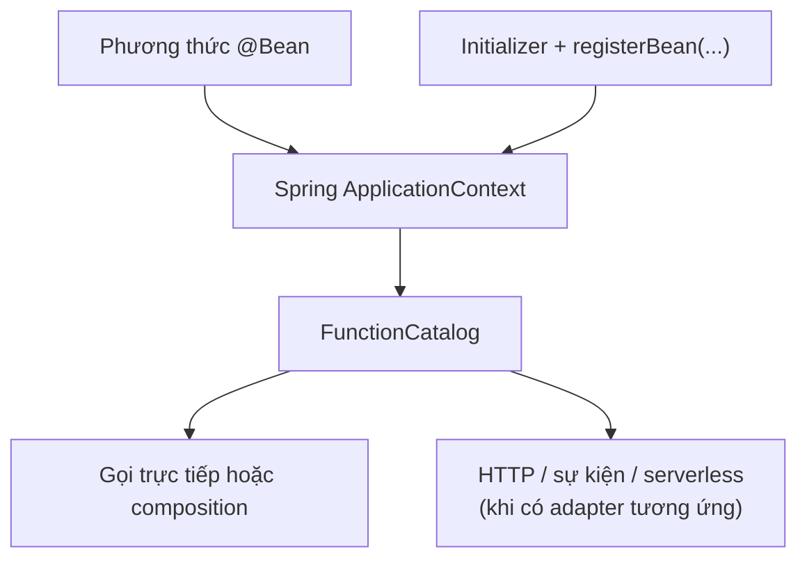

# Phân biệt `@Bean` với đăng ký bean theo phong cách functional

## Mục tiêu

Sau bài học, bạn có thể:

- Phân biệt **viết hàm nghiệp vụ** bằng `Supplier`, `Function`, `Consumer` với **đăng ký hàm đó làm Spring bean**.
- Đăng ký cùng một hàm cho Spring Cloud Function theo hai cách: khai báo `@Bean` và đăng ký tường minh bằng `GenericApplicationContext.registerBean(...)`.
- Giải thích vì sao tên bean, thông tin kiểu generic và thời điểm đăng ký quan trọng với `FunctionCatalog`, chuyển đổi dữ liệu đầu vào/đầu ra và các adapter như HTTP.
- Chọn cách đăng ký phù hợp với ứng dụng thông thường hoặc ứng dụng cần khởi tạo bean bằng mã Java.

## 1. Hai khái niệm dễ bị nhầm

Spring Cloud Function cho phép đóng gói logic nghiệp vụ bằng ba giao diện Java quen thuộc:

| Giao diện | Vai trò | Ví dụ |
| --- | --- | --- |
| `Supplier<O>` | Tạo dữ liệu, không nhận tham số đầu vào | Lấy danh sách đơn hàng cần xử lý |
| `Function<I, O>` | Nhận dữ liệu và trả kết quả | Chuẩn hóa mã đơn hàng |
| `Consumer<I>` | Nhận dữ liệu và thực hiện tác vụ, không trả kết quả | Ghi sự kiện kiểm toán |

Các giao diện này mô tả **hợp đồng của hàm nghiệp vụ**. Chúng không quy định Spring phải tạo bean bằng cách nào.

Trong khi đó, `@Bean` và **functional bean registration** là hai cơ chế đưa đối tượng vào `ApplicationContext`:

- **Khai báo bằng `@Bean`:** Spring đọc phương thức được chú thích trong một lớp cấu hình và dùng giá trị trả về để tạo bean.
- **Đăng ký theo phong cách functional:** mã Java chủ động khai báo bean bằng API của container, thường qua `ApplicationContextInitializer<GenericApplicationContext>` và `context.registerBean(...)`.

Một hàm thuộc kiểu `Function<String, String>` có thể được đăng ký bằng **cả hai cách**. Vì vậy, từ *functional* trong tên phong cách đăng ký **không đồng nghĩa** với việc cứ dùng `java.util.function.Function` là đã đăng ký bean theo phong cách functional.

Khi Spring Cloud Function được cấu hình trong ứng dụng, `FunctionCatalog` có thể phát hiện các bean phù hợp thuộc `Supplier`, `Function` và `Consumer`, bọc chúng để hỗ trợ tra cứu, chuyển đổi dữ liệu và ghép hàm. Cơ chế đăng ký quyết định **bean xuất hiện trong context như thế nào**; catalog quyết định **hàm được truy cập thông qua Spring Cloud Function như thế nào**.



## 2. Cách thứ nhất: khai báo hàm bằng `@Bean`

Giả sử nghiệp vụ cần nhận tên nhập từ bên ngoài, bỏ khoảng trắng ở hai đầu và chuyển thành chữ hoa. Cách thông dụng trong ứng dụng Spring Boot có Spring Cloud Function là tạo một bean có kiểu `Function<String, String>`.

```java
import java.util.Locale;
import java.util.function.Function;

import org.springframework.boot.SpringApplication;
import org.springframework.boot.autoconfigure.SpringBootApplication;
import org.springframework.context.annotation.Bean;

@SpringBootApplication
public class BeanStyleApplication {

    public static void main(String[] args) {
        SpringApplication.run(BeanStyleApplication.class, args);
    }

    @Bean
    public Function<String, String> normalizeName() {
        return input -> input.trim().toUpperCase(Locale.ROOT);
    }
}
```

Trong ví dụ này:

1. `@SpringBootApplication` kích hoạt cơ chế cấu hình/khám phá bean thông thường của Spring Boot.
2. Phương thức `normalizeName()` được đánh dấu `@Bean`, nên Spring tạo bean từ đối tượng `Function` mà phương thức trả về.
3. Tên bean mặc định là `normalizeName`, tức tên phương thức. Có thể đặt tên khác bằng `@Bean("tenKhac")`.
4. Chữ ký `Function<String, String>` xuất hiện trực tiếp trong khai báo phương thức. Spring Cloud Function có cơ sở để xác định kiểu dữ liệu vào/ra phục vụ chuyển đổi thông điệp.

Giá trị `"  an  "` khi đi qua hàm sẽ trở thành `"AN"`. Việc dùng `Locale.ROOT` giúp quy tắc chuyển chữ hoa không phụ thuộc locale mặc định của máy chạy ứng dụng.

Đặc trưng của `@Bean` là cấu hình dễ đọc, tích hợp tự nhiên với `@Configuration`, điều kiện cấu hình, dependency injection và những công cụ thông dụng của Spring Boot. Đây thường là lựa chọn thuận tiện nhất khi tập hợp hàm đã biết ngay khi viết ứng dụng.

## 3. Cách thứ hai: đăng ký bean bằng mã Java

Thay vì định nghĩa phương thức `@Bean`, ứng dụng có thể tạo một `ApplicationContextInitializer` để đưa định nghĩa bean vào `GenericApplicationContext` **trước khi context được refresh**.

Ví dụ dưới đây thực hiện đúng nghiệp vụ của phần trước nhưng đăng ký bằng `registerBean(...)`:

```java
import java.util.Locale;
import java.util.function.Function;

import org.springframework.boot.SpringApplication;
import org.springframework.boot.autoconfigure.SpringBootApplication;
import org.springframework.context.ApplicationContextInitializer;
import org.springframework.context.support.GenericApplicationContext;

@SpringBootApplication
public class FunctionalStyleApplication {

    public static void main(String[] args) {
        SpringApplication application =
                new SpringApplication(FunctionalStyleApplication.class);

        application.addInitializers(
                (ApplicationContextInitializer<GenericApplicationContext>) context ->
                        context.registerBean(
                                "normalizeName",
                                NormalizeName.class,
                                NormalizeName::new));

        application.run(args);
    }

    static final class NormalizeName implements Function<String, String> {

        @Override
        public String apply(String input) {
            return input.trim().toUpperCase(Locale.ROOT);
        }
    }
}
```

Điểm cần quan sát:

- Không có phương thức `@Bean` nào tạo `normalizeName`. Bean được khai báo trực tiếp bằng `context.registerBean("normalizeName", NormalizeName.class, NormalizeName::new)`.
- `"normalizeName"` là tên bean được chỉ định tường minh; `NormalizeName.class` là lớp triển khai; `NormalizeName::new` cung cấp đối tượng khi container khởi tạo bean.
- Lớp `NormalizeName` hiện thực `Function<String, String>`, nên quan hệ kiểu dữ liệu vào/ra được thể hiện ở chính lớp, thay vì chỉ nằm trong phép ép kiểu lambda lúc đăng ký.
- Initializer chạy trong giai đoạn khởi tạo context, trước khi refresh; nhờ vậy bean tham gia vòng đời quản lý của Spring và được Spring Cloud Function phát hiện trong quá trình cấu hình catalog.

**Lưu ý về tên gọi:** đây là *functional bean registration* của Spring Framework/Boot. Bản thân đối tượng được đăng ký vẫn là một Java `Function` phục vụ Spring Cloud Function. Nó không bắt buộc bạn phải loại bỏ hoàn toàn `@SpringBootApplication`, annotation hoặc mọi cấu hình tự động của Spring Boot.

### Tại sao ví dụ dùng lớp triển khai thay cho một lambda kiểu thô?

Bạn có thể thấy một dạng đăng ký ngắn hơn như sau:

```java
context.registerBean(
        "normalizeName",
        Function.class,
        () -> (Function<String, String>)
                input -> input.trim().toUpperCase(Locale.ROOT));
```

Đoạn mã này đăng ký một bean, nhưng đối số `Function.class` là **kiểu thô** (*raw type*): thông tin `<String, String>` không nằm trong `Class` được cung cấp cho container. Phép ép kiểu của lambda ở thời điểm biên dịch không bảo đảm framework suy ra đầy đủ kiểu vào/ra lúc chạy.

Điều đó đặc biệt quan trọng trong Spring Cloud Function: khi dữ liệu đi qua HTTP hoặc hệ thống thông điệp, framework có thể cần biết kiểu đích để chuyển đổi payload. Với hàm chỉ làm việc với chuỗi, thiếu metadata đôi khi chưa bộc lộ lỗi; với JSON cần ánh xạ thành DTO, rủi ro chuyển đổi sai kiểu rõ rệt hơn.

Có hai hướng xử lý đáng tin cậy:

1. Đăng ký một **lớp cụ thể** hiện thực `Function<I, O>` như `NormalizeName` ở trên, để metadata generic có thể được phân tích.
2. Khi phải đăng ký lambda hoặc hàm được sinh/thu nạp động, dùng khả năng khai báo **kiểu hàm tường minh** của Spring Cloud Function, thường thông qua `FunctionRegistration` và metadata kiểu tương ứng với phiên bản framework đang sử dụng.

`FunctionRegistration` là lớp hỗ trợ **đăng ký hàm cùng tên và thông tin kiểu cho Spring Cloud Function**; nó không phải tên gọi khác của phương thức `GenericApplicationContext.registerBean(...)`. Hai API có thể phối hợp với nhau khi xây dựng ứng dụng theo hướng functional, nhất là khi kiểu generic của hàm không thể suy ra qua reflection.

## 4. So sánh trực tiếp

| Tiêu chí | Khai báo `@Bean` | Đăng ký functional bằng `registerBean` |
| --- | --- | --- |
| Nơi khai báo | Phương thức trong lớp cấu hình Spring | Mã Java gọi API của `GenericApplicationContext` |
| Cách cung cấp bean | Giá trị trả về từ phương thức `@Bean` | Lớp bean và/hoặc `Supplier` tạo bean |
| Thời điểm cấu hình | Spring xử lý khai báo cấu hình khi xây dựng context | Thường trong initializer, trước khi context refresh |
| Đặt tên | Mặc định theo tên phương thức; có thể đổi bằng annotation | Chỉ định bằng tham số `beanName` |
| Metadata generic | Thường đọc được từ chữ ký phương thức `@Bean` | Phụ thuộc kiểu lớp/bean definition; phải chú ý khi dùng raw `Function.class` |
| Việc tiêm phụ thuộc | Dùng tham số phương thức `@Bean` hoặc cơ chế DI khác | Dùng cơ chế DI của Spring hoặc cung cấp dependency khi khởi tạo qua supplier |
| Vòng đời bean | Spring quản lý | Spring cũng quản lý nếu bean được đăng ký đúng vào context |
| Khi phù hợp | Ứng dụng Spring Boot cấu hình tĩnh, dễ đọc, dễ bảo trì | Đăng ký bằng mã, khởi tạo có điều kiện, tập hợp hàm biến đổi lúc bootstrap |

**Cả hai đều có thể tạo bean cho `FunctionCatalog`.** Không có chuyện `@Bean` chỉ dùng cho HTTP còn `registerBean` chỉ dùng cho serverless. Khả năng phục vụ HTTP, sự kiện hay nền tảng serverless do **adapter/runtime được cấu hình** quyết định, không phải do cú pháp đăng ký bean.

Một khác biệt khác dễ bị hiểu sai: `registerBean` không tự làm hàm nghiệp vụ chạy nhanh hơn `@Bean`. Hai cơ chế chủ yếu khác nhau ở cách khai báo và khởi tạo bean. Nếu cân nhắc hiệu năng hoặc thời gian khởi động, cần đo trên ứng dụng và cấu hình cụ thể thay vì suy ra từ tên *functional*.

## 5. `FunctionCatalog` nhìn thấy gì?

Sau khi context được tạo và có auto-configuration của Spring Cloud Function, bean `normalizeName` có thể được tra cứu thông qua catalog ở **cả hai cách đăng ký**:

```java
import java.util.function.Function;
import org.springframework.cloud.function.context.FunctionCatalog;

// catalog được lấy từ Spring ApplicationContext.
Function<String, String> function = catalog.lookup("normalizeName");
String result = function.apply("  an  "); // "AN"
```

Ví dụ trên minh họa phần mã gọi; biến `catalog` cần được inject hoặc lấy từ `ApplicationContext` tại nơi sử dụng. Tên `normalizeName` trong `lookup` phải trùng với tên mà Spring Cloud Function công bố cho hàm.

Sơ đồ xử lý khi có adapter:

```text
HTTP request / event payload
          |
          v
Adapter (nếu được cài và cấu hình)
          |
          v
FunctionCatalog.lookup("normalizeName")
          |
          v
Chuyển đổi dữ liệu theo kiểu đầu vào (nếu cần)
          |
          v
Function<String, String>.apply(...)
          |
          v
Kết quả + chuyển đổi dữ liệu đầu ra
```

Nếu ứng dụng có **Spring Cloud Function Web adapter** và đang chạy HTTP server tương thích, có thể thử endpoint mà adapter công bố:

```bash
curl -X POST http://localhost:8080/normalizeName \
  -H 'Content-Type: text/plain' \
  --data-binary '  an  '
```

Kết quả mong đợi là `AN`. Lệnh trên chỉ áp dụng khi bạn đã thêm và cấu hình adapter HTTP phù hợp; chỉ đăng ký bean hoặc chỉ thêm Spring Cloud Function Context **không tự tạo endpoint HTTP**.

Tương tự, việc sử dụng hàm trong Spring Cloud Stream hoặc môi trường serverless yêu cầu các adapter/launcher tương ứng. Ý tưởng tái sử dụng logic nằm ở chỗ **cùng bean hàm** có thể được catalog đưa tới nhiều giao thức gọi khác nhau.

## 6. Những lỗi thường gặp

### 6.1. Nhầm kiểu `Function` với cách đăng ký functional

Viết `@Bean Function<String, String> ...` nghĩa là bạn đang **dùng Java functional interface nhưng đăng ký theo annotation**. Chỉ khi gọi API như `registerBean(...)` mới là đăng ký bean theo phong cách functional được thảo luận trong bài.

### 6.2. Đăng ký cùng một tên ở hai nơi

Nếu trong **cùng ứng dụng** vừa có phương thức `@Bean normalizeName()` vừa có initializer gọi `registerBean("normalizeName", ...)`, bạn sẽ gặp xung đột bean definition hoặc hành vi phụ thuộc cấu hình ghi đè bean. Hai chương trình ví dụ là **hai phương án độc lập để so sánh**, không nên gộp nguyên trạng vào một context.

### 6.3. Mất metadata của `Function<I, O>`

Đăng ký bằng `Function.class` mà không cung cấp thông tin kiểu phù hợp có thể khiến việc chuyển JSON thành DTO, chuyển đổi message hoặc xác định kiểu trả về hoạt động sai. Với ứng dụng dựa vào chuyển đổi payload, nên ưu tiên chữ ký `@Bean` đầy đủ generic, lớp triển khai cụ thể hoặc cơ chế khai báo kiểu của `FunctionRegistration`.

### 6.4. Đăng ký sau khi context đã hoàn tất khởi động

Đăng ký bean trong initializer là một lựa chọn an toàn vì chạy **trước khi refresh**. Nếu thêm hàm sau khi catalog và các auto-configuration đã khởi tạo, không nên mặc định rằng mọi adapter và catalog sẽ tự cập nhật như lúc bootstrap.

### 6.5. Kiểm thử quên đưa initializer vào context

Trong ví dụ functional, initializer được thêm tại `main`. Một phép thử tự tạo Spring test context có thể **không gọi `main`**, do đó cũng không tự dùng initializer ấy. Khi viết integration test, hãy cấu hình initializer vào test context hoặc trích nó thành lớp riêng để có thể tái sử dụng. Ngược lại, một bài unit test chỉ kiểm tra phép biến đổi chuỗi có thể gọi trực tiếp `new NormalizeName().apply(...)` mà không cần Spring.

## 7. Nên chọn cách nào?

**Ưu tiên `@Bean`** khi tập hợp hàm tương đối cố định, ứng dụng đã dùng Spring Boot theo cách thông thường và nhóm muốn các khai báo dễ tìm, dễ đọc, dễ kiểm thử. Đây là điểm bắt đầu hợp lý cho đa số chức năng nghiệp vụ `Supplier`, `Function`, `Consumer`.

**Chọn đăng ký functional** khi ứng dụng cần điều khiển quá trình khai báo bean bằng mã Java: chẳng hạn tải một tập hợp hàm ở lúc bootstrap, dựng cấu hình module theo điều kiện runtime hoặc muốn quản lý bean definition rõ ràng. Khi đó cần chủ động bảo toàn tên hàm, metadata kiểu và cách kết nối với vòng đời Spring.

**Dùng thêm `FunctionRegistration` khi cần** công bố tường minh danh tính và kiểu dữ liệu của hàm cho Spring Cloud Function, đặc biệt với lambda không có chữ ký generic mà framework có thể đọc trực tiếp. Cách gọi API cụ thể cần tương thích với phiên bản Spring Cloud Function của dự án.

## 8. Tự kiểm tra

1. Một phương thức `@Bean` trả về `Consumer<OrderEvent>` có phải là đăng ký bean theo phong cách functional không? **Không**: `Consumer` là kiểu nghiệp vụ; cơ chế đăng ký vẫn là `@Bean`.
2. Tại sao `registerBean("process", Function.class, supplier)` có thể bất tiện hơn `registerBean("process", ProcessOrder.class, ProcessOrder::new)` nếu `ProcessOrder implements Function<Order, Receipt>`? **Vì** lớp triển khai cụ thể thể hiện generic `Order` và `Receipt`, còn `Function.class` không mang các tham số kiểu đó.
3. Đổi bean từ `@Bean` sang `registerBean` có tự động chuyển chức năng từ HTTP sang Kafka không? **Không**: giao thức và cách kích hoạt hàm phụ thuộc adapter và cấu hình tích hợp.
4. Cần gọi `registerBean` vào lúc nào trong ví dụ functional? **Trong initializer trước khi context refresh**, để bean tham gia đúng quá trình khởi tạo ứng dụng.

**Ghi nhớ:** `Supplier`/`Function`/`Consumer` mô tả **hàm làm gì**; `@Bean` hoặc `registerBean` mô tả **Spring nhận hàm như thế nào**; `FunctionCatalog` cùng adapter mô tả **ứng dụng tìm và kích hoạt hàm ra sao**.
