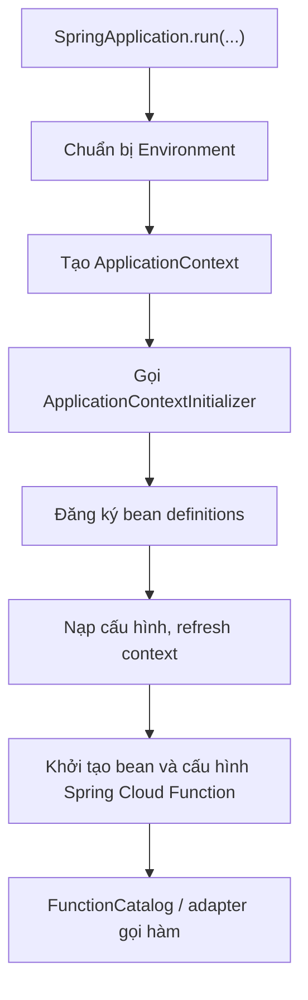

# `ApplicationContextInitializer` và `GenericApplicationContext` trong Spring Cloud Function

## Mục tiêu bài học

Trong chương **Đăng ký bean** của Spring Cloud Function, `ApplicationContextInitializer` và `GenericApplicationContext` là hai công cụ quan trọng khi muốn đưa hàm nghiệp vụ vào Spring bằng mã Java thay vì chỉ dùng phương thức `@Bean`. Sau bài này, bạn có thể:

- Giải thích **initializer chạy ở thời điểm nào** trong quá trình Spring Boot khởi động.
- Dùng `GenericApplicationContext.registerBean(...)` để đăng ký một `Function<I, O>` có tên và kiểu dữ liệu rõ ràng.
- Phân biệt **định nghĩa bean**, **factory tạo bean**, **bean instance** và **hàm nghiệp vụ**.
- Tra cứu hàm thông qua `FunctionCatalog`; hiểu điều kiện để cùng một hàm có thể được gọi bằng HTTP, sự kiện hay môi trường serverless.
- Xử lý các lỗi phổ biến liên quan đến thời điểm đăng ký, kiểu generic, tên bean, dependency injection và kiểm thử.

## 1. Vai trò của hai API

### `ApplicationContextInitializer<C>`: can thiệp vào quá trình tạo context

`ApplicationContextInitializer<C extends ConfigurableApplicationContext>` là giao diện của Spring với một phương thức:

```java
void initialize(C applicationContext);
```

Spring gọi initializer **sau khi đã tạo và chuẩn bị `ApplicationContext` nhưng trước khi context được `refresh()`**. Vì vậy, initializer phù hợp để chuẩn bị cấu hình ban đầu hoặc đăng ký những bean definition mà các bước khởi tạo tiếp theo cần sử dụng.

Trong một ứng dụng Spring Boot, trình tự khái quát là:



Sơ đồ mô tả các mốc chính; một số bước cấu hình nội bộ diễn ra trong quá trình `refresh()`. Điểm cốt lõi là: **initializer có cơ hội đăng ký bean trước khi container hoàn tất khởi động**.

Initializer không tự được chạy chỉ vì lớp có tên `...Initializer`. Bạn phải đăng ký nó với quá trình tạo context, chẳng hạn qua `SpringApplication.addInitializers(...)`, hoặc qua cơ chế cấu hình initializer của môi trường ứng dụng/kiểm thử.

### `GenericApplicationContext`: context có API đăng ký bean bằng mã Java

`GenericApplicationContext` là một triển khai `ApplicationContext` của Spring, cho phép đăng ký định nghĩa bean một cách trực tiếp. Ví dụ:

```java
context.registerBean("normalizeName", NormalizeName.class, NormalizeName::new);
```

Lệnh này nói với container:

| Thành phần | Ý nghĩa |
| --- | --- |
| `"normalizeName"` | Tên bean, dùng để phân biệt và tra cứu |
| `NormalizeName.class` | Lớp của bean; giúp Spring biết kiểu bean |
| `NormalizeName::new` | `Supplier<NormalizeName>` dùng để tạo đối tượng khi cần |
| `context` | Context chịu trách nhiệm lưu định nghĩa và quản lý vòng đời bean |

**Gọi `registerBean` không đồng nghĩa với việc constructor đã chạy ngay tại dòng lệnh đó.** Container lưu bean definition và khởi tạo instance theo vòng đời Spring: singleton thông thường thường được tạo trong lúc `refresh()`, còn bean lazy hoặc scope khác có thể được tạo về sau.

Ngoài biến thể có tên và factory, `GenericApplicationContext` còn có các overload như `registerBean(Class<T>)`, `registerBean(String, Class<T>)` và biến thể nhận `BeanDefinitionCustomizer` để tùy chỉnh metadata. Chọn overload dựa trên nhu cầu đặt tên, tạo instance, scope hoặc lifecycle.

**Chú ý hai loại `Supplier`:** trong `registerBean(..., NormalizeName::new)`, `Supplier` là **factory tạo bean**. Còn một `Supplier<Order>` của Spring Cloud Function là **hàm nghiệp vụ tạo dữ liệu**. Cả hai dùng giao diện `java.util.function.Supplier` nhưng đảm nhiệm hai công việc khác nhau.

## 2. Ví dụ hoàn chỉnh: đăng ký một `Function` từ initializer

Giả sử ứng dụng cần chuẩn hóa tên khách hàng: bỏ khoảng trắng đầu/cuối và chuyển thành chữ hoa. Hàm phải dùng được trong Spring Cloud Function qua `FunctionCatalog`, để adapter phù hợp có thể gọi qua HTTP hoặc một nguồn sự kiện sau này.

Ví dụ dùng Spring Boot, Spring Cloud Function Context và Java. Hãy chọn phiên bản Spring Boot/Spring Cloud Function tương thích với dự án. Nếu muốn expose endpoint HTTP, cần thêm **Spring Cloud Function Web adapter** và môi trường web thích hợp.

### Bước 1 — Viết hàm nghiệp vụ độc lập

File `NormalizeName.java`:

```java
package example.scf;

import java.util.Locale;
import java.util.function.Function;

public final class NormalizeName implements Function<String, String> {

    @Override
    public String apply(String input) {
        return input.trim().toUpperCase(Locale.ROOT);
    }
}
```

Lớp này không cần `@Component` hoặc `@Bean`. Nó có thể được unit test như Java thông thường. Việc hiện thực rõ `Function<String, String>` cũng giúp framework phân tích được kiểu đầu vào và đầu ra khi đăng ký lớp cụ thể.

### Bước 2 — Tạo initializer và đăng ký bean

File `FunctionBeansInitializer.java`:

```java
package example.scf;

import org.springframework.context.ApplicationContextInitializer;
import org.springframework.context.support.GenericApplicationContext;

public final class FunctionBeansInitializer
        implements ApplicationContextInitializer<GenericApplicationContext> {

    @Override
    public void initialize(GenericApplicationContext context) {
        context.registerBean(
                "normalizeName",
                NormalizeName.class,
                NormalizeName::new);
    }
}
```

Trong đoạn mã trên, initializer **đăng ký định nghĩa bean** tên `normalizeName`. Không phải gọi `new NormalizeName()` rồi giữ một instance độc lập ngoài Spring: chính container sử dụng factory được cung cấp và quản lý bean đã tạo.

Việc khai báo `GenericApplicationContext` làm tham số kiểu của initializer yêu cầu context thực tế tương thích với kiểu đó. Các context mặc định thông dụng trong Spring Boot hỗ trợ cách này, nhưng ứng dụng dùng `ApplicationContextFactory` hoặc loại context tùy biến cần kiểm tra khả năng tương thích; tránh ép kiểu mù từ `ConfigurableApplicationContext`.

### Bước 3 — Gắn initializer vào `SpringApplication`

File `ScfApplication.java`:

```java
package example.scf;

import java.util.function.Function;

import org.springframework.boot.SpringApplication;
import org.springframework.boot.autoconfigure.SpringBootApplication;
import org.springframework.cloud.function.context.FunctionCatalog;
import org.springframework.context.ConfigurableApplicationContext;

@SpringBootApplication
public class ScfApplication {

    public static void main(String[] args) {
        SpringApplication application = new SpringApplication(ScfApplication.class);
        application.addInitializers(new FunctionBeansInitializer());

        ConfigurableApplicationContext context = application.run(args);
        FunctionCatalog catalog = context.getBean(FunctionCatalog.class);
        Function<String, String> normalize = catalog.lookup("normalizeName");

        if (normalize == null) {
            throw new IllegalStateException("Không tìm thấy normalizeName");
        }

        System.out.println(normalize.apply("  linh  ")); // LINH
    }
}
```

**Kết quả mong đợi:** `LINH`.

Ví dụ giữ context hoạt động sau `run()`, phù hợp với dịch vụ HTTP hoặc consumer cần chạy liên tục. Với một ứng dụng chỉ dùng để thử nhanh và không khởi động web server, bạn có thể chủ động gọi `context.close()` khi đã xử lý xong.

Lưu ý: `FunctionCatalog` đến từ Spring Cloud Function. Nếu ứng dụng chỉ có Spring Framework hoặc thiếu phần cấu hình Spring Cloud Function cần thiết, `context.getBean(FunctionCatalog.class)` sẽ không có bean để lấy. Bản thân `GenericApplicationContext.registerBean` chỉ là thao tác Spring Framework.

## 3. Bean definition và instance: điều gì thực sự xảy ra?

Xét lại dòng:

```java
context.registerBean("normalizeName", NormalizeName.class, NormalizeName::new);
```

Tại thời điểm `initialize(...)` chạy, Spring có thể biết **tên, lớp và cách tạo bean** mà chưa cần tạo `NormalizeName`. Khi `refresh()`, container xử lý các bean definition, áp dụng các cơ chế của Spring và tạo instance theo scope/lazy setting.

```text
initialize(context)
    |
    +-- registerBean("normalizeName", NormalizeName.class, factory)
            |
            +-- Bean definition được ghi nhận
                    |
                    v
             context.refresh()
                    |
                    +-- Spring tạo instance khi cần
                    +-- Quản lý vòng đời / post-processing
                    +-- FunctionCatalog nhận diện hàm phù hợp
                    |
                    v
             catalog.lookup("normalizeName")
```

Phân biệt các thao tác dễ lẫn:

| Thao tác | Kết quả |
| --- | --- |
| `registerBean(...)` | Đăng ký **bean definition** được Spring quản lý |
| `new NormalizeName()` | Tạo đối tượng Java bình thường, tự nó chưa vào context |
| `context.getBean("normalizeName")` | Lấy bean instance được context quản lý |
| `catalog.lookup("normalizeName")` | Lấy hàm thông qua `FunctionCatalog` của Spring Cloud Function; có thể đi kèm cơ chế bọc/chuyển đổi của catalog |

`registerBean` không tự làm mất dependency injection, vòng đời bean hay khả năng chịu tác động của các `BeanPostProcessor`. Tuy nhiên, nếu factory do bạn cung cấp **tự gọi constructor**, chính factory cần truyền các dependency thiết yếu mà constructor yêu cầu.

## 4. Đăng ký có điều kiện và tiêm phụ thuộc bằng factory

### Chọn bean bằng cấu hình trước khi refresh

Initializer có thể dùng `Environment` đã được Spring Boot chuẩn bị để quyết định có đăng ký bean hay không:

```java
@Override
public void initialize(GenericApplicationContext context) {
    boolean enabled = context.getEnvironment()
            .getProperty("app.normalize.enabled", Boolean.class, true);

    if (enabled) {
        context.registerBean(
                "normalizeName",
                NormalizeName.class,
                NormalizeName::new);
    }
}
```

Nếu thuộc tính `app.normalize.enabled=false` có trong `Environment` tại thời điểm initializer chạy thì bean không được đăng ký. Đây là **điều kiện do mã Java chủ động kiểm tra**; đừng mặc định các annotation như `@ConditionalOnProperty` trên một lớp bất kỳ sẽ được xử lý tự động khi gọi `registerBean` với lớp đó.

Vì initializer chạy sớm, chỉ nên dựa vào các nguồn cấu hình **đã có trong `Environment` ở giai đoạn đó**. Cấu hình xuất hiện muộn hơn trong quá trình xử lý bean có thể chưa sẵn sàng.

### Tạo hàm phụ thuộc vào service của Spring

Một hàm nghiệp vụ có thể cần một bean dịch vụ:

```java
public final class PriceFunction implements
        java.util.function.Function<Order, Quote> {

    private final PriceService priceService;

    public PriceFunction(PriceService priceService) {
        this.priceService = priceService;
    }

    @Override
    public Quote apply(Order order) {
        return priceService.quote(order);
    }
}
```

Giả sử `Order`, `Quote`, `PriceService` được định nghĩa trong ứng dụng và `PriceService` sẽ là một Spring bean, initializer có thể đăng ký như sau:

```java
context.registerBean(
        "price",
        PriceFunction.class,
        () -> new PriceFunction(context.getBean(PriceService.class)));
```

Hàm factory `() -> ...` được gọi **khi Spring thực sự tạo bean `price`**, thường trong giai đoạn refresh đối với singleton không lazy. Điều này khác với việc gọi `context.getBean(PriceService.class)` **ngay trong phần thân của `initialize(...)`**, khi nhiều bean definition của ứng dụng có thể chưa được nạp hoặc sẵn sàng.

Không cần dùng factory nếu Spring có thể tự chọn và gọi constructor thích hợp từ bean definition; tuy nhiên factory tường minh hữu ích khi logic tạo đối tượng do ứng dụng quyết định.

## 5. Kết nối với `FunctionCatalog` và các giao thức

Spring Cloud Function xây dựng mô hình hàm nghiệp vụ quanh ba giao diện:

| Giao diện | Ý nghĩa đối với catalog |
| --- | --- |
| `Supplier<O>` | Nguồn cung cấp dữ liệu |
| `Function<I, O>` | Xử lý dữ liệu vào và sinh kết quả |
| `Consumer<I>` | Nhận dữ liệu và thực hiện một hành động |

Khi các hàm này là bean trong application context và có cấu hình Spring Cloud Function thích hợp, `FunctionCatalog` có thể tìm thấy chúng theo tên. Cách bean được đưa vào context có thể là `@Bean` hoặc `registerBean(...)`; hợp đồng nghiệp vụ của hàm không đổi.

```java
Function<String, String> fn = catalog.lookup("normalizeName");
String output = fn.apply("  linh  "); // LINH
```

Nếu cài đặt **Spring Cloud Function Web adapter**, ứng dụng web có thể nhận HTTP request và chuyển đến hàm được công bố. Ví dụ với endpoint mặc định tương ứng tên hàm trong một cấu hình web phổ biến:

```bash
curl -X POST http://localhost:8080/normalizeName \
  -H 'Content-Type: text/plain' \
  --data-binary '  linh  '
```

Kết quả mong đợi: `LINH`. Lệnh này đòi hỏi web adapter, HTTP server đang chạy, cách ánh xạ endpoint thích hợp và không đóng context ngay sau `run()`. **Chỉ gọi `registerBean` không tự mở cổng HTTP.**

Tương tự, sự kiện từ broker hoặc nền tảng serverless cần adapter/launcher tương ứng. Lợi ích của Spring Cloud Function là giữ logic `Function` tách khỏi cách kích hoạt, nhờ vậy có thể sử dụng lại cùng một hàm trong các môi trường khác nhau.

### Giữ metadata generic để chuyển đổi message

Ví dụ đăng ký:

```java
context.registerBean(
        "normalizeName",
        NormalizeName.class,
        NormalizeName::new);
```

giúp Spring thấy lớp `NormalizeName implements Function<String, String>`. Ngược lại, cách viết:

```java
context.registerBean(
        "normalizeName",
        java.util.function.Function.class,
        () -> (java.util.function.Function<String, String>)
                text -> text.trim().toUpperCase(java.util.Locale.ROOT));
```

đăng ký bằng `Function.class` là **raw type**, không thể hiện `<String, String>` ngay trong kiểu lớp đưa cho container. Khi xử lý JSON → DTO, thiếu metadata đầu vào/đầu ra có thể gây lỗi chuyển đổi message.

Vì vậy, nên ưu tiên **lớp triển khai có generic rõ ràng** hoặc cung cấp metadata kiểu tường minh bằng cơ chế được hỗ trợ bởi phiên bản Spring Cloud Function đang dùng, chẳng hạn `FunctionRegistration` khi phù hợp. `FunctionRegistration` phục vụ khai báo tên/kiểu hàm cho Spring Cloud Function; còn `GenericApplicationContext.registerBean` là API đăng ký bean definition của Spring Framework.

## 6. Kiểm thử initializer

### Kiểm thử riêng việc đăng ký bean

Không cần khởi động toàn bộ Spring Boot để kiểm tra một initializer đơn giản. Với JUnit 5 và Spring Context:

```java
import static org.junit.jupiter.api.Assertions.assertEquals;
import static org.junit.jupiter.api.Assertions.assertTrue;

import java.util.function.Function;
import org.junit.jupiter.api.Test;
import org.springframework.context.support.GenericApplicationContext;

class FunctionBeansInitializerTest {

    @Test
    void registersNormalizeName() {
        try (GenericApplicationContext context = new GenericApplicationContext()) {
            new FunctionBeansInitializer().initialize(context);

            assertTrue(context.containsBeanDefinition("normalizeName"));

            context.refresh();

            @SuppressWarnings("unchecked")
            Function<String, String> fn =
                    (Function<String, String>) context.getBean("normalizeName");

            assertEquals("LINH", fn.apply("  linh  "));
        }
    }
}
```

Ở bước kiểm tra này, `getBean(...)` xác nhận bean tồn tại và hoạt động trong Spring Context; nó **chưa chứng minh** `FunctionCatalog` đã được auto-configure hay HTTP adapter hoạt động.

### Kiểm thử tích hợp với Spring Cloud Function

Trong một bài integration test dùng Spring Boot, hãy đảm bảo initializer thực sự được đưa vào test context:

```java
import static org.junit.jupiter.api.Assertions.assertEquals;

import java.util.function.Function;
import org.junit.jupiter.api.Test;
import org.springframework.beans.factory.annotation.Autowired;
import org.springframework.boot.test.context.SpringBootTest;
import org.springframework.cloud.function.context.FunctionCatalog;
import org.springframework.test.context.ContextConfiguration;

@SpringBootTest
@ContextConfiguration(initializers = FunctionBeansInitializer.class)
class FunctionCatalogIntegrationTest {

    @Autowired
    FunctionCatalog catalog;

    @Test
    void exposesFunctionThroughCatalog() {
        Function<String, String> fn = catalog.lookup("normalizeName");
        assertEquals("LINH", fn.apply("  linh  "));
    }
}
```

Test này cần các dependency Spring Boot Test, JUnit 5 và Spring Cloud Function Context/auto-configuration tương ứng. Annotation `@ContextConfiguration(initializers = ...)` có ý nghĩa vì `@SpringBootTest` thường dựng test context trực tiếp, **không chạy phương thức `main`** nơi ví dụ trên gọi `addInitializers`.

## 7. Lỗi thường gặp và cách xử lý

| Hiện tượng | Nguyên nhân có thể | Cách kiểm tra/khắc phục |
| --- | --- | --- |
| `NoSuchBeanDefinitionException` cho `normalizeName` | Initializer chưa được gắn vào quá trình tạo context | Kiểm tra `addInitializers` hoặc initializer trong test config |
| `catalog.lookup("normalizeName")` không tìm được hàm | Sai tên, hàm chưa đăng ký kịp, hoặc thiếu Spring Cloud Function config | Đối chiếu bean name; đăng ký trước refresh; xác minh dependency |
| Xung đột tên bean | Cùng tên được đăng ký qua `@Bean` và `registerBean` hoặc bởi hai initializer | Đặt tên duy nhất, tránh đăng ký trùng và không phụ thuộc vào cơ chế override |
| `ClassCastException` ở initializer | Kiểu `ApplicationContext` thực tế không phù hợp với generic/cast được dùng | Kiểm tra context factory và kiểu initializer |
| `getBean(...)` lỗi khi đang `initialize(...)` | Context chưa refresh, bean definition chưa nạp hoặc chưa sẵn sàng | Đăng ký factory và để Spring giải quyết dependency khi tạo bean |
| Chuyển JSON vào DTO thất bại | Generic input/output không được nhận diện khi dùng raw `Function.class` | Dùng lớp hiện thực `Function<I, O>` hoặc metadata kiểu tường minh |
| HTTP trả 404 dù bean có tồn tại | Chưa có web adapter hoặc ánh xạ endpoint không phù hợp | Kiểm tra adapter, server, route, cấu hình exposed functions |
| Test unit chạy nhưng integration test không thấy hàm | Test context không nhận initializer được gắn riêng trong `main` | Khai báo initializer trong `@ContextConfiguration` hoặc cấu hình bootstrap chung |

**Không nên đăng ký hàm mới sau khi context và catalog đã hoàn tất khởi tạo rồi mặc định các adapter sẽ nhận thấy nó.** Đăng ký trong initializer trước refresh là cách phổ biến để đảm bảo bean hiện diện trong quá trình thiết lập catalog.

## 8. Khi nào nên dùng cách này?

Sử dụng `ApplicationContextInitializer` kết hợp `GenericApplicationContext` khi muốn **lựa chọn hoặc tạo bean bằng mã tại lúc khởi động**, ví dụ cấu hình một tập hợp hàm theo môi trường triển khai, bật/tắt nhóm chức năng theo thuộc tính khởi động hoặc kiểm soát rõ tên và factory của hàm.

Nếu ứng dụng chỉ có vài hàm nghiệp vụ cố định, phương thức `@Bean` thường dễ đọc và dễ bảo trì hơn. Với Spring Cloud Function, **hai cách đều có thể tạo ra bean `Supplier`, `Function`, `Consumer` mà catalog sử dụng**; việc chọn cách nào phụ thuộc nhu cầu cấu hình và vòng đời, không phụ thuộc ứng dụng sẽ gọi hàm qua HTTP, sự kiện hay serverless.

## 9. Câu hỏi tự kiểm tra

1. **Vì sao gọi `registerBean` trong initializer phù hợp hơn khi cần catalog nhận diện hàm lúc khởi động?** Vì initializer chạy trước `refresh()`; bean definition có mặt trong quá trình Spring Cloud Function thiết lập catalog.
2. **`Supplier<NormalizeName>` trong `registerBean` có phải là `Supplier<O>` nghiệp vụ của Spring Cloud Function không?** Không. Nó tạo bean instance; `Supplier<O>` nghiệp vụ tạo dữ liệu khi hàm được gọi.
3. **Gọi `registerBean("normalizeName", NormalizeName.class, ...)` đã khiến HTTP endpoint hoạt động chưa?** Chưa. Cần Spring Cloud Function Web adapter và môi trường/cấu hình web tương ứng.
4. **Vì sao nên giữ lớp `NormalizeName implements Function<String, String>` thay cho đăng ký raw `Function.class`?** Vì metadata kiểu generic giúp catalog và các adapter chuyển đổi payload đúng kiểu.
5. **Vì sao `@SpringBootTest` không nhất thiết thấy initializer được thêm trong `main`?** Vì Spring Test tự dựng context và có thể không gọi `main`; cần đăng ký initializer vào test context.

**Tóm tắt quan hệ:** `ApplicationContextInitializer` cho biết **khi nào và ở đâu chuẩn bị bean definition**; `GenericApplicationContext` cung cấp API **đăng ký bean bằng mã**; `FunctionCatalog` của Spring Cloud Function cung cấp cách **tìm và gọi hàm nghiệp vụ** sau khi Spring đã khởi tạo context.
