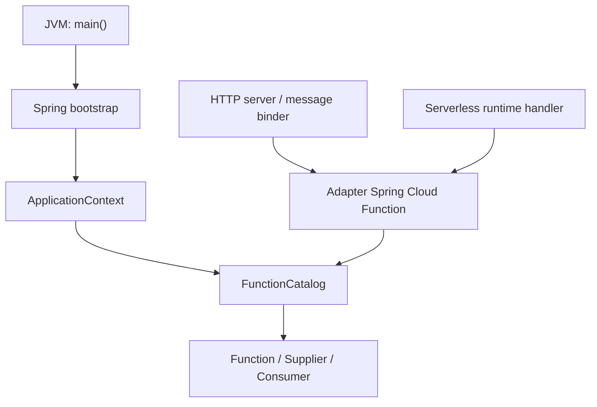
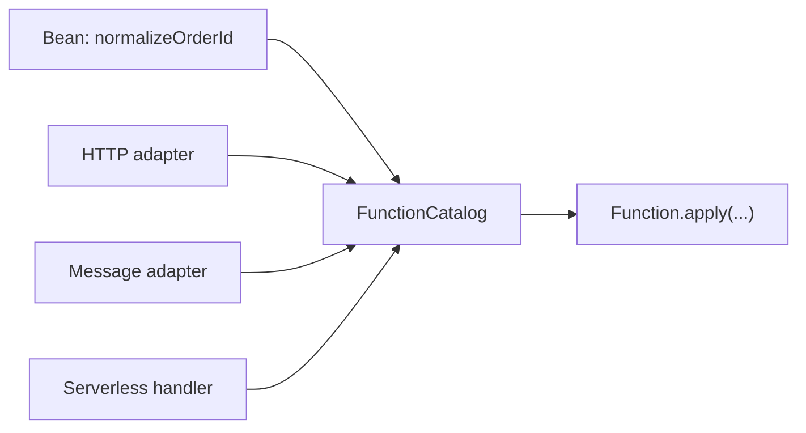

# `FunctionalSpringApplication` và điểm vào ứng dụng

## Mục tiêu học tập

Trong chương **Đăng ký bean** của **Spring Cloud Function**, ngoài cách khai báo `Supplier`, `Function`, `Consumer` bằng `@Bean`, chúng ta có thể đăng ký hàm bằng mã Java để tái sử dụng logic nghiệp vụ độc lập với giao thức gọi. `FunctionalSpringApplication` là điểm khởi chạy dành cho phong cách cấu hình hàm theo hướng này trong những phiên bản Spring Cloud Function có hỗ trợ API đó.

Sau bài này, bạn có thể:

- Phân biệt **điểm vào ứng dụng** (`main` hoặc handler của môi trường triển khai), **bootstrap Spring** và **điểm vào hàm nghiệp vụ**.
- Sử dụng `FunctionalSpringApplication.run(...)` cùng `ApplicationContextInitializer<GenericApplicationContext>` để đăng ký một `Function<I, O>`.
- Giải thích quá trình đưa bean vào `ApplicationContext` để Spring Cloud Function có thể tra cứu bằng `FunctionCatalog`.
- Hiểu giới hạn của functional bootstrap: tên bean, kiểu generic, cấu hình adapter, vòng đời context và tương thích phiên bản.
- Chọn điểm khởi chạy phù hợp cho ứng dụng JVM, HTTP, sự kiện và môi trường serverless.

## 1. "Điểm vào" có ba nghĩa khác nhau

Khi làm việc với Spring Cloud Function, cần tách ba lớp trách nhiệm:

| Lớp | Ví dụ | Nhiệm vụ |
| --- | --- | --- |
| **Điểm vào của tiến trình Java** | `public static void main(String[] args)` | Bắt đầu khởi động ứng dụng khi chạy trực tiếp bằng JVM hoặc executable JAR |
| **Điểm vào của Spring** | `FunctionalSpringApplication.run(...)` hoặc `SpringApplication.run(...)` | Tạo, cấu hình và refresh `ApplicationContext` |
| **Điểm vào của logic nghiệp vụ** | `Function<String, String>.apply(...)` | Xử lý dữ liệu đầu vào, trả kết quả; không cần biết dữ liệu đến từ HTTP, message hay serverless |

Với serverless, nền tảng đám mây thường gọi một **handler/adapter** do runtime quy định, nên `main` của ứng dụng không nhất thiết là phương thức được gọi khi có một sự kiện mới. Dù cách khởi chạy khác nhau, hàm nghiệp vụ có thể giữ nguyên nếu adapter khởi tạo hoặc tìm đúng Spring context và `FunctionCatalog`.



Sơ đồ nhấn mạnh sự phân công trách nhiệm: **`main` khởi động ứng dụng**, **Spring quản lý bean**, **catalog giúp tìm hàm**, còn **adapter chuyển lời gọi của giao thức sang hàm**. Trong triển khai thực tế, adapter cũng chạy trong hoặc kết nối với application context được bootstrap.

## 2. `FunctionalSpringApplication` là gì?

`FunctionalSpringApplication` thuộc hạ tầng Spring Cloud Function; trong các phiên bản cung cấp lớp này, tên đầy đủ thường dùng là:

```java
import org.springframework.cloud.function.context.config.FunctionalSpringApplication;
```

API này cung cấp cách khởi chạy ứng dụng có **functional bean registration**, trong đó một lớp triển khai `ApplicationContextInitializer` khai báo các bean bằng mã Java. Cách viết đặc trưng:

```java
public static void main(String[] args) {
    FunctionalSpringApplication.run(FunctionApplication.class, args);
}
```

`FunctionApplication.class` ở đây là **nguồn cấu hình ứng dụng và initializer**; đây không phải một instance `Function` sẽ được gọi với dữ liệu nghiệp vụ. Khi ứng dụng khởi động, Spring Cloud Function sử dụng cơ chế functional bootstrap tương ứng để đưa các đăng ký bean vào context.

Trong nhiều ví dụ functional truyền thống, lớp ứng dụng chính đồng thời:

1. Cung cấp phương thức `main` để JVM có thể chạy ứng dụng.
2. Triển khai `ApplicationContextInitializer<GenericApplicationContext>` để đăng ký các hàm.

**Phụ thuộc phiên bản:** lớp `FunctionalSpringApplication`, package, hành vi bootstrap và mức hỗ trợ cấu hình có thể khác giữa các dòng phiên bản Spring Cloud Function. Khi dùng dự án thực tế, cần đối chiếu API có mặt trên classpath và phiên bản Spring Boot/Spring Cloud Function tương thích. Đừng mặc định ví dụ từ một thế hệ framework sẽ biên dịch nguyên trạng ở mọi thế hệ.

### Liên hệ với `SpringApplication`

`SpringApplication` là API bootstrap tổng quát của Spring Boot. Phong cách thông thường sử dụng lớp `@SpringBootApplication`, `@Configuration`, `@Bean` và quá trình xử lý annotation/configuration.

`FunctionalSpringApplication` nhấn mạnh **khai báo bean bằng mã**, trong đó initializer và bean definition đóng vai trò trung tâm. Điều này có thể giúp kiểm soát cách tạo và lựa chọn bean trong quá trình khởi động. Tuy nhiên, **không nên suy ra rằng cứ đổi phương thức `run` là ứng dụng tự động chạy nhanh hơn, không còn phụ thuộc Spring Boot hoặc hỗ trợ mọi auto-configuration như cách khởi chạy cũ**. Những khả năng đó phải được xác minh với phiên bản và cấu hình cụ thể.

## 3. Ví dụ thực hành: một ứng dụng functional có thể chạy

Giả sử hệ thống nhận mã đơn hàng dưới dạng chuỗi và cần chuẩn hóa mã đó trước khi đưa vào hệ thống tiếp theo. Ta viết hàm có kiểu `Function<String, String>` để sử dụng qua catalog và các adapter phù hợp.

Ví dụ sau minh họa **phong cách API của những phiên bản có `FunctionalSpringApplication`**. Dự án cần có dependency Spring Cloud Function Context tương thích với Spring Boot. Nếu muốn nhận HTTP request, cần bổ sung web adapter và HTTP server tương ứng.

### Bước 1. Viết lớp ứng dụng kiêm initializer

File `FunctionApplication.java`:

```java
package example.function;

import java.util.Locale;
import java.util.function.Function;

import org.springframework.cloud.function.context.config.FunctionalSpringApplication;
import org.springframework.context.ApplicationContextInitializer;
import org.springframework.context.support.GenericApplicationContext;

public class FunctionApplication
        implements ApplicationContextInitializer<GenericApplicationContext> {

    public static void main(String[] args) {
        FunctionalSpringApplication.run(FunctionApplication.class, args);
    }

    @Override
    public void initialize(GenericApplicationContext context) {
        context.registerBean(
                "normalizeOrderId",
                NormalizeOrderId.class,
                NormalizeOrderId::new);
    }

    public static final class NormalizeOrderId
            implements Function<String, String> {

        @Override
        public String apply(String input) {
            return input.trim().toUpperCase(Locale.ROOT);
        }
    }
}
```

Ở ví dụ này:

- `main(...)` dùng `FunctionalSpringApplication.run(...)` để khởi động ứng dụng.
- `FunctionApplication` là initializer; phương thức `initialize(...)` nhận context trước khi quá trình khởi tạo hoàn tất.
- `registerBean("normalizeOrderId", ...)` khai báo bean với tên **`normalizeOrderId`**.
- `NormalizeOrderId.class` hiện thực `Function<String, String>`, giúp bảo toàn thông tin kiểu generic cần thiết khi framework chuyển đổi dữ liệu.
- `NormalizeOrderId::new` là factory tạo bean, **khác** với một `Supplier<O>` đóng vai trò nguồn dữ liệu nghiệp vụ.
- `apply(...)` hoàn toàn không phụ thuộc `main`, HTTP request hay message broker.

Đầu vào `"  order-47  "` cho kết quả `"ORDER-47"`.

Không cần đánh dấu `NormalizeOrderId` bằng `@Component` hoặc khai báo thêm phương thức `@Bean`: initializer đã đăng ký bean tường minh. Tránh đăng ký cùng tên `normalizeOrderId` một lần nữa thông qua các cơ chế khác.

### Bước 2. Hiểu trình tự khởi động

```text
JVM gọi main(String[] args)
    |
    v
FunctionalSpringApplication.run(FunctionApplication.class, args)
    |
    v
Tạo / chuẩn bị Spring ApplicationContext
    |
    v
Gọi FunctionApplication.initialize(context)
    |
    +-- registerBean("normalizeOrderId",
    |                NormalizeOrderId.class,
    |                NormalizeOrderId::new)
    |
    v
Refresh context; Spring quản lý bean instance
    |
    v
Spring Cloud Function cấu hình FunctionCatalog
    |
    v
lookup("normalizeOrderId") -> Function.apply(...)
```

Điểm quan trọng là `registerBean(...)` chủ yếu **đăng ký bean definition** trong context; `NormalizeOrderId::new` được Spring sử dụng khi tạo bean theo lifecycle của container. Với singleton không lazy, instance thường được tạo trong quá trình refresh, không bắt buộc được tạo ngay lúc initializer đang đăng ký.

Khi Spring Cloud Function đã được cấu hình thích hợp, bean có tên `normalizeOrderId` có thể được tra cứu qua `FunctionCatalog`.

### Bước 3. Tra cứu hàm qua `FunctionCatalog`

Trong một thành phần đã có tham chiếu tới catalog:

```java
import java.util.function.Function;
import org.springframework.cloud.function.context.FunctionCatalog;

// Ví dụ: catalog được tiêm từ Spring ApplicationContext.
Function<String, String> fn = catalog.lookup("normalizeOrderId");

if (fn == null) {
    throw new IllegalStateException("Không tìm thấy normalizeOrderId");
}

String result = fn.apply("  order-47  "); // ORDER-47
```

Đây là ví dụ **sử dụng catalog**, không phải một file Java độc lập: biến `catalog` cần được inject hoặc lấy từ Spring `ApplicationContext`. Catalog giúp truy cập hàm theo tên và có thể cung cấp cơ chế bọc/chuyển đổi, ghép hàm tùy cấu hình. Việc gọi trực tiếp `new NormalizeOrderId().apply(...)` cũng cho cùng logic nghiệp vụ nhưng không đi qua cơ chế quản lý và chuyển đổi của Spring Cloud Function.

## 4. So sánh các kiểu điểm khởi chạy

| Cách khởi chạy | Điểm vào | Cách đăng ký hàm | Khi sử dụng |
| --- | --- | --- | --- |
| Spring Boot thông thường | `SpringApplication.run(App.class, args)` | Thường có `@Bean`, `@Component` hoặc cấu hình Spring | Ứng dụng Boot dựa vào cấu hình annotation phổ biến |
| Functional bootstrap | `FunctionalSpringApplication.run(App.class, args)` | Initializer gọi `GenericApplicationContext.registerBean(...)` | Muốn biểu diễn đăng ký hàm bằng mã Java theo API functional mà phiên bản cung cấp |
| Spring Boot + initializer tường minh | Tạo `SpringApplication`, gọi `addInitializers(...)`, sau đó `run(args)` | Initializer khai báo bean trong context Boot | Muốn kết hợp Spring Boot thường dùng với bean registration bằng mã |
| Runtime serverless | Handler/launcher theo nền tảng | Tùy adapter và cách bootstrap Spring context | Khi môi trường thực thi tự quyết định điểm vào của lời gọi |

### Một biến thể dùng `SpringApplication.addInitializers(...)`

Nếu dự án ưu tiên cơ chế khởi động Spring Boot tiêu chuẩn hoặc không có `FunctionalSpringApplication` trên classpath, một cách **đăng ký bean bằng mã** là:

```java
@SpringBootApplication
public class BootApplication {

    public static void main(String[] args) {
        SpringApplication app = new SpringApplication(BootApplication.class);
        app.addInitializers(new FunctionInitializer());
        app.run(args);
    }
}
```

Với `FunctionInitializer` triển khai `ApplicationContextInitializer<GenericApplicationContext>` và gọi `registerBean(...)`. Các import `SpringApplication` và `SpringBootApplication` đến từ Spring Boot, còn initializer/context đến từ Spring Framework.

**Lưu ý:** hai cách bootstrap không nên được coi là tương đương tuyệt đối về auto-configuration hay tối ưu hóa startup. Ví dụ này chứng minh **có thể đăng ký bean theo phong cách functional ngay trong ứng dụng Boot thông thường**; nó không mô phỏng hoàn toàn mọi chi tiết của `FunctionalSpringApplication`.

## 5. Từ điểm vào ứng dụng đến HTTP, sự kiện và serverless

Spring Cloud Function cho phép viết một hàm độc lập với giao thức:

```java
public final class NormalizeOrderId implements Function<String, String> {
    @Override
    public String apply(String value) {
        return value.trim().toUpperCase(Locale.ROOT);
    }
}
```

Hàm có thể được đưa vào `FunctionCatalog` bằng cùng một bean registration. Cách hàm được gọi phụ thuộc runtime:

**Ứng dụng JVM/CLI.** JVM chạy `main` của lớp ứng dụng; sau khi Spring context khởi tạo, mã Java có thể gọi `catalog.lookup(...)`. Với ứng dụng dòng lệnh chỉ chạy một lượt, có thể chủ động đóng context sau khi hoàn tất.

**Ứng dụng HTTP.** Một ứng dụng web cần HTTP server và Spring Cloud Function Web adapter phù hợp. Khi có cấu hình mặc định thích hợp, một request có thể được định tuyến tới bean theo tên:

```bash
curl -X POST http://localhost:8080/normalizeOrderId \
  -H 'Content-Type: text/plain' \
  --data-binary '  order-47  '
```

Kết quả mong đợi là `ORDER-47`. Lệnh này chỉ chạy khi có web adapter, server đang hoạt động và endpoint được expose; **`FunctionalSpringApplication.run(...)` tự nó không cam kết tạo ra một HTTP endpoint**.

**Ứng dụng nhận sự kiện.** Với Spring Cloud Stream hoặc adapter nhắn tin thích hợp, hệ thống nhận bản tin và đưa payload tới hàm trong catalog theo cấu hình binding/definition. Việc sử dụng binder, broker và cấu hình message là trách nhiệm tầng tích hợp; không cần nhúng mã nhận HTTP/Kafka vào `NormalizeOrderId`.

**Ứng dụng serverless.** Nền tảng gọi một handler theo hợp đồng của runtime. Handler/launcher Spring Cloud Function có trách nhiệm thiết lập hoặc dùng Spring context và chuyển sự kiện tới hàm. Một số môi trường hoặc adapter **không gọi `main`** cho từng request, vì thế không nên đặt việc đăng ký hàm hoặc side effect quan trọng chỉ trong những câu lệnh chạy sau `run(...)` ở `main`. Cách bootstrap đúng phải theo adapter của nền tảng đó.



Nếu có **nhiều bean hàm**, các adapter/binder có thể yêu cầu chỉ định tên hoặc biểu thức composition bằng cấu hình như `spring.cloud.function.definition`. Thuộc tính này giúp chọn hàm khi runtime cần; nó **không thay thế việc đăng ký bean** hoặc tự tạo bean chưa tồn tại.

## 6. Tên hàm, thông tin kiểu và composition

### Tên bean là một phần của hợp đồng tra cứu

```java
context.registerBean(
        "normalizeOrderId",
        NormalizeOrderId.class,
        NormalizeOrderId::new);
```

Trong ví dụ trên:

- `normalizeOrderId` là **tên dùng để đăng ký và tra cứu** trong context/catalog.
- `NormalizeOrderId` là **lớp Java** của bean, không tự quyết định URL hay tên binding.
- `Function<String, String>` là **hợp đồng kiểu dữ liệu** của logic nghiệp vụ.

Đổi tên bean nhưng giữ nguyên `lookup("normalizeOrderId")` có thể khiến tra cứu thất bại. Nếu một adapter đã cấu hình tên hàm, khi đổi tên bean phải cập nhật cấu hình tương ứng.

### Giữ kiểu generic khi đăng ký

Cách đăng ký bằng lớp triển khai có generic cụ thể:

```java
context.registerBean("normalizeOrderId",
        NormalizeOrderId.class, NormalizeOrderId::new);
```

giúp Spring có cơ sở phân tích `Function<String, String>`. Trái lại, nếu đăng ký một lambda trực tiếp bằng raw type:

```java
context.registerBean(
        "normalizeOrderId",
        Function.class,
        () -> (Function<String, String>) text -> text.trim());
```

thì `Function.class` không mang tham số kiểu `<String, String>`. Việc ép kiểu lambda ở Java không bảo đảm Spring Cloud Function suy ra được kiểu input/output ở runtime. Với payload JSON cần chuyển thành DTO, metadata kiểu đặc biệt quan trọng.

Trong trường hợp dùng lambda động hoặc cần công bố kiểu tường minh, có thể cân nhắc `FunctionRegistration` và API khai báo kiểu tương ứng với **phiên bản Spring Cloud Function đang sử dụng**. `FunctionRegistration` không đồng nghĩa với `GenericApplicationContext.registerBean`: một bên mô tả đăng ký hàm cho Spring Cloud Function, bên kia là API đăng ký bean của Spring Framework.

### Ghép hàm không phụ thuộc `main`

Giả sử ứng dụng có thêm bean `appendMarker`, đều là các `Function<String, String>` có metadata phù hợp. Spring Cloud Function hỗ trợ tra cứu biểu thức ghép hàm theo cú pháp của catalog, ví dụ:

```java
Function<String, String> pipeline =
        catalog.lookup("normalizeOrderId|appendMarker");
```

Luồng nghiệp vụ chạy qua `normalizeOrderId` rồi `appendMarker`. Đây là khả năng của **catalog**, không phải của JVM `main` hay riêng `FunctionalSpringApplication`. Để composition chạy được, **cả hai hàm phải được đăng ký** và kiểu đầu ra/đầu vào phải tương thích.

## 7. Điểm vào ứng dụng và vòng đời Spring

Một initializer chạy **trước khi context refresh**, nên thường chưa phải nơi thích hợp để gọi `context.getBean(...)` cho các bean sẽ chỉ xuất hiện sau khi nạp cấu hình. Nhiệm vụ chính của initializer là đăng ký bean definition và thiết lập một số cấu hình có sẵn ở giai đoạn sớm.

Ví dụ, thay vì lấy service ngay lúc initialize:

```java
// Tránh giả định tất cả service đã sẵn sàng tại initialize(...).
var service = context.getBean(OrderService.class);
```

hãy cung cấp factory để Spring lấy dependency **khi tạo bean**:

```java
context.registerBean(
        "orderHandler",
        OrderHandler.class,
        () -> new OrderHandler(context.getBean(OrderService.class)));
```

Đoạn minh họa giả định `OrderHandler` và `OrderService` đã được ứng dụng định nghĩa, trong đó `OrderService` có bean definition hợp lệ. Điều này giúp phân tách **thời điểm đăng ký** khỏi **thời điểm khởi tạo instance**.

Đối với hệ thống đa giao thức:

- Tránh mở kết nối mạng hoặc gọi API bên ngoài trực tiếp trong static initializer của lớp `main`.
- Không dựa vào trạng thái biến `static` thay cho dependency được Spring quản lý.
- Không giả định serverless gọi lại `main` hoặc initializer cho từng message.
- Giữ phần logic nghiệp vụ thuần Java càng nhiều càng tốt, và để adapter xử lý request, header, event envelope, lỗi giao thức.

Những điểm này giúp cùng một `Function` có thể được tái sử dụng mà không bị gắn cứng vào một kiểu khởi động.

## 8. Kiểm thử điểm vào functional

### Kiểm thử đơn vị: không cần Spring

Kiểm tra tính đúng đắn của hàm trước, tách khỏi bootstrap:

```java
import static org.junit.jupiter.api.Assertions.assertEquals;

import org.junit.jupiter.api.Test;

class NormalizeOrderIdTest {

    @Test
    void normalizesOrderId() {
        var fn = new FunctionApplication.NormalizeOrderId();
        assertEquals("ORDER-47", fn.apply("  order-47  "));
    }
}
```

Test này xác minh **logic Java** nhưng chưa chứng minh ứng dụng có đăng ký bean hoặc catalog tra cứu được hàm.

### Kiểm thử tích hợp: khởi động qua đúng entry point

Với phiên bản có `FunctionalSpringApplication`, có thể khởi chạy context trong test rồi tra cứu catalog:

```java
import static org.junit.jupiter.api.Assertions.assertEquals;
import static org.junit.jupiter.api.Assertions.assertNotNull;

import java.util.function.Function;
import org.junit.jupiter.api.Test;
import org.springframework.cloud.function.context.FunctionCatalog;
import org.springframework.cloud.function.context.config.FunctionalSpringApplication;
import org.springframework.context.ConfigurableApplicationContext;

class FunctionalBootstrapTest {

    @Test
    void exposesRegisteredFunction() {
        try (ConfigurableApplicationContext context =
                FunctionalSpringApplication.run(
                        FunctionApplication.class,
                        "--spring.main.web-application-type=none")) {

            FunctionCatalog catalog = context.getBean(FunctionCatalog.class);
            Function<String, String> fn = catalog.lookup("normalizeOrderId");

            assertNotNull(fn);
            assertEquals("ORDER-47", fn.apply("  order-47  "));
        }
    }
}
```

Test này yêu cầu các dependency Spring Cloud Function, Spring Boot và JUnit tương thích. Nó xác minh **bootstrap + registration + catalog**. Nó **không tự xác minh** HTTP endpoint, broker binding hoặc handler serverless; những adapter ấy cần kiểm thử tích hợp tương ứng khi được sử dụng.

Nếu dùng một cơ chế tạo test context khác, hãy đảm bảo initializer cũng được đăng ký trong test. Một test chỉ dùng `@SpringBootTest` không mặc nhiên gọi phương thức `main` của ứng dụng; vì vậy nó có thể bỏ qua bootstrap được cấu hình riêng trong `main`.

## 9. Lỗi thường gặp khi dùng `FunctionalSpringApplication`

| Dấu hiệu | Nguyên nhân có thể | Hướng xử lý |
| --- | --- | --- |
| IDE báo không tìm thấy `FunctionalSpringApplication` | Artifact hoặc phiên bản Spring Cloud Function đang dùng không cung cấp class/API này | Xác nhận dependency và API của phiên bản; cân nhắc Boot + `addInitializers` nếu phù hợp |
| `main` chạy nhưng `lookup(...)` trả `null` | Bean chưa được đăng ký, tên không khớp, initializer không chạy hoặc catalog chưa sẵn sàng | Kiểm tra tên `registerBean`, cách bootstrap và cấu hình Spring Cloud Function |
| `NoSuchBeanDefinitionException: FunctionCatalog` | Phần context/auto-configuration của Spring Cloud Function chưa được thiết lập | Xác minh dependency và cách khởi tạo context, không chỉ bean definition |
| Đăng ký hai bean cùng tên | Hàm được khai báo qua nhiều con đường | Đặt tên duy nhất, bỏ khai báo trùng; không dựa vào ghi đè bean |
| JSON không chuyển được sang DTO | Generic `Function<I, O>` không được suy ra từ raw `Function.class` | Dùng lớp triển khai có generic hoặc khai báo metadata kiểu tường minh |
| HTTP 404 dù catalog có hàm | Không có adapter HTTP, sai route hoặc server chưa chạy | Kiểm tra web adapter, cấu hình endpoint, cổng và tên hàm |
| Serverless không chạy đoạn trong `main` | Runtime gọi handler thay vì `main` | Đưa đăng ký hàm vào bootstrap được adapter hỗ trợ, theo hợp đồng runtime |
| Context startup khác kỳ vọng khi đổi từ `SpringApplication` | Hai cơ chế bootstrap có khác biệt về cấu hình, dependency hoặc auto-configuration | Kiểm tra ứng dụng thực tế trên phiên bản đang dùng, không coi hai lối `run` là tương đương tuyệt đối |
| Test đơn vị pass nhưng catalog không thấy hàm | Test chỉ gọi `apply(...)` mà không khởi tạo Spring | Thêm integration test khởi động context qua đúng entry point |

## 10. Tình huống lựa chọn và câu hỏi tự đánh giá

**Tình huống A — Ứng dụng chỉ có hai `Function` cố định.** Nhóm đã dùng Spring Boot và các cấu hình annotation. Đăng ký bằng `@Bean` có thể đủ đơn giản; không cần đổi toàn bộ entry point sang functional chỉ vì logic sử dụng `java.util.function.Function`.

**Tình huống B — Ứng dụng cần khai báo danh sách hàm bằng mã ở bootstrap.** Có thể sử dụng initializer + `registerBean`; khi phiên bản hỗ trợ, `FunctionalSpringApplication` cung cấp cách khởi chạy phù hợp với phong cách functional. Cần kiểm tra tên bean, kiểu generic và cấu hình context thực tế.

**Tình huống C — Cùng nghiệp vụ được gọi qua HTTP và một cloud function.** Giữ `Function<I, O>` không phụ thuộc giao thức, cấu hình từng adapter/launcher theo môi trường và đảm bảo cả hai tìm đúng hàm trong `FunctionCatalog`. Điểm vào của HTTP server và handler serverless có thể khác nhau.

Tự trả lời:

1. **`FunctionalSpringApplication.run(App.class, args)` có nghĩa là gọi `Function.apply(...)` ngay không?** Không. Nó khởi tạo ứng dụng; lời gọi logic nghiệp vụ đến sau, thông qua mã Java/catalog/adapter.
2. **Vì sao lớp ứng dụng có thể đồng thời chứa `main` và triển khai `ApplicationContextInitializer`?** `main` là điểm vào của tiến trình; `initialize` cung cấp bean definitions trước khi context refresh.
3. **Có cần HTTP adapter khi muốn gọi `normalizeOrderId` bằng cURL không?** Có, cùng một HTTP server và ánh xạ endpoint thích hợp. Bean và catalog riêng lẻ không tự mở endpoint.
4. **Một serverless handler có bắt buộc gọi `main` cho mỗi request không?** Không; cách bootstrap phụ thuộc runtime và adapter serverless.
5. **Vì sao tránh đăng ký raw `Function.class` nếu xử lý DTO?** Vì lớp raw không thể hiện kiểu generic đầu vào/đầu ra mà cơ chế chuyển đổi thông điệp có thể cần.

**Ghi nhớ:** `main` hoặc runtime handler quyết định **ứng dụng bắt đầu ở đâu**; `FunctionalSpringApplication` quyết định **khởi tạo Spring theo phong cách functional như thế nào**; initializer và `GenericApplicationContext` quyết định **hàm trở thành bean ra sao**; còn `FunctionCatalog` và adapter quyết định **hàm được tìm và gọi qua giao thức nào**.
