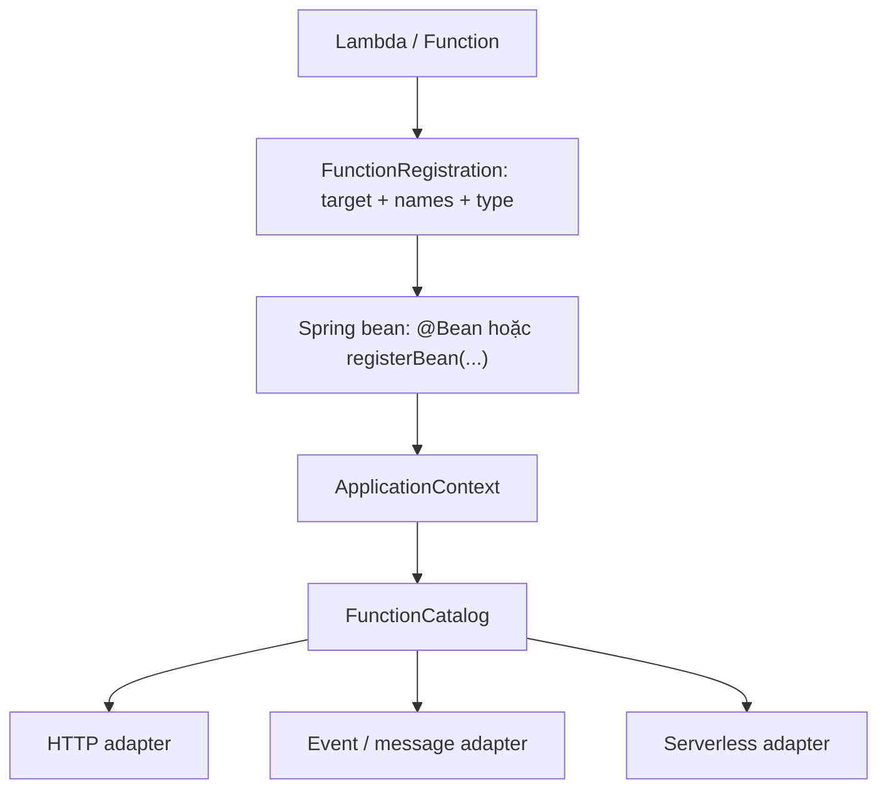

# FunctionRegistration với tên và kiểu tường minh

## Mục tiêu học tập

Trong **Spring Cloud Function**, việc viết logic nghiệp vụ dưới dạng `Supplier`, `Function` hoặc `Consumer` giúp tái sử dụng một hàm qua HTTP, sự kiện và các môi trường serverless. Nhưng để `FunctionCatalog` tìm và gọi đúng hàm, framework cần biết **hàm nào được đăng ký, tên công bố là gì và dữ liệu đi vào/đi ra có kiểu nào**.

Bài này thuộc chương **Đăng ký bean**, tập trung vào `FunctionRegistration`: đối tượng mô tả một hàm kèm **tên** và **kiểu tường minh**. Sau bài học, bạn có thể:

- Phân biệt `FunctionRegistration` với chính `Function<I, O>` và với `GenericApplicationContext.registerBean(...)`.
- Tạo `FunctionRegistration` cho lambda bằng tên `normalizeOrderId` và kiểu `String -> String`.
- Giải thích tại sao generic bị xóa ở runtime và vì sao message conversion cần thông tin kiểu.
- Đưa registration vào Spring context theo `@Bean` hoặc API đăng ký bean theo phong cách functional.
- Tra cứu qua `FunctionCatalog`, xử lý xung đột tên, chuyển đổi DTO và kiểm thử đăng ký.

## 1. Vì sao đôi khi khai báo một `Function` bean vẫn chưa đủ?

Xem hàm Java:

```java
Function<String, String> normalize =
        text -> text.trim().toUpperCase(Locale.ROOT);
```

Về mặt Java, compiler biết hàm có đầu vào và đầu ra `String`. Tuy nhiên, khi truyền lambda vào một API chỉ nhận lớp thô:

```java
context.registerBean(
        "normalizeOrderId",
        Function.class,
        () -> (Function<String, String>) text ->
                text.trim().toUpperCase(Locale.ROOT));
```

thì `Function.class` **không mang** hai tham số generic `String, String`. Do **type erasure**, không thể giả định Spring Cloud Function sẽ khôi phục chính xác kiểu vào/ra từ một lambda và một bean definition dùng raw `Function.class`.

Điều này ảnh hưởng đến hai nhu cầu khác nhau:

1. **Tên để tìm hàm:** `FunctionCatalog.lookup("normalizeOrderId")` cần xác định hàm mà lời gọi muốn sử dụng. Các adapter còn có thể chọn hàm bằng cấu hình `spring.cloud.function.definition`.
2. **Kiểu để chuyển đổi payload:** khi đầu vào là JSON hoặc một message từ broker, adapter/catalog có thể cần biết kiểu đích như `OrderCommand` để chuyển đổi dữ liệu trước khi gọi `apply(...)`.

Với một phương thức `@Bean` có chữ ký đầy đủ như `Function<OrderCommand, OrderResult>`, Spring thường có thể phân tích thông tin generic trên phương thức. Nhưng khi đăng ký **lambda trực tiếp, hàm tải động hoặc bean definition kiểu thô**, việc cung cấp metadata một cách chủ động giúp tránh phụ thuộc vào suy luận kiểu ở runtime.

Đây là bài toán mà `FunctionRegistration` giải quyết.

## 2. `FunctionRegistration` là gì?

`org.springframework.cloud.function.context.FunctionRegistration<T>` mô tả một hàm đích `T` cùng các thông tin Spring Cloud Function cần khi đăng ký hàm, đặc biệt là **tên** và **kiểu**.

Ví dụ cú pháp thường thấy trong các phiên bản Spring Cloud Function cung cấp `FunctionType`:

```java
Function<String, String> target =
        text -> text.trim().toUpperCase(Locale.ROOT);

FunctionRegistration<Function<String, String>> registration =
        new FunctionRegistration<>(target, "normalizeOrderId")
                .type(FunctionType.from(String.class).to(String.class));
```

Ở đây:

| Thành phần | Ý nghĩa |
| --- | --- |
| `target` | Đối tượng hàm nghiệp vụ, gọi bằng `apply(...)` |
| `"normalizeOrderId"` | Tên công bố cho Spring Cloud Function, dùng trong catalog/cấu hình adapter |
| `FunctionType.from(String.class).to(String.class)` | Metadata tường minh về kiểu vào và kiểu ra |
| `FunctionRegistration<Function<String, String>>` | Đối tượng đăng ký chứa hàm và metadata của nó |

**Điểm phân biệt quan trọng:** `FunctionRegistration` thuộc **Spring Cloud Function**; `GenericApplicationContext.registerBean(...)` thuộc **Spring Framework**. Tên gần giống nhau nhưng chúng có nhiệm vụ khác nhau:

- `FunctionRegistration` mô tả **hàm nào, tên gì, nhận và trả kiểu nào**.
- `registerBean(...)` đưa một **định nghĩa bean** vào Spring application context.
- `FunctionCatalog` là nơi **tra cứu và chuẩn hóa lời gọi tới hàm** đã được Spring Cloud Function tiếp nhận.

Không nhất thiết phải dùng `GenericApplicationContext.registerBean(...)` mới được dùng `FunctionRegistration`: một phương thức `@Bean` cũng có thể trả về `FunctionRegistration`.



Sơ đồ chỉ mô tả các thành phần tham gia. Adapter phù hợp phải được cài đặt và cấu hình; riêng việc có `FunctionRegistration` **không tự mở HTTP endpoint hoặc kết nối message broker**.

## 3. Ví dụ hoàn chỉnh: đăng ký tên và kiểu bằng `@Bean`

Ta triển khai hàm chuẩn hóa mã đơn hàng. Hàm nhận chuỗi, loại bỏ khoảng trắng hai đầu, chuyển thành chữ hoa theo `Locale.ROOT`.

Ví dụ Spring Boot dưới đây giả định dự án đã có **Spring Cloud Function Context** và các phiên bản Spring Boot/Spring Cloud Function tương thích. Phần mềm dùng Spring Cloud Function phiên bản khác cần kiểm tra lại API `FunctionRegistration`/`FunctionType` của chính phiên bản đó.

```java
package example.scf;

import java.util.Locale;
import java.util.function.Function;

import org.springframework.boot.ApplicationRunner;
import org.springframework.boot.SpringApplication;
import org.springframework.boot.autoconfigure.SpringBootApplication;
import org.springframework.cloud.function.context.FunctionCatalog;
import org.springframework.cloud.function.context.FunctionRegistration;
import org.springframework.cloud.function.context.FunctionType;
import org.springframework.context.annotation.Bean;

@SpringBootApplication
public class RegistrationApplication {

    public static void main(String[] args) {
        SpringApplication.run(RegistrationApplication.class, args);
    }

    @Bean
    public FunctionRegistration<Function<String, String>>
            normalizeRegistration() {

        Function<String, String> target =
                input -> input.trim().toUpperCase(Locale.ROOT);

        return new FunctionRegistration<>(target, "normalizeOrderId")
                .type(FunctionType.from(String.class).to(String.class));
    }

    @Bean
    public ApplicationRunner demo(FunctionCatalog catalog) {
        return args -> {
            Function<String, String> function =
                    catalog.lookup("normalizeOrderId");
            if (function == null) {
                throw new IllegalStateException(
                        "Không tìm thấy hàm normalizeOrderId");
            }

            System.out.println(function.apply("  ord-15  ")); // ORD-15
        };
    }
}
```

Phân tích:

1. Phương thức `normalizeRegistration()` tạo **một bean có kiểu `FunctionRegistration`**; tên bean theo `@Bean` mặc định là `normalizeRegistration`.
2. Constructor `new FunctionRegistration<>(target, "normalizeOrderId")` cung cấp **tên hàm trong Spring Cloud Function** là `normalizeOrderId`. Tên này được chọn tường minh và không cần giống tên phương thức `@Bean`.
3. `FunctionType.from(String.class).to(String.class)` mô tả phép biến đổi `String -> String`. Đây là phần quan trọng khi `target` là lambda khó phân tích đầy đủ qua reflection.
4. Spring Cloud Function tiếp nhận registration từ application context để công bố hàm thông qua `FunctionCatalog`; `ApplicationRunner` tra cứu đúng tên hàm rồi gọi.
5. Logic trong `target` không biết ai gọi nó: CLI, HTTP, event binder hay launcher serverless.

**Kết quả mong đợi trên console:** `ORD-15`. `ApplicationRunner` chạy sau khi Spring Boot đã khởi tạo context; nó là ví dụ gọi thử hàm, không bắt buộc cho một dịch vụ production.

### Vì sao có hai tên khác nhau?

Giả sử bạn đặt:

```java
@Bean
FunctionRegistration<Function<String, String>> normalizeRegistration() {
    // ...
    return new FunctionRegistration<>(target, "normalizeOrderId")
            .type(FunctionType.from(String.class).to(String.class));
}
```

`normalizeRegistration` là **tên bean chứa registration** theo cơ chế Spring; `normalizeOrderId` là **tên hàm mà registration công bố** để catalog tìm kiếm. Chúng có thể giống hoặc khác nhau, nhưng cần phân biệt rõ khi cấu hình adapter.

Nên giữ một quy ước đặt tên nhất quán: tên hàm nghiệp vụ đủ mô tả hành động, ví dụ `normalizeOrderId`; tên bean registration có thể thêm hậu tố `Registration` để người đọc biết đó là metadata. Tránh dựa vào việc framework suy ra tên khi bạn có thể cung cấp tên tường minh.

## 4. Ví dụ thứ hai: đăng ký `FunctionRegistration` theo phong cách functional

Trong ứng dụng dùng `ApplicationContextInitializer<GenericApplicationContext>`, có thể đăng ký **bean chứa `FunctionRegistration`** mà không viết phương thức `@Bean`.

```java
package example.scf;

import java.util.Locale;
import java.util.function.Function;

import org.springframework.cloud.function.context.FunctionRegistration;
import org.springframework.cloud.function.context.FunctionType;
import org.springframework.context.ApplicationContextInitializer;
import org.springframework.context.support.GenericApplicationContext;

public final class RegistrationInitializer
        implements ApplicationContextInitializer<GenericApplicationContext> {

    @Override
    public void initialize(GenericApplicationContext context) {
        context.registerBean(
                "normalizeOrderRegistration",
                FunctionRegistration.class,
                () -> {
                    Function<String, String> target =
                            input -> input.trim().toUpperCase(Locale.ROOT);

                    return new FunctionRegistration<>(target, "normalizeOrderId")
                            .type(FunctionType.from(String.class)
                                    .to(String.class));
                });
    }
}
```

Cơ chế ở đây gồm **hai tầng**:

- `context.registerBean("normalizeOrderRegistration", FunctionRegistration.class, factory)` đăng ký **Spring bean definition**, để container tạo đối tượng đăng ký khi thích hợp.
- Factory `() -> new FunctionRegistration<>(...)` tạo **metadata của hàm đích**, công bố tên `normalizeOrderId` và kiểu `String -> String` cho Spring Cloud Function.

Mặc dù đối số `FunctionRegistration.class` là một lớp không thể hiện đầy đủ generic của registration, `type(...)` đã cung cấp **metadata nghiệp vụ của hàm** một cách tường minh. Đừng nhầm generic của chính bean `FunctionRegistration` với thông tin kiểu input/output mà catalog cần.

Initializer phải được đưa vào quá trình bootstrap, ví dụ trong Spring Boot:

```java
SpringApplication app = new SpringApplication(RegistrationBootApp.class);
app.addInitializers(new RegistrationInitializer());
app.run(args);
```

`RegistrationBootApp` trong đoạn minh họa là lớp nguồn ứng dụng Spring Boot do dự án cung cấp. Có thể dùng bootstrap theo phong cách functional nếu phiên bản Spring Cloud Function hỗ trợ. **Không ghép nguyên trạng ví dụ `@Bean` và ví dụ initializer vào cùng một context**, vì cả hai cùng muốn công bố hàm `normalizeOrderId`.

Initializer chạy trước khi context được `refresh()`, nên registration có mặt trong giai đoạn Spring Cloud Function xây dựng/khởi tạo các thành phần tra cứu hàm. Tránh thêm hàm động sau khi context và các adapter đã chạy rồi mặc định catalog hoặc binder sẽ cập nhật tức thì.

## 5. Metadata kiểu quyết định khả năng chuyển đổi dữ liệu

Ví dụ `String -> String` dễ hiểu nhưng chưa cho thấy đầy đủ lợi ích của khai báo kiểu tường minh. Xét API nhận JSON đơn hàng:

```json
{
  "orderId": " ord-15 ",
  "quantity": 2
}
```

Giả sử ứng dụng Java 17+ định nghĩa:

```java
public record OrderCommand(String orderId, int quantity) {}
public record OrderReceipt(String normalizedId, boolean accepted) {}
```

Hàm xử lý đơn hàng có thể được mô tả bằng:

```java
Function<OrderCommand, OrderReceipt> target = command -> {
    String normalized =
            command.orderId().trim().toUpperCase(Locale.ROOT);
    return new OrderReceipt(normalized, command.quantity() > 0);
};

FunctionRegistration<Function<OrderCommand, OrderReceipt>> registration =
        new FunctionRegistration<>(target, "acceptOrder")
                .type(FunctionType.from(OrderCommand.class)
                        .to(OrderReceipt.class));
```

Khi một adapter nhận được JSON và cần chuyển payload thành `OrderCommand`, metadata `OrderCommand -> OrderReceipt` giúp Spring Cloud Function xác định kiểu cần chuyển. Mô tả này **không tự biến mọi chuỗi thành đối tượng Java**: chuyển đổi còn phụ thuộc bộ chuyển đổi, content type, serializer và cấu hình adapter.

### Với kiểu lồng nhau như `List<OrderCommand>` thì sao?

Không đủ để chỉ mô tả `List.class -> List.class` nếu framework cần biết **kiểu phần tử**. Java xóa tham số generic tại runtime; `List.class` không thể hiện `OrderCommand`.

Khi làm việc với `List<OrderCommand>`, `Message<OrderCommand>`, collection lồng nhau hoặc luồng reactive, cần giữ lại toàn bộ metadata kiểu tham số phù hợp với API của **phiên bản Spring Cloud Function** đang dùng. Có thể lấy kiểu từ chữ ký phương thức/lớp triển khai hoặc dùng cơ chế khai báo `Type`/metadata tường minh mà bản framework hỗ trợ. Đừng tự giả định rằng `FunctionType.from(List.class).to(List.class)` đủ để chuyển mọi cấu trúc JSON phức tạp.

### Khác biệt giữa kiểu do Java biết và kiểu Spring thấy

| Cách khai báo | Khả năng biết `I` và `O` ở runtime |
| --- | --- |
| `@Bean Function<OrderCommand, OrderReceipt> process()` | Thường suy ra được từ chữ ký generic của phương thức |
| Lớp `ProcessOrder implements Function<OrderCommand, OrderReceipt>` | Thường suy ra được từ lớp triển khai cụ thể |
| `registerBean("process", Function.class, () -> lambda)` | `Function.class` không chứa generic; suy luận có thể thiếu |
| `FunctionRegistration` với `type(...)` phù hợp | Công bố metadata kiểu rõ ràng cho Spring Cloud Function |

`FunctionRegistration` đặc biệt hữu ích khi hàm là **lambda**, được sinh lúc bootstrap hoặc được thu nạp từ một nguồn mà generic của bean definition không thể phân tích đáng tin cậy.

## 6. Tên tường minh, `FunctionCatalog` và cấu hình chọn hàm

### Tra cứu theo tên

Sau khi context và Spring Cloud Function được cấu hình, code sử dụng catalog có thể viết:

```java
Function<String, String> function =
        catalog.lookup("normalizeOrderId");

if (function == null) {
    throw new IllegalStateException("Thiếu hàm normalizeOrderId");
}

String result = function.apply("  ord-15  "); // ORD-15
```

Biến `catalog` cần được lấy từ Spring `ApplicationContext` hoặc được dependency injection vào một bean. `lookup` dùng **tên hàm mà registration đã công bố**, không mặc nhiên dùng tên phương thức tạo registration.

### Nhiều hàm cùng nằm trong một application context

Nếu ứng dụng có `normalizeOrderId`, `validateOrder` và `writeAudit`, một adapter có thể cần biết **hàm nào** được chọn. Spring Cloud Function hỗ trợ cấu hình chọn hàm, thường qua:

```properties
spring.cloud.function.definition=normalizeOrderId
```

Đối với nơi hỗ trợ composition, có thể chọn một chuỗi hàm khi kiểu tương thích:

```properties
spring.cloud.function.definition=normalizeOrderId|appendPrefix
```

Cấu hình trên chỉ có ý nghĩa nếu cả `normalizeOrderId` và `appendPrefix` đã được catalog nhận diện và có hợp đồng dữ liệu phù hợp. Nó **không tự tạo** bean hoặc registration cho hàm còn thiếu.

Một ví dụ tra cứu composition trực tiếp:

```java
Function<String, String> pipeline =
        catalog.lookup("normalizeOrderId|appendPrefix");
```

Trong đó `appendPrefix` là một hàm `Function<String, String>` khác đã được đăng ký. Kết quả của `normalizeOrderId` trở thành đầu vào của `appendPrefix`.

### Tên bean registration, tên function và URL không phải một thứ

| Loại tên | Ví dụ | Ai sử dụng? |
| --- | --- | --- |
| **Spring bean name** | `normalizeRegistration` | Container lưu và quản lý bean đăng ký |
| **Function registration name** | `normalizeOrderId` | Spring Cloud Function catalog và cấu hình chọn hàm |
| **HTTP endpoint/path** | `/normalizeOrderId` trong một cách cấu hình web phổ biến | HTTP adapter quyết định route; có thể cấu hình khác |

Nếu dùng Spring Cloud Function Web adapter và server đã chạy với ánh xạ phù hợp, có thể thử:

```bash
curl -X POST http://localhost:8080/normalizeOrderId \
  -H 'Content-Type: text/plain' \
  --data-binary '  ord-15  '
```

Kết quả mong đợi là `ORD-15`. **Chỉ đăng ký `FunctionRegistration` không đủ để ứng dụng phục vụ HTTP**: phải có adapter web, server và route tương ứng. Với Spring Cloud Stream hoặc serverless cũng cần binder/launcher và cấu hình riêng; logic `target` vẫn giữ nguyên.

## 7. Vấn đề thường gặp khi dùng `FunctionRegistration`

### 7.1. Chỉ tạo đối tượng registration nhưng không đưa vào Spring context

```java
var registration =
        new FunctionRegistration<>(target, "normalizeOrderId")
                .type(FunctionType.from(String.class).to(String.class));
```

Đoạn trên chỉ tạo một đối tượng Java. Nếu bạn không đưa nó vào Spring theo một cơ chế mà Spring Cloud Function tiếp nhận, `FunctionCatalog` không có lý do tự biết đến đối tượng cục bộ đó. Hãy đăng ký qua `@Bean`, initializer hoặc cơ chế registration phù hợp của framework.

### 7.2. Tin rằng tên bean chứa registration luôn chính là tên hàm

Ví dụ `@Bean normalizeRegistration()` không có nghĩa rằng tên công bố cho hàm là `normalizeRegistration`, khi registration đã chỉ định `"normalizeOrderId"`. Dùng tên tường minh trong constructor, đối chiếu tên trong `lookup` và cấu hình adapter.

### 7.3. Khai báo kiểu không đúng với hàm thực tế

Nếu lambda thực tế nhận `OrderCommand` nhưng metadata lại khai báo `String -> String`, một adapter có thể chuyển payload sai kiểu, dẫn đến `ClassCastException`, lỗi xử lý message hoặc kết quả không như mong đợi.

**Metadata kiểu không biến đổi chữ ký thực của lambda**. Hãy luôn đảm bảo `type(...)` mô tả đúng đầu vào/đầu ra của target.

### 7.4. Dùng raw `Function.class` rồi trông đợi chuyển đổi DTO

`Function.class` chỉ nói rằng bean là một `Function`, chưa nói dữ liệu là `OrderCommand` hay `OrderReceipt`. Nếu chọn đăng ký lambda theo kiểu này, hãy cung cấp metadata kiểu rõ ràng thông qua cơ chế framework hỗ trợ.

### 7.5. Trùng tên hàm hoặc đăng ký target hai lần

Đăng ký vừa một bean `Function` trực tiếp vừa một `FunctionRegistration` cho cùng target/tên, hoặc dùng hai registration trùng tên, có thể khiến catalog xử lý tên không như kỳ vọng. Đừng dựa vào cơ chế ghi đè không rõ ràng: mỗi tên hàm được công bố nên có chủ sở hữu rõ ràng.

### 7.6. Sao chép API giữa các dòng phiên bản

`FunctionRegistration`, `FunctionType` và cách khai báo metadata đã có thay đổi giữa các thế hệ Spring Cloud Function. Ví dụ trong bài minh họa cách dùng `FunctionType.from(...).to(...)` ở những phiên bản hỗ trợ API này. Khi biên dịch một dự án thực tế, xác minh package/class/method có sẵn và chọn một cặp phiên bản Spring Boot/Spring Cloud Function tương thích. Nếu cần mô tả generic lồng nhau hoặc reactive type, hãy dùng đúng API loại `Type` mà phiên bản đó chấp nhận.

## 8. Kiểm thử đăng ký qua `FunctionCatalog`

Một bài unit test chỉ gọi `target.apply(...)` sẽ kiểm tra logic Java, nhưng **không xác minh** tên và metadata đã được catalog sử dụng. Cần có kiểm thử tích hợp dựng Spring context với Spring Cloud Function.

Với ví dụ `RegistrationApplication` dùng `@SpringBootApplication` phía trên, có thể kiểm tra bằng JUnit 5 và Spring Boot Test:

```java
package example.scf;

import static org.junit.jupiter.api.Assertions.assertEquals;
import static org.junit.jupiter.api.Assertions.assertNotNull;

import java.util.function.Function;
import org.junit.jupiter.api.Test;
import org.springframework.beans.factory.annotation.Autowired;
import org.springframework.boot.test.context.SpringBootTest;
import org.springframework.cloud.function.context.FunctionCatalog;

@SpringBootTest(
        classes = RegistrationApplication.class,
        webEnvironment = SpringBootTest.WebEnvironment.NONE)
class FunctionRegistrationIntegrationTest {

    @Autowired
    FunctionCatalog catalog;

    @Test
    void findsFunctionByExplicitName() {
        Function<String, String> fn = catalog.lookup("normalizeOrderId");

        assertNotNull(fn);
        assertEquals("ORD-15", fn.apply("  ord-15  "));
    }
}
```

Test xác nhận **registration đã vào context, tên đã được catalog công bố và hàm có thể được gọi**. Nó chưa kiểm tra HTTP request hoặc chuyển đổi JSON thành DTO. Để kiểm tra kiểu metadata trong tình huống thực tế, cần thêm integration test với adapter và content type đang dùng, ví dụ gửi JSON `OrderCommand` qua web adapter và xác nhận response `OrderReceipt`.

Với initializer, hãy đưa initializer vào test context bằng cấu hình phù hợp; `@SpringBootTest` không nhất thiết chạy `main` nơi bạn gọi `SpringApplication.addInitializers(...)`.

### Bảng kiểm khi hàm không được tìm thấy

| Điều cần xác minh | Câu hỏi nên đặt ra |
| --- | --- |
| Registration bean | Đối tượng `FunctionRegistration` đã được Spring context tạo và Spring Cloud Function tiếp nhận chưa? |
| Tên hàm | Tên chỉ định trong registration có khớp với `catalog.lookup(...)` hoặc `spring.cloud.function.definition` không? |
| Kiểu dữ liệu | `type(...)` có phản ánh đúng target, kể cả kiểu generic lồng nhau không? |
| Context startup | Initializer được gọi trước `refresh()` chưa, và dependency Spring Cloud Function có đầy đủ không? |
| Adapter | HTTP/message/serverless adapter được cài và cấu hình đúng chưa? |
| Xung đột | Có bean hàm/registration nào khác dùng cùng tên không? |

## 9. Bài tập áp dụng

### Bài tập 1 — Đăng ký một lambda

Viết `Function<Integer, Integer>` nhận số lượng sản phẩm và cộng thêm một đơn vị. Đăng ký với tên `incrementQuantity`, chỉ rõ kiểu `Integer -> Integer` và tra cứu bằng `FunctionCatalog`. Với đầu vào `4`, kết quả mong đợi là `5`. Hãy đảm bảo dữ liệu đầu vào đúng kiểu `Integer` trong bài thử trực tiếp.

Gợi ý phần khai báo:

```java
Function<Integer, Integer> increment = amount -> amount + 1;

FunctionRegistration<Function<Integer, Integer>> registration =
        new FunctionRegistration<>(increment, "incrementQuantity")
                .type(FunctionType.from(Integer.class).to(Integer.class));
```

Bạn vẫn cần đưa `registration` vào Spring context qua `@Bean` hoặc đăng ký bean phù hợp trước khi dùng catalog.

### Bài tập 2 — Bắt lỗi metadata sai

Giả sử `target` có kiểu `Function<OrderCommand, OrderReceipt>`, nhưng người lập trình ghi:

```java
new FunctionRegistration<>(target, "acceptOrder")
        .type(FunctionType.from(String.class).to(String.class));
```

Hãy giải thích vì sao code có thể vẫn tạo được một đối tượng registration nhưng sai khi adapter chuyển JSON thành `String` hoặc catalog sử dụng dữ liệu theo kiểu đã khai báo. Sửa lại metadata thành `OrderCommand.class -> OrderReceipt.class`, rồi viết kiểm thử bằng payload DTO thực tế.

### Bài tập 3 — Phân biệt ba loại tên

Một phương thức `@Bean` có tên `paymentRegistration`, trả về `new FunctionRegistration<>(target, "validatePayment")`. Nếu HTTP adapter dùng route mặc định dựa vào tên hàm, nên thử route nào? **`/validatePayment`**, khi web adapter có cấu hình route phù hợp. Khi gọi catalog, dùng `lookup("validatePayment")`.

## 10. Tự kiểm tra

1. **`FunctionRegistration` có tự tạo HTTP endpoint không?** Không. Nó mô tả hàm và metadata; endpoint phụ thuộc adapter web và cấu hình chạy HTTP.
2. **Vì sao `FunctionRegistration` cần thông tin kiểu tường minh khi target là lambda?** Vì generic có thể không suy ra đầy đủ ở runtime; adapter cần kiểu đích để chuyển đổi payload.
3. **Tên Spring bean `normalizeRegistration` có bắt buộc trùng tên function `normalizeOrderId` không?** Không. Tên registration của hàm đã được đặt tường minh.
4. **`GenericApplicationContext.registerBean(...)` có phải phương thức của `FunctionRegistration` không?** Không. Đây là API đăng ký bean definition của Spring Framework.
5. **Metadata `FunctionType.from(String.class).to(String.class)` có phù hợp với `Function<OrderCommand, OrderReceipt>` không?** Không. Metadata phải phản ánh kiểu thực của target.
6. **Một unit test chỉ gọi `new Target().apply(...)` đã chứng minh catalog đăng ký thành công chưa?** Chưa. Phải khởi tạo Spring Cloud Function context và tra cứu qua catalog.

**Ghi nhớ:** `Function<I, O>` xác định **logic nghiệp vụ**; `FunctionRegistration` xác định **hàm nào được công bố, dưới tên gì và với kiểu nào**; Spring `ApplicationContext` lưu các bean; `FunctionCatalog` cùng adapter giúp **tìm và gọi hàm qua những cơ chế thực thi khác nhau**.
