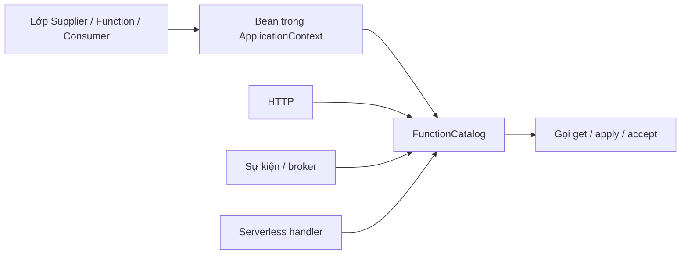

# Đăng ký lớp triển khai trực tiếp `Supplier`, `Function` hoặc `Consumer`

## Mục tiêu bài học

Spring Cloud Function cho phép xây dựng logic nghiệp vụ tái sử dụng thông qua `java.util.function.Supplier`, `Function` và `Consumer`, đồng thời tách phần xử lý khỏi cách kích hoạt qua HTTP, sự kiện hay môi trường serverless. Trong chương **Đăng ký bean**, một kỹ thuật quan trọng là **viết lớp Java triển khai trực tiếp các giao diện này rồi đăng ký chính lớp đó làm Spring bean**.

Sau bài học, bạn có thể:

- Phân biệt **một lớp triển khai giao diện hàm**, **một đối tượng Java** và **một bean được Spring quản lý**.
- Viết các lớp cụ thể `Supplier<O>`, `Function<I, O>`, `Consumer<I>`, đăng ký chúng bằng `@Component`, `@Bean` hoặc `GenericApplicationContext.registerBean(...)`.
- Dùng `FunctionCatalog` tìm hàm theo tên và gọi từng loại hàm.
- Hiểu vì sao lớp triển khai có generic rõ ràng giúp Spring Cloud Function nhận diện kiểu đầu vào/đầu ra.
- Xử lý dependency injection, vòng đời, trạng thái giữa các lần gọi, lỗi nghiệp vụ và các giới hạn khi ghép hàm hoặc kết nối adapter.

## 1. Lớp triển khai trực tiếp là gì?

Thay vì chỉ trả về lambda từ phương thức `@Bean`, bạn có thể đặt logic trong một lớp Java có tên rõ ràng:

```java
import java.util.Locale;
import java.util.function.Function;

public final class NormalizeOrderId implements Function<String, String> {

    @Override
    public String apply(String value) {
        return value.trim().toUpperCase(Locale.ROOT);
    }
}
```

`NormalizeOrderId` đã là một `Function<String, String>` hợp lệ, nhưng **chưa tự động trở thành Spring bean**. Câu lệnh `new NormalizeOrderId()` chỉ tạo một đối tượng Java. Để Spring Cloud Function phát hiện hàm thông qua application context, ta cần đưa lớp hoặc instance của nó vào hệ thống quản lý bean bằng một cơ chế đăng ký phù hợp.

Ba giao diện có hợp đồng khác nhau:

| Giao diện | Phương thức cốt lõi | Dữ liệu vào | Dữ liệu ra | Tình huống |
| --- | --- | --- | --- | --- |
| `Supplier<O>` | `O get()` | Không có tham số | Một giá trị kiểu `O` | Sinh sự kiện hoặc lấy đơn hàng cần xử lý |
| `Function<I, O>` | `O apply(I input)` | Một giá trị kiểu `I` | Một giá trị kiểu `O` | Chuyển đơn hàng thành hóa đơn |
| `Consumer<I>` | `void accept(I input)` | Một giá trị kiểu `I` | Không có kết quả nghiệp vụ | Ghi audit hoặc gửi thông báo |

Tên `Supplier` trong một `registerBean(..., SomeClass::new)` cũng có thể chỉ **factory tạo đối tượng bean**. Không được nhầm factory đó với một **bean nghiệp vụ kiểu `Supplier<Order>`** mà Spring Cloud Function sẽ gọi `get()`.

## 2. Ví dụ thực tế: ba lớp xử lý đơn hàng

Xét một quy trình giản lược: tạo đơn hàng mẫu, tính tiền và ghi dấu vết xử lý. Mỗi bước có trách nhiệm riêng, có thể unit test mà không khởi động Spring.

Ví dụ dùng **Java 17+** (vì sử dụng `record`), Spring Boot và Spring Cloud Function Context với các phiên bản tương thích. Các tệp Java cùng thuộc package `example.orders`.

### 2.1. Định nghĩa dữ liệu

File `Order.java`:

```java
package example.orders;

public record Order(String id, int quantity) {
}
```

File `Receipt.java`:

```java
package example.orders;

public record Receipt(String orderId, long totalCents) {
}
```

Mỗi record `public` được đặt trong file Java có cùng tên để dùng giữa các package và thuận tiện khi adapter JSON cần ánh xạ dữ liệu. Với dự án thực tế, có thể bổ sung validation cho `id` và `quantity` ở biên nhận dữ liệu.

### 2.2. `Supplier<Order>`: tạo dữ liệu khi được gọi

File `SupplyOrder.java`:

```java
package example.orders;

import java.util.concurrent.atomic.AtomicLong;
import java.util.function.Supplier;

public final class SupplyOrder implements Supplier<Order> {

    private final AtomicLong sequence = new AtomicLong();

    @Override
    public Order get() {
        long next = sequence.incrementAndGet();
        return new Order("ORD-" + next, 2);
    }
}
```

`get()` không nhận tham số và trả về một `Order`. Trong ví dụ, các lần gọi nối tiếp tạo `ORD-1`, `ORD-2`, ...; `AtomicLong` làm phép tăng an toàn khi có nhiều luồng.

Điều này **không có nghĩa** Spring Cloud Function sẽ tự động gọi `get()` theo lịch. Bean `Supplier` chỉ cung cấp khả năng sinh dữ liệu; cách gọi theo yêu cầu, polling hay sự kiện phụ thuộc adapter, binder hoặc mã ứng dụng.

### 2.3. `Function<Order, Receipt>`: biến đổi dữ liệu

File `PriceOrder.java`:

```java
package example.orders;

import java.util.function.Function;

public final class PriceOrder implements Function<Order, Receipt> {

    private static final long UNIT_PRICE_CENTS = 12_000L;

    @Override
    public Receipt apply(Order order) {
        if (order == null || order.quantity() <= 0) {
            throw new IllegalArgumentException("Đơn hàng không hợp lệ");
        }

        long total = Math.multiplyExact(
                (long) order.quantity(), UNIT_PRICE_CENTS);

        return new Receipt(order.id(), total);
    }
}
```

`apply(...)` nhận `Order` và trả `Receipt`. `Math.multiplyExact` thực hiện phép nhân có kiểm tra tràn số nguyên, hữu ích nếu công thức hoặc phạm vi số thay đổi về sau. Với `quantity = 2`, tổng tiền là `24_000` cent.

Logic tính tiền là phép biến đổi thuần túy theo đầu vào: với cùng đơn hàng hợp lệ, kết quả như nhau. Đây là thuộc tính thuận lợi cho việc kiểm thử và tái sử dụng qua nhiều giao thức.

### 2.4. `Consumer<Receipt>`: thực hiện hành động phụ

File `AuditReceipt.java`:

```java
package example.orders;

import java.util.function.Consumer;

public final class AuditReceipt implements Consumer<Receipt> {

    @Override
    public void accept(Receipt receipt) {
        System.out.println(
                "AUDIT " + receipt.orderId()
                + ", amount=" + receipt.totalCents());
    }
}
```

`accept(...)` không trả về kết quả nghiệp vụ. `System.out.println` chỉ được dùng để dễ quan sát; trong ứng dụng thật nên sử dụng logging, kho lưu audit hoặc một client có cơ chế xử lý lỗi phù hợp.

Một `Consumer` có side effect cần chú ý đến **retry và idempotency**: cùng một message có thể được chuyển đến nhiều lần tùy môi trường, nên thao tác ghi/sử dụng dịch vụ ngoài phải có cách tránh xử lý trùng nếu nghiệp vụ yêu cầu.

## 3. Đăng ký trực tiếp ba lớp qua `GenericApplicationContext`

Ta sử dụng `ApplicationContextInitializer<GenericApplicationContext>` để đăng ký **lớp cụ thể**, không đăng ký raw `Supplier.class`, `Function.class` hay `Consumer.class`.

File `OrderFunctionInitializer.java`:

```java
package example.orders;

import org.springframework.context.ApplicationContextInitializer;
import org.springframework.context.support.GenericApplicationContext;

public final class OrderFunctionInitializer
        implements ApplicationContextInitializer<GenericApplicationContext> {

    @Override
    public void initialize(GenericApplicationContext context) {
        context.registerBean("supplyOrder", SupplyOrder.class);
        context.registerBean("priceOrder", PriceOrder.class);
        context.registerBean("auditReceipt", AuditReceipt.class);
    }
}
```

Mỗi dòng `registerBean(name, concreteClass)` tạo một **bean definition** để Spring khởi tạo và quản lý instance trong quá trình refresh context:

| Bean name | Bean class | Kiểu hàm mà lớp triển khai |
| --- | --- | --- |
| `supplyOrder` | `SupplyOrder.class` | `Supplier<Order>` |
| `priceOrder` | `PriceOrder.class` | `Function<Order, Receipt>` |
| `auditReceipt` | `AuditReceipt.class` | `Consumer<Receipt>` |

Đăng ký bằng lớp cụ thể giúp metadata `Supplier<Order>`, `Function<Order, Receipt>` và `Consumer<Receipt>` tồn tại trên định nghĩa lớp để framework phân tích bằng reflection. Nếu đăng ký bean bằng raw `Function.class` chứa một lambda, Spring có thể không có đủ thông tin generic để chuyển JSON thành `Order` hoặc `Receipt`.

Initializer chạy **trước khi context refresh**, vì vậy đây là thời điểm thích hợp để khai báo bean definitions. `registerBean` không nhất thiết chạy constructor ngay: với singleton thông thường, Spring khởi tạo bean khi refresh hoặc khi cần theo scope và cấu hình lazy.

Đối với lớp có constructor không tham số như ba lớp trên, biến thể `registerBean(String, Class)` là đủ. Khi muốn tự quyết định cách tạo instance, có thể truyền factory:

```java
context.registerBean(
        "priceOrder",
        PriceOrder.class,
        PriceOrder::new);
```

Hãy dùng **một cách đăng ký** cho mỗi bean name. Đừng thêm dòng factory này vào initializer đã đăng ký `priceOrder` trước đó.

## 4. Khởi động ứng dụng và truy cập bằng `FunctionCatalog`

File `OrderFunctionsApplication.java`:

```java
package example.orders;

import java.util.function.Consumer;
import java.util.function.Function;
import java.util.function.Supplier;

import org.springframework.boot.SpringApplication;
import org.springframework.boot.autoconfigure.SpringBootApplication;
import org.springframework.cloud.function.context.FunctionCatalog;
import org.springframework.context.ConfigurableApplicationContext;

@SpringBootApplication
public class OrderFunctionsApplication {

    public static void main(String[] args) {
        SpringApplication app =
                new SpringApplication(OrderFunctionsApplication.class);

        app.addInitializers(new OrderFunctionInitializer());

        ConfigurableApplicationContext context = app.run(args);
        FunctionCatalog catalog = context.getBean(FunctionCatalog.class);

        Supplier<Order> source = catalog.lookup("supplyOrder");
        Function<Order, Receipt> calculate = catalog.lookup("priceOrder");
        Consumer<Receipt> audit = catalog.lookup("auditReceipt");

        if (source == null || calculate == null || audit == null) {
            throw new IllegalStateException(
                    "Thiếu một hoặc nhiều hàm trong FunctionCatalog");
        }

        Order order = source.get();
        Receipt receipt = calculate.apply(order);
        audit.accept(receipt);
    }
}
```

**Kết quả minh họa** khi chạy một lần:

```text
AUDIT ORD-1, amount=24000
```

Các bước xử lý:

1. `SpringApplication` tạo và refresh application context.
2. `OrderFunctionInitializer` đăng ký ba bean theo tên.
3. Spring Cloud Function nhận diện các bean phù hợp và công bố chúng qua `FunctionCatalog`, khi dependency và auto-configuration cần thiết đã có.
4. Ứng dụng tìm từng hàm bằng tên, sau đó gọi `get()`, `apply(...)`, `accept(...)` theo đúng hợp đồng Java.

Ví dụ trên chủ động gọi ba hàm để minh họa, nên **không cần HTTP server**. Nếu chạy một ứng dụng CLI chỉ dùng một lượt, có thể đóng context sau khi hoàn thành. Trong dịch vụ web hoặc consumer cần chạy liên tục, để Spring Boot quản lý vòng đời thay vì đóng context ngay sau `run()`.

**Phân biệt hai cách tra cứu:** `context.getBean("priceOrder")` trả đối tượng bean do Spring quản lý, còn `catalog.lookup("priceOrder")` trả một hàm được Spring Cloud Function nhận diện và có thể bọc để hỗ trợ chuyển đổi payload, message và composition. Trong bài tập trực tiếp với các kiểu `Order`/`Receipt`, ta sử dụng kết quả `lookup` theo các giao diện Java tương ứng.

## 5. Các cách đăng ký lớp triển khai khác

### Cách A — `@Component` và component scanning

Nếu dự án dùng component scanning của Spring Boot, có thể đánh dấu trực tiếp lớp triển khai:

```java
import org.springframework.stereotype.Component;
import java.util.function.Function;

@Component("priceOrder")
public final class PriceOrder implements Function<Order, Receipt> {
    @Override
    public Receipt apply(Order order) {
        return new Receipt(
                order.id(),
                Math.multiplyExact((long) order.quantity(), 12_000L));
    }
}
```

`@SpringBootApplication` sẽ quét component trong package phù hợp và đăng ký bean. Cần đặt lớp trong phạm vi quét của ứng dụng hoặc cấu hình scan bổ sung. `@Component("priceOrder")` đặt tên bean tường minh; nếu không đặt, Spring sử dụng quy tắc đặt tên bean mặc định.

Đây là **phương án thay thế** cho initializer ở phần trước: nếu cùng lớp đã được scan thành bean tên `priceOrder`, không đăng ký tiếp một bean trùng tên bằng `registerBean`.

### Cách B — `@Bean` trả về lớp triển khai cụ thể

Trong một lớp cấu hình Spring:

```java
import org.springframework.context.annotation.Bean;
import org.springframework.context.annotation.Configuration;

@Configuration
class FunctionsConfiguration {

    @Bean
    PriceOrder priceOrder() {
        return new PriceOrder();
    }
}
```

Bean có lớp cụ thể `PriceOrder`, nên quan hệ `Function<Order, Receipt>` vẫn có thể được phân tích từ kiểu lớp. Cách này phù hợp khi muốn cấu hình rõ ràng bằng annotation hoặc cần truyền các dependency khi tạo bean.

### Cách C — `registerBean(...)` không cần annotation trên lớp

Cách ở phần 3 dùng:

```java
context.registerBean("priceOrder", PriceOrder.class);
```

Nó phù hợp khi danh sách hàm được lựa chọn bằng mã Java trong lúc bootstrap hoặc khi không muốn đặt annotation Spring lên lớp nghiệp vụ.

| Tiêu chí | `@Component` | `@Bean` | `registerBean` với class |
| --- | --- | --- | --- |
| Nơi định nghĩa bean | Annotation trên lớp hàm | Phương thức cấu hình | Initializer hoặc mã tạo context |
| Yêu cầu class nằm trong component scan | Có, trừ khi đăng ký theo cơ chế khác | Không | Không |
| Có thể đặt tên tường minh | Có | Có | Có |
| Có thể giữ kiểu generic từ lớp triển khai | Có | Có | Có |
| Spring quản lý vòng đời | Có | Có | Có |
| Phù hợp | Ứng dụng Spring thông thường | Cấu hình có dependency rõ ràng | Đăng ký bean bằng mã khi bootstrap |

**Không có cách nào trong ba cách tự quyết định giao thức gọi hàm.** HTTP, broker message và serverless vẫn cần adapter/launcher tương ứng.

## 6. Generic, dependency injection và vòng đời bean

### 6.1. Để Spring biết kiểu hàm thực

Khai báo:

```java
public final class PriceOrder implements Function<Order, Receipt> {
    // ...
}
```

cho phép hệ thống kiểu của Java và reflection thể hiện trực tiếp rằng `PriceOrder` nhận `Order`, trả `Receipt`. Metadata này hữu ích khi Spring Cloud Function chuyển đổi payload dựa trên content type trước khi gọi hàm.

Không nên thay class cụ thể bằng raw interface mà không cân nhắc metadata:

```java
// Có thể không giữ được thông tin Order -> Receipt:
context.registerBean(
        "priceOrder",
        Function.class,
        () -> (Function<Order, Receipt>) order ->
                new Receipt(order.id(), order.quantity() * 12_000L));
```

Việc ép kiểu lambda ở Java không bảo đảm framework thấy đủ tham số kiểu khi chạy. Nếu thực sự cần đăng ký lambda động, hãy xem cơ chế metadata kiểu tường minh như `FunctionRegistration` ở phiên bản Spring Cloud Function đang sử dụng.

Với kiểu generic lồng nhau như `List<Order>` hoặc `Message<Order>`, phải giữ cả thông tin kiểu phần tử/nội dung khi adapter cần chuyển đổi JSON. Chỉ nhìn `List.class` không đủ để xác định `Order`.

### 6.2. Lớp hàm có thể nhận dependency qua constructor

Giả sử giá đơn vị do một service cấu hình:

```java
public interface PricePolicy {
    long priceInCents(Order order);
}

public final class PriceOrder implements Function<Order, Receipt> {
    private final PricePolicy policy;

    public PriceOrder(PricePolicy policy) {
        this.policy = policy;
    }

    @Override
    public Receipt apply(Order order) {
        long total = Math.multiplyExact(
                (long) order.quantity(),
                policy.priceInCents(order));
        return new Receipt(order.id(), total);
    }
}
```

Nếu `PricePolicy` là một Spring bean và bạn đăng ký `PriceOrder.class` mà không truyền supplier riêng, Spring có thể dùng constructor injection để cấp dependency phù hợp. Nếu cung cấp factory, phải tự xử lý dependency:

```java
context.registerBean(
        "priceOrder",
        PriceOrder.class,
        () -> new PriceOrder(context.getBean(PricePolicy.class)));
```

Factory được thực thi **khi container tạo bean**, khác với việc gọi `context.getBean(PricePolicy.class)` ngay trong thân `initialize(...)` trước `refresh()`, khi nhiều bean definition khác có thể chưa được nạp.

Các đoạn trong tiểu mục này là **biến thể thiết kế**, thay thế lớp `PriceOrder` không tham số ở ví dụ hoàn chỉnh; không ghép tất cả phiên bản trùng tên vào cùng dự án.

### 6.3. Singleton và trạng thái giữa các lần gọi

Spring bean thường có scope `singleton` theo mặc định, nghĩa là cùng instance có thể phục vụ nhiều lần gọi và nhiều luồng.

- `PriceOrder` gần như không giữ trạng thái thay đổi, nên dễ gọi đồng thời.
- `SupplyOrder` giữ `AtomicLong`: có trạng thái, nhưng phép tăng là thread-safe. Đây chỉ là ví dụ trong bộ nhớ, **không bảo đảm ID toàn cục** nếu ứng dụng chạy nhiều instance hoặc khởi động lại.
- `AuditReceipt` có side effect: cần cân nhắc xử lý trùng, ghi lỗi và retry khi kết nối hệ thống ngoài.

Tránh dùng trường `int counter` rồi `counter++` trong singleton Supplier nếu có nhiều luồng gọi. Nếu nguồn dữ liệu có khả năng thất bại, hãy xây dựng chính sách lỗi và retry tại tầng phù hợp với giao thức; không giả định catalog tự bảo đảm tính đúng đắn của giao dịch.

## 7. Tái sử dụng cùng lớp trong HTTP, sự kiện và serverless

Sau khi ba lớp trở thành Spring bean và được Spring Cloud Function nhận diện, adapter có thể hướng lời gọi đến hàm theo tên hoặc cấu hình `spring.cloud.function.definition`.



Trong một ứng dụng có nhiều hàm, adapter có thể yêu cầu chọn đích tường minh:

```properties
spring.cloud.function.definition=priceOrder
```

Giá trị này **chọn một hàm đã có** trong catalog, không tự tạo bean mới. Cách chọn binding hay mapping chính xác phụ thuộc adapter.

Nếu thêm Spring Cloud Function Web adapter và HTTP server, với ánh xạ phù hợp có thể gọi `priceOrder` qua POST:

```bash
curl -X POST http://localhost:8080/priceOrder \
  -H 'Content-Type: application/json' \
  --data '{"id":"ORD-7","quantity":2}'
```

Kết quả nghiệp vụ mong đợi, sau khi adapter và bộ chuyển đổi JSON hoạt động đúng, có dữ liệu tương đương:

```json
{"orderId":"ORD-7","totalCents":24000}
```

Đây là ví dụ minh họa endpoint của web adapter; route và cách serialize thực tế phụ thuộc phiên bản/cấu hình. Chỉ đăng ký bean trong Spring Cloud Function Context **không tự mở cổng HTTP**.

Với Spring Cloud Stream, một binder có thể kích hoạt Supplier hoặc chuyển message tới Function/Consumer theo binding, lịch polling và cấu hình của môi trường. Với serverless, launcher hoặc handler do nền tảng cung cấp nhận event và gọi hàm qua Spring Cloud Function. Các bean nghiệp vụ vẫn không cần biết dữ liệu đến từ đâu.

**Về composition:** khi có các kiểu tương thích, catalog có thể hỗ trợ ghép hàm theo biểu thức như `source|transform`, nhưng cần hiểu semantics của Supplier và Consumer trong adapter cụ thể. Không phải cứ có ba lớp `Supplier<Order>`, `Function<Order,Receipt>`, `Consumer<Receipt>` là mọi endpoint hoặc binder sẽ tự chạy cả chuỗi theo đúng thứ tự. Ví dụ ở phần 4 đã **gọi ba hàm tuần tự bằng Java** để minh họa quy trình một cách tường minh.

## 8. Kiểm thử đúng hai tầng

### Kiểm thử logic Java không cần Spring

Với JUnit 5, có thể kiểm thử trực tiếp các lớp:

```java
import static org.junit.jupiter.api.Assertions.assertEquals;
import org.junit.jupiter.api.Test;

class DirectFunctionsUnitTest {

    @Test
    void calculatesReceipt() {
        PriceOrder function = new PriceOrder();

        Receipt receipt =
                function.apply(new Order("ORD-7", 2));

        assertEquals("ORD-7", receipt.orderId());
        assertEquals(24_000L, receipt.totalCents());
    }
}
```

Test này xác minh logic `apply(...)`, chưa kiểm chứng Spring đã tạo bean hoặc `FunctionCatalog` thấy hàm. `SupplyOrder` nên được kiểm tra thêm rằng hai lần `get()` tạo ID khác nhau; `AuditReceipt` trong ứng dụng thực tế nên kiểm tra tương tác với service/mock thay cho việc assert console.

### Kiểm thử tích hợp tên bean và catalog

Một Spring Boot integration test có thể gắn initializer vào test context:

```java
import static org.junit.jupiter.api.Assertions.assertEquals;
import static org.junit.jupiter.api.Assertions.assertNotNull;

import java.util.function.Function;
import org.junit.jupiter.api.Test;
import org.springframework.beans.factory.annotation.Autowired;
import org.springframework.boot.test.context.SpringBootTest;
import org.springframework.cloud.function.context.FunctionCatalog;
import org.springframework.test.context.ContextConfiguration;

@SpringBootTest(
        classes = OrderFunctionsApplication.class,
        webEnvironment = SpringBootTest.WebEnvironment.NONE)
@ContextConfiguration(initializers = OrderFunctionInitializer.class)
class CatalogRegistrationTest {

    @Autowired
    FunctionCatalog catalog;

    @Test
    void discoversConcreteFunction() {
        Function<Order, Receipt> function =
                catalog.lookup("priceOrder");

        assertNotNull(function);
        assertEquals(
                24_000L,
                function.apply(new Order("ORD-7", 2)).totalCents());
    }
}
```

Test cần dependency Spring Boot Test/JUnit và Spring Cloud Function tương thích. `@ContextConfiguration(initializers = ...)` quan trọng vì test context không bắt buộc chạy `main` nơi ví dụ gọi `addInitializers(...)`. Test này chỉ kiểm tra đăng ký/catalog, **chưa thay thế kiểm thử adapter HTTP, message hoặc serverless**.

## 9. Những lỗi thường gặp

| Triệu chứng | Nguyên nhân có thể | Cách khắc phục |
| --- | --- | --- |
| `catalog.lookup("priceOrder")` trả `null` | Lớp chỉ được `new` thủ công, không phải bean; sai tên; initializer chưa chạy | Đăng ký bằng một trong ba cơ chế và kiểm tra tên bean |
| Không thấy bean dùng `@Component` | Lớp nằm ngoài phạm vi component scan | Đưa lớp vào package được scan hoặc cấu hình scan |
| Lỗi xung đột bean name | Vừa `@Component` vừa `registerBean` với cùng tên | Chỉ chọn một cách đăng ký cho mỗi bean |
| Chuyển JSON thành DTO lỗi | Bean được khai báo qua raw `Function.class` hoặc thiếu kiểu phần tử | Dùng lớp `implements Function<I,O>` rõ ràng hoặc metadata kiểu phù hợp |
| `NoSuchBeanDefinitionException` cho dependency | Bean service chưa được đăng ký hoặc bị cấu hình loại trừ | Đăng ký dependency trước refresh và dùng constructor injection |
| Kết quả Supply bị trùng ID sau restart | Counter chỉ nằm trong bộ nhớ một instance | Dùng dịch vụ phát sinh ID có tính duy nhất phù hợp môi trường |
| Consumer xử lý một sự kiện hai lần | Retry/redelivery ở tầng tích hợp | Thiết kế idempotency và kiểm tra khóa nghiệp vụ |
| HTTP 404 dù hàm đã có trong catalog | Chưa có web adapter, không đúng route hoặc server chưa chạy | Kiểm tra adapter và cấu hình endpoint |
| Test unit pass nhưng catalog test lỗi | Test chưa gắn initializer hoặc thiếu Spring Cloud Function | Dùng integration test với context được cấu hình đúng |

## 10. Bài tập tự luyện

1. **Đăng ký lớp trực tiếp.** Viết `NormalizeCustomerId implements Function<String,String>`, đăng ký bằng `registerBean("normalizeCustomerId", NormalizeCustomerId.class)`. Sau khi context khởi động, tra cứu bằng catalog và gọi với `"  c-17  "`. Kết quả mong đợi: `"C-17"`.
2. **Thử component scanning.** Bỏ dòng `registerBean` của một hàm, thêm `@Component("normalizeCustomerId")` lên lớp và đặt lớp vào package được scan. Kiểm tra catalog vẫn nhận diện đúng tên.
3. **Thêm dependency.** Tạo `DiscountPolicy` làm Spring bean, tiêm qua constructor vào lớp `Function<Order, Receipt>`. Giữ lớp hàm không phụ thuộc HTTP request.
4. **Kiểm tra tính đồng thời.** Gọi `SupplyOrder.get()` từ nhiều luồng và xác minh không có ID bị trùng trong một instance đang chạy; giải thích vì sao cách đó chưa bảo đảm duy nhất trên nhiều máy.
5. **Chọn adapter.** Với ứng dụng có ba hàm, trình bày lý do cần cấu hình tên hàm và HTTP/message adapter phù hợp trước khi lời gọi bên ngoài có thể kích hoạt một hàm cụ thể.

**Ghi nhớ:** Triển khai `Supplier`, `Function`, `Consumer` bằng lớp Java giúp logic có tên, có cấu trúc và giữ được kiểu generic. **Đăng ký lớp đó làm Spring bean** giúp Spring Cloud Function nhận diện nó; **`FunctionCatalog`** cung cấp cách tra cứu; còn **adapter HTTP, sự kiện hoặc serverless** quyết định cách dữ liệu thực tế đi vào và đi ra khỏi hàm.
