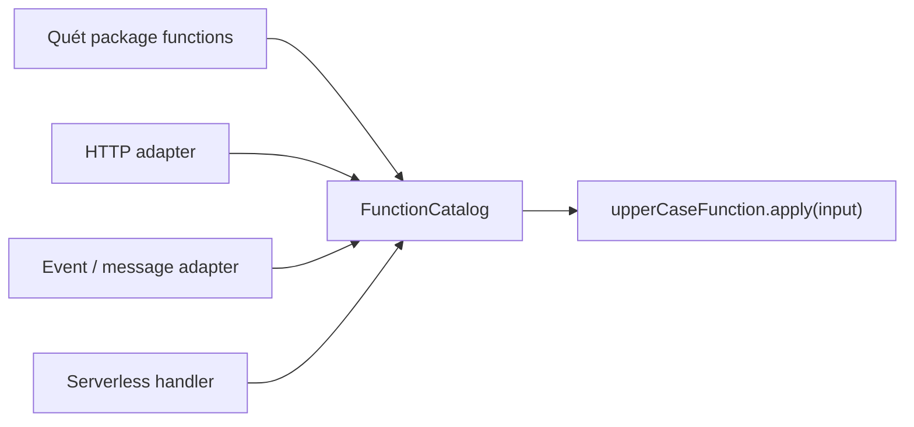

# Tự quét package `functions` trong Spring Cloud Function

## Mục tiêu bài học

Trong chương **Đăng ký bean** của **Spring Cloud Function**, ngoài việc dùng `@Bean`, `@Component` hoặc `GenericApplicationContext.registerBean(...)`, framework còn hỗ trợ **tự tìm các lớp Java triển khai `Supplier`, `Function`, `Consumer` trong một package**. Cơ chế này thường được gọi là *Function Component Scan*.

Nhờ cơ chế quét chuyên biệt, bạn có thể viết logic nghiệp vụ bằng Java thuần, không cần gắn annotation Spring vào từng lớp. Các hàm được phát hiện có thể được sử dụng thông qua `FunctionCatalog`, sau đó kết nối với HTTP, hệ thống sự kiện hoặc môi trường serverless khi có adapter phù hợp.

Sau bài này, bạn sẽ biết cách:

- Tổ chức lớp triển khai trong package mặc định `functions` và dự đoán tên hàm khi tra cứu.
- Đổi phạm vi quét bằng `spring.cloud.function.scan.packages` hoặc tắt bằng `spring.cloud.function.scan.enabled=false`.
- Phân biệt **Function Component Scan** với `@ComponentScan` của Spring Framework và với đăng ký bean tường minh.
- Kiểm tra hàm được tự phát hiện qua `FunctionCatalog`, đồng thời giữ nguyên thông tin generic cần cho chuyển đổi thông điệp.
- Tránh quét nhầm hàm, đăng ký trùng tên, hiểu sai cơ chế gọi tự động và lỗi do thiếu cấu hình adapter.

## 1. Cơ chế tự quét package `functions`

Theo mô hình của Spring Cloud Function, một lớp Java cụ thể hiện thực một trong ba giao diện sau có thể được **phát hiện bằng Function Component Scan**:

| Kiểu lớp | Hợp đồng | Vai trò |
| --- | --- | --- |
| `Supplier<O>` | `O get()` | Sinh dữ liệu khi được gọi |
| `Function<I, O>` | `O apply(I input)` | Nhận dữ liệu và trả kết quả |
| `Consumer<I>` | `void accept(I input)` | Nhận dữ liệu và thực hiện hành động |

Mặc định, Spring Cloud Function quét package có tên **`functions`** nếu nó tồn tại trên classpath. Vì vậy, chỉ cần lớp phù hợp được đặt trong package này, không nhất thiết phải thêm `@Component` hoặc phương thức `@Bean`.

Ví dụ:

```text
src/main/java/
├── demo/
│   └── app/
│       └── ScanningApplication.java
└── functions/
    ├── UpperCaseFunction.java
    ├── SampleOrderSupplier.java
    └── AuditConsumer.java
```

Điểm cần chú ý: `functions` trong ví dụ là **Java package**, được khai báo bằng `package functions;`, không chỉ là một tên thư mục tùy ý. Sau khi biên dịch, các lớp tương ứng phải nằm trên classpath mà ứng dụng thực sự chạy.

Ở ví dụ này, `ScanningApplication` nằm trong `demo.app`, còn các hàm nằm trong `functions` bên ngoài package gốc của ứng dụng. Cấu trúc đó giúp phân biệt rõ việc quét chuyên biệt của Spring Cloud Function với phạm vi `@ComponentScan` mặc định của Spring Boot.

**Giới hạn:** cơ chế tự quét yêu cầu phần Spring Cloud Function hỗ trợ tính năng này đang có trên classpath và được cấu hình hoạt động. Chỉ tạo thư mục `functions` trong một ứng dụng Spring Boot không có Spring Cloud Function sẽ không tự kích hoạt khả năng này.

## 2. Ví dụ Java đầy đủ: ba hàm không dùng `@Component`

Tình huống: một dịch vụ nhận mã đơn hàng, chuẩn hóa chuỗi thành chữ hoa, đồng thời có một hàm sinh mã mẫu và một hàm ghi audit. Các lớp xử lý không cần biết mình sẽ được gọi từ HTTP hay message broker.

Ví dụ sử dụng Spring Boot, Java 17+ và dependency Spring Cloud Function Context tương thích. Nếu muốn cung cấp HTTP endpoint, cần thêm web adapter và web server; phần gọi trực tiếp bằng catalog dưới đây chưa cần HTTP.

### 2.1. `Function<String, String>`: chuyển chuỗi thành chữ hoa

File `src/main/java/functions/UpperCaseFunction.java`:

```java
package functions;

import java.util.Locale;
import java.util.function.Function;

public final class UpperCaseFunction implements Function<String, String> {

    @Override
    public String apply(String input) {
        if (input == null) {
            throw new IllegalArgumentException("input không được null");
        }

        return input.trim().toUpperCase(Locale.ROOT);
    }
}
```

Lớp này **không có `@Component`** và không cần phụ thuộc vào bất kỳ API Spring nào. Chữ ký `implements Function<String, String>` cho biết rõ kiểu dữ liệu đầu vào/đầu ra.

Theo quy tắc đặt tên của Function Component Scan, lớp `UpperCaseFunction` thường được công bố với tên **`upperCaseFunction`** (chữ cái đầu của tên lớp được chuyển thành chữ thường). Vì vậy, ví dụ bên dưới sẽ tra cứu `catalog.lookup("upperCaseFunction")`.

### 2.2. `Supplier<String>`: tạo mã đơn hàng mẫu

File `src/main/java/functions/SampleOrderSupplier.java`:

```java
package functions;

import java.util.function.Supplier;

public final class SampleOrderSupplier implements Supplier<String> {

    @Override
    public String get() {
        return " ord-42 ";
    }
}
```

Tên dự kiến trong catalog là `sampleOrderSupplier`. Đây là **hàm cung cấp dữ liệu nghiệp vụ**. Phương thức `get()` chỉ được gọi khi mã ứng dụng, catalog hoặc một adapter thực sự kích hoạt nó; việc được tự quét **không đồng nghĩa hàm chạy định kỳ**.

### 2.3. `Consumer<String>`: ghi dấu vết

File `src/main/java/functions/AuditConsumer.java`:

```java
package functions;

import java.util.function.Consumer;

public final class AuditConsumer implements Consumer<String> {

    @Override
    public void accept(String value) {
        System.out.println("AUDIT " + value);
    }
}
```

Tên dự kiến là `auditConsumer`. `Consumer` xử lý dữ liệu nhưng không trả một giá trị nghiệp vụ. `System.out.println` chỉ phù hợp với ví dụ; hệ thống thực tế có thể ghi qua service kiểm toán, logging hoặc message broker và cần xử lý retry/trùng lặp nếu message được gửi lại.

### 2.4. Khởi động Spring Boot và tra cứu bằng `FunctionCatalog`

File `src/main/java/demo/app/ScanningApplication.java`:

```java
package demo.app;

import java.util.function.Consumer;
import java.util.function.Function;
import java.util.function.Supplier;

import org.springframework.boot.ApplicationRunner;
import org.springframework.boot.SpringApplication;
import org.springframework.boot.autoconfigure.SpringBootApplication;
import org.springframework.cloud.function.context.FunctionCatalog;
import org.springframework.context.annotation.Bean;

@SpringBootApplication
public class ScanningApplication {

    public static void main(String[] args) {
        SpringApplication.run(ScanningApplication.class, args);
    }

    @Bean
    ApplicationRunner demonstrate(FunctionCatalog catalog) {
        return args -> {
            Supplier<String> supplier =
                    catalog.lookup("sampleOrderSupplier");
            Function<String, String> normalize =
                    catalog.lookup("upperCaseFunction");
            Consumer<String> audit =
                    catalog.lookup("auditConsumer");

            if (supplier == null || normalize == null || audit == null) {
                throw new IllegalStateException(
                        "Thiếu một hoặc nhiều hàm trong FunctionCatalog");
            }

            String value = normalize.apply(supplier.get());
            audit.accept(value);
        };
    }
}
```

Nếu Function Component Scan hoạt động, kết quả in ra khi ứng dụng khởi động là:

```text
AUDIT ORD-42
```

Các điểm quan trọng:

1. Không có `@Component` trên ba lớp xử lý và cũng không có `@Bean` nào tạo chúng.
2. Spring Cloud Function phát hiện các lớp qua package `functions` và đưa chúng vào cơ chế tra cứu của `FunctionCatalog`.
3. `@Bean` duy nhất trong `ScanningApplication` tạo một **`ApplicationRunner` để trình diễn**, không đăng ký ba hàm nghiệp vụ.
4. `ApplicationRunner` gọi `get()`, `apply(...)`, `accept(...)` **theo thứ tự do mã Java lựa chọn**. Framework không tự suy luận rằng ba hàm này tạo thành một workflow.
5. Các lớp giữ được kiểu generic `String`, cho phép catalog và adapter có cơ sở nhận diện kiểu payload.

Vì `ApplicationRunner` chạy sau khi context khởi tạo, đây là một vị trí thích hợp cho đoạn mã kiểm tra thủ công khi học tập. Trong dịch vụ thật, không cần đặt việc gọi hàm thử trong `main`; adapter sẽ kích hoạt hàm theo request/event được cấu hình.

## 3. Tùy chỉnh package được quét

Bạn không buộc phải đặt các lớp trong package `functions` mặc định. Nếu muốn cấu trúc thư mục rõ theo domain, ví dụ `com.example.order.logic`, hãy đặt các lớp ở package đó:

```text
src/main/java/
└── com/example/order/
    ├── OrderApplication.java
    └── logic/
        ├── ValidateOrderFunction.java
        └── NotifyOrderConsumer.java
```

Các lớp cần khai báo package thực tế:

```java
package com.example.order.logic;
```

Đồng thời thêm vào `src/main/resources/application.properties`:

```properties
spring.cloud.function.scan.packages=com.example.order.logic
```

Hoặc dạng YAML trong `application.yml`:

```yaml
spring:
  cloud:
    function:
      scan:
        packages: com.example.order.logic
```

Thuộc tính **`spring.cloud.function.scan.packages`** điều khiển package mà *Function Component Scan* của Spring Cloud Function tìm các lớp triển khai interface hàm. Khi đặt đường dẫn tùy chỉnh, phải kiểm tra tên package trong nguồn Java và cấu hình viết **khớp nhau**.

Không cần thêm `@Component` chỉ vì đổi sang package khác. Nếu đang quét nhiều vùng của ứng dụng, nên chọn rõ các package chứa **hàm muốn công bố** để tránh vô tình đưa một lớp thử nghiệm hoặc hàm nội bộ vào catalog.

### Tắt hoàn toàn Function Component Scan

Để chủ động đăng ký hàm bằng cách khác hoặc tránh tự phát hiện các lớp trong package, cấu hình:

```properties
spring.cloud.function.scan.enabled=false
```

Giá trị `false` tắt **cơ chế quét hàm chuyên biệt này**. Nó không có nghĩa vô hiệu hóa mọi cách khai báo Spring bean: các phương thức `@Bean`, các lớp `@Component` được Spring component scan bình thường tìm thấy, hoặc bean đăng ký tường minh vẫn có thể tồn tại. Với cấu hình phù hợp, Spring Cloud Function có thể tiếp tục tiếp nhận các bean hàm đó.

| Cấu hình | Ý nghĩa |
| --- | --- |
| Không khai báo thuộc tính scan | Quét package `functions` mặc định nếu có |
| `spring.cloud.function.scan.packages=com.example.order.logic` | Chọn package hàm tùy chỉnh |
| `spring.cloud.function.scan.enabled=false` | Không thực hiện Function Component Scan |
| `spring.cloud.function.definition=upperCaseFunction` | Chọn tên hàm/biểu thức dùng bởi một số adapter; **không thay đổi package được quét** |

**Đừng nhầm `scan.packages` với `spring.cloud.function.definition`.** Thuộc tính đầu tìm nơi có lớp hàm; thuộc tính sau chọn hàm đã đăng ký/được phát hiện để runtime sử dụng khi cần.

## 4. Khác biệt với Spring `@ComponentScan` thông thường

Mặc dù cùng có chữ *scan*, hai cơ chế có tiêu chí phát hiện khác nhau.

| Đặc điểm | Function Component Scan | Spring `@ComponentScan` |
| --- | --- | --- |
| Thuộc framework | Spring Cloud Function | Spring Framework / Spring Boot |
| Mục tiêu | Tìm các lớp cụ thể triển khai `Supplier`, `Function`, `Consumer` | Tìm các class được đánh dấu `@Component`, `@Service`, `@Repository`, `@Controller` và stereotype phù hợp |
| Cần annotation trên lớp hàm | Không | Thường có, nếu muốn lớp được auto-discover qua component scan |
| Package mặc định trong ví dụ | `functions` | Package của ứng dụng Spring Boot và các package con, trừ khi tùy chỉnh |
| Cấu hình package | `spring.cloud.function.scan.packages` | `@ComponentScan(basePackages = ...)` hoặc cấu hình Boot |
| Tắt riêng cơ chế | `spring.cloud.function.scan.enabled=false` | Điều chỉnh/vô hiệu hóa component scan bằng cấu hình Spring thích hợp |

Xét một lớp thuần Java:

```java
package functions;

public final class UpperCaseFunction
        implements java.util.function.Function<String, String> {

    @Override
    public String apply(String text) {
        return text.toUpperCase(java.util.Locale.ROOT);
    }
}
```

Với cấu hình Function Component Scan mặc định, class phù hợp này là **ứng viên để tự phát hiện** dù không có annotation. Nếu bạn chỉ dùng `@ComponentScan("functions")` của Spring Framework, không nên mặc định lớp không có stereotype sẽ được phát hiện như một component thông thường.

Một ứng dụng có thể bật cả hai cơ chế. Khi một lớp đồng thời có `@Component` và nằm trong package quét hàm, cần kiểm tra khả năng **đăng ký trùng bean hoặc trùng tên trong catalog**. Cách đơn giản là thống nhất một con đường đăng ký cho từng hàm.

## 5. Tên hàm được tạo ra như thế nào?

Khi quét các lớp triển khai, Spring Cloud Function có quy ước tên dựa trên **tên lớp**, thường theo kiểu biến Java bắt đầu bằng chữ thường. Tài liệu triển khai chính thức đưa ví dụ lớp `functions.UpperCaseFunction` có tên tra cứu `upperCaseFunction`.

| Class Java | Tên hàm dự kiến trong catalog |
| --- | --- |
| `functions.UpperCaseFunction` | `upperCaseFunction` |
| `functions.SampleOrderSupplier` | `sampleOrderSupplier` |
| `functions.AuditConsumer` | `auditConsumer` |
| `com.example.order.logic.ValidateOrderFunction` | `validateOrderFunction` |

Quy ước này hữu ích khi đọc code, nhưng **tên thực tế cần được xác nhận bằng `FunctionCatalog.lookup(...)` hoặc qua kiểm thử**, nhất là khi dự án tùy chỉnh bean name hay dùng phiên bản khác.

Ví dụ:

```java
Function<String, String> fn =
        catalog.lookup("upperCaseFunction");

if (fn == null) {
    throw new IllegalStateException(
            "Function upperCaseFunction chưa được phát hiện");
}
```

Với nhiều hàm cùng tồn tại, một adapter có thể yêu cầu chọn đích:

```properties
spring.cloud.function.definition=upperCaseFunction
```

Nếu tên trong `definition`, tên endpoint hoặc tên trong `lookup` không khớp với tên catalog công bố, lời gọi có thể không tìm thấy hàm. Nếu hai package khác nhau có các lớp cùng tên đơn giản, nên tránh tạo ra xung đột tên hàm khi chúng cùng được quét.

## 6. Generic type, DTO và chuyển đổi thông điệp

Lợi ích của việc quét **lớp triển khai trực tiếp** là chữ ký generic có thể được biểu diễn ngay trên lớp:

```java
public final class ValidateOrderFunction
        implements Function<OrderCommand, ValidationResult> {
    @Override
    public ValidationResult apply(OrderCommand command) {
        return new ValidationResult(
                command.id(),
                command.quantity() > 0);
    }
}
```

Giả sử ứng dụng còn định nghĩa hai record:

```java
public record OrderCommand(String id, int quantity) {}
public record ValidationResult(String id, boolean valid) {}
```

Trong ví dụ riêng này, khi framework cần nhận JSON như:

```json
{"id":"ORD-42","quantity":3}
```

thông tin `Function<OrderCommand, ValidationResult>` giúp Spring Cloud Function xác định kiểu đích để chuyển đổi payload. Việc chuyển JSON còn phụ thuộc adapter, content type, codec/JSON mapper và khả năng tạo DTO; **quét được class không tự bảo đảm mọi định dạng message đều được hỗ trợ**.

Với lớp quét tự động, nên giữ các kiểu generic cụ thể, thay vì triển khai một `Function` dạng *raw type* hoặc kế thừa generic chưa được ràng buộc:

```java
// Tránh khi muốn framework suy ra rõ kiểu vào/ra:
public final class RawOrderFunction implements Function {
    @Override
    public Object apply(Object input) {
        return input;
    }
}
```

Class này không cho biết dữ liệu vào là `OrderCommand` hay đầu ra là `ValidationResult`, nên adapter có thể không chuyển đổi như mong đợi. Với `List<OrderCommand>`, `Message<OrderCommand>` hoặc reactive types, thông tin kiểu lồng nhau càng quan trọng. Khi không thể biểu đạt được kiểu từ class, cần đăng ký hàm cùng metadata tường minh bằng cơ chế Spring Cloud Function hỗ trợ, ví dụ `FunctionRegistration` ở phiên bản phù hợp.

## 7. Tích hợp với HTTP, sự kiện và serverless

Sau khi `UpperCaseFunction` được phát hiện, các cách gọi có thể cùng sử dụng một logic `apply(...)`:



**HTTP:** nếu ứng dụng có Spring Cloud Function Web adapter và server HTTP tương ứng, cấu hình thường gặp có thể công bố route theo tên hàm. Ví dụ:

```bash
curl -X POST http://localhost:8080/upperCaseFunction \
  -H 'Content-Type: text/plain' \
  --data-binary '  hello  '
```

Kết quả nghiệp vụ mong đợi là `HELLO`. Route chính xác còn tùy phiên bản và cấu hình `spring.cloud.function.web.path`; **chỉ quét package không khiến HTTP endpoint tự xuất hiện khi thiếu web adapter**.

**Sự kiện/broker:** với Spring Cloud Stream, binder và cấu hình binding phù hợp có thể lấy message từ broker rồi chuyển cho hàm trong catalog. Việc quét chỉ đăng ký hàm; cách nhận message, chính sách retry và định tuyến message do Spring Cloud Stream cùng adapter quyết định.

**Serverless:** runtime có một handler/launcher theo hợp đồng nền tảng. Handler có thể khởi tạo hoặc dùng Spring context chứa hàm đã quét rồi gọi qua catalog. Không nên giả định serverless gọi `main` hoặc tự chạy `Supplier.get()` mỗi khi không có event.

**Composition:** khi có thêm một hàm `Function<String, String>` tên `appendSuffixFunction`, catalog có thể tra cứu:

```java
Function<String, String> pipeline =
        catalog.lookup("upperCaseFunction|appendSuffixFunction");
```

Điều kiện: cả hai hàm phải được phát hiện/đăng ký và kiểu đầu ra của bước trước tương thích với đầu vào của bước sau. Quét package chỉ cung cấp các hàm đầu vào cho catalog; nó không tự ghép hàm theo thứ tự file hoặc thứ tự class.

## 8. Kiểm thử việc tự quét

### Kiểm thử logic Java

Vì `UpperCaseFunction` không phụ thuộc Spring, unit test có thể gọi trực tiếp:

```java
package functions;

import static org.junit.jupiter.api.Assertions.assertEquals;

import org.junit.jupiter.api.Test;

class UpperCaseFunctionTest {

    @Test
    void convertsText() {
        UpperCaseFunction fn = new UpperCaseFunction();
        assertEquals("HELLO", fn.apply("  hello  "));
    }
}
```

Test này xác nhận logic Java, nhưng **chưa chứng minh** quá trình quét được cấu hình và catalog tìm thấy hàm.

### Kiểm thử tích hợp với `FunctionCatalog`

Với Spring Boot Test, dựng context chứa Spring Cloud Function và gọi catalog:

```java
package demo.app;

import static org.junit.jupiter.api.Assertions.assertEquals;
import static org.junit.jupiter.api.Assertions.assertNotNull;

import java.util.function.Function;
import org.junit.jupiter.api.Test;
import org.springframework.beans.factory.annotation.Autowired;
import org.springframework.boot.test.context.SpringBootTest;
import org.springframework.cloud.function.context.FunctionCatalog;

@SpringBootTest(
        classes = ScanningApplication.class,
        webEnvironment = SpringBootTest.WebEnvironment.NONE)
class FunctionPackageScanTest {

    @Autowired
    FunctionCatalog catalog;

    @Test
    void discoversFunctionWithoutComponentAnnotation() {
        Function<String, String> fn =
                catalog.lookup("upperCaseFunction");

        assertNotNull(fn);
        assertEquals("HELLO", fn.apply("  hello  "));
    }
}
```

Test này giả định cơ chế scan vẫn bật, package `functions` có trên **test runtime classpath** và các dependency Spring Cloud Function thích hợp được thêm vào dự án. Nó kiểm chứng chức năng **tự phát hiện + tra cứu**, chứ chưa kiểm chứng endpoint HTTP hoặc binding từ message broker.

### Kiểm tra cấu hình tắt scan

Nếu bạn cấu hình `spring.cloud.function.scan.enabled=false` và **không đăng ký** `UpperCaseFunction` bằng cơ chế khác, `catalog.lookup("upperCaseFunction")` không còn được kỳ vọng tìm thấy hàm chỉ nhờ việc class nằm trong package `functions`.

Để kiểm thử tình huống đó, nên dùng một test context riêng có thuộc tính scan tắt và không có bean hàm cùng tên tạo bằng `@Bean`/`@Component`. Nếu có nhiều cơ chế đăng ký cùng lúc, kết quả lookup chưa đủ để kết luận scanner nào đã cung cấp hàm.

## 9. Chẩn đoán lỗi tự quét

| Hiện tượng | Nguyên nhân có thể | Cách xử lý |
| --- | --- | --- |
| `catalog.lookup("upperCaseFunction")` trả `null` | Class không nằm đúng package được quét | Kiểm tra `package`, đường dẫn nguồn, classpath và `scan.packages` |
| Lớp ở `com.example.functions` nhưng không được tìm | Chỉ trông đợi vào mặc định `functions` mà chưa cấu hình package thực tế | Đặt `spring.cloud.function.scan.packages=com.example.functions` |
| Tự quét bị vô hiệu | Có `spring.cloud.function.scan.enabled=false` | Bật lại nếu cần auto-discovery, hoặc đăng ký tường minh |
| Tìm thấy Bean với `@Component` nhưng không chứng minh scan hoạt động | Spring component scan có thể đã đăng ký bean | Dùng class không annotation trong package quét và integration test riêng |
| Trùng tên, hàm không như dự kiến | Nhiều class/bean dùng cùng tên được suy ra hoặc nhiều cơ chế đăng ký | Đặt quy ước tên rõ, thu hẹp package quét, loại bỏ đăng ký trùng |
| JSON không chuyển được thành DTO | Thiếu generic cụ thể hoặc content type/mapper không phù hợp | Dùng `Function<DTO, Result>`, kiểm tra adapter, codec, message headers |
| HTTP 404 dù catalog có hàm | Chưa có web adapter, sai route hoặc HTTP server chưa chạy | Kiểm tra dependency web, `spring.cloud.function.web.path`, cổng và URL |
| `Supplier` không tự chạy theo chu kỳ | Quét chỉ làm hàm có thể được tìm thấy, không tạo lịch polling | Cấu hình adapter/binder hoặc mã kích hoạt riêng |
| Test chạy cục bộ nhưng deploy không tìm class | Artifact đóng gói thiếu class hoặc classloader không chứa package | Kiểm tra classpath thực tế của JAR/launcher và cấu hình scan |
| Gọi hàm phát sinh lỗi khởi tạo | Class không thể được tạo theo cơ chế container đang dùng hoặc thiếu dependency | Bảo đảm lớp cụ thể có cách tạo hợp lệ; dùng bean registration tường minh nếu cần |

Khi điều tra, hãy xác nhận **theo thứ tự**: class đã có trên classpath → package cần quét đúng → scan được bật → tên trong catalog đúng → adapter đã cấu hình. Cách kiểm tra này giúp phân biệt lỗi *discovery* với lỗi *transport*.

## 10. Bài tập áp dụng

1. **Quét mặc định:** tạo `functions.ReverseTextFunction implements Function<String,String>`; kiểm tra `catalog.lookup("reverseTextFunction")` trả kết quả mong đợi khi đảo chuỗi.
2. **Đổi package:** chuyển lớp sang `com.example.text.functions`, cấu hình `spring.cloud.function.scan.packages=com.example.text.functions` và chạy lại integration test.
3. **Tắt scan:** đặt `spring.cloud.function.scan.enabled=false`, xác minh lớp không còn được tìm thấy do auto-discovery; sau đó tự đăng ký bằng `@Bean` để so sánh.
4. **Nhiều hàm:** thêm `TrimFunction implements Function<String,String>` trong package quét. Đảm bảo catalog tra cứu `trimFunction` và `upperCaseFunction` độc lập; thử composition nếu hai kiểu tương thích.
5. **DTO:** viết `ValidateOrderFunction implements Function<OrderCommand, ValidationResult>`, gửi payload JSON qua một adapter đã cấu hình và kiểm tra kiểu dữ liệu được chuyển đổi đúng.
6. **Phân biệt scanner:** giải thích vì sao một lớp không có `@Component` có thể được Function Component Scan tìm thấy nhưng không nhất thiết được Spring `@ComponentScan` phát hiện.

## 11. Tổng kết

Mặc định, Spring Cloud Function có thể **tự quét package `functions`** để phát hiện các lớp hiện thực `Supplier`, `Function`, `Consumer` mà không cần annotation Spring. Thuộc tính **`spring.cloud.function.scan.packages`** cho phép đổi vị trí tìm kiếm; **`spring.cloud.function.scan.enabled=false`** tắt riêng cơ chế quét đó. Khi đã được phát hiện, hàm trở nên khả dụng qua **`FunctionCatalog`**; HTTP, sự kiện và serverless vẫn cần các adapter và cấu hình kích hoạt thích hợp.

Tài liệu tham khảo: [Spring Cloud Function — Programming Model, mục Function Component Scan](https://docs.spring.io/spring-cloud-function/reference/spring-cloud-function/programming-model.html) và [Deploying a Packaged Function — Component Scanning](https://docs.spring.io/spring-cloud-function/reference/spring-cloud-function/deploying-a-packaged.html). Đối chiếu với dòng phiên bản Spring Cloud Function đang sử dụng khi triển khai thực tế.
