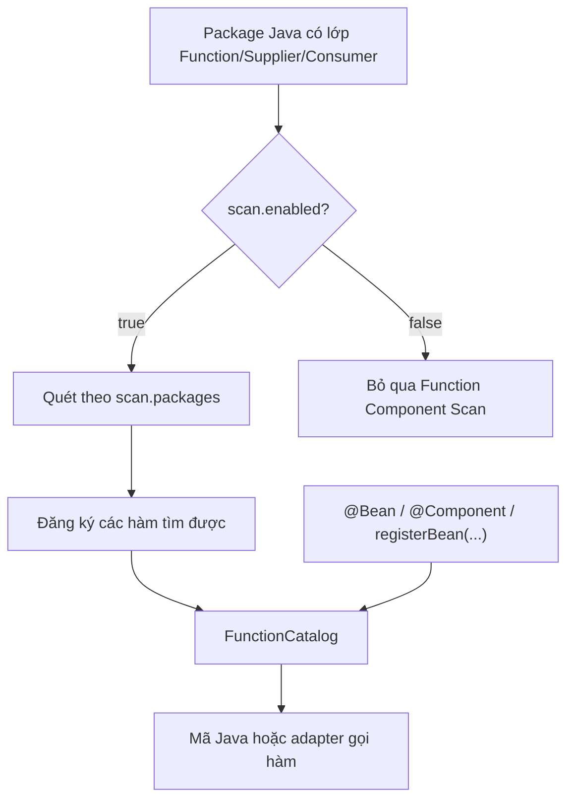

# Tùy chỉnh `spring.cloud.function.scan.packages` và `scan.enabled`

## Mục tiêu

Trong chương **Đăng ký bean** của **Spring Cloud Function**, một ứng dụng có thể công bố logic nghiệp vụ dưới dạng `Supplier`, `Function`, `Consumer` bằng cách để framework **quét lớp triển khai** thay vì viết `@Bean` cho từng hàm. Hai thuộc tính cần nắm vững là:

- `spring.cloud.function.scan.packages`: chỉ định package Java mà Spring Cloud Function tìm các lớp hàm.
- `spring.cloud.function.scan.enabled`: bật hoặc tắt cơ chế quét hàm chuyên biệt.

Sau bài này, bạn có thể chuyển các hàm sang package tùy chỉnh, kiểm soát việc quét theo môi trường, giải thích sự khác biệt với Spring `@ComponentScan`, kiểm tra kết quả qua `FunctionCatalog` và xử lý tình huống hàm không xuất hiện dù class đã được biên dịch.

## 1. Phân biệt đăng ký, quét và kích hoạt hàm

Spring Cloud Function xây dựng mô hình lập trình quanh ba giao diện Java:

| Giao diện | Phương thức gọi | Ý nghĩa |
| --- | --- | --- |
| `Supplier<O>` | `O get()` | Sinh dữ liệu |
| `Function<I, O>` | `O apply(I input)` | Chuyển dữ liệu vào thành kết quả |
| `Consumer<I>` | `void accept(I input)` | Tiêu thụ dữ liệu, thực hiện hành động |

Một lớp `implements Function<String, String>` là **hàm Java**. Nó chỉ có thể được gọi qua `FunctionCatalog` sau khi Spring Cloud Function nhận diện hoặc đăng ký nó vào context/catalog theo một cơ chế hỗ trợ. Function Component Scan là một trong các cơ chế đó.

Ba bước cần phân biệt:

1. **Discovery:** quét package để tìm lớp triển khai `Supplier`, `Function`, `Consumer`.
2. **Registration:** chuẩn bị các bean/hàm phù hợp để `FunctionCatalog` tra cứu.
3. **Invocation:** ứng dụng Java, HTTP adapter, Spring Cloud Stream binder hoặc serverless handler gọi hàm thực sự.



**Hai thuộc tính scan chỉ chi phối quá trình tìm lớp hàm.** Chúng không làm hàm chạy định kỳ, không tự mở HTTP endpoint và không cấu hình broker. Cách gọi qua HTTP, sự kiện hay serverless phụ thuộc adapter/runtime bổ sung.

## 2. Giá trị mặc định và vị trí package Java

Với Function Component Scan đang bật, Spring Cloud Function mặc định tìm các lớp hàm trong Java package có tên **`functions`** trên classpath.

Ví dụ cấu trúc:

```text
src/main/java/
├── com/acme/app/
│   └── DemoApplication.java
└── functions/
    ├── NormalizeText.java
    ├── SampleValue.java
    └── AuditValue.java
```

Trong file `NormalizeText.java`:

```java
package functions;

import java.util.Locale;
import java.util.function.Function;

public final class NormalizeText implements Function<String, String> {

    @Override
    public String apply(String input) {
        return input.trim().toUpperCase(Locale.ROOT);
    }
}
```

Với cơ chế quét phù hợp, `NormalizeText` là lớp ứng viên dù **không gắn `@Component`**. Theo quy ước thông thường, tên được công bố từ lớp này là `normalizeText`; một bài kiểm thử tra cứu catalog sẽ xác minh tên thực tế trong phiên bản đang sử dụng.

Đây là **Java package** khai báo bằng `package functions;`, không phải tên thư mục tùy đặt. Một lớp nằm ở `com.acme.functions` **không cùng package** với `functions`; không nên mặc định cả hai được quét khi chỉ dùng cấu hình mặc định.

Việc quét diễn ra khi bootstrap ứng dụng. Nếu sau khi context đã chạy bạn tải thêm class hoặc sửa giá trị cấu hình ở một tệp, không nên giả định Spring Cloud Function tự quét lại lập tức. Muốn thay đổi tập hàm được công bố, thường cần tạo lại context/khởi động lại theo quy trình triển khai.

## 3. Tùy chỉnh `spring.cloud.function.scan.packages`

Khi ứng dụng phát triển, đặt toàn bộ logic trong package gốc `functions` có thể bất tiện. Ta có thể gom các hàm theo domain, chẳng hạn:

```text
src/main/java/
└── com/acme/
    ├── app/
    │   └── OrderApplication.java
    └── order/
        └── functions/
            ├── NormalizeOrderId.java
            └── ValidateOrder.java
```

Những lớp cần được quét khai báo:

```java
package com.acme.order.functions;
```

Trong `src/main/resources/application.properties`, đặt:

```properties
spring.cloud.function.scan.packages=com.acme.order.functions
```

Hoặc trong `application.yml`:

```yaml
spring:
  cloud:
    function:
      scan:
        packages: com.acme.order.functions
```

Sau đó Spring Cloud Function tìm các lớp hàm theo **package được chỉ định**. Cấu hình phải là tên package Java, phân tách bằng dấu chấm; **không dùng đường dẫn** như `src/main/java/com/acme/order/functions` hoặc đường dẫn file `.class`.

### Chọn phạm vi đủ hẹp

Nên quét package dành riêng cho các hàm thực sự muốn dùng qua `FunctionCatalog`. Nếu chỉ định một package quá rộng bao gồm nhiều lớp thử nghiệm hoặc lớp `Function` nội bộ, framework có thể nhận diện nhiều hàm hơn dự kiến. Điều đó đặc biệt đáng chú ý khi có adapter web hoặc message binder dựa vào tập hàm được công bố.

Ví dụ, nếu tất cả các hàm dịch vụ được đặt dưới `com.acme.order.functions`, hãy dùng đúng package đó thay vì chỉ định `com.acme` không cần thiết.

### Có nhiều nhóm hàm thì sao?

Một số cấu hình Spring Cloud Function cho phép khai báo danh sách package, ví dụ dưới dạng danh sách phân tách bằng dấu phẩy trong `application.properties`:

```properties
spring.cloud.function.scan.packages=com.acme.order.functions,com.acme.payment.functions
```

Khi dùng nhiều package, hãy đối chiếu kiểu dữ liệu mà cấu hình scan của phiên bản đang chạy chấp nhận và xác minh **cả hai** hàm bằng integration test. Nếu chỉ cần một điểm cấu hình, cách đơn giản hơn là tổ chức các lớp dưới **một package gốc dành cho hàm** với các package con tương ứng rồi kiểm tra phạm vi quét thực tế.

## 4. Ví dụ chạy ứng dụng với package tùy chỉnh

Ví dụ này độc lập với package `functions` mặc định. Ta có một ứng dụng nhận mã đơn hàng và chuẩn hóa mã trước khi dùng trong HTTP, message hoặc serverless. Lớp nghiệp vụ không phụ thuộc Spring.

Yêu cầu: Java 17+, Spring Boot và Spring Cloud Function Context ở các phiên bản tương thích. Nếu muốn expose HTTP cần thêm Spring Cloud Function Web adapter và HTTP server.

### 4.1. Lớp hàm trong package `com.acme.order.functions`

File `src/main/java/com/acme/order/functions/NormalizeOrderId.java`:

```java
package com.acme.order.functions;

import java.util.Locale;
import java.util.function.Function;

public final class NormalizeOrderId implements Function<String, String> {

    @Override
    public String apply(String input) {
        if (input == null || input.isBlank()) {
            throw new IllegalArgumentException("Mã đơn hàng rỗng");
        }
        return input.trim().toUpperCase(Locale.ROOT);
    }
}
```

Không thêm `@Component` vào lớp này: mục đích là chứng minh **Function Component Scan** tìm được một lớp Java thuần. Chữ ký `Function<String, String>` giữ thông tin kiểu đầu vào và đầu ra cho Spring Cloud Function.

### 4.2. Cấu hình bật scan và chọn package

File `src/main/resources/application.properties`:

```properties
spring.cloud.function.scan.enabled=true
spring.cloud.function.scan.packages=com.acme.order.functions
```

`scan.enabled=true` diễn đạt ý định bật cơ chế quét. Khi dùng giá trị mặc định đang bật, có thể lược bỏ dòng này; khai báo tường minh hữu ích cho bài tập kiểm chứng bật/tắt.

### 4.3. Điểm vào Spring Boot và thử tra cứu catalog

File `src/main/java/com/acme/app/OrderApplication.java`:

```java
package com.acme.app;

import java.util.function.Function;

import org.springframework.boot.ApplicationRunner;
import org.springframework.boot.SpringApplication;
import org.springframework.boot.autoconfigure.SpringBootApplication;
import org.springframework.cloud.function.context.FunctionCatalog;
import org.springframework.context.annotation.Bean;

@SpringBootApplication
public class OrderApplication {

    public static void main(String[] args) {
        SpringApplication.run(OrderApplication.class, args);
    }

    @Bean
    ApplicationRunner demo(FunctionCatalog catalog) {
        return args -> {
            Function<String, String> normalize =
                    catalog.lookup("normalizeOrderId");

            if (normalize == null) {
                throw new IllegalStateException(
                        "Không tìm thấy normalizeOrderId trong FunctionCatalog");
            }

            System.out.println(normalize.apply("  ord-104  "));
        };
    }
}
```

Kết quả được mong đợi trên console:

```text
ORD-104
```

Trong ví dụ này, `OrderApplication` thuộc `com.acme.app`; lớp `NormalizeOrderId` nằm trong `com.acme.order.functions`, **không ở package con của `com.acme.app`**. Nhờ đó, khi catalog tìm được hàm không có annotation, ta có căn cứ rõ hơn để kiểm tra chính cơ chế scan của Spring Cloud Function.

`@Bean` trong `OrderApplication` tạo một `ApplicationRunner` để minh họa, **không tạo `NormalizeOrderId`**. Hàm chỉ xuất hiện khi cơ chế scan hoặc một cơ chế đăng ký khác tìm được lớp đó.

Nên dùng `ApplicationRunner` để thực hành sau khi Spring Boot đã khởi tạo context; trong ứng dụng phục vụ request liên tục, thường adapter sẽ kích hoạt hàm và không cần một runner in dữ liệu mẫu.

## 5. Bật hoặc tắt bằng `spring.cloud.function.scan.enabled`

Trong `application.properties`, đặt:

```properties
spring.cloud.function.scan.enabled=false
```

Tác động: **Function Component Scan bị tắt**. Với ví dụ ở phần 4, nếu `NormalizeOrderId` không được đăng ký qua `@Bean`, `@Component` hay cách nào khác, `catalog.lookup("normalizeOrderId")` sẽ không còn được mong đợi tìm thấy hàm chỉ nhờ `scan.packages`.

Để bật lại:

```properties
spring.cloud.function.scan.enabled=true
```

| Thuộc tính | Giá trị minh họa | Ý nghĩa |
| --- | --- | --- |
| `scan.packages` | `com.acme.order.functions` | Nơi Function Component Scan tìm lớp hàm |
| `scan.enabled` | `true` | Cho phép quét trong quá trình bootstrap |
| `scan.enabled` | `false` | Bỏ qua cơ chế quét hàm chuyên biệt |
| `spring.cloud.function.definition` | `normalizeOrderId` | Chọn hàm đã được nhận diện để một adapter sử dụng; không kích hoạt scanner |

### Tắt quét có đồng nghĩa tắt Spring Cloud Function?

**Không.** Thuộc tính này chỉ tắt cơ chế khám phá các lớp hàm qua Function Component Scan. Ứng dụng vẫn có thể đăng ký:

- Một `@Bean Function<String, String> normalizeOrderId()` trong lớp `@Configuration`.
- Một lớp `@Component("normalizeOrderId") implements Function<String, String>` được Spring component scan thông thường nhận diện.
- Một bean `NormalizeOrderId` qua `GenericApplicationContext.registerBean(...)` ở initializer.
- Một `FunctionRegistration` được khai báo rõ tên và kiểu theo API của Spring Cloud Function đang dùng.

Khi các bean/hàm này được Spring Cloud Function tiếp nhận, catalog vẫn có thể tìm thấy chúng dù `scan.enabled=false`.

**Không đăng ký cùng một hàm qua nhiều cơ chế nếu chưa có chủ đích.** Ví dụ, vừa quét một class thuần Java vừa thêm `@Component` hoặc `@Bean` trùng tên có thể tạo xung đột bean hoặc tên function.

### Khi nào nên tắt scan?

Tắt Function Component Scan khi muốn **mọi hàm được công bố đều phải được khai báo tường minh**, khi cần kiểm soát tập hàm trong môi trường triển khai, hoặc khi không muốn lớp có kiểu `Function` trong một package nhất định được phát hiện tự động.

Ví dụ một ứng dụng tích hợp dùng nhiều framework có thể chọn `scan.enabled=false` và chỉ đăng ký ba hàm nghiệp vụ được hỗ trợ chính thức bằng `@Bean`. Nhờ vậy, việc thêm một class implements `Function` mới trong mã nguồn sẽ không tự thay đổi danh sách hàm được scanner phát hiện.

## 6. Thay đổi cấu hình theo môi trường

Các thuộc tính trên được Spring Boot đọc từ `Environment`, nên có thể cung cấp qua file cấu hình, profile hoặc đối số chạy ứng dụng, tùy cách triển khai.

### Ví dụ theo profile

File `application-dev.properties`:

```properties
spring.cloud.function.scan.enabled=true
spring.cloud.function.scan.packages=com.acme.order.functions
```

File `application-prod.properties`:

```properties
spring.cloud.function.scan.enabled=false
```

Ứng dụng production trong ví dụ giả định các hàm cần dùng **đã được đăng ký tường minh bằng cơ chế khác**. Nếu không, việc tắt scan có thể khiến catalog không tìm thấy chúng và adapter không có hàm để gọi.

Để chạy với profile:

```bash
java -jar order-service.jar --spring.profiles.active=dev
```

### Ghi đè khi khởi động

Có thể đưa thuộc tính qua tham số dòng lệnh cho Spring Boot:

```bash
java -jar order-service.jar \
  --spring.cloud.function.scan.enabled=true \
  --spring.cloud.function.scan.packages=com.acme.order.functions
```

Trong môi trường container, thuộc tính Spring Boot cũng có thể được ánh xạ từ biến môi trường, ví dụ:

```text
SPRING_CLOUD_FUNCTION_SCAN_ENABLED=false
SPRING_CLOUD_FUNCTION_SCAN_PACKAGES=com.acme.order.functions
```

Những ví dụ biến môi trường thể hiện quy tắc *relaxed binding* phổ biến của Spring Boot: chữ hoa và dấu gạch dưới tương ứng với các thành phần tên property. Hãy bảo đảm công cụ triển khai thực sự chuyển các biến này vào tiến trình Java.

**Thứ tự ưu tiên cấu hình:** nếu property xuất hiện ở nhiều nguồn, Spring Boot áp dụng thứ tự ưu tiên `PropertySource` của nó. Vì vậy, đừng chỉ nhìn một tệp `application.properties` rồi kết luận giá trị cuối cùng. Đối số dòng lệnh, biến môi trường, profile và cấu hình bên ngoài có thể làm thay đổi kết quả.

## 7. `scan.packages` khác gì với `@ComponentScan`?

Hai cơ chế đều tìm class trên classpath nhưng **khác tiêu chí chọn class**.

| Khía cạnh | Function Component Scan | Spring `@ComponentScan` |
| --- | --- | --- |
| Framework | Spring Cloud Function | Spring Framework / Spring Boot |
| Tìm lớp nào? | Lớp triển khai `Supplier`, `Function`, `Consumer` phù hợp | Lớp có `@Component` hoặc stereotype tương ứng |
| Có cần annotation trên lớp nghiệp vụ? | Không nhất thiết | Thường cần để được component scan thông thường chọn |
| Phạm vi cấu hình | `spring.cloud.function.scan.packages` | `@ComponentScan(basePackages = ...)` và cấu hình liên quan |
| Thuộc tính bật/tắt ở bài này | `spring.cloud.function.scan.enabled` | Không bị điều khiển bởi thuộc tính này |
| Kết quả hướng đến | Các hàm có thể được Spring Cloud Function nhận diện | Các Spring bean nói chung |

Ví dụ: `com.acme.order.functions.NormalizeOrderId` không có `@Component`. Nếu `@SpringBootApplication` nằm ở `com.acme.app`, Spring component scan mặc định **không tự phát hiện** class đó. Tuy nhiên, với Function Component Scan bật và `scan.packages=com.acme.order.functions`, nó trở thành ứng viên quét hàm.

Ngược lại, nếu `NormalizeOrderId` có `@Component` và nằm trong phạm vi Spring component scan, khi `spring.cloud.function.scan.enabled=false` nó **vẫn có thể là một bean**. Chế độ tắt scan hàm không xóa các bean đến từ cơ chế khác.

## 8. Tên hàm và quan hệ với `FunctionCatalog`

Khi scan lớp `NormalizeOrderId`, tên thường được suy ra theo quy tắc đặt tên class thành bean name, ví dụ `normalizeOrderId`. Kiểm tra thực tế bằng:

```java
Function<String, String> fn =
        catalog.lookup("normalizeOrderId");

if (fn == null) {
    throw new IllegalStateException(
            "Không có normalizeOrderId trong FunctionCatalog");
}
```

Nếu một adapter phải chọn hàm trong ứng dụng có nhiều hàm, có thể cấu hình:

```properties
spring.cloud.function.definition=normalizeOrderId
```

**`spring.cloud.function.definition` không phải thuộc tính quét.** Nó chỉ tên hoặc biểu thức composition để runtime/adapter chọn một hàm đã tồn tại. Nếu `scan.enabled=false` làm hàm không được đăng ký và bạn không có cách đăng ký khác, cấu hình `definition=normalizeOrderId` không thể tự tạo hàm.

### Thử gọi qua HTTP

Khi Spring Cloud Function Web adapter và HTTP server tương thích được cấu hình, có thể có route tương ứng tên hàm:

```bash
curl -X POST http://localhost:8080/normalizeOrderId \
  -H 'Content-Type: text/plain' \
  --data-binary '  ord-104  '
```

Kết quả nghiệp vụ kỳ vọng: `ORD-104`. Đường dẫn còn phụ thuộc ánh xạ của web adapter, chẳng hạn cấu hình path nếu có. **Chỉ bật scan không tạo HTTP endpoint** khi ứng dụng chưa có adapter.

Với Spring Cloud Stream, binder nhận message rồi gọi Function/Consumer đã chọn trong catalog. Với serverless, handler/launcher của nền tảng đảm nhiệm gọi hàm. Tên trong `definition` và khả năng chuyển đổi payload phải thống nhất với kiểu `Function<I, O>` thực tế.

## 9. Hai kiểm thử để xác nhận cấu hình bật/tắt

Một unit test gọi `new NormalizeOrderId().apply(...)` chỉ xác minh logic Java. Để kiểm tra **cấu hình scan và catalog**, cần tạo Spring context.

Hai test dưới đây sử dụng **một cấu hình Spring Boot tối thiểu không có `ApplicationRunner`**. Điều này quan trọng vì `OrderApplication` ở phần 4 chủ động ném lỗi nếu catalog không tìm thấy hàm; khi scan tắt, lỗi từ runner sẽ làm test thất bại trước khi kiểm tra được kết quả `lookup`.

File `src/test/java/com/acme/testconfig/ScanOnlyTestApplication.java`:

```java
package com.acme.testconfig;

import org.springframework.boot.SpringBootConfiguration;
import org.springframework.boot.autoconfigure.EnableAutoConfiguration;

@SpringBootConfiguration
@EnableAutoConfiguration
public class ScanOnlyTestApplication {
}
```

`@SpringBootConfiguration` kết hợp `@EnableAutoConfiguration` cho phép nạp các auto-configuration cần thiết của Spring Cloud Function mà không bật component scan toàn bộ package `com.acme.app`, nhờ đó không vô tình tải lại runner ở ví dụ trước.

### 9.1. Kiểm thử khi quét được bật

Với Spring Boot Test và Spring Cloud Function Context:

```java
package com.acme.app;

import static org.junit.jupiter.api.Assertions.assertEquals;
import static org.junit.jupiter.api.Assertions.assertNotNull;

import com.acme.testconfig.ScanOnlyTestApplication;
import java.util.function.Function;
import org.junit.jupiter.api.Test;
import org.springframework.beans.factory.annotation.Autowired;
import org.springframework.boot.test.context.SpringBootTest;
import org.springframework.cloud.function.context.FunctionCatalog;

@SpringBootTest(
        classes = ScanOnlyTestApplication.class,
        webEnvironment = SpringBootTest.WebEnvironment.NONE,
        properties = {
            "spring.cloud.function.scan.enabled=true",
            "spring.cloud.function.scan.packages=com.acme.order.functions"
        })
class EnabledFunctionScanTest {

    @Autowired
    FunctionCatalog catalog;

    @Test
    void findsFunctionInConfiguredPackage() {
        Function<String, String> fn = catalog.lookup("normalizeOrderId");
        assertNotNull(fn);
        assertEquals("ORD-104", fn.apply("  ord-104  "));
    }
}
```

Test chứng minh lớp thuần Java trong package tùy chỉnh được catalog tìm thấy trong context đã cấu hình. Nó chưa kiểm chứng adapter HTTP hoặc message broker.

### 9.2. Kiểm thử khi quét bị tắt

Với **test context riêng**, nơi không có cơ chế nào khác đăng ký `NormalizeOrderId`:

```java
package com.acme.app;

import static org.junit.jupiter.api.Assertions.assertNull;

import com.acme.testconfig.ScanOnlyTestApplication;
import org.junit.jupiter.api.Test;
import org.springframework.beans.factory.annotation.Autowired;
import org.springframework.boot.test.context.SpringBootTest;
import org.springframework.cloud.function.context.FunctionCatalog;

@SpringBootTest(
        classes = ScanOnlyTestApplication.class,
        webEnvironment = SpringBootTest.WebEnvironment.NONE,
        properties = {
            "spring.cloud.function.scan.enabled=false",
            "spring.cloud.function.scan.packages=com.acme.order.functions"
        })
class DisabledFunctionScanTest {

    @Autowired
    FunctionCatalog catalog;

    @Test
    void doesNotDiscoverClassSolelyByPackage() {
        assertNull(catalog.lookup("normalizeOrderId"));
    }
}
```

Kiểm thử tắt scan chỉ có ý nghĩa khi **không còn bean `NormalizeOrderId` đến từ `@Bean`, `@Component` hoặc initializer**. Hai test sử dụng cấu hình riêng và thuộc tính `scan.enabled` khác nhau để xác nhận chính cơ chế Function Component Scan; chúng không cần khởi động HTTP server.

## 10. Lỗi thường gặp và cách chẩn đoán

| Triệu chứng | Nguyên nhân thường gặp | Hướng xử lý |
| --- | --- | --- |
| `lookup("normalizeOrderId")` trả `null` | `scan.packages` không trùng Java package | Đối chiếu dòng `package ...;`, cấu hình và classpath thực tế |
| Đã cấu hình package nhưng hàm vẫn không xuất hiện | `scan.enabled=false` do profile hoặc nguồn cấu hình ưu tiên cao hơn | Kiểm tra giá trị property sau khi Spring Boot xử lý `Environment` |
| Vô tình quét nhiều lớp hơn cần thiết | Package quá rộng hoặc lớp hàm thử nghiệm cùng phạm vi | Thu hẹp package hoặc tắt scan và đăng ký tường minh |
| Tắt scan mà catalog vẫn tìm được hàm | Hàm được tạo qua `@Bean`, `@Component`, initializer hoặc registration khác | Kiểm tra mọi đường đăng ký; thuộc tính scan không vô hiệu hóa chúng |
| `definition` đã đặt nhưng adapter không có hàm | Tên trong definition không tồn tại trong catalog | Kiểm tra `lookup` trước, sau đó đối chiếu tên hàm |
| Lỗi trùng bean hoặc tên hàm | Cùng class được scan và đăng ký thêm bằng cơ chế khác | Dùng một cơ chế chủ đạo cho mỗi tên hàm |
| JSON không chuyển được sang DTO | `Function<I, O>` thiếu kiểu cụ thể, adapter/content type sai | Khai báo generic rõ, kiểm tra codec và payload trước khi xử lý |
| HTTP 404 mặc dù test catalog chạy đúng | Chưa có web adapter/server hoặc route không khớp | Kiểm tra dependency HTTP, endpoint và cấu hình routing |
| Chạy local được nhưng deploy không tìm thấy class | Lớp không có trong artifact hoặc classloader khác | Kiểm tra nội dung JAR và classpath của runtime |
| Test tắt scan thất bại khi context bắt đầu chạy | `ApplicationRunner` phụ thuộc hàm bị tắt scan | Dùng lớp cấu hình test tối thiểu không có runner này |

Thứ tự điều tra hiệu quả: **class có trên classpath → package cấu hình đúng → scan có bật → tên hàm chính xác → catalog lookup thành công → adapter cấu hình phù hợp**. Cách này tách được lỗi khám phá hàm khỏi lỗi giao thức.

## 11. Bài tập và câu hỏi tự kiểm tra

1. Tạo lớp `com.acme.payment.functions.ValidatePayment implements Function<String, Boolean>` không có `@Component`. Hãy cấu hình `scan.packages` để `FunctionCatalog` tìm được tên `validatePayment` và viết integration test tương ứng.
2. Đặt `scan.enabled=false` nhưng vẫn giữ `scan.packages`. Nếu không có đường đăng ký khác, `catalog.lookup("validatePayment")` có còn tìm được hàm nhờ quét package không? **Không.**
3. Giải thích vì sao một lớp `@Component("validatePayment")` vẫn có thể trở thành bean khi Function Component Scan bị tắt. **Vì đó là cơ chế component scan của Spring, độc lập với cấu hình scan chuyên biệt.**
4. Một adapter cấu hình `spring.cloud.function.definition=validatePayment` nhưng `scan.enabled=false` và không có bean nào đăng ký hàm. Cần sửa gì? **Bật scan đúng package hoặc đăng ký hàm tường minh**; `definition` không tạo bean.
5. Khi thay `application.properties` trong source nhưng môi trường triển khai vẫn đặt `SPRING_CLOUD_FUNCTION_SCAN_ENABLED=false`, vì sao kết quả có thể không như local? **Vì giá trị cuối cùng phụ thuộc thứ tự ưu tiên cấu hình Spring Boot.**
6. Hàm đã tìm thấy trong catalog nhưng gọi HTTP không được. Bước tiếp theo là gì? **Kiểm tra Spring Cloud Function Web adapter, HTTP server, route và cách chuyển payload**, thay vì chỉ sửa `scan.packages`.

## 12. Ghi nhớ

**`spring.cloud.function.scan.packages` quyết định *quét ở đâu*; `spring.cloud.function.scan.enabled` quyết định *có quét hay không*.** Hai thuộc tính điều khiển Function Component Scan, còn các bean đăng ký bằng `@Bean`, `@Component` và initializer vẫn theo cơ chế riêng. Sau khi có hàm trong `FunctionCatalog`, adapter HTTP, sự kiện hoặc serverless mới quyết định cách gọi.

Tham khảo tài liệu chính thức: [Spring Cloud Function — Reference](https://docs.spring.io/spring-cloud-function/reference/), phần *Programming Model* và *Function Component Scan*. Hãy kiểm tra phiên bản framework đang dùng vì chi tiết quét và cách cấu hình có thể thay đổi giữa các dòng phát hành.
