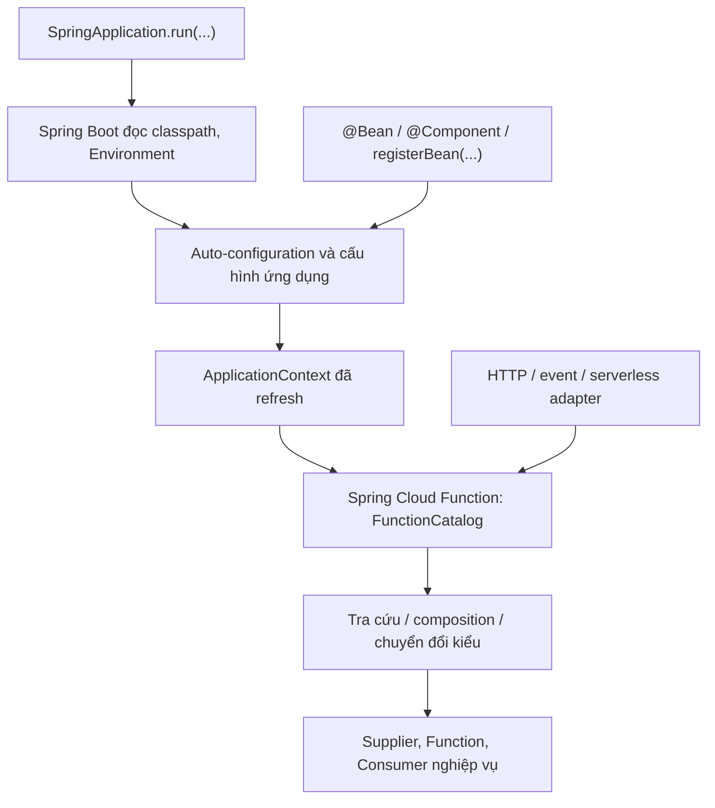
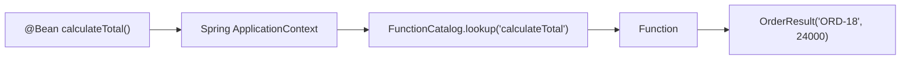

# Kết hợp đăng ký bean với Spring Boot auto-configuration

## Mục tiêu bài học

Trong chương **Đăng ký bean** của **Spring Cloud Function**, điều quan trọng không chỉ là viết `Supplier`, `Function` hoặc `Consumer`, mà còn là hiểu cách các hàm đó trở thành Spring bean và được `FunctionCatalog` sử dụng. **Spring Boot auto-configuration** giúp thiết lập hạ tầng cần thiết dựa trên các thư viện, cấu hình và bean có sẵn; ứng dụng vẫn phải cung cấp logic nghiệp vụ của mình.

Sau bài học, bạn sẽ có thể:

- Phân biệt **đăng ký bean hàm** với **auto-configuration** của Spring Boot và Spring Cloud Function.
- Xây dựng một `@SpringBootApplication` chứa `@Bean Function<I, O>` và tra cứu hàm qua `FunctionCatalog`.
- Giải thích tại sao thêm Spring Cloud Function Web adapter mới có thể công bố hàm qua HTTP, trong khi message broker và serverless cần adapter tương ứng.
- Hiểu vai trò của điều kiện `@ConditionalOnClass`, `@ConditionalOnMissingBean`, `@ConditionalOnProperty` khi đóng gói hàm vào thư viện có auto-configuration.
- Phát hiện lỗi thiếu dependency, thiếu hàm, xung đột bean, mất kiểu generic và khác biệt giữa kiểm thử Spring context với kiểm thử giao thức.

## 1. Ba phần phối hợp như thế nào?

**Spring Boot** đọc thông tin từ classpath, `Environment`, các cấu hình của ứng dụng và các auto-configuration được cung cấp bởi thư viện. Trong quá trình khởi động, Boot tạo `ApplicationContext`, nạp các định nghĩa bean và làm mới context.

**Spring Cloud Function** bổ sung mô hình hàm và cơ chế `FunctionCatalog` để tra cứu, chuyển đổi dữ liệu và có thể ghép các hàm phù hợp. Một `Function` đã tồn tại trong Spring context có thể được Spring Cloud Function nhận diện mà không cần tự viết một HTTP controller cho nó.

**Ứng dụng nghiệp vụ** cung cấp các hàm thực sự làm việc, chẳng hạn `Function<OrderCommand, OrderResult>`, `Supplier<Order>` hoặc `Consumer<OrderResult>`.



Sơ đồ biểu diễn trách nhiệm, không phải danh sách chính xác mọi callback nội bộ. Những bean và auto-configuration có thể được tạo/điều kiện hóa ở các thời điểm khác nhau trong quá trình `refresh()`.

| Thành phần | Trách nhiệm chính | Điều nó **không** tự làm |
| --- | --- | --- |
| `@SpringBootApplication` | Đánh dấu lớp cấu hình ứng dụng, bật component scan và auto-configuration thông thường | Không tự sinh hàm nghiệp vụ; tiến trình vẫn cần điểm vào khởi chạy phù hợp |
| `@Bean Function<I,O>` | Đăng ký hàm cụ thể vào Spring context | Không tự tạo HTTP endpoint hay consumer broker |
| Spring Cloud Function Context | Cung cấp các thành phần cho `FunctionCatalog` khi dependency và cấu hình thích hợp | Không tự tạo một hàm nghiệp vụ chưa được đăng ký |
| Spring Cloud Function Web adapter | Kết nối HTTP với hàm trong catalog khi có môi trường web phù hợp | Không thay thế logic của `Function` |
| Spring Cloud Stream / serverless adapter | Chuyển message/event đến các hàm đã chọn | Không biến một bean bất kỳ thành ứng dụng broker/serverless hoàn chỉnh nếu thiếu cấu hình |

**Nguyên tắc:** auto-configuration chuẩn bị **hạ tầng và các giá trị mặc định có điều kiện**; bean của ứng dụng cung cấp **hành vi nghiệp vụ**. Hai phần bổ sung cho nhau chứ không loại trừ nhau.

## 2. Vì sao `@Bean Function` hoạt động với auto-configuration?

Spring Boot thường dùng `@SpringBootApplication`, một annotation kết hợp những chức năng quan trọng như cấu hình ứng dụng, component scanning và bật auto-configuration. Trong các cấu hình phù hợp của Spring Cloud Function, những bean có kiểu `Supplier`, `Function` hoặc `Consumer` sẽ được framework xem là các hàm có thể tra cứu.

Ví dụ:

```java
@Bean
public Function<String, String> normalizeText() {
    return value -> value.trim().toUpperCase(Locale.ROOT);
}
```

Đoạn này thực hiện **đăng ký bean nghiệp vụ** tên `normalizeText`. Khi ứng dụng có Spring Cloud Function Context và cấu hình phù hợp, ta có thể tra cứu:

```java
Function<String, String> fn = catalog.lookup("normalizeText");
```

Không cần tự khai báo bean `FunctionCatalog` theo cách thủ công nếu hạ tầng Spring Cloud Function đã được Boot cấu hình đúng. Tuy vậy, **chỉ có Spring Boot Starter thông thường không bảo đảm `FunctionCatalog` tồn tại**: Spring Cloud Function phải có mặt ở phiên bản và cách tích hợp hỗ trợ tạo catalog.

### Chú ý về dependency

Trong một dự án Maven **đã quản lý phiên bản Spring Boot và Spring Cloud tương thích** (ví dụ Boot parent/BOM kết hợp Spring Cloud BOM), dependency thiết yếu để sử dụng catalog là:

```xml
<dependency>
    <groupId>org.springframework.cloud</groupId>
    <artifactId>spring-cloud-function-context</artifactId>
</dependency>
```

Nếu cần HTTP, bổ sung phần thích hợp cho runtime web, chẳng hạn:

```xml
<dependency>
    <groupId>org.springframework.cloud</groupId>
    <artifactId>spring-cloud-function-web</artifactId>
</dependency>
<dependency>
    <groupId>org.springframework.boot</groupId>
    <artifactId>spring-boot-starter-web</artifactId>
</dependency>
```

Đây là **đoạn dependency minh họa**, không phải tệp `pom.xml` hoàn chỉnh. Dự án còn phải có cấu hình phiên bản được quản lý, plugin build và Java phù hợp. Chọn release train Spring Cloud tương thích Spring Boot đang sử dụng; không phối hợp ngẫu nhiên các phiên bản.

Việc có nhiều thư viện trên classpath làm thay đổi những auto-configuration có thể được kích hoạt. Ví dụ khi có hạ tầng web, Boot cấu hình web server và các thành phần web thích hợp; khi có Spring Cloud Function Web adapter, các request có thể được ánh xạ tới hàm trong catalog. **Chỉ thêm `spring-cloud-function-context` không đồng nghĩa đã mở cổng HTTP**.

## 3. Ví dụ Java: đăng ký hàm và dùng `FunctionCatalog`

Tình huống: một dịch vụ nhận đơn hàng và tính tiền theo số lượng. Hàm nghiệp vụ chỉ nhận dữ liệu Java, không biết lời gọi đến từ HTTP, Kafka hay một cloud function. Ví dụ sử dụng Java 17+ với `record`.

Đặt các lớp trong package `example.order` để Spring Boot tìm thấy cấu hình.

### 3.1. Định nghĩa kiểu đầu vào và đầu ra

File `OrderCommand.java`:

```java
package example.order;

public record OrderCommand(String orderId, int quantity) {
}
```

File `OrderResult.java`:

```java
package example.order;

public record OrderResult(String orderId, long totalCents) {
}
```

Tách thành hai record `public` giúp chúng có thể được dùng từ test, adapter hoặc package khác. Trong ứng dụng thực tế, nên có thêm validation tại biên nhận dữ liệu; demo kiểm tra giá trị trong hàm để người đọc dễ theo dõi.

### 3.2. Tạo ứng dụng Spring Boot với `@Bean`

File `OrderFunctionApplication.java`:

```java
package example.order;

import java.util.function.Function;

import org.springframework.boot.SpringApplication;
import org.springframework.boot.autoconfigure.SpringBootApplication;
import org.springframework.context.annotation.Bean;

@SpringBootApplication
public class OrderFunctionApplication {

    public static void main(String[] args) {
        SpringApplication.run(OrderFunctionApplication.class, args);
    }

    @Bean
    public Function<OrderCommand, OrderResult> calculateTotal() {
        return command -> {
            if (command == null
                    || command.orderId() == null
                    || command.orderId().isBlank()
                    || command.quantity() <= 0) {
                throw new IllegalArgumentException("Đơn hàng không hợp lệ");
            }

            long totalCents = Math.multiplyExact(
                    (long) command.quantity(), 12_000L);
            return new OrderResult(command.orderId(), totalCents);
        };
    }
}
```

Phân tích mã:

1. `main(...)` gọi `SpringApplication.run(...)` để Boot tạo context và thực thi auto-configuration thích hợp.
2. `@Bean` đăng ký **một bean hàm tên `calculateTotal`** vào application context.
3. Kiểu trả về `Function<OrderCommand, OrderResult>` có generic rõ ràng để Spring Cloud Function nhận diện kiểu đầu vào/đầu ra.
4. `calculateTotal` chỉ xử lý dữ liệu nghiệp vụ; không có `HttpServletRequest`, header broker hoặc handler serverless trong logic.
5. Với số lượng `2`, đơn giá `12_000` cent, hàm trả `24_000` cent.

Không cần triển khai `FunctionCatalog` hay cấu hình controller riêng chỉ để gọi hàm trong cùng JVM: Spring Cloud Function Context sẽ cung cấp catalog nếu dependency/auto-configuration tương ứng được nạp. Chính bean `calculateTotal` vẫn là do ứng dụng tạo ra.

### 3.3. Tra cứu hàm trong kiểm thử hoặc thành phần Spring

Đoạn mã minh họa (giả sử đã có biến `catalog` do Spring cấp):

```java
Function<OrderCommand, OrderResult> fn =
        catalog.lookup("calculateTotal");

if (fn == null) {
    throw new IllegalStateException("Không tìm thấy calculateTotal");
}

OrderResult result = fn.apply(new OrderCommand("ORD-18", 2));
// result: OrderResult[orderId=ORD-18, totalCents=24000]
```

`FunctionCatalog.lookup(...)` sử dụng tên hàm. Trong ví dụ, tên này trùng tên phương thức `@Bean`. Khi dùng `@Bean(name = "...")` hoặc các cơ chế đăng ký tường minh khác, hãy tra cứu **tên đã được công bố thực tế**, không suy ra từ tên class một cách tùy tiện.



## 4. Từ bean hàm đến endpoint HTTP

Một điểm rất dễ nhầm: **có `@Bean Function` và có `FunctionCatalog` chưa đủ để phục vụ HTTP**. Cần một adapter web tương thích và HTTP server đang chạy.

Khi Spring Cloud Function Web adapter đã có trên classpath và routing cho phép truy cập hàm tên `calculateTotal`, ví dụ gửi:

```bash
curl -X POST http://localhost:8080/calculateTotal \
  -H 'Content-Type: application/json' \
  --data '{"orderId":"ORD-18","quantity":2}'
```

Kết quả nghiệp vụ kỳ vọng (định dạng JSON tương đương, phụ thuộc cấu hình serializer/adapter):

```json
{
  "orderId": "ORD-18",
  "totalCents": 24000
}
```

Khi đó có một chuỗi phối hợp:

1. Spring Boot chuẩn bị web server và các bean hạ tầng phù hợp.
2. Spring Cloud Function Web adapter nhận HTTP request, định tuyến đến hàm đã công bố.
3. Cơ chế chuyển đổi dựa trên content type và metadata generic có thể ánh xạ JSON thành `OrderCommand`.
4. Hàm `calculateTotal.apply(...)` xử lý đối tượng Java.
5. Adapter chuyển `OrderResult` thành response thích hợp.

Route, mã trạng thái khi lỗi, định dạng response và khả năng serialize phụ thuộc adapter, cấu hình và phiên bản. **Không nên hứa rằng chỉ cần dependency là mọi phương thức/đường dẫn HTTP đều có sẵn theo một dạng cố định**.

### Khi cần nhận sự kiện hoặc chạy serverless

Với Spring Cloud Stream, ứng dụng phải có binder và cấu hình binding tương ứng; các message sau đó có thể được chuyển tới `calculateTotal` theo định nghĩa hàm. Với serverless, launcher/handler của nền tảng có trách nhiệm tạo hoặc sử dụng context rồi gọi hàm qua catalog. Không nhất thiết có lời gọi tới `main` cho mỗi event serverless.

Lợi ích chính là **không viết lại `calculateTotal`** cho từng loại giao thức. Hàm vẫn nhận `OrderCommand` và trả `OrderResult`, trong khi tầng tích hợp thay đổi theo môi trường.

## 5. Nhiều `Function` bean và chọn hàm bằng `definition`

Spring Boot có thể nạp nhiều `@Bean` hàm trong cùng application context:

```java
@Bean
public Function<OrderResult, String> receiptLabel() {
    return result ->
            result.orderId() + ":" + result.totalCents();
}
```

Như vậy ứng dụng có:

- `calculateTotal: OrderCommand -> OrderResult`.
- `receiptLabel: OrderResult -> String`.

`FunctionCatalog` có thể tra cứu từng hàm theo tên hoặc một biểu thức composition khi kiểu tương thích:

```java
Function<OrderCommand, String> pipeline =
        catalog.lookup("calculateTotal|receiptLabel");

String label = pipeline.apply(new OrderCommand("ORD-18", 2));
// ORD-18:24000
```

Với adapter cần chọn hàm/binding, có thể khai báo:

```properties
spring.cloud.function.definition=calculateTotal
```

Hoặc, khi adapter hỗ trợ composition phù hợp:

```properties
spring.cloud.function.definition=calculateTotal|receiptLabel
```

`spring.cloud.function.definition` **không phải** một lệnh đăng ký bean và không tự sinh ra hàm. Nó chỉ xác định **hàm hay chuỗi hàm đã có** mà runtime cần sử dụng. Tên trong property phải khớp với những hàm có thể tra cứu qua catalog.

Nếu chọn nhiều hàm hoặc composition, phải kiểm tra type contract giữa các bước, content type của message, và quy tắc định tuyến/binding của adapter đang dùng. Việc Spring Boot tự cấu hình context không tự đoán nên kích hoạt `Supplier` nào, `Function` nào hoặc `Consumer` nào trong tất cả tình huống.

## 6. Khi nào Boot auto-configuration tạo bean, và khi nào "nhường chỗ"?

Nhiều auto-configuration của Spring Boot sử dụng **điều kiện** để quyết định có khai báo bean mặc định hay không:

| Điều kiện | Ý nghĩa thực tế |
| --- | --- |
| `@ConditionalOnClass` | Chỉ áp dụng cấu hình khi class hoặc thư viện cần thiết có trên classpath |
| `@ConditionalOnBean` | Chỉ áp dụng khi tồn tại bean đáp ứng điều kiện |
| `@ConditionalOnMissingBean` | Bỏ qua định nghĩa mặc định nếu ứng dụng đã cung cấp bean phù hợp |
| `@ConditionalOnProperty` | Bật/tắt cấu hình theo giá trị property trong `Environment` |
| `@AutoConfiguration` | Đánh dấu class cung cấp auto-configuration để Boot nhập qua cơ chế đăng ký của nó |

Vì vậy auto-configuration **không phải** quy tắc "luôn tạo mọi bean khi thư viện có mặt". Nó hoạt động dựa trên các điều kiện, thứ tự xử lý và bean definitions đã tồn tại.

Ví dụ, thư viện có thể cung cấp một `Function` mặc định nhưng cho phép ứng dụng thay thế. Khi ứng dụng khai báo bean cùng tên hoặc cùng kiểu theo điều kiện của thư viện, `@ConditionalOnMissingBean` cho phép auto-configuration **back off** thay vì bắt buộc ghi đè.

**Không phải mọi auto-configuration đều có cùng điều kiện**. Cần đọc điều kiện của auto-configuration cụ thể khi điều tra: không nên suy luận rằng mọi bean của Spring Cloud Function đều có `@ConditionalOnMissingBean` hoặc đều được tạo ngay khi thấy một class.

## 7. Ví dụ nâng cao: đóng gói hàm trong thư viện auto-configuration

Giả sử nhóm phát triển một thư viện dùng lại cho nhiều dịch vụ. Thay vì yêu cầu mỗi ứng dụng viết một `@Bean` giống nhau, thư viện có thể cung cấp auto-configuration **đăng ký một `Function` mặc định có điều kiện**.

Ví dụ theo kiểu API Spring Boot 3+ (cần dùng release/phiên bản tương thích), trong một **thư viện riêng**. Khi tách mã thành các JAR độc lập, hai record `OrderCommand` và `OrderResult` đã minh họa ở phần 3 phải nằm trong **module hợp đồng dùng chung** mà cả thư viện và ứng dụng đều tham chiếu; không được để thư viện auto-configuration phụ thuộc ngược vào các lớp chỉ tồn tại trong ứng dụng host. Package `example.order` ở phần import dưới đây được giữ để nối với ví dụ học tập, với giả định các kiểu đó đã được chuyển vào module chung:

```java
package example.library.autoconfigure;

import java.util.function.Function;

import example.order.OrderCommand;
import example.order.OrderResult;
import org.springframework.boot.autoconfigure.AutoConfiguration;
import org.springframework.boot.autoconfigure.condition.ConditionalOnClass;
import org.springframework.boot.autoconfigure.condition.ConditionalOnMissingBean;
import org.springframework.boot.autoconfigure.condition.ConditionalOnProperty;
import org.springframework.cloud.function.context.FunctionCatalog;
import org.springframework.context.annotation.Bean;

@AutoConfiguration
@ConditionalOnClass(FunctionCatalog.class)
public class OrderFunctionsAutoConfiguration {

    @Bean
    @ConditionalOnMissingBean(name = "calculateTotal")
    @ConditionalOnProperty(
            prefix = "orders.function",
            name = "enabled",
            havingValue = "true",
            matchIfMissing = true)
    public Function<OrderCommand, OrderResult> calculateTotal() {
        return command -> {
            if (command.quantity() <= 0) {
                throw new IllegalArgumentException("Số lượng phải dương");
            }
            return new OrderResult(
                    command.orderId(),
                    Math.multiplyExact((long) command.quantity(), 12_000L));
        };
    }
}
```

Đoạn ví dụ độc lập với `@Bean calculateTotal()` ở phần 3: **chúng là hai phương án**. Khi dùng thư viện với ứng dụng đã tự khai báo bean `calculateTotal`, điều kiện `@ConditionalOnMissingBean(name = "calculateTotal")` nhằm tránh tạo thêm bean mặc định trùng tên. Cách điều kiện hoạt động còn phụ thuộc thứ tự và tập bean definitions thực tế.

Muốn Boot nạp auto-configuration từ JAR thư viện theo cơ chế hiện đại, JAR cần có file:

```text
META-INF/spring/org.springframework.boot.autoconfigure.AutoConfiguration.imports
```

Nội dung là tên đầy đủ của class auto-configuration, mỗi dòng một class:

```text
example.library.autoconfigure.OrderFunctionsAutoConfiguration
```

**Không phải cứ đặt class `@AutoConfiguration` trong JAR là Boot tự tìm nó bằng component scan.** Cần đăng ký với cơ chế imports theo thế hệ Spring Boot được sử dụng. Với Boot phiên bản cũ, cơ chế đăng ký khác; bài này minh họa phong cách Boot 3+.

Nếu muốn tắt hàm mặc định từ thư viện:

```properties
orders.function.enabled=false
```

Khi đó `@ConditionalOnProperty` trong ví dụ sẽ không tạo bean `calculateTotal` mặc định. Tuy nhiên, nếu ứng dụng tự cung cấp bean cùng tên, bean do ứng dụng tạo **không tự biến mất** chỉ vì property riêng của thư viện là `false`.

### Khi nào nên viết auto-configuration riêng?

Viết auto-configuration là lựa chọn hợp lý nếu một thư viện được dùng trong nhiều ứng dụng, muốn tự kích hoạt khi có dependency phù hợp và muốn cho ứng dụng thay thế các bean mặc định. Ngược lại, đối với một dịch vụ duy nhất với vài hàm ổn định, `@Bean` trong `@Configuration` hoặc `@SpringBootApplication` thường đơn giản hơn.

Trong môi trường sử dụng `ApplicationContextInitializer` và `GenericApplicationContext.registerBean(...)`, các bean được thêm trước `refresh()`; sau đó những cơ chế auto-configuration còn tùy thuộc loại bootstrap được dùng. Một runtime dùng **functional bootstrap chuyên biệt** có thể xử lý cấu hình annotation khác với Spring Boot tiêu chuẩn. Vì vậy, nếu phụ thuộc vào nhiều auto-configuration, phải kiểm tra chúng thực sự được nạp trong kiểu bootstrap đó thay vì mặc định hai cách khởi chạy hoàn toàn giống nhau.

## 8. Kiểu generic và chuyển đổi thông điệp

Auto-configuration giúp cung cấp các bean hỗ trợ, nhưng **thông tin kiểu input/output vẫn phải đúng**. Xét:

```java
@Bean
public Function<OrderCommand, OrderResult> calculateTotal() {
    return command -> new OrderResult(
            command.orderId(),
            (long) command.quantity() * 12_000L);
}
```

Vì chữ ký phương thức `@Bean` có `Function<OrderCommand, OrderResult>`, Spring Cloud Function thường có đủ metadata generic để xác định loại payload trong các adapter có chuyển đổi dữ liệu.

Ngược lại:

```java
@Bean
@SuppressWarnings({"rawtypes", "unchecked"})
public Function calculateTotal() {
    return (Function<OrderCommand, OrderResult>) command ->
            new OrderResult(command.orderId(),
                    (long) command.quantity() * 12_000L);
}
```

Phương thức này chỉ công bố kiểu thô `Function` trên bean definition; không nên giả định Spring sẽ khôi phục `OrderCommand` và `OrderResult` từ lambda sau khi Java thực hiện type erasure. Khi adapter nhận JSON, thiếu metadata có thể làm bước chuyển đổi DTO không đúng.

Ưu tiên chữ ký `@Bean` có generic cụ thể hoặc một lớp `implements Function<I, O>` rõ kiểu. Với lambda được đăng ký theo cách động và framework không thể suy luận kiểu, có thể dùng cơ chế **`FunctionRegistration`** kèm metadata kiểu tường minh, tương ứng với API của phiên bản Spring Cloud Function đang dùng.

Ngoài generic, content type, bộ JSON mapper, message headers, cấu hình adapter và khả năng deserialize DTO đều ảnh hưởng kết quả. Không nên quy mọi lỗi JSON vào auto-configuration hay riêng `FunctionCatalog`.

## 9. Kiểm thử Spring context và hàm đã đăng ký

Một unit test gọi trực tiếp `calculateTotal().apply(...)` chỉ chứng minh logic Java. Để xác minh **Spring Boot + Spring Cloud Function auto-configuration + bean registration**, cần một integration test thực sự khởi tạo context.

Với JUnit 5 và Spring Boot Test:

```java
package example.order;

import static org.junit.jupiter.api.Assertions.assertEquals;
import static org.junit.jupiter.api.Assertions.assertNotNull;

import java.util.function.Function;
import org.junit.jupiter.api.Test;
import org.springframework.beans.factory.annotation.Autowired;
import org.springframework.boot.test.context.SpringBootTest;
import org.springframework.cloud.function.context.FunctionCatalog;

@SpringBootTest(
        classes = OrderFunctionApplication.class,
        webEnvironment = SpringBootTest.WebEnvironment.NONE)
class OrderFunctionCatalogTest {

    @Autowired
    FunctionCatalog catalog;

    @Test
    void discoversCalculateTotalBean() {
        Function<OrderCommand, OrderResult> function =
                catalog.lookup("calculateTotal");

        assertNotNull(function);
        assertEquals(
                new OrderResult("ORD-18", 24_000L),
                function.apply(new OrderCommand("ORD-18", 2)));
    }
}
```

Test này xác nhận:

1. Spring Boot đã dựng application context.
2. Spring Cloud Function Context đã cung cấp `FunctionCatalog`.
3. Bean `calculateTotal` được catalog tra cứu bằng tên.
4. Hàm có thể xử lý `OrderCommand` và trả kết quả mong đợi.

Nó **chưa phải** integration test HTTP, message broker hay serverless, vì `WebEnvironment.NONE` không khởi tạo web server. Với endpoint JSON thực sự, cần bài kiểm thử riêng qua adapter web đang dùng để đánh giá route, content type và serialization.

### Kiểm thử điều kiện auto-configuration của thư viện

Nếu tự viết `OrderFunctionsAutoConfiguration` ở phần 7, nên bổ sung kiểm thử những trường hợp:

- Có dependency thích hợp, không có bean người dùng và property bật: bean mặc định xuất hiện.
- Có bean `calculateTotal` của ứng dụng: auto-configuration không tạo thêm bean mặc định cùng tên.
- Đặt `orders.function.enabled=false`: auto-configuration không tạo bean mặc định.

Có thể dùng `ApplicationContextRunner` của Spring Boot Test với auto-configuration đã chọn để kiểm tra điều kiện trong context tối thiểu, hoặc dùng `@SpringBootTest` trong một ứng dụng mẫu. Quan trọng là khởi tạo đúng các điều kiện, không chỉ gọi phương thức factory bằng Java trực tiếp.

## 10. Chẩn đoán auto-configuration và bean registration

| Dấu hiệu | Nguyên nhân có thể | Cách kiểm tra và khắc phục |
| --- | --- | --- |
| `NoSuchBeanDefinitionException: FunctionCatalog` | Thiếu dependency hoặc phần cấu hình Spring Cloud Function chưa được nạp | Kiểm tra classpath, cấu hình và compatibility của Boot/Function |
| `catalog.lookup("calculateTotal")` trả `null` | Bean hàm chưa được tạo, tên không đúng hoặc điều kiện không thỏa | Kiểm tra bean name, phương thức `@Bean`, property, catalog |
| Có `FunctionCatalog` nhưng HTTP 404 | Thiếu Spring Cloud Function Web adapter/server hoặc route sai | Kiểm tra module web, port, context path và HTTP mapping |
| Khởi động lỗi vì hai bean cùng tên | Khai báo hàm cả trong ứng dụng và thư viện, nhưng thiếu điều kiện back-off | Dùng `@ConditionalOnMissingBean` phù hợp hoặc loại bỏ một đường đăng ký |
| Hàm không xuất hiện khi tắt một property | `@ConditionalOnProperty` trong auto-config không đạt điều kiện | Kiểm tra property cuối cùng và các nguồn cấu hình của `Environment` |
| Thư viện có `@AutoConfiguration` nhưng Boot không nạp | Thiếu đăng ký trong `AutoConfiguration.imports` hoặc sai thế hệ Boot | Kiểm tra metadata đóng gói và phiên bản Boot |
| Boot tự cấu hình nhiều thành phần không như kỳ vọng | Các dependency trên classpath làm thay đổi điều kiện | Xem báo cáo điều kiện auto-config/khởi động với `--debug` hoặc Actuator `conditions` nếu có |
| JSON không chuyển được thành `OrderCommand` | Thiếu metadata generic, content type hoặc mapper thích hợp | Giữ `Function<OrderCommand,OrderResult>` và test adapter với JSON thực |
| Có nhiều hàm và adapter chọn sai hàm | Thiếu hoặc sai `spring.cloud.function.definition` | Xác minh tên catalog và cấu hình function definition/binding |
| Unit test pass nhưng application startup lỗi | Test không dựng Boot context/auto-config | Thêm integration test với dependency và cấu hình thật |

Trong Spring Boot, việc bật **condition evaluation report** là công cụ chẩn đoán hữu ích: chạy với `--debug` hoặc dùng endpoint Actuator thích hợp khi đã bật và bảo vệ nó. Báo cáo cho biết những điều kiện auto-configuration nào khớp hoặc không khớp; nó không thay thế việc kiểm tra `FunctionCatalog.lookup(...)`.

### Một quy trình kiểm tra ngắn

1. Xác định ứng dụng có các dependency Spring Cloud Function phù hợp và phiên bản tương thích.
2. Xác minh bean nghiệp vụ `calculateTotal` được tạo thực sự; phân biệt tên bean với tên trong `definition`.
3. Tra cứu qua `FunctionCatalog` bằng integration test không cần network.
4. Nếu tra cứu đã thành công nhưng lời gọi ngoài lỗi, kiểm tra adapter, route/binding, content type và chuyển đổi payload.
5. Nếu nghi auto-configuration bị bỏ qua, kiểm tra điều kiện, property, bean hiện có và báo cáo condition evaluation.

## 11. Bài tập và câu hỏi tự kiểm tra

### Bài tập 1 — Đăng ký `Consumer` cùng ứng dụng

Thêm `@Bean Consumer<OrderResult> auditOrder()` để ghi nhận tổng tiền đơn hàng; xác minh `FunctionCatalog.lookup("auditOrder")` tìm được bean. Giải thích vì sao consumer này chưa tự nhận sự kiện từ broker nếu không có binder và cấu hình binding.

### Bài tập 2 — Ghi đè bean mặc định của thư viện

Giả sử thư viện có `@ConditionalOnMissingBean(name = "calculateTotal")`. Trong ứng dụng, khai báo một bean `calculateTotal` mới dùng đơn giá `15_000` cent. Kiểm thử rằng bean mặc định không bị đăng ký trùng tên, và với số lượng `2`, kết quả mới là `30_000` cent.

### Bài tập 3 — Kiểm tra HTTP và JSON

Sau khi test catalog thành công, thêm web adapter phù hợp rồi gửi JSON `OrderCommand` vào endpoint của `calculateTotal`. Nếu nhận lỗi chuyển đổi, xác minh chữ ký generic, content type, serializer và route trước khi sửa logic nghiệp vụ.

### Tự trả lời

1. **`@SpringBootApplication` có tự viết `Function` cho bạn không?** Không. Ứng dụng vẫn phải cung cấp bean hàm hoặc cơ chế đăng ký phù hợp.
2. **Vì sao `@Bean Function<OrderCommand, OrderResult>` hữu ích hơn raw `@Bean Function`?** Vì generic thể hiện kiểu đầu vào/đầu ra mà catalog/adapter có thể cần để chuyển đổi message.
3. **Có `FunctionCatalog` đã đủ để thử cURL chưa?** Chưa; cần Spring Cloud Function Web adapter và HTTP server/routing tương ứng.
4. **`@ConditionalOnMissingBean` dùng để làm gì?** Để auto-configuration có thể nhường chỗ cho bean đã được ứng dụng cung cấp khi điều kiện tương ứng thỏa.
5. **`spring.cloud.function.definition` có tự tạo bean `calculateTotal` không?** Không; nó chọn hàm đã đăng ký hoặc biểu thức composition.
6. **Một test gọi trực tiếp `new FunctionClass().apply(...)` có chứng minh Boot auto-configuration hoạt động không?** Không; phải dựng Spring context để kiểm tra bean và catalog.

## 12. Tổng kết

Khi kết hợp Spring Cloud Function với **Spring Boot auto-configuration**, hãy tách rõ **hàm nghiệp vụ**, **bean registration**, **hạ tầng do Boot/framework cấu hình**, và **adapter theo giao thức**. Với `@Bean Function<I,O>` có generic rõ ràng, Spring Boot và Spring Cloud Function có thể phối hợp tạo context và công bố hàm qua `FunctionCatalog`. Auto-configuration có điều kiện giúp thư viện cung cấp mặc định mà ứng dụng vẫn có khả năng thay thế; còn HTTP, sự kiện hoặc serverless phải có phần tích hợp tương ứng.

Tham khảo: [Spring Cloud Function Reference](https://docs.spring.io/spring-cloud-function/reference/) và [Spring Boot Auto-configuration](https://docs.spring.io/spring-boot/reference/using/auto-configuration.html). Khi áp dụng, đối chiếu API và cơ chế auto-configuration với phiên bản cụ thể của dự án.
