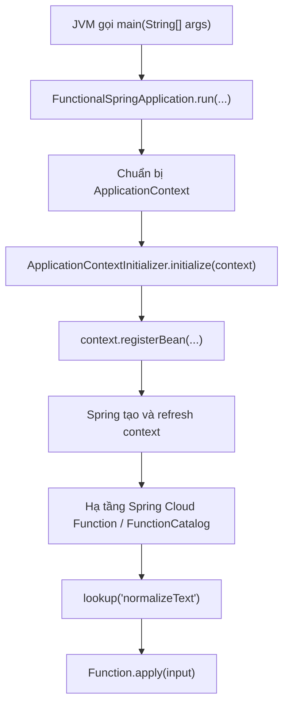
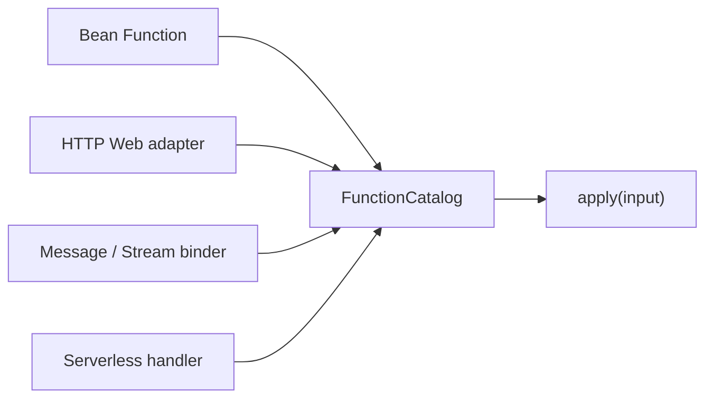

# `spring.functional.enabled` và giới hạn của chế độ functional

## Mục tiêu học tập

Trong **Spring Cloud Function**, logic nghiệp vụ thường được biểu diễn bằng `Supplier<O>`, `Function<I, O>` và `Consumer<I>`. Những hàm này có thể được gọi qua Java, HTTP, sự kiện hoặc môi trường serverless nếu có tầng tích hợp thích hợp. Trong chương **Đăng ký bean**, bên cạnh cách dùng `@Bean` và `@Component`, Spring Cloud Function còn có **phong cách khởi tạo ứng dụng theo hướng functional**: đăng ký bean bằng mã Java thay vì phụ thuộc chủ yếu vào quá trình quét và phân tích annotation.

Thuộc tính `spring.functional.enabled` gắn với cơ chế functional trong những dòng Spring Cloud Function có hỗ trợ. Tên thuộc tính nghe có vẻ đơn giản, nhưng cần hiểu đúng: **bật functional không có nghĩa là tự tạo hàm, tự mở endpoint hoặc bảo đảm toàn bộ hạ tầng Spring Boot sẽ được cấu hình như trước**.

Sau bài này, bạn có thể:

- Giải thích vai trò của `spring.functional.enabled`, `FunctionalSpringApplication` và `ApplicationContextInitializer<GenericApplicationContext>`.
- Đăng ký một `Function<I, O>` bằng lớp triển khai Java cụ thể và tra cứu nó qua `FunctionCatalog`.
- Phân biệt chế độ functional với chế độ Spring Boot thông thường và với `spring.cloud.function.scan.enabled`.
- Nhận diện giới hạn của annotation processing, component scanning, auto-configuration, dependency injection, kiểu generic và các adapter HTTP/message/serverless.
- Lựa chọn kiểu bootstrap, thiết kế kiểm thử và đo đạc phù hợp, thay vì coi functional là tùy chọn tối ưu hóa luôn có lợi.

## 1. Chế độ functional nhằm giải quyết vấn đề gì?

Một ứng dụng Spring Boot quen thuộc thường khai báo:

```java
@SpringBootApplication
public class Application {
    public static void main(String[] args) {
        SpringApplication.run(Application.class, args);
    }

    @Bean
    Function<String, String> uppercase() {
        return text -> text.toUpperCase(Locale.ROOT);
    }
}
```

Spring Boot tìm cấu hình ứng dụng, xử lý annotation, nạp auto-configuration và tạo bean. Spring Cloud Function nhận diện bean hàm để công bố trong `FunctionCatalog`.

Với phong cách **functional bean registration**, ta có thể viết lớp hàm Java thuần và đăng ký nó bằng API của Spring Framework:

```java
context.registerBean("uppercase", Uppercase.class);
```

`Uppercase` là lớp triển khai `Function<String, String>`; `context` là `GenericApplicationContext` trong một initializer. Không cần gắn `@Component` vào lớp hàm hoặc viết phương thức `@Bean` riêng chỉ để khai báo nó.

Lợi ích kỳ vọng là **kiểm soát rõ bean nào được đưa vào context**, có thể giảm một phần công việc xử lý cấu hình không cần thiết trong ứng dụng có cấu trúc phù hợp. Tuy nhiên, đây không phải một cơ chế thay thế toàn bộ Spring Framework: vẫn có `ApplicationContext`, bean lifecycle, dependency, `FunctionCatalog` và các adapter cần thiết.

| Khía cạnh | Spring Boot thường dùng | Phong cách functional |
| --- | --- | --- |
| Điểm khởi động điển hình | `SpringApplication.run(...)` | `FunctionalSpringApplication.run(...)` khi phiên bản hỗ trợ |
| Khai báo hàm phổ biến | `@Bean`, `@Component` | `ApplicationContextInitializer` và `registerBean(...)` |
| Cách lựa chọn bean | Annotation, component scan, cấu hình và điều kiện | Đăng ký bean tường minh trong initializer; các tích hợp bổ sung phụ thuộc bootstrap |
| Kiểu dữ liệu hàm | Lấy từ chữ ký `@Bean` hoặc lớp triển khai | Nên lấy từ lớp triển khai cụ thể hoặc metadata kiểu tường minh |
| Auto-configuration | Có thể dùng toàn bộ cơ chế Boot khi điều kiện đáp ứng | **Không nên giả định** mọi auto-configuration đều được nạp và hoạt động giống Boot thông thường |
| Adapter HTTP/sự kiện | Vẫn cần dependency và cấu hình | Vẫn cần dependency và cấu hình, có thể phải tích hợp rõ hơn |

Chọn phong cách nào phụ thuộc yêu cầu ứng dụng, không chỉ dựa vào số lượng hàm.

## 2. Hiểu đúng `spring.functional.enabled`

`spring.functional.enabled` là một **thuộc tính liên quan đến cơ chế functional của Spring Cloud Function ở những phiên bản hỗ trợ nó**. Khi được cơ chế bootstrap tương ứng sử dụng, giá trị `true` biểu thị ý định bật hành vi functional; giá trị `false` không bật hành vi đó theo nhánh cấu hình điều kiện tương ứng.

Có thể khai báo:

```properties
spring.functional.enabled=true
```

Hoặc trong `application.yml`:

```yaml
spring:
  functional:
    enabled: true
```

Điều cần lưu ý là **thuộc tính không thay thế API bootstrap hoặc mã đăng ký hàm**. Một ứng dụng chỉ thêm dòng `spring.functional.enabled=true` nhưng không có bean `Supplier`/`Function`/`Consumer`, initializer hoặc một cách đăng ký tương đương sẽ không tự xuất hiện hàm nghiệp vụ trong `FunctionCatalog`.

Đồng thời, **không nên coi `spring.functional.enabled` là thuộc tính Spring Boot cốt lõi áp dụng giống nhau ở mọi phiên bản**. Tên class, nơi đọc property và phạm vi hành vi functional có thể thay đổi giữa các thế hệ Spring Cloud Function. Để biết cấu hình có hiệu lực trong dự án, phải đối chiếu API của phiên bản đang dùng và kiểm thử context thực tế.

### Ba thành phần phải được phân biệt

| Thành phần | Vai trò | Không nên hiểu nhầm |
| --- | --- | --- |
| `spring.functional.enabled` | Cờ cấu hình cho hành vi functional ở bản hỗ trợ | Không phải công tắc chung bật/tắt toàn bộ Spring Cloud Function |
| `FunctionalSpringApplication` | Cách bootstrap đặc thù của Spring Cloud Function khi API này tồn tại | Không phải tên hàm nghiệp vụ hoặc handler của từng request |
| `ApplicationContextInitializer<GenericApplicationContext>` | Nơi đăng ký các bean definition bằng mã Java trước khi context refresh | Không phải callback xử lý mỗi HTTP request hoặc mỗi message |

Một initializer có thể được dùng ngay trong **Spring Boot thông thường** bằng `SpringApplication.addInitializers(...)`. Vì thế, khái niệm **đăng ký bean bằng mã** không đồng nghĩa tuyệt đối với việc phải sử dụng `FunctionalSpringApplication` hay đặt property `spring.functional.enabled=true`.

## 3. Vòng đời khởi tạo trong mô hình functional

Với cách khởi động dùng `FunctionalSpringApplication` và initializer, có thể hình dung luồng xử lý như sau:



Sơ đồ thể hiện thứ tự trách nhiệm ở mức khái niệm; chi tiết nội bộ của quá trình bootstrap, tạo bean catalog và lựa chọn auto-configuration phụ thuộc phiên bản.

`initialize(...)` chạy **trước khi context được refresh**. Khi gọi `registerBean(...)`, ta khai báo **bean definition**; Spring sẽ tạo instance theo quy tắc vòng đời và scope. Không nên coi `registerBean` là thao tác lập tức chạy nghiệp vụ `apply(...)`.

Ngoài ra, **`main` và hàm nghiệp vụ là hai điểm vào khác nhau**. Trong dịch vụ HTTP, server nhận request rồi adapter tìm hàm. Trong môi trường serverless, runtime có thể gọi một handler thay vì chạy `main` cho từng event. Logic `Function.apply(...)` giữ nguyên, nhưng cách khởi tạo context phải theo hợp đồng của môi trường triển khai.

## 4. Ví dụ hoàn chỉnh: `FunctionalSpringApplication` và lớp `Function`

Giả sử một hệ thống cần chuẩn hóa mã đơn hàng: cắt khoảng trắng hai đầu và chuyển thành chữ hoa trước khi ghi vào kho dữ liệu. Ta tách hàm thành lớp Java thuần để dùng lại qua các adapter.

Ví dụ minh họa **những phiên bản Spring Cloud Function có API `org.springframework.cloud.function.context.config.FunctionalSpringApplication`**. Dự án phải dùng Spring Boot và Spring Cloud Function Context tương thích với API đó. Trước khi sao chép, hãy xác nhận các class này thật sự có trên classpath.

### Bước 1 — Tạo lớp hàm nghiệp vụ

File `src/main/java/example/function/NormalizeText.java`:

```java
package example.function;

import java.util.Locale;
import java.util.function.Function;

public final class NormalizeText implements Function<String, String> {

    @Override
    public String apply(String value) {
        if (value == null || value.isBlank()) {
            throw new IllegalArgumentException(
                    "Mã đơn hàng không được rỗng");
        }
        return value.trim().toUpperCase(Locale.ROOT);
    }
}
```

Lớp này không sử dụng `@Component` hoặc bất kỳ API Spring nào; nó có thể được test bằng `new NormalizeText().apply(" ord-58 ")`.

**Điểm quan trọng về kiểu:** lớp cụ thể khai báo `implements Function<String, String>`, nên Spring Cloud Function có cơ sở đọc thông tin generic từ lớp. Điều này hữu ích cho cơ chế chuyển đổi payload trong adapter.

### Bước 2 — Tạo entry point kiêm initializer

File `src/main/java/example/function/FunctionalOrderApplication.java`:

```java
package example.function;

import org.springframework.cloud.function.context.config.FunctionalSpringApplication;
import org.springframework.context.ApplicationContextInitializer;
import org.springframework.context.support.GenericApplicationContext;

public class FunctionalOrderApplication
        implements ApplicationContextInitializer<GenericApplicationContext> {

    public static void main(String[] args) {
        FunctionalSpringApplication.run(
                FunctionalOrderApplication.class, args);
    }

    @Override
    public void initialize(GenericApplicationContext context) {
        context.registerBean(
                "normalizeText",
                NormalizeText.class,
                NormalizeText::new);
    }
}
```

Trong đó:

1. `FunctionalOrderApplication.main(...)` là điểm vào JVM khi chạy JAR trực tiếp.
2. `FunctionalSpringApplication.run(...)` gọi bootstrap theo phong cách functional của Spring Cloud Function, nếu phiên bản hỗ trợ.
3. `FunctionalOrderApplication` triển khai `ApplicationContextInitializer`, nên cung cấp nơi khai báo bean sớm.
4. `context.registerBean("normalizeText", NormalizeText.class, NormalizeText::new)` đăng ký bean **tên `normalizeText`**, kiểu lớp **`NormalizeText`**.
5. `NormalizeText::new` là factory tạo đối tượng bean, **không phải `Supplier<String>` nghiệp vụ** dùng để phát sinh một sự kiện.

Đừng thêm `@Component("normalizeText")` vào `NormalizeText` rồi đồng thời đăng ký cùng tên bằng initializer nếu không có lý do rõ ràng: có thể sinh xung đột hoặc trùng đăng ký.

### Bước 3 — Cấu hình property khi bản framework hỗ trợ

Trong `src/main/resources/application.properties`:

```properties
spring.functional.enabled=true
```

Đặt property giúp thể hiện ý định dùng functional mode trong những dòng framework có đọc cờ này. **Trong ví dụ, việc đăng ký bean vẫn do initializer thực hiện; property không thay initializer.** Một số phiên bản sử dụng `FunctionalSpringApplication` để quyết định đường bootstrap mà không cần người dùng thêm property bằng tay; do đó không nên suy luận rằng chỉ có đúng một cách kích hoạt cho mọi phiên bản.

### Bước 4 — Tra cứu hàm sau khi khởi tạo context

Một đoạn kiểm chứng có thể chủ động khởi chạy ứng dụng và lấy catalog. Chẳng hạn trong **bài kiểm thử tích hợp** (không phải code đặt sau `run(...)` trong ứng dụng production):

```java
try (ConfigurableApplicationContext context =
        FunctionalSpringApplication.run(
                FunctionalOrderApplication.class,
                "--spring.main.web-application-type=none")) {

    FunctionCatalog catalog = context.getBean(FunctionCatalog.class);
    Function<String, String> fn = catalog.lookup("normalizeText");

    if (fn == null) {
        throw new IllegalStateException(
                "Không thấy normalizeText trong FunctionCatalog");
    }

    System.out.println(fn.apply("  ord-58  ")); // ORD-58
}
```

Trong đoạn rút gọn này, cần import `ConfigurableApplicationContext` từ `org.springframework.context`, `FunctionCatalog` từ `org.springframework.cloud.function.context` và `Function` từ `java.util.function`. Tác vụ demo đóng context bằng try-with-resources là phù hợp với chương trình kiểm tra một lượt; **không đóng context ngay trong `main` của dịch vụ web** vì như vậy HTTP server có thể bị dừng ngay sau khi khởi động.

Khi Spring Cloud Function Context/auto-configuration tương ứng đã được nạp, kết quả dự kiến là `ORD-58`. Nếu không tìm được `FunctionCatalog`, cần kiểm tra dependency và bootstrap/phiên bản trước khi kết luận rằng hàm `NormalizeText` sai.

## 5. `spring.functional.enabled` khác những property dễ nhầm

Ba nhóm cấu hình sau có phạm vi hoàn toàn khác nhau:

| Cấu hình | Hỏi điều gì? | Không làm thay |
| --- | --- | --- |
| `spring.functional.enabled` | Có dùng hành vi functional mà bản Spring Cloud Function hỗ trợ hay không? | Không tự đăng ký `Function`, không quyết định HTTP endpoint |
| `spring.cloud.function.scan.enabled` | Có chạy cơ chế **Function Component Scan** để tự tìm lớp hàm trong package không? | Không bật/tắt toàn bộ functional bootstrap |
| `spring.cloud.function.scan.packages` | Function Component Scan tìm lớp ở package Java nào? | Không thay đổi bản chất `FunctionalSpringApplication` |
| `spring.cloud.function.definition` | Adapter/catalog cần chọn hàm hay chuỗi composition nào đã có? | Không tạo bean hoặc tự kích hoạt scanner |
| `spring.main.web-application-type=none` | Có khởi tạo ứng dụng không có web server không? | Không đổi hàm Java thành chế độ functional |

Ví dụ:

```properties
spring.functional.enabled=true
spring.cloud.function.scan.enabled=false
spring.cloud.function.definition=normalizeText
```

Trong cấu hình minh họa này, ta dự định đăng ký `normalizeText` **tường minh** thông qua initializer, không phụ thuộc vào việc quét package `functions`. `definition` có thể giúp một adapter chọn hàm đã được đăng ký, **nó không sinh hàm**.

Nếu một dự án sử dụng lối khởi chạy `SpringApplication.run(...)` thông thường nhưng cũng muốn đăng ký bean bằng Java, có thể dùng `SpringApplication.addInitializers(...)` mà không bắt buộc dựa vào `spring.functional.enabled`. Đây là giải pháp khác với việc thay toàn bộ bootstrap bằng `FunctionalSpringApplication`.

## 6. Giới hạn quan trọng: auto-configuration và annotation

### 6.1. Không mặc định mọi tính năng của Spring Boot đều còn nguyên

Khi dùng Spring Boot thông thường, `@SpringBootApplication` thường kéo theo component scanning và xử lý các auto-configuration phù hợp. Chế độ functional nhấn mạnh **đăng ký bean bằng mã**; tùy phiên bản và đường bootstrap, một số cơ chế xử lý annotation, quét thành phần hoặc auto-configuration có thể không được kích hoạt giống ứng dụng Boot thông thường.

Điều cần tránh là suy luận:

> "Tôi chuyển `SpringApplication.run(...)` thành `FunctionalSpringApplication.run(...)`, vậy mọi `@Component`, `@Configuration`, `@Enable...` và mọi auto-configuration vẫn hoạt động y hệt."

Thực tế cần **kiểm chứng từng dependency và bean hạ tầng** mà ứng dụng phụ thuộc. Có những tích hợp yêu cầu annotation processor, importer hoặc auto-configuration riêng; khi các cơ chế đó không được nạp, bean có thể không tồn tại.

Đặc biệt lưu ý các nhóm chức năng thường phụ thuộc cấu hình Boot:

- HTTP server, request mapping, JSON serialization, validation.
- Kết nối cơ sở dữ liệu, transaction manager, data repository.
- Security filter chain, xác thực và phân quyền.
- Observability, metrics, tracing, actuator.
- Spring Cloud Stream binder hoặc adapter serverless.

Không phải mọi mục đều **bị vô hiệu hóa mặc định** trong mọi bản functional. Giới hạn ở đây là **không được bảo đảm chúng hoạt động tự động**; bạn phải xác minh trên tổ hợp framework/runtime đang triển khai.

### 6.2. `@Component` không nhất thiết được tự quét

Lớp:

```java
@Component
public class OrderService {
    // ...
}
```

chỉ tự thành Spring bean nếu có cơ chế component scanning/registration phù hợp. Nếu functional bootstrap được thiết kế để tránh quét annotation, lớp chỉ có `@Component` có thể không được tạo.

Khi muốn chắc chắn có một service trong context, có thể đăng ký tường minh:

```java
context.registerBean("orderService", OrderService.class);
```

Ví dụ này là **phương án thay thế** cho component scanning, không nên cố tình đăng ký trùng cả hai nơi. Nếu service có dependency, nên dùng constructor injection hoặc factory thích hợp.

### 6.3. `@Bean` trong một `@Configuration` chưa chắc đã được nạp

Nếu lớp cấu hình không được xử lý/import bởi bootstrap đang dùng, một phương thức:

```java
@Bean
Function<String, String> normalizeText() {
    return value -> value.trim().toUpperCase(Locale.ROOT);
}
```

sẽ không tự tạo bean chỉ vì tệp Java có trên classpath. Tương tự, một auto-configuration của thư viện không nên được coi là hoạt động nếu chưa kiểm tra nó thực sự được nạp.

Với ứng dụng chủ yếu dựa vào annotation và nhiều Spring Boot starter, **giữ Spring Boot bootstrap thông thường và bổ sung initializer tường minh** thường là hướng chuyển đổi an toàn hơn so với thay toàn bộ điểm khởi chạy ngay lập tức.

## 7. Phương án kết hợp: giữ Spring Boot, đăng ký hàm bằng Java

Nếu vẫn cần Spring Boot auto-configuration thông thường nhưng muốn hàm nghiệp vụ không phụ thuộc annotation, bạn có thể đăng ký initializer khi tạo `SpringApplication`.

File `NormalBootApplication.java`:

```java
package example.function;

import org.springframework.boot.SpringApplication;
import org.springframework.boot.autoconfigure.SpringBootApplication;

@SpringBootApplication
public class NormalBootApplication {

    public static void main(String[] args) {
        SpringApplication app =
                new SpringApplication(NormalBootApplication.class);

        app.addInitializers(new NormalizeInitializer());
        app.run(args);
    }
}
```

File `NormalizeInitializer.java`:

```java
package example.function;

import org.springframework.context.ApplicationContextInitializer;
import org.springframework.context.support.GenericApplicationContext;

public final class NormalizeInitializer
        implements ApplicationContextInitializer<GenericApplicationContext> {

    @Override
    public void initialize(GenericApplicationContext context) {
        context.registerBean("normalizeText", NormalizeText.class);
    }
}
```

Đây là **ứng dụng thay thế** cho ví dụ `FunctionalOrderApplication` ở phần 4; không chạy hai entry point và đăng ký hai lần cùng tên `normalizeText` trong một context.

Trong cách kết hợp này:

1. `SpringApplication` sử dụng cơ chế khởi chạy Spring Boot thông thường.
2. Initializer thêm bean `normalizeText` **trước khi refresh**.
3. Spring Boot tiếp tục áp dụng các auto-configuration và annotation theo điều kiện thông thường.
4. Spring Cloud Function có thể nhận diện bean `Function<String,String>` qua `FunctionCatalog` khi dependency phù hợp tồn tại.

**Lưu ý:** viết initializer trong ứng dụng Boot bình thường không có nghĩa hai kiểu bootstrap có startup, memory footprint hoặc hành vi auto-configuration giống hệt nhau. Đây là lựa chọn kỹ thuật khi muốn bảo toàn cách tích hợp Boot mà vẫn đăng ký hàm bằng mã.

## 8. Giới hạn kiểu dữ liệu: functional không xóa bỏ type erasure

Xét cách đăng ký một lambda qua kiểu thô:

```java
context.registerBean(
        "normalizeText",
        Function.class,
        () -> (Function<String, String>) text ->
                text.trim().toUpperCase(Locale.ROOT));
```

Mặc dù Java compiler biết kiểu của lambda ở biểu thức ép kiểu, `Function.class` **không chứa thông tin `<String,String>`**. Khi Spring Cloud Function muốn chuyển một message JSON thành DTO Java, metadata kiểu bị thiếu có thể dẫn đến chuyển đổi sai.

Đăng ký qua lớp triển khai cụ thể:

```java
context.registerBean("normalizeText", NormalizeText.class);
```

thường dễ phân tích generic hơn vì `NormalizeText implements Function<String,String>`. Với dữ liệu kiểu phức tạp:

```java
public record OrderCommand(String id, int quantity) {}
public record OrderResult(String id, boolean accepted) {}
```

hãy định nghĩa lớp:

```java
public final class ValidateOrder
        implements Function<OrderCommand, OrderResult> {

    @Override
    public OrderResult apply(OrderCommand order) {
        return new OrderResult(order.id(), order.quantity() > 0);
    }
}
```

Khi đó catalog/adapter có cơ sở biết `OrderCommand -> OrderResult`. Với lambda động hoặc kiểu phức hợp như `List<OrderCommand>`, `Message<OrderCommand>` và reactive types, cần cân nhắc metadata kiểu tường minh qua `FunctionRegistration` hoặc API tương ứng của phiên bản đang dùng.

**Functional bootstrap không thay thế serializer hoặc content type.** Chuyển đổi JSON vẫn cần adapter, codec, header/content type phù hợp và DTO có thể deserialize.

## 9. Giới hạn vòng đời, dependency và trạng thái

### Initializer không phải nơi gọi mọi bean

`ApplicationContextInitializer.initialize(...)` diễn ra trước `refresh()`. Vì vậy, tránh gọi:

```java
OrderService service = context.getBean(OrderService.class);
```

ngay trong `initialize(...)` nếu bean đó chỉ được đăng ký hoặc tạo sau này. Thay vào đó, đăng ký bean với factory phù hợp:

```java
context.registerBean(
        "validateOrder",
        ValidateOrderWithService.class,
        () -> new ValidateOrderWithService(
                context.getBean(OrderService.class)));
```

Đoạn minh họa giả định `OrderService` là Spring bean và `ValidateOrderWithService` có constructor nhận `OrderService`. Factory được container sử dụng **khi tạo bean**, không phải khi chỉ ghi nhận bean definition trong initializer.

### `Supplier` nghiệp vụ khác factory tạo bean

```java
context.registerBean("normalizeText", NormalizeText.class,
        NormalizeText::new);
```

`NormalizeText::new` có dạng `Supplier<NormalizeText>`, nhưng nó là **factory cho bean**. Nó không trở thành một hàm `Supplier<String>` nghiệp vụ mà `FunctionCatalog.lookup("...")` gọi `get()`. Khi muốn khai báo một Supplier nghiệp vụ, hãy đăng ký lớp `implements Supplier<O>` thực sự.

### Singleton và concurrency vẫn cần được thiết kế

Spring thường quản lý bean singleton theo mặc định; cùng một `Function` có thể được gọi từ nhiều request/message đồng thời. Chế độ functional không tự bảo đảm thread safety. Hạn chế lưu dữ liệu request hiện tại trong trường mutable của bean, hoặc bảo vệ trạng thái bằng cơ chế đồng bộ thích hợp.

Với `Consumer` có side effect, phải cân nhắc idempotency khi message bị retry/redelivery. Với `Supplier` có polling, tần suất gọi thuộc adapter/scheduler, **không phải do `spring.functional.enabled` quyết định**.

## 10. HTTP, sự kiện và serverless trong functional mode

Trong kiến trúc Spring Cloud Function, adapter chịu trách nhiệm chuyển lời gọi bên ngoài thành lời gọi tới hàm trong catalog:



Giả sử `normalizeText` đã được catalog nhận diện. Khi cài Spring Cloud Function Web adapter và HTTP server đúng phiên bản/cấu hình, một route thông thường có thể nhận:

```bash
curl -X POST http://localhost:8080/normalizeText \
  -H 'Content-Type: text/plain' \
  --data-binary '  ord-58  '
```

Kết quả nghiệp vụ mong đợi: `ORD-58`. **Lệnh chỉ hoạt động khi web adapter/server thực sự có mặt và route được ánh xạ**. Một số kiểu functional bootstrap có thể không nạp web auto-configuration như mong đợi, vì vậy phải kiểm thử HTTP ở mức hệ thống thay vì suy ra từ thành công của `catalog.lookup(...)`.

Với Spring Cloud Stream, cần binder, binding và cấu hình chọn hàm. Với serverless, cần handler/launcher tương thích nền tảng, xác nhận cách context được khởi tạo và thời điểm `main` có hoặc không được gọi. Không nên nhúng logic tạo kết nối hoặc đăng ký bean quan trọng vào đoạn mã chỉ chạy sau `main` nếu adapter serverless không sử dụng đường đó.

`spring.cloud.function.definition=normalizeText` có thể giúp adapter chọn hàm đã tồn tại; thuộc tính này **không khắc phục** việc initializer chưa chạy hoặc catalog thiếu bean.

## 11. Kiểm thử chế độ functional mà không ngộ nhận kết quả

### 11.1. Unit test logic Java

Với JUnit 5:

```java
package example.function;

import static org.junit.jupiter.api.Assertions.assertEquals;
import org.junit.jupiter.api.Test;

class NormalizeTextTest {

    @Test
    void normalizesOrderCode() {
        NormalizeText fn = new NormalizeText();
        assertEquals("ORD-58", fn.apply("  ord-58  "));
    }
}
```

Test này chứng minh hàm Java đúng, nhưng **không chứng minh** initializer đã chạy, bean đã có trong context hoặc chế độ functional đang hoạt động.

### 11.2. Kiểm thử bean registration độc lập

Có thể kiểm tra initializer với `GenericApplicationContext` mà không cần Spring Cloud Function auto-configuration:

```java
package example.function;

import static org.junit.jupiter.api.Assertions.assertEquals;
import static org.junit.jupiter.api.Assertions.assertTrue;

import org.junit.jupiter.api.Test;
import org.springframework.context.support.GenericApplicationContext;

class BeanDefinitionTest {

    @Test
    void initializerRegistersConcreteFunction() {
        try (GenericApplicationContext context =
                new GenericApplicationContext()) {

            new FunctionalOrderApplication().initialize(context);
            assertTrue(context.containsBeanDefinition("normalizeText"));

            context.refresh();
            NormalizeText fn =
                    context.getBean("normalizeText", NormalizeText.class);

            assertEquals("ORD-58", fn.apply("  ord-58  "));
        }
    }
}
```

Test này kiểm tra **initializer + Spring bean lifecycle**. Nó chưa nạp `FunctionCatalog`, chưa kiểm tra property `spring.functional.enabled` và chưa xác minh auto-configuration.

### 11.3. Kiểm thử catalog qua đúng bootstrap

Với dependency/phiên bản có `FunctionalSpringApplication`:

```java
package example.function;

import static org.junit.jupiter.api.Assertions.assertEquals;
import static org.junit.jupiter.api.Assertions.assertNotNull;

import java.util.function.Function;
import org.junit.jupiter.api.Test;
import org.springframework.cloud.function.context.FunctionCatalog;
import org.springframework.cloud.function.context.config.FunctionalSpringApplication;
import org.springframework.context.ConfigurableApplicationContext;

class FunctionalBootstrapTest {

    @Test
    void discoversFunction() {
        try (ConfigurableApplicationContext context =
                FunctionalSpringApplication.run(
                        FunctionalOrderApplication.class,
                        "--spring.functional.enabled=true",
                        "--spring.main.web-application-type=none")) {

            FunctionCatalog catalog =
                    context.getBean(FunctionCatalog.class);
            Function<String, String> fn =
                    catalog.lookup("normalizeText");

            assertNotNull(fn);
            assertEquals("ORD-58", fn.apply("  ord-58  "));
        }
    }
}
```

Nếu test này thất bại vì thiếu `FunctionCatalog`, lỗi có thể nằm ở dependency, cơ chế bootstrap hoặc phiên bản, chứ không nhất thiết ở hàm. Nếu test pass, nó chứng minh **bootstrap + registration + catalog** hoạt động ở cấu hình hiện tại, không tự chứng minh web server, message binder hay handler serverless hoạt động.

Muốn so sánh `spring.functional.enabled=true` và `false`, phải kiểm thử **hai Spring context độc lập** với cùng dependency và đường bootstrap phù hợp. Không nên kết luận chỉ dựa vào việc một unit test tạo `new NormalizeText()` pass, cũng không giả định đặt property `false` sẽ xóa mọi bean đã được khai báo tường minh.

## 12. Chẩn đoán vấn đề thường gặp

| Dấu hiệu | Nguyên nhân có thể | Cách xử lý |
| --- | --- | --- |
| `FunctionalSpringApplication` không tìm thấy trên classpath | Dùng phiên bản Spring Cloud Function khác hoặc thiếu artifact cung cấp API | Kiểm tra dependency và tài liệu API đúng phiên bản; cân nhắc Boot + initializer |
| Đặt `spring.functional.enabled=true` nhưng catalog không có hàm | Chỉ bật cờ, chưa khai báo bean/initializer hoặc initializer không được gọi | Đăng ký một hàm và test `lookup` trong context |
| `NoSuchBeanDefinitionException: FunctionCatalog` | Chưa có cấu hình hạ tầng Spring Cloud Function tương ứng | Kiểm tra Spring Cloud Function Context, bootstrap, classpath và phiên bản |
| `@Component` hay `@Bean` không xuất hiện | Đường functional bootstrap có thể không xử lý configuration/scan như Boot thông thường | Đăng ký tường minh hoặc trở lại Boot bootstrap có auto-configuration phù hợp |
| Thiếu `DataSource`, security, web bean | Một số auto-configuration của Boot không được nạp như kỳ vọng | Xác minh context thực tế và cấu hình adapter; không mặc định functional giống Boot |
| Hàm có trong context nhưng `lookup(...)` null | Tên không khớp hoặc hạ tầng catalog/metadata chưa được thiết lập | Xác nhận tên bean, kiểu hàm, FunctionCatalog và cấu hình definition |
| JSON không chuyển thành DTO | Raw `Function.class` không đủ generic, thiếu content type/codec | Dùng lớp triển khai cụ thể hoặc metadata `FunctionRegistration` tương thích |
| HTTP 404 trong khi Java test pass | Không có web adapter, HTTP server, route hoặc auto-config web chưa được kích hoạt | Kiểm thử adapter thực tế và dependency web, không chỉ kiểm thử catalog |
| Tên bean bị trùng | Hàm vừa được initializer đăng ký, vừa được scan/đăng ký theo cách khác | Chọn một cách đăng ký cho mỗi tên hàm |
| Lỗi lấy dependency trong initializer | Gọi `getBean` trước lúc context refresh | Đăng ký factory/constructor injection và để Spring tạo instance sau |
| Startup không cải thiện, thậm chí chậm hơn | Phần chi phí chính nằm ở dependency, I/O, adapter hoặc kết nối ngoài | Đo cold start, memory và workload trên chính môi trường deploy |

Quy trình gỡ lỗi nên đi theo thứ tự:

1. **Kiểm tra phiên bản và API:** dự án có thật sự hỗ trợ `FunctionalSpringApplication` và property đang dùng không?
2. **Kiểm tra bean definition:** initializer có được gọi, `normalizeText` có được khai báo không?
3. **Kiểm tra catalog:** có bean `FunctionCatalog`, `lookup("normalizeText")` có thành công không?
4. **Kiểm tra adapter:** web/binder/serverless đã được cài, khởi tạo, định tuyến và chuyển đổi payload đúng chưa?
5. **Kiểm tra điều kiện cấu hình:** có đang nhầm `spring.functional.enabled` với `scan.enabled` hoặc `spring.cloud.function.definition` không?

## 13. Khi nào nên chọn functional bootstrap?

| Tình huống | Hướng cân nhắc |
| --- | --- |
| Ứng dụng rất gọn, chủ yếu là vài hàm nghiệp vụ; muốn tự kiểm soát từng bean được nạp | Có thể thử `FunctionalSpringApplication` cùng initializer, sau đó đo startup/memory thực tế |
| Ứng dụng phụ thuộc nhiều Spring Boot starter, repository, security, tracing hoặc web configuration | Thường nên bắt đầu với Spring Boot thông thường, chỉ thêm initializer nếu cần đăng ký bean bằng mã |
| Cùng hàm phải chạy ở nhiều adapter (HTTP, broker, serverless) | Giữ hàm Java độc lập giao thức; chọn bootstrap/adapter theo runtime và kiểm thử từng môi trường |
| Cần dynamic function hoặc lambda không giữ được generic | Dùng metadata kiểu tường minh như `FunctionRegistration` thay vì trông đợi functional mode suy ra mọi thứ |
| Đang tối ưu cold start/serverless | Đo trên môi trường triển khai thật; functional có thể giúp giảm một số overhead nhưng không bảo đảm tối ưu vô điều kiện |
| Chuyển một ứng dụng Boot lớn sang functional | Làm từng bước, xác minh auto-configuration/bean cần thiết; cân nhắc Boot + `addInitializers` trước |

Không nên dùng kết quả từ một ví dụ tối giản để khẳng định functional luôn nhanh hơn hoặc ít bộ nhớ hơn. Chi phí thực tế phụ thuộc số bean, reflection, codec, auto-configuration, kết nối ngoài, thiết bị chạy và loại adapter. Nếu triển khai native image/AOT, cần xác nhận khả năng tương thích và metadata reachability theo phiên bản; **chỉ bật property functional không tự bảo đảm native image sẽ build/chạy đúng**.

## 14. Bài tập áp dụng và tự kiểm tra

**Bài tập 1 — Đăng ký tường minh:** viết `NormalizeCustomerId implements Function<String,String>`, đăng ký tên `normalizeCustomerId` bằng initializer và xác nhận `FunctionCatalog.lookup("normalizeCustomerId")` trả một hàm có thể được gọi.

**Bài tập 2 — So sánh bootstrap:** dùng cùng lớp `NormalizeText` với hai entry point độc lập: `FunctionalSpringApplication` và `SpringApplication + addInitializers`. Ghi nhận những bean/auto-configuration được tạo, startup và memory footprint trên cùng môi trường, không chỉ so sánh kết quả `apply(...)`.

**Bài tập 3 — Kiểu dữ liệu:** thay `String -> String` bằng `OrderCommand -> OrderResult` và đăng ký bằng lớp `implements Function<OrderCommand,OrderResult>`. So sánh với cách đăng ký raw `Function.class` khi dùng adapter chuyển JSON.

**Bài tập 4 — Adapter:** sau khi catalog có hàm, thử HTTP với Web adapter thích hợp rồi giải thích vì sao test catalog thành công không tự chứng minh endpoint sẵn sàng. Với serverless, xác định rõ launcher/handler mà runtime gọi thay vì giả định `main` chạy mỗi request.

Tự trả lời:

1. **`spring.functional.enabled=true` có tự tạo `Function` bean không?** Không. Hàm vẫn phải được đăng ký hoặc phát hiện bằng cơ chế phù hợp.
2. **Functional mode có nhất thiết nạp mọi `@Component` và auto-configuration như `@SpringBootApplication` không?** Không nên mặc định như vậy; phải xác minh với phiên bản và bootstrap thực tế.
3. **`spring.cloud.function.scan.enabled=false` có vô hiệu toàn bộ Spring Cloud Function không?** Không. Nó tắt cơ chế quét package hàm chuyên biệt, không xóa các bean đăng ký theo cách khác.
4. **Vì sao nên đăng ký `NormalizeText.class` thay vì raw `Function.class`?** Lớp cụ thể thể hiện generic `Function<String,String>` mà adapter có thể cần.
5. **Gọi `registerBean` trong initializer đã chạy `apply(...)` chưa?** Chưa. Nó đăng ký bean definition, không gọi hàm nghiệp vụ.
6. **Chuyển sang functional có tự tạo server HTTP không?** Không; cần adapter và web server đã cấu hình đúng.
7. **Muốn dùng Boot auto-configuration nhưng vẫn đăng ký hàm bằng Java thì làm gì?** Có thể giữ `SpringApplication` và dùng `addInitializers(...)`.

## 15. Tổng kết

**`spring.functional.enabled`** liên quan đến phong cách bootstrap/đăng ký bean functional của **Spring Cloud Function** trong những phiên bản có hỗ trợ. Để sử dụng đúng, cần phân biệt **cờ cấu hình**, **`FunctionalSpringApplication`**, **initializer đăng ký bean** và **`FunctionCatalog`**. Functional registration giúp mô tả rõ các hàm Java không phụ thuộc giao thức, nhưng **không thay thế toàn bộ auto-configuration, dependency, metadata kiểu hay adapter**.

Lựa chọn thực dụng là dùng functional khi cần chủ động kiểm soát context và đã kiểm thử các tích hợp; dùng Spring Boot thông thường (có thể kết hợp initializer) khi cần tận dụng hệ sinh thái auto-configuration rộng. Trong cả hai trường hợp, logic `Supplier`, `Function`, `Consumer` nên độc lập HTTP/message/serverless, còn các adapter chịu trách nhiệm gọi chúng qua catalog.

Tham khảo API và hành vi cụ thể theo phiên bản đang dùng trong [Spring Cloud Function Reference](https://docs.spring.io/spring-cloud-function/reference/) và [Spring Boot Reference — Auto-configuration](https://docs.spring.io/spring-boot/reference/using/auto-configuration.html).
