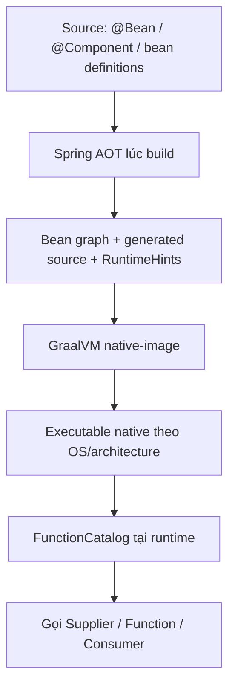
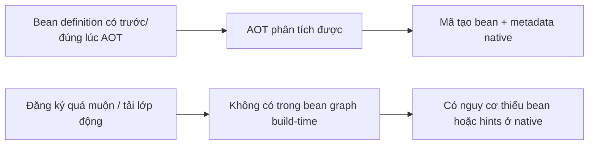

# Tác động của cách đăng ký bean tới AOT và native image

## Mục tiêu học tập

**Spring Cloud Function** cho phép phát triển logic nghiệp vụ bằng `Supplier<O>`, `Function<I, O>` và `Consumer<I>`, sau đó sử dụng lại qua `FunctionCatalog`, composition, HTTP, sự kiện hoặc serverless. Trong chương **Đăng ký bean**, một quyết định tưởng nhỏ — đăng ký bằng `@Bean`, `@Component`, lớp cụ thể hay lambda/factory động — có thể ảnh hưởng lớn tới khả năng phân tích **Ahead-of-Time (AOT)** và đóng gói thành **GraalVM Native Image**.

Kết thúc bài học, bạn có thể:

- Phân biệt **Spring AOT** với **GraalVM native-image** và với *functional bean registration* của Spring Cloud Function.
- Giải thích tại sao **bean definition phải xuất hiện trong giai đoạn build-time AOT** và cần có kiểu đủ chính xác.
- So sánh `@Bean`, `@Component`, `GenericApplicationContext.registerBean(...)`, `FunctionRegistration` và cách đăng ký động.
- Viết một hàm `Function<OrderCommand, OrderReceipt>` với chữ ký có thể được Spring AOT phân tích; kiểm tra bằng `FunctionCatalog`.
- Nhận biết giới hạn của lambda instance supplier, `registerSingleton`, quét classpath lúc runtime, `@Profile` và `@ConditionalOnProperty`.
- Bổ sung `RuntimeHints` khi có phản chiếu, tài nguyên hoặc JSON binding **không được AOT suy ra**; phân biệt hints với metadata kiểu hàm.
- Lập quy trình thử nghiệm JVM, AOT-processed JVM và native image, bao gồm adapter HTTP/message/serverless.

## 1. Spring AOT và native image khác nhau ở đâu?

Ở môi trường JVM truyền thống, Spring có thể quét classpath, đọc annotation, kiểm tra điều kiện và dựng nhiều bean definitions trong lúc ứng dụng khởi động. Điều này tạo sự linh hoạt nhưng có chi phí thời gian và bộ nhớ lúc startup.

**Spring AOT** chuyển một phần các công việc khám phá và quyết định cấu hình sang **giai đoạn build**. Nó phân tích `ApplicationContext`, xác định những bean definitions có thể có, sau đó tạo mã Java, bytecode hỗ trợ proxy và metadata/hints cho những hành vi runtime cần thiết.

**GraalVM Native Image** biên dịch ứng dụng thành executable gắn với hệ điều hành và kiến trúc đích; quá trình phân tích tĩnh dựa vào một *closed world* gồm mã và tài nguyên được biết trước. Đối với ứng dụng Spring Boot native, bước Spring AOT là một phần quan trọng của quy trình build; bản thân GraalVM cũng cần thông tin về reflection, resource, serialization và dynamic proxy.



| Khái niệm | Hoạt động chủ yếu | Điều cần nhớ |
| --- | --- | --- |
| Đăng ký bean | Lúc xây dựng Spring context | Phải xác định được bean nào, tên gì và kiểu gì |
| Spring AOT | **Build time** | Chuẩn bị mô hình bean và các mã/hints để hạn chế khám phá động |
| GraalVM Native Image | **Native build time** | Biên dịch thành chương trình closed-world, không chạy như JVM truyền thống |
| `FunctionCatalog` | Ở ứng dụng đã khởi tạo | Tra cứu, phối hợp và gọi các hàm đã được công bố |
| HTTP / event / serverless adapter | Runtime triển khai | Định tuyến dữ liệu từ giao thức tới hàm, không thay thế việc đăng ký bean |

**Không đồng nhất ba cờ/cơ chế:** `spring.functional.enabled` là hành vi *functional bootstrap* phụ thuộc phiên bản Spring Cloud Function; `spring.aot.enabled` là cơ chế bật sử dụng **mã đã được Spring AOT tạo sẵn** trên JVM trong những phiên bản hỗ trợ; native image là executable riêng được tạo bằng công cụ native build. Bật một property đơn lẻ **không tự tạo native image**.

## 2. Vì sao thời điểm đăng ký bean trở nên quan trọng?

Trong JVM bình thường, ứng dụng có thể đăng ký thêm bean khi khởi động hoặc thậm chí thử thêm động trong lúc chạy. Khi AOT phân tích, chỉ những **bean definitions mà engine nhìn thấy qua những giai đoạn xử lý được hỗ trợ** mới có thể đóng góp đầy đủ vào mã/hints sinh ra.



Các vấn đề thường gặp:

1. **Bean xuất hiện quá muộn:** bean được thêm từ một callback runtime sau khi mô hình AOT đã được xác lập thì không chắc xuất hiện trong mã sinh ra.
2. **Kiểu khai báo quá chung:** `Function.class` hoặc `Object.class` không thể hiện `OrderCommand`, `OrderReceipt` hay lớp có constructor/lifecycle callback cần phân tích.
3. **Phụ thuộc vào quét runtime:** native image không cung cấp cơ chế classpath động giống JVM. Quét lớp cần được xử lý trong giai đoạn build hoặc thay bằng đăng ký tường minh phù hợp.
4. **Phụ thuộc vào reflection không được biết trước:** tên class lấy từ chuỗi, codec động, tài nguyên tải theo tên và proxy tạo theo nhánh ít được phân tích có thể cần hints.
5. **Đổi tập bean bằng cấu hình ở runtime:** các quyết định `@Profile` hoặc điều kiện ảnh hưởng việc bean có tồn tại thường đã được cố định trong quá trình AOT.

Đây là lý do **cùng một hàm Java chạy tốt trên JVM nhưng có thể thiếu bean hoặc lỗi khi chạy native**.

## 3. So sánh tác động của những cách đăng ký

| Cách đăng ký | Spring nhìn thấy gì? | Hệ quả với AOT/native |
| --- | --- | --- |
| `@Bean PriceOrder priceOrder()` | Bean factory method và **lớp cụ thể** | Dễ phân tích kiểu, constructor và vòng đời nếu cấu hình được nạp lúc build |
| `@Bean Function<OrderCommand, OrderReceipt> priceOrder()` | Generic input/output rõ nhưng bean type công bố là interface | Hữu ích cho FunctionCatalog/message conversion; AOT không nhất thiết biết mọi chi tiết riêng của class ẩn bên trong |
| `@Component class PriceOrder implements Function<...>` | Lớp triển khai cụ thể được component scan tìm thấy | Phù hợp nếu scan được thực hiện trong AOT và lớp nằm đúng phạm vi |
| `registerBean("priceOrder", PriceOrder.class)` | Bean definition với class cụ thể | Có thể phù hợp nếu callback đăng ký được AOT thực thi/nhìn thấy **đủ sớm** |
| `registerBean(..., PriceOrder.class, PriceOrder::new)` | Bean definition có **instance supplier do người dùng cung cấp** | Cần thận trọng: theo hạn chế AOT được tài liệu hóa, dạng instance supplier lambda/method reference **không được biến đổi AOT như bean definition thông thường** |
| `registerBean("priceOrder", Function.class, () -> lambda)` | Kiểu bean thô + instance supplier | Cả khả năng suy luận generic lẫn khả năng chuyển đổi AOT đều đáng lo; không ưu tiên cho native |
| `FunctionRegistration` có tên/kiểu tường minh | Metadata Spring Cloud Function về tên và kiểu hàm | Giúp catalog/conversion, nhưng **không tự giải quyết** mọi hạn chế tạo bean hoặc reflection native |
| `registerSingleton(..., instance)` | Instance đã tạo sẵn, không phải bean definition có thể phân tích đầy đủ | Không phải cách đăng ký được Spring AOT hỗ trợ biến đổi như bean definition |
| Tìm class từ chuỗi tên sau startup rồi đăng ký động | Class/bean chỉ xuất hiện runtime | Không bảo đảm phù hợp closed-world; cần thiết kế registration/AOT contribution riêng |

**Không suy luận rằng “dùng functional registration” thì native luôn nhanh hơn hay dễ hơn.** Spring AOT hỗ trợ mô hình `@Configuration`/`@Bean` thông thường rất tốt. Với đăng ký bằng Java, điều cần kiểm tra là **kiểu bean, giai đoạn đăng ký và dạng bean definition**.

## 4. Ví dụ AOT-friendly: đăng ký bằng lớp triển khai cụ thể

Tình huống: dịch vụ tính tổng tiền cho đơn hàng rồi tái sử dụng hàm qua HTTP hoặc message adapter. Dùng Java 17+ và phiên bản **Spring Boot 3+/Spring Cloud Function tương thích**; trong môi trường Spring Boot 4+ cũng cần xác nhận starter/plugin và API tương ứng.

Các lớp trong package `example.orders`.

### 4.1. Khai báo DTO có hợp đồng rõ ràng

File `OrderCommand.java`:

```java
package example.orders;

public record OrderCommand(String id, int quantity) {
}
```

File `OrderReceipt.java`:

```java
package example.orders;

public record OrderReceipt(String id, long totalCents) {
}
```

Mỗi `public record` phải được đặt trong file Java cùng tên. Kiểu dữ liệu rõ ràng giúp người đọc và framework xác định payload đầu vào/đầu ra; tuy nhiên việc JSON serialize/deserialize ở native vẫn phụ thuộc codec và metadata phản chiếu tương ứng.

### 4.2. Viết lớp `Function` độc lập giao thức

File `PriceOrder.java`:

```java
package example.orders;

import java.util.function.Function;

public final class PriceOrder
        implements Function<OrderCommand, OrderReceipt> {

    private static final long UNIT_PRICE_CENTS = 12_000L;

    @Override
    public OrderReceipt apply(OrderCommand command) {
        if (command == null || command.id() == null
                || command.id().isBlank() || command.quantity() <= 0) {
            throw new IllegalArgumentException("Đơn hàng không hợp lệ");
        }

        long total = Math.multiplyExact(
                (long) command.quantity(), UNIT_PRICE_CENTS);
        return new OrderReceipt(command.id(), total);
    }
}
```

`PriceOrder` không phụ thuộc Spring, web controller hay message header. Nó có một constructor mặc định đơn giản, không chứa trạng thái mutable và khai báo trực tiếp `Function<OrderCommand, OrderReceipt>`.

### 4.3. Công bố **lớp cụ thể** bằng phương thức `@Bean`

File `OrderFunctionApplication.java`:

```java
package example.orders;

import org.springframework.boot.SpringApplication;
import org.springframework.boot.autoconfigure.SpringBootApplication;
import org.springframework.context.annotation.Bean;

@SpringBootApplication(proxyBeanMethods = false)
public class OrderFunctionApplication {

    public static void main(String[] args) {
        SpringApplication.run(OrderFunctionApplication.class, args);
    }

    @Bean
    PriceOrder priceOrder() {
        return new PriceOrder();
    }
}
```

Tại sao kiểu trả về của `@Bean` là `PriceOrder`?

- Spring AOT biết **bean class cụ thể** để phân tích các thuộc tính cần thiết của bean, thay vì chỉ thấy `Function.class`.
- Spring Cloud Function vẫn có thể xem `PriceOrder` là một `Function<OrderCommand, OrderReceipt>` vì class implements giao diện đó.
- Bean name `priceOrder` rõ ràng để tra cứu bằng `catalog.lookup("priceOrder")`.
- `proxyBeanMethods = false` phù hợp nếu các phương thức bean không cần gọi lẫn nhau theo cơ chế proxy; nó **không phải** nút bật AOT.

Trong ứng dụng chỉ cần một lambda đơn giản, `@Bean Function<OrderCommand, OrderReceipt>` với generic rõ vẫn là cách hợp lệ. Tuy nhiên, khi so sánh với native AOT và muốn Spring biết chi tiết lớp triển khai, kiểu trả về **cụ thể** như ví dụ thường giúp giảm sự mơ hồ.

### 4.4. Tra cứu và thử logic qua `FunctionCatalog`

Khi Spring Cloud Function Context được thêm đúng phiên bản và các auto-configuration tương ứng đã hoạt động:

```java
Function<OrderCommand, OrderReceipt> function =
        catalog.lookup("priceOrder");

if (function == null) {
    throw new IllegalStateException("Không tìm thấy priceOrder");
}

OrderReceipt receipt =
        function.apply(new OrderCommand("ORD-21", 2));
// OrderReceipt[id=ORD-21, totalCents=24000]
```

Đoạn này giả định `catalog` đã được Spring inject hoặc lấy từ `ApplicationContext`. Nó kiểm thử phần Java/catalog, không chứng minh adapter HTTP hay bản native hoạt động.

## 5. Đăng ký programmatic: cần thấy bean definition ở build time

Có thể muốn sử dụng `ApplicationContextInitializer<GenericApplicationContext>` thay `@Bean`. Một cấu hình minh họa:

```java
package example.orders;

import org.springframework.context.ApplicationContextInitializer;
import org.springframework.context.support.GenericApplicationContext;

public final class OrderInitializer
        implements ApplicationContextInitializer<GenericApplicationContext> {

    @Override
    public void initialize(GenericApplicationContext context) {
        context.registerBean("priceOrder", PriceOrder.class);
    }
}
```

Để dùng initializer trong Spring Boot:

```java
SpringApplication app = new SpringApplication(OrderFunctionApplication.class);
app.addInitializers(new OrderInitializer());
app.run(args);
```

**Đây là phương án thay thế cho `@Bean PriceOrder priceOrder()` ở phần trước**, không thêm cả hai đường đăng ký cùng tên vào cùng một context.

Với AOT, việc có `OrderInitializer` **chưa đủ để kết luận** bean chắc chắn được xử lý. Cần xác minh initializer thực sự tham gia giai đoạn dựng bean graph mà plugin AOT dùng. Spring Framework khuyến nghị đăng ký bean definition qua những cơ chế được xử lý trong AOT, ví dụ `BeanDefinitionRegistry` kết hợp `ImportBeanDefinitionRegistrar` khi xây dựng hạ tầng thư viện.

### Vì sao tránh instance supplier trong ví dụ native?

Trong lập trình Spring bình thường, API dưới đây có thể tạo bean thành công:

```java
context.registerBean(
        "priceOrder",
        PriceOrder.class,
        PriceOrder::new);
```

Tuy nhiên, tài liệu Spring Framework AOT nêu giới hạn đối với **bean definitions có instance supplier là lambda hoặc method reference** được cung cấp theo cách này. Khi mục tiêu là AOT/native, ưu tiên `@Bean` được Spring phân tích hoặc bean definition có lớp/constructor rõ ràng, rồi **chạy AOT/native build để xác minh**. Không được đánh đồng một instance supplier do ứng dụng đặt vào bean definition với `BeanInstanceSupplier` mà **Spring AOT tự sinh ra** trong mã generated.

Tương tự, lời gọi:

```java
context.getBeanFactory().registerSingleton(
        "priceOrder", new PriceOrder());
```

đăng ký một **instance**, không phải cùng loại bean definition có thể được AOT sinh mã bình thường. Đây không phải lựa chọn nên dùng làm đường đăng ký chính cho native.

### Khi cần cấu hình bean bằng mã phức tạp

Tác giả thư viện có thể triển khai `ImportBeanDefinitionRegistrar` hoặc các AOT extension point như `BeanFactoryInitializationAotProcessor`/`BeanRegistrationAotProcessor` khi thực sự cần. Các API này dành cho hạ tầng; **không phải** việc cần làm cho mỗi `Function` nghiệp vụ.

Ví dụ một registrar đơn giản về ý tưởng:

```java
public final class OrderRegistrar implements ImportBeanDefinitionRegistrar {

    @Override
    public void registerBeanDefinitions(
            AnnotationMetadata importingClassMetadata,
            BeanDefinitionRegistry registry) {

        registry.registerBeanDefinition(
                "priceOrder",
                new RootBeanDefinition(PriceOrder.class));
    }
}
```

Trong đó `ImportBeanDefinitionRegistrar` thuộc `org.springframework.context.annotation`, `AnnotationMetadata` thuộc `org.springframework.core.type`, `BeanDefinitionRegistry` và `RootBeanDefinition` thuộc `org.springframework.beans.factory.support`. Cần `@Import(OrderRegistrar.class)` trên một cấu hình được AOT xử lý để registrar chạy trong phase phù hợp. Chỉ triển khai cơ chế này khi có yêu cầu tổ chức thư viện, không phải để thay một `@Bean` đơn giản.

## 6. `FunctionRegistration`: metadata catalog không phải RuntimeHints

Spring Cloud Function có `FunctionRegistration` để gắn **tên và thông tin kiểu đầu vào/đầu ra** cho hàm. Điều này đặc biệt quan trọng khi target là lambda hoặc hàm tạo động, nơi reflection có thể không suy ra đủ generic.

Trong các phiên bản có API tương ứng, dạng minh họa:

```java
Function<OrderCommand, OrderReceipt> target =
        new PriceOrder();

FunctionRegistration<Function<OrderCommand, OrderReceipt>> registration =
        new FunctionRegistration<>(target, "priceOrder")
                .type(PriceOrder.class);
```

Đoạn này chỉ tạo đối tượng registration; muốn catalog nhận diện còn cần **đưa registration vào Spring context bằng cơ chế được framework hỗ trợ**. Đừng đăng ký thêm `priceOrder` cùng lúc với bean trực tiếp trong phần 4.

Vì sao metadata và AOT là hai vấn đề khác nhau?

- `FunctionRegistration` cho Spring Cloud Function biết **tên, target, kiểu nghiệp vụ** để tra cứu, composition và chuyển đổi payload.
- **Spring AOT** cần biết **bean definitions và cách tạo bean** ở build time.
- **GraalVM RuntimeHints** thông báo những truy cập runtime như reflection, resources, JDK proxy hoặc serialization mà phân tích tĩnh không tự tìm ra.

Do đó, khai báo `.type(PriceOrder.class)` **không tự bảo đảm** mọi thư viện JSON, dynamic proxy hoặc class tải theo tên sẽ chạy trong native image. Ngược lại, thêm reflection hints cũng **không sửa** một tên hàm sai hoặc một `Function` thiếu generic metadata.

Đặc biệt không nên đăng ký:

```java
context.registerBean(
        "priceOrder",
        Function.class,
        () -> (Function<OrderCommand, OrderReceipt>) new PriceOrder());
```

và coi đó là lựa chọn tương đương cho native. Bean type thô `Function.class` và instance supplier do ứng dụng cung cấp khiến cả hai nhiệm vụ suy luận kiểu và xử lý AOT khó hơn. Hãy ưu tiên lớp cụ thể/`@Bean` có kiểu rõ, hoặc một đường `FunctionRegistration` đã được kiểm thử với phiên bản framework.

## 7. Cấu hình điều kiện và profile thường được cố định khi AOT build

Xét một hàm chỉ xuất hiện khi property bật:

```java
@Bean
@ConditionalOnProperty(
        name = "orders.pricing.enabled",
        havingValue = "true")
PriceOrder priceOrder() {
    return new PriceOrder();
}
```

Ở ứng dụng JVM thông thường, việc tạo context với property khác nhau có thể dẫn đến tập bean khác nhau. Với Spring AOT/native, các điều kiện ảnh hưởng **việc bean có tồn tại** được đánh giá tại **build time**; không thể trông đợi đổi property ở runtime để tạo ra bean vốn không được đưa vào generated bean graph.

Tương tự, `@Profile("prod")` cần được lựa chọn phù hợp với môi trường AOT build. Đừng xây một image với profile dev rồi mặc định chuyển sang profile prod khi chạy là sẽ xuất hiện các bean chỉ có trong prod.

| Loại cấu hình | Có thể đổi ở runtime? | Ghi chú |
| --- | --- | --- |
| Hệ số giá/URL được đọc bởi bean đã tồn tại | Thường có, theo cách ứng dụng đọc cấu hình | Giá trị runtime có thể thay đổi mà không làm thay đổi tập bean |
| `@ConditionalOnProperty` quyết định có tạo `PriceOrder` | **Không nên dựa vào runtime để thay đổi bean graph** | Phải cấu hình đúng lúc chạy Spring AOT |
| `@Profile` quyết định bean nào tồn tại | Quyết định gắn với AOT build | Cần chọn profile đúng cho artifact |
| Thêm JAR chứa một hàm mới sau khi build native | Không theo mô hình classpath JVM động | Cần build lại artifact/native hoặc kiến trúc plugin riêng được thiết kế rõ |
| `spring.cloud.function.definition=priceOrder` | Chọn tên hàm đã có, theo adapter | Không sinh bean bị thiếu trong native image |

**Phân biệt:** tùy chỉnh giá trị cấu hình của một bean **đã nằm trong image** khác với thay đổi **danh sách bean**. Chính vế thứ hai chịu giới hạn lớn nhất của AOT.

## 8. Reflection, JSON DTO và `RuntimeHints`

Một chương trình JVM có thể dùng reflection để tìm constructor, method hoặc field của một class ngay khi nhận message. GraalVM Native Image cần biết trước những thành phần mà chương trình sẽ truy cập bằng reflection, hoặc chúng phải được cung cấp qua metadata/hints phù hợp.

Spring Boot và Spring Framework có thể tự sinh nhiều hints dựa trên cấu hình, kiểu của controller, binding và các tích hợp được hỗ trợ. **Không cần tự đăng ký hints cho mọi DTO** nếu AOT đã suy ra đầy đủ.

Tuy vậy, một `Function<OrderCommand, OrderReceipt>` được gọi gián tiếp qua catalog/adapter có thể có một nhánh JSON binding mà engine không suy ra như khi DTO xuất hiện trực tiếp trên chữ ký controller. Khi native image lỗi chỉ ở bước serialize/deserialize, hãy kiểm tra hints.

### 8.1. `@RegisterReflectionForBinding` khi DTO không được suy ra

Với Spring Framework hỗ trợ annotation này, có thể thêm vào một cấu hình được AOT xử lý:

```java
package example.orders;

import org.springframework.aot.hint.annotation.RegisterReflectionForBinding;
import org.springframework.context.annotation.Configuration;

@Configuration(proxyBeanMethods = false)
@RegisterReflectionForBinding({
        OrderCommand.class,
        OrderReceipt.class
})
public class OrderBindingHintsConfiguration {
}
```

Mục đích là đăng ký nhu cầu reflection cho những type được dùng trong data binding, bao gồm các thành phần cần thiết của record. **Chỉ thêm khi cần thiết**, sau khi xác định engine chưa sinh đủ metadata. Class cấu hình này phải thật sự được Spring AOT nạp; chỉ đặt tệp Java trên classpath nhưng không import/scan nó thì annotation có thể không có hiệu lực.

### 8.2. `RuntimeHintsRegistrar` cho tài nguyên động

Nếu hàm đọc tệp `pricing/rules.json` từ classpath bằng tên chuỗi, ứng dụng có thể cần resource hint:

```java
package example.orders;

import org.springframework.aot.hint.RuntimeHints;
import org.springframework.aot.hint.RuntimeHintsRegistrar;

public final class PricingResourceHints implements RuntimeHintsRegistrar {

    @Override
    public void registerHints(
            RuntimeHints hints, ClassLoader classLoader) {
        hints.resources().registerPattern("pricing/rules.json");
    }
}
```

Kích hoạt registrar trên lớp cấu hình được Spring AOT xử lý:

```java
@ImportRuntimeHints(PricingResourceHints.class)
@SpringBootApplication(proxyBeanMethods = false)
public class OrderFunctionApplication {
    // ...
}
```

`ImportRuntimeHints` thuộc `org.springframework.context.annotation`. Đây là biến thể dành cho ứng dụng có resource động, không phải thay thế toàn bộ lớp ứng dụng ở phần 4.

**Hints không đưa tệp vào source tree**: `pricing/rules.json` phải thực sự tồn tại trong resources của build. Tương tự, một hint cho JDK proxy hoặc reflection chỉ mô tả quyền truy cập, không tự làm một dependency không tương thích trở nên hoạt động.

### 8.3. Cách chọn công cụ khắc phục

| Lỗi | Hướng giải quyết đúng |
| --- | --- |
| Catalog không tìm thấy `priceOrder` | Kiểm tra **đăng ký bean và tên**; hints không tạo bean |
| JSON DTO mất trường hoặc báo thiếu constructor trong native | Kiểm tra metadata generic, codec và reflection hints |
| Tài nguyên `rules.json` không tồn tại trong native | Kiểm tra đóng gói resource và resource hint |
| Tạo proxy động bị lỗi | Kiểm tra hỗ trợ AOT và JDK/dynamic proxy hints cho đúng interface |
| Hàm chỉ chạy trên JVM vì dùng tải class theo tên | Thiết kế lại để các class/registration được biết khi build hoặc cung cấp metadata phù hợp nếu khả thi |

## 9. Function Component Scan, dynamic function và native image

Spring Cloud Function hỗ trợ tự quét các lớp `Supplier`, `Function`, `Consumer` trong package (mặc định thường là `functions`), có thể cấu hình bằng `spring.cloud.function.scan.packages` và `spring.cloud.function.scan.enabled`.

Trong ứng dụng native, **không được giả định quét classpath ở runtime luôn hoạt động**. Những lớp hàm cần được nhận diện và chuyển thành bean definitions trong quá trình build-time AOT. Nếu một cơ chế tự quét/custom scanner chỉ thực hiện ở runtime, AOT có thể không có thông tin để tạo mã và hints.

Khi cần hỗ trợ native ổn định, các lựa chọn dễ xác minh nhất là:

1. Dùng `@Bean` trả về **lớp triển khai cụ thể** hoặc một `@Component` được Spring AOT phát hiện.
2. Với cấu hình programmatic, sử dụng một đường đăng ký bean definition **được AOT xử lý trong giai đoạn build**.
3. Giữ generic rõ ràng; kiểm tra `FunctionCatalog.lookup(...)` cả trên JVM AOT và native.
4. Tránh cơ chế “mỗi lần startup quét lại plugin JAR từ một thư mục bên ngoài rồi tạo `Function`” nếu không có thiết kế native AOT riêng.

`FunctionCatalog` có thể hỗ trợ composition, chẳng hạn `"priceOrder|receiptToText"` nếu hai hàm tồn tại và kiểu nối tương thích. Nhưng **composition không tạo class hoặc bean mới ngoài tập mà build/native đã hỗ trợ**. Một tên hàm chỉ có trong file cấu hình runtime không thể thay thế việc đăng ký bean tại build.

### Functional bootstrap có đồng nghĩa native-friendly không?

**Không.** `FunctionalSpringApplication`, `ApplicationContextInitializer` và `spring.functional.enabled` là những khái niệm liên quan đến cách bootstrap/đăng ký bean trong các phiên bản Spring Cloud Function tương ứng. **Spring AOT** là quá trình phân tích và sinh mã cho ứng dụng tại build time. Hai hướng có thể kết hợp nhưng không đồng nghĩa.

Một ứng dụng dùng `FunctionalSpringApplication` vẫn cần kiểm tra:

- Initializer và bean definitions có được Spring AOT nhìn thấy không?
- Có dùng instance supplier dạng lambda/method reference không?
- Các auto-configuration cần cho JSON, HTTP, bảo mật, cơ sở dữ liệu và messaging có thực sự được nạp không?
- Các adapter/handler dùng được trong native image và có metadata cần thiết không?

Nếu dự án phụ thuộc mạnh vào Spring Boot auto-configuration, giữ `@SpringBootApplication` cùng `@Bean` rõ kiểu thường là điểm xuất phát đáng tin cậy hơn trước khi tối ưu functional bootstrap.

## 10. Quy trình build và chạy thử native image

**Điều kiện trước:** dự án đã có Spring Boot plugin, hệ quản lý dependency phiên bản tương thích, GraalVM Native Build Tools và JDK/GraalVM phù hợp với dòng Spring Boot đang dùng. Những lệnh dưới đây là mẫu thao tác **cho dự án đã được cấu hình native build**; không phải cứ dán lệnh là mọi dự án tự biên dịch được.

### 10.1. Bắt đầu bằng kiểm thử JVM thường

```bash
./mvnw test
```

Hoặc:

```bash
./gradlew test
```

Phải có một test tạo Spring context và tra cứu `catalog.lookup("priceOrder")` trước. Kiểm thử thuần Java với `new PriceOrder().apply(...)` không chứng minh registration/catalog hoặc AOT hoạt động.

### 10.2. Chạy ứng dụng JVM với mã AOT đã tạo

Với Maven và cấu hình Spring Boot hỗ trợ AOT:

```bash
./mvnw -Pnative package
java -Dspring.aot.enabled=true -jar target/<ten-artifact>.jar
```

Đây là **AOT-processed JVM**, vẫn chạy trên JVM và cần artifact chứa generated AOT code. Nó không phải native executable. Tên JAR và profile `native` phụ thuộc cấu hình Maven.

### 10.3. Biên dịch native

Với Maven đã cấu hình profile/plugin thích hợp:

```bash
./mvnw -Pnative native:compile
```

Với Gradle đã áp dụng plugin GraalVM Native Build Tools và plugin Spring Boot:

```bash
./gradlew nativeCompile
```

Sau đó chạy executable được sinh trong `target/` hoặc `build/native/nativeCompile/` (tên và đường dẫn chính xác do build cấu hình). Hoặc dùng `spring-boot:build-image`/`bootBuildImage` nếu muốn tạo **container image native** theo hỗ trợ của phiên bản đang sử dụng.

**Đừng nhầm “build thành công” với “ứng dụng đúng”.** Native image có thể biên dịch xong nhưng chỉ lỗi khi nhận JSON, tải một resource hiếm gặp, khởi tạo binder hoặc gọi một hàm ít dùng.

### 10.4. Kiểm thử một lời gọi HTTP nếu có web adapter

Với **Spring Cloud Function Web adapter** và server đang chạy, route/serialization tương ứng có thể hỗ trợ:

```bash
curl -X POST http://localhost:8080/priceOrder \
  -H 'Content-Type: application/json' \
  --data '{"id":"ORD-21","quantity":2}'
```

Kết quả nghiệp vụ mong đợi (định dạng có thể phụ thuộc adapter):

```json
{"id":"ORD-21","totalCents":24000}
```

Cần kiểm tra route, port, content type, JSON codec, xác thực và phiên bản web adapter. **Chỉ có `spring-cloud-function-context` không tự tạo HTTP server**.

Nếu triển khai serverless (ví dụ AWS Lambda), một executable native không thể tự động được tải như JAR cho Java managed runtime. Phải đóng gói theo **native custom runtime và bootstrap** mà nền tảng yêu cầu, bên cạnh việc tích hợp đúng Spring Cloud Function adapter.

## 11. Kiểm thử AOT và native theo nhiều tầng

### 11.1. Unit test logic độc lập Spring

```java
package example.orders;

import static org.junit.jupiter.api.Assertions.assertEquals;
import org.junit.jupiter.api.Test;

class PriceOrderTest {

    @Test
    void calculatesReceipt() {
        PriceOrder function = new PriceOrder();
        OrderReceipt result =
                function.apply(new OrderCommand("ORD-21", 2));

        assertEquals(new OrderReceipt("ORD-21", 24_000L), result);
    }
}
```

Đây là kiểm thử thuật toán, không kiểm tra Spring bean.

### 11.2. Spring context + `FunctionCatalog`

```java
package example.orders;

import static org.junit.jupiter.api.Assertions.assertEquals;
import static org.junit.jupiter.api.Assertions.assertNotNull;

import java.util.function.Function;
import org.junit.jupiter.api.Test;
import org.springframework.beans.factory.annotation.Autowired;
import org.springframework.boot.test.context.SpringBootTest;
import org.springframework.cloud.function.context.FunctionCatalog;

@SpringBootTest(
        classes = OrderFunctionApplication.class,
        webEnvironment = SpringBootTest.WebEnvironment.NONE)
class PriceOrderCatalogTest {

    @Autowired
    FunctionCatalog catalog;

    @Test
    void catalogFindsRegisteredFunction() {
        Function<OrderCommand, OrderReceipt> function =
                catalog.lookup("priceOrder");

        assertNotNull(function);
        assertEquals(
                new OrderReceipt("ORD-21", 24_000L),
                function.apply(new OrderCommand("ORD-21", 2)));
    }
}
```

Test này cần dependency Spring Boot Test và Spring Cloud Function tương thích. Nó xác nhận tên, kiểu và chức năng catalog trong JVM thông thường; chưa chứng minh native.

### 11.3. AOT và native smoke test

Để kiểm tra khả năng deploy thật, dùng pipeline riêng:

1. Chạy test logic và catalog trên JVM.
2. Sinh AOT source, theo dõi cảnh báo khi không thể xử lý một bean definition/constructor.
3. Chạy AOT-processed JVM (nếu build hỗ trợ) để bắt lỗi bean graph sớm.
4. Biên dịch native và khởi động executable thật.
5. Gửi JSON qua web adapter hoặc chạy luồng message/serverless thực tế; kiểm tra response, lỗi chuyển đổi, các resource và proxy cần thiết.
6. Với integration framework phiên bản hỗ trợ, cân nhắc native test tasks (`nativeTest`) hoặc test chuyên biệt; không coi JVM `@SpringBootTest` là bằng chứng native đã đúng.

Nếu sử dụng `RuntimeHintsRegistrar`, có thể bổ sung unit test với `RuntimeHintsPredicates` để xác minh hint đăng ký đúng. Tuy nhiên, một **hint unit test pass vẫn không thay thế native smoke test**.

## 12. Các lỗi điển hình và cách chẩn đoán

| Hiện tượng | Nguyên nhân có thể | Cách xử lý |
| --- | --- | --- |
| JVM chạy được nhưng Spring AOT build báo không hỗ trợ bean definition | Dùng instance supplier, instance singleton hoặc bean definition quá động | Chuyển sang `@Bean`/bean class cụ thể; dùng AOT-compatible registrar khi cần |
| Native khởi động mà `catalog.lookup("priceOrder")` trả `null` | Bean không hiện diện trong mô hình AOT hoặc tên không khớp | Kiểm tra tập bean trong giai đoạn build, bean name và auto-configuration |
| Chạy khác profile làm thiếu `Function` | Bean bị điều kiện hóa và không được chọn trong AOT build | Cấu hình đúng profile/property khi build artifact |
| `ClassNotFoundException`/không tìm được plugin ở runtime | Class được quyết định theo classpath động sau build | Đưa vào closed-world build hoặc thiết kế lại plugin |
| Native lỗi JSON binding với DTO | Thiếu reflection metadata, codec hoặc generic | Kiểm tra kiểu `Function<I,O>` và thêm binding hints khi thực sự thiếu |
| Không đọc được `rules.json` trong native | Resource không được đóng gói/không có hint | Kiểm tra resources và `RuntimeHintsRegistrar` |
| Dynamic proxy không được tạo | Proxy type chưa được AOT nhận diện/hint đầy đủ | Kiểm tra interface/proxy hints và hỗ trợ thư viện |
| `FunctionRegistration` đã có `.type(...)` mà native vẫn lỗi reflection | Metadata kiểu hàm khác với RuntimeHints | Kiểm tra reflection, resources, serialization riêng |
| Build native thành công nhưng HTTP 404 | Thiếu web adapter/server hoặc route sai | Kiểm tra tích hợp HTTP, không chỉ bean registration |
| JVM tốt nhưng native binder/serverless không hoạt động | Adapter/runtime có yêu cầu đóng gói, JNI, reflection hoặc bootstrap riêng | Kiểm chứng hỗ trợ native cho binder/launcher và deployment target |
| Native startup không nhanh hơn trong phép đo nhỏ | I/O, kết nối ngoài, lớp init, cấu hình build và workload khác nhau | Đo cold start và memory trên cùng hạ tầng, không suy từ tên kỹ thuật |

Thứ tự gỡ lỗi khuyến nghị: **bean definition lúc build → generated AOT code → native build → FunctionCatalog → chuyển đổi payload → adapter/binder → tài nguyên/phản chiếu phụ trợ**. Nếu catalog không có hàm, thêm `reflect-config.json` bừa bãi thường không chữa đúng nguyên nhân.

## 13. Quy tắc lựa chọn cách đăng ký cho dự án

| Bối cảnh | Lựa chọn khởi đầu phù hợp |
| --- | --- |
| Một vài hàm nghiệp vụ ổn định, triển khai trên JVM và có kế hoạch native | `@Bean` với **lớp cụ thể** hoặc `@Component` được AOT quét rõ ràng |
| Hàm là lambda đơn giản, `@Bean Function<I,O>` có generic đầy đủ | Giữ chữ ký generic; kiểm thử metadata và native thay vì giả định lambda luôn lỗi |
| Phải đăng ký bean bằng mã | Dùng bean definition có class đủ chính xác và bảo đảm callback được AOT chạy |
| Cần đăng ký target/tên/kiểu vào `FunctionCatalog` một cách đặc biệt | `FunctionRegistration` và metadata phù hợp phiên bản; kiểm tra AOT riêng |
| Hệ thống plugin tự tải class từ JAR mới ở runtime | Cân nhắc kiến trúc khác hoặc AOT extensions; native không có classpath động như JVM |
| Chỉ tối ưu startup | So sánh JVM thường, AOT JVM và native trên cùng workload; không đổi cơ chế đăng ký trước khi có số đo |
| Kết nối nhiều cơ sở dữ liệu, security, messaging | Kiểm tra khả năng native của từng tích hợp và auto-configuration, không chỉ mã `Function` |

**Một hướng triển khai ít rủi ro:** bắt đầu từ `@SpringBootApplication` và các bean có type rõ, bật AOT/native build, xác minh catalog và adapter; chỉ chuyển sang functional bootstrap hoặc registrar tùy biến khi có lý do kỹ thuật đo được.

## 14. Bài tập và câu hỏi tự kiểm tra

### Bài tập 1 — Thay đổi cách công bố bean

Từ `PriceOrder implements Function<OrderCommand, OrderReceipt>`, so sánh hai bean definitions:

```java
@Bean
PriceOrder priceOrder() {
    return new PriceOrder();
}
```

và:

```java
context.registerBean("priceOrder", Function.class,
        () -> (Function<OrderCommand, OrderReceipt>)
                new PriceOrder());
```

Giải thích vì sao cách đầu có type chính xác hơn và không phụ thuộc instance supplier do ứng dụng cung cấp; kiểm thử cả hai trong pipeline AOT trước khi chọn, thay vì chỉ dựa vào JVM unit test.

### Bài tập 2 — Điều kiện lúc build

Một bean `@ConditionalOnProperty(name="orders.pricing.enabled", havingValue="true")` bị loại ở build vì property đặt `false`. Nếu chỉ đổi `orders.pricing.enabled=true` khi chạy executable native, bean có tự xuất hiện không? **Không nên kỳ vọng như vậy**: tập bean đã được xác định qua AOT. Hãy sửa cấu hình AOT build và tạo lại artifact.

### Bài tập 3 — Hint thiếu hay registration thiếu?

Bạn thấy `catalog.lookup("priceOrder") != null` trên native nhưng POST JSON báo lỗi tạo `OrderCommand`. Hãy kiểm tra codec, content type, generic metadata và reflection hints; **đừng** đăng ký lại `PriceOrder` chỉ vì JSON lỗi. Ngược lại, nếu catalog trả `null`, cần kiểm tra bean graph/tên trước.

### Tự trả lời

1. **Spring AOT có phải là GraalVM native-image không?** Không. Spring AOT chuẩn bị mã và hints; GraalVM biên dịch executable native.
2. **`@Bean` có bị cấm trong native image không?** Không. Đó là một cách khai báo được Spring AOT hỗ trợ.
3. **Tại sao đăng ký bean sau startup là rủi ro?** Vì AOT không nhất thiết thấy nó ở build time để tạo mã/hints.
4. **`FunctionRegistration.type(...)` có thay thế `RuntimeHints` không?** Không; chúng xử lý hai loại metadata khác nhau.
5. **Bật `spring.functional.enabled=true` có tự tạo native executable không?** Không.
6. **Có thể đổi `@Profile` ở runtime để thay đổi danh sách bean trong native image không?** Không theo cách tự do như JVM bình thường; quyết định bean graph gắn với AOT build.
7. **Native build thành công đã đủ kết luận ứng dụng chạy đúng qua HTTP hoặc broker chưa?** Chưa. Phải kiểm thử chính adapter và đường dữ liệu thực tế.

## 15. Tổng kết và tài liệu tham khảo

**Tác động lớn nhất của cách đăng ký bean tới AOT/native là khả năng Spring thấy *đúng bean definitions, đúng thời điểm, với kiểu đủ chính xác*.** `@Bean` trả về lớp cụ thể hoặc bean definition tường minh được AOT xử lý thường là điểm xuất phát dễ kiểm chứng. Ngược lại, đăng ký quá muộn, chỉ cung cấp raw `Function.class`, dùng instance supplier không phù hợp hoặc tải class động đều có thể làm native build/runtime thất bại.

Trong Spring Cloud Function, phải phân biệt thêm **metadata nghiệp vụ của `FunctionCatalog`** với **RuntimeHints của GraalVM**. Đầu tiên hãy làm cho catalog nhìn thấy đúng hàm; sau đó xác minh JSON, reflection, resources và adapter HTTP, message hoặc serverless. Native image là một lựa chọn deployment với những giới hạn cụ thể, không phải một cờ cấu hình thay thế thiết kế bean.

Tài liệu chính thức để đối chiếu theo phiên bản:

- [Spring Framework — Ahead of Time Optimizations](https://docs.spring.io/spring-framework/reference/core/aot.html): giới hạn, bean definition, lập trình registration và RuntimeHints.
- [Spring Boot — Introducing GraalVM Native Images](https://docs.spring.io/spring-boot/reference/packaging/native-image/introducing-graalvm-native-images.html): closed-world, build-time bean graph và khác biệt với JVM.
- [Spring Boot — Advanced Native Images Topics](https://docs.spring.io/spring-boot/reference/packaging/native-image/advanced-topics.html): binding, RuntimeHints, reflection và chẩn đoán.
- [Spring Cloud Function — Functional Bean Definitions](https://docs.spring.io/spring-cloud-function/reference/functional.html): functional bootstrap, FunctionRegistration và giới hạn với Spring Boot auto-configuration.
- [Spring Cloud Function — AWS Lambda](https://docs.spring.io/spring-cloud-function/reference/adapters/aws-intro.html): lưu ý về custom runtime khi triển khai native trên AWS Lambda.

**Lưu ý phiên bản:** tên API, plugin, cơ chế AOT và hỗ trợ native của từng adapter có thể thay đổi theo Spring Boot, Spring Framework, Spring Cloud Function và GraalVM. Những lệnh build và ví dụ trong bài cần được kiểm tra với tổ hợp phiên bản thực tế trước khi sử dụng trong production.
