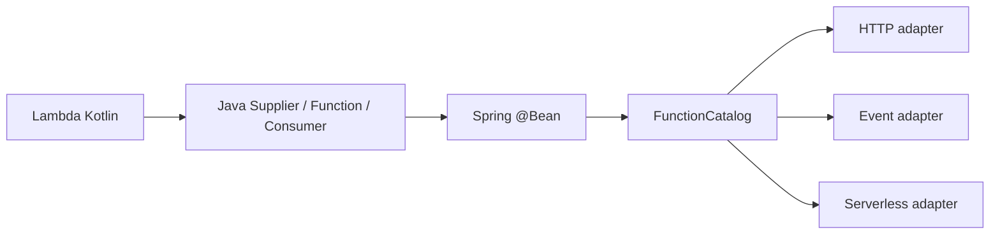

# Ánh xạ lambda Kotlin sang `Supplier`, `Function` và `Consumer`

## 1. Vì sao phải ánh xạ lambda Kotlin?

Trong Kotlin, có thể biểu diễn logic nghiệp vụ bằng lambda hoặc hàm thông thường: `() -> T`, `(T) -> R`, `(T) -> Unit`. Cách viết này ngắn gọn nhưng **kiểu hàm Kotlin không đồng nhất với các giao diện hàm Java** mà Spring Cloud Function sử dụng làm hợp đồng thực thi: `java.util.function.Supplier`, `java.util.function.Function` và `java.util.function.Consumer`.

Spring Cloud Function cho phép đăng ký logic dưới dạng bean, tra cứu qua `FunctionCatalog`, ghép các hàm tương thích và đưa cùng logic đó tới các bộ chuyển tiếp (adapter) như HTTP, hệ thống sự kiện hoặc môi trường serverless. Vì vậy, khi viết bằng Kotlin, ta cần xác định đúng giao diện Java tương ứng với đầu vào và đầu ra của từng lambda.

| Mục đích | Kiểu lambda Kotlin gần tương ứng | Giao diện Java dùng với Spring Cloud Function | Phương thức thực thi |
| --- | --- | --- | --- |
| Tạo dữ liệu khi được gọi | `() -> T` | `Supplier<T>` | `get(): T` |
| Biến đổi dữ liệu | `(T) -> R` | `Function<T, R>` | `apply(T): R` |
| Xử lý dữ liệu, không trả kết quả | `(T) -> Unit` | `Consumer<T>` | `accept(T): void` |

Trong bảng, `T` là kiểu đầu vào hoặc kiểu dữ liệu được tạo ra; `R` là kiểu kết quả biến đổi. `Unit` của Kotlin biểu thị một biểu thức không có kết quả hữu ích, trong khi phương thức `accept` của Java trả về `void`. **Không dùng `Function<T, Unit>` để thay thế `Consumer<T>`** nếu hợp đồng nghiệp vụ chỉ cần hiệu ứng phụ.

## 2. Chuyển lambda bằng SAM conversion

Cả ba giao diện Java trên đều là *Single Abstract Method* (SAM): mỗi giao diện có đúng một phương thức trừu tượng cần triển khai. Kotlin hỗ trợ **SAM conversion**: truyền lambda cho trình tạo giao diện Java, trình biên dịch sẽ sinh đối tượng thực thi phương thức tương ứng.

```kotlin
import java.util.function.Consumer
import java.util.function.Function
import java.util.function.Supplier

val supplier: Supplier<String> = Supplier { "Xin chào" }
val transform: Function<String, String> = Function { input ->
    input.trim().uppercase()
}
val consume: Consumer<String> = Consumer { input ->
    println("Đã nhận: $input")
}

println(supplier.get())             // Xin chào
println(transform.apply("  kotlin  ")) // KOTLIN
consume.accept("Sự kiện mới")       // Đã nhận: Sự kiện mới
```

Các phép ánh xạ trên có ba điểm khác biệt:

1. `Supplier` không nhận đối số; biểu thức cuối của lambda tạo ra giá trị trả về.
2. `Function` nhận một giá trị và trả một giá trị khác (có thể cùng kiểu).
3. `Consumer` nhận một giá trị để xử lý; không cung cấp kết quả cho bước ghép hàm tiếp theo.

Một lambda Kotlin đã tồn tại cũng có thể được **bọc tường minh** thành `Function` của Java:

```kotlin
val normalizeText: (String) -> String = { raw -> raw.trim().lowercase() }

// Kiểu bên trái là java.util.function.Function, không phải kiểu hàm Kotlin.
val normalizeFunction: Function<String, String> =
    Function { raw -> normalizeText(raw) }

println(normalizeFunction.apply("  HELLO  ")) // hello
```

Lưu ý tên `Function`: Kotlin có hệ kiểu hàm riêng (`(T) -> R` và `Function1<T, R>`), nên khi đọc hoặc viết code Spring Cloud Function cần kiểm tra import. Nếu trong dự án có nhiều tên `Function` dễ gây nhầm lẫn, có thể đặt bí danh:

```kotlin
import java.util.function.Function as JavaFunction

val uppercase: JavaFunction<String, String> = JavaFunction { it.uppercase() }
```

## 3. Đăng ký lambda thành các bean của Spring Cloud Function

Đây là một cấu hình ví dụ gồm ba dạng hàm và một hàm bổ sung để minh họa phép ghép:

```kotlin
import org.slf4j.LoggerFactory
import org.springframework.context.annotation.Bean
import org.springframework.context.annotation.Configuration
import java.util.function.Consumer
import java.util.function.Function
import java.util.function.Supplier

@Configuration(proxyBeanMethods = false)
class KotlinFunctionConfig {
    private val logger = LoggerFactory.getLogger(KotlinFunctionConfig::class.java)

    @Bean
    fun greeting(): Supplier<String> = Supplier {
        "Xin chào từ Spring Cloud Function"
    }

    @Bean
    fun normalize(): Function<String, String> = Function { raw ->
        raw.trim().uppercase()
    }

    @Bean
    fun emphasize(): Function<String, String> = Function { text ->
        "$text!"
    }

    @Bean
    fun audit(): Consumer<String> = Consumer { text ->
        logger.info("Đã xử lý thông điệp: {}", text)
    }
}
```

Tên bean mặc định chính là tên phương thức `@Bean`: `greeting`, `normalize`, `emphasize`, `audit`. Khi Spring khởi tạo ứng dụng, Spring Cloud Function có thể tìm các bean thuộc các giao diện hàm này và đưa chúng vào `FunctionCatalog`. Mỗi lambda chỉ chứa logic xử lý, chưa phụ thuộc một giao thức gọi cụ thể.

Với ứng dụng Kotlin sử dụng `@Configuration`, dự án Spring Boot thường bật plugin `kotlin("plugin.spring")` để các lớp/phương thức Spring cần proxy không bị vướng tính `final` mặc định của Kotlin. Ví dụ trên dùng `proxyBeanMethods = false` vì các phương thức bean không gọi lẫn nhau.

### Luồng thực thi



Các adapter cần dependency và cấu hình phù hợp với môi trường triển khai. Việc khai báo `@Bean` tự nó không tạo kết nối đến broker sự kiện hoặc tự triển khai một hàm serverless.

## 4. Tra cứu và ghép hàm bằng `FunctionCatalog`

`FunctionCatalog` là điểm tra cứu hàm theo tên bean và là nơi Spring Cloud Function xử lý các phép ghép. Giả sử các bean ở mục trước đã được đăng ký:

```kotlin
import org.springframework.cloud.function.context.FunctionCatalog
import org.springframework.stereotype.Service
import java.util.function.Function

@Service
class TextService(private val catalog: FunctionCatalog) {
    fun process(input: String): String {
        val pipeline: Function<String, String> =
            catalog.lookup("normalize|emphasize")

        return pipeline.apply(input)
    }
}

// process("  xin chào  ") trả về "XIN CHÀO!"
```

Biểu thức `normalize|emphasize` chạy lần lượt hai hàm: `String -> String -> String`. Trong cấu hình Spring Cloud Function, cũng có thể chỉ định định nghĩa hàm bằng thuộc tính:

```properties
spring.cloud.function.definition=normalize|emphasize
```

Thuộc tính này giúp adapter có một hàm hoặc chuỗi hàm cụ thể để kích hoạt, đặc biệt khi có nhiều bean hàm. Giá trị cấu hình cần tương thích với cơ chế routing/binding của adapter đang dùng; không nên giả định rằng mọi adapter có cùng cách đặt tên endpoint.

Quy tắc ghép quan trọng:

| Phép ghép | Khi nào hợp lệ? | Kết quả logic |
| --- | --- | --- |
| `Function<A, B> | Function<B, C>` | Kiểu đầu ra của hàm trước phù hợp đầu vào hàm sau | `Function<A, C>` |
| `Supplier<A> | Function<A, B>` | Hàm sau nhận được dữ liệu do supplier cung cấp | `Supplier<B>` |
| `Function<A, B> | Consumer<B>` | Consumer nhận được kết quả từ hàm trước | Xử lý đầu vào, kết thúc bằng hiệu ứng phụ |
| `Consumer<A> | Function<...>` | Consumer không tạo giá trị cho bước tiếp theo | Không phải chuỗi biến đổi hợp lệ |

Ví dụ `normalize|audit` có thể dùng khi muốn chuẩn hóa trước khi ghi log hoặc đẩy sự kiện. Ngược lại, `audit|emphasize` không có dữ liệu đầu ra từ `audit` để truyền tiếp.

## 5. Kích hoạt cùng logic qua HTTP

Khi ứng dụng có adapter Web của Spring Cloud Function, các bean hàm có thể được gọi qua HTTP mà không cần viết controller chuyển đổi dữ liệu thủ công cho ví dụ đơn giản:

```kotlin
// build.gradle.kts — phiên bản dependency do BOM tương thích quản lý.
dependencies {
    implementation("org.springframework.cloud:spring-cloud-starter-function-web")
}
```

Để thử từng bean theo tên trong ứng dụng Web, có thể gửi các yêu cầu sau sau khi khởi động server cục bộ ở cổng `8080`:

```bash
# Function: biến đổi văn bản
curl -X POST http://localhost:8080/normalize \
  -H "Content-Type: text/plain" \
  --data '  kotlin spring  '
# Phản hồi điển hình: KOTLIN SPRING

# Supplier: lấy dữ liệu do supplier tạo
curl http://localhost:8080/greeting

# Consumer: gửi dữ liệu để xử lý, không mong chờ nội dung kết quả
curl -X POST http://localhost:8080/audit \
  -H "Content-Type: text/plain" \
  --data 'order-created'
```

Các đường dẫn trên minh họa cách adapter Web ánh xạ tên bean khi cho phép truy cập từng hàm. Nếu ứng dụng cấu hình một định nghĩa hàm mặc định, routing tùy chỉnh, bảo mật hoặc đường dẫn context riêng, hãy dùng đúng tuyến mà adapter thực tế công bố. Một `Consumer` hoàn thành công việc xử lý; mã HTTP và phần thân phản hồi do adapter quyết định, không phải giá trị trả về của lambda.

Với hệ thống sự kiện, có thể kết hợp Spring Cloud Stream cùng binder thích hợp để đưa thông điệp vào `Function`/`Consumer` hoặc phát kết quả từ `Supplier`. Với môi trường serverless, dùng adapter dành cho nền tảng triển khai. Logic Kotlin ở mục 3 vẫn là những bean như cũ; phần tích hợp thay đổi ở dependency, cấu hình và cách kích hoạt.

## 6. Giữ kiểu dữ liệu và metadata khi chuyển đổi thông điệp

Trong nghiệp vụ thực tế, dữ liệu thường là DTO thay vì `String`. Có thể ánh xạ trực tiếp `Function<Request, Response>`:

```kotlin
data class GreetingRequest(val name: String)
data class GreetingResponse(val message: String)

@Bean
fun greetUser(): Function<GreetingRequest, GreetingResponse> = Function { request ->
    GreetingResponse(message = "Xin chào, ${request.name.trim()}")
}
```

Đoạn này là một phương thức `@Bean` để đặt **bên trong** lớp `@Configuration` cùng các import ở ví dụ trước. Khi nhận JSON từ HTTP hoặc một message broker, cần adapter/chuyển đổi thông điệp tương ứng; với Kotlin data class, hãy bảo đảm dự án hỗ trợ giải tuần tự hóa Kotlin (ví dụ Jackson Kotlin module khi dùng Jackson). Giữ kiểu generic rõ ràng giúp adapter có đủ thông tin chuyển kiểu payload.

Nếu logic cần đọc hoặc bổ sung header, sử dụng `org.springframework.messaging.Message<T>`:

```kotlin
import org.springframework.messaging.Message
import org.springframework.messaging.support.MessageBuilder
import java.util.function.Function

@Bean
fun normalizeMessage(): Function<Message<String>, Message<String>> =
    Function { incoming ->
        MessageBuilder.withPayload(incoming.payload.trim().uppercase())
            .copyHeaders(incoming.headers)
            .setHeader("processedBy", "normalizeMessage")
            .build()
    }
```

Với biến thể `Message`, lambda chủ động bảo toàn header đầu vào và thêm header mới. Cần phân biệt `Function<String, String>` (chỉ quan tâm payload nghiệp vụ) với `Function<Message<String>, Message<String>>` (có thể làm việc với metadata). Hình thức header đến/đi thực tế còn phụ thuộc adapter, content type và binder.

## 7. Kiểm thử logic độc lập với giao thức

Một lợi ích của cách thiết kế này là có thể kiểm tra lambda mà không cần mở HTTP server hay kết nối broker:

```kotlin
import org.junit.jupiter.api.Assertions.assertEquals
import org.junit.jupiter.api.Test

class KotlinFunctionConfigTest {
    private val functions = KotlinFunctionConfig()

    @Test
    fun `normalize removes surrounding spaces and uppercases`() {
        val result = functions.normalize().apply("  spring cloud  ")
        assertEquals("SPRING CLOUD", result)
    }

    @Test
    fun `emphasize appends an exclamation mark`() {
        val result = functions.emphasize().apply("KOTLIN")
        assertEquals("KOTLIN!", result)
    }
}
```

Sau kiểm thử đơn vị, nên có ít nhất một kiểm thử tích hợp với context Spring nếu dự án phụ thuộc vào việc tìm bean theo tên, `FunctionCatalog`, composition hoặc conversion JSON. Kiểm thử đơn vị chỉ xác nhận phép biến đổi bên trong lambda; nó không xác nhận adapter đã route và deserialize đúng.

## 8. Các lỗi thường gặp

| Hiện tượng | Nguyên nhân thường gặp | Cách xử lý |
| --- | --- | --- |
| Lambda hoạt động khi gọi trực tiếp nhưng không tra cứu được trong catalog | Bean khai báo kiểu `(String) -> String` của Kotlin, hoặc chưa được Spring đăng ký | Khai báo `@Bean` với `java.util.function.Function<String, String>` và kiểm tra component scanning |
| Biên dịch không nhận ra `Function` đúng kiểu | Nhầm hàm Kotlin với giao diện Java hoặc import sai | Dùng `import java.util.function.Function` hoặc bí danh `JavaFunction` |
| Ghép hàm thất bại | Kiểu kết quả của bước trước không khớp kiểu đầu vào bước sau | Kiểm tra chuỗi `A -> B -> C` và kiểu generic của từng bean |
| Chọn nhầm `Function<T, Unit>` cho tác vụ chỉ ghi log | Xem `Unit` như `void` | Dùng `Consumer<T>` cho tác vụ không tạo giá trị kết quả |
| HTTP/event nhận DTO bị lỗi | Thiếu converter hoặc cấu hình content type/serializer chưa phù hợp | Khai báo DTO rõ kiểu và cấu hình JSON/message converter thích hợp |
| Một lambda có kết quả khác nhau giữa nhiều lần gọi đồng thời | Lambda giữ trạng thái mutable chung, ví dụ biến đếm không đồng bộ | Ưu tiên hàm thuần; nếu phải có trạng thái, quản lý tính an toàn luồng |
| Consumer xử lý sự kiện bị lặp khi broker gửi lại | Tác vụ có hiệu ứng phụ nhưng thiếu kiểm soát trùng lặp | Thiết kế idempotency và cơ chế retry theo đặc tính broker/binder |

## 9. Checklist khi xây dựng hàm Kotlin tái sử dụng

1. Xác định hàm **tạo**, **biến đổi** hay **tiêu thụ** dữ liệu; chọn lần lượt `Supplier`, `Function` hoặc `Consumer`.
2. Đặt logic trong lambda đơn giản, có kiểu đầu vào/đầu ra cụ thể; tránh trộn code phụ thuộc HTTP hoặc broker vào thân hàm nếu không cần thiết.
3. Bọc lambda bằng Java SAM và đăng ký thành bean với tên rõ nghĩa.
4. Khi có nhiều bean, cấu hình định nghĩa hàm hoặc composition phù hợp, kiểm tra tương thích kiểu tại các ranh giới.
5. Kiểm thử phép biến đổi bằng unit test; kiểm thử thêm catalog, chuyển đổi message và adapter ở tầng tích hợp.

Ví dụ này cho thấy giá trị thực tế của Spring Cloud Function trong Kotlin: cùng một biểu thức nghiệp vụ, sau khi được ánh xạ vào `java.util.function.*`, có thể được Spring quản lý và gọi thông qua các cơ chế tích hợp khác nhau mà không phải viết lại thuật toán xử lý.
