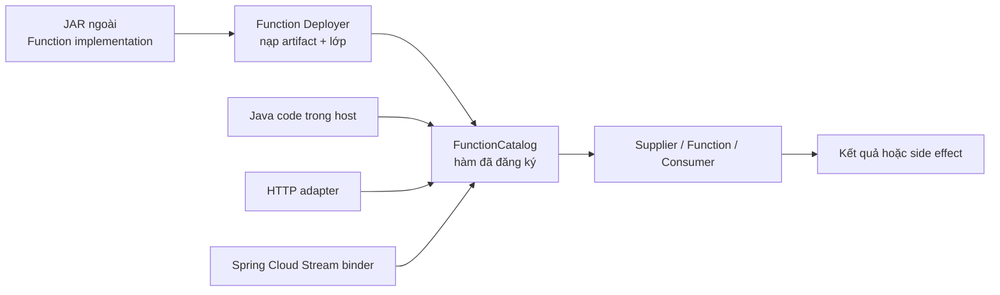
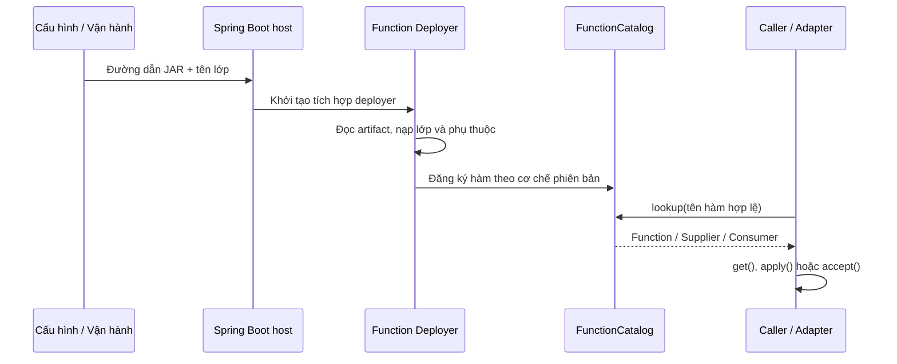

# Vai trò của spring-cloud-function-deployer

## 1. Bài toán: muốn dùng một hàm nằm trong JAR bên ngoài

Giả sử nhóm phát triển có một ứng dụng Spring Boot đang tiếp nhận yêu cầu chuẩn hóa mã đơn hàng. Quy tắc chuẩn hóa vốn được viết thành một `Function<String, String>`, nhưng nhóm nghiệp vụ khác cần cung cấp phiên bản quy tắc của riêng mình dưới dạng thư viện JAR. Nhóm vận hành muốn một **ứng dụng chủ** (*host application*) nạp hàm từ JAR được chỉ định, thay vì mỗi lần thay thư viện lại chép mã nguồn vào ứng dụng chủ.

Đây là bối cảnh của **`spring-cloud-function-deployer`** trong hệ sinh thái **Spring Cloud Function** (`SPRING_CLOUD_FUNCTION`). Module này hướng đến việc **triển khai/nạp hàm được đóng gói trong một JAR bên ngoài vào môi trường Spring Cloud Function đang chạy**, để framework có thể tiếp cận hàm qua cơ chế đăng ký và tra cứu. Từ đó, những thành phần như `FunctionCatalog` và bộ điều hợp phù hợp có thể gọi hàm theo hợp đồng của nó.

Trong phạm vi module học, ta vẫn phát triển nghiệp vụ bằng các kiểu `Supplier<T>`, `Function<T, R>` và `Consumer<T>`, học `FunctionCatalog`, composition và chuyển đổi thông điệp, đồng thời hướng đến tái sử dụng logic qua HTTP, sự kiện hoặc serverless. Điểm mới của phần **nạp JAR** là: **mã định nghĩa hàm không nhất thiết nằm trên classpath ban đầu của ứng dụng chủ**.

Điều quan trọng là không nhầm *function deployer* với một công cụ triển khai hạ tầng. Nó không tự tạo một container Kubernetes, một AWS Lambda hay một broker. Chức năng chủ yếu của nó nằm **bên trong tiến trình Java/Spring đang được vận hành**.

## 2. Phân biệt năm thành phần trong mô hình

| Thành phần | Vai trò | Ví dụ |
| --- | --- | --- |
| **JAR chứa hàm** | Đóng gói bytecode và, theo cách đóng gói, các tài nguyên/dependency cần thiết của hàm. | `normalize-function-1.0.0.jar`. |
| **Ứng dụng chủ** | Khởi động JVM và Spring ApplicationContext, cung cấp cấu hình và những adapter cần thiết. | Spring Boot host. |
| **`spring-cloud-function-deployer`** | Đọc thông tin về artifact và lớp hàm cần nạp; tích hợp hàm bên ngoài vào cơ chế Spring Cloud Function theo khả năng của phiên bản. | Module deployer trong host. |
| **`FunctionCatalog`** | Đầu mối tra cứu một hàm đã đăng ký theo tên/định nghĩa và hỗ trợ các khả năng của framework. | `catalog.lookup(...)`. |
| **Bộ điều hợp (*adapter*)** | Kết nối catalog/hàm với cách kích hoạt cụ thể. | HTTP Web adapter, Spring Cloud Stream binder, adapter serverless. |



Mũi tên từ JAR đến deployer thể hiện **quá trình nạp mã**; mũi tên từ adapter đến catalog thể hiện **quá trình lựa chọn/gọi hàm**. Hai quá trình này khác nhau. Một function có thể đã nạp thành công nhưng chưa được HTTP hay Stream gọi nếu chưa có adapter, binding hoặc điểm gọi tương ứng.

## 3. Deployer giải quyết vấn đề gì và không giải quyết vấn đề gì?

### Những việc nó giúp thực hiện

1. **Tách nguồn phát hành hàm khỏi ứng dụng chủ:** có thể xây dựng một artifact chứa logic độc lập với host.
2. **Xác định hàm cần nạp bằng cấu hình:** host không nhất thiết phải import lớp triển khai của mọi nhà cung cấp hàm ngay lúc biên dịch.
3. **Đưa hàm vào cơ chế đăng ký và gọi của Spring Cloud Function:** ứng dụng có thể tiếp cận hàm qua catalog theo tên/định nghĩa được đăng ký.
4. **Tạo nền tảng tái sử dụng adapter:** sau khi hàm có mặt trong catalog, việc nối HTTP, messaging hoặc serverless vẫn theo cơ chế tích hợp của từng môi trường.
5. **Hỗ trợ cách tổ chức kiểu plugin về mặt kỹ thuật:** phần logic được đóng gói riêng, còn ứng dụng chủ chịu trách nhiệm vận hành và chọn hàm.

### Những việc nó không tự làm

- Không tự biến một JAR bất kỳ thành một `Function` hợp lệ.
- Không tự xây REST controller, Kafka topic hay cloud trigger.
- Không thay việc quản lý dependency, version Java, binary compatibility và kiểu đầu vào/đầu ra.
- Không bảo đảm hot reload hoặc thay hàm **không gián đoạn** khi ghi đè JAR.
- Không phải cơ chế sandbox an toàn cho mã không đáng tin cậy.
- Không thay hệ thống triển khai ứng dụng như CI/CD, Kubernetes, Spring Cloud Data Flow hay AWS Lambda.

**Tóm lại:** deployer tập trung vào **nạp hàm từ artifact bên ngoài**; catalog tập trung vào **tìm/gọi hàm**; adapter tập trung vào **nhận và trả dữ liệu qua môi trường chạy**.

## 4. So sánh với các cách đưa logic vào ứng dụng

| Cách triển khai | Mã hàm có mặt bằng cách nào? | Lợi ích | Giới hạn |
| --- | --- | --- | --- |
| **Bean `@Bean Function` trong host** | Biên dịch và đóng gói cùng ứng dụng chủ. | Đơn giản, dependency rõ, IDE dễ phân tích. | Đổi logic thường phải build/deploy host. |
| **Thư viện JAR trên classpath của host** | Khai báo Maven/Gradle dependency hoặc đưa JAR vào classpath khi khởi động. | Quản lý version quen thuộc, dễ test tích hợp. | Artifact thường được quyết định ở bước build/startup. |
| **`spring-cloud-function-deployer`** | Host được cấu hình để nạp hàm từ JAR bên ngoài bằng cơ chế deployer. | Tách artifact của hàm với ứng dụng chủ; phù hợp một số mô hình plugin. | Cần quản trị classloader, dependency, contract và nạp/đổi phiên bản cẩn thận. |
| **Chạy executable Spring Boot JAR riêng** | Mỗi JAR là một tiến trình/app độc lập. | Cách ly vòng đời và tài nguyên ở cấp tiến trình. | Không phải nạp một `Function` vào host; giao tiếp giữa các app cần cơ chế riêng. |
| **Triển khai JAR lên serverless** | Nền tảng khởi chạy runtime/handler theo sự kiện. | Tài nguyên và kích hoạt theo mô hình FaaS. | Phụ thuộc cấu hình handler, event, IAM, packaging; không phải vai trò của deployer nội bộ. |

Trong các quyết định kiến trúc, **nạp một JAR vào JVM hiện hữu** và **chạy một JAR thành tiến trình mới** là hai lựa chọn có ranh giới lỗi, bảo mật và vận hành khác nhau.

## 5. Bước 1: viết một hàm Java độc lập

Để ví dụ dễ kiểm soát, ta tạo một hàm chuẩn hóa mã đơn hàng nhận `String` và trả `String`. Không có HTTP request, Kafka record hoặc kiểu API của cloud trong chữ ký.

Tệp `NormalizeOrderId.java` trong **dự án thư viện hàm**:

```java
package demo.functions;

import java.util.Locale;
import java.util.Objects;
import java.util.function.Function;

public final class NormalizeOrderId
        implements Function<String, String> {

    public NormalizeOrderId() {
        // Constructor công khai, không tham số cho ví dụ đơn giản.
    }

    @Override
    public String apply(String input) {
        Objects.requireNonNull(input, "orderId");
        String normalized = input.strip()
                .toUpperCase(Locale.ROOT);
        if (normalized.isEmpty()) {
            throw new IllegalArgumentException(
                    "Order ID must not be blank");
        }
        return normalized;
    }
}
```

Kết quả dự kiến:

```text
apply("  od-204 ")  ->  "OD-204"
apply("  ")         ->  IllegalArgumentException
```

Chữ ký `Function<String, String>` có ý nghĩa: một input, một output và không có side effect trong ví dụ. Nó có thể được gọi thuần Java:

```java
Function<String, String> normalize =
        new NormalizeOrderId();

String result = normalize.apply("  od-204 ");
// result.equals("OD-204")
```

Với cách nạp lớp cụ thể, một **lớp công khai triển khai `Function` và có thể khởi tạo phù hợp** là cách minh họa đơn giản. Không nên suy ra mọi JAR chứa Spring `@Configuration` hoặc mọi lớp tùy ý đều tự được deployer tìm thấy: cách xác định hàm phải phù hợp phiên bản và kiểu đóng gói được hỗ trợ.

## 6. Bước 2: đóng gói thành JAR thư viện

Trong dự án ví dụ này, mã hàm chỉ phụ thuộc các interface của JDK; vì thế không cần Spring Boot application class chỉ để tạo artifact. Với Maven, một `pom.xml` tối giản minh họa:

```xml
<?xml version="1.0" encoding="UTF-8"?>
<project xmlns="http://maven.apache.org/POM/4.0.0"
         xmlns:xsi="http://www.w3.org/2001/XMLSchema-instance"
         xsi:schemaLocation="http://maven.apache.org/POM/4.0.0 https://maven.apache.org/xsd/maven-4.0.0.xsd">
    <modelVersion>4.0.0</modelVersion>
    <groupId>demo.functions</groupId>
    <artifactId>normalize-function</artifactId>
    <version>1.0.0</version>
    <properties>
        <maven.compiler.release>17</maven.compiler.release>
        <project.build.sourceEncoding>UTF-8</project.build.sourceEncoding>
    </properties>
</project>
```

Lưu `NormalizeOrderId.java` tại:

```text
src/main/java/demo/functions/NormalizeOrderId.java
```

Build artifact:

```bash
mvn package
```

Một kết quả mong đợi là `target/normalize-function-1.0.0.jar` chứa `demo/functions/NormalizeOrderId.class`. Có thể kiểm tra nội dung JAR bằng:

```bash
jar tf target/normalize-function-1.0.0.jar
```

**Điểm phân biệt quan trọng:** đây là **JAR thư viện** chứa class triển khai hàm, không phải mặc định một **Spring Boot executable/fat JAR** có cấu trúc `BOOT-INF`. Những bản đóng gói có dependency phức tạp cần xem xét cách deployer nạp artifact và dependency theo release đang sử dụng. Không nên mặc nhiên cho rằng mọi JAR chạy được bằng `java -jar` đều là JAR phù hợp để deployer nạp một lớp hàm.

## 7. Bước 3: chuẩn bị ứng dụng chủ có deployer

Ứng dụng chủ là một ứng dụng Spring Boot thông thường. Trong những dòng Spring Cloud Function còn cung cấp module này, dependency Maven trung tâm là:

```xml
<dependency>
    <groupId>org.springframework.cloud</groupId>
    <artifactId>spring-cloud-function-deployer</artifactId>
</dependency>
```

Spring Boot và các module Spring Cloud Function phải dùng **phiên bản tương thích**, được quản lý thống nhất qua BOM/dependency management. Không nên copy version độc lập từ nhiều ví dụ khác nhau vào cùng dự án.

Ví dụ điểm khởi động:

```java
package demo.host;

import org.springframework.boot.SpringApplication;
import org.springframework.boot.autoconfigure.SpringBootApplication;

@SpringBootApplication
public class FunctionHostApplication {
    public static void main(String[] args) {
        SpringApplication.run(FunctionHostApplication.class, args);
    }
}
```

Nếu host **chỉ thử gọi hàm trong JVM**, không cần thêm web server. Khi muốn tạo HTTP endpoint theo cơ chế Spring Cloud Function, bổ sung adapter web tương thích:

```xml
<dependency>
    <groupId>org.springframework.cloud</groupId>
    <artifactId>spring-cloud-starter-function-web</artifactId>
</dependency>
```

Muốn kết nối Kafka hoặc RabbitMQ, cần **Spring Cloud Stream** và binder tương ứng, cùng bindings. Deployer không tự đưa Kafka vào ứng dụng chỉ vì đã nạp được JAR chứa hàm.

## 8. Bước 4: cấu hình vị trí JAR và lớp hàm

Các tài liệu/phiên bản hỗ trợ Function Deployer sử dụng nhóm cấu hình theo hướng xác định **vị trí artifact** và **tên lớp hàm**. Một cấu hình minh họa cho cơ chế này:

```yaml
spring:
  cloud:
    function:
      location: "file:///opt/functions/normalize-function-1.0.0.jar"
      function-class: "demo.functions.NormalizeOrderId"
```

Có thể biểu diễn tương ứng bằng property:

```properties
spring.cloud.function.location=file:///opt/functions/normalize-function-1.0.0.jar
spring.cloud.function.function-class=demo.functions.NormalizeOrderId
```

**Cần đối chiếu với phiên bản `spring-cloud-function-deployer` đang dùng:** module này và khả năng nhận dạng URI, artifact, lớp, khởi tạo bean cũng như tên đăng ký có thể khác nhau giữa các dòng release. Hai property ở trên diễn tả cơ chế cấu hình Function Deployer truyền thống; không nên mặc nhiên áp dụng cho mọi phiên bản Spring Cloud Function hiện tại mà chưa kiểm tra dependency và tài liệu tương ứng.

Diễn giải:

- `location` trỏ đến artifact chứa hàm cần nạp. Trong ví dụ là **file URI** có thể truy cập từ môi trường chạy host.
- `function-class` xác định tên lớp Java đầy đủ của implementation mà deployer cần nạp theo cơ chế hỗ trợ.
- Các quy tắc **tên đăng ký trong catalog**, cơ chế đặt tên/alias và hỗ trợ nhiều hàm phải được kiểm tra trên phiên bản cụ thể; không đồng nhất tên file JAR, tên lớp và tên bean.

Trong môi trường container, `/opt/functions/...` là đường dẫn **bên trong filesystem mà tiến trình Java nhìn thấy**, không phải đường dẫn trên máy lập trình nếu hai máy/container khác nhau. Artifact phải thực sự được mount, copy hoặc cung cấp theo quy trình phát hành được chọn.

## 9. Vòng đời nạp hàm đến khi có thể gọi

Để phân biệt các giai đoạn, xét một luồng minh họa:



Quy trình khái niệm gồm:

1. Host khởi động một Spring ApplicationContext với dependency deployer.
2. Deployer đọc thông tin cấu hình và truy cập JAR.
3. Lớp triển khai được nạp/khởi tạo theo khả năng của bản deployer và dependency liên quan.
4. Hàm được đưa vào hệ thống đăng ký để các thành phần khác có thể tìm qua catalog.
5. Caller hoặc adapter tìm hàm thích hợp và gọi theo chữ ký.

**Nạp thành công không đồng nghĩa đã xử lý một thông điệp.** Phải có Java caller, HTTP endpoint, Stream binding hoặc handler thích hợp. **Gọi hàm cũng không tự bảo đảm rằng output message đã được broker xác nhận** hoặc một HTTP response đã được gửi thành công.

## 10. Dùng FunctionCatalog sau khi nạp JAR

`FunctionCatalog` là ranh giới thuận tiện giữa **đăng ký hàm** và **ứng dụng muốn gọi hàm**. Sau khi xác minh tên hàm đã được catalog đăng ký trong phiên bản host, một thành phần Spring có thể thực hiện:

```java
import java.util.function.Function;
import org.springframework.cloud.function.context.FunctionCatalog;

// Đoạn minh họa bên trong bean/service đã inject FunctionCatalog catalog.
// registeredName phải là tên thực tế đã được deployer đăng ký.
Function<String, String> fn = catalog.lookup(registeredName);

if (fn == null) {
    throw new IllegalStateException(
            "Function not found: " + registeredName);
}

String normalized = fn.apply("  od-204 ");
// Mong đợi "OD-204" nếu đúng lớp NormalizeOrderId được nạp.
```

**Không đoán tên hàm.** Tên lớp `demo.functions.NormalizeOrderId`, tên JAR `normalize-function-1.0.0.jar` và tên đăng ký được dùng bởi `lookup(...)` không nhất thiết giống nhau. Kiểm tra log khởi tạo, danh sách hàm/định nghĩa được phiên bản host công bố hoặc cấu hình đặt tên nếu được hỗ trợ.

Khi integration test, nên kiểm tra cả:

- Hàm tìm thấy hay không (`lookup` không trả `null`).
- Đúng kiểu input/output và kết quả trên dữ liệu chuẩn.
- Lỗi khi input không hợp lệ và khả năng đóng gói exception.
- Có function/bean nào khác trong host trùng tên hoặc gây nhập nhằng không.

Catalog cũng có thể trả một **wrapper** phục vụ composition hoặc message conversion; không nên phụ thuộc vào việc object lookup chính là instance từ classloader gốc.

## 11. Chuyện gì xảy ra nếu dùng HTTP, messaging hoặc serverless?

Deployer chỉ giải quyết việc **đưa implementation của hàm vào hệ thống**. Một khi function được đăng ký hợp lệ, adapter khác quyết định cách kích hoạt.

| Điểm gọi | Cần thêm điều gì? | Hệ quả |
| --- | --- | --- |
| **Java nội bộ** | Service/runner inject catalog hoặc dùng cách gọi được host hỗ trợ. | `apply()` nhận/trả object Java. |
| **HTTP** | Spring Cloud Function Web adapter, route và message conversion tương thích. | Payload HTTP được chuyển thành input và kết quả thành response. |
| **Messaging** | Spring Cloud Stream, binder, `spring.cloud.function.definition` phù hợp và bindings. | Input/output message qua broker. |
| **Serverless** | Runtime adapter/handler, event source, đóng gói và quyền theo nền tảng. | Hàm được gọi theo contract của invocation. |

Ví dụ **Spring Cloud Stream** (chỉ áp dụng khi xác nhận tên hàm `normalizeOrderId` thực sự có trong catalog và được chọn làm definition):

```yaml
spring:
  cloud:
    function:
      definition: normalizeOrderId
    stream:
      bindings:
        normalizeOrderId-in-0:
          destination: raw-order-ids
          group: normalizer
          content-type: text/plain
        normalizeOrderId-out-0:
          destination: normalized-order-ids
          content-type: text/plain
```

Ở deployment này còn cần binder thích hợp và cấu hình kết nối broker. Tên binding trong ví dụ minh họa trường hợp tên function definition trùng `normalizeOrderId`; **không được suy ra** deployer tự đặt tên như vậy cho mọi bản/kiểu class. Trong bài toán thực tế, lựa chọn tên đã đăng ký và điều chỉnh bindings trước khi chạy.

Khi dùng HTTP, JSON/string serialization và HTTP status cũng phụ thuộc adapter. Một hàm `Function<String, String>` không tự có endpoint chỉ vì `NormalizeOrderId.class` đã được nạp.

Khi dùng serverless, **function-deployer không phải một Lambda handler**. Một ứng dụng serverless cần adapter/runtime tương ứng, cấu hình entry point, đóng gói, IAM và nguồn event. Có thể tái sử dụng cùng implementation Java; không có bảo đảm có thể đưa nguyên một JAR plugin lên mọi cloud mà không cần sửa quy trình triển khai.

## 12. Khác biệt giữa JAR thư viện và Spring Boot executable JAR

Đây là lỗi thiết kế phổ biến khi làm việc với cơ chế nạp JAR:

| Đặc điểm | JAR thư viện | Spring Boot executable JAR |
| --- | --- | --- |
| Mục tiêu chính | Chứa các lớp và tài nguyên để một ứng dụng khác nạp. | Khởi động ứng dụng độc lập với launcher của Boot. |
| Cấu trúc thường gặp | Package Java trực tiếp ở root archive. | `BOOT-INF/classes` và `BOOT-INF/lib` theo cách đóng gói Boot thông thường. |
| Cách sử dụng | Đưa vào classpath hoặc để cơ chế nạp phù hợp đọc. | Thường khởi động bằng `java -jar`. |
| Điều deployer cần | Tìm và nạp đúng lớp hàm theo cơ chế hỗ trợ. | Không mặc nhiên hiểu mọi cấu trúc launcher/nested JAR như một thư viện hàm. |

Với ví dụ `NormalizeOrderId`, JAR thư viện đơn giản thường dễ kiểm soát nhất. Nếu hàm có dependency bên ngoài, cần quyết định dependency được đóng gói, cung cấp qua classpath, hay được bộ nạp hỗ trợ như thế nào. **Không tự giả định** nested JAR bên trong một executable Boot JAR được deployer xử lý như khi chạy ứng dụng Boot.

## 13. Classloader và dependency: lợi ích đi kèm rủi ro

Khi nạp class từ một JAR ngoài vào JVM, Java cần classloader giải quyết:

- **Class của hàm:** `demo.functions.NormalizeOrderId` có thực sự trong artifact?
- **Interface dùng chung:** `java.util.function.Function` và các kiểu dữ liệu mà host và function chia sẻ có tương thích?
- **Phụ thuộc của hàm:** thư viện JSON, HTTP client, database driver hoặc helper class có được nạp đúng phiên bản?
- **Tài nguyên:** file cấu hình, template hoặc resource mà function đọc có trên đường dẫn hợp lệ?
- **Ranh giới lifecycle:** classloader, file handle và tài nguyên có được quản lý đúng khi dừng/khởi động lại không?

Một số cơ chế function deployer sử dụng bộ nạp tách biệt để truy cập artifact. Việc tách classloader có thể giảm xung đột nhất định nhưng **không có nghĩa** mọi thư viện sẽ tự được cô lập hoàn toàn. Hai phiên bản cùng tên class hoặc các API object được truyền qua classloader khác nhau vẫn có thể gây lỗi `ClassCastException`, `LinkageError` hoặc `NoSuchMethodError`.

Ví dụ, nếu một `Function<OrderRequest, OrderDecision>` được nạp từ JAR ngoài nhưng host và JAR đóng gói **hai định nghĩa khác nhau** của `OrderRequest`, việc chuyển object Java giữa hai phía có thể gặp lỗi dù package và class name nhìn giống nhau. Một hợp đồng chia sẻ nên được versioning và cung cấp bằng cách mà host cùng function thực sự tương thích.

**Khuyến nghị:** bắt đầu với hàm kiểu chuẩn như `Function<String, String>` để xác thực đường nạp. Sau đó mới thêm DTO, dependency và converter, và kiểm tra từng ranh giới.

## 14. Cấu hình không đồng nghĩa hot reload hoặc hot swap

Nói “động” dễ khiến người học nghĩ có thể ghi đè `normalize-function-1.0.0.jar` trên ổ đĩa là các lời gọi mới lập tức dùng bytecode mới. **Không nên dựa vào giả định này.**

Các cơ chế nạp JAR thường thiết lập classloader và đăng ký function ở một thời điểm nhất định trong vòng đời ứng dụng. Việc đổi class đã nạp, gỡ classloader cũ, xử lý request đang chạy và làm mới catalog là các vấn đề riêng. Không có cam kết mặc định rằng:

- Deployer theo dõi thay đổi file JAR và tự nạp lại;
- có thể thay class trong JVM mà không có thao tác vận hành;
- các invocation đang chạy đều chuyển phiên bản mà không bị gián đoạn;
- state, thread, connection pool hoặc scheduler do hàm cũ tạo sẽ tự dừng an toàn.

Trong production, hãy thiết kế quy trình **phát hành artifact bất biến, cập nhật cấu hình và khởi động lại/rollout host có kiểm soát** nếu đó là cách được phiên bản triển khai hỗ trợ. Dùng health check, readiness và rollback thích hợp khi hàm bị lỗi. Nếu yêu cầu thay phiên bản không gián đoạn là bắt buộc, cần xác nhận có cơ chế hỗ trợ rõ ràng và test nó thay vì suy đoán từ tên *deployer*.

## 15. Bảo mật: JAR ngoài là mã được thực thi trong host

Đây là giới hạn quan trọng nhất của cơ chế plugin/JAR loading: **một JAR chứa bytecode có thể thực thi**, không chỉ là dữ liệu. Hàm nạp vào có thể chạy với quyền của tiến trình Java, truy cập dependency, tài nguyên và dữ liệu mà host cho phép.

Vì vậy:

1. **Chỉ nạp artifact tin cậy.** Quản trị nguồn phát hành, người phê duyệt và quyền sửa JAR.
2. **Dùng artifact bất biến.** Áp dụng version, checksum hoặc chữ ký/phần xác minh integrity phù hợp quy trình phát hành.
3. **Kiểm soát đường dẫn và URI.** Không cho input không tin cậy quyết định tùy ý location/class; tránh đường nạp artifact từ nguồn không kiểm soát.
4. **Quản lý dependency và lỗ hổng.** Dùng inventory/SBOM, quét các thư viện và cập nhật khi phát hiện vấn đề.
5. **Giới hạn quyền host.** Đặt secret, network, filesystem và database access theo nguyên tắc least privilege.
6. **Tách tiến trình khi không tin cậy.** Classloader không phải sandbox bảo mật; nếu chạy logic từ bên thứ ba không kiểm soát, cân nhắc isolation ở cấp container/process và API contract rõ ràng.
7. **Hạn chế hàm được công bố.** Không cho caller ngoài tùy ý chọn tên function dẫn đến gọi một `Consumer` có side effect nguy hiểm.

Việc tái sử dụng cùng hàm qua HTTP hoặc messaging còn cần authentication, authorization, validation, rate limiting và cơ chế kiểm tra đầu vào phù hợp với môi trường gọi. Deployer không tự cung cấp những lớp bảo vệ này.

## 16. Hiểu giới hạn về kiểu hàm và side effect

Deployer có thể phục vụ các kiểu hàm mà Spring Cloud Function hỗ trợ trong dòng release liên quan:

| Kiểu hàm | Ý nghĩa sau khi được nạp | Điểm vận hành cần lưu ý |
| --- | --- | --- |
| `Supplier<T>` | Có thể tạo giá trị khi được gọi. | Deployer không tự lên lịch; poller/adapter quyết định thời điểm `get()`. |
| `Function<T, R>` | Nhận input, trả output. | Không bảo đảm phép biến đổi là pure hay không blocking. |
| `Consumer<T>` | Nhận input và thực hiện hành động. | Side effect cần xử lý retry/idempotency/transaction tùy nguồn gọi. |

Một `Function` có thể ném exception hoặc sử dụng database. Một `Consumer` trả `void` không đồng nghĩa broker đã acknowledgment. Khi được gọi từ nhiều môi trường, cùng code vẫn phải tính đến retry và lỗi I/O của môi trường đó.

**Nạp được hàm** không có nghĩa hàm đã sẵn sàng chạy production: cần kiểm tra concurrency, timeout, dependency, lượng bộ nhớ, logging/tracing và side effect tương ứng.

## 17. Các lỗi hay gặp và cách chẩn đoán

| Biểu hiện | Khả năng nguyên nhân | Hướng kiểm tra |
| --- | --- | --- |
| Không tìm thấy JAR | `location` sai, file chưa mount hoặc host không có quyền đọc. | Xác nhận đường dẫn trong môi trường chạy, URI, quyền file. |
| `ClassNotFoundException` | Sai tên `function-class`, class không nằm trong JAR hoặc thiếu phụ thuộc. | Kiểm tra tên đầy đủ, nội dung archive, dependency. |
| `NoClassDefFoundError` | Class phụ thuộc không có lúc chạy. | Kiểm tra transitive dependencies và cách loader giải quyết chúng. |
| `NoSuchMethodError` / `LinkageError` | Binary incompatibility hoặc version conflict. | Soát phiên bản Java, Spring, thư viện và contract. |
| `ClassCastException` | Kiểu DTO ở hai classloader không tương thích hoặc converter sai. | Kiểm tra ranh giới classloader, generic type và mapping. |
| `FunctionCatalog.lookup(...)` trả `null` | Hàm chưa được đăng ký, sai tên hoặc nạp lỗi. | Kiểm tra log deployer, tên thực tế đã đăng ký, cấu hình. |
| HTTP trả lỗi dù Java `apply()` chạy đúng | Route, content type, converter hoặc validation ở adapter sai. | Test HTTP contract riêng, kiểm tra payload và response. |
| Không nhận/gửi message | Chưa cài binder, sai function definition, binding hoặc broker. | Kiểm tra Stream config, group, destination và connectivity. |
| Nạp lớp được nhưng gọi thất bại | Input không đúng kiểu, lỗi nghiệp vụ hoặc dependency I/O. | Unit test function, kiểm tra stack trace, tracing và test tích hợp. |
| Cập nhật JAR nhưng kết quả vẫn cũ | Runtime vẫn dùng class đã nạp, cấu hình trỏ artifact cũ hoặc host chưa restart. | Kiểm tra version/checksum, quy trình rollout và lifecycle. |

Nên kiểm tra **theo thứ tự**: artifact tồn tại → class có thể nạp → hàm được đăng ký → catalog tra cứu được → lời gọi Java đúng → adapter hoạt động → dữ liệu và lỗi trong production đúng hợp đồng. Cách chia tầng này tránh nhầm lỗi classloader với lỗi của HTTP hoặc Kafka.

## 18. Kiểm thử một hàm nạp từ JAR

Một chiến lược kiểm thử có ba lớp:

### 18.1. Unit test bên trong dự án JAR

Không cần Spring:

```java
package demo.functions;

import static org.junit.jupiter.api.Assertions.assertEquals;
import static org.junit.jupiter.api.Assertions.assertThrows;
import org.junit.jupiter.api.Test;

class NormalizeOrderIdTest {
    private final NormalizeOrderId function = new NormalizeOrderId();

    @Test
    void normalizesId() {
        assertEquals("OD-204",
                function.apply("  od-204 "));
    }

    @Test
    void rejectsBlankId() {
        assertThrows(IllegalArgumentException.class,
                () -> function.apply("   "));
    }
}
```

Ví dụ kiểm thử cần dependency JUnit trong project khi chạy test. Không có lý do bắt buộc phải nạp một JAR chỉ để kiểm tra thuật toán chuẩn hóa.

### 18.2. Integration test của host/deployer

Với **artifact JAR đã build**, khởi động host bằng cấu hình location/function-class trên phiên bản hỗ trợ; kiểm tra log nạp, tên đăng ký thực tế, `FunctionCatalog.lookup(...)` và `apply()`. Những điều này xác minh **cơ chế JAR loading** chứ không chỉ hàm Java.

Đối với các DTO custom, test payload và version của shared API ở cả hai phía. Kiểm thử thêm artifact bị thiếu, sai class name, dependency không tương thích và trường hợp registry trùng tên.

### 18.3. Contract test của adapter

Nếu dùng web adapter, gửi HTTP request thật hoặc web integration test với content type hợp lệ và không hợp lệ. Với Stream, test binding, converter, output destination và retry. Với serverless, kiểm tra contract của event source/handler, timeout và failure semantics. **Các adapter có thể sai dù function đã nạp và `apply()` chạy đúng.**

## 19. Khi nào nên và không nên dùng function deployer?

| Tình huống | Đánh giá |
| --- | --- |
| Host cần nhận những hàm Java từ các artifact được kiểm soát, có contract chung và được phát hành độc lập. | **Có thể phù hợp**, sau khi xác nhận khả năng của bản deployer và quy trình vận hành. |
| Cùng một tập hàm cần được đăng ký để host/adapter lựa chọn theo cấu hình. | **Có ích** nếu registry và cách nạp external JAR thật sự giảm coupling. |
| Ứng dụng có vài bean `Function` cố định và luôn deploy cùng một lần. | **Thường không cần** deployer; `@Bean` hoặc Maven dependency đơn giản hơn. |
| Mục tiêu là chạy nhiều service độc lập trên Kubernetes. | Deployer nội bộ **không thay** công cụ deploy ứng dụng/container. |
| Mục tiêu là triển khai một function lên AWS Lambda. | Cần adapter và package Lambda thích hợp; deployer **không phải** dịch vụ Lambda. |
| JAR đến từ nguồn không đáng tin hoặc cần cách ly an toàn giữa các plugin. | **Không nên dùng như sandbox**; ưu tiên isolation ở cấp tiến trình/container. |
| Cần hot-swap code không gián đoạn và rollback tức thời. | Chỉ cân nhắc khi bản triển khai có cơ chế hỗ trợ/test rõ; không được mặc định. |

Lợi ích lớn nhất thường xuất hiện khi **lifecycle phát hành hàm khác lifecycle phát hành ứng dụng chủ** nhưng vẫn chấp nhận được những yêu cầu về tương thích và vận hành trong JVM chung. Nếu không có nhu cầu đó, cơ chế nạp động có thể tạo ra chi phí không cần thiết.

## 20. Checklist trước khi dùng trong thực tế

1. **Xác nhận tính sẵn có và tương thích:** release đang dùng có `spring-cloud-function-deployer` và hỗ trợ cách cấu hình dự kiến không?
2. **Đóng gói đúng artifact:** JAR chứa class triển khai rõ ràng, dependency và version Java phù hợp.
3. **Quản lý artifact:** version bất biến, đường dẫn/URI có kiểm soát, checksum/signature theo chính sách.
4. **Cấu hình host:** có dependency deployer, FunctionCatalog và adapter cần dùng; location/class được xác định tường minh.
5. **Kiểm tra tên đăng ký:** đừng đoán tên hàm từ tên class hay file JAR.
6. **Xác minh lời gọi:** catalog tìm được hàm, input/output và lỗi đúng hợp đồng.
7. **Kiểm tra ranh giới classloader:** shared DTO, thư viện và resources tương thích.
8. **Kiểm tra tích hợp:** HTTP, Stream hoặc runtime serverless được cấu hình và test riêng.
9. **Giám sát vận hành:** log nạp, lỗi, latency, memory, retry, concurrency và nguồn gốc artifact.
10. **Định nghĩa quy trình thay bản:** rollout/restart/rollback cụ thể; không dựa vào giả định có hot reload.

## 21. Kết luận

**`spring-cloud-function-deployer` đóng vai trò cầu nối giữa JAR chứa hàm bên ngoài và cơ chế đăng ký hàm của Spring Cloud Function trong ứng dụng chủ.** Nó hữu ích khi muốn tách artifact của logic nghiệp vụ ra khỏi quá trình build host và nạp implementation được chỉ định, từ đó tiếp cận hàm qua `FunctionCatalog` và các bộ điều hợp phù hợp.

Cần phân biệt ba việc: **nạp code từ JAR**, **tra cứu/gọi hàm** và **kích hoạt qua giao thức/runtime**. Deployer giải quyết phần thứ nhất; catalog tổ chức phần thứ hai; HTTP/Stream/serverless adapter cùng hạ tầng thực thi đảm nhiệm phần thứ ba. Những ràng buộc về phiên bản, classloader, dependency, bảo mật, retry và lifecycle triển khai vẫn phải được thiết kế và kiểm thử riêng.

Vì thế, khi học nạp JAR trong Spring Cloud Function, mục tiêu không chỉ là “đọc được file `.jar`”, mà là **biến một implementation `Supplier`, `Function` hoặc `Consumer` được đóng gói riêng thành một phần có thể gọi được của ứng dụng, có hợp đồng dữ liệu và cách vận hành rõ ràng**.
