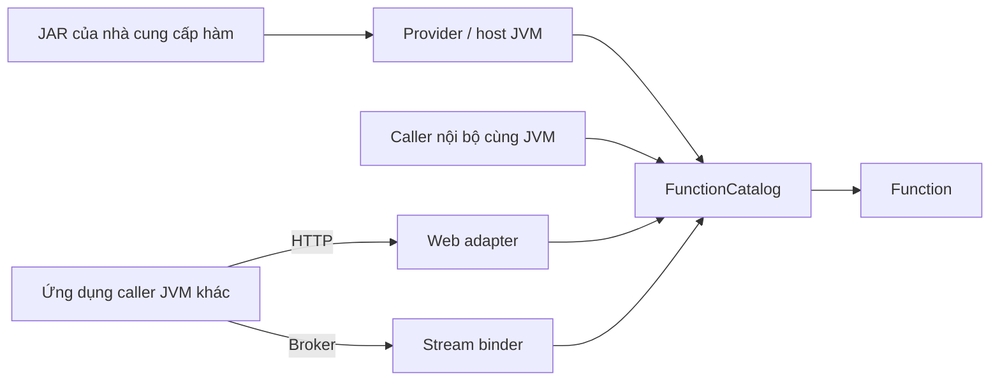
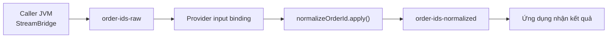

# Tách ứng dụng chứa hàm khỏi ứng dụng gọi hàm

## 1. Vấn đề: phát hành một quy tắc, gọi từ nhiều ứng dụng

Giả sử nền tảng bán hàng cần chuẩn hóa mã đơn hàng trước khi lưu trữ và xử lý sự kiện. Nhóm nghiệp vụ duy trì quy tắc; nhóm API tiếp nhận HTTP request; nhóm tích hợp xử lý message. Sao chép logic vào từng controller, Kafka listener hoặc cloud handler khiến các bên dễ dùng những phiên bản quy tắc khác nhau.

Trong **Spring Cloud Function** (`SPRING_CLOUD_FUNCTION`), logic có thể được biểu diễn bằng `Supplier<T>`, `Function<T,R>` hoặc `Consumer<T>`, đăng ký qua `FunctionCatalog`, ghép qua composition và được bộ điều hợp kích hoạt qua HTTP, messaging hoặc serverless. Chủ đề **Nạp JAR** bổ sung một yêu cầu quan trọng: **tách nơi đóng gói/phát hành code hàm khỏi nơi sử dụng hàm**.

Trước hết phải phân biệt **hai mức độ tách**:

1. **Tách mã và artifact:** một nhóm phát hành JAR chứa hàm, một ứng dụng chủ nạp JAR bằng `spring-cloud-function-deployer` hoặc dùng như dependency. Nếu host gọi hàm sau khi nạp, mã vẫn thực thi **trong cùng JVM**; không có lời gọi mạng hoặc process mới tự động xuất hiện.
2. **Tách tiến trình:** provider chạy hàm như một dịch vụ độc lập; caller ở ứng dụng khác gọi qua HTTP hoặc message broker. Hai bên có deployment, tài nguyên, timeout, vòng đời và lỗi giao vận riêng.

Hai phương án có thể phối hợp: provider dùng deployer nạp JAR rồi tiếp nhận lời gọi từ caller khác. Tuy nhiên **deployer không phải network client**; và **để tách provider/caller theo tiến trình, không bắt buộc phải dùng deployer**.

## 2. Bốn vai trò cần tách bạch

| Thành phần | Trách nhiệm | Ví dụ |
| --- | --- | --- |
| **Function library** | Giữ quy tắc và hợp đồng kiểu dữ liệu. | `OrderIdNormalizer implements Function<String,String>`. |
| **Artifact hàm** | Đóng gói bytecode, resource và version phát hành. | `normalize-order-id-1.0.0.jar`. |
| **Host/provider** | Chạy Spring Boot, đăng ký hàm, cung cấp `FunctionCatalog` và adapter cần thiết. | Web function service hoặc host có deployer. |
| **Caller** | Quyết định khi nào gọi, gửi input, xử lý output và lỗi. | Java service, HTTP client, message producer. |



Mũi tên **JAR → host** là nạp code; **remote caller → adapter** là giao tiếp qua giao thức. Catalog quản lý hàm **trong một Spring context**, không phải dịch vụ tra cứu từ xa xuyên JVM.

## 3. Ba cách tổ chức hệ thống

### Phương án A — Hàm và caller biên dịch chung

```text
Spring Boot application
  ├── @Bean Function<String,String>
  ├── FunctionCatalog
  └── Java service gọi apply()
```

Đơn giản, ít cấu hình, dễ debug. Thay code hàm thường yêu cầu build/deploy lại ứng dụng.

### Phương án B — JAR ngoài, cùng JVM host

```text
normalize-order-id-1.0.0.jar
           |
           v
Spring Boot host (một JVM)
  ├── spring-cloud-function-deployer
  ├── FunctionCatalog
  └── Runner / Web adapter / Stream binder
```

Hữu ích khi muốn quản lý và phát hành logic thành artifact riêng. Nhưng code được nạp vẫn chia sẻ CPU, heap, quyền truy cập và vòng đời của JVM host; classloader riêng không phải sandbox.

### Phương án C — Provider và caller ở hai JVM

```text
Provider JVM A                      Caller JVM B
  Function bean                        HTTP client
  FunctionCatalog       <--HTTP---     / StreamBridge
  HTTP / Stream adapter  --output-->   Xử lý kết quả
```

Giúp scale và rollout độc lập, nhưng phải giải quyết timeout, network, authentication, schema, retry và observability.

| Tiêu chí | A: build chung | B: JAR ngoài | C: dịch vụ tách tiến trình |
| --- | --- | --- | --- |
| Mã hàm phát hành riêng | Không bắt buộc | Có | Có thể có |
| Số JVM giữa caller và function | Một | Một | Hai hoặc nhiều |
| Gọi `apply()` trực tiếp | Có | Có sau nạp/lookup | Không, phải dùng giao thức |
| Serialization qua mạng | Không | Không nếu caller nội bộ | Có |
| Cách ly lỗi cấp process | Không | Không | Có mức độ nhất định |
| Chi phí chính | Coupling khi build | Loader, dependency, rollout | Giao thức, network failure, tracing |

Không có một phương án tốt nhất cho mọi hệ thống. Mức độ độc lập cần thiết phải cân đối với chi phí vận hành.

## 4. Ví dụ hợp đồng hàm

Để tập trung vào JAR loading, dùng phép biến đổi thuần Java với kiểu chuẩn:

```text
Input  : "  od-204 "
Output : "OD-204"
Input rỗng sau khi strip: lỗi validation
```

Chọn `Function<String,String>` giúp chưa phải giải quyết vấn đề chia sẻ DTO qua nhiều classloader. Phân biệt tên lớp Java, tên file JAR, tên hàm trong catalog, HTTP route và tên binding:

| Loại tên | Ví dụ | Nơi sử dụng |
| --- | --- | --- |
| Java class | `demo.functions.OrderIdNormalizer` | Class cần nạp |
| JAR | `normalize-order-id-1.0.0.jar` | Vị trí artifact |
| Catalog name | Có thể là `normalizeOrderId` | `FunctionCatalog.lookup(...)` sau khi xác minh |
| HTTP path | `/normalizeOrderId` | Web adapter của provider |
| Stream binding | `normalizeOrderId-in-0` | Spring Cloud Stream |

**Không suy đoán** tên catalog được deployer đăng ký từ tên JAR hoặc tên class. Khi dùng deployer, phải kiểm tra quy tắc đặt tên theo release thực tế.

## 5. Dự án chứa hàm: xây dựng JAR thư viện

Tệp `src/main/java/demo/functions/OrderIdNormalizer.java`:

```java
package demo.functions;

import java.util.Locale;
import java.util.Objects;
import java.util.function.Function;

public final class OrderIdNormalizer
        implements Function<String, String> {

    public OrderIdNormalizer() {}

    @Override
    public String apply(String input) {
        Objects.requireNonNull(input, "orderId");
        String normalized =
                input.strip().toUpperCase(Locale.ROOT);
        if (normalized.isEmpty()) {
            throw new IllegalArgumentException(
                    "orderId must not be blank");
        }
        return normalized;
    }
}
```

Hàm không biết HTTP, Kafka hay AWS. Unit test trực tiếp:

```java
package demo.functions;

import static org.junit.jupiter.api.Assertions.assertEquals;
import static org.junit.jupiter.api.Assertions.assertThrows;
import org.junit.jupiter.api.Test;

class OrderIdNormalizerTest {
    private final OrderIdNormalizer fn = new OrderIdNormalizer();

    @Test
    void normalizes() {
        assertEquals("OD-204", fn.apply("  od-204 "));
    }

    @Test
    void rejectsBlank() {
        assertThrows(IllegalArgumentException.class,
                () -> fn.apply("   "));
    }
}
```

Đoạn test cần JUnit Jupiter trong dependencies của dự án thử nghiệm. Một Maven `pom.xml` đơn giản cho phần JAR:

```xml
<project xmlns="http://maven.apache.org/POM/4.0.0"
         xmlns:xsi="http://www.w3.org/2001/XMLSchema-instance"
         xsi:schemaLocation="http://maven.apache.org/POM/4.0.0 https://maven.apache.org/xsd/maven-4.0.0.xsd">
    <modelVersion>4.0.0</modelVersion>
    <groupId>demo.functions</groupId>
    <artifactId>normalize-order-id</artifactId>
    <version>1.0.0</version>
    <properties>
        <maven.compiler.release>17</maven.compiler.release>
        <project.build.sourceEncoding>UTF-8</project.build.sourceEncoding>
    </properties>
</project>
```

Lệnh minh họa để học viên chạy trong dự án thư viện:

```bash
mvn package
jar tf target/normalize-order-id-1.0.0.jar
```

Kết quả dự kiến có `demo/functions/OrderIdNormalizer.class`. Đây là **JAR thư viện**, không mặc nhiên là executable Spring Boot JAR chứa `BOOT-INF`. Nếu hàm có dependency riêng, cần lựa chọn cách đưa các dependency đó vào đường nạp mà release deployer hỗ trợ.

## 6. Host: nạp JAR bằng spring-cloud-function-deployer

Trong các dòng Spring Cloud Function còn hỗ trợ module và cách cấu hình này, host Spring Boot có thể sử dụng:

```xml
<dependency>
    <groupId>org.springframework.cloud</groupId>
    <artifactId>spring-cloud-function-deployer</artifactId>
</dependency>
```

Entry point của host:

```java
package demo.host;

import org.springframework.boot.SpringApplication;
import org.springframework.boot.autoconfigure.SpringBootApplication;

@SpringBootApplication
public class FunctionHostApplication {
    public static void main(String[] args) {
        SpringApplication.run(FunctionHostApplication.class, args);
    }
}
```

Cấu hình **minh họa** cho những phiên bản có hỗ trợ Function Deployer theo nhóm property truyền thống:

```yaml
spring:
  cloud:
    function:
      location: "file:///opt/functions/normalize-order-id-1.0.0.jar"
      function-class: "demo.functions.OrderIdNormalizer"
```

**Quan trọng:** đây không phải mẫu cấu hình bảo đảm đúng cho mọi release. Phải xác minh bản Spring Boot/Spring Cloud Function tương thích, module deployer có sẵn, loại URI, cơ chế khởi tạo và tên đăng ký trong catalog. `/opt/functions/...` là đường dẫn file **bên trong môi trường host**, không phải máy khác. Container phải được mount/copy artifact.

### 6.1. Gọi hàm trong host sau khi nạp

Ví dụ runner của host tra cứu bằng một tên lấy từ cấu hình **do ứng dụng tự định nghĩa**:

```java
package demo.host;

import java.util.function.Function;
import org.springframework.beans.factory.annotation.Value;
import org.springframework.boot.ApplicationRunner;
import org.springframework.cloud.function.context.FunctionCatalog;
import org.springframework.context.annotation.Bean;
import org.springframework.context.annotation.Configuration;

@Configuration
public class LoadedFunctionRunner {
    @Bean
    ApplicationRunner verifyLoaded(
            FunctionCatalog catalog,
            @Value("${demo.lookup-name}") String name) {
        return args -> {
            Function<String, String> fn = catalog.lookup(name);
            if (fn == null) {
                throw new IllegalStateException(
                        "Function not registered: " + name);
            }
            System.out.println(fn.apply("  od-204 "));
        };
    }
}
```

Chỉ đặt `demo.lookup-name` thành tên thật sau khi kiểm tra log/registration của bản deployer, ví dụ `normalizeOrderId` nếu tên này thực sự tồn tại. Property `demo.lookup-name` **không phải property của framework**; nó chỉ phục vụ mã runner trên.

Lời gọi `fn.apply(...)` ở đây chạy **cùng JVM của host**. Không có HTTP request hay Kafka message. Deployer giúp mang code từ artifact ngoài vào host, không tự tạo process hoặc dịch vụ RPC.

## 7. Khi caller ở JVM khác: phải có bộ điều hợp

Muốn một caller khác thực sự độc lập với runtime của provider, cần đường kết nối từ xa. Có hai cách xây provider:

- **Provider nạp JAR ngoài** bằng deployer rồi công bố hàm qua web/Stream adapter nếu phiên bản hỗ trợ.
- **Provider thêm JAR như Maven dependency** và khai báo bean function thông thường, rồi công bố qua web/Stream adapter. Cách này không cần deployer nhưng vẫn tách **provider JVM** khỏi **caller JVM**.

Phần ví dụ HTTP/messaging dưới đây sử dụng **cách thứ hai** để không phụ thuộc tên tự động do các release deployer đặt. Đây là phương án triển khai **thay thế**, không yêu cầu đồng thời dùng cả hai đường nạp trong một provider.

## 8. Provider: đăng ký hàm và công bố qua HTTP

Provider khai báo dependency đến artifact hàm và web adapter:

```xml
<dependency>
    <groupId>demo.functions</groupId>
    <artifactId>normalize-order-id</artifactId>
    <version>1.0.0</version>
</dependency>
<dependency>
    <groupId>org.springframework.cloud</groupId>
    <artifactId>spring-cloud-starter-function-web</artifactId>
</dependency>
```

Spring Boot application ở provider:

```java
package demo.provider;

import java.util.function.Function;
import demo.functions.OrderIdNormalizer;
import org.springframework.boot.SpringApplication;
import org.springframework.boot.autoconfigure.SpringBootApplication;
import org.springframework.context.annotation.Bean;

@SpringBootApplication
public class FunctionProviderApplication {
    public static void main(String[] args) {
        SpringApplication.run(FunctionProviderApplication.class, args);
    }

    @Bean
    Function<String, String> normalizeOrderId() {
        return new OrderIdNormalizer();
    }
}
```

Ví dụ provider sử dụng cổng riêng:

```yaml
server:
  port: 8081
```

Khi adapter web được cấu hình phù hợp, thử endpoint theo tên hàm:

```bash
curl -X POST http://localhost:8081/normalizeOrderId \
  -H "Content-Type: text/plain" \
  --data "  od-204 "
```

Nội dung nghiệp vụ mong đợi là `OD-204`. Cần kiểm tra route, HTTP method và chuyển đổi content type trên adapter/version thực tế. Caller từ xa **không cần import lớp Java** của provider; hai bên thống nhất HTTP contract.

## 9. Caller: gửi yêu cầu từ một Spring Boot khác

Spring Framework 6.1+ cung cấp `RestClient` (sử dụng với Spring Boot tương thích); cũng có thể dùng HTTP client khác:

```java
package demo.caller;

import org.springframework.beans.factory.annotation.Value;
import org.springframework.http.MediaType;
import org.springframework.stereotype.Service;
import org.springframework.web.client.RestClient;

@Service
public class OrderIdClient {
    private final RestClient client;

    public OrderIdClient(
            RestClient.Builder builder,
            @Value("${order-function.base-url}") String baseUrl) {
        this.client = builder.baseUrl(baseUrl).build();
    }

    public String normalize(String rawOrderId) {
        return client.post()
                .uri("/normalizeOrderId")
                .contentType(MediaType.TEXT_PLAIN)
                .body(rawOrderId)
                .retrieve()
                .body(String.class);
    }
}
```

Ví dụ cấu hình của caller:

```yaml
order-function:
  base-url: "http://localhost:8081"
```

Trong container, `localhost` trỏ đến chính container caller, không phải container provider khác. Khi deploy, dùng DNS/service name/gateway thực sự truy cập được và cấu hình timeout/authentication. Caller gọi provider qua mạng; nó **không thể inject hoặc lookup `FunctionCatalog` của JVM provider**.

Nếu provider phát hành bản logic mới nhưng giữ hợp đồng HTTP tương thích, caller có thể không cần triển khai lại. Đổi lại, caller phải xử lý lỗi kết nối, HTTP error, timeout và retry theo hợp đồng.

## 10. Tách caller và provider bằng messaging

HTTP phù hợp khi caller cần phản hồi ngay. Nếu ứng dụng phát yêu cầu và có thể nhận kết quả sau, dùng **Spring Cloud Stream** với binder Kafka hoặc RabbitMQ có thể hợp lý hơn:



Vẫn dùng bean `normalizeOrderId` trong provider nhưng triển khai Stream là **phương án adapter riêng** so với ứng dụng web ở mục 8. Cần dependency Spring Cloud Stream và binder tương ứng, ví dụ `org.springframework.cloud:spring-cloud-stream-binder-kafka`.

### 10.1. Cấu hình phía provider

```yaml
spring:
  cloud:
    function:
      definition: normalizeOrderId
    stream:
      bindings:
        normalizeOrderId-in-0:
          destination: order-ids-raw
          group: order-id-normalizers
          content-type: text/plain
        normalizeOrderId-out-0:
          destination: order-ids-normalized
          content-type: text/plain
      kafka:
        binder:
          brokers: localhost:9092
```

Khi message có payload `"  od-204 "` đến input binding, binder/converter chuyển payload sang `String` rồi gọi `Function.apply()`. Giá trị `"OD-204"` là payload dự kiến của message đầu ra. Thực tế cần kiểm tra encoding, content type và serializer trên binder/version.

`normalizeOrderId-in-0` và `normalizeOrderId-out-0` là **tên binding mặc định** trong mô hình một function tên `normalizeOrderId`. Nếu dùng composition hoặc đổi definition, tên binding có thể khác. Kafka destination và consumer group cần cấu hình đúng theo broker, không do `FunctionCatalog` tự tạo một kết nối hoạt động khi thiếu binder.

### 10.2. Caller phát message bằng StreamBridge

Caller có thể không biết Java implementation của provider. Một service trong caller phát message như sau:

```java
package demo.caller;

import org.springframework.cloud.stream.function.StreamBridge;
import org.springframework.stereotype.Service;

@Service
public class OrderIdPublisher {
    private final StreamBridge streamBridge;

    public OrderIdPublisher(StreamBridge streamBridge) {
        this.streamBridge = streamBridge;
    }

    public boolean publish(String rawOrderId) {
        return streamBridge.send(
                "rawOrderIds-out-0", rawOrderId);
    }
}
```

Caller sử dụng binder và output binding của riêng nó:

```yaml
spring:
  cloud:
    stream:
      output-bindings: rawOrderIds-out-0
      bindings:
        rawOrderIds-out-0:
          destination: order-ids-raw
          content-type: text/plain
      kafka:
        binder:
          brokers: localhost:9092
```

Hai tệp YAML ở mục này mô tả **hai ứng dụng độc lập**, không được cộng dồn trong một `application.yml`. Địa chỉ broker phụ thuộc mạng triển khai; `localhost:9092` chỉ là minh họa khi học trong môi trường cục bộ.

Giá trị `boolean` của `StreamBridge.send(...)` **không phải kết quả nghiệp vụ được chuẩn hóa**. Nó cũng không chứng minh provider đã xử lý và bên nhận cuối đã nhận output. Nếu caller cần biết kết quả tương ứng với yêu cầu nào, cần thiết kế correlation ID, result topic, timeout, theo dõi trạng thái và idempotency khi cần.

### 10.3. Khi nào chọn HTTP, khi nào chọn messaging?

| Khía cạnh | HTTP | Messaging |
| --- | --- | --- |
| Caller nhận kết quả | Thường trong cùng một request/response. | Thường qua sự kiện/luồng kết quả riêng. |
| Không gian tên | HTTP URL, method, status. | Topic/destination, binding, group và message headers. |
| Provider tạm ngừng | Caller gặp timeout, 5xx hoặc lỗi kết nối. | Broker có thể giữ message để xử lý sau tùy cấu hình và độ bền. |
| Xử lý trùng | Client/gateway có thể gửi request lại. | Broker có thể redelivery, retry hoặc reprocess. |
| Cần xác thực | API authentication/TLS. | Broker ACL và quyền publish/subscribe. |
| Phù hợp nhất | Tương tác cần quyết định ngay. | Luồng sự kiện và ghép dịch vụ bất đồng bộ. |

Spring Cloud Function giữ logic `apply()` không đổi; những quy tắc về delivery và error vẫn phải được thiết kế riêng cho từng adapter.

## 11. Ranh giới classloader so với ranh giới network

Khi nạp JAR bằng deployer, cùng JVM có thể tồn tại **nhiều classloader**. Hai class cùng tên Java nhưng được nạp bởi hai classloader không tương thích có thể trở thành **hai kiểu Java khác nhau**. Điều này đáng chú ý khi input/output không phải `String`:

```java
record OrderRequest(String id, long amountVnd) {}
record OrderDecision(String id, boolean approved) {}

Function<OrderRequest, OrderDecision>
```

Nếu host và JAR ngoài đóng gói riêng những định nghĩa `OrderRequest` không cùng class identity, một object từ host chưa chắc có thể ép sang kiểu DTO của hàm. Triệu chứng có thể là `ClassCastException` hoặc lỗi chuyển đổi. Cần quy định API dùng chung và cơ chế nạp class/dependency tương thích, hoặc dùng một lớp chuyển đổi ở ranh giới phù hợp.

Với **hai tiến trình qua HTTP**, object Java **không đi qua mạng**. Caller serialize dữ liệu thành text/JSON; provider deserialize theo schema. Hai ứng dụng có thể dùng hai ngôn ngữ khác nhau nếu tôn trọng hợp đồng giao thức.

| Cách tách | Điều cần thống nhất |
| --- | --- |
| Cùng JVM, dùng Java types | Generic signature, class identity, dependency/binary compatibility. |
| Hai JVM qua HTTP | URL/method, payload schema, version, HTTP status và lỗi. |
| Hai JVM qua broker | Topic, key, payload schema, headers, content type và delivery semantics. |
| Serverless adapter | Event envelope, handler, response/failure contract và cấu hình trigger. |

Không nên đưa JPA entity, HTTP request object, Kafka `ConsumerRecord` hay cloud SDK context vào hợp đồng nghiệp vụ nếu không có lý do rõ ràng; DTO nhỏ, có đơn vị dữ liệu và version rõ ràng dễ duy trì hơn.

## 12. Chọn kiểu hàm khi tách provider và caller

Spring Cloud Function hỗ trợ ba hình dạng chức năng khác nhau:

| Kiểu | Trong cùng JVM host | Nếu có caller từ xa |
| --- | --- | --- |
| `Supplier<T>` | Caller hoặc poller gọi `get()` khi cần dữ liệu. | Web adapter có thể trả dữ liệu; Stream poller có thể phát nguồn. |
| `Function<T,R>` | Caller gọi `apply(T)` và nhận `R`. | HTTP response hoặc Stream output message theo contract. |
| `Consumer<T>` | Caller gọi `accept(T)` để thực hiện side effect. | Adapter nhận request/message; không có giá trị `R` từ logic, nhưng có completion/ack theo giao thức. |

`Supplier` không phải scheduler: khoảng thời gian gọi thuộc poller, API request hoặc runtime. `Consumer.accept()` trả `void` không đồng nghĩa broker đã xác nhận hay database đã commit. `Function.apply()` trả object trong host không đồng nghĩa output message đã được gửi thành công.

Nếu muốn ghép các bean đã đăng ký bằng `FunctionCatalog.lookup("normalize|validate")`, đầu ra của bước trước phải tương thích đầu vào bước sau. **Composition diễn ra trong cùng hệ thống gọi hàm**, không tự sinh một workflow giữa nhiều JVM. Muốn liên kết nhiều dịch vụ, cần HTTP call, broker topology hoặc orchestration tường minh.

## 13. Quản lý version khi phát hành độc lập

Tách mã nguồn chỉ thật sự có ích khi có **quy trình hợp đồng và phiên bản**:

- **Artifact version:** `normalize-order-id-1.0.0.jar` và `1.1.0.jar` là hai phiên bản bytecode.
- **Provider version:** image/JAR của ứng dụng chạy adapter và khai báo bean.
- **Contract version:** hành vi chuẩn hóa, trường input/output, error schema hoặc tên topic.
- **Caller version:** code client, kỳ vọng kết quả và converter.

Ngay cả khi chữ ký vẫn là `String → String`, thay quy tắc loại bỏ dấu gạch nối có thể là **breaking change về ngữ nghĩa**. Caller có thể phụ thuộc vào định dạng cũ để tra cứu database. Không đánh giá compatibility chỉ bằng việc Java compile được hay HTTP vẫn trả `200`.

Một quy trình phát hành gợi ý:

1. Nhà cung cấp phát hành JAR phiên bản **bất biến**, kèm nguồn phát hành và checksum nếu quy trình yêu cầu.
2. Chạy unit test và contract test với dữ liệu ranh giới.
3. Provider chọn phiên bản artifact đã được phê duyệt; kiểm tra JVM, Spring và dependency compatibility.
4. Deploy provider hoặc host vào staging; chạy adapter integration test trước khi mở traffic.
5. Triển khai canary/rolling và quan sát lỗi, độ trễ, payload, consumer lag.
6. Cho caller di chuyển sang contract mới khi cần; không buộc tất cả ứng dụng phải nâng cấp cùng thời điểm nếu có cơ chế tương thích.
7. Có quy trình rollback cả artifact lẫn cấu hình/contract.

**Thay một file JAR không mặc nhiên là hot swap.** Class đã nạp có thể tiếp tục được JVM sử dụng. Nếu bản deployer không công bố cơ chế reload an toàn đã kiểm chứng, cần restart/rollout host có kiểm soát. Độc lập artifact không đồng nghĩa có thể thay bytecode khi đang xử lý.

## 14. Các rủi ro vận hành ở hai kiểu tách

### 14.1. Nạp JAR ngoài trong cùng JVM

- **Dependency conflict:** thiếu lớp, không tương thích phiên bản thư viện, `NoSuchMethodError`, `LinkageError`.
- **Ranh giới classloader:** cùng tên class nhưng không cùng identity, `ClassCastException` với DTO.
- **Chia sẻ tài nguyên:** function dùng CPU, heap, connection, thread của host.
- **Bảo mật:** bytecode chạy với quyền của tiến trình host; classloader không phải sandbox.
- **Lifecycle:** dừng/gỡ hàm, đổi bản hoặc giải phóng tài nguyên cần cơ chế được xác nhận.

### 14.2. Caller/provider khác tiến trình

- **Network failure:** DNS, TLS, timeout, kết nối gián đoạn hoặc broker không khả dụng.
- **Version mismatch:** payload schema hoặc semantics thay đổi mà caller chưa cập nhật.
- **Redelivery/retry:** cùng input có thể được xử lý nhiều lần; cần idempotency với side effect.
- **Backpressure và capacity:** provider có thể quá tải khi caller tăng lưu lượng.
- **Quan sát phân tán:** log một JVM không đủ; cần correlation ID, tracing và metrics.
- **Authentication/authorization:** quyền gọi API hoặc publish/consume topic phải rõ ràng.

Spring Cloud Function cung cấp abstraction hàm nhưng **không làm biến mất lỗi phân tán**. Mỗi môi trường cần một chính sách riêng cho timeout, retry, idempotency và transaction.

## 15. Phân biệt kết quả nghiệp vụ và lỗi giao vận

Ví dụ `OrderIdNormalizer` nhận chuỗi rỗng và ném `IllegalArgumentException`. Kết quả lỗi này đi ra ngoài tùy phương thức gọi:

| Phương thức | Biểu hiện lỗi | Việc cần thiết kế |
| --- | --- | --- |
| Java gọi `apply("  ")` | Exception đồng bộ. | Caller phân loại lỗi input hoặc lỗi hệ thống. |
| Catalog lookup | Có thể gặp không tìm thấy function, wrapper/converter exception hoặc lỗi từ hàm. | Xác nhận tên, kiểu và cơ chế xử lý. |
| HTTP | Có thể thành HTTP error theo adapter/handler. | Status 4xx/5xx và error body rõ ràng; không suy ra mặc định luôn là 400. |
| Kafka/RabbitMQ | Message có thể retry, redelivery hoặc vào DLQ theo binder. | Invalid input không nên retry vô hạn; cần chính sách poison message. |
| Serverless | Runtime nhận success/failure theo event type. | Handler, retries, batch failure và timeout. |

Nếu một `Consumer` thay đổi trạng thái database, timeout không chứng minh giao dịch chưa diễn ra. Caller gửi lại có thể gây cập nhật trùng. Dùng idempotency key, event ID hoặc transaction/outbox phù hợp với nghiệp vụ.

## 16. Bảo mật khi nhóm khác cung cấp JAR hoặc gọi từ xa

Tách nhóm phát triển không đồng nghĩa mã và request được tự động tin cậy:

1. **Chỉ nạp JAR tin cậy:** kiểm soát nơi lưu trữ, người được quyền phát hành, checksum/signature, dependency và lỗ hổng.
2. **Không cho người dùng chỉ định tùy ý JAR URI/class:** đây là khả năng thực thi bytecode trong host, không chỉ là đọc một file dữ liệu.
3. **Giới hạn function được công bố:** whitelist function/definition; tránh để client bên ngoài gọi một `Consumer` có side effect nhạy cảm.
4. **Bảo vệ HTTP:** TLS/mTLS khi phù hợp, authentication/authorization, payload validation, size limit và rate limiting.
5. **Bảo vệ messaging:** broker ACL, quyền publish/subscribe theo topic, kiểm tra schema và dữ liệu đến từ producer.
6. **Tách secret khỏi artifact:** cung cấp secret cho runtime bằng cơ chế an toàn; áp dụng least privilege cho filesystem, database, network và IAM.
7. **Chọn isolation theo mức tin cậy:** nếu function đến từ nguồn không đáng tin hoặc có yêu cầu cách ly mạnh, dùng process/container riêng thay vì xem classloader là sandbox.

## 17. Kiểm thử tại đúng ranh giới

### 17.1. Kiểm thử thư viện hàm

Unit test `OrderIdNormalizer` trực tiếp với input bình thường, rỗng/null, chữ thường, khoảng trắng và những tình huống Unicode nếu contract yêu cầu. Mục tiêu là xác nhận logic, không kiểm tra Spring hoặc Kafka.

### 17.2. Kiểm thử host/deployer

Khởi động host trên bản Spring Cloud Function hỗ trợ cấu hình nạp JAR; kiểm tra JAR tồn tại, classload thành công, tên được đăng ký trong catalog, `lookup(...)` không null và `apply()` cho output đúng. Thử JAR thiếu, sai URI, sai tên lớp, dependency không tương thích, classloader conflict và host restart khi đổi bản.

### 17.3. Kiểm thử HTTP caller/provider

Gửi request với `Content-Type: text/plain`, kiểm tra body `OD-204`, route, lỗi validation, 404/415, timeout, authentication và URL khi chạy trong hai container. Kiểm tra thêm cách caller phản ứng khi provider bị dừng hoặc trả 5xx.

### 17.4. Kiểm thử messaging

Kiểm tra input/output destination, serialization, consumer group, correlation ID, retry, DLQ và duplicate. `StreamBridge.send(...)` được chấp nhận không thay việc kiểm tra output của provider. Với yêu cầu tương quan kết quả, cần chạy kiểm thử end-to-end qua result consumer.

### 17.5. Kiểm thử rollout độc lập

Giữ caller ở version cũ, nâng provider/artifact lên version mới, rồi kiểm tra contract và ngữ nghĩa output. Đảo lại: nâng caller trước trong khi provider cũ còn chạy. Đây là phần xác minh thực chất cho lời hứa **có thể triển khai độc lập**.

## 18. Chẩn đoán theo thứ tự từ JAR đến caller

| Triệu chứng | Lớp nghi ngờ | Hướng kiểm tra |
| --- | --- | --- |
| `ClassNotFoundException` | Artifact/deployer. | Kiểm tra JAR, tên class, location và quyền file. |
| `NoClassDefFoundError` hoặc `NoSuchMethodError` | Dependency/binary compatibility. | Thư viện và bản Java/Spring của host. |
| `FunctionCatalog.lookup(...)` trả `null` | Catalog/registration. | Log nạp, tên thực tế, trùng bean/function. |
| JVM gọi `apply()` được nhưng HTTP 404 | Web routing/adapter. | Starter, endpoint, port, HTTP method. |
| Connection refused hoặc timeout | Network/provider process. | DNS, service URL, port, firewall, health. |
| HTTP 415 hoặc deserialize lỗi | Content type/payload. | Converter, JSON/text schema, DTO contract. |
| Kafka không nhận input | Binder hoặc destination. | Broker, topic, group, ACL, binding name. |
| Có input nhưng không nhận kết quả | Output/correlation. | Topic kết quả, consumer lag, correlation ID. |
| Đã cập nhật JAR nhưng logic cũ vẫn chạy | Lifecycle/version. | Checksum, image/volume, restart và rollout. |
| Lặp thao tác ghi sau retry | Idempotency/transaction. | Event ID, key, transaction/outbox. |

Thứ tự hợp lý: **logic Java → JAR → classloader/deployer → catalog → adapter → transport → caller**. Không nên sửa `FunctionCatalog` chỉ vì DNS sai, cũng không cần sửa Kafka khi nguyên nhân nằm ở class không được nạp.

## 19. Chọn kiến trúc phù hợp

| Nhu cầu | Hướng ưu tiên |
| --- | --- |
| Chỉ một ứng dụng sử dụng logic, thay đổi cùng phiên bản. | Bean hoặc service thông thường, không cần deployer. |
| Code hàm phát hành riêng, nhưng chấp nhận chung JVM. | JAR thư viện; cân nhắc deployer nếu thật sự cần nạp từ artifact theo cấu hình. |
| Phải scale và rollback provider không ảnh hưởng caller. | Provider chạy tiến trình riêng, hợp đồng HTTP/message ổn định. |
| Caller cần kết quả tức thời. | HTTP request/response hoặc giao thức đồng bộ thích hợp. |
| Caller phát yêu cầu bất đồng bộ. | Spring Cloud Stream và broker, cùng result/correlation contract khi cần. |
| Function không đáng tin hoặc dùng nhiều tài nguyên. | Cách ly process/container; không nạp vào JVM chung thiếu kiểm soát. |
| Chạy trên môi trường serverless. | Handler/adapter theo cloud runtime, không nhầm với Function Deployer. |

Khi hàm ở JAR riêng, có thể **đưa artifact vào Maven dependency** hoặc **nạp động qua deployer**; đây là hai lựa chọn khác nhau. Việc tách provider/caller qua HTTP/messaging là một quyết định khác nữa và không mặc nhiên buộc dùng `spring-cloud-function-deployer`.

## 20. Bài tập thực hành và kết luận

Hãy thực hiện một mini-project có **ba artifact/ứng dụng riêng**:

1. **Function library:** JAR chứa `OrderIdNormalizer implements Function<String,String>` với unit test và version `1.0.0`.
2. **Provider/host:** chọn *một* phương án: nạp JAR ngoài bằng deployer tương thích hoặc thêm JAR làm dependency rồi khai báo `@Bean normalizeOrderId`. Xác minh gọi được hàm trong host. Nếu muốn remote API, bổ sung HTTP/Stream adapter và thử contract.
3. **Caller:** một Spring Boot app chỉ dùng `RestClient` hoặc `StreamBridge`; không import `OrderIdNormalizer`. Kiểm tra đầu vào `"  od-204 "` tạo ra `"OD-204"`.

Sau đó thử tắt provider, thay artifact từ `1.0.0` sang `1.1.0` và gửi input lỗi. Ghi lại **vòng đời triển khai**, kết quả retry/timeout và bước nào phải thay đổi khi contract không tương thích. Nếu dùng deployer, xác minh **tên catalog thực tế** và liệu phiên bản đó có hỗ trợ thay JAR khi host đang chạy hay không, thay vì giả định.

**Kết luận:** Tách ứng dụng chứa hàm khỏi ứng dụng gọi hàm có thể là **tách JAR mã nguồn nhưng vẫn cùng JVM**, hoặc **tách hẳn provider và caller qua một giao thức**. `spring-cloud-function-deployer` giúp giải quyết việc nạp implementation từ JAR bên ngoài trong những release hỗ trợ; `FunctionCatalog` quản lý tra cứu và composition; HTTP/Stream/serverless adapter kết nối hàm với thế giới ngoài. Nhận diện đúng những ranh giới này giúp giữ quy tắc nghiệp vụ tái sử dụng được mà vẫn quản lý rõ version, lỗi, bảo mật và vận hành.
