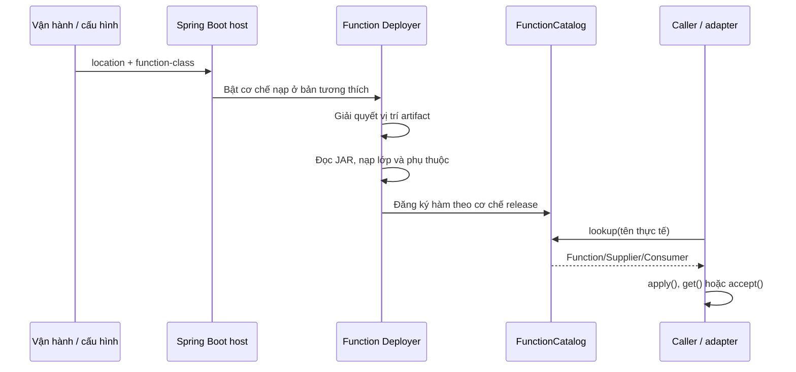

# spring.cloud.function.location và vị trí artifact

## 1. Vì sao đường dẫn JAR là một phần quan trọng của kiến trúc nạp hàm?

Giả sử hệ thống đơn hàng có một quy tắc chuẩn hóa mã đơn do nhóm nghiệp vụ phát hành dưới dạng `normalize-order-id-1.0.0.jar`. Nhóm vận hành không muốn đưa source của quy tắc vào ứng dụng tiếp nhận yêu cầu; họ cần chỉ cho **ứng dụng chủ** (*host*) biết JAR nằm ở đâu để hàm có thể được nạp và gọi.

Trong module **Spring Cloud Function** (`SPRING_CLOUD_FUNCTION`), logic được tổ chức dưới dạng `Supplier<T>`, `Function<T,R>` hoặc `Consumer<T>`, có thể được tra cứu bằng `FunctionCatalog`, ghép qua composition và kết nối đến HTTP, messaging hoặc serverless. Với hướng **nạp JAR ngoài**, một khái niệm đặc biệt là cấu hình **`spring.cloud.function.location`**: nó mô tả **vị trí artifact chứa implementation** mà cơ chế `spring-cloud-function-deployer` của những phiên bản hỗ trợ cần truy cập.

Vấn đề không chỉ là ghi đúng tên file. Một artifact có thể nằm trên máy phát triển nhưng không tồn tại trong container; có thể đọc được JAR nhưng thiếu dependency; có thể nạp được lớp nhưng chưa đăng ký đúng tên vào catalog; hoặc catalog có hàm nhưng web/broker chưa được cấu hình để gọi.

**Phạm vi bài học:** giải thích ý nghĩa của `spring.cloud.function.location`, cách suy luận vị trí artifact đối với host, cách đóng gói/kiểm tra một JAR minh họa và những ranh giới vận hành cần xác minh. Cú pháp và khả năng hỗ trợ của Function Deployer có thể thay đổi theo release: các ví dụ dưới đây dùng mô hình cấu hình truyền thống, **không khẳng định mọi phiên bản Spring Cloud Function hiện có đều hỗ trợ giống hệt**.

## 2. `location` trả lời câu hỏi nào?

Hãy xem bốn thông tin khác nhau:

| Thông tin | Câu hỏi nó trả lời | Ví dụ |
| --- | --- | --- |
| **Vị trí artifact** | *Ở đâu* có thể đọc được JAR chứa code? | `spring.cloud.function.location=file:///opt/functions/normalize-order-id-1.0.0.jar` |
| **Lớp implementation** | *Class nào* trong artifact được chọn làm hàm? | `spring.cloud.function.function-class=demo.functions.OrderIdNormalizer` trong cơ chế hỗ trợ. |
| **Tên hàm đã đăng ký** | *Tên nào* được tìm qua `FunctionCatalog`? | Một tên thực tế đã được deployer đăng ký; phải xác nhận. |
| **Đường kích hoạt** | *Ai gọi* hàm và qua đâu? | Java runner, HTTP endpoint, Stream binding hoặc handler serverless. |

**`location` không phải tên function**, không phải endpoint HTTP, cũng không phải tên Kafka topic. Nó chỉ xác định nơi tìm **artifact** cho bước nạp code ở cấu hình Function Deployer tương ứng.

Ví dụ:

```properties
spring.cloud.function.location=file:///opt/functions/normalize-order-id-1.0.0.jar
spring.cloud.function.function-class=demo.functions.OrderIdNormalizer
```

Hai dòng này diễn giải như sau: host cần đọc JAR tại một vị trí có thể truy cập và tìm lớp Java cụ thể trong cách nạp được phiên bản hỗ trợ. Việc hàm được đăng ký dưới **tên nào** và có được công bố qua **giao thức nào** là những bước riêng.

Một tên như `normalizeOrderId` trong cấu hình adapter chỉ đúng khi catalog **thực sự có** định nghĩa đó. Không nên suy từ tên file JAR hoặc tên class ra tên lookup.

## 3. Vị trí artifact luôn được nhìn từ tiến trình thực thi

Xét ba môi trường:

| Môi trường chạy host | Artifact được đặt ở đâu? | Giá trị `location` minh họa |
| --- | --- | --- |
| Linux VM hoặc máy vật lý | `/opt/functions/normalize-order-id-1.0.0.jar` trên cùng máy host. | `file:///opt/functions/normalize-order-id-1.0.0.jar` |
| Docker container | `/opt/functions/normalize-order-id-1.0.0.jar` **bên trong container**. | `file:///opt/functions/normalize-order-id-1.0.0.jar` |
| Windows JVM | `C:\functions\normalize-order-id-1.0.0.jar` trên máy chạy JVM. | `file:///C:/functions/normalize-order-id-1.0.0.jar` |

Trong ví dụ, `file:` biểu thị **file URI** chứ không phải đường dẫn HTTP. URI dùng dấu `/`, kể cả trong ví dụ Windows. Đường dẫn có dấu cách hoặc ký tự đặc biệt cần được biểu diễn dưới dạng URI đúng chuẩn (percent-encoding khi cần), không tùy tiện ghép chuỗi.

Một lỗi thường gặp:

```text
Máy lập trình:
  C:\Users\developer\Downloads\normalize-order-id-1.0.0.jar

Container chạy host:
  /opt/functions/normalize-order-id-1.0.0.jar

Nếu cấu hình trong container vẫn trỏ đến C:\Users\...,
host không thể thấy file chỉ vì nó tồn tại trên laptop.
```

**Nguyên tắc:** luôn trả lời câu hỏi “JVM của ứng dụng chủ hiện chạy ở đâu và filesystem/mount/network nào nó nhìn thấy?” trước khi thiết lập `location`.

### 3.1. Đường dẫn tương đối hay tuyệt đối?

Các cơ chế đọc tài nguyên của Java/Spring có thể xử lý đường dẫn tương đối theo những quy tắc khác nhau. Không nên giả định `./plugins/my.jar` được giải quyết từ thư mục chứa JAR của host; thư mục làm việc của tiến trình có thể khác. Khi dùng **file URI tuyệt đối** cho ví dụ nạp JAR, vị trí thường tường minh và dễ kiểm tra hơn.

```yaml
spring:
  cloud:
    function:
      location: "file:///opt/functions/normalize-order-id-1.0.0.jar"
```

Nếu cần đường dẫn tương đối, chỉ sử dụng khi **phiên bản deployer cụ thể** hỗ trợ và đã xác định rõ nó được giải quyết tương đối với thư mục nào. Có thể thay đổi working directory khi chạy trong IDE, service manager, Docker hoặc Kubernetes, khiến đường dẫn tưởng như đúng bị sai khi triển khai.

### 3.2. Có thể dùng HTTP, Maven repository hoặc S3 URI không?

**Không nên coi mọi scheme đều được hỗ trợ chỉ vì property tên là `location`.** Khả năng đọc `file:`, `http:`, `https:`, artifact repository hoặc những kiểu locator khác phụ thuộc implementation, classloader, resolver và phiên bản `spring-cloud-function-deployer`.

Trong bài này, **`file:///...` là ví dụ cơ sở**. Nếu cần artifact từ kho Maven/HTTP/object storage, hãy dùng quy trình triển khai để **tải hoặc mount artifact về một vị trí đã kiểm soát**, hoặc chỉ chọn URI từ xa khi tài liệu đúng release xác nhận nó được hỗ trợ. Việc Spring nói chung có kiểu `Resource` không đồng nghĩa deployer hỗ trợ nạp JAR từ mọi loại `Resource`.

## 4. Vòng đời từ URI đến lời gọi hàm



Có **năm cửa kiểm tra** độc lập:

1. **Có artifact:** host tìm thấy và có quyền đọc `location`.
2. **Đúng định dạng:** artifact chứa class đúng cấu trúc và phù hợp cách deployer đọc.
3. **Nạp được code:** class, Java runtime, dependency và constructor/khởi tạo tương thích.
4. **Đăng ký được hàm:** catalog có tên/definition để caller tra cứu.
5. **Kích hoạt được:** Java code hoặc adapter thực sự gọi hàm và xử lý kết quả/lỗi đúng giao thức.

Vượt qua cửa 1 chưa chứng minh được cửa 3; vượt qua cửa 4 chưa chứng minh adapter HTTP/Stream đã hoạt động. Phân tầng chẩn đoán giúp tránh sửa sai chỗ.

## 5. Tạo JAR minh họa chứa một Function thuần Java

Một lớp Java đơn giản, tự chứa, dễ nạp là `Function<String,String>`. Tệp `src/main/java/demo/functions/OrderIdNormalizer.java` của **dự án function**:

```java
package demo.functions;

import java.util.Locale;
import java.util.Objects;
import java.util.function.Function;

public final class OrderIdNormalizer
        implements Function<String, String> {

    public OrderIdNormalizer() {
        // Constructor public, không tham số để minh họa nạp lớp.
    }

    @Override
    public String apply(String input) {
        Objects.requireNonNull(input, "orderId");
        String normalized = input.strip()
                .toUpperCase(Locale.ROOT);
        if (normalized.isEmpty()) {
            throw new IllegalArgumentException(
                    "orderId must not be blank");
        }
        return normalized;
    }
}
```

Hàm này không chứa HTTP header, Kafka consumer record, AWS SDK hay Spring bean logic. Khi caller Java gọi:

```java
Function<String, String> fn = new OrderIdNormalizer();
String output = fn.apply("  od-204 ");
// output = "OD-204"
```

Hàm có thể kiểm thử ngay trước khi build artifact, nhờ đó lỗi xử lý input được phân biệt với lỗi nạp JAR. Ví dụ dùng JUnit Jupiter:

```java
package demo.functions;

import static org.junit.jupiter.api.Assertions.assertEquals;
import static org.junit.jupiter.api.Assertions.assertThrows;
import org.junit.jupiter.api.Test;

class OrderIdNormalizerTest {
    private final OrderIdNormalizer fn =
            new OrderIdNormalizer();

    @Test
    void normalizes() {
        assertEquals("OD-204", fn.apply("  od-204 "));
    }

    @Test
    void rejectsBlank() {
        assertThrows(IllegalArgumentException.class,
                () -> fn.apply("   "));
    }
}
```

Để chạy test cần khai báo dependency JUnit Jupiter và cấu hình build/test phù hợp. Trong bài, các lệnh build chỉ dành cho học viên thực hành; không giả định artifact đã được build tại bất kỳ đường dẫn thực tế nào.

## 6. Đóng gói đúng loại artifact

Ví dụ `pom.xml` tối giản tạo **JAR thư viện** chứa lớp hàm:

```xml
<?xml version="1.0" encoding="UTF-8"?>
<project xmlns="http://maven.apache.org/POM/4.0.0"
         xmlns:xsi="http://www.w3.org/2001/XMLSchema-instance"
         xsi:schemaLocation="http://maven.apache.org/POM/4.0.0 https://maven.apache.org/xsd/maven-4.0.0.xsd">
    <modelVersion>4.0.0</modelVersion>
    <groupId>demo.functions</groupId>
    <artifactId>normalize-order-id</artifactId>
    <version>1.0.0</version>
    <properties>
        <maven.compiler.release>17</maven.compiler.release>
        <project.build.sourceEncoding>UTF-8</project.build.sourceEncoding>
    </properties>
</project>
```

Các lệnh minh họa:

```bash
mvn package
jar tf target/normalize-order-id-1.0.0.jar
```

Đầu ra `jar tf` cần có class:

```text
demo/functions/OrderIdNormalizer.class
```

**JAR thư viện khác executable Spring Boot JAR.** JAR thư viện thường chứa các class ở vị trí package trực tiếp trong archive; Spring Boot executable JAR có thể chứa `BOOT-INF/classes` và các nested JAR ở `BOOT-INF/lib`. Không được suy ra deployer có thể nạp một executable JAR như một thư viện hàm, hoặc tự giải quyết tất cả nested dependencies.

| Kiểm tra artifact | Vì sao quan trọng? |
| --- | --- |
| Đúng version `1.0.0` | Tránh host nạp nhầm bản cũ/mới. |
| Chứa đúng class `demo.functions.OrderIdNormalizer` | `function-class` phải trỏ đến lớp có thật. |
| Compiled cho mức Java mà host chạy được | Tránh `UnsupportedClassVersionError`. |
| Các dependency cần thiết truy cập được | Tránh `NoClassDefFoundError` hoặc conflict. |
| Cấu trúc JAR phù hợp loader | Tránh lỗi không tìm thấy class do layout archive. |
| Artifact có nguồn gốc và checksum rõ | Giảm rủi ro bị thay đổi ngoài ý muốn. |

Nếu hàm sử dụng một SDK hay thư viện nghiệp vụ khác, cần xác định rõ cơ chế nạp các dependency đi kèm **trên phiên bản deployer đã chọn**, thay vì mặc nhiên giả định chỉ trỏ đến một JAR là đủ.

## 7. Ứng dụng chủ và cấu hình `spring.cloud.function.location`

Ví dụ host chạy Spring Boot với một dòng Spring Cloud Function **còn hỗ trợ module deployer**:

```xml
<dependency>
    <groupId>org.springframework.cloud</groupId>
    <artifactId>spring-cloud-function-deployer</artifactId>
</dependency>
```

Chọn Spring Boot và Spring Cloud BOM tương thích để quản lý version; không sao chép các version độc lập của những hướng dẫn thuộc nhiều release khác nhau.

Entry point ví dụ:

```java
package demo.host;

import org.springframework.boot.SpringApplication;
import org.springframework.boot.autoconfigure.SpringBootApplication;

@SpringBootApplication
public class FunctionHostApplication {
    public static void main(String[] args) {
        SpringApplication.run(FunctionHostApplication.class, args);
    }
}
```

Trong cấu hình truyền thống được các phiên bản hỗ trợ:

```yaml
spring:
  cloud:
    function:
      location: "file:///opt/functions/normalize-order-id-1.0.0.jar"
      function-class: "demo.functions.OrderIdNormalizer"
```

Tương đương về mặt ý tưởng khi biểu diễn dưới dạng `application.properties`:

```properties
spring.cloud.function.location=file:///opt/functions/normalize-order-id-1.0.0.jar
spring.cloud.function.function-class=demo.functions.OrderIdNormalizer
```

**Các giá trị trên là ví dụ minh họa có điều kiện.** Trước khi thực hành, xác minh module `spring-cloud-function-deployer`, tên property, khả năng giải quyết URI, yêu cầu khởi tạo class và cách đặt tên hàm trên release cụ thể. Không khẳng định property này là một cơ chế nạp JAR phổ quát của mọi ứng dụng chỉ dùng Spring Cloud Function context.

`spring.cloud.function.location` chỉ **chỗ chứa bytecode**. `spring.cloud.function.function-class`, khi được hỗ trợ, giúp chọn **lớp implementation**. `spring.cloud.function.definition` là khái niệm khác: chọn **hàm/pipeline đã đăng ký** cho adapter phù hợp, không tự tải JAR.

Một host không có web adapter có thể nạp hàm thành công nhưng không có HTTP endpoint. Một host không có Stream binder có thể nạp hàm thành công nhưng không hề nhận Kafka message. Cần cài đúng adapter riêng cho nhu cầu vận hành.

## 8. Đưa `location` vào cấu hình theo môi trường

Việc mã hóa cứng `/opt/functions/...` có thể phù hợp khi học thử, nhưng ứng dụng phát hành cho nhiều môi trường cần biết **artifact nào đã được phê duyệt và nó được đặt ở đâu**.

### 8.1. Truyền location qua biến môi trường

Spring Boot hỗ trợ ánh xạ property theo quy tắc *relaxed binding* thông dụng. Ví dụ thay đổi vị trí khi khởi động ứng dụng bằng biến môi trường:

```bash
export SPRING_CLOUD_FUNCTION_LOCATION="file:///opt/functions/normalize-order-id-1.0.0.jar"
export SPRING_CLOUD_FUNCTION_FUNCTION_CLASS="demo.functions.OrderIdNormalizer"
java -jar function-host.jar
```

Hai biến trên tương ứng với tên property `spring.cloud.function.location` và `spring.cloud.function.function-class` trong môi trường cấu hình Spring Boot thông thường; việc deployer có sử dụng được chúng còn phụ thuộc **bản phát hành**. Không nên tự ý đưa một URI được client gửi đến thành biến cấu hình của host: đó là khả năng chọn code sẽ thực thi.

Trong Windows PowerShell, cách đặt biến môi trường cho tiến trình hiện tại có thể viết:

```powershell
$env:SPRING_CLOUD_FUNCTION_LOCATION = "file:///C:/functions/normalize-order-id-1.0.0.jar"
$env:SPRING_CLOUD_FUNCTION_FUNCTION_CLASS = "demo.functions.OrderIdNormalizer"
java -jar function-host.jar
```

Giá trị Windows chỉ đúng khi JVM host chạy trên Windows và file thực sự tồn tại ở ổ `C:`. Một JVM trong Docker Linux trên máy Windows **không dùng** đường dẫn ổ `C:` bên trong container.

### 8.2. Cấu hình theo profile

Host có thể dùng cấu hình riêng cho môi trường phát triển và staging. Ví dụ:

```yaml
# application-dev.yml
spring:
  cloud:
    function:
      location: "file:///home/dev/functions/normalize-order-id-1.0.0.jar"
      function-class: "demo.functions.OrderIdNormalizer"
```

```yaml
# application-prod.yml
spring:
  cloud:
    function:
      location: "file:///opt/functions/normalize-order-id-1.0.0.jar"
      function-class: "demo.functions.OrderIdNormalizer"
```

Đây là **hai ví dụ cho hai profile**, không phải hai cấu hình cần kích hoạt đồng thời. Tên file, đường dẫn và phiên bản artifact phải được bộ phận phát hành quản lý thống nhất; không dựa vào sự trùng hợp về tên file để kết luận hai môi trường chạy cùng bytecode.

### 8.3. Nên đưa gì vào log khởi tạo?

Khi host nạp hàm, có thể ghi lại metadata vận hành **không chứa secret**: URI hoặc đường dẫn artifact đã được kiểm duyệt, version, checksum, tên class, tên function thực tế và kết quả kiểm tra khởi tạo. Không ghi thông tin xác thực trong URI (nếu cơ chế từ xa có dùng) hoặc dữ liệu nhạy cảm.

Một log “File tồn tại” vẫn chưa đủ; cần quan sát thêm hàm có được đăng ký và thực thi thành công với input kiểm thử hay không.

## 9. Docker: đường dẫn trong image và volume mount

Khi host chạy trong container, có hai chiến lược thường gặp:

1. **Copy JAR vào image host lúc build:** artifact là một phần của image, thuận lợi cho tính tái lập và rollback bằng image digest.
2. **Mount JAR từ volume:** artifact được quản lý riêng với image; phải bảo đảm volume/mount tồn tại ở **mọi replica** và có quyền đọc nhất quán.

### 9.1. Ví dụ đóng gói artifact cùng image

Đoạn Dockerfile minh họa giả định đã có `function-host.jar` và `normalize-order-id-1.0.0.jar` ở build context:

```dockerfile
FROM eclipse-temurin:17-jre
WORKDIR /app
COPY function-host.jar /app/function-host.jar
COPY normalize-order-id-1.0.0.jar /opt/functions/normalize-order-id-1.0.0.jar
ENV SPRING_CLOUD_FUNCTION_LOCATION=file:///opt/functions/normalize-order-id-1.0.0.jar
ENV SPRING_CLOUD_FUNCTION_FUNCTION_CLASS=demo.functions.OrderIdNormalizer
ENTRYPOINT ["java", "-jar", "/app/function-host.jar"]
```

Đây là **ví dụ packaging**, không kiểm định một version deployer cụ thể. Thư mục và quyền file phải phù hợp user chạy container; `COPY` không tự sửa các vấn đề tương thích của Java/classloader.

### 9.2. Ví dụ mount JAR khi chạy

Thay vì copy JAR vào image, có thể mount một thư mục đã chứa artifact:

```bash
docker run --rm \
  -v /srv/functions:/opt/functions:ro \
  -e SPRING_CLOUD_FUNCTION_LOCATION=file:///opt/functions/normalize-order-id-1.0.0.jar \
  -e SPRING_CLOUD_FUNCTION_FUNCTION_CLASS=demo.functions.OrderIdNormalizer \
  function-host:demo
```

Lệnh trên minh họa Linux host có thư mục `/srv/functions`; image `function-host:demo` phải thực sự tồn tại sau quy trình build riêng. Ký hiệu `:ro` mount ở chế độ chỉ đọc, giảm rủi ro vô tình thay artifact trong container. Nếu chạy trên môi trường khác, cú pháp mount của Docker và đường dẫn host có thể cần điều chỉnh.

Một lỗi điển hình: lệnh mount đúng thư mục nhưng artifact thực tế có tên `normalize-order-id-1.1.0.jar`, còn `location` trỏ bản `1.0.0`. Host sẽ gặp lỗi đọc file hoặc tiếp tục chạy phiên bản khác với mong đợi; giải pháp là đối chiếu **tên, version, checksum và vị trí thực tế**, không chỉ kiểm tra volume.

## 10. Kubernetes: cùng một path ở mọi replica

Khi chạy nhiều Pod, mỗi Pod phải nhìn thấy một artifact **tương thích và được phê duyệt** tại vị trí nó được cấu hình. Có thể dùng image chứa artifact, volume, init container hoặc một quy trình phát hành khác phù hợp với môi trường.

Ví dụ ý tưởng dùng volume đã được chuẩn bị trước:

```yaml
apiVersion: apps/v1
kind: Deployment
metadata:
  name: function-host
spec:
  replicas: 2
  selector:
    matchLabels:
      app: function-host
  template:
    metadata:
      labels:
        app: function-host
    spec:
      containers:
        - name: app
          image: example/function-host:1.0.0
          env:
            - name: SPRING_CLOUD_FUNCTION_LOCATION
              value: "file:///opt/functions/normalize-order-id-1.0.0.jar"
            - name: SPRING_CLOUD_FUNCTION_FUNCTION_CLASS
              value: "demo.functions.OrderIdNormalizer"
          volumeMounts:
            - name: function-artifacts
              mountPath: /opt/functions
              readOnly: true
      volumes:
        - name: function-artifacts
          persistentVolumeClaim:
            claimName: function-artifacts-pvc
```

Manifest này **giả định PVC đã được tạo và chứa JAR đúng đường dẫn, có access mode tương thích với hai replica**. Đây không phải ví dụ đủ tài nguyên để triển khai độc lập và không cam kết mọi storage class đều cho nhiều Pod mount cùng một volume.

Nếu yêu cầu triển khai lặp lại được, cách đóng gói artifact vào **image bất biến** thường dễ đối chiếu phiên bản hơn việc dùng một file JAR có thể bị thay đổi trên shared volume. Nếu dùng PVC/init container, cần bảo đảm **checksum, quyền đọc, readiness và rollout** được thiết kế phù hợp.

**Tránh ghi đè artifact đang được dùng và kỳ vọng host tự thay bytecode:** JAR loading không mặc nhiên là hot reload. Đổi phiên bản thường cần một vòng rollout/restart có kiểm soát nếu release không có cơ chế thay hàm an toàn được xác nhận.

## 11. Đọc được JAR chưa có nghĩa nạp được class

Ví dụ `location` trỏ đến JAR có thật, nhưng `function-class` lại là `demo.functions.NormalizeOrderId` trong khi archive chứa `demo.functions.OrderIdNormalizer`. Deployer không thể tự suy ra đây là một tên thay thế đúng.

Các vấn đề tiếp theo có thể xuất hiện:

| Giai đoạn | Dấu hiệu thất bại | Nguyên nhân điển hình |
| --- | --- | --- |
| Giải quyết `location` | File không tìm thấy/không đọc được. | Sai mount, sai quyền, sai URI hoặc path thuộc máy khác. |
| Đọc archive | JAR lỗi/định dạng không phù hợp. | File hỏng, nhầm artifact hoặc layout không được loader hỗ trợ. |
| Nạp lớp | `ClassNotFoundException`. | Sai `function-class` hoặc class không trong archive. |
| Liên kết dependency | `NoClassDefFoundError` / `NoSuchMethodError`. | Thiếu thư viện hoặc xung đột version. |
| Khởi tạo hàm | Lỗi constructor/khởi tạo. | Lớp không phù hợp cơ chế deployer hoặc dependency khởi tạo lỗi. |
| Đăng ký | Lookup trả `null`. | Chưa được đăng ký, tên khác kỳ vọng hoặc cấu hình definition không khớp. |
| Gọi `apply()` | Lỗi kiểu dữ liệu hoặc nghiệp vụ. | Input không đúng kiểu, converter sai, validation thất bại. |

### 11.1. Classloader và identity của DTO

Với `Function<String,String>`, ví dụ chỉ dùng kiểu JDK nên đơn giản. Khi chuyển sang kiểu riêng:

```java
record OrderRequest(String orderId, long amountVnd) {}
record OrderDecision(String orderId, boolean approved) {}

Function<OrderRequest, OrderDecision>
```

host và JAR phải thống nhất cách nhìn các kiểu dùng chung. Trong Java, **cùng tên package/class nhưng nạp bởi hai classloader không tương thích có thể là hai kiểu khác nhau**. Điều này gây `ClassCastException` hoặc lỗi mapping dù artifact và class name đều đúng.

Cần định nghĩa hợp đồng Java/API được versioning và giải quyết dependency tại ranh giới loader, hoặc để adapter chuyển từ payload trung gian thành kiểu mà hàm thực sự nhận. `spring.cloud.function.location` không giải quyết tự động vấn đề class identity.

### 11.2. JDK và dependency của artifact

Nếu function JAR được biên dịch cho Java 21 nhưng host chạy Java 17, JVM có thể ném `UnsupportedClassVersionError`. Nếu JAR tham chiếu một thư viện không được cung cấp theo cách loader hỗ trợ, có thể gặp `NoClassDefFoundError`. Nếu library có cùng tên lớp nhưng khác binary API, có thể gặp `NoSuchMethodError` hoặc `LinkageError`.

Do vậy, **vị trí** chỉ là một điều kiện của việc nạp thành công. Chọn được đúng **artifact/version/runtime** mới tạo ra một bước kiểm tra đầy đủ.

## 12. Từ artifact đến FunctionCatalog: xác minh tên được đăng ký

Sau khi deployer nạp implementation, caller trong host có thể tra cứu `FunctionCatalog`. Tên lookup phải đến từ **đăng ký thực tế**, không đoán từ đường dẫn:

```java
package demo.host;

import java.util.function.Function;
import org.springframework.beans.factory.annotation.Value;
import org.springframework.boot.ApplicationRunner;
import org.springframework.cloud.function.context.FunctionCatalog;
import org.springframework.context.annotation.Bean;
import org.springframework.context.annotation.Configuration;

@Configuration
public class FunctionLookupCheck {
    @Bean
    ApplicationRunner verifyFunction(
            FunctionCatalog catalog,
            @Value("${demo.function.lookup-name}") String lookupName) {
        return args -> {
            Function<String, String> fn =
                    catalog.lookup(lookupName);
            if (fn == null) {
                throw new IllegalStateException(
                        "Function is missing: " + lookupName);
            }
            String value = fn.apply("  od-204 ");
            System.out.println("Function output = " + value);
        };
    }
}
```

Trong ví dụ, `demo.function.lookup-name` là property **do ứng dụng host tự đặt**, không phải property deployer. Giá trị phải được xác định theo tên function đã đăng ký. Nếu bản đang chạy đăng ký dưới tên `orderIdNormalizer`, có thể cấu hình:

```yaml
demo:
  function:
    lookup-name: orderIdNormalizer
```

Nhưng không bảo đảm tên này đúng cho mọi release. Nếu lookup trả `null`, xem log/registration của framework rồi điều chỉnh tên thay vì thay đổi `location` một cách ngẫu nhiên.

Đoạn runner trên là một **smoke test tại startup**. Trong production, quyết định có chạy test này mỗi lần khởi động hay không phụ thuộc yêu cầu vận hành; nếu dùng, nên có lỗi rõ ràng để readiness không đánh dấu một host thiếu function là sẵn sàng phục vụ.

## 13. `location` không thay bộ điều hợp HTTP, Stream hoặc serverless

Sau khi nạp JAR và tìm được function, **cách gọi** còn phụ thuộc adapter:

| Kiểu điểm vào | Cần có | Không thuộc nhiệm vụ của `location` |
| --- | --- | --- |
| Java runner/service | `FunctionCatalog` hoặc bean callable trong host. | Không tự xác định lịch chạy hoặc tạo lời gọi. |
| HTTP | Spring Cloud Function Web adapter hoặc controller, port/route, converter. | Không tự tạo HTTP endpoint. |
| Messaging | Spring Cloud Stream, binder, function definition và binding/destination. | Không tự đăng ký Kafka consumer hay topic. |
| Serverless | Adapter handler/runtime, deployment, trigger, IAM và event conversion. | Không tự triển khai AWS Lambda hoặc cloud function. |

Ví dụ, nếu **tên hàm thực tế** trong catalog là `orderIdNormalizer` và host có Stream binder thích hợp:

```yaml
spring:
  cloud:
    function:
      definition: orderIdNormalizer
    stream:
      bindings:
        orderIdNormalizer-in-0:
          destination: raw-order-ids
          group: normalizer
          content-type: text/plain
        orderIdNormalizer-out-0:
          destination: normalized-order-ids
          content-type: text/plain
```

Đây là **cấu hình Stream minh họa cho một tên đã được xác nhận**, không phải khẳng định deployer tự đăng ký tên `orderIdNormalizer`. Cần thêm binder, broker và cấu hình kết nối thực tế. `spring.cloud.function.definition` lựa chọn hàm được adapter bind; nó **không thay `spring.cloud.function.location`** ở bước nạp artifact.

Tương tự, nếu web adapter công bố endpoint theo tên hàm được hỗ trợ, một request HTTP vẫn phải qua body converter trước khi gọi `apply()`. Với `Function<String,String>`, cần xác nhận content type và định dạng payload thích hợp; không phải mọi JSON object đều được chuyển thành `String` theo ý muốn của người gửi.

Nếu chạy trong serverless, còn phải giải mã event envelope (ví dụ body của API Gateway hoặc record của SQS) và báo kết quả/lỗi theo contract trigger. Vị trí của JAR chứa hàm **không giải quyết** việc chuyển đổi envelope đó.

## 14. Quản lý artifact bất biến, version và rollback

Một `location` chỉ trỏ đến `/opt/functions/normalize-order-id.jar` không cung cấp nhiều thông tin về **bytecode cụ thể**. Khi file cùng tên bị ghi đè, rất khó biết một replica đã khởi động với phiên bản nào và liệu các replica có cùng quy tắc hay không.

Nên áp dụng các nguyên tắc:

1. **Tên/version rõ ràng:** `normalize-order-id-1.0.0.jar`, `normalize-order-id-1.1.0.jar` thay vì ghi đè `latest.jar` trong khi hệ thống hoạt động.
2. **Nguồn phát hành được kiểm soát:** artifact repository, pipeline build và người/phương thức phê duyệt.
3. **Checksum hoặc chữ ký:** xác minh artifact được mount/copy là đúng bản đã duyệt; có thể lưu SHA-256 trong release manifest.
4. **Cấu hình và artifact đi cùng một lần phát hành:** đổi `location`, image hoặc mount trong một deployment có lịch sử và khả năng rollback.
5. **Không dựa vào hot reload ngầm định:** sau khi class được nạp, thay file trên đĩa không mặc nhiên thay code đang chạy.
6. **Canary/rolling rollout:** quan sát lỗi nạp, latency, memory, output/side effect trước khi chuyển toàn bộ traffic.

Ví dụ phát hành hai bản qua hai URI tường minh:

```text
file:///opt/functions/normalize-order-id-1.0.0.jar
file:///opt/functions/normalize-order-id-1.1.0.jar
```

Nếu công thức chuẩn hóa thay đổi giữa hai bản, chỉ cần cùng chữ ký `Function<String,String>` **không đủ chứng minh tương thích nghiệp vụ**. Caller có thể phụ thuộc vào semantics cũ. Vì vậy cần quản lý **contract version** song song với artifact version.

## 15. Bảo mật tại ranh giới `location`

Một JAR được nạp vào JVM là **mã thực thi**, không đơn thuần là dữ liệu. Nếu kẻ tấn công kiểm soát `spring.cloud.function.location` hoặc có thể thay file ở vị trí đó, họ có thể ảnh hưởng đến code mà host sẽ nạp theo cơ chế hỗ trợ.

Biện pháp cần thiết:

- **Không nhận `location` từ input không tin cậy** như request HTTP hay message rồi sử dụng trực tiếp làm cấu hình nạp.
- **Chỉ nạp artifact đã kiểm duyệt**, có version, nguồn gốc và checksum/chữ ký theo chính sách phát hành.
- **Ưu tiên mount chỉ đọc** hoặc image bất biến; giới hạn quyền ghi vào thư mục function JAR.
- **Hạn chế quyền host** đối với filesystem, mạng, database và secrets; mã trong JAR có thể tận dụng những quyền của tiến trình.
- **Không xem classloader là sandbox**. Nếu cần chạy mã không tin cậy, cân nhắc process/container isolation với API contract.
- **Chỉ công bố hàm được phép gọi** qua web/Stream adapter; một consumer có side effect không nên bị kích hoạt chỉ vì có tên trong catalog.
- **Tránh để credential trong URI/log hoặc trong JAR**; sử dụng cơ chế quản lý secret của hạ tầng.

Quét lỗ hổng dependency, lưu SBOM nếu quy trình yêu cầu, và bảo đảm có khả năng khôi phục một artifact sạch khi phát hiện sự cố.

## 16. Chẩn đoán sự cố theo từng tầng

| Triệu chứng | Nên kiểm tra trước | Không nên làm |
| --- | --- | --- |
| Host không nhìn thấy JAR | URI, mount, filesystem của host, quyền đọc. | Đổi tên function trong catalog một cách đoán mò. |
| File tồn tại nhưng không nạp được lớp | `jar tf`, `function-class`, archive layout. | Chỉ sửa HTTP endpoint. |
| Nạp lớp nhưng gặp `NoClassDefFoundError` | Dependency được loader nhìn thấy, version và classloader. | Cho rằng location hợp lệ là đủ. |
| `UnsupportedClassVersionError` | Java release dùng build JAR so với JRE của host. | Đổi URI mà không đổi bytecode/JRE. |
| Hàm đã nạp nhưng `lookup(...)` trả `null` | Đăng ký function, tên thực tế, cấu hình. | Tự suy từ file name ra tên lookup. |
| Lookup được nhưng HTTP trả 404/415 | Adapter, route, content type. | Đổ lỗi cho file URI. |
| Stream không tiêu thụ hoặc xuất message | Definition, binding, binder, broker, group. | Thay đổi function-class không có bằng chứng. |
| Sau rollout vẫn thấy logic cũ | Image/volume, checksum, Pod/host restart, artifact version. | Kỳ vọng JVM tự thay class khi file đổi. |
| `ClassCastException` với DTO custom | Class identity, shared API, converter. | Chỉ kiểm tra file tồn tại. |

Một quy trình chẩn đoán thực tế có thể đi theo thứ tự:

```text
[1] Host đọc đúng location?
    |
    v
[2] JAR đúng version, class tồn tại?
    |
    v
[3] Loader khởi tạo được class và dependencies?
    |
    v
[4] Catalog đăng ký tên nào, lookup có trả hàm?
    |
    v
[5] apply/get/accept có chạy đúng trong host?
    |
    v
[6] HTTP/Stream/serverless adapter nhận và trả đúng dữ liệu?
```

Đừng nhầm **lỗi không mở được file**, **lỗi khởi tạo class**, **lỗi registry** và **lỗi giao vận**: chúng cần những biện pháp sửa hoàn toàn khác nhau.

## 17. Kiểm thử từ artifact đến runtime

### 17.1. Unit test phần logic

Kiểm tra `new OrderIdNormalizer().apply(...)` với dữ liệu bình thường, rỗng, null và những tình huống Unicode phù hợp contract. Unit test không cần Spring và không chứng minh JAR có thể nạp qua deployer.

### 17.2. Artifact test

Kiểm tra JAR đúng version và `OrderIdNormalizer.class` nằm đúng vị trí; xác nhận bản Java, dependency và checksum. Nếu dùng công cụ build, đây là bước trước khi phát hành artifact lên môi trường có host.

### 17.3. Integration test với Function Deployer

Sử dụng release hỗ trợ và một `location` thật mà host đọc được. Khởi động host, kiểm tra log nạp, xác định tên được đăng ký, gọi `FunctionCatalog.lookup(...)` và chạy `apply("  od-204 ")` để xác nhận output `OD-204`.

Thử những trường hợp âm:

| Tình huống thử | Hành vi cần xác minh |
| --- | --- |
| JAR không tồn tại | Host báo rõ lỗi thay vì âm thầm hoạt động với function thiếu. |
| Sai `function-class` | Lỗi nạp lớp có thể chẩn đoán. |
| Sai quyền đọc | Lỗi tại bước truy cập artifact. |
| Thiếu dependency | Lỗi liên kết class được phát hiện trước khi mở traffic. |
| Tên lookup sai | Catalog không trả hàm, không gọi nhầm một function khác. |
| Đổi artifact version | Rollout/restart thực sự chạy bytecode dự kiến. |

### 17.4. Adapter/contract test

Nếu có web adapter, test HTTP method, path, content type, payload, response và mapping lỗi. Nếu có Stream, test destination, converter, retry, group và output. Nếu dùng serverless, kiểm tra event envelope, handler và failure semantics theo runtime. Đây là **bài test giao thức**, khác với bài test `location`.

## 18. Khi nào nên dùng `location` thay vì classpath dependency?

| Nhu cầu | Hướng thường phù hợp |
| --- | --- |
| Hàm và host luôn build/deploy cùng phiên bản | Bean `@Bean Function` hoặc dependency Maven bình thường. |
| Host cần lấy implementation được phát hành riêng, tại vị trí do vận hành cấu hình | Cân nhắc Function Deployer và `spring.cloud.function.location` nếu release hỗ trợ. |
| Cần nhiều service triển khai độc lập theo tiến trình | Dùng provider/caller qua HTTP hoặc messaging; deployer không phải bắt buộc. |
| Muốn triển khai một hàm lên AWS Lambda | Chọn runtime adapter và packaging Lambda; `location` không tự tạo trigger. |
| Chạy mã của bên thứ ba không tin cậy | Không coi JAR loading là sandbox; cân nhắc cách ly tiến trình. |
| Cần hot swap không gián đoạn | Chỉ sử dụng nếu có cơ chế được release hỗ trợ rõ ràng và được test; không suy từ `location`. |

Một khi host đã nạp JAR, `FunctionCatalog` giúp gọi theo tên và composition trong phạm vi các hàm được đăng ký. Nhưng khả năng tái sử dụng qua HTTP, sự kiện hoặc serverless vẫn phụ thuộc adapter và hợp đồng dữ liệu riêng. Đây là sự phân tách trách nhiệm cốt lõi của mô hình hàm.

## 19. Bài tập thực hành

Hãy thực hiện thí nghiệm với **một JAR chứa hàm** và **một Spring Boot host**:

1. Tạo `OrderIdNormalizer implements Function<String,String>`; viết unit test cho `"  od-204 "`, input rỗng và null.
2. Build JAR thư viện version `1.0.0`, kiểm tra `jar tf` và ghi checksum artifact.
3. Chọn phiên bản Spring Cloud Function **có hỗ trợ deployer**; cấu hình `location` trỏ đến một file URI tuyệt đối cùng `function-class`.
4. Khởi động host; xác nhận artifact có thể đọc, class nạp được và tên được đăng ký trong `FunctionCatalog`.
5. Gọi hàm từ runner trong host để kiểm tra output `OD-204`.
6. Đổi `location` sang URI không tồn tại để quan sát lỗi; phục hồi lại file đúng.
7. Nếu dùng Docker, mount/copy artifact vào `/opt/functions` rồi lặp lại. Giải thích vì sao đường dẫn trên laptop không dùng trực tiếp trong container.
8. Phát hành `1.1.0`, chỉ định vị trí artifact mới và thực hiện rollout/restart theo cơ chế đã xác minh. Đối chiếu checksum và kết quả của hai phiên bản.
9. Nếu cài Web hoặc Stream adapter, cấu hình tên function **đã được catalog đăng ký thực tế** và chạy thêm contract test qua giao thức đó.

**Tiêu chí hoàn thành:** phân biệt được trường hợp “file không có”, “class không nạp được”, “catalog không tìm thấy hàm” và “adapter không xử lý được payload”; chỉ ra `location` trỏ đến **artifact trong môi trường chạy host**, không trỏ đến đường dẫn trên máy phát triển theo mặc định.

## 20. Kết luận

**`spring.cloud.function.location` định vị artifact để cơ chế nạp JAR của Spring Cloud Function Deployer có thể truy cập implementation bên ngoài trong những phiên bản hỗ trợ.** Giá trị của property phải được hiểu từ filesystem/URI mà JVM của **host** nhìn thấy. Nó khác với `function-class` dùng chọn lớp, tên đã đăng ký dùng cho `FunctionCatalog.lookup(...)`, và `spring.cloud.function.definition` dùng chọn hàm/pipeline cho adapter.

Để sử dụng an toàn, cần kiểm soát **đúng JAR, đúng Java/dependency, đúng mount/path, đúng tên đăng ký, đúng adapter và đúng chính sách vận hành**. File tồn tại chưa có nghĩa hàm đã sẵn sàng; nạp được hàm chưa có nghĩa HTTP, messaging hoặc serverless tự được cấu hình.

Mô hình hiệu quả là **phát hành logic `Supplier`/`Function`/`Consumer` thành artifact có version rõ ràng, nạp bằng cơ chế được release hỗ trợ, xác minh qua `FunctionCatalog` và chỉ sau đó kết nối với cách gọi mong muốn**. Khi đó, phần nghiệp vụ có thể tái sử dụng mà vị trí artifact, hợp đồng dữ liệu và trách nhiệm vận hành vẫn minh bạch.
