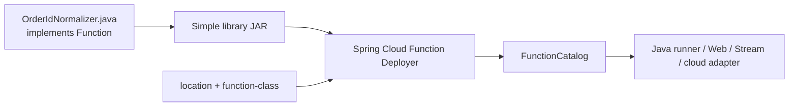
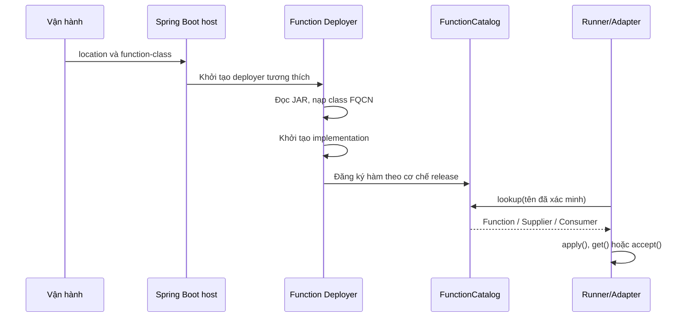

# Nạp simple JAR bằng spring.cloud.function.function-class

## 1. Mục tiêu: nạp một lớp hàm Java từ JAR không phải ứng dụng Spring Boot

Một nhóm triển khai dịch vụ quản lý đơn hàng muốn chuẩn hóa mã đơn từ nhiều kênh. Nhóm nghiệp vụ chỉ phát hành **một JAR thư viện nhỏ chứa lớp Java thực hiện quy tắc**, trong khi nhóm vận hành duy trì một Spring Boot host có khả năng nhận HTTP hoặc sự kiện. Khi đổi cách chuẩn hóa, mục tiêu là phát hành artifact riêng thay vì sao chép điều kiện nghiệp vụ sang controller, Kafka listener hay cloud handler.

Trong **Spring Cloud Function** (`SPRING_CLOUD_FUNCTION`), logic được biểu diễn bằng `Supplier<T>`, `Function<T,R>` và `Consumer<T>`. `FunctionCatalog` hỗ trợ tra cứu hàm đã đăng ký; composition ghép bước tương thích; bộ điều hợp kết nối HTTP, messaging hoặc serverless. Ở chương **Nạp JAR**, code hàm có thể nằm ngoài classpath ban đầu của ứng dụng chủ.

Chủ đề này tập trung vào **`spring.cloud.function.function-class`**: trong cơ chế **Spring Cloud Function Deployer** của những phiên bản hỗ trợ, property giúp xác định **class triển khai hàm** cần nạp từ artifact. Với *simple JAR*, lớp thường là một `public class` implement trực tiếp giao diện functional của Java.

**Cần phân biệt:** `function-class` **chọn lớp**, `location` xác định **JAR ở đâu**, `FunctionCatalog` cho phép **tìm hàm đã đăng ký**, còn adapter/caller quyết định **khi nào và bằng cách nào gọi**. Không property nào trong số này tự biến một JAR thành dịch vụ HTTP hoàn chỉnh.

> **Giới hạn phiên bản:** `spring-cloud-function-deployer` và những property minh họa ở đây thuộc cách nạp JAR của các dòng phát hành hỗ trợ cơ chế tương ứng. Không nên khẳng định mọi phiên bản Spring Cloud Function hiện tại đều hỗ trợ các property, URI, cách khởi tạo và cơ chế đặt tên giống hệt. Trước khi áp dụng, phải đối chiếu release Spring Boot/Spring Cloud Function và module deployer thực tế.

## 2. Simple JAR khác một ứng dụng Spring Boot

Trong bài này, **simple JAR** là JAR thư viện Java thông thường:

- Chứa file `.class` của một implementation `Function`, `Supplier` hoặc `Consumer`.
- Không nhất thiết có `main()`, `@SpringBootApplication`, controller hay một Spring context riêng.
- Có thể chỉ dùng JDK; nếu có dependency ngoài, cần bảo đảm loader có thể cung cấp dependency theo release hỗ trợ.
- Với ví dụ nạp lớp đơn giản, class công khai có constructor không tham số và không phụ thuộc injection phức tạp.
- Không đồng nhất với **Spring Boot executable/fat JAR** dùng launcher và layout `BOOT-INF`.

Artifact ví dụ:

```text
normalize-order-id-1.0.0.jar
└── demo/
    └── functions/
        └── OrderIdNormalizer.class
```



Mũi tên JAR → deployer thể hiện **nạp code**. Mũi tên catalog → caller là **tra cứu và gọi**. Khi runner gọi hàm trong host, code thực thi trong **cùng JVM**, dù artifact được phát hành riêng.

## 3. Phân biệt `function-class`, `location` và `definition`

| Property | Câu hỏi | Ví dụ | Không tự làm |
| --- | --- | --- | --- |
| `spring.cloud.function.location` | JAR nằm **ở đâu** đối với host? | `file:///opt/functions/normalize-order-id-1.0.0.jar` | Không chọn lớp chính xác trong JAR. |
| `spring.cloud.function.function-class` | **Lớp Java** nào được chọn để nạp? | `demo.functions.OrderIdNormalizer` | Không mở endpoint hay đặt topic. |
| `spring.cloud.function.definition` | Adapter dùng **hàm/pipeline đã đăng ký** nào? | Ví dụ `normalizeOrderId` | Không tải JAR hoặc sửa lỗi không có class. |

Ví dụ trong `application.yml` theo mô hình deployer truyền thống:

```yaml
spring:
  cloud:
    function:
      location: "file:///opt/functions/normalize-order-id-1.0.0.jar"
      function-class: "demo.functions.OrderIdNormalizer"
```

Biểu diễn `application.properties`:

```properties
spring.cloud.function.location=file:///opt/functions/normalize-order-id-1.0.0.jar
spring.cloud.function.function-class=demo.functions.OrderIdNormalizer
```

`demo.functions.OrderIdNormalizer` là **fully qualified class name (FQCN)**, gồm package và tên class. `normalize-order-id-1.0.0.jar` chỉ là tên file. Còn `normalizeOrderId` là một tên catalog **minh họa**, không được suy đoán từ tên file hoặc class nếu chưa xác nhận đăng ký thực tế trên phiên bản host.

## 4. Viết class implementation đúng hình dạng

Tệp `src/main/java/demo/functions/OrderIdNormalizer.java` trong dự án thư viện:

```java
package demo.functions;

import java.util.Locale;
import java.util.Objects;
import java.util.function.Function;

public final class OrderIdNormalizer
        implements Function<String, String> {

    // Constructor công khai, không tham số cho ví dụ simple JAR.
    public OrderIdNormalizer() {}

    @Override
    public String apply(String rawOrderId) {
        Objects.requireNonNull(rawOrderId, "rawOrderId");

        String normalized = rawOrderId.strip()
                .toUpperCase(Locale.ROOT);
        if (normalized.isEmpty()) {
            throw new IllegalArgumentException(
                    "Order ID must not be blank");
        }
        return normalized;
    }
}
```

Kết quả:

```text
apply("  od-204 ")  -> "OD-204"
apply(" ab-01 ")   -> "AB-01"
apply("   ")       -> IllegalArgumentException
apply(null)        -> NullPointerException
```

Chữ ký `Function<String,String>` là interface chuẩn `java.util.function`, không phải đặc tả HTTP hay cloud event. Class không dùng Spring, HTTP, broker hay SDK serverless. Vì vậy nó có thể được gọi thuần Java, test độc lập và kết nối với những adapter khác nhau qua host.

### 4.1. Vì sao dùng public class và constructor mặc định?

Class `public` có tên Java rõ ràng để khai báo tại `function-class`; constructor công khai không tham số giúp minh họa cách khởi tạo trực tiếp. Tuy nhiên, cách một release deployer thực sự tạo instance, bao gồm khả năng nhận constructor injection hoặc bean dependencies, phải được xác nhận trên release đó.

Một implementation cần repository qua constructor:

```java
public OrderIdNormalizer(OrderRepository repository) {
    this.repository = repository;
}
```

không thể được suy ra là nạp được chỉ vì đã có `spring.cloud.function.function-class`. Lớp như vậy cần phương án quản lý dependency phù hợp; ví dụ đơn giản cố tình **không yêu cầu injection**.

### 4.2. Không chọn tên class ẩn của Java lambda

Một bean như sau hoàn toàn có thể phù hợp **khi nằm trong ứng dụng Spring có cấu hình thích hợp**:

```java
@Bean
Function<String, String> normalizeOrderId() {
    return raw -> raw.strip().toUpperCase(Locale.ROOT);
}
```

Nhưng Java lambda có lớp triển khai runtime do JVM xử lý; tên lớp sinh ra không phải một API ổn định để điền vào `function-class`. Khác biệt ở đây là **nạp một class implementation có FQCN** so với **Spring tạo bean từ một method `@Bean`**.

## 5. Kiểm thử Java thuần trước khi build

Tệp `src/test/java/demo/functions/OrderIdNormalizerTest.java`:

```java
package demo.functions;

import static org.junit.jupiter.api.Assertions.assertEquals;
import static org.junit.jupiter.api.Assertions.assertThrows;
import org.junit.jupiter.api.Test;

class OrderIdNormalizerTest {
    private final OrderIdNormalizer normalize =
            new OrderIdNormalizer();

    @Test
    void normalizesCaseAndWhitespace() {
        assertEquals("OD-204",
                normalize.apply("  od-204 "));
    }

    @Test
    void rejectsBlankInput() {
        assertThrows(IllegalArgumentException.class,
                () -> normalize.apply("   "));
    }

    @Test
    void rejectsNullInput() {
        assertThrows(NullPointerException.class,
                () -> normalize.apply(null));
    }
}
```

Mẫu POM ở mục 6 khai báo JUnit Jupiter và Maven Surefire để thực hiện các test minh họa. Unit test xác minh quy tắc, **không chứng minh** JAR được đóng gói đúng, loader tìm được class hay `FunctionCatalog` đã đăng ký hàm.

## 6. Đóng gói simple JAR bằng Maven

Một `pom.xml` tối giản của dự án thư viện:

```xml
<?xml version="1.0" encoding="UTF-8"?>
<project xmlns="http://maven.apache.org/POM/4.0.0"
         xmlns:xsi="http://www.w3.org/2001/XMLSchema-instance"
         xsi:schemaLocation="http://maven.apache.org/POM/4.0.0 https://maven.apache.org/xsd/maven-4.0.0.xsd">
    <modelVersion>4.0.0</modelVersion>
    <groupId>demo.functions</groupId>
    <artifactId>normalize-order-id</artifactId>
    <version>1.0.0</version>
    <properties>
        <maven.compiler.release>17</maven.compiler.release>
        <project.build.sourceEncoding>UTF-8</project.build.sourceEncoding>
    </properties>
    <dependencies>
        <dependency>
            <groupId>org.junit.jupiter</groupId>
            <artifactId>junit-jupiter</artifactId>
            <version>5.10.2</version>
            <scope>test</scope>
        </dependency>
    </dependencies>
    <build>
        <plugins>
            <plugin>
                <groupId>org.apache.maven.plugins</groupId>
                <artifactId>maven-compiler-plugin</artifactId>
                <version>3.13.0</version>
            </plugin>
            <plugin>
                <groupId>org.apache.maven.plugins</groupId>
                <artifactId>maven-surefire-plugin</artifactId>
                <version>3.2.5</version>
            </plugin>
        </plugins>
    </build>
</project>
```

Minh họa bước build và kiểm tra khi tự thực hành:

```bash
mvn package
jar tf target/normalize-order-id-1.0.0.jar
```

Archive phải chứa `demo/functions/OrderIdNormalizer.class`. Nếu thêm test, build/test cần dependency JUnit phù hợp. Đây là **JAR thư viện**, không phải mặc định một executable Spring Boot JAR.

| Kiểm tra | Simple library JAR | Executable Spring Boot JAR thường gặp |
| --- | --- | --- |
| Mục tiêu | Cung cấp class cho host nạp. | Chạy ứng dụng độc lập. |
| Class thường đặt ở | Package path trực tiếp trong JAR. | `BOOT-INF/classes`. |
| Dependency | Theo cơ chế classpath/loader. | Có thể nằm trong nested `BOOT-INF/lib`. |
| Có `main()`? | Không cần. | Thường có entry point. |
| Có chắc deployer đọc được? | Vẫn phải kiểm tra release/cấu hình. | Không mặc định; phụ thuộc loader/layout. |

**Không tự cho rằng mọi JAR chạy được bằng `java -jar` là một simple JAR phù hợp cho `function-class`.** Nếu code phụ thuộc thư viện ngoài, cần giải quyết cả dependency và classloader; chỉ có tên class trong cấu hình không tạo ra các dependency bị thiếu.

## 7. Đặt artifact tại vị trí host đọc được

Ví dụ file JAR được đưa đến filesystem Linux:

```text
/opt/functions/normalize-order-id-1.0.0.jar
```

Khi đó URI tuyệt đối minh họa là:

```text
file:///opt/functions/normalize-order-id-1.0.0.jar
```

`location` phải là nơi **JVM host nhìn thấy file**, không phải đường dẫn trên laptop của người build. Trong container, host chỉ thấy filesystem container và các volume được mount.

Ví dụ mount một thư mục chỉ đọc:

```bash
docker run --rm \
  -v /srv/functions:/opt/functions:ro \
  -e SPRING_CLOUD_FUNCTION_LOCATION=file:///opt/functions/normalize-order-id-1.0.0.jar \
  -e SPRING_CLOUD_FUNCTION_FUNCTION_CLASS=demo.functions.OrderIdNormalizer \
  example/function-host:demo
```

Lệnh giả định đã build image và thư mục `/srv/functions` có JAR. Với môi trường Windows/container khác, cần điều chỉnh đường dẫn và syntax mount. Một tên file chính xác chưa đủ nếu JVM không có quyền đọc.

Không suy ra mọi scheme `http:`, `https:` hoặc Maven repository đều được deployer chấp nhận chỉ vì property tên `location`. Khả năng giải quyết URI phụ thuộc cách triển khai của release; an toàn nhất cho bài thực hành là **đưa artifact đáng tin cậy về một file URI đã kiểm soát**.

## 8. Tạo Spring Boot host có Function Deployer

Ứng dụng chủ khác với JAR thư viện: nó có Spring Boot runtime và dependency Spring Cloud Function. Trong những release còn hỗ trợ module này, dependency:

```xml
<dependency>
    <groupId>org.springframework.cloud</groupId>
    <artifactId>spring-cloud-function-deployer</artifactId>
</dependency>
```

Chọn Spring Boot và Spring Cloud BOM tương thích; không trộn tùy ý version từ các tài liệu thuộc release khác nhau.

Ví dụ entry point:

```java
package demo.host;

import org.springframework.boot.SpringApplication;
import org.springframework.boot.autoconfigure.SpringBootApplication;

@SpringBootApplication
public class FunctionHostApplication {
    public static void main(String[] args) {
        SpringApplication.run(FunctionHostApplication.class, args);
    }
}
```

`application.yml` minh họa host chạy **không có web server**:

```yaml
spring:
  main:
    web-application-type: none
  cloud:
    function:
      location: "file:///opt/functions/normalize-order-id-1.0.0.jar"
      function-class: "demo.functions.OrderIdNormalizer"
```

`spring.main.web-application-type: none` chỉ phục vụ ví dụ console. Nếu muốn công bố HTTP, cần web adapter/runtime thích hợp và bỏ cấu hình tắt web server này. Nếu muốn nhận Kafka, cần Spring Cloud Stream/binder và cấu hình bindings. Chỉ đặt `function-class` không làm cho một endpoint hoặc consumer tự xuất hiện.

Để môi trường thay đổi đường dẫn mà không phải sửa source, có thể truyền thông qua biến môi trường Spring Boot:

```bash
export SPRING_CLOUD_FUNCTION_LOCATION="file:///opt/functions/normalize-order-id-1.0.0.jar"
export SPRING_CLOUD_FUNCTION_FUNCTION_CLASS="demo.functions.OrderIdNormalizer"
java -jar function-host.jar
```

Cách binder Spring Boot đọc property và deployer sử dụng giá trị cuối cùng vẫn phải được kiểm chứng trong phiên bản được chọn. `function-class` là configuration do vận hành kiểm soát; không nhận tên class tùy ý từ request bên ngoài.

## 9. Nạp class không đồng nghĩa đăng ký tên mà mình đoán

Một lớp tên `demo.functions.OrderIdNormalizer` có thể được nạp thành công nhưng **tên function trong catalog** phải được xác nhận theo cách deployer đăng ký. Ví dụ `orderIdNormalizer` hoặc `normalizeOrderId` chỉ là gợi ý tên minh họa, **không phải quy tắc đặt tên bảo đảm** của mọi release.

Có thể tạo một runner dùng tên từ cấu hình riêng của host:

```java
package demo.host;

import java.util.function.Function;
import org.springframework.beans.factory.annotation.Value;
import org.springframework.boot.ApplicationRunner;
import org.springframework.cloud.function.context.FunctionCatalog;
import org.springframework.context.annotation.Bean;
import org.springframework.context.annotation.Configuration;

@Configuration
public class LoadedFunctionSmokeTest {

    @Bean
    ApplicationRunner verifyLoaded(
            FunctionCatalog catalog,
            @Value("${demo.function.lookup-name}") String lookupName) {
        return args -> {
            Function<String, String> fn = catalog.lookup(lookupName);
            if (fn == null) {
                throw new IllegalStateException(
                        "Function not registered: " + lookupName);
            }
            String result = fn.apply("  od-204 ");
            System.out.println("Normalized ID: " + result);
        };
    }
}
```

Đặt trong cấu hình **sau khi xác nhận tên đăng ký thực tế**:

```yaml
demo:
  function:
    lookup-name: orderIdNormalizer
```

`demo.function.lookup-name` là **property của ví dụ tự tạo**, không phải property của `spring-cloud-function-deployer`. Không nên cố gọi khi `catalog.lookup(...)` trả `null`; kiểm tra log nạp, tên catalog/definition và classloader trước.

## 10. Sơ đồ kiểm tra từ FQCN đến lời gọi



Một quy trình kiểm tra cần tách sáu điểm:

1. **JAR hiện hữu và đọc được** từ JVM host.
2. **Class đúng FQCN** nằm trong archive.
3. **Dependency và JDK tương thích**, không có classloader linkage error.
4. **Class khởi tạo được** bằng cách deployer hỗ trợ.
5. **Function được đăng ký** dưới một tên/definition có thể tra cứu.
6. **Caller gọi được** với kiểu dữ liệu và contract phù hợp.

Vượt qua bước 1 chưa chứng minh bước 4; bước 5 đúng không tự bật HTTP endpoint. Nên ghi rõ mỗi trạng thái trong log và readiness/health check của host.

## 11. Chọn đúng loại lớp: Supplier, Function, Consumer

Property `function-class` được dùng trong bối cảnh module nạp hàm, nên không chỉ nghĩ đến `Function<T,R>`. Ba giao diện Java có hình dạng khác nhau:

| Giao diện | Phương thức | Đầu vào / đầu ra | Khi được adapter sử dụng |
| --- | --- | --- | --- |
| `Supplier<T>` | `get()` | Không có input, tạo giá trị `T`. | Caller hoặc poller quyết định thời điểm lấy dữ liệu. |
| `Function<T,R>` | `apply(T)` | Một input thành một output. | HTTP request/response hoặc Stream input/output binding. |
| `Consumer<T>` | `accept(T)` | Nhận input, không trả kết quả nghiệp vụ. | Thường là điểm nhận dữ liệu và side effect. |

### 11.1. Ví dụ class Supplier

```java
package demo.functions;

import java.util.function.Supplier;

public final class PolicyVersion
        implements Supplier<String> {

    public PolicyVersion() {}

    @Override
    public String get() {
        return "order-policy-v1";
    }
}
```

Nếu JAR chứa lớp này và release deployer hỗ trợ nạp kiểu tương ứng, `function-class` cần trỏ đến `demo.functions.PolicyVersion`. Nhưng `Supplier` không tự tạo lịch chạy. Trong messaging, một poller hoặc nguồn kích hoạt phải quyết định khi nào gọi `get()`; trong Java nội bộ, runner có thể gọi trực tiếp.

### 11.2. Ví dụ class Consumer

```java
package demo.functions;

import java.util.function.Consumer;

public final class AuditDecision
        implements Consumer<String> {

    public AuditDecision() {}

    @Override
    public void accept(String decision) {
        System.out.println("AUDIT: " + decision);
    }
}
```

Đây chỉ là ví dụ side effect để minh họa chữ ký. Trong production, logging, audit storage, transaction và idempotency cần được thiết kế theo yêu cầu nghiệp vụ; `accept()` trả `void` không phải bảo đảm message đã được broker xác nhận.

### 11.3. Nếu JAR có nhiều lớp hàm?

```text
demo/functions/OrderIdNormalizer.class
demo/functions/PolicyVersion.class
demo/functions/AuditDecision.class
```

Khi có nhiều class, **tên FQCN trong `function-class` càng quan trọng**. Không nên kỳ vọng deployer tự chọn “hàm đúng” chỉ nhờ tên file JAR. Cách khai báo nhiều hàm hoặc danh sách class, nếu được release hỗ trợ, phải được đối chiếu tài liệu đúng phiên bản; bài tập này cố ý chọn **một simple JAR và một class cụ thể** để giảm nhập nhằng.

## 12. Chọn function-class khác với Spring component scanning

Trong một ứng dụng Spring Boot thông thường, người phát triển có thể khai báo:

```java
@Configuration
class Functions {
    @Bean
    Function<String, String> normalizeOrderId() {
        return input -> input.strip();
    }
}
```

Spring quét hoặc import cấu hình này, gọi method `@Bean` và đăng ký một bean hàm. **Đây là cách phát hành bean qua Spring context**, không phải bắt buộc cần `spring.cloud.function.function-class`.

Ngược lại, với simple JAR có lớp `OrderIdNormalizer implements Function`, host có thể dùng deployer để nạp implementation từ một JAR ngoài. Hai mô hình có điểm chung ở chỗ hàm có thể xuất hiện trong `FunctionCatalog`, nhưng **đường tạo instance** và **phạm vi dependency injection** khác nhau.

Đừng dựa vào các giả định sau:

- Chỉ cần đặt `@Component` trên một class ở JAR ngoài là host tự quét được nó.
- Chỉ cần có `@Configuration` là mọi `@Bean` trong JAR được tạo mà không cần import/scan đúng cách.
- Chỉ cần `function-class` là mọi dependency constructor tự được cung cấp.
- Tên bean từ `@Bean` và tên class từ deployer chắc chắn tạo ra cùng một catalog name.

Nếu mục tiêu là dùng nhiều Spring bean với lifecycle và injection phức tạp, một **thư viện Spring được cấu hình/import có chủ đích** hoặc một provider service riêng có thể dễ hiểu hơn so với ép tất cả vào cơ chế nạp một simple class.

## 13. Generic types và chuyển đổi dữ liệu

Một hàm được nạp thành công có thể nhận payload sai kiểu ở bước gọi. Ví dụ `OrderIdNormalizer` yêu cầu `String`; nếu adapter HTTP gửi một JSON object không có converter phù hợp, việc chuyển thành `String` có thể không mang ý nghĩa như mong muốn.

Trong Java thuần:

```java
Function<String, String> fn = new OrderIdNormalizer();
String value = fn.apply(" od-204 ");
```

Không cần JSON hay message converter vì caller đã có `String`. Trong HTTP/Stream, adapter có thể phải giải mã byte/text/JSON, xác định content type và ánh xạ thành đúng input. Spring Cloud Function hỗ trợ chuyển đổi thông điệp trong những ngữ cảnh framework tích hợp, nhưng **không bảo đảm mọi payload bất kỳ đều được chấp nhận**.

Với DTO riêng:

```java
record OrderRequest(String orderId, long amountVnd) {}
record OrderDecision(String orderId, boolean approved) {}

Function<OrderRequest, OrderDecision>
```

cần xác định schema, generic type metadata và vấn đề classloader. Hai class cùng FQCN được nạp bởi hai classloader không tương thích có thể là **hai kiểu khác nhau** trong JVM; điều này dẫn đến `ClassCastException` hoặc lỗi chuyển đổi dù code trông giống nhau.

### 13.1. Khi nào nên dùng Message?

Nếu hàm cần metadata như correlation ID, có thể thiết kế:

```java
Function<Message<OrderRequest>, Message<OrderDecision>>
```

`Message<T>` thuộc `org.springframework.messaging`, không thuộc `java.util.function`. Khi dùng kiểu này trong JAR, phải quản lý dependency và ranh giới loader. Nếu quy tắc chỉ cần input miền, `Function<OrderRequest,OrderDecision>` thường dễ tái sử dụng hơn qua Java nội bộ, HTTP, messaging và serverless.

### 13.2. Không dùng raw Function khi muốn metadata kiểu chính xác

Một class implement raw `Function` đánh mất thông tin kiểu input/output quan trọng cho adapter/converter. Nên khai báo đầy đủ generics như `Function<String,String>`. Tuy nhiên, metadata đúng vẫn không thay việc xác minh payload thực tế, schema evolution và content type ở giao thức.

## 14. Dùng hàm đã nạp qua HTTP, messaging và serverless

**Nạp simple JAR thành công không đồng nghĩa host đã có endpoint.** Để công bố qua HTTP, cần Spring Cloud Function Web adapter hoặc một controller gọi function. Ví dụ Maven dependency ở **ứng dụng host**, không phải JAR hàm:

```xml
<dependency>
    <groupId>org.springframework.cloud</groupId>
    <artifactId>spring-cloud-starter-function-web</artifactId>
</dependency>
```

Nếu adapter hỗ trợ và tên đã được đăng ký thực tế là `orderIdNormalizer`, host có thể công bố một route theo tên đó. Một request minh họa:

```bash
curl -X POST http://localhost:8080/orderIdNormalizer \
  -H "Content-Type: text/plain" \
  --data "  od-204 "
```

Kết quả nghiệp vụ mong đợi là `OD-204`. Route, HTTP method, body conversion và status code cần kiểm tra trên phiên bản web adapter đang sử dụng. Không khẳng định `orderIdNormalizer` là tên tự động của mọi deployer.

Đối với **Spring Cloud Stream**, host cần binder Kafka/RabbitMQ và định nghĩa hàm đã có trong catalog. Ví dụ **chỉ khi tên thực tế là `orderIdNormalizer`**:

```yaml
spring:
  cloud:
    function:
      definition: orderIdNormalizer
    stream:
      bindings:
        orderIdNormalizer-in-0:
          destination: raw-order-ids
          group: normalize-workers
          content-type: text/plain
        orderIdNormalizer-out-0:
          destination: normalized-order-ids
          content-type: text/plain
      kafka:
        binder:
          brokers: localhost:9092
```

Tại runtime, input message được converter xử lý, `apply()` chạy và output được phát theo binder. Việc function trả `String` không tự bảo đảm message đã được broker ghi nhận bền vững hoặc consumer cuối đã xử lý thành công.

Với **serverless**, deployment cần adapter/handler riêng cho nền tảng, event source, quyền và contract phản hồi. `function-class` dùng ở ngữ cảnh nạp JAR không phải một Lambda handler hoặc property có thể thay việc khai báo cloud trigger. Có thể tái sử dụng cùng Java implementation mà không buộc mọi deployment đều dùng Function Deployer.

## 15. Các nhóm lỗi khi function-class không đúng

| Biểu hiện | Nguyên nhân có thể | Cách chẩn đoán |
| --- | --- | --- |
| JAR không mở được | `location` sai, thiếu mount/quyền đọc hoặc URI không hỗ trợ. | Kiểm tra đường dẫn từ JVM host, quyền file và release hỗ trợ. |
| `ClassNotFoundException` | `function-class` không đúng FQCN, class thiếu trong archive. | Kiểm tra package/class trong source và `jar tf`. |
| `NoClassDefFoundError` | Class phụ thuộc không được loader cung cấp. | Kiểm tra dependency của function và đường nạp. |
| `UnsupportedClassVersionError` | Bytecode mới hơn JRE đang chạy. | Kiểm tra Java release build JAR và JRE host. |
| `NoSuchMethodError` hoặc `LinkageError` | Xung đột hoặc binary incompatibility dependency. | Kiểm tra classloader và version thư viện. |
| Lỗi khởi tạo instance | Constructor/dependency không phù hợp cơ chế deployer. | Bắt đầu bằng class `public` không tham số và xác minh yêu cầu release. |
| Lookup trả `null` | Đăng ký chưa thành công hoặc gọi sai tên catalog. | Xem log/định nghĩa thực tế, không đoán từ FQCN. |
| `ClassCastException` | Input/DTO không cùng kiểu hoặc classloader identity. | Kiểm tra generic type, shared API, converter. |
| HTTP 404 dù catalog có hàm | Web adapter chưa có hoặc URL sai. | Kiểm tra route, cổng, starter và tên function. |
| Kafka không chạy | Binder/binding/broker sai hoặc chưa có. | Kiểm tra `spring.cloud.function.definition` và Stream config. |

Một quy trình xử lý lỗi tốt luôn đi theo thứ tự: **artifact → class → instance → catalog → caller/adapter**. Nếu `function-class` bị đánh sai, chỉnh Kafka topic sẽ không giúp nạp được class. Nếu catalog đã lookup được nhưng HTTP trả 404, sửa `location` ngẫu nhiên cũng không phải bước đầu tiên.

## 16. Version, dependency và ranh giới classloader

Với simple JAR chỉ dùng JDK, bài tập ít rủi ro nhất. Trong dự án thật, hàm có thể dùng JSON library, HTTP client, repository hoặc module domain. Lúc đó cần giải quyết:

1. **JDK compatibility:** JAR build cho Java 21 không chạy được trên Java 17.
2. **Thư viện liên quan:** JAR mỏng (*thin JAR*) không tự chứa transitive dependencies; phải đảm bảo loader có thể truy cập chúng.
3. **Binary API:** không trộn những phiên bản thư viện không tương thích làm method/field biến mất.
4. **Class identity:** cùng class name nhưng hai classloader khác nhau không bảo đảm ép kiểu an toàn.
5. **Spring lifecycle:** code được nạp phải có hành vi khởi tạo/đóng tài nguyên phù hợp; không tự tạo thread hoặc scheduler rồi kỳ vọng host luôn giải phóng đúng.
6. **Instance concurrency:** nếu hàm giữ mutable state, nhiều request hoặc message có thể làm kết quả sai khi chạy đồng thời.

**`function-class` chỉ chọn lớp; nó không giải quyết dependency injection, transaction hay ranh giới side effect.** Nếu implementation phải ghi database, cần tự thiết kế transaction, retry và idempotency theo môi trường kích hoạt. Một `Consumer` trả `void` không chứng minh bên phát sẽ không gửi lại sự kiện.

### 16.1. Artifact version không đồng nghĩa thay nóng

`normalize-order-id-1.0.0.jar` và `1.1.0.jar` có thể tồn tại ở hai vị trí khác nhau. Thay `location` hoặc ghi đè file trong khi JVM đang chạy **không mặc nhiên** thay bytecode đã nạp. Trước khi cho phép hot reload, phải xác nhận deployer có cơ chế quản lý classloader/registry/đang xử lý an toàn trên release cụ thể. Cách vận hành thường dễ kiểm soát hơn là **artifact bất biến + rollout/restart host có chủ đích**.

## 17. Bảo mật khi chọn class từ JAR ngoài

Property `function-class` chọn **mã Java có thể thực thi**, không phải dữ liệu. Một JAR được nạp có thể sử dụng quyền của tiến trình host để đọc file, mở network, truy cập secret hoặc tạo thread.

Vì thế:

- Chỉ cho phép **artifact tin cậy** được phát hành và nạp; xác minh nguồn gốc/version/checksum khi phù hợp.
- Không nhận trực tiếp `location` hoặc `function-class` từ request/queue message không tin cậy rồi dùng làm cấu hình.
- Giới hạn quyền ghi vào thư mục JAR; dùng image bất biến hoặc mount chỉ đọc khi phù hợp.
- Áp dụng **least privilege** cho host: filesystem, mạng, IAM và database.
- Không xem classloader như **sandbox bảo mật**. Nếu logic đến từ nguồn không tin cậy, cân nhắc tách process/container và dùng contract giao tiếp chặt chẽ.
- Hạn chế tên hàm được công bố qua HTTP/Stream, nhất là `Consumer` có side effect.
- Không ghi secrets trong URI, artifact hay log; quản lý credential qua công cụ của runtime.

Vấn đề bảo mật không biến mất chỉ vì hàm được viết bằng `java.util.function.Function`. Giao diện functional không giới hạn được những lời gọi hệ thống mà implementation có thể thực hiện.

## 18. Checklist kiểm thử end-to-end

| Giai đoạn | Điều cần xác minh |
| --- | --- |
| Unit test | `OrderIdNormalizer.apply("  od-204 ")` trả `OD-204`; input rỗng/null có lỗi dự kiến. |
| Artifact | `jar tf` có class chính xác; JAR đúng version và bytecode Java. |
| Đường dẫn | Host đọc được `file:///...` tại vị trí được mount/copy. |
| Class selection | `function-class` dùng **FQCN chính xác** và instance được khởi tạo. |
| Registration | Catalog có tên thực tế; `lookup(...)` không trả null. |
| Invocation | Input/output Java đúng khi gọi từ runner. |
| HTTP | Nếu bật Web, route, content type, body conversion và lỗi đúng API contract. |
| Messaging | Nếu bật Stream, binding, destination, group, converter, retry và output đúng. |
| Deployment | Mọi replica có đúng artifact/checksum; rollout và rollback vận hành được. |

Một số ca kiểm thử lỗi quan trọng:

```text
Thử 1: đổi function-class thành demo.functions.DoesNotExist
       → phải thấy lỗi nạp lớp hoặc đăng ký phù hợp, không coi là thành công.

Thử 2: đổi location sang file không tồn tại
       → phải thấy lỗi đọc artifact ở host.

Thử 3: trả location đúng, lookup dùng tên không được đăng ký
       → catalog trả null; kiểm tra tên thực tế.

Thử 4: Java apply() đúng nhưng HTTP trả lỗi
       → chẩn đoán adapter, route và payload, không sửa JAR bừa bãi.
```

Các phép thử trên giúp xác minh riêng từng ranh giới của hệ thống, thay vì lấy một lần gọi `apply()` thành công làm bằng chứng rằng toàn bộ quá trình nạp JAR và tích hợp adapter đều đúng.

## 19. Bài tập: đổi class nhưng giữ nguyên host

Thực hiện một mini-project gồm **function library** và **host**:

1. Tạo `OrderIdNormalizer implements Function<String,String>` ở package `demo.functions`, constructor công khai không tham số.
2. Dùng Maven tạo simple JAR version `1.0.0` và kiểm tra file `demo/functions/OrderIdNormalizer.class`.
3. Chọn release Spring Cloud Function **có hỗ trợ Function Deployer** và xác nhận property `spring.cloud.function.function-class`.
4. Đặt JAR vào `/opt/functions` của môi trường host; cấu hình cả `location` và `function-class` với giá trị cụ thể.
5. Khởi động host, xác nhận tên function thực tế được catalog đăng ký rồi gọi `apply("  od-204 ")`.
6. Cố ý nhập sai FQCN để quan sát lỗi; sửa lại tên class.
7. Thêm một class thứ hai `PolicyVersion implements Supplier<String>` vào JAR mới. Chỉ đổi `function-class` sang tên class Supplier và kiểm chứng kiểu hàm được đăng ký; chú ý đây là **ví dụ chức năng mới**, không phải `Function<String,String>` cũ.
8. Khi cần HTTP hoặc Kafka, cấu hình adapter riêng và contract riêng; không thay nhầm `function-class` chỉ để giải quyết lỗi route/binding.
9. Phát hành version `1.1.0`, thay `location` sang artifact mới và rollout host theo cơ chế đã xác nhận; không dựa vào hot swap ngầm định.

**Tiêu chí đạt:** giải thích được sự khác biệt giữa **chọn JAR**, **chọn class trong JAR**, **đăng ký function trong catalog** và **kích hoạt function qua adapter**; có bằng chứng từ output Java và log rằng đúng implementation đang được gọi.

## 20. Tổng kết

**`spring.cloud.function.function-class` dùng để chỉ định lớp Java triển khai hàm trong cơ chế nạp simple JAR của Spring Cloud Function Deployer ở các phiên bản hỗ trợ.** Nó cần được kết hợp với thông tin artifact (`spring.cloud.function.location`), một class đúng FQCN có thể nạp/khởi tạo và bước xác minh đăng ký qua `FunctionCatalog`. Tên class, tên JAR, tên function trong catalog và endpoint/binding không phải một khái niệm.

Simple JAR hữu ích vì code nghiệp vụ có thể tách khỏi Spring Boot host: một `Supplier`, `Function` hoặc `Consumer` độc lập được đóng gói và tái sử dụng. Tuy nhiên, điều đó không miễn trừ quản lý **dependency, generic types, classloader, security, concurrency, retry và versioning**. Muốn expose qua HTTP, messaging hoặc serverless, host/runtime còn phải có adapter và hợp đồng dữ liệu tương ứng.

Nguyên tắc áp dụng là **bắt đầu với một class `public` implement `Function<String,String>` và một JAR thư viện mỏng, xác minh từng bước từ artifact đến catalog, rồi mới tăng độ phức tạp của kiểu dữ liệu, dependency và giao thức**. Cách làm này giúp phân biệt lỗi nạp class với lỗi nghiệp vụ và lỗi giao vận, đồng thời giữ rõ mục tiêu cốt lõi của Spring Cloud Function: logic có thể dùng lại mà không gắn cứng vào một giao thức gọi.
