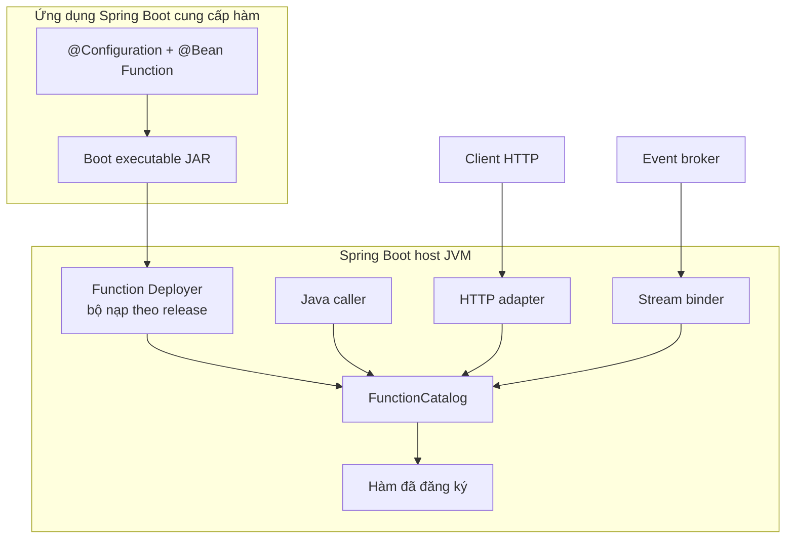

# Nạp Spring Boot JAR và ứng dụng có functional bean

## 1. Bài toán: nạp cả ứng dụng đã khai báo hàm, không chỉ một class Java

Nhóm tính phí giao hàng xây dựng một ứng dụng Spring Boot, trong đó nghiệp vụ đã được khai báo thành bean `Function<ShippingRequest, ShippingQuote>`. Nhóm vận hành muốn dùng chức năng này từ một **ứng dụng chủ** (*host*) khác, có thể qua `FunctionCatalog`, HTTP hoặc hệ thống sự kiện, thay vì sao chép mã bean vào host.

Đây là một dạng nạp JAR trong **Spring Cloud Function** (`SPRING_CLOUD_FUNCTION`). Module cho phép biểu diễn logic qua `Supplier<T>`, `Function<T,R>` và `Consumer<T>`, tra cứu bằng `FunctionCatalog`, ghép hàm (*composition*) và, khi có adapter, gọi cùng logic qua HTTP, messaging hoặc serverless. Điểm đặc thù của bài là **artifact nguồn vốn là một ứng dụng Spring Boot có Spring context và functional bean**, chứ không chỉ là JAR thư viện chứa một lớp `implements Function`.

Có hai cách sử dụng artifact cần phân biệt ngay:

1. **Chạy ứng dụng Boot độc lập:** khởi động bằng `java -jar`. Ứng dụng tự tạo Spring ApplicationContext, phát hiện bean và dùng các adapter nằm trong **chính ứng dụng đó**.
2. **Nạp JAR ứng dụng vào một host có Function Deployer:** host dùng cơ chế `spring-cloud-function-deployer` của **dòng phát hành có hỗ trợ** để truy cập artifact, tạo/tích hợp ngữ cảnh cần thiết, phát hiện bean hàm và cho phép gọi hàm qua môi trường host.

Hai cơ chế không tương đương. `java -jar` tạo **tiến trình ứng dụng mới**; Function Deployer nạp code theo cơ chế bên trong tiến trình host, không tự biến mỗi JAR thành một microservice riêng.

> **Giới hạn tương thích:** `spring-cloud-function-deployer` và chức năng nạp Spring Boot executable JAR không nên được coi là khả năng mặc định của mọi phiên bản Spring Cloud Function. Cấu trúc JAR, API và property của deployer phụ thuộc release. Trước khi áp dụng các cấu hình minh họa, cần đối chiếu phiên bản Spring Boot/Spring Cloud Function và tài liệu của đúng module deployer đang dùng.

## 2. Những thành phần tham gia

| Thành phần | Vai trò | Cần chú ý |
| --- | --- | --- |
| **Ứng dụng chứa hàm** | Spring Boot application định nghĩa các bean functional. | Bean có tên và generic type rõ ràng. |
| **Spring Boot executable JAR** | Artifact đóng gói application classes, tài nguyên và thường có các dependency JAR lồng nhau. | Cấu trúc khác simple library JAR. |
| **Ứng dụng chủ** | Một Spring Boot process có môi trường chạy riêng; có thể sử dụng deployer. | Host và ứng dụng hàm có thể khác vòng đời phát hành. |
| **Function Deployer** | Bộ nạp artifact và tích hợp hàm từ JAR ngoài theo cơ chế được release hỗ trợ. | Không phải công cụ deploy cloud/container. |
| **FunctionCatalog** | Tra cứu hàm đã đăng ký theo tên hoặc định nghĩa; hỗ trợ composition/wrapper phù hợp. | Tên đăng ký thực tế cần xác minh. |
| **Adapter** | Kích hoạt hàm từ HTTP, Stream hoặc serverless. | Cần dependency, route/binding/handler riêng. |



Sơ đồ là **mô hình khái niệm**: môi trường nạp có thể dùng context/classloader hoặc wrapper riêng tùy bản triển khai. Không suy ra mọi bean trong ứng dụng nguồn đều được nhập thành bean có thể inject trực tiếp ở parent context của host. Mục tiêu cần chứng minh là **hàm được đưa vào cơ chế gọi/tra cứu mà release hỗ trợ**.

## 3. So sánh với nạp simple JAR bằng function-class

| Khía cạnh | Simple JAR chứa class Function | Spring Boot JAR có functional bean |
| --- | --- | --- |
| Mã nguồn | Một lớp `public implements Function`. | `@SpringBootApplication`, `@Configuration` và `@Bean` (hoặc cách đăng ký bean được hỗ trợ). |
| Định dạng artifact | Thư viện JAR, class thường ở root package path. | Executable JAR, thường có `BOOT-INF/classes` và `BOOT-INF/lib`. |
| Cách xác định hàm | Cơ chế deployer có thể dùng `function-class` trỏ FQCN. | Cần phát hiện functional bean trong application context của ứng dụng đã nạp. |
| Dependency | Theo classloader và cách cung cấp thư viện của JAR. | Có thể được đóng gói dạng nested dependencies; loader phải hiểu định dạng. |
| Điểm vào ứng dụng | Không cần `main()`. | Thường có `main()` để chạy độc lập. |
| Kiểm thử cơ bản | Gọi `new FunctionClass().apply(...)`. | Spring context test để xác minh bean + catalog; thêm unit test miền. |
| Rủi ro điển hình | Sai FQCN, constructor hoặc dependency. | Sai cấu trúc Boot JAR, bean discovery, context, classloader/dependency. |

**Không lấy `function-class` để đoán tên một method `@Bean`.** Đó là hai abstraction khác nhau: một bên chọn **class triển khai**, bên kia đăng ký **instance hàm do Spring tạo**. Các cơ chế deployer hỗ trợ nạp ứng dụng Spring Boot có thể phát hiện bean mà không cần chỉ định class implementation riêng, nhưng điều này phải được kiểm tra trên đúng release.

## 4. Xây dựng một ứng dụng Boot có bean Function

Ta dùng quy tắc tính phí giao hàng:

- Mã đơn phải có giá trị.
- Khu vực `INNER` có phí cơ bản 20.000 VND, `OUTER` có phí 40.000 VND.
- Đơn từ 500.000 VND trở lên được miễn phí.
- Dữ liệu không hợp lệ phải bị từ chối rõ ràng; không tự chọn một vùng mặc định.

Ví dụ sử dụng **Java 17 trở lên**, với các file Java sau.

### 4.1. Kiểu request và result

```java
// src/main/java/demo/shipping/ShippingRequest.java
package demo.shipping;

import java.math.BigDecimal;

public record ShippingRequest(
        String orderId,
        String region,
        BigDecimal subtotalVnd) {}
```

```java
// src/main/java/demo/shipping/ShippingQuote.java
package demo.shipping;

import java.math.BigDecimal;

public record ShippingQuote(
        String orderId,
        BigDecimal feeVnd,
        String tariffCode) {}
```

DTO không chứa `HttpServletRequest`, Kafka record hay AWS event type. Chính điều này giúp dùng lại nghiệp vụ qua nhiều adapter khác nhau.

### 4.2. Lõi nghiệp vụ Java độc lập

```java
// src/main/java/demo/shipping/ShippingPolicy.java
package demo.shipping;

import java.math.BigDecimal;
import java.util.Locale;
import java.util.Objects;

public final class ShippingPolicy {
    private static final BigDecimal FREE_LIMIT =
            new BigDecimal("500000");
    private static final BigDecimal INNER_FEE =
            new BigDecimal("20000");
    private static final BigDecimal OUTER_FEE =
            new BigDecimal("40000");

    public ShippingQuote quote(ShippingRequest input) {
        Objects.requireNonNull(input, "input");
        if (input.orderId() == null ||
                input.orderId().isBlank()) {
            throw new IllegalArgumentException("Missing orderId");
        }

        BigDecimal subtotal = input.subtotalVnd();
        if (subtotal == null || subtotal.signum() < 0) {
            throw new IllegalArgumentException("Invalid subtotalVnd");
        }
        if (input.region() == null) {
            throw new IllegalArgumentException("Missing region");
        }

        String region = input.region().strip()
                .toUpperCase(Locale.ROOT);
        BigDecimal baseFee = switch (region) {
            case "INNER" -> INNER_FEE;
            case "OUTER" -> OUTER_FEE;
            default -> throw new IllegalArgumentException(
                    "Unsupported region: " + region);
        };

        if (subtotal.compareTo(FREE_LIMIT) >= 0) {
            return new ShippingQuote(
                    input.orderId(), BigDecimal.ZERO, "FREE");
        }
        return new ShippingQuote(
                input.orderId(), baseFee, region);
    }
}
```

`BigDecimal` giúp so sánh số tiền theo đơn vị VND mà không dùng sai số dấu phẩy động nhị phân. Với cùng input và chính sách, hàm trả cùng kết quả; ví dụ không có I/O hoặc mutable state.

### 4.3. Tạo bean chức năng

```java
// src/main/java/demo/shipping/ShippingFunctions.java
package demo.shipping;

import java.util.function.Function;
import org.springframework.context.annotation.Bean;
import org.springframework.context.annotation.Configuration;

@Configuration
public class ShippingFunctions {
    @Bean
    ShippingPolicy shippingPolicy() {
        return new ShippingPolicy();
    }

    @Bean
    Function<ShippingRequest, ShippingQuote> quoteShipping(
            ShippingPolicy policy) {
        return policy::quote;
    }
}
```

Tên Spring bean mặc định là `quoteShipping`. Chữ ký có generic type cụ thể, giúp framework suy luận input/output khi adapter cần chuyển đổi payload. Bản thân bean chưa tạo endpoint hay broker subscription.

### 4.4. Điểm khởi động Spring Boot

```java
// src/main/java/demo/shipping/ShippingFunctionApplication.java
package demo.shipping;

import org.springframework.boot.SpringApplication;
import org.springframework.boot.autoconfigure.SpringBootApplication;

@SpringBootApplication
public class ShippingFunctionApplication {
    public static void main(String[] args) {
        SpringApplication.run(
                ShippingFunctionApplication.class, args);
    }
}
```

Do `ShippingFunctions` cùng package gốc `demo.shipping`, Spring Boot có thể phát hiện cấu hình trong cách tổ chức thông thường. Để ứng dụng nguồn chạy **không có web server** nếu chỉ dùng console hoặc đóng gói hàm, có thể cấu hình:

```yaml
spring:
  main:
    web-application-type: none
```

Đây là **cấu hình cho trường hợp non-web**. Nếu muốn ứng dụng nguồn tự phục vụ HTTP, cần dependency web adapter và không tắt web server. Khi host khác nạp artifact, việc bật web server của host và cách tạo context của artifact phải xem xét riêng, không mặc nhiên được quyết định bởi một file cấu hình này.

## 5. Đăng ký nhiều bean: lợi ích và khả năng gây nhập nhằng

Một ứng dụng có thể còn chứa `Supplier` và `Consumer`:

```java
@Bean
Supplier<String> policyVersion() {
    return () -> "shipping-policy-v1";
}

@Bean
Consumer<ShippingQuote> auditQuote() {
    return quote -> System.out.println(
            "AUDIT " + quote.orderId()
                    + " / fee=" + quote.feeVnd());
}
```

Đây là hai method **bổ sung trong một `@Configuration` thích hợp**, với imports `java.util.function.Supplier` và `Consumer`; chúng không thuộc source cốt lõi bắt buộc của ví dụ. `System.out.println` chỉ là side effect minh họa, không thay cho audit storage production.

| Bean | Chữ ký | Tác dụng |
| --- | --- | --- |
| `policyVersion` | `Supplier<String>` | Cung cấp thông tin khi có caller/poller gọi. |
| `quoteShipping` | `Function<ShippingRequest,ShippingQuote>` | Tính phí từ request sang quote. |
| `auditQuote` | `Consumer<ShippingQuote>` | Nhận quote và thực hiện side effect. |

Khi có nhiều bean functional, adapter không thể suy ra **mục tiêu kinh doanh** mà người dùng muốn gọi chỉ dựa vào việc Spring đã khởi tạo chúng. `spring.cloud.function.definition` được dùng trong những ngữ cảnh hỗ trợ để **chọn hàm hoặc pipeline đã đăng ký**:

```yaml
spring:
  cloud:
    function:
      definition: quoteShipping
```

Property này **không phải locator JAR** và không tự nạp bean từ ứng dụng khác. Nếu cấu hình composition như `normalize|quoteShipping` thì tên các bước phải tồn tại trong catalog và kiểu input/output phải tương thích. Với Spring Cloud Stream, function definition còn ảnh hưởng tên input/output binding. Khi nạp Boot JAR qua deployer, cần xác minh **tên các function thực tế đã được đăng ký** trong môi trường host.

## 6. Đóng gói thành Spring Boot executable JAR

### 6.1. Những dependency cần thiết

Dự án nguồn dùng một `pom.xml` Spring Boot có dependency management tương thích với dòng Spring Cloud đã chọn. Các dependencies cốt lõi có thể biểu diễn như sau:

```xml
<!-- Trích từ pom.xml có Spring Boot parent và BOM Spring Cloud phù hợp -->
<dependencies>
    <dependency>
        <groupId>org.springframework.boot</groupId>
        <artifactId>spring-boot-starter</artifactId>
    </dependency>
    <dependency>
        <groupId>org.springframework.cloud</groupId>
        <artifactId>spring-cloud-function-context</artifactId>
    </dependency>
    <dependency>
        <groupId>org.springframework.boot</groupId>
        <artifactId>spring-boot-starter-test</artifactId>
        <scope>test</scope>
    </dependency>
</dependencies>
```

Đoạn XML trên là **một phần POM**, chưa bao gồm parent/version, dependency management, coordinates hay toàn bộ plugin. Cần chọn **một cặp Spring Boot và Spring Cloud Function tương thích**. Không sao chép version bất kỳ từ các release khác nhau rồi kết luận Boot executable JAR có thể nạp được.

Plugin đóng gói Boot:

```xml
<build>
    <plugins>
        <plugin>
            <groupId>org.springframework.boot</groupId>
            <artifactId>spring-boot-maven-plugin</artifactId>
            <executions>
                <execution>
                    <goals>
                        <goal>repackage</goal>
                    </goals>
                </execution>
            </executions>
        </plugin>
    </plugins>
</build>
```

Với POM hợp lệ và build đã cấu hình phù hợp, học viên có thể chạy:

```bash
mvn test
mvn package
java -jar target/shipping-functions-1.0.0.jar
```

Tên file cuối cùng chỉ đúng nếu Maven coordinates của dự án được đặt là `shipping-functions:1.0.0`; hãy thay theo tên artifact thực tế.

### 6.2. Kiểm tra cấu trúc archive

```bash
jar tf target/shipping-functions-1.0.0.jar
```

Một **Spring Boot executable JAR** thường có cấu trúc khái niệm:

```text
META-INF/
BOOT-INF/
  classes/
    demo/shipping/ShippingFunctionApplication.class
    demo/shipping/ShippingFunctions.class
    demo/shipping/ShippingPolicy.class
    demo/shipping/ShippingRequest.class
    demo/shipping/ShippingQuote.class
  lib/
    spring-boot-....jar
    spring-cloud-function-....jar
    ...
org/springframework/boot/loader/...
```

Đây là sơ đồ minh họa, không phải output chính xác của mọi Boot release. `BOOT-INF/classes` và `BOOT-INF/lib` khác layout của **simple library JAR** có class ở package path trực tiếp trong root archive.

**Vì sao khác biệt quan trọng?** Classloader JDK dùng như với một library JAR thông thường không mặc nhiên biết cách tìm lớp và nested dependencies trong Spring Boot executable archive. Deployer muốn nạp Boot JAR phải **có cơ chế hỗ trợ layout/ngữ cảnh này** ở release đang dùng. Không có bảo đảm rằng một cấu hình `function-class` dành cho simple JAR sẽ tự giải quyết nested JAR của mọi Spring Boot artifact.

## 7. Chạy Boot JAR độc lập trước khi thử nạp

Nên kiểm chứng ứng dụng chứa hàm ở trạng thái độc lập trước khi ghép vào host. Khi khởi động bằng:

```bash
java -jar target/shipping-functions-1.0.0.jar
```

Spring Boot tạo context, phát hiện `ShippingFunctions`, tạo bean `quoteShipping` và đăng ký theo cơ chế của Spring Cloud Function context khi dependency cần thiết có mặt.

**Điểm dễ hiểu lầm:** nếu ứng dụng được cấu hình `spring.main.web-application-type: none`, không có server/runner/poller giữ JVM hoạt động, chương trình có thể kết thúc sau khi khởi tạo. Điều này không chứng tỏ bean `Function` sai. Một bean không tự chạy hoặc giữ tiến trình sống. Nếu muốn kiểm chứng bằng console, có thể thêm một `ApplicationRunner` có chủ đích; nếu muốn nhận HTTP, thêm web adapter và cấu hình web runtime.

### 7.1. Tạo runner kiểm chứng trong ứng dụng nguồn

Đây là một **tùy chọn phục vụ development**, có thể đặt thành class riêng và chỉ bật theo profile thử nghiệm:

```java
package demo.shipping;

import java.math.BigDecimal;
import java.util.function.Function;

import org.springframework.boot.ApplicationRunner;
import org.springframework.context.annotation.Bean;
import org.springframework.context.annotation.Configuration;
import org.springframework.context.annotation.Profile;
import org.springframework.cloud.function.context.FunctionCatalog;

@Configuration
@Profile("smoke")
public class ShippingSmokeCheck {
    @Bean
    ApplicationRunner checkQuote(FunctionCatalog catalog) {
        return args -> {
            Function<ShippingRequest, ShippingQuote> fn =
                    catalog.lookup("quoteShipping");
            if (fn == null) {
                throw new IllegalStateException(
                        "quoteShipping not registered");
            }
            ShippingQuote quote = fn.apply(
                    new ShippingRequest(
                            "ORD-305", "INNER",
                            new BigDecimal("450000")));
            System.out.println(quote);
        };
    }
}
```

Nếu bật profile `smoke`:

```bash
java -jar target/shipping-functions-1.0.0.jar \
  --spring.profiles.active=smoke
```

Kết quả nghiệp vụ mong đợi là `feeVnd=20000`, `tariffCode=INNER`. Đừng coi việc runner in kết quả là bằng chứng deployer của host đã nạp Boot JAR: đây mới chỉ là **kiểm thử ứng dụng nguồn tự chạy**.

Nếu muốn dùng artifact trong host mà không có tác dụng phụ khi khởi động, không nên cấu hình một `ApplicationRunner` production tự ghi database, gửi message hoặc tạo dữ liệu chỉ vì Spring context được tạo. Lưu ý cả `CommandLineRunner`, `@PostConstruct`, scheduler và message listener trong ứng dụng nguồn: khi một cơ chế nạp tạo context, các thành phần khởi tạo có thể phát sinh side effect ngoài mong đợi tùy cách tích hợp của release.

## 8. Host nạp Spring Boot executable JAR qua Function Deployer

### 8.1. Dependency của host

Ứng dụng chủ khác với artifact nguồn; nó chịu trách nhiệm lựa chọn artifact và cung cấp điểm gọi phù hợp. Với **dòng Spring Cloud Function có hỗ trợ module deployer và kiểu artifact Boot JAR**, host khai báo dependency:

```xml
<dependency>
    <groupId>org.springframework.cloud</groupId>
    <artifactId>spring-cloud-function-deployer</artifactId>
</dependency>
```

Đừng tự cho rằng một ứng dụng chỉ có `spring-cloud-function-context` sẽ đọc cấu hình `spring.cloud.function.location` và nạp executable JAR. **FunctionCatalog quản lý các hàm đã đăng ký**, còn cơ chế đọc JAR ngoài là trách nhiệm của deployer/loader.

Điểm khởi động host:

```java
// src/main/java/demo/host/FunctionHostApplication.java
package demo.host;

import org.springframework.boot.SpringApplication;
import org.springframework.boot.autoconfigure.SpringBootApplication;

@SpringBootApplication
public class FunctionHostApplication {
    public static void main(String[] args) {
        SpringApplication.run(
                FunctionHostApplication.class, args);
    }
}
```

Trong ví dụ host chưa cần web server, có thể sử dụng `spring.main.web-application-type: none`. Nếu host cần HTTP server thì phải bổ sung web adapter và không tắt web như vậy.

### 8.2. Cấu hình vị trí Boot JAR

Giả sử artifact nguồn được đưa vào đường dẫn host nhìn thấy:

```text
/opt/functions/shipping-functions-1.0.0.jar
```

Cấu hình minh họa cho trường hợp **deployer release hỗ trợ nạp Spring Boot packaged application**:

```yaml
spring:
  main:
    web-application-type: none
  cloud:
    function:
      location: "file:///opt/functions/shipping-functions-1.0.0.jar"
```

Đây **không phải** cấu hình bảo đảm chạy cho mọi release. Đường đi nạp Boot JAR và cách phát hiện bean/định nghĩa của ứng dụng bên trong có thể khác theo phiên bản. Trong cơ chế nhận diện các functional bean của một Boot application, **đừng tự điền `spring.cloud.function.function-class` bằng tên `ShippingFunctions` hoặc tên method `quoteShipping`**: đó không phải FQCN của một class `implements Function` như ở simple JAR. Nếu bản deployer có yêu cầu property hoặc metadata bổ sung, phải tuân thủ contract của release ấy.

Với `application.properties`, ý tưởng tương ứng là:

```properties
spring.cloud.function.location=file:///opt/functions/shipping-functions-1.0.0.jar
```

`location` là **địa chỉ artifact** chứ không phải tên bean trong catalog. URI `file:` được giải quyết từ filesystem của **JVM host**, không phải từ máy build hoặc máy gửi request.

### 8.3. Nạp trong container

Ví dụ host chạy trong Docker và artifact nằm trên máy Linux tại `/srv/functions`:

```bash
docker run --rm \
  -v /srv/functions:/opt/functions:ro \
  -e SPRING_CLOUD_FUNCTION_LOCATION=file:///opt/functions/shipping-functions-1.0.0.jar \
  example/function-host:demo
```

Đây là lệnh minh họa sau khi có image host và file JAR thật. `:ro` là mount chỉ đọc. **Nếu container nhìn thấy `/opt/functions` mà máy phát triển có file ở `C:\Users\...`, hai đường dẫn không tự tương đương.** Artifact cần được copy, mount hoặc phát hành qua cơ chế hạ tầng được kiểm soát.

Đường dẫn có dấu cách/ký tự đặc biệt phải mã hóa thành URI hợp lệ. Không tự suy diễn rằng deployer có thể nạp từ mọi `https:`, Maven coordinate hoặc cloud storage scheme: chỉ dùng cách mà đúng loader/release xác nhận.

## 9. Spring ApplicationContext và ranh giới phát hiện bean

Khi chạy Boot JAR độc lập, `@SpringBootApplication` tạo/khởi tạo context của chính application. Khi một host cố nạp Boot JAR ngoài, phải giải quyết các câu hỏi:

- Lớp `ShippingFunctionApplication` và `ShippingFunctions` có được tìm trong `BOOT-INF/classes` không?
- Các dependency ở `BOOT-INF/lib` có được loader hỗ trợ?
- Các bean `quoteShipping`, `policyVersion`, `auditQuote` được tạo từ **context nào**?
- Những bean có được đưa vào cơ chế catalog/wrapper mà caller trong host tra cứu được không?
- Cấu hình, environment/property, bean lifecycle và resource được chia sẻ/cách ly như thế nào?
- Nếu ứng dụng nguồn cũng có web/server/listener/scheduler, chúng có bị khởi động ngoài dự kiến không?

Không nên đồng nhất **“Spring Boot JAR có functional bean”** với **“mọi bean trong JAR tự động trở thành bean của host”**. Cơ chế nạp có thể cần tạo context riêng hoặc cách tích hợp khác. Điều phải quan sát là **hàm mong muốn được register và gọi đúng** qua API mà deployer/catalog hỗ trợ, chứ không dựa vào phép đoán cấu trúc nội bộ.

Một sai lầm khác là thêm nhiều thư viện Spring Boot, Spring Framework hoặc Spring Cloud Function vào cả host và JAR mà không kiểm soát tương thích. Cùng tên class ở các classloader khác nhau có thể không là cùng kiểu Java; xung đột phiên bản có thể gây `NoSuchMethodError`, `LinkageError` hoặc lỗi khởi tạo.

## 10. Kiểm tra FunctionCatalog trong host

Sau khi xác minh deployer đã đăng ký function, host có thể thử tra cứu **bằng tên thực tế**:

```java
// src/main/java/demo/host/LoadedFunctionCheck.java
package demo.host;

import java.math.BigDecimal;
import java.util.function.Function;

import org.springframework.beans.factory.annotation.Value;
import org.springframework.boot.ApplicationRunner;
import org.springframework.cloud.function.context.FunctionCatalog;
import org.springframework.context.annotation.Bean;
import org.springframework.context.annotation.Configuration;

@Configuration
public class LoadedFunctionCheck {
    @Bean
    ApplicationRunner verifyLoadedFunction(
            FunctionCatalog catalog,
            @Value("${demo.lookup-name}") String name) {
        return args -> {
            Function<Object, Object> function =
                    catalog.lookup(name);
            if (function == null) {
                throw new IllegalStateException(
                        "Function not found: " + name);
            }
            // Dùng input đúng kiểu thực tế đã đăng ký/convert.
            System.out.println("Found function: " + name);
        };
    }
}
```

Runner này **chỉ xác minh lookup**, chưa gọi `apply()`. Nó chủ động không tạo `ShippingRequest` từ source của JAR ở host: một host nạp JAR ngoài có thể không có class DTO trên compile classpath hoặc DTO ở khác classloader. Với input/output riêng, cần chọn cách chuyển đổi theo API của loader/catalog mà bản release hỗ trợ, hoặc dùng hợp đồng payload/serializer chung đã kiểm chứng. Không nên ép kiểu Java tùy ý rồi giả định không có classloader mismatch.

Ví dụ property **do ứng dụng host tự đặt**:

```yaml
demo:
  lookup-name: quoteShipping
```

Giá trị `quoteShipping` chỉ dùng **sau khi xác định tên đã được catalog thực sự đăng ký** trong phiên bản đang thử. Nếu tên khác, điều chỉnh property; không suy ra từ file `shipping-functions-1.0.0.jar`. `demo.lookup-name` không phải property của framework.

### 10.1. Phân biệt tra cứu bằng tên và lựa chọn definition

| Khái niệm | Giá trị ví dụ | Ý nghĩa |
| --- | --- | --- |
| Tên `@Bean` ở source | `quoteShipping` | Tên Spring bean trong ứng dụng nguồn. |
| Tên catalog trong host | Cần kiểm tra; có thể tương ứng với tên bean. | Tên thực tế có thể lookup. |
| `spring.cloud.function.definition` | `quoteShipping` | Adapter chọn hàm/pipeline **đã có** trong catalog. |
| `spring.cloud.function.location` | `file:///opt/functions/shipping-functions-1.0.0.jar` | Deployer tìm artifact JAR. |

Nếu host định nghĩa thêm function của chính nó, có thể xảy ra trùng tên hoặc ambiguity. Cần phân biệt hàm đã nạp với hàm có sẵn ở host và kiểm tra cơ chế xử lý trùng tên/alias theo release, không dựa vào sự im lặng của log khởi động.

## 11. Composition khi ứng dụng Boot chứa nhiều functional bean

Giả sử muốn chuẩn hóa vùng giao hàng trước khi tính phí:

```java
@Bean
Function<ShippingRequest, ShippingRequest> normalizeRegion() {
    return request -> new ShippingRequest(
            request.orderId(),
            request.region() == null
                    ? null : request.region().strip(),
            request.subtotalVnd());
}
```

Đây là method đặt trong `ShippingFunctions` hoặc một `@Configuration` khác thuộc ứng dụng nguồn. Khi cả `normalizeRegion` và `quoteShipping` đã được đăng ký trong catalog tương ứng, có thể tra cứu composition:

```java
// catalog đã inject và tên hai hàm đều tồn tại
Function<ShippingRequest, ShippingQuote> pipeline =
        catalog.lookup("normalizeRegion|quoteShipping");
```

Thứ tự từ trái sang phải. Output `ShippingRequest` của bước chuẩn hóa khớp input `ShippingRequest` của `quoteShipping`. Một application hoặc adapter hỗ trợ lựa chọn có thể dùng:

```yaml
spring:
  cloud:
    function:
      definition: "normalizeRegion|quoteShipping"
```

**Ràng buộc:** composition không tự tải JAR mới, không thay bước nạp Boot application, không tự tạo transaction và không ghép hai JVM qua mạng. Với bean ở ngữ cảnh/classloader khác nhau, phải kiểm tra chúng thực sự được catalog cho phép compose và kiểu dữ liệu ở ranh giới tương thích. Kết quả của `normalizeRegion` ném exception sẽ ngăn bước `quoteShipping` chạy; xử lý lỗi phụ thuộc caller và adapter.

## 12. Cùng functional bean qua HTTP, messaging và serverless

Nạp một Spring Boot JAR có bean `Function` là **bước cấp code**. Bộ điều hợp mới quyết định thời điểm chạy và cách chuyển đổi dữ liệu.

### 12.1. Nếu ứng dụng nguồn chạy độc lập với HTTP

Thêm vào **ứng dụng nguồn** dependency web adapter:

```xml
<dependency>
    <groupId>org.springframework.cloud</groupId>
    <artifactId>spring-cloud-starter-function-web</artifactId>
</dependency>
```

Khi ứng dụng nguồn chạy như server trên cổng 8080, không có cấu hình tắt web và `quoteShipping` được công bố theo cơ chế adapter phù hợp, ví dụ:

```bash
curl -X POST http://localhost:8080/quoteShipping \
  -H "Content-Type: application/json" \
  -d '{"orderId":"ORD-305","region":"INNER","subtotalVnd":450000}'
```

Kết quả nghiệp vụ mong đợi:

```json
{
  "orderId": "ORD-305",
  "feeVnd": 20000,
  "tariffCode": "INNER"
}
```

Đây là **mô hình chạy Boot JAR như ứng dụng độc lập**, không phải bằng chứng host với deployer công bố chính xác cùng URL. Nếu host nạp JAR, web adapter phải hoạt động trong môi trường host và tên route phải được xác minh riêng.

### 12.2. Nếu provider dùng Spring Cloud Stream

Một ứng dụng Boot có thể dùng bean `quoteShipping` cùng Kafka binder để xử lý sự kiện. Cấu hình ví dụ khi function definition đúng là `quoteShipping`:

```yaml
spring:
  cloud:
    function:
      definition: quoteShipping
    stream:
      bindings:
        quoteShipping-in-0:
          destination: shipping-requests
          group: shipping-calculators
          content-type: application/json
        quoteShipping-out-0:
          destination: shipping-quotes
          content-type: application/json
      kafka:
        binder:
          brokers: localhost:9092
```

Ứng dụng cần `spring-cloud-stream-binder-kafka` và broker thực. Binder nhận payload, chuyển thành `ShippingRequest`, gọi function và phát `ShippingQuote`. Khác HTTP, kết quả thường ra **topic khác**, không phải response đồng bộ cho producer.

Khi host nạp function từ Boot JAR, không mặc nhiên các binder và cấu hình trong ứng dụng nguồn đều được host sử dụng đúng cách. Cần kiểm tra chức năng adapter ở **deployment thực tế** và xác minh tên function/binding đã đăng ký.

### 12.3. Với serverless

Một runtime như AWS Lambda có handler/trigger/event envelope riêng. Spring Cloud Function hỗ trợ adapter phù hợp để tái sử dụng logic của bean, nhưng `spring-cloud-function-deployer` **không tự tạo Lambda function hoặc IAM/event source mapping**. Muốn chạy Spring Boot JAR trên FaaS, cần build/package/handler theo runtime mục tiêu; event SQS/API Gateway có thể cần giải mã envelope trước khi vào `ShippingRequest`.

### 12.4. Những gì không đổi và những gì bắt buộc thay

| Thành phần | Giữ nguyên khi đổi adapter? |
| --- | --- |
| `ShippingPolicy.quote()` | Thường có, vì là quy tắc miền độc lập giao thức. |
| Chữ ký `Function<ShippingRequest,ShippingQuote>` | Có nếu hợp đồng miền không đổi. |
| `FunctionCatalog`/bean registration | Cơ chế và tên phải được kiểm tra theo môi trường. |
| HTTP route và JSON conversion | Không; tùy web adapter/provider. |
| Topic/binding, retry, acknowledgment | Không; tùy Stream binder/broker. |
| Serverless handler/event envelope/timeout | Không; tùy cloud runtime. |
| Cách đóng gói executable JAR | Có thể khác theo cách chạy độc lập, deployer hoặc serverless. |

## 13. Những tình huống nạp không thành công và cách xử lý

Hãy chẩn đoán theo **tầng xảy ra lỗi**, thay vì đổi nhiều property cùng lúc:

| Dấu hiệu | Tầng có thể gặp lỗi | Cách kiểm tra |
| --- | --- | --- |
| Không tìm thấy `shipping-functions-1.0.0.jar` | Vị trí artifact | Kiểm tra `spring.cloud.function.location`, URI, mount, quyền đọc trong host. |
| JAR đúng path nhưng loader không tìm thấy `ShippingFunctionApplication` | Boot JAR layout / loader | Kiểm tra `jar tf`, `BOOT-INF/classes` và khả năng hỗ trợ executable JAR của deployer release. |
| `UnsupportedClassVersionError` | JVM/bytecode | Xác nhận bản Java dùng biên dịch JAR so với JRE của host. |
| `NoClassDefFoundError` | Dependency | Kiểm tra nested `BOOT-INF/lib`, classloader, version Spring/third-party. |
| `NoSuchMethodError` / `LinkageError` | Binary compatibility | Xem stack trace và những bản thư viện Boot/Spring Cloud được nạp. |
| Context khởi tạo thất bại | Spring auto-configuration / bean lifecycle | Kiểm tra @Configuration, constructor, properties bắt buộc và bean gây side effect. |
| Boot JAR độc lập chạy được nhưng host không nạp được | Khác cơ chế chạy | Không suy ra `java -jar` thành công tức loader deployer hỗ trợ cùng layout/dependencies. |
| Context có bean nhưng lookup trả `null` | FunctionCatalog / tên/registry | Kiểm tra tên bean được công bố, chức năng catalog, định nghĩa đã chọn và bản deployer. |
| Nhiều bean functional nhưng không biết chọn hàm nào | Definition / ambiguity | Chọn `spring.cloud.function.definition` phù hợp trong adapter có hỗ trợ. |
| Lookup được nhưng áp dụng payload gây `ClassCastException` | Classloader / conversion | Kiểm tra DTO class identity, generic types và wrapper/converter. |
| HTTP trả 404 hoặc 415 | Web adapter | Kiểm tra starter, route, cổng, content type và format JSON. |
| Không thấy Kafka message | Stream adapter | Kiểm tra binder, destination, group, definition và broker connection. |
| Thay JAR rồi vẫn nhận kết quả cũ | Deployment lifecycle | Kiểm tra image/volume, checksum, host restart/rollout và JAR đã nạp. |

### 13.1. Lỗi phổ biến: gán function-class bằng tên @Bean

Ví dụ sai về mặt khái niệm:

```properties
spring.cloud.function.function-class=quoteShipping
```

`quoteShipping` trong ví dụ nguồn là **tên method/bean**, không phải một FQCN class `implements Function` để nạp theo đường simple JAR. Tương tự:

```properties
spring.cloud.function.function-class=demo.shipping.ShippingFunctions
```

`ShippingFunctions` là class `@Configuration` chứa method bean; **không phải chính đối tượng `Function<ShippingRequest,ShippingQuote>`**. Nếu deployer đang ở chế độ nạp Boot application và phát hiện functional bean, nên dùng cơ chế tương ứng của bản đó thay vì ép cấu hình dành cho simple class. Nếu một release hỗ trợ cách khác để chọn class/bean, cần tham khảo contract chính xác của release ấy.

### 13.2. Lỗi phổ biến: trùng tên trong catalog

Host có một bean `quoteShipping` nội bộ; Boot JAR bên ngoài cũng có bean cùng tên. Cần xác định:

- Deployer công bố các tên từ context ngoài bằng cách nào?
- Có namespace/alias hoặc quy tắc ưu tiên không?
- Adapter chọn bản nào khi `definition: quoteShipping`?
- Có thể kiểm tra nguồn artifact của hàm thực sự được gọi hay không?

Không giải quyết bằng cách chỉ kiểm tra ứng dụng đã khởi động không lỗi. Phải **gọi thử dữ liệu phân biệt** và quan sát đúng implementation/version.

### 13.3. Lỗi phổ biến: classloader khác nhau với DTO Java

`ShippingRequest` từ executable JAR và một class `demo.shipping.ShippingRequest` do host tự đóng gói chưa chắc là cùng class Java nếu được nạp bởi hai classloader khác nhau. Hai lớp cùng package/tên nhưng khác loader có thể gây lỗi khi truyền object.

Do vậy, host không nên tự ý tạo object cùng tên rồi ép `Function<Object,Object>` thành `Function<ShippingRequest,ShippingQuote>` nếu chưa biết cơ chế chia sẻ API và classloader của release. Có thể sử dụng contract chuyển đổi thông điệp được framework hỗ trợ hoặc tách DTO vào một shared API artifact được cung cấp nhất quán; vẫn phải kiểm tra bằng integration test.

## 14. Kiểm thử theo từng ranh giới

### 14.1. Unit test cho nghiệp vụ

Không cần Spring context để kiểm tra quy tắc phí giao hàng:

```java
package demo.shipping;

import static org.junit.jupiter.api.Assertions.assertEquals;
import static org.junit.jupiter.api.Assertions.assertThrows;
import java.math.BigDecimal;
import org.junit.jupiter.api.Test;

class ShippingPolicyTest {
    private final ShippingPolicy policy = new ShippingPolicy();

    @Test
    void appliesInnerFeeBelowLimit() {
        var result = policy.quote(new ShippingRequest(
                "ORD-305", "INNER", new BigDecimal("450000")));
        assertEquals(new BigDecimal("20000"), result.feeVnd());
        assertEquals("INNER", result.tariffCode());
    }

    @Test
    void givesFreeShippingAtLimit() {
        var result = policy.quote(new ShippingRequest(
                "ORD-306", "OUTER", new BigDecimal("500000")));
        assertEquals(BigDecimal.ZERO, result.feeVnd());
        assertEquals("FREE", result.tariffCode());
    }

    @Test
    void rejectsUnknownRegion() {
        assertThrows(IllegalArgumentException.class,
                () -> policy.quote(new ShippingRequest(
                        "ORD-307", "UNKNOWN",
                        new BigDecimal("100000"))));
    }
}
```

Nên bổ sung test `orderId` null/rỗng, số tiền âm/null, vùng có khoảng trắng và các ranh giới 499.999/500.000 VND. Unit test này chỉ xác nhận **quy tắc**, không xác nhận nạp JAR.

### 14.2. Spring context test của ứng dụng nguồn

Một integration test ở **project Boot chứa hàm** có thể xác minh bean và catalog:

```java
package demo.shipping;

import static org.junit.jupiter.api.Assertions.assertNotNull;
import static org.junit.jupiter.api.Assertions.assertEquals;

import java.math.BigDecimal;
import java.util.function.Function;

import org.junit.jupiter.api.Test;
import org.springframework.beans.factory.annotation.Autowired;
import org.springframework.boot.test.context.SpringBootTest;
import org.springframework.cloud.function.context.FunctionCatalog;

@SpringBootTest(
        properties = "spring.main.web-application-type=none")
class ShippingCatalogTest {
    @Autowired
    FunctionCatalog catalog;

    @Test
    void findsAndInvokesShippingFunction() {
        Function<ShippingRequest, ShippingQuote> fn =
                catalog.lookup("quoteShipping");
        assertNotNull(fn);

        var result = fn.apply(new ShippingRequest(
                "ORD-305", "INNER", new BigDecimal("450000")));
        assertEquals(new BigDecimal("20000"), result.feeVnd());
    }
}
```

Test dựa trên dependencies `spring-boot-starter-test` và Spring Cloud Function context phù hợp; cần chọn phiên bản test stack tương thích với Boot. Nó xác nhận source app phát hiện bean đúng trong **context của chính nó**.

### 14.3. Integration test nạp Boot JAR từ host

Đây mới là kiểm thử **chủ đề nạp JAR**:

1. Build Spring Boot executable JAR thật với layout được release deployer hỗ trợ.
2. Đặt artifact tại `location` có thể truy cập từ host, không dùng path chỉ có trên máy build.
3. Khởi động host có module deployer đúng version; xác minh log nạp JAR và context/registry.
4. Tra cứu **tên thực tế đã đăng ký** qua `FunctionCatalog`.
5. Gọi một input kiểm thử theo API/chuyển đổi hỗ trợ của loader và xác nhận output.
6. Thử sai URI, thiếu file, sai version Java, thiếu dependency hoặc bean không phải functional.
7. Đổi bản JAR có chủ đích rồi kiểm tra kết quả/metadata của bản mới sau rollout.

**Không thay bước 14.3 bằng `@SpringBootTest` của source app.** Test trong source chỉ nói ứng dụng tự tạo context được; không chứng minh deployer của host đọc hiểu layout Boot JAR.

### 14.4. Contract test cho adapter

| Adapter | Câu hỏi phải kiểm tra |
| --- | --- |
| HTTP | Endpoint/method có đúng, JSON → `ShippingRequest` hoạt động, HTTP error schema và timeout đúng? |
| Spring Cloud Stream | Function definition/binding, broker, serialization, group, retry/DLQ, output đúng? |
| Serverless | Handler, event envelope, batch/timeout/failure semantics theo cloud trigger? |
| Java nội bộ | Lookup/truyền object qua ranh giới classloader có đúng kiểu? |

Một function được nạp thành công có thể vẫn thất bại ở HTTP hoặc Kafka nếu content type, schema hay broker sai. Cần **tách kết quả kiểm thử code, packaging, nạp và adapter**.

## 15. Giới hạn vận hành và bảo mật

### 15.1. Code từ Boot JAR là code thực thi

Deployer không phải sandbox: một Spring Boot JAR có thể chứa code khởi tạo, auto-configuration, scheduler, thread, database client hoặc logic với side effect. Khi được nạp vào tiến trình host theo cơ chế hỗ trợ, nó có thể gây ảnh hưởng đến tài nguyên/hoạt động của host. **Chỉ nạp artifact đáng tin cậy**.

Các biện pháp quan trọng:

- Quản lý nguồn artifact, người phát hành, version, checksum/chữ ký và dependency vulnerabilities.
- Dùng URI/đường dẫn được vận hành kiểm soát; không cho HTTP client tùy ý chỉ định JAR muốn host nạp.
- Ưu tiên image/artifact bất biến hoặc volume đọc-only; không ghi đè file JAR đang được dùng.
- Áp dụng least privilege cho filesystem, secret, database, network và IAM của host.
- Giới hạn function được expose qua adapter; tránh công bố một `Consumer` thực hiện hành động nhạy cảm ngoài ý muốn.
- Giám sát memory, thread, connection, startup time, latency và các side effect khi khởi tạo context.
- Nếu code từ bên thứ ba không đáng tin, cân nhắc **cách ly process/container** và gọi qua API thay vì nạp cùng JVM.

### 15.2. Không mặc định hot reload khi đổi JAR

Việc đổi `shipping-functions-1.0.0.jar` thành `1.1.0.jar` hoặc thay `spring.cloud.function.location` trong file cấu hình **không mặc nhiên thay class đã nạp trong JVM**. Deployer cần có cơ chế lifecycle đặc thù nếu muốn hot swap an toàn trong lúc invocation đang chạy.

Khi release không cung cấp/không kiểm chứng cơ chế đó, hãy dùng quy trình thông thường: artifact có version bất biến → cập nhật location/image → restart/rolling deployment → health/readiness check → giám sát và rollback khi cần.

### 15.3. Không có bảo đảm transaction và xử lý đúng một lần

`Supplier` không tự định lịch; `Function.apply()` không bảo đảm output message đã được broker ghi nhận; `Consumer.accept()` trả `void` không có nghĩa sự kiện sẽ không bị phát lại. Khi function có side effect như ghi database, cần thiết kế idempotency, retry, transaction và error handling theo adapter. Spring Cloud Function giúp **giữ chữ ký nghiệp vụ ổn định**, không xóa bỏ lỗi của hệ thống phân tán.

### 15.4. Chi phí context và độ trễ

Ứng dụng Boot có thể nạp nhiều auto-configuration, thư viện và kết nối hơn một simple JAR. Kích thước artifact, thời gian khởi tạo Spring context, footprint bộ nhớ và xung đột dependency có thể ảnh hưởng thời gian startup của host hoặc cold start nếu dùng môi trường serverless. Trước khi chọn cách nạp executable JAR, cần so sánh với cách nhẹ hơn như đưa một library JAR vào classpath hoặc dùng một provider service chạy riêng.

## 16. Khi nào nên dùng Boot JAR chứa functional bean?

| Tình huống | Hướng phù hợp |
| --- | --- |
| Ứng dụng đã có cấu hình Spring, các functional bean, lifecycle và cần chạy độc lập. | Đóng gói Spring Boot executable JAR và chạy bằng `java -jar` nếu yêu cầu là service/process riêng. |
| Host cần lấy functional beans từ artifact Boot được phát hành độc lập. | Cân nhắc `spring-cloud-function-deployer` **khi release xác nhận hỗ trợ Boot JAR**; test loader/context. |
| Chỉ có một hàm Java đơn giản không phụ thuộc Spring. | Simple library JAR + class `implements Function` thường dễ quản lý hơn. |
| Nhiều ứng dụng cần cùng logic nhưng có thể build chung dependency. | Maven library + `@Bean Function` có thể đơn giản hơn deployer. |
| Provider và caller phải độc lập ở cấp tiến trình, tài nguyên và rollback. | Chạy provider riêng qua HTTP/Stream; deployer không bắt buộc. |
| JAR chứa code chưa được kiểm duyệt hoặc phụ thuộc phức tạp. | Tránh nạp chung JVM khi cần cách ly mạnh; cân nhắc process/container. |
| Cần tác vụ có timer, checkpoint và compensation kéo dài. | Function có thể là bước nghiệp vụ, nhưng workflow/batch engine quản lý vòng đời. |

Không có yêu cầu rằng **mọi functional bean phải được nạp bằng deployer**. Nếu code đã là dependency của host hoặc provider service tự chạy ổn định, thêm một lớp nạp JAR ngoài có thể chỉ làm tăng chi phí vận hành.

## 17. Bài tập thực hành

Hãy tạo hai project: **`shipping-functions`** và **`function-host`**.

1. Trong `shipping-functions`, tạo `ShippingRequest`, `ShippingQuote`, `ShippingPolicy` và bean `quoteShipping` như mục 4.
2. Viết unit test theo ranh giới phí giao hàng và test `FunctionCatalog.lookup("quoteShipping")` bên trong source app.
3. Cấu hình Maven Boot plugin để tạo executable JAR; kiểm tra `BOOT-INF/classes` và `BOOT-INF/lib` bằng `jar tf`.
4. Chạy `java -jar` với profile `smoke` để xác nhận Spring context của source app tạo bean và cho kết quả đúng.
5. Chọn bản `spring-cloud-function-deployer` **có hỗ trợ nạp Spring Boot executable JAR** và cấu hình `location` đến artifact thật mà host đọc được.
6. Khởi động host; quan sát log, xác nhận tên bean/function được công bố trong catalog của host. Nếu không có chức năng nạp tương ứng trong release, ghi nhận giới hạn thay vì ép cấu hình simple JAR.
7. Gọi hàm qua catalog/API do loader hỗ trợ, tránh ép kiểu DTO khác classloader; xác minh kết quả nghiệp vụ.
8. Thêm bean `policyVersion` hoặc `normalizeRegion`; xác định cách chọn definition/composition và vấn đề nhiều bean.
9. Tùy chọn bật HTTP/Stream adapter ở deployment thích hợp, kiểm tra JSON schema, status/output binding và xử lý lỗi.
10. Đổi artifact `1.0.0` thành `1.1.0` bằng rollout có kiểm soát; đối chiếu code/version thực sự được nạp.

**Tiêu chí hoàn thành:** giải thích được sự khác nhau giữa (a) Boot app tự chạy, (b) host nạp Boot JAR có functional bean, và (c) host nạp simple JAR bằng tên class; chứng minh được chính xác **artifact nào, bean nào, catalog nào và adapter nào** đã tham gia mỗi đường chạy.

## 18. Kết luận

**Nạp Spring Boot JAR có functional bean** là bài toán tích hợp **một ứng dụng Spring đã đóng gói** vào môi trường gọi hàm, khác với nạp một class `implements Function` trong simple library JAR. Các bean `Supplier`, `Function` và `Consumer` đã được khai báo trong Spring context của ứng dụng nguồn; cơ chế deployer phù hợp phải hiểu cấu trúc executable JAR và đưa chúng vào đường tra cứu/gọi theo khả năng của release.

`spring.cloud.function.location` xác định **vị trí artifact**; `spring.cloud.function.definition` chọn **hàm hoặc composition đã đăng ký** cho những adapter hỗ trợ; `FunctionCatalog` là điểm **tra cứu/gọi**. Không suy ra `function-class` bắt buộc cho một method `@Bean`, không suy ra tên lookup chỉ từ tên file và không suy ra có HTTP/Kafka/Lambda chỉ vì nạp được JAR.

Nguyên tắc thực hành là **xây lõi nghiệp vụ Java dễ kiểm thử → đăng ký bean rõ chữ ký → build đúng Boot executable JAR → xác minh source application → xác minh loader/context/catalog của host → mới kiểm thử HTTP, messaging hoặc serverless**. Đi đúng các ranh giới này cho phép tái sử dụng logic mà vẫn kiểm soát được dependency, classloader, cấu hình, bảo mật và vòng đời triển khai.
