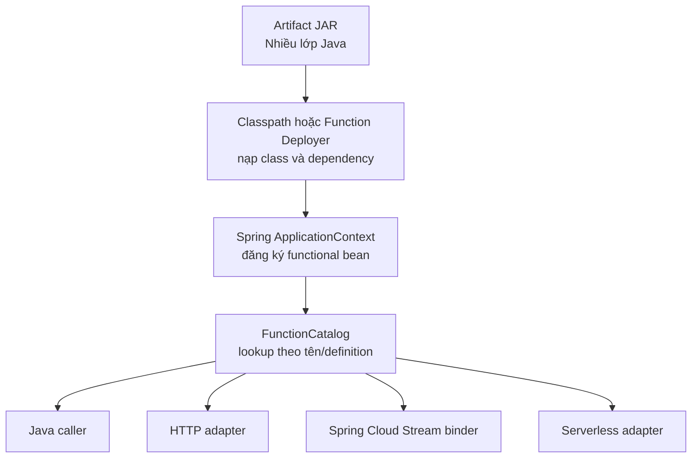
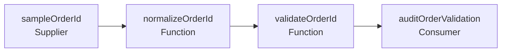

# Nạp nhiều lớp hàm và quy tắc đặt tên

## 1. Bài toán: một JAR chứa nhiều hàm, ứng dụng gọi phải chọn đúng

Một nền tảng xử lý đơn hàng muốn tái sử dụng bốn thao tác: tạo mã đơn mẫu, chuẩn hóa mã, kiểm tra mã hợp lệ và ghi nhật ký kết quả. Nhóm nghiệp vụ phát hành chúng trong một artifact; nhóm vận hành có một ứng dụng Spring Boot nhận HTTP hoặc sự kiện. Khi chỉ có một hàm, việc chọn hàm đôi khi dễ suy luận. Khi có **nhiều hàm**, các câu hỏi lập tức xuất hiện:

- Một file JAR chứa bốn lớp Java có nghĩa cả bốn hàm sẽ tự được đăng ký không?
- `NormalizeOrderId` là tên **lớp**, hay tên phải dùng trong `FunctionCatalog.lookup(...)`?
- Nếu hai JAR có bean cùng tên `normalizeOrderId`, host phải gọi bản nào?
- `spring.cloud.function.definition` chọn hàm nào và có tải thêm class từ JAR không?
- Composition `normalizeOrderId|validateOrderId` hoạt động với kiểu dữ liệu nào?
- HTTP endpoint, Kafka binding và tên function có bắt buộc giống nhau không?

Trong module **Spring Cloud Function** (`SPRING_CLOUD_FUNCTION`), nghiệp vụ có thể biểu diễn bằng `Supplier<T>`, `Function<T,R>` và `Consumer<T>`, tra cứu qua `FunctionCatalog`, ghép bằng composition, rồi chạy qua Java nội bộ, HTTP, messaging hoặc serverless adapter. Phần **Nạp JAR** thêm một lớp trách nhiệm: **lấy implementation bên ngoài vào môi trường thực thi** mà không đánh mất khả năng lựa chọn hàm theo tên.

**Ý chính:** *class có trong JAR* khác *function đã được đăng ký*; *function được đăng ký* lại khác *function được chọn để kích hoạt*. Khi nạp nhiều lớp hàm, phải làm rõ cả ba.

## 2. Mô hình từ artifact đến function được gọi



Đây là **sơ đồ trách nhiệm**, không cam kết mọi bản Function Deployer triển khai chính xác một cấu trúc context/classloader. Một số phiên bản hỗ trợ nạp Boot JAR có functional bean; cách nạp một simple JAR bằng `function-class` là luồng khác. Hãy xác nhận hành vi của **release thực tế** trước khi cấu hình nạp nhiều lớp.

| Bước | Điều được xác định | Ví dụ |
| --- | --- | --- |
| **Đóng gói** | Những class nào tồn tại trong artifact? | `NormalizeOrderId.class`, `ValidateOrderId.class`. |
| **Nạp** | Loader/host có truy cập và khởi tạo code được không? | File URI, classloader, dependency, Boot context. |
| **Đăng ký** | Những function nào có tên trong catalog? | `normalizeOrderId`, `validateOrderId`. |
| **Lựa chọn** | Caller/adapter gọi hàm hoặc composition nào? | `prepareOrderId` hoặc `normalizeOrderId|validateOrderId`. |
| **Kích hoạt** | Dữ liệu đến bằng đường nào? | Java method, HTTP request, Kafka message. |

Đưa một class mới vào JAR mới giải quyết bước đầu; không tự tạo Web endpoint, không tự thêm Kafka binding, cũng không bảo đảm class ấy được đăng ký vào catalog.

## 3. Ba chiến lược khi một artifact có nhiều lớp hàm

| Chiến lược | Cách quản lý danh sách hàm | Khi nào nên dùng? |
| --- | --- | --- |
| **Spring Boot application có nhiều functional bean** | Đăng ký từng `@Bean` với tên tường minh. | Muốn nhiều hàm cùng một context, dependency injection, composition và tên ổn định. |
| **Simple JAR có nhiều class `implements Function`** | Cần cơ chế chọn/đăng ký các class theo bản deployer đang dùng. | Thư viện chỉ chứa Java thuần, không muốn phụ thuộc Spring trong source. |
| **Host tự khai báo bean từ JAR thư viện** | Host thêm dependency JAR và tạo `@Bean`/factory tường minh. | Muốn kiểm soát tên đầy đủ mà không phụ thuộc cơ chế nạp động. |

Một **simple JAR chứa nhiều file `.class`** không đồng nghĩa `spring.cloud.function.function-class` có thể nhận danh sách FQCN phân cách bằng dấu phẩy, dấu chấm phẩy hoặc ký tự bất kỳ. **Không tự bịa cú pháp đa class.** Nếu release hỗ trợ chọn nhiều class, phải đối chiếu tài liệu/kiểm thử release đó. Để có một bài thực hành có quy tắc tên rõ ràng, ta dùng chiến lược **nhiều class Java thuần, đăng ký thành nhiều bean có tên trong ứng dụng Spring Boot**.

## 4. Thiết kế một bộ hàm có đầu vào/đầu ra tường minh

Ta xây năm functional bean từ bốn lớp Java:

| Bean | Java signature | Chức năng |
| --- | --- | --- |
| `sampleOrderId` | `Supplier<String>` | Cung cấp mã mẫu `od-204` khi được gọi. |
| `normalizeOrderId` | `Function<String,String>` | Chuyển `"  od-204 "` thành `"OD-204"`. |
| `validateOrderId` | `Function<String,OrderValidation>` | Kiểm tra định dạng `AA-999`. |
| `auditOrderValidation` | `Consumer<OrderValidation>` | Ghi một thông tin audit minh họa. |
| `prepareOrderId` | `Function<String,OrderValidation>` | Hàm đặt tên ổn định cho `normalize` rồi `validate`. |

`prepareOrderId` được ghép từ **hai bean khác** nhưng có tên riêng để client không buộc phải biết chuỗi tên nội bộ. Đây là một pattern hữu ích khi muốn giữ contract công khai ổn định và vẫn thay đổi cách cài đặt pipeline.

### 4.1. DTO kết quả

```java
// src/main/java/demo/orders/OrderValidation.java
package demo.orders;

public record OrderValidation(
        String orderId,
        boolean valid,
        String reason) {}
```

Một mã hợp lệ sẽ có `valid=true` và `reason="OK"`. Một mã sai định dạng nhưng vẫn là chuỗi input hợp lệ có thể được trả về như **kết quả kiểm tra âm**, thay vì ném exception. Chỉ input `null` hoặc rỗng mới là lỗi validation của hợp đồng.

### 4.2. Lớp NormalizeOrderId

```java
// src/main/java/demo/orders/NormalizeOrderId.java
package demo.orders;

import java.util.Locale;
import java.util.function.Function;

public final class NormalizeOrderId
        implements Function<String, String> {

    @Override
    public String apply(String input) {
        if (input == null || input.isBlank()) {
            throw new IllegalArgumentException(
                    "orderId must not be blank");
        }
        return input.strip().toUpperCase(Locale.ROOT);
    }
}
```

Hàm này không phụ thuộc HTTP, broker hay Spring; tên **class** là `NormalizeOrderId`, khác tên **bean** sẽ được khai báo là `normalizeOrderId`.

### 4.3. Lớp ValidateOrderId

```java
// src/main/java/demo/orders/ValidateOrderId.java
package demo.orders;

import java.util.function.Function;
import java.util.regex.Pattern;

public final class ValidateOrderId
        implements Function<String, OrderValidation> {

    private static final Pattern ID_PATTERN =
            Pattern.compile("[A-Z]{2}-[0-9]{3}");

    @Override
    public OrderValidation apply(String orderId) {
        if (orderId == null || orderId.isBlank()) {
            throw new IllegalArgumentException(
                    "orderId must not be blank");
        }
        boolean valid = ID_PATTERN.matcher(orderId).matches();
        return new OrderValidation(
                orderId, valid, valid ? "OK" : "INVALID_FORMAT");
    }
}
```

Ví dụ `validateOrderId.apply("OD-204")` trả `OrderValidation("OD-204", true, "OK")`. Nếu gọi thẳng với `" od-204 "`, hàm trả `valid=false` vì nó **không tự chuẩn hóa**. Như vậy, thứ tự composition có ý nghĩa.

### 4.4. Lớp AuditOrderValidation

```java
// src/main/java/demo/orders/AuditOrderValidation.java
package demo.orders;

import java.util.Objects;
import java.util.function.Consumer;

public final class AuditOrderValidation
        implements Consumer<OrderValidation> {

    @Override
    public void accept(OrderValidation result) {
        Objects.requireNonNull(result, "result");
        System.out.println("AUDIT order=" + result.orderId()
                + " valid=" + result.valid());
    }
}
```

`System.out.println` chỉ minh họa một side effect; audit thật có thể cần lưu trữ bền vững, idempotency và cấu hình quyền. `Consumer.accept()` trả `void` không phải xác nhận Kafka message đã được broker xử lý xong hoặc có transaction nguyên tử.

### 4.5. Lớp SampleOrderId

```java
// src/main/java/demo/orders/SampleOrderId.java
package demo.orders;

import java.util.function.Supplier;

public final class SampleOrderId
        implements Supplier<String> {

    @Override
    public String get() {
        return " od-204 ";
    }
}
```

`Supplier` không có input, nhưng điều đó không có nghĩa framework tự gọi định kỳ. Một runner, poller hoặc runtime adapter cần quyết định lúc nào gọi `get()`.

## 5. Đăng ký nhiều lớp thành nhiều bean có tên ổn định

Đây là chỗ phân biệt quan trọng nhất giữa **tồn tại trong artifact** và **có mặt trong FunctionCatalog**.

```java
// src/main/java/demo/orders/OrderFunctionConfiguration.java
package demo.orders;

import java.util.function.Consumer;
import java.util.function.Function;
import java.util.function.Supplier;

import org.springframework.beans.factory.annotation.Qualifier;
import org.springframework.context.annotation.Bean;
import org.springframework.context.annotation.Configuration;

@Configuration(proxyBeanMethods = false)
public class OrderFunctionConfiguration {

    @Bean("sampleOrderId")
    Supplier<String> sampleOrderId() {
        return new SampleOrderId();
    }

    @Bean("normalizeOrderId")
    Function<String, String> normalizeOrderId() {
        return new NormalizeOrderId();
    }

    @Bean("validateOrderId")
    Function<String, OrderValidation> validateOrderId() {
        return new ValidateOrderId();
    }

    @Bean("auditOrderValidation")
    Consumer<OrderValidation> auditOrderValidation() {
        return new AuditOrderValidation();
    }

    @Bean("prepareOrderId")
    Function<String, OrderValidation> prepareOrderId(
            @Qualifier("normalizeOrderId")
            Function<String, String> normalize,
            @Qualifier("validateOrderId")
            Function<String, OrderValidation> validate) {
        return normalize.andThen(validate);
    }
}
```

`@Bean("normalizeOrderId")` đặt **bean name tường minh** thay vì dựa vào việc đổi tên method trong refactor. `@Qualifier` ở `prepareOrderId` loại bỏ nhập nhằng giữa nhiều bean cùng raw type `Function`.

Trong **ApplicationContext của ứng dụng nguồn**, các bean theo cách đăng ký này có tên tương ứng. Khi Spring Cloud Function context tương thích phát hiện functional bean, `FunctionCatalog` có thể cho phép tra cứu theo tên/định nghĩa. Nếu ứng dụng **được nạp như JAR ngoài qua deployer**, tên được công bố cho **host catalog** phải được xác minh theo cơ chế deployer của bản đang dùng; đừng mặc nhiên coi mọi tên Spring bean ở một context con sẽ luôn xuất hiện y hệt ở context host.

### 5.1. Vì sao không dùng chung một tên?

Không thể an toàn đặt cả hai function sau dưới cùng một tên rồi mong catalog phân biệt bằng generic:

```java
Function<String, String> normalizeOrderId;
Function<String, OrderValidation> validateOrderId;
```

`FunctionCatalog.lookup("someName")` là **tra cứu dựa trên tên/định nghĩa**, không phải cơ chế overload Java theo `Function<String,R>`. Khi bean name trùng trong Spring context, việc đăng ký có thể bị từ chối hoặc một định nghĩa bị ghi đè nếu cấu hình cho phép, dẫn đến kết quả không kiểm soát.

**Nguyên tắc:** mỗi hàm được công bố cần **một tên rõ ràng, duy nhất trong phạm vi catalog của runtime**. Tránh dựa vào hành vi bean overriding để chọn version.

## 6. Ứng dụng Spring Boot chứa nhiều functional bean

Để đóng gói thành ứng dụng Boot JAR, tạo điểm khởi động:

```java
// src/main/java/demo/orders/OrderFunctionsApplication.java
package demo.orders;

import org.springframework.boot.SpringApplication;
import org.springframework.boot.autoconfigure.SpringBootApplication;

@SpringBootApplication
public class OrderFunctionsApplication {
    public static void main(String[] args) {
        SpringApplication.run(OrderFunctionsApplication.class, args);
    }
}
```

`@SpringBootApplication` ở `demo.orders` giúp cấu hình `OrderFunctionConfiguration` cùng package được Spring tìm thấy theo quy tắc component scanning thông thường. Source các class nghiệp vụ vẫn không có dependency Spring, chỉ lớp đăng ký bean và application class phụ thuộc Spring Boot.

Maven project cần **Spring Boot parent hoặc dependency management**, Spring Cloud Function context và plugin đóng gói. Ví dụ phần dependencies:

```xml
<!-- Trích POM; chọn một tổ hợp Spring Boot / Spring Cloud tương thích -->
<dependencies>
    <dependency>
        <groupId>org.springframework.boot</groupId>
        <artifactId>spring-boot-starter</artifactId>
    </dependency>
    <dependency>
        <groupId>org.springframework.cloud</groupId>
        <artifactId>spring-cloud-function-context</artifactId>
    </dependency>
    <dependency>
        <groupId>org.springframework.boot</groupId>
        <artifactId>spring-boot-starter-test</artifactId>
        <scope>test</scope>
    </dependency>
</dependencies>
```

Plugin Maven Boot để tạo executable JAR (trong POM đầy đủ):

```xml
<build>
    <plugins>
        <plugin>
            <groupId>org.springframework.boot</groupId>
            <artifactId>spring-boot-maven-plugin</artifactId>
            <executions>
                <execution>
                    <goals>
                        <goal>repackage</goal>
                    </goals>
                </execution>
            </executions>
        </plugin>
    </plugins>
</build>
```

Các đoạn XML là **trích đoạn**, chưa phải POM build được độc lập: còn phải khai báo tọa độ project, parent hoặc phiên bản Spring Boot, Spring Cloud BOM/dependency management tương thích và build settings khác. Không copy trộn version từ các release khác nhau.

Một ví dụ layout khi build application:

```text
order-functions-1.0.0.jar
  BOOT-INF/classes/demo/orders/OrderFunctionsApplication.class
  BOOT-INF/classes/demo/orders/OrderFunctionConfiguration.class
  BOOT-INF/classes/demo/orders/NormalizeOrderId.class
  BOOT-INF/classes/demo/orders/ValidateOrderId.class
  BOOT-INF/classes/demo/orders/AuditOrderValidation.class
  BOOT-INF/classes/demo/orders/SampleOrderId.class
  BOOT-INF/classes/demo/orders/OrderValidation.class
  BOOT-INF/lib/...
```

Đây là **Spring Boot executable JAR**; nhiều class nằm trong một archive, nhưng chính `@Bean` ở `OrderFunctionConfiguration` mới xác định những functional beans cụ thể. Không nên nhầm nó với simple library JAR có class trực tiếp tại package path gốc.

## 7. Khởi động và xác minh tên bean trong ứng dụng nguồn

Để chạy ứng dụng Boot nguồn không có web server:

```yaml
spring:
  main:
    web-application-type: none
```

Nếu không có runner/poller hoặc service giữ ứng dụng sống, non-web Boot application có thể kết thúc sau khởi tạo. Điều này không có nghĩa catalog không có bean. Hãy dùng test context hoặc runner có chủ đích để kiểm tra.

```java
// src/main/java/demo/orders/CatalogSmokeRunner.java
package demo.orders;

import java.util.function.Function;

import org.springframework.boot.ApplicationRunner;
import org.springframework.cloud.function.context.FunctionCatalog;
import org.springframework.context.annotation.Bean;
import org.springframework.context.annotation.Configuration;
import org.springframework.context.annotation.Profile;

@Configuration
@Profile("smoke")
public class CatalogSmokeRunner {

    @Bean
    ApplicationRunner verify(FunctionCatalog catalog) {
        return args -> {
            Function<String, OrderValidation> fn =
                    catalog.lookup("prepareOrderId");
            if (fn == null) {
                throw new IllegalStateException(
                        "prepareOrderId not registered");
            }
            System.out.println(fn.apply("  od-204 "));
        };
    }
}
```

Khi chạy `java -jar order-functions-1.0.0.jar --spring.profiles.active=smoke`, kết quả mong đợi chứa `OrderValidation[orderId=OD-204, valid=true, reason=OK]`.

**Chỉ bật runner smoke cho môi trường thử nghiệm.** Một runner in log có thể chấp nhận được, nhưng một `Consumer` ghi database hoặc scheduler tự khởi động trong JAR được nạp vào host có thể tạo side effect không mong đợi. Tên hàm và vòng đời phải được quản lý ngay từ thiết kế.

## 8. Nạp nhiều lớp khi chỉ có simple JAR

Giả sử thay vì Spring Boot executable JAR, nhà cung cấp build một **simple library JAR** có bốn lớp implement trực tiếp interface của JDK:

```text
order-functions-lib-1.0.0.jar
  demo/orders/NormalizeOrderId.class
  demo/orders/ValidateOrderId.class
  demo/orders/AuditOrderValidation.class
  demo/orders/SampleOrderId.class
  demo/orders/OrderValidation.class
```

Với cơ chế nạp lớp trực tiếp của những bản `spring-cloud-function-deployer` hỗ trợ, cấu hình chọn **một lớp cụ thể** có thể có dạng minh họa:

```yaml
spring:
  cloud:
    function:
      location: "file:///opt/functions/order-functions-lib-1.0.0.jar"
      function-class: "demo.orders.NormalizeOrderId"
```

Hai property trên trả lời **vị trí JAR** và **lớp muốn nạp**. Chúng **không tự nói** phải đăng ký đồng thời `ValidateOrderId`, `AuditOrderValidation` và `SampleOrderId` chỉ vì các class này cũng nằm trong archive.

Nếu muốn có **nhiều hàm cùng một catalog**, các hướng thực tế là:

1. **Đóng gói một Spring Boot application** có nhiều functional bean được đặt tên tường minh, rồi sử dụng hình thức nạp Boot JAR mà release deployer hỗ trợ.
2. **Thêm library JAR vào classpath của host** rồi tạo các `@Bean` riêng cho từng implementation. Cách này không phải nạp động nhưng tên được host kiểm soát rõ ràng.
3. **Sử dụng cơ chế nhiều class/hàm cụ thể của release** nếu tài liệu và integration test thực sự xác nhận hỗ trợ; không tự áp dụng cú pháp danh sách `function-class` từ suy đoán.
4. **Tách ra nhiều provider/host** nếu cần cô lập lifecycle, tài nguyên và rollback cho từng hàm.

Một JAR có nhiều class chưa phải một registry. Tên được công bố là **quyết định đăng ký**, không đơn thuần là kết quả `jar tf` liệt kê các file.

### 8.1. Host khai báo nhiều bean từ một JAR thư viện

Nếu chấp nhận đưa library JAR vào **classpath của host từ lúc build**, host có thể tạo các bean tường minh mà không dùng deployer. Ví dụ đoạn cấu hình sau thuộc **một host riêng**, không dùng đồng thời với `OrderFunctionConfiguration` ở mục 5 trong cùng context để tránh bean name trùng:

```java
package demo.host;

import demo.orders.NormalizeOrderId;
import demo.orders.OrderValidation;
import demo.orders.ValidateOrderId;
import java.util.function.Function;
import org.springframework.context.annotation.Bean;
import org.springframework.context.annotation.Configuration;

@Configuration(proxyBeanMethods = false)
public class HostFunctionBeans {
    @Bean("normalizeOrderId")
    Function<String, String> normalizeOrderId() {
        return new NormalizeOrderId();
    }

    @Bean("validateOrderId")
    Function<String, OrderValidation> validateOrderId() {
        return new ValidateOrderId();
    }
}
```

Đây không phải **nạp động JAR bằng `location`**; Maven/Gradle đã đặt artifact thư viện trên classpath để code host import được `demo.orders.*`. Bù lại, tên hai function được khai báo tường minh và dễ kiểm tra qua `FunctionCatalog`. Nếu yêu cầu thật sự là chọn **artifact ngoài lúc khởi động** mà không import implementation khi build, cần dùng loader/deployer có khả năng tương ứng và kiểm chứng cách đăng ký nhiều class trên release mục tiêu.

## 9. Quy tắc đặt tên: phân biệt sáu phạm vi

Khi triển khai nhiều hàm, “tên” có ít nhất sáu ý nghĩa:

| Phạm vi | Ví dụ | Ai sử dụng? |
| --- | --- | --- |
| **Tên lớp Java (FQCN)** | `demo.orders.NormalizeOrderId` | Classloader hoặc cơ chế chọn implementation bằng class. |
| **Tên artifact/version** | `order-functions-1.0.0.jar` | CI/CD, host locator, quản lý release. |
| **Spring bean name** | `normalizeOrderId` | BeanFactory, `@Qualifier` và metadata function. |
| **FunctionCatalog name/definition** | `normalizeOrderId`, `prepareOrderId` | `lookup(...)`, composition và adapter selection. |
| **HTTP route** | Ví dụ `/prepareOrderId` | Web adapter/API consumer theo contract của provider. |
| **Messaging binding/destination** | `prepareOrderId-in-0` và `order-requests` | Spring Cloud Stream và broker. |

Trong ứng dụng Boot nguồn thông thường, functional bean có thể được catalog nhận theo bean name. Khi **nạp từ JAR ngoài**, tên thực tế được host catalog nhìn thấy còn phụ thuộc cách deployer đăng ký/công bố hàm. **Phải kiểm tra trên runtime mục tiêu; không đoán tên chỉ từ FQCN hoặc file JAR.**

Vì vậy, naming convention cần phân biệt:

- **Tên nội bộ triển khai:** `NormalizeOrderId`, package, method name; có thể thay khi refactor.
- **Tên function công bố:** `normalizeOrderId`, `prepareOrderId`; nên có owner, tính duy nhất và contract ổn định.
- **Tên bên ngoài ứng dụng:** HTTP route hoặc topic; có version/compatibility policy riêng.

Không có quy định nào bắt buộc URL và bean name phải giống nhau nếu một lớp định tuyến riêng tạo alias. Tuy nhiên, **web adapter mặc định** thường dựa vào tên hàm được chọn. Nếu giữ URL ổn định trong khi đổi tên bean, có thể dùng một adapter/controller có route cố định hoặc bean alias/wrapper được thiết kế rõ ràng và kiểm thử.

## 10. Cách đặt tên để tránh trùng và tránh biến refactor thành breaking change

Một quy ước thực dụng cho module đơn hàng:

| Quy tắc | Ví dụ nên dùng | Ví dụ nên tránh |
| --- | --- | --- |
| Có ý nghĩa nghiệp vụ rõ ràng | `normalizeOrderId`, `validateOrderId` | `function1`, `handler`, `processor`. |
| Dễ phân biệt input/output | `prepareOrderId` trả `OrderValidation`, có contract rõ | `process` nhưng không biết tác động. |
| Unique trong runtime catalog | `orderNormalizeV2` khi buộc chạy song song version | Hai bean đều tên `normalizeOrderId`. |
| Tên public ổn định | Giữ `prepareOrderId`, thay implementation phía sau | Đổi URL mỗi khi đổi class. |
| Không đưa chi tiết hạ tầng vào tên lõi | `validateOrderId` | `kafkaValidateOrderId` cho cùng quy tắc chỉ vì đổi binder. |

Có thể dùng namespace theo lĩnh vực nếu nhiều nhóm cùng phát hành: `orderNormalize`, `invoiceNormalize` thay vì hai bên cùng `normalize`. Nếu nhiều version phải sống song song, dùng tên/route version rõ hoặc tách deployment; chỉ thêm `V2` khi chính sách versioning thực sự cần, không dùng version suffix để che giấu xung đột không được quản lý.

**Đặt tên là một phần API contract** khi caller cấu hình `spring.cloud.function.definition` hoặc dựa vào route theo function name. Đổi tên bean không còn là refactor thuần nội bộ nếu tên đó được dùng ngoài module.

## 11. Tra cứu nhiều hàm trong FunctionCatalog

`FunctionCatalog` là giao diện do Spring Cloud Function cung cấp để tìm hàm đã được đăng ký trong môi trường Spring. Với ứng dụng nguồn có năm bean ở mục 5, có thể kiểm tra **từng tên** và **một composition**.

```java
// Đoạn mã chạy bên trong Spring bean có FunctionCatalog catalog.
Function<String, String> normalize =
        catalog.lookup("normalizeOrderId");

Function<String, OrderValidation> validate =
        catalog.lookup("validateOrderId");

Function<String, OrderValidation> pipeline =
        catalog.lookup("normalizeOrderId|validateOrderId");

Supplier<String> sample =
        catalog.lookup("sampleOrderId");

Consumer<OrderValidation> audit =
        catalog.lookup("auditOrderValidation");

if (normalize == null || validate == null ||
        pipeline == null || sample == null || audit == null) {
    throw new IllegalStateException("Missing registered function");
}

String rawId = sample.get();            // " od-204 "
String cleaned = normalize.apply(rawId); // "OD-204"
OrderValidation direct = validate.apply(cleaned);
OrderValidation composed = pipeline.apply(rawId);

// Chỉ minh họa side effect; không đưa trực tiếp vào smoke test production.
audit.accept(composed);
```

Kết quả của `direct` và `composed` mong đợi là `OrderValidation("OD-204", true, "OK")`. Bản thân `FunctionCatalog.lookup(...)` có thể trả **wrapper** phục vụ chuyển đổi kiểu/composition; đừng phụ thuộc vào việc instance trả ra là object `new NormalizeOrderId()` gốc hoặc ép kiểu sang implementation class.

**Quan trọng khi nạp JAR ngoài:** đoạn mã trên giả định **tất cả tên đã được xác minh có trong catalog của context đang tra cứu**. Một Boot JAR tự chạy và một host nạp Boot JAR có thể có ranh giới context/classloader khác nhau. Catalog của host không mặc nhiên chứa mọi bean từ một context khác nếu bộ nạp không công bố chúng theo cách được release hỗ trợ.

### 11.1. Tên sai và trường hợp trả null

```java
Function<String, String> missing =
        catalog.lookup("normalizeOrderID"); // Sai khác hoa/thường.
if (missing == null) {
    // Kiểm tra tên thực tế thay vì gọi apply().
}
```

Không dùng tên viết gần đúng, không tự động chọn “hàm đầu tiên” và không dựa vào thứ tự tạo bean để đoán function sẽ được gọi. Trong một deployment có nhiều hàm, việc gọi sai function có thể tệ hơn lỗi `null`, nhất là đối với `Consumer` ghi dữ liệu.

## 12. Composition: ghép đúng kiểu và đúng thứ tự

Chuỗi:

```text
String
  |
  v
normalizeOrderId : Function<String, String>
  |
  v
validateOrderId  : Function<String, OrderValidation>
  |
  v
OrderValidation
```

được biểu diễn qua tên:

```java
Function<String, OrderValidation> pipeline =
        catalog.lookup("normalizeOrderId|validateOrderId");
```

Dấu `|` được sử dụng trong syntax composition của Spring Cloud Function; **thứ tự từ trái sang phải**. Input cho bước sau phải tương thích output của bước trước. `FunctionCatalog` hỗ trợ composition nhưng không sửa được logic của pipeline sai kiểu.

Ví dụ **không phù hợp kiểu**:

```text
validateOrderId|normalizeOrderId

validateOrderId: String -> OrderValidation
normalizeOrderId: String -> String

Output của bước 1 là OrderValidation,
trong khi bước 2 chờ String.
```

Đừng chờ đến khi có request production để mới phát hiện thứ tự pipeline sai. Kiểm tra khi khởi tạo hoặc viết integration test với `catalog.lookup(...)` và input thực tế.

### 12.1. Khi nào dùng function bean đặt tên riêng cho pipeline?

Bean `prepareOrderId` ở mục 5:

```java
return normalize.andThen(validate);
```

đã đặt tên cho một pipeline hai bước. Điều này hữu ích khi người gọi không cần biết nội bộ có hai hàm, hoặc muốn đổi cách xử lý mà vẫn giữ **tên public** ổn định:

| Cách dùng | Điểm mạnh | Điều cần quản lý |
| --- | --- | --- |
| `lookup("normalizeOrderId|validateOrderId")` | Cấu hình chọn pipeline trực tiếp từ các bước. | Tên hai bước và thứ tự trở thành phần contract cấu hình. |
| `lookup("prepareOrderId")` | Một tên công khai, implementation có thể đổi trong source. | Bean phải tồn tại; test semantics của tên công khai. |

Nếu composition có `Supplier` hoặc `Consumer`, đầu/đuôi pipeline và đặc tính wrapper phụ thuộc kiểu giao diện, khả năng composition của release và cách adapter kích hoạt. Bắt đầu bằng hai `Function` có kiểu tương thích như trên, rồi kiểm chứng trước khi mở rộng. `FunctionCatalog` không tự cung cấp workflow có timer, checkpoint, transaction phân tán hoặc saga.

## 13. `spring.cloud.function.definition` chọn hàm; nó không nạp class

Với ứng dụng chứa nhiều functional bean, các adapter như Spring Cloud Stream thường cần một lựa chọn rõ ràng:

```yaml
spring:
  cloud:
    function:
      definition: prepareOrderId
```

Đây là lựa chọn **một bean đã đăng ký**. Nếu muốn chọn pipeline tạo từ các function đã có:

```yaml
spring:
  cloud:
    function:
      definition: "normalizeOrderId|validateOrderId"
```

Ký tự `|` là cú pháp composition, không phải tên một class Java; đặt chuỗi trong dấu nháy giúp cấu hình rõ ràng. Những hàm/bước cần được catalog tra cứu được trong runtime adapter.

Phân biệt:

| Thuộc tính | Đích tác động |
| --- | --- |
| `spring.cloud.function.location` | Artifact JAR cần nạp theo cơ chế deployer được hỗ trợ. |
| `spring.cloud.function.function-class` | Class implementation được chọn trong cách nạp simple JAR tương ứng. |
| `spring.cloud.function.definition` | Hàm hoặc composition **đã đăng ký** mà adapter sử dụng. |

`definition` **không phải danh sách class để deployer tự mở file**. Nếu JAR thiếu, class lỗi hoặc bean chưa đăng ký, đổi `definition` không giải quyết được lỗi đó.

### 13.1. Nếu nhiều adapter cần các hàm khác nhau?

Đừng mặc định `spring.cloud.function.definition` có thể công bố toàn bộ bean bằng một chuỗi tên ngẫu nhiên. Cách lựa chọn một hoặc nhiều function, delimiter và các binding được tạo có thể khác theo từng dòng Spring Cloud Stream. Có thể:

- Chạy hai provider deployment chọn hai definition khác nhau.
- Đưa nhiều bean vào một Spring context rồi cấu hình **nhiều functional binding** bằng cú pháp được bản Spring Cloud Stream sử dụng và kiểm thử.
- Tạo các adapter/endpoint riêng, mỗi adapter gọi một **tên catalog được phép**.

Trong các bản Stream hỗ trợ nhiều definition độc lập, cú pháp phân tách definition (chẳng hạn `;` ở những dòng phát hành hỗ trợ) phải được xác nhận; **dấu `;` không đồng nghĩa với dấu `|`**. Dấu `|` dùng cho một composition nối output của bước trước vào input của bước sau.

## 14. Công bố nhiều hàm qua HTTP: tên route là hợp đồng công khai

Trong một Spring Boot application có dependency `spring-cloud-starter-function-web` và cấu hình web runtime tương thích, web adapter có thể cung cấp những đường gọi theo tên function được hỗ trợ.

Ví dụ với bean `normalizeOrderId`:

```bash
curl -X POST http://localhost:8080/normalizeOrderId \
  -H "Content-Type: text/plain" \
  --data "  od-204 "
```

Nội dung nghiệp vụ dự kiến:

```text
OD-204
```

Với bean `prepareOrderId`:

```bash
curl -X POST http://localhost:8080/prepareOrderId \
  -H "Content-Type: text/plain" \
  --data "  od-204 "
```

Kết quả dự kiến sau bước serialization phù hợp:

```json
{
  "orderId": "OD-204",
  "valid": true,
  "reason": "OK"
}
```

Đây là các ví dụ **khi adapter hỗ trợ cách định tuyến đó và tên hàm thực sự được công bố**; kiểm tra route, method, body content type, HTTP status/error và các giới hạn của bản web adapter đang chạy.

**Không công bố toàn bộ catalog ra ngoài một cách không chủ đích.** `auditOrderValidation` là một `Consumer` có side effect, nên trong hệ thống thật cần quy định ai được gọi, xác thực, quyền và validation. Nếu chỉ muốn công bố `prepareOrderId`, có thể dùng controller/gateway với danh sách route cho phép hoặc cấu hình giới hạn exposure thích hợp, thay vì tin rằng mọi bean trong JAR đều an toàn để gọi từ internet.

### 14.1. Nếu đổi tên bean, URL có bị ảnh hưởng?

Nếu endpoint do web adapter xây dựng từ tên function, đổi `@Bean("prepareOrderId")` thành `@Bean("prepareOrder")` có thể đổi đường gọi và làm client cũ bị lỗi. Muốn đổi implementation mà giữ URL ổn định, có thể giữ bean alias/tên public `prepareOrderId`, hoặc đặt một controller với route versioned ổn định gọi đến service/function bên trong.

**Đổi tên class nội bộ** chưa chắc là breaking change; **đổi tên function đã được caller dùng** thường là thay đổi contract cần quản lý.

## 15. Lựa chọn hàm trong Spring Cloud Stream

Với ví dụ `prepareOrderId : Function<String,OrderValidation>`, một ứng dụng có `spring-cloud-stream-binder-kafka` và broker thực có thể định nghĩa một luồng từ topic input đến topic output:

```yaml
spring:
  cloud:
    function:
      definition: prepareOrderId
    stream:
      bindings:
        prepareOrderId-in-0:
          destination: raw-order-ids
          group: order-id-checkers
          content-type: text/plain
        prepareOrderId-out-0:
          destination: validated-order-ids
          content-type: application/json
      kafka:
        binder:
          brokers: localhost:9092
```

Khi một record chứa `"  od-204 "` được chuyển thành `String` phù hợp, binder gọi `prepareOrderId`, rồi serialize `OrderValidation` thành output message. Hai topic phục vụ **hai vai trò khác nhau**; tên `prepareOrderId-in-0` và `prepareOrderId-out-0` là tên binding mặc định của functional binding cho definition đơn `prepareOrderId`, không nhất thiết là tên Kafka topic.

| Tên | Ý nghĩa |
| --- | --- |
| `prepareOrderId` | Function definition được chọn. |
| `prepareOrderId-in-0` | Tên input binding do mô hình functional tạo. |
| `raw-order-ids` | Destination/topic đầu vào thực tế. |
| `prepareOrderId-out-0` | Tên output binding. |
| `validated-order-ids` | Destination/topic đầu ra thực tế. |
| `order-id-checkers` | Consumer group dùng trong ví dụ. |

**Lưu ý:** Khi dùng một composition `normalizeOrderId|validateOrderId` làm definition, tên binding mặc định có thể phản ánh cả composition và chứa ký tự `|`; cần xác minh exact binding name trên release Stream được sử dụng. Nếu muốn tên broker/binding dễ vận hành, có thể dùng một bean pipeline có tên ổn định như `prepareOrderId`.

### 15.1. Hai hàm độc lập không phải pipeline

Nếu host có `normalizeOrderId` và `validateOrderId`, chọn chúng chạy **độc lập** khác với chọn `normalizeOrderId|validateOrderId`. Trong trường hợp độc lập, mỗi hàm có input/output contract và binding riêng; chúng **không tự truyền message từ output hàm này sang input hàm kia** nếu không có topology broker hoặc một composition tường minh.

Với nhiều function definitions trong cùng app, cú pháp cấu hình và số binding cần dựa vào bản Spring Cloud Stream đang dùng. Đừng giả định danh sách `normalizeOrderId,validateOrderId` sẽ luôn hoạt động hoặc hai function tự được nối với nhau. Khi còn nghi ngờ, deploy từng function thành instance khác nhau hoặc viết adapter tường minh và kiểm thử một topology đúng.

## 16. Nạp nhiều JAR: tên trùng và classloader

Giả sử host nạp **hai artifact**:

```text
order-functions-1.0.0.jar
  bean normalizeOrderId

partner-functions-2.0.0.jar
  bean normalizeOrderId
```

Một catalog gọi `lookup("normalizeOrderId")` không đủ để biểu đạt ý định chọn bản A hay B nếu hai nguồn định đăng ký cùng tên vào **cùng namespace**. Kết quả phụ thuộc cơ chế registry/deployer và cách xử lý trùng tên của release; không nên tin vào thứ tự nạp.

Các hướng thiết kế:

1. **Tên duy nhất theo miền/nhà cung cấp** nếu cùng tồn tại trong một catalog, ví dụ `internalNormalizeOrderId` và `partnerNormalizeOrderId`.
2. **Tên public/alias tường minh** ở host cho implementation được phê duyệt, thay vì cho caller gọi tùy ý tất cả bản.
3. **Tách deployment** nếu muốn cách ly phiên bản, classloader, tài nguyên và rollback.
4. **Không bật bean override thiếu kiểm soát** để một bean tình cờ che bean khác.
5. **Ghi nhận nguồn artifact/checksum và kết quả smoke test** khi đăng ký tên được công bố.

### 16.1. Class cùng tên chưa chắc cùng kiểu

Trong một JVM, type identity của Java phụ thuộc **tên class và classloader**. Nếu hai JAR hoặc host và JAR chứa các bản `demo.orders.OrderValidation` khác nhau, object cùng FQCN nhưng từ classloader khác có thể không ép kiểu được. Các lỗi điển hình là `ClassCastException`, `LinkageError` hoặc lỗi converter.

Để hạn chế:

- Tách **shared API contract** ổn định, version rõ, tránh đóng gói nhiều bản không tương thích.
- Dùng DTO JSON/message schema ở ranh giới adapter nếu hợp lý.
- Kiểm tra classloader và dependency path của phiên bản deployer.
- Bắt đầu với kiểu chuẩn như `String` trong smoke test, sau đó mới thử DTO riêng.

### 16.2. Nạp nhiều artifact không mặc nhiên là hot swap

Khi cập nhật `order-functions-1.0.0.jar` sang `1.1.0.jar`, thay file hoặc đổi `location` không tự bảo đảm JVM xóa classloader cũ và đăng ký lại cùng tên an toàn. Một host có thể tiếp tục dùng implementation cũ hoặc giữ tài nguyên. Cần cơ chế lifecycle/rollout rõ ràng và xác minh cả kết quả lẫn nguồn artifact; nếu không có hot reload được release hỗ trợ, hãy restart/rolling deploy có kiểm soát.

## 17. Chuyển đổi message và schema khi nhiều hàm được công bố

Khi Java runner gọi `Function<String,OrderValidation>`, caller có thể truyền object `String` trực tiếp và nhận Java record. Nhưng HTTP và messaging còn có serialization:

```json
{
  "orderId": "OD-204",
  "valid": true,
  "reason": "OK"
}
```

Đây là **payload output**, không phải object `OrderValidation` được gửi nguyên vẹn qua mạng. Bên nhận phải hiểu schema, content type, ý nghĩa `valid`, version và lỗi.

| Lỗi | Nguyên nhân có thể | Nơi xác minh |
| --- | --- | --- |
| Gửi JSON object cho hàm nhận `String` nhưng kết quả bất thường | Converter hoặc body contract không phù hợp. | HTTP/Stream adapter. |
| Hàm nhận `OrderValidation` nhưng input chỉ là `"OD-204"` | Sai kiểu hợp đồng hoặc thiếu bước chuyển đổi. | Definition/composition, payload schema. |
| Message có content type sai | Không chọn được converter đúng. | Binding/header/config. |
| Thay `reason` từ text sang object | Breaking schema change. | Version contract và consumer test. |
| Đúng payload nhưng gặp `ClassCastException` trong host | Classloader hoặc shared DTO không tương thích. | Loader/API contract. |

Nếu cần correlation ID hoặc headers, có thể thiết kế `Function<Message<T>, Message<R>>` (thuộc `org.springframework.messaging`). Tuy nhiên, điều này đưa messaging abstraction vào chữ ký và làm dependency của JAR phức tạp hơn; chỉ dùng khi nghiệp vụ thực sự cần metadata đó.

**Nạp nhiều class không tự tạo converter cho mọi kiểu payload.** Giữ đầy đủ generic types, version hóa DTO và kiểm thử contract của từng adapter là trách nhiệm riêng.

## 18. Side effect, Supplier và mô hình gọi nhiều hàm

Một hệ thống có nhiều function không chỉ có các phép biến đổi thuần dữ liệu. `sampleOrderId` là nguồn, `auditOrderValidation` là điểm nhận có side effect:



Sơ đồ biểu diễn **chuỗi nghiệp vụ mong muốn**, không phải bảo đảm Spring Cloud Function sẽ tự lên lịch hoặc nối các bean trong JAR khi khởi động. Cần có một caller, adapter hoặc composition được hỗ trợ và cấu hình chính xác.

Khi `Consumer` ghi database hay phát message, cần trả lời:

- Nếu HTTP client gửi lại request do timeout, liệu hành động có bị thực hiện hai lần?
- Nếu broker redeliver cùng một message, có idempotency key hoặc event ID không?
- Nếu xử lý dữ liệu thành công nhưng output publish thất bại, cơ chế retry sẽ ra sao?
- Nếu function được nạp trên nhiều replica, state trong RAM của từng replica có nhất quán không?

`FunctionCatalog` không tự tạo transaction phân tán, exactly-once hay workflow bền vững. `Consumer.accept()` trả `void` chỉ là chữ ký Java; broker acknowledgment, transaction commit và DLQ là trách nhiệm của adapter và hạ tầng theo cấu hình.

Đối với `Supplier`, cũng cần chọn nhịp gọi: cron/job, Stream poller hoặc invocation từ caller. `Supplier.get()` không có input, nhưng không mặc nhiên có scheduler. Nếu nhiều instance cùng phát nguồn, cần chiến lược phân chia công việc hoặc deduplication riêng.

## 19. Bảo mật: không cho caller chọn tùy ý tên hàm nhạy cảm

Khi ứng dụng có nhiều function, một rủi ro mới là **dynamic dispatch**: caller cung cấp chuỗi tên và ứng dụng dùng nó để tra catalog.

Ví dụ nguy hiểm về mặt thiết kế:

```java
// Không nên làm với input không tin cậy.
String requestedFunction = externalRequest.getFunctionName();
Function<?, ?> selected = catalog.lookup(requestedFunction);
```

Nếu host có `auditOrderValidation` hoặc một consumer thực hiện thao tác hủy đơn, xóa dữ liệu, việc cho client truyền tùy ý tên/definition có thể mở ra những hành động ngoài ý muốn. Composition string cũng cần kiểm soát; không nên ghép `"|"` với các đoạn tên do người dùng gửi đến mà chưa được xác nhận.

**Cách an toàn hơn:** lập danh sách function được phép công bố và map tên bên ngoài sang định nghĩa nội bộ đã kiểm soát:

```java
// Danh sách lựa chọn do ứng dụng quản lý, không do client sửa.
Map<String, String> publicFunctions = Map.of(
        "normalize-v1", "normalizeOrderId",
        "prepare-v1", "prepareOrderId");

String internalName = publicFunctions.get(publicAction);
if (internalName == null) {
    throw new IllegalArgumentException("Unsupported action");
}

Function<?, ?> fn = catalog.lookup(internalName);
if (fn == null) {
    throw new IllegalStateException(
            "Configured function is unavailable");
}
```

Đây là **mẫu ý tưởng**: phần kiểm tra authentication/authorization, input type và lời gọi thực tế cần được code của adapter triển khai thích hợp. Một API public chỉ nên công bố những function được phê duyệt; dùng gateway/controller hoặc cấu hình exposure phù hợp, không chỉ dựa vào quy ước đặt tên.

Ngoài ra, JAR ngoài chứa **bytecode có thể thực thi**, không phải dữ liệu:

- Chỉ nạp artifact từ nguồn tin cậy, có quyền phát hành được kiểm soát.
- Quản lý version, checksum/chữ ký và dependency vulnerabilities.
- Không cho input không tin cậy chọn `spring.cloud.function.location` hoặc `function-class`.
- Giới hạn quyền của host đối với secrets, filesystem, network và database.
- Không coi classloader là sandbox cho mã độc hoặc plugin chưa được kiểm duyệt.
- Khi cần cách ly lỗi/quyền mạnh, cân nhắc provider process/container riêng thay vì nạp vào cùng JVM.

## 20. Kiểm thử naming, lookup và composition

### 20.1. Unit test từng lớp Java

Các implementation ở mục 4 không phụ thuộc Spring, nên kiểm thử độc lập:

```java
package demo.orders;

import static org.junit.jupiter.api.Assertions.assertEquals;
import static org.junit.jupiter.api.Assertions.assertFalse;
import static org.junit.jupiter.api.Assertions.assertThrows;
import static org.junit.jupiter.api.Assertions.assertTrue;

import org.junit.jupiter.api.Test;

class OrderFunctionsUnitTest {
    private final NormalizeOrderId normalize =
            new NormalizeOrderId();
    private final ValidateOrderId validate =
            new ValidateOrderId();

    @Test
    void normalizesAndValidates() {
        String id = normalize.apply("  od-204 ");
        assertEquals("OD-204", id);

        OrderValidation result = validate.apply(id);
        assertEquals("OD-204", result.orderId());
        assertTrue(result.valid());
        assertEquals("OK", result.reason());
    }

    @Test
    void rejectsBlankAndFlagsWrongFormat() {
        assertThrows(IllegalArgumentException.class,
                () -> normalize.apply("   "));

        OrderValidation invalid = validate.apply("X-123");
        assertFalse(invalid.valid());
        assertEquals("INVALID_FORMAT", invalid.reason());
    }
}
```

Unit test xác nhận logic đúng, nhưng chưa chứng minh tên bean hoặc catalog tồn tại. Test class riêng `AuditOrderValidation` nên thay output/log bằng abstraction có thể kiểm thử nếu dùng thực tế, thay vì dựa vào `System.out` trong production.

### 20.2. Integration test tên bean và FunctionCatalog

Trong **dự án Spring Boot nguồn** có dependencies `spring-boot-starter-test` và `spring-cloud-function-context` tương thích:

```java
package demo.orders;

import static org.junit.jupiter.api.Assertions.assertEquals;
import static org.junit.jupiter.api.Assertions.assertNotNull;
import static org.junit.jupiter.api.Assertions.assertTrue;

import java.util.function.Function;

import org.junit.jupiter.api.Test;
import org.springframework.beans.factory.annotation.Autowired;
import org.springframework.boot.test.context.SpringBootTest;
import org.springframework.cloud.function.context.FunctionCatalog;

@SpringBootTest(
        properties = "spring.main.web-application-type=none")
class OrderFunctionCatalogTest {

    @Autowired
    FunctionCatalog catalog;

    @Test
    void findsNamedFunctionsAndComposition() {
        Function<String, String> normalize =
                catalog.lookup("normalizeOrderId");
        Function<String, OrderValidation> compose =
                catalog.lookup("normalizeOrderId|validateOrderId");
        Function<String, OrderValidation> named =
                catalog.lookup("prepareOrderId");

        assertNotNull(normalize);
        assertNotNull(compose);
        assertNotNull(named);
        assertEquals("OD-204", normalize.apply(" od-204 "));

        OrderValidation fromComposition =
                compose.apply(" od-204 ");
        OrderValidation fromNamed =
                named.apply(" od-204 ");
        assertTrue(fromComposition.valid());
        assertEquals(fromComposition, fromNamed);
    }
}
```

Test này xác minh ba điều độc lập: `normalizeOrderId` có tên đúng, `normalizeOrderId|validateOrderId` compose được theo kiểu và `prepareOrderId` trả cùng semantics. Nếu bỏ/đổi tên `validateOrderId`, test composition phải thất bại thay vì tiếp tục gọi nhầm một implementation khác.

### 20.3. Test khi nạp JAR ngoài

Một `@SpringBootTest` chạy trong **source project** không chứng minh host có thể nạp JAR. Kiểm thử release deployer cần:

1. Build JAR thật có đúng các class và `@Bean` definitions.
2. Cấu hình `location` trên host theo cơ chế được bản deployer hỗ trợ.
3. Quan sát classloader/context và kết quả đăng ký.
4. Xác minh **tên thực tế trong host catalog**, không chỉ tên ở source Spring context.
5. Gọi từng hàm đã công bố; kiểm tra `Supplier`, `Function`, `Consumer` theo ngữ nghĩa tương ứng.
6. Thử trùng tên, dependency sai, JAR thiếu, loại artifact không hỗ trợ và tên function không tồn tại.
7. Thử composition giữa những hàm đã nạp và kiểm tra kiểu input/output ở ranh giới loader.

### 20.4. Contract test của adapter

| Bề mặt gọi | Test quan trọng |
| --- | --- |
| HTTP | Route đúng tên, method, content type, status/error schema, quyền gọi. |
| Spring Cloud Stream | Definition, input/output binding, topic, consumer group, serialization, retry/DLQ. |
| Serverless | Handler, event envelope, failure response, timeout và IAM. |
| Java nội bộ | Lookup, generic types, wrapper, concurrency và xử lý exception. |

Chỉ có test `apply()` thành công chưa chứng minh ứng dụng có **nhiều hàm** sẽ chọn đúng definition trong runtime production.

## 21. Chẩn đoán các lỗi thường gặp

| Triệu chứng | Nguyên nhân điển hình | Hướng xử lý |
| --- | --- | --- |
| `jar tf` có bốn lớp nhưng catalog chỉ thấy một hàm | Class có trong JAR nhưng chưa được đăng ký hoặc deployer chỉ chọn một implementation. | Xác minh chiến lược đăng ký, không đoán cú pháp multi-class. |
| `lookup("NormalizeOrderId")` trả `null` | Trộn tên class với bean/catalog name. | Kiểm tra `@Bean("normalizeOrderId")` và registry thực tế. |
| Bean source tồn tại nhưng host không thấy tên | Context/loader không công bố bean như giả định. | Kiểm tra release deployer, khởi tạo context và tên đăng ký. |
| `BeanDefinitionOverrideException` hoặc bean collision | Hai nguồn đăng ký trùng tên. | Đổi tên hoặc tách namespace/deployment; không tùy tiện bật override. |
| `ClassNotFoundException` | FQCN không đúng, artifact thiếu class. | `jar tf`, `location` và tên đầy đủ của class. |
| `NoClassDefFoundError` hoặc `NoSuchMethodError` | Dependency/classloader/Java version không tương thích. | Kiểm tra transitive dependency, BOM, loader và binary API. |
| Composition trả lỗi kiểu | `validateOrderId|normalizeOrderId` sai thứ tự hoặc DTO không tương thích. | Vẽ luồng kiểu `T→R` rồi sửa pipeline. |
| HTTP 404 dù bean tồn tại | Sai route, adapter, cấu hình hoặc tên được công bố. | Xác minh mapping và phiên bản web adapter. |
| HTTP body không chuyển sang kiểu cần thiết | Content type hoặc converter không phù hợp. | Kiểm tra schema, headers và generic types. |
| Stream không nhận message | `definition` sai hoặc binding/broker không đúng. | Kiểm tra tên function và `*-in-0`, destination, broker. |
| Stream gửi kết quả sai topic | Nhầm tên binding với destination. | Xem cả input/output bindings và topic thực tế. |
| `Consumer` làm side effect hai lần | HTTP retry hoặc message redelivery. | Idempotency, transaction và retry policy. |
| Đổi JAR nhưng kết quả không đổi | Host vẫn dùng artifact/class đã nạp. | Version/checksum, rollout/restart, không giả định hot reload. |

Khi chẩn đoán, đi từ **artifact → loader/context → bean → catalog → definition/composition → adapter → network/payload**. Không sửa topic Kafka chỉ vì tên bean chưa được đăng ký; cũng không sửa `function-class` nếu nguyên nhân là HTTP route sai.

## 22. Đổi tên và nâng cấp nhiều hàm mà không phá caller cũ

Một kịch bản thường gặp: nhóm nghiệp vụ chuyển `NormalizeOrderId` sang implementation mới nhưng API public vẫn phải tiếp nhận `POST /prepareOrderId`.

**Cách nâng cấp ít gây ảnh hưởng:**

1. Giữ bean name public `prepareOrderId` ổn định, sửa logic hoặc các bước nó gọi ở phía sau.
2. Duy trì unit test input/output và contract test cho tên public.
3. Phát hành JAR có version bất biến, ghi nhận checksum và dependency version.
4. Nếu cần thay đổi schema hoặc semantics không tương thích, công bố **contract V2** (route/topic/bean public tùy ranh giới) và duy trì thời gian chuyển tiếp.
5. Khi hai version cùng chạy, bảo đảm **tên trong catalog không xung đột** hoặc chia chúng sang các deployment riêng.
6. Rollout có kiểm soát; không ghi đè JAR đang được host sử dụng rồi mặc định class đã thay trong JVM.
7. Theo dõi metrics theo function name, artifact version và lỗi của từng adapter; có rollback rõ ràng.

Đừng chỉ nhìn thấy cùng generic `Function<String,OrderValidation>` mà kết luận tương thích. Nếu đổi quy tắc từ `[A-Z]{2}-[0-9]{3}` sang định dạng mới, caller cũ có thể nhận kết quả `valid=false` khác trước dù payload JSON vẫn đúng schema.

### 22.1. Tên catalog có thể là chi tiết triển khai hay API?

| Caller dùng | Hệ quả của đổi bean name |
| --- | --- |
| Một Java service inject theo type và không sử dụng tên | Có thể không ảnh hưởng nếu wiring vẫn chính xác; nhiều bean cùng type có thể gây nhập nhằng. |
| `FunctionCatalog.lookup("prepareOrderId")` | Có thể mất function; tên là contract. |
| HTTP adapter tạo route từ tên | Có thể thay đổi URL công bố. |
| Spring Cloud Stream definition | Có thể thay đổi selection và tên binding mặc định. |
| Controller/gateway có route độc lập với bean name | Có thể giữ URL ổn định nếu mapping tới implementation mới được kiểm thử. |

Điều này giải thích vì sao **đặt tên và quản trị tên** có trọng lượng lớn hơn khi nạp nhiều function từ những artifact độc lập.

## 23. Bài tập thực hành: một JAR, nhiều hàm và nhiều tên

Hãy tạo project `order-functions` và thực hiện các bước sau:

1. Tạo bốn lớp Java `NormalizeOrderId`, `ValidateOrderId`, `AuditOrderValidation`, `SampleOrderId` và record `OrderValidation` như mục 4.
2. Khai báo năm `@Bean` trong `OrderFunctionConfiguration`; đặt tên tường minh và dùng `@Qualifier` ở `prepareOrderId`.
3. Viết unit test cho normalize/validate; viết Spring context test xác minh `catalog.lookup("normalizeOrderId")`, `catalog.lookup("prepareOrderId")` và `catalog.lookup("normalizeOrderId|validateOrderId")`.
4. Build Spring Boot JAR, kiểm tra archive chứa đủ class ở `BOOT-INF/classes`, rồi chạy profile smoke để quan sát `OrderValidation` hợp lệ.
5. Với **release deployer hỗ trợ nạp Boot JAR**, cấu hình `location` đến JAR này trong host. Kiểm tra từng tên catalog thực tế mà host nhìn thấy; nếu không được hỗ trợ, ghi rõ giới hạn thay vì đoán syntax.
6. Thử một **simple JAR** chứa các class Java và cấu hình `function-class` trỏ `demo.orders.NormalizeOrderId`. Giải thích vì sao điều đó **không tự đăng ký tất cả class còn lại**.
7. Cố ý đổi `@Bean("normalizeOrderId")` thành `@Bean("normalizeId")`; xem test composition và các definition liên quan thay đổi thế nào.
8. Tạo một function khác cũng tên `normalizeOrderId` và quan sát lỗi/xung đột trong context hoặc cơ chế registry; giải quyết bằng tên rõ ràng, không bật bean overriding tùy tiện.
9. Cấu hình Stream chọn `prepareOrderId`; gửi `"  od-204 "` vào `raw-order-ids` và kiểm tra record JSON đến `validated-order-ids`.
10. Nếu bật HTTP, chỉ công bố những function được phép; không cho client tùy ý kích hoạt `auditOrderValidation`.
11. Phát hành bản `1.1.0` có thay đổi quy tắc, kiểm tra tính tương thích contract và quy trình rollout/rollback.

**Tiêu chí đạt:** người học chỉ ra được **class nào ở JAR, bean name nào ở context, tên function nào được catalog tra cứu, definition nào được adapter chọn và destination nào nhận dữ liệu**. Họ cũng phải giải thích được vì sao `function-class` cho một implementation không chứng minh đã nạp đồng thời mọi lớp hàm trong artifact.

## 24. Kết luận

**Nạp nhiều lớp hàm** không đơn giản là đặt nhiều file `.class` vào cùng JAR: cần có cơ chế **nạp**, **đăng ký nhiều functional bean**, **đặt tên duy nhất**, **tra cứu/ghép hàm** và **chọn chính xác tên được adapter kích hoạt**. Với ứng dụng Spring Boot có nhiều `@Bean Supplier`/`Function`/`Consumer`, tên tường minh và `@Qualifier` giúp định nghĩa contract rõ; `FunctionCatalog` hỗ trợ lookup và composition; `spring.cloud.function.definition` lựa chọn những function đã có, không thay việc nạp artifact.

Khi dùng `spring-cloud-function-deployer`, cần phân biệt nạp **simple JAR bằng FQCN class** với nạp **Spring Boot JAR có nhiều functional bean** theo khả năng của bản release. Không tự giả định một danh sách `function-class` bất kỳ có thể nạp nhiều class hoặc tên bean của source app luôn hiện nguyên vẹn ở host catalog. Tên lớp, tên JAR, tên catalog, HTTP route và message binding là những tầng khác nhau.

Nguyên tắc thực hành là **chọn ranh giới hàm rõ ràng, đăng ký tên ổn định, xác minh từng tên qua catalog, kiểm thử composition đúng kiểu và quản lý chặt chẽ việc công bố hàm ra HTTP/messaging/serverless**. Khi đó cùng một bộ logic nghiệp vụ có thể tái sử dụng mà không đánh đổi khả năng kiểm soát version, bảo mật và vận hành.
