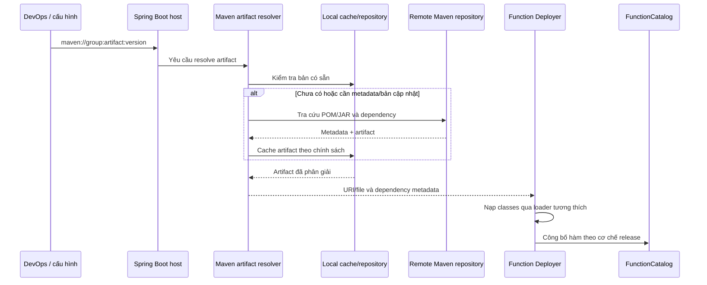
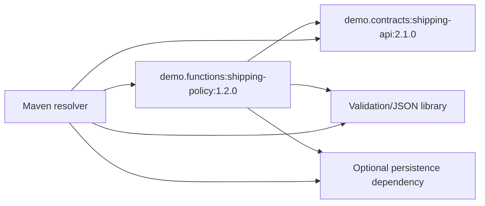
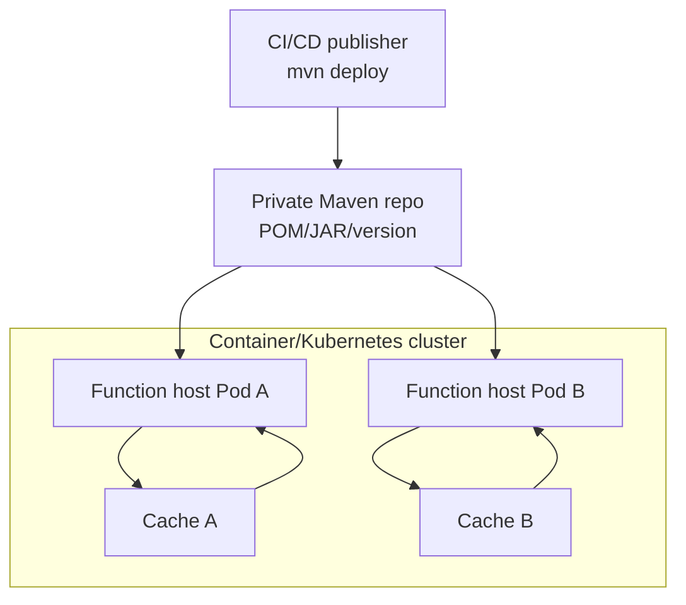

# Tra cứu artifact Maven và tùy chỉnh kho artifact

## 1. Bài toán: function JAR được phát hành ở đâu để host tìm được?

Một nhóm nghiệp vụ xây dựng hàm chuẩn hóa mã đơn hàng rồi đóng gói thành JAR. Nhóm này phát hành phiên bản `1.0.0` lên kho Maven nội bộ. Một ứng dụng Spring Boot khác đóng vai trò **host**: khi khởi động, nó phải lấy đúng JAR cùng các dependency cần thiết, nạp implementation và đưa hàm vào cơ chế gọi của **Spring Cloud Function**.

Nếu chỉ biết đường dẫn `/opt/functions/order-id-normalizer.jar`, bộ phận vận hành phải tự sao chép file lên từng máy hoặc container. Với artifact được quản lý theo Maven coordinates, host có thể **tra cứu bằng định danh artifact**, còn repository đảm nhận việc lưu phiên bản và phân phối tệp. Đây là lý do tồn tại cơ chế `maven:`/`maven://` ở `spring.cloud.function.location` trong những dòng **`spring-cloud-function-deployer`** hỗ trợ Maven artifact resolution.

Trong phạm vi module **`SPRING_CLOUD_FUNCTION`**, ta tiếp tục sử dụng `Supplier`, `Function` và `Consumer` để tách logic nghiệp vụ khỏi giao thức; `FunctionCatalog` để tra cứu và composition; các adapter để gọi cùng logic qua Java, HTTP, messaging hoặc serverless. Chủ đề này tập trung vào **mắt xích trước khi gọi hàm**: định vị và phân giải JAR từ Maven repository, tùy chỉnh repository, rồi xác minh artifact đã được nạp đúng.

**Ba thao tác khác nhau không được đánh đồng:**

1. **Publish**: build và đưa JAR/POM lên Maven repository theo tọa độ và phiên bản.
2. **Resolve/load**: host dùng Maven coordinates trong cấu hình deployer để tìm artifact, tải/đọc cache và nạp các class/dependency.
3. **Register/invoke**: sau khi nạp thành công, `FunctionCatalog` tra cứu hàm đã đăng ký; Java caller hoặc adapter mới kích hoạt `get()`, `apply()` hoặc `accept()`.

> **Lưu ý phiên bản:** tài liệu Spring Cloud Function mô tả Maven URI và bean `MavenProperties` ở phần *Deploying a Packaged Function*. Tên API/cú pháp phụ thuộc bản Spring Cloud Function/Deployer/Resource Resolver được sử dụng. Các ví dụ là hướng dẫn cho **release có hỗ trợ**, không được hiểu là mọi ứng dụng chỉ có `spring-cloud-function-context` đều có thể tải Maven artifact tự động.

## 2. Maven coordinates là gì?

Một Maven artifact thường có định danh:

```text
groupId:artifactId:version
```

Ví dụ:

```text
demo.functions:order-id-normalizer:1.0.0
```

| Thành phần | Ví dụ | Vai trò |
| --- | --- | --- |
| `groupId` | `demo.functions` | Namespace của tổ chức/nhóm phát hành; tránh trùng tên với dự án khác. |
| `artifactId` | `order-id-normalizer` | Tên gói thư viện hàm. |
| `version` | `1.0.0` | Phiên bản bytecode và dependency metadata được phát hành. |
| `packaging` | `jar` | Định dạng artifact, thường được xác định trong POM. |
| `classifier` nếu có | Ví dụ `exec` | Phân biệt biến thể artifact; chỉ dùng khi resolver/release hỗ trợ cú pháp tương ứng. |

Trên một Maven repository có layout tiêu chuẩn, bản JAR ví dụ thường nằm theo cấu trúc:

```text
demo/
  functions/
    order-id-normalizer/
      1.0.0/
        order-id-normalizer-1.0.0.pom
        order-id-normalizer-1.0.0.jar
```

**POM quan trọng không kém JAR** khi hàm có dependency: POM cung cấp metadata để bộ phân giải xác định những thư viện cần thiết theo cơ chế hỗ trợ. Tuy nhiên, việc tải được các dependency chưa tự bảo đảm tương thích classloader, Java version hoặc contract input/output.

### 2.1. Maven coordinate không phải Java class name

`demo.functions:order-id-normalizer:1.0.0` không phải FQCN như `demo.functions.OrderIdNormalizer`. Cả hai đều cần thiết trong ví dụ simple JAR:

- **Coordinate** cho biết **artifact nào** cần tìm.
- **`function-class`** cho biết **class nào** trong artifact được chọn làm function.
- **Tên trong `FunctionCatalog`** cho biết **hàm đã đăng ký** được caller tra cứu bằng chuỗi nào.

Đừng dùng tên JAR hay coordinate làm đối số `catalog.lookup(...)` trừ khi chính runtime đã đăng ký một tên tương ứng theo contract xác nhận được.

## 3. `spring.cloud.function.location` với Maven URI

Tài liệu triển khai packaged function của Spring Cloud Function có ví dụ location dạng:

```properties
spring.cloud.function.location=maven://demo.functions:order-id-normalizer:1.0.0
spring.cloud.function.function-class=demo.functions.OrderIdNormalizer
```

Tương ứng trong YAML:

```yaml
spring:
  cloud:
    function:
      location: "maven://demo.functions:order-id-normalizer:1.0.0"
      function-class: "demo.functions.OrderIdNormalizer"
```

**`maven://...` là URI dành cho Maven artifact resolver của Function Deployer**, không phải một URL HTTP tải trực tiếp từ `maven://` trên trình duyệt. Resolver cần tìm `groupId:artifactId:version` ở local repository/cache hoặc remote repository mà nó được cấu hình sử dụng.

So sánh hai cách chỉ định cùng implementation:

| Location | Cách tìm artifact | Điều kiện cần |
| --- | --- | --- |
| `file:///opt/functions/order-id-normalizer-1.0.0.jar` | Đọc một JAR từ filesystem của JVM host. | File hiện hữu, được mount/copy và có quyền đọc. |
| `maven://demo.functions:order-id-normalizer:1.0.0` | Phân giải Maven coordinates thành JAR và metadata qua resolver. | Artifact được publish/cached, repo truy cập được và resolver có cấu hình phù hợp. |

Một URI Maven hợp lệ **không xác nhận** artifact đã được publish hoặc host có quyền truy cập. Resolve thất bại xảy ra trước bước nạp class; không nên sửa tên `FunctionCatalog` khi lỗi thật là repository trả 404/401.

### 3.1. Khi nào dùng `definition` thay cho `function-class`?

Với **simple library JAR** có lớp công khai `implements Function`, ví dụ dùng `function-class` chọn FQCN. Với **Spring Boot packaged application** có functional bean `@Bean`, cơ chế deployer hỗ trợ thường dùng `spring.cloud.function.definition` để chọn bean/pipeline **đã được đăng ký** thay vì giả định tên method bean là class có thể khởi tạo trực tiếp:

```yaml
# Ví dụ cho loại artifact Boot application có bean quoteShipping
spring:
  cloud:
    function:
      location: "maven://demo.functions:shipping-boot-app:1.0.0"
      definition: quoteShipping
```

Cấu hình Boot JAR trên chỉ có ý nghĩa **khi bản deployer được chọn thực sự hỗ trợ việc phân giải artifact đó và nạp Spring Boot application**. Đặc biệt, một Boot executable JAR có layout `BOOT-INF` khác simple library JAR; các bản đóng gói có classifier hoặc dependency lồng nhau phải được kiểm tra trên release cụ thể.

## 4. Luồng Maven artifact lookup trong Function Deployer



Sơ đồ là **mô hình khái niệm**: cách cache, truy vấn metadata, lựa chọn repository và thời điểm kết nối mạng tùy thư viện resolver/version/configuration. Một local cache còn tồn tại không nhất thiết chứng minh runtime sẽ luôn chạy offline; metadata `SNAPSHOT` hoặc dependency chưa cache có thể cần mạng.

**Các bước chẩn đoán tách biệt**:

1. Có quyền truy cập repo và resolve đúng Maven coordinates?
2. Tải/đọc được JAR **và** metadata/dependency cần thiết?
3. Classloader có nạp được implementation cùng dependencies?
4. Function có được đăng ký đúng tên trong catalog?
5. Adapter HTTP, messaging hoặc serverless có chọn/gọi được function đúng contract?

## 5. Tạo một simple function JAR để publish

Ta dùng một implementation không phụ thuộc Spring hoặc hạ tầng để minh họa:

```java
// src/main/java/demo/functions/OrderIdNormalizer.java
package demo.functions;

import java.util.Locale;
import java.util.function.Function;

public final class OrderIdNormalizer
        implements Function<String, String> {

    public OrderIdNormalizer() {}

    @Override
    public String apply(String rawOrderId) {
        if (rawOrderId == null || rawOrderId.isBlank()) {
            throw new IllegalArgumentException(
                    "orderId must not be blank");
        }
        return rawOrderId.strip()
                .toUpperCase(Locale.ROOT);
    }
}
```

Ví dụ:

```text
apply("  od-204 ")  -> "OD-204"
apply(" ab-07 ")   -> "AB-07"
apply("    ")      -> IllegalArgumentException
```

`Function<String,String>` rõ input/output và dễ test Java thuần. Cơ chế Maven lookup **không thay đổi nghiệp vụ**; chỉ thay cách đưa class đến host. Sau khi catalog tra cứu được, hàm vẫn dùng `apply()` như khi chạy với một JAR file tại `file:///...`.

### 5.1. POM của function artifact

Một `pom.xml` độc lập tối giản, dùng Maven để build JAR từ Java 17:

```xml
<?xml version="1.0" encoding="UTF-8"?>
<project xmlns="http://maven.apache.org/POM/4.0.0"
         xmlns:xsi="http://www.w3.org/2001/XMLSchema-instance"
         xsi:schemaLocation="http://maven.apache.org/POM/4.0.0 https://maven.apache.org/xsd/maven-4.0.0.xsd">
    <modelVersion>4.0.0</modelVersion>
    <groupId>demo.functions</groupId>
    <artifactId>order-id-normalizer</artifactId>
    <version>1.0.0</version>
    <packaging>jar</packaging>
    <properties>
        <maven.compiler.release>17</maven.compiler.release>
        <project.build.sourceEncoding>UTF-8</project.build.sourceEncoding>
    </properties>
    <build>
        <plugins>
            <plugin>
                <groupId>org.apache.maven.plugins</groupId>
                <artifactId>maven-compiler-plugin</artifactId>
                <version>3.13.0</version>
            </plugin>
        </plugins>
    </build>
</project>
```

POM này có thể tạo một JAR thư viện chứa `demo/functions/OrderIdNormalizer.class`. Nó chưa có unit test dependency hoặc phân phối lên remote repository. Nếu project cần chạy JUnit 5, phải bổ sung JUnit Jupiter và Surefire/test configuration tương thích.

Lệnh minh họa cho người học thực hành trong **dự án nguồn hàm**:

```bash
mvn package
jar tf target/order-id-normalizer-1.0.0.jar
```

Việc file xuất hiện trong thư mục `target` **không đồng nghĩa đã được publish** lên bất kỳ Maven repository nào.

## 6. Phân biệt package, install và deploy trong Maven

| Lệnh Maven | Tác dụng chính | Host ở máy khác có tự thấy artifact không? |
| --- | --- | --- |
| `mvn package` | Biên dịch/đóng gói JAR tại `target` của project. | Không. |
| `mvn install` | Đặt artifact và metadata vào **local Maven repository của môi trường chạy lệnh**. | Không, nếu host dùng filesystem/repository khác. |
| `mvn deploy` | Đẩy artifact/POM lên remote repository đã được cấu hình cho project. | Có thể, **nếu** host truy cập đúng repository và được phép tải. |

```bash
# Trên máy build hoặc trong bài thực hành của người học
mvn install
```

Với Maven CLI thông thường, local repo mặc định thường nằm dưới `~/.m2/repository`. Tuy nhiên, **resolver của Function Deployer có cấu hình `MavenProperties` riêng**, nên không mặc nhiên cho rằng nó dùng chính local repo của một người phát triển. Đặc biệt trong container, mỗi replica có thể có filesystem/cache riêng.

Nếu chỉ chạy `mvn install` trên laptop, host trong Kubernetes **không thể** resolve từ laptop khi host không chia sẻ repository đó. Một phương án phát hành nghiêm túc cần remote artifact repository có quyền truy cập và lịch sử version rõ ràng.

### 6.1. Cấu hình nơi `mvn deploy` đưa artifact lên

Trong POM của **project phát hành function**, có thể khai báo `distributionManagement`:

```xml
<distributionManagement>
    <repository>
        <id>company-releases</id>
        <url>https://repo.example.invalid/repository/function-releases/</url>
    </repository>
    <snapshotRepository>
        <id>company-snapshots</id>
        <url>https://repo.example.invalid/repository/function-snapshots/</url>
    </snapshotRepository>
</distributionManagement>
```

Đây là **trích đoạn chèn vào POM**, không phải một file XML độc lập. `repo.example.invalid` là địa chỉ minh họa, không có dịch vụ thật. Project version `1.0.0` dùng releases repository; `1.1.0-SNAPSHOT` thường dùng snapshots repository theo cấu hình Maven plugin/repository.

Lệnh minh họa:

```bash
mvn deploy
```

**`distributionManagement` chỉ xác định nơi project phát hành bằng Maven CLI**. Nó **không tự cấu hình repository từ xa cho Spring Boot host**: resolver trên host phải có repository, credentials và kết nối mạng riêng. Hai bên đều có thể dùng Maven coordinates giống nhau nhưng hệ thống credential và thời điểm truy cập khác nhau.

## 7. Maven repository nội bộ, public, local và cache

| Loại kho | Vai trò | Rủi ro/cân nhắc |
| --- | --- | --- |
| **Local repository/cache** | Giữ artifact đã tải hoặc được cài qua `mvn install` trên máy/container cụ thể. | Không được chia sẻ tự động giữa các host; có thể lỗi thiếu bản hoặc metadata cũ. |
| **Maven Central/public repo** | Phân phối artifact công khai phù hợp với chính sách dự án. | Không thích hợp cho logic proprietary chưa được phép công bố. |
| **Nexus/Artifactory/private Maven-compatible repo** | Phát hành artifact nội bộ, phân quyền, lưu version và metadata. | Cần xác thực, TLS, khả dụng, retention và cấu hình resolver. |
| **Repository mirror/proxy** | Cache hoặc điều phối request tới nguồn được phê duyệt. | Có thể chỉ có một số repo upstream hoặc giới hạn quyền/loại artifact. |

Một kho nội bộ có thể được gọi là `company-releases` trong Maven CLI, còn host dùng một key như `companyFunctions` trong map repositories của `MavenProperties`. **Key của resolver**, **repository ID** và **Maven groupId** không phải cùng một khái niệm; cần quy ước rõ khi dùng credential, mirror và log.

Khi ứng dụng được triển khai ở nhiều container, mỗi container có thể tải về cache riêng. Cache làm tăng tốc khởi động về sau nhưng không nên là **nguồn sự thật** cho version và provenance. Nên pin version cụ thể, có chính sách giữ artifact ở repository và xác nhận checksum khi phát hành.

## 8. Tùy chỉnh MavenProperties trong ứng dụng chủ

Theo tài liệu *Deploying a Packaged Function* của Spring Cloud Function, resolver dùng `MavenProperties` với các giá trị mặc định cho tài nguyên Maven thông dụng. Khi cần thay **vị trí local repository**, **danh sách remote repositories** hoặc thuộc tính liên quan đến kết nối/tài khoản, host có thể khai báo một bean `MavenProperties` trên release hỗ trợ cách tích hợp này.

```java
// src/main/java/demo/host/MavenArtifactConfiguration.java
package demo.host;

import java.util.LinkedHashMap;
import java.util.Map;

import org.springframework.cloud.deployer.resource.maven.MavenProperties;
import org.springframework.context.annotation.Bean;
import org.springframework.context.annotation.Configuration;

@Configuration(proxyBeanMethods = false)
public class MavenArtifactConfiguration {

    @Bean
    public MavenProperties mavenProperties() {
        MavenProperties properties = new MavenProperties();

        // Đường dẫn cache mà JVM host có quyền đọc/ghi.
        properties.setLocalRepository("/var/cache/function-maven");

        Map<String, MavenProperties.RemoteRepository> repos =
                new LinkedHashMap<>();
        repos.put("companyFunctions",
                new MavenProperties.RemoteRepository(
                        "https://repo.example.invalid/repository/function-releases/"));
        properties.setRemoteRepositories(repos);

        return properties;
    }
}
```

`repo.example.invalid` là **placeholder**, không phải một dịch vụ có thể tải artifact. Đoạn mã minh họa các API `MavenProperties` và `RemoteRepository` được dùng trong dòng Spring Cloud Deployer Resource phù hợp; **cần đối chiếu import, constructor, setter và dependency trên release thực tế**.

### 8.1. Đổi local repository

```java
// Một ví dụ thay thế tối giản khi chỉ cần đổi local cache.
@Bean
MavenProperties mavenProperties() {
    MavenProperties properties = new MavenProperties();
    properties.setLocalRepository("/var/cache/function-maven");
    return properties;
}
```

Đây là **biến thể thay thế**, không khai báo song song với bean `mavenProperties()` trước đó trong cùng context. Thư mục phải tồn tại/được tạo được, có quyền đọc/ghi đối với user chạy JVM. Với container chỉ cho phép filesystem read-only, cần cấp volume/cache được kiểm soát.

**Đổi local repository không tự cấu hình remote repository.** Nếu artifact hoặc dependency chưa có ở cache, host vẫn phải truy cập một nguồn phù hợp.

### 8.2. Cấu hình nhiều remote repositories

Ví dụ trích đoạn trong **method tạo bean ở mục 8**:

```java
Map<String, MavenProperties.RemoteRepository> repos =
        new LinkedHashMap<>();
repos.put("companyFunctions",
        new MavenProperties.RemoteRepository(
                "https://repo.example.invalid/repository/function-releases/"));
repos.put("companySnapshots",
        new MavenProperties.RemoteRepository(
                "https://repo.example.invalid/repository/function-snapshots/"));
properties.setRemoteRepositories(repos);
```

Các repo ID trong map là nhãn nội bộ để cấu hình/nhận diện nguồn. **Không suy ra thứ tự map là chính sách ưu tiên cố định của mọi Maven resolver.** Phải xác nhận release resolver hỗ trợ releases/SNAPSHOT, authentication, mirror và xử lý lỗi ra sao.

Nếu custom map thay thế danh sách repository mặc định, cần đảm bảo các **dependency công khai** vẫn được tìm thấy ở một repository được phép hoặc ở một Maven group/proxy repository nội bộ. Một JAR chính có thể resolve được nhưng class vẫn nạp lỗi do dependency bên ngoài chưa có.

### 8.3. Có thể dùng `maven.*` properties thay bean không?

Một số ứng dụng dùng Spring Cloud Deployer Resource có property binding dạng `maven.local-repository` và `maven.remote-repositories.<id>.url`. **Không khẳng định host dùng Spring Cloud Function Deployer tự bind các property ấy chỉ vì dependency có MavenProperties.** Tài liệu Function Deployer mô tả cách rõ ràng là **cung cấp một bean `MavenProperties`**. Nếu muốn dùng cấu hình properties thuần, phải xác minh host thực sự bật binding tương ứng.

Ví dụ chỉ có tính chất minh họa khi **binding đã được xác nhận**:

```properties
maven.local-repository=/var/cache/function-maven
maven.remote-repositories.companyFunctions.url=https://repo.example.invalid/repository/function-releases/
```

Không nên trộn cả hai cách cấu hình mà không kiểm tra bean nào được sử dụng, nguồn nào là effective configuration và có repository mặc định nào bị vô hiệu hóa.

## 9. Repository private: authentication, TLS và secret

Với Maven repository nội bộ (Nexus, Artifactory hoặc dịch vụ Maven-compatible khác), cần phân biệt các loại quyền:

| Thành phần | Quyền cần có | Hành động |
| --- | --- | --- |
| **CI/CD publisher** | Write/publish vào releases hoặc snapshots. | `mvn deploy` và upload JAR/POM. |
| **Spring Cloud Function host** | **Read/resolve** artifact và dependency. | Tải JAR/POM khi khởi động hoặc theo lifecycle deployer. |
| **HTTP/Kafka caller** | Gọi API hoặc publish/subscribe message. | Không cần biết token Maven repository. |

Một token có quyền publish không nên được đưa vào host chỉ để đọc artifact. Áp dụng **least privilege** riêng cho publisher và resolver.

### 9.1. Maven settings.xml cho publisher

Maven CLI thường tìm credential theo `<server><id>` trong `settings.xml`. Ví dụ trích đoạn cho **máy build/publisher**:

```xml
<settings xmlns="http://maven.apache.org/SETTINGS/1.2.0">
    <servers>
        <server>
            <id>company-releases</id>
            <username>${env.MAVEN_PUBLISH_USER}</username>
            <password>${env.MAVEN_PUBLISH_TOKEN}</password>
        </server>
    </servers>
</settings>
```

Đoạn này dùng tên biến môi trường làm placeholder và **không chứa credential thực**. Maven CLI cần được cấu hình để đọc chúng từ CI secrets. Không commit mật khẩu thật vào POM, settings.xml trong source control, application YAML hoặc log.

**Không mặc nhiên suy ra `MavenProperties` của host tự đọc cùng `settings.xml`, `<server><id>` hoặc token của Maven CLI.** Phải kiểm tra API authentication của `MavenProperties.RemoteRepository` trên phiên bản resolver đang dùng; inject **read-only** credential bằng secret manager/Kubernetes Secret/environment mechanism được kiểm soát.

### 9.2. HTTPS, proxy và chứng chỉ

- Dùng TLS, CA chain tin cậy và kiểm tra hostname, thay vì tắt SSL verification để “sửa” lỗi tải artifact.
- Nếu qua corporate proxy, phải cấu hình proxy mà Maven resolver/runtime thực sự sử dụng; cấu hình Maven CLI ở máy build chưa chắc được host sử dụng.
- Không nhúng `username:password@repo-host` vào URI vì nó có thể bị lộ trong log, exception hoặc tracing.
- Nếu repository redirect sang domain lưu trữ khác, DNS, firewall và truststore của host cũng phải cho phép.
- Phân biệt **401** (thiếu/sai authentication), **403** (không được cấp quyền), lỗi TLS, DNS và timeout mạng.

### 9.3. Một Maven URI có thể trở thành đường thực thi code

`maven://group:artifact:version` **không chỉ là chuỗi cấu hình bình thường**: nó quyết định bytecode nào được host nạp. Nếu để một HTTP client tùy ý chọn `spring.cloud.function.location`, ứng dụng có thể vô tình cấp khả năng thực thi mã tùy ý trong JVM.

Chỉ cho phép artifact đã được kiểm duyệt từ repositories được tin cậy, pin version, kiểm tra provenance và giới hạn quyền process. **Classloader không phải security sandbox**. Nếu cần chạy plugin không tin cậy, cân nhắc tách process/container có API contract và quyền truy cập riêng.

## 10. Chọn version: release, SNAPSHOT và reproducibility

### 10.1. Release artifact

```text
maven://demo.functions:order-id-normalizer:1.0.0
```

Trong quy trình phát hành được kiểm soát, `1.0.0` là **release version bất biến**: không ghi đè cùng coordinate bằng bytecode mới. Nếu bị ghi đè, hai host có cache khác nhau có thể chạy hai bản code mà log vẫn hiển thị một version.

### 10.2. SNAPSHOT artifact

```text
maven://demo.functions:order-id-normalizer:1.1.0-SNAPSHOT
```

SNAPSHOT có thể dùng metadata và timestamped artifacts để xác định bản mới, tùy cách publish và chính sách update của resolver. **Không sử dụng SNAPSHOT cho production cần tái lập chính xác** nếu chưa có biện pháp khóa snapshot version/digest và thử hành vi cache/update.

### 10.3. Version range và alias

Không mặc định Maven resolver của Function Deployer hỗ trợ `LATEST`, `RELEASE` hoặc range như `[1.0,2.0)`. Dù Maven ecosystem có những khái niệm này, **cú pháp và ngữ nghĩa của URI `maven:` phải được xác nhận theo release**. Đối với production, **pin version** để dễ trace và rollback.

### 10.4. Version artifact khác version hợp đồng nghiệp vụ

Nếu `1.1.0` thay quy tắc chuẩn hóa nhưng vẫn giữ `Function<String,String>`, caller có thể bị ảnh hưởng về **semantics** dù type signature không đổi. Cần quản lý song song:

- **Artifact version** — bytecode/POM cụ thể.
- **Contract/schema version** — ý nghĩa dữ liệu, response/error, ngữ nghĩa của quy tắc.
- **Function/catalog name** — định nghĩa được caller/adapter chọn.
- **Deployment version** — image/config/repository coordinate thực tế đang chạy.

## 11. Phụ thuộc bắc cầu và classloader khi resolve Maven artifact

Một simple JAR chỉ dùng `java.util.function` và JDK có thể không có dependency ngoài. Nhưng JAR xử lý nghiệp vụ thực tế có thể yêu cầu shared API, validation, JSON library hoặc database client.



POM cho phép Maven dependency resolution tìm những phụ thuộc phù hợp, nhưng **`maven://...` không bảo đảm mọi dependency có thể nạp vào runtime**:

1. JAR và POM phải được publish đủ, đúng tọa độ.
2. Repository của host phải cung cấp dependency, có authentication phù hợp.
3. Dependency scopes/exclusions phải đúng; `test` và `provided` không mặc nhiên có trong runtime.
4. JDK host phải hiểu bytecode và API của JAR/dependency.
5. Loader của deployer phải giải quyết classloader identity và thứ tự classpath đúng cách.
6. Với Spring Boot executable JAR, layout `BOOT-INF/classes`/`BOOT-INF/lib` cần được loader/deployer hỗ trợ.

| Triệu chứng | Có thể do |
| --- | --- |
| JAR chính resolve được, dependency con trả 404 | POM tham chiếu thư viện không có trong kho được cấu hình. |
| `NoClassDefFoundError` | Loader không nhìn thấy class phụ thuộc. |
| `NoSuchMethodError` | Class cùng tên nhưng phiên bản API không tương thích. |
| `ClassCastException` | Host và JAR dùng DTO qua classloader không tương thích. |
| `UnsupportedClassVersionError` | JAR hoặc dependency build cho Java mới hơn JVM host. |

**Không chữa lỗi bằng cách thêm tất cả thư viện vào host classpath một cách mù quáng.** Làm vậy có thể tạo xung đột version và mất lợi ích cô lập của loader. Hãy kiểm tra POM, dependency graph, loại artifact, version Spring/Java và loader trước.

## 12. Host Spring Boot resolve và kiểm tra FunctionCatalog

### 12.1. Dependency trong host

Ở những dòng phát hành có Function Deployer hỗ trợ Maven URI, dependency chính là:

```xml
<dependency>
    <groupId>org.springframework.cloud</groupId>
    <artifactId>spring-cloud-function-deployer</artifactId>
</dependency>
```

Phải dùng dependency management phù hợp để chọn Spring Boot, Spring Cloud Function và Spring Cloud Deployer Resource **tương thích**. Không trộn version của các ví dụ thuộc release khác nhau.

Entry point ví dụ:

```java
package demo.host;

import org.springframework.boot.SpringApplication;
import org.springframework.boot.autoconfigure.SpringBootApplication;

@SpringBootApplication
public class MavenFunctionHostApplication {
    public static void main(String[] args) {
        SpringApplication.run(
                MavenFunctionHostApplication.class, args);
    }
}
```

Cấu hình `application.yml` cho **simple function JAR**:

```yaml
spring:
  main:
    web-application-type: none
  cloud:
    function:
      location: "maven://demo.functions:order-id-normalizer:1.0.0"
      function-class: "demo.functions.OrderIdNormalizer"
```

`spring.main.web-application-type: none` chỉ nhằm minh họa host chạy **console/non-web**. Nếu muốn endpoint HTTP, cần web adapter và không tắt web server. Việc resolve JAR Maven **không tự khởi chạy HTTP server**.

### 12.2. Tra cứu bằng tên đã đăng ký thực tế

Tên class `demo.functions.OrderIdNormalizer` không bảo đảm tên catalog là `orderIdNormalizer` trên mọi release. Hãy kiểm tra log/registry hoặc contract đăng ký trước khi lookup.

Một smoke runner đặt trong host:

```java
package demo.host;

import java.util.function.Function;
import org.springframework.beans.factory.annotation.Value;
import org.springframework.boot.ApplicationRunner;
import org.springframework.cloud.function.context.FunctionCatalog;
import org.springframework.context.annotation.Bean;
import org.springframework.context.annotation.Configuration;

@Configuration
public class CatalogSmokeCheck {
    @Bean
    ApplicationRunner verifyFunction(
            FunctionCatalog catalog,
            @Value("${demo.function.lookup-name}") String name) {
        return args -> {
            Function<String, String> function = catalog.lookup(name);
            if (function == null) {
                throw new IllegalStateException(
                        "Function not found: " + name);
            }

            String result = function.apply("  od-204 ");
            if (!"OD-204".equals(result)) {
                throw new IllegalStateException(
                        "Unexpected result: " + result);
            }
            System.out.println("Resolved artifact/function OK: " + name);
        };
    }
}
```

`demo.function.lookup-name` là **property tự định nghĩa của host**, không phải Spring Cloud Function property. Chỉ dùng tên sau nếu đã xác nhận đăng ký tương ứng:

```yaml
demo:
  function:
    lookup-name: orderIdNormalizer
```

Trên runtime tương thích, gọi `apply()` xảy ra trong tiến trình host sau khi resolver tìm được artifact và deployer đưa implementation vào catalog. Nếu input/output là DTO riêng, phải kiểm tra type/classloader và message conversion trước khi ép kiểu Java.

### 12.3. Đừng nhầm Maven coordinate với function definition

| Cấu hình | Ý nghĩa |
| --- | --- |
| `spring.cloud.function.location=maven://demo.functions:order-id-normalizer:1.0.0` | **Tìm artifact** để nạp. |
| `spring.cloud.function.function-class=demo.functions.OrderIdNormalizer` | **Chọn implementation class** trong simple JAR theo cơ chế hỗ trợ. |
| `spring.cloud.function.definition=orderIdNormalizer` | **Chọn function đã có** cho adapter hoặc pipeline. |
| `demo.function.lookup-name=orderIdNormalizer` | Property của smoke runner riêng, không phải API framework. |

`definition` không tự tải artifact; thay `definition` không giải quyết 404/401 từ Maven repo. Ngược lại, artifact đã tải được chưa bảo đảm một bean/function có tên đúng để adapter sử dụng.

## 13. Maven lookup và nhiều loại functional bean

Một JAR có thể chứa các implementation khác nhau:

```java
Supplier<String> produceOrderId;
Function<String, String> normalizeOrderId;
Consumer<String> auditOrderId;
```

Với simple JAR và `function-class`, cơ chế chọn lớp cần phù hợp loại function. Với Boot JAR có nhiều `@Bean`, `definition` lựa chọn function/pipeline **đã đăng ký** theo release hỗ trợ.

| Loại | Khi được gọi | Điều Maven lookup không tự thực hiện |
| --- | --- | --- |
| `Supplier<T>` | `get()` tạo dữ liệu. | Không đặt lịch poller. |
| `Function<T,R>` | `apply(T)` chuyển input thành result. | Không tự xử lý JSON/HTTP hoặc định nghĩa Kafka topic. |
| `Consumer<T>` | `accept(T)` thực hiện side effect. | Không tự bảo đảm transaction, idempotency hay broker acknowledgment. |

Đối với composition như `normalizeOrderId|validateOrderId`, các function phải có **tên được đăng ký** và kiểu output/input tương thích. Maven resolver có thể cung cấp artifact chứa các class, nhưng **không tự ghép tất cả hàm thành pipeline**; dùng `FunctionCatalog`/definition và test runtime riêng.

### 13.1. HTTP, messaging và serverless là lớp khác

Sau khi hàm đã có trong catalog:

- HTTP adapter chuyển request thành input và result thành response; cần cấu hình web/runtime, route và content type.
- Spring Cloud Stream binder kết nối function definition với input/output destination, serializer, retry và consumer group.
- Serverless adapter/handler xử lý cloud event envelope và deployment/IAM theo nền tảng.

Không phải chỉ vì repository đã resolve JAR mà HTTP endpoint tự tồn tại. Một function `Consumer` có side effect vẫn có thể được gọi lại bởi broker; Maven repository không can thiệp delivery semantics.

## 14. Host trong Docker/Kubernetes và quyền tải artifact

Trong môi trường container, **host runtime** mới là nơi Maven artifact resolver thực thi. Artifact cache của laptop không tự xuất hiện trong container và mạng của CI có thể khác mạng của Pod.

Một sơ đồ triển khai:



### 14.1. Trước khi cho Pod nhận traffic

- Pod có DNS/network egress đến repository và các dependency endpoints cần thiết.
- Runtime có CA/truststore và credentials **read-only**, nếu repo là private.
- Local cache directory có quyền và dung lượng phù hợp với nhiều dependency.
- JAR đã phân giải, classloader/bean đã đăng ký, smoke test đã chạy; **readiness** không nên báo ready khi function quan trọng chưa tồn tại.
- Mỗi replica được pin cùng artifact version và quan sát được checksum/metadata.
- Repository có chính sách giữ releases, không xóa artifact đang được deployment tham chiếu.

Nếu cluster bị chặn egress hoàn toàn, một Pod mới không có cache có thể **không khởi động được** khi phải tải JAR/dependency. Lúc đó cân nhắc preload/publish artifact vào image, mount cache đáng tin cậy hoặc dùng `file:///...` với JAR đã được đưa vào container trong bước build/initialization.

### 14.2. Local cache không phải nguồn truth

Một cache `/var/cache/function-maven` dùng chung có thể cải thiện thời gian tải nhưng cần xem xét concurrency, quyền file, corrupt cache, cleanup và khác biệt runtime. Dùng shared writable volume giữa nhiều Pod chỉ khi có cơ chế hỗ trợ an toàn. Trong nhiều trường hợp, cache **riêng từng Pod** cộng repository bất biến dễ kiểm soát hơn.

### 14.3. Rollout version

Muốn chuyển `1.0.0` lên `1.1.0`:

1. Publish JAR/POM `1.1.0` và các dependency cần thiết.
2. Test resolver trong môi trường giống production (kho, certificate, auth, proxy).
3. Đổi `spring.cloud.function.location` sang coordinate `1.1.0` và tạo một rollout/restart có kiểm soát.
4. Xác nhận tên function, kết quả test và version/checksum thực tế trên từng replica.
5. Theo dõi lỗi nạp, latency, resource và thông điệp bất thường; rollback về `1.0.0` nếu cần.

**Đổi coordinate trong configuration file không tự hot swap bytecode đã nạp**. Nếu bản deployer không có cơ chế thay classloader/registry an toàn được xác nhận, hãy coi việc đổi version là một lần triển khai host mới.

## 15. Chẩn đoán khi Maven artifact không được tìm thấy

Một tình huống có nhiều dạng lỗi: host log rằng không nạp được function. Hãy xác định **nó thất bại ở bước nào** thay vì thay đổi class name, version và repository cùng lúc.

| Dấu hiệu/exception | Khả năng nguyên nhân | Hướng kiểm tra |
| --- | --- | --- |
| Artifact not found, HTTP **404** từ repository | Sai `groupId:artifactId:version`, chưa publish hoặc repo không chứa bản ấy. | Tra POM/JAR bằng quyền host, kiểm tra đúng releases/SNAPSHOT repository. |
| HTTP **401** | Không có hoặc sai token/user. | Kiểm tra cách `MavenProperties` nhận credentials, secret injection, hết hạn token. |
| HTTP **403** | User có danh tính nhưng thiếu quyền đọc. | Kiểm tra ACL/quyền repository, group và đường dẫn artifact. |
| DNS/Connect timeout | Host không truy cập được repo. | DNS trong container, egress firewall/network policy, proxy, port. |
| TLS handshake/PKIX error | CA, certificate hoặc hostname verification không phù hợp. | Kiểm tra truststore, chuỗi chứng chỉ và URL. |
| Maven resolver không tìm dependency con | POM thiếu/sai, dependency không ở repo, scope hoặc policy lỗi. | Phân tích dependency metadata và repo cấu hình thực tế. |
| `ClassNotFoundException` | JAR tải được nhưng không chứa FQCN, sai package hoặc layout. | `jar tf`, `function-class` và cấu trúc artifact. |
| `NoClassDefFoundError` | Lớp phụ thuộc không được nạp vào loader. | Kiểm tra dependency và classloader thay vì chỉ URL repo. |
| `UnsupportedClassVersionError` | JDK host cũ hơn JDK dùng biên dịch bytecode. | So sánh Java compiler release và runtime. |
| `FunctionCatalog.lookup(...)` trả `null` | Function chưa đăng ký hoặc lookup sai tên. | Log nạp/registration, tên catalog thực tế, definition. |
| Hàm lookup được nhưng HTTP 404 | Web adapter/route thiếu hoặc sai. | Kiểm tra web dependency, mapping, port, function exposure. |
| Kafka không nhận message | Stream binder/binding/definition không đúng. | Kiểm tra topic, group, broker, converter và trạng thái consumer. |

### 15.1. Đường phân tích lỗi gợi ý

```text
Maven coordinate đúng?
   |
   +-- Không --> Sửa groupId / artifactId / version
   |
   v
Host truy cập remote/local repository?
   |
   +-- Không --> Kiểm tra 401/403, DNS, proxy, CA, credentials
   |
   v
JAR/POM và dependency có thể resolve?
   |
   +-- Không --> Kiểm tra metadata, scope, repository policy
   |
   v
Classloader nạp implementation?
   |
   +-- Không --> Kiểm tra FQCN, packaging, JDK, dependency
   |
   v
FunctionCatalog lookup được tên đúng?
   |
   +-- Không --> Kiểm tra bean/registration/definition
   |
   v
Adapter gọi hàm và chuyển đổi payload đúng?
```

**Đừng đổi `spring.cloud.function.function-class` vì 401 repository**, cũng đừng sửa token Maven khi lỗi thật nằm ở tên HTTP endpoint. Phân tích theo từng tầng giúp giữ thông tin chẩn đoán rõ ràng.

## 16. Những nhầm lẫn thường gặp

| Nhầm lẫn | Giải thích đúng |
| --- | --- |
| “`mvn package` thành công tức Maven URI tải được.” | `package` chỉ tạo output trong project; cần install vào local đúng máy hoặc deploy lên repo host truy cập. |
| “Đã `mvn install` trên laptop, Pod chắc chắn thấy.” | Local repository không được chia sẻ mặc định giữa môi trường. |
| “POM `distributionManagement` là cấu hình tải của host.” | Nó chủ yếu phục vụ **publisher**; host resolver có cấu hình riêng. |
| “Có dependency `spring-cloud-function-context` là tự resolve `maven://`.” | Cần cơ chế **Function Deployer/resource resolver** tương ứng. |
| “`maven://` luôn dùng Maven Central.” | Danh sách local/remote repositories phụ thuộc `MavenProperties` và release. |
| “Đổi JAR version trong config là thay code đang chạy ngay.” | Classloader/code đã nạp không mặc nhiên hot reload. |
| “Tải được JAR nghĩa là function được đăng ký.” | Còn bước classloading, bean discovery và catalog registration. |
| “Function trong Maven repo là API HTTP công khai.” | Maven repo phân phối **artifact**; HTTP adapter công bố **hàm được phép**. |
| “SNAPSHOT giống release bất biến.” | Snapshot metadata/artifact có thể đổi theo phiên bản/policy. |
| “Maven resolver dùng chính tài khoản của Maven CLI.” | Credentials/settings của host phải được xác nhận riêng. |
| “Giấu địa chỉ repo đủ để an toàn.” | Cần TLS, quyền truy cập, checksum/provenance, giới hạn code được nạp và quyền host. |

## 17. Kiểm thử theo từng ranh giới

### 17.1. Unit test implementation

Test logic trước khi đóng gói:

```java
package demo.functions;

import static org.junit.jupiter.api.Assertions.assertEquals;
import static org.junit.jupiter.api.Assertions.assertThrows;
import org.junit.jupiter.api.Test;

class OrderIdNormalizerTest {
    private final OrderIdNormalizer fn = new OrderIdNormalizer();

    @Test
    void normalizesOrderId() {
        assertEquals("OD-204", fn.apply("  od-204 "));
    }

    @Test
    void rejectsBlankInput() {
        assertThrows(IllegalArgumentException.class,
                () -> fn.apply("   "));
    }
}
```

Ví dụ test cần dependency JUnit Jupiter và test runner trong project. Unit test xác nhận **quy tắc**, không kiểm tra repository hay deployer.

### 17.2. Artifact repository test

Sau khi build/publish từ môi trường CI:

1. Xác minh JAR và POM cùng version `1.0.0` đã thực sự có trong repository.
2. Dùng **credentials read-only của host** để resolve artifact, thay vì token publish của CI.
3. Kiểm tra version, checksum và sự tồn tại của dependencies; thử cả cold cache.
4. Xác minh policy với `SNAPSHOT` nếu môi trường thực sự sử dụng.
5. Kiểm tra secret không bị in ra log/exception và việc cấp/quản lý quyền được tuân thủ.

Một Maven CLI trên laptop tải được artifact chưa chứng minh resolver trong Pod cũng tải được: Pod có network, proxy, truststore và `MavenProperties` khác.

### 17.3. Integration test của Function Deployer

Trong host chạy **release hỗ trợ Maven URI**:

- Cấu hình `location=maven://demo.functions:order-id-normalizer:1.0.0`.
- Xác nhận có bean `MavenProperties` nếu cần repo nội bộ và resolver dùng đúng cấu hình.
- Khởi động host với local cache rỗng và một repository thử nghiệm đã publish JAR.
- Xác nhận artifact được resolve, `OrderIdNormalizer` nạp và khởi tạo thành công.
- Xác nhận **tên catalog thực tế** và gọi `apply("  od-204 ")` trả `OD-204`.
- Thử sai coordinate, sai FQCN, dependency thiếu và lỗi repo 401/404.
- Kiểm tra hai host/replica có cùng artifact version và kết quả.

Không được coi `FunctionCatalog.lookup(...)` trả `null` là cùng loại lỗi với HTTP 401: cần kiểm tra log từ bước Maven resolver và classloader để tìm nguyên nhân gốc.

### 17.4. Adapter contract test

Nếu cài thêm web adapter, test HTTP method, route, content type, output và error mapping. Nếu dùng Spring Cloud Stream, test binding/destination, broker access, conversion, consumer group, retry/DLQ. Nếu dùng serverless, test handler, event envelope, timeout và failure semantics.

**Cùng implementation JAR không có nghĩa toàn bộ các adapter phải hoạt động giống nhau.** Function Deployer chỉ giải quyết đường **nạp code**; broker/HTTP/serverless runtime có hợp đồng riêng.

## 18. Bài tập thực hành: từ Maven repository đến FunctionCatalog

Mục tiêu là xây **một function library**, **một host** và **một repository thử nghiệm**.

1. Tạo `OrderIdNormalizer implements Function<String,String>` và viết unit test cho input `"  od-204 "`, input rỗng.
2. Build JAR `demo.functions:order-id-normalizer:1.0.0`; dùng `jar tf` xác minh `demo/functions/OrderIdNormalizer.class`.
3. Chạy `mvn install` trên máy thực hành; giải thích vì sao local repository chỉ áp dụng cho môi trường đó.
4. Cấu hình `distributionManagement` với Maven repository thử nghiệm và thực hiện `mvn deploy` khi có quyền publish; xác nhận JAR và POM tồn tại.
5. Tạo host Spring Boot có `spring-cloud-function-deployer` phiên bản tương thích. Cấu hình `spring.cloud.function.location=maven://demo.functions:order-id-normalizer:1.0.0` cùng `function-class`.
6. Khi dùng repo riêng, cấu hình bean `MavenProperties` cho local cache và remote repo. Kiểm tra host có thể tải artifact với quyền read-only.
7. Xác minh tên thực tế trong `FunctionCatalog` rồi dùng Java runner gọi `apply("  od-204 ")`.
8. Xóa cache ở **môi trường thử nghiệm** theo cách an toàn và thử cold resolution; không xóa bừa repository đang được service khác sử dụng.
9. Cố ý đổi `version` sang bản không tồn tại và quan sát lỗi resolve; phục hồi lại coordinate đúng.
10. Cố ý cấu hình repo không có quyền đọc và phân biệt lỗi 401/403 với lỗi 404.
11. Phát hành `1.1.0`, thay Maven coordinate trong host và rollout/restart có kiểm soát; xác nhận bản mới được nạp.
12. Tùy chọn thêm HTTP/Stream adapter, dùng một hợp đồng payload được phép và test route/bindings riêng.

**Tiêu chí đạt:** người học có thể chỉ ra **artifact đang ở repo nào, coordinate nào được resolve, phiên bản bytecode nào thực sự chạy, tên nào được catalog đăng ký và adapter nào kích hoạt hàm**. Các lỗi repository và lỗi function registration phải được nhận diện riêng biệt.

## 19. Checklist vận hành

Trước khi dùng Maven lookup cho function production, hãy kiểm tra:

1. Spring Cloud Function Deployer và Maven resource resolver **có hỗ trợ đúng URI/API** trên bản release đã chọn.
2. `groupId`, `artifactId` và `version` đã được xác nhận; artifact có POM đúng và dependency đầy đủ.
3. Remote repository được quản lý rõ ràng, có SLA, retention, backup và quyền read-only cho runtime.
4. HTTPS, DNS, proxy, truststore và Kubernetes network policy cho phép host truy cập.
5. Credential được inject qua cơ chế secret phù hợp, không nhúng vào POM, URI hoặc log.
6. Local cache có quyền và dung lượng; quy trình cold start không phụ thuộc vào cache chỉ có trên laptop.
7. Release artifacts bất biến, version được pin và checksum/provenance được đối chiếu.
8. Classloader/Java version/dependency tương thích; các DTO có contract rõ.
9. Function được đăng ký dưới tên đã xác minh, không đoán từ tên JAR.
10. HTTP/Stream/serverless adapters có kiểm thử độc lập về serialization, retry, security và error behavior.
11. Có health/readiness check phù hợp, monitoring cho lỗi repository, startup và function invocation.
12. Có quy trình rollout/rollback cho coordinate mới, không dựa vào hot reload ngầm định.

## 20. Tài liệu tham khảo và giới hạn áp dụng

Tài liệu chính thức nên đối chiếu với bản runtime đang sử dụng:

- [Spring Cloud Function — Deploying a Packaged Function](https://docs.spring.io/spring-cloud-function/reference/spring-cloud-function/deploying-a-packaged.html): mô tả `spring-cloud-function-deployer`, Maven URI trong `location`, ví dụ `function-class`, `FunctionCatalog` và bean `MavenProperties`.
- [Spring Cloud Function — Reference Documentation](https://docs.spring.io/spring-cloud-function/reference/): các khái niệm về catalog, adapters, composition và packaging.
- [Apache Maven — Introduction to Repositories](https://maven.apache.org/guides/introduction/introduction-to-repositories.html): kiến thức nền về local/remote repositories, phân giải artifact và cách Maven tổ chức metadata.

Các trích dẫn URL là nơi **tra cứu tài liệu cập nhật**, không phải cam kết bản deployer đang chạy hỗ trợ mọi ví dụ. Khi học viên sử dụng các dòng release khác nhau, cần kiểm tra Java/package/API/cấu hình cụ thể trên dòng release ấy.

## 21. Kết luận

**Tra cứu artifact Maven trong Spring Cloud Function Deployer giúp host nạp một function JAR theo định danh `groupId:artifactId:version` thay vì phụ thuộc hoàn toàn vào đường dẫn file cố định.** Với release hỗ trợ, `spring.cloud.function.location=maven://...` cho phép resolver tìm artifact qua local cache và remote Maven repositories; bean `MavenProperties` giúp tùy chỉnh những nguồn tra cứu và vị trí cache theo API tương ứng.

Tuy nhiên, **publish**, **resolve/load** và **invoke** là ba công đoạn riêng. `mvn deploy` đưa JAR/POM lên kho; Maven resolver của host tải artifact theo quyền và cấu hình runtime; Function Deployer nạp class/bean; `FunctionCatalog` đăng ký và tra cứu hàm; HTTP, messaging hoặc serverless adapter mới quyết định dữ liệu được gọi và trả ra như thế nào.

Nguyên tắc thiết kế là **pin artifact version bất biến, quản lý repository và secret theo quyền tối thiểu, xác minh từng bước từ coordinate đến catalog và kiểm thử adapter tách biệt**. Nhờ vậy các `Supplier`, `Function` và `Consumer` có thể phát hành độc lập, tái sử dụng qua nhiều giao thức mà vẫn kiểm soát được nguồn code, dependency, bảo mật và vòng đời vận hành.
