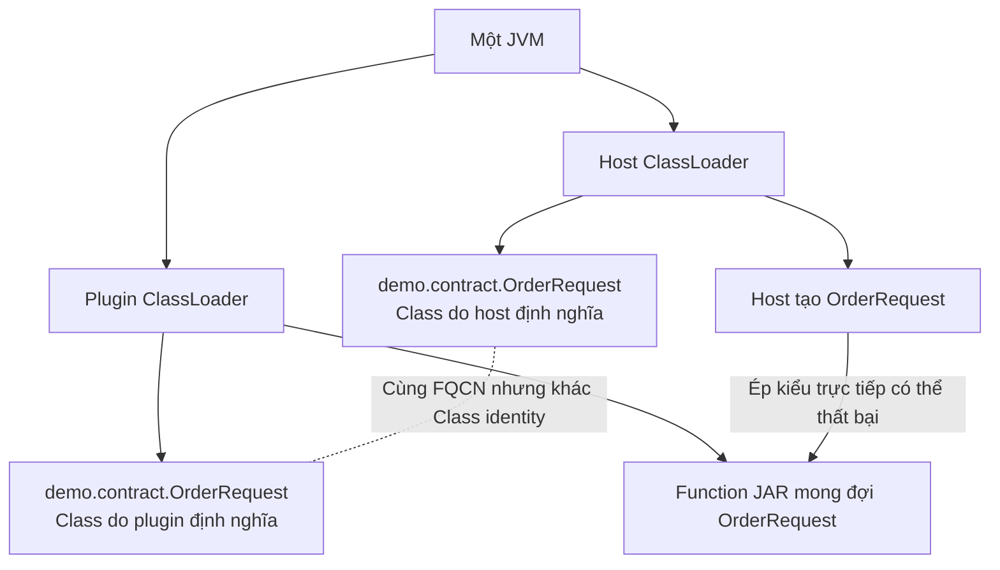
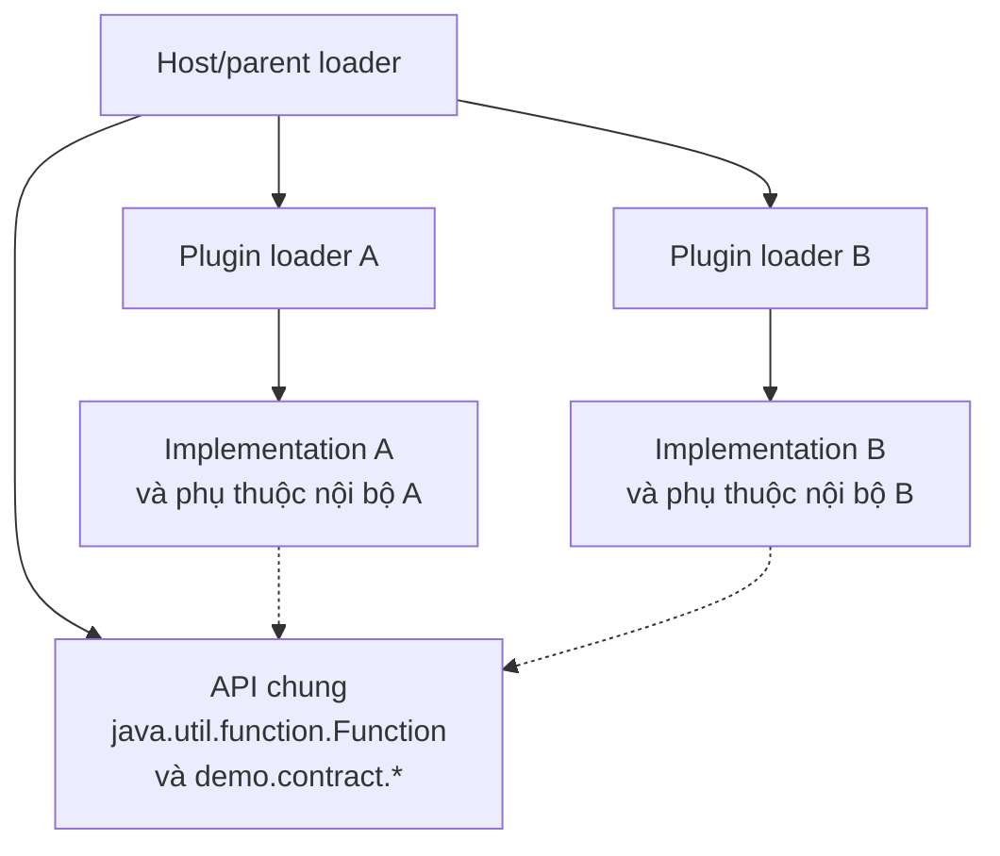
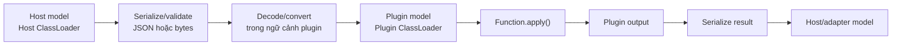
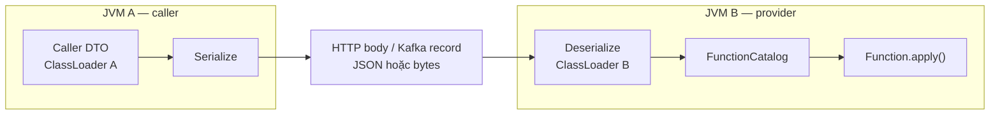
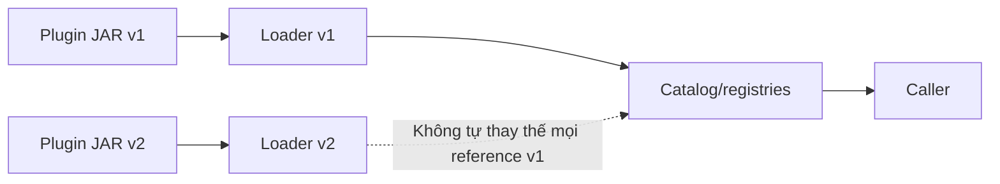

# ClassLoader riêng và ranh giới kiểu giữa các ứng dụng

## 1. Bài toán: cùng tên lớp nhưng không dùng chung được đối tượng

Một hệ thống tính phí vận chuyển có **ứng dụng chủ** (*host*) Spring Boot chịu trách nhiệm tiếp nhận HTTP hoặc sự kiện Kafka. Nhóm nghiệp vụ phát hành hàm `Function<OrderRequest, OrderQuote>` trong một JAR riêng, rồi host sử dụng cơ chế nạp JAR của **Spring Cloud Function** để đăng ký và gọi hàm. Ứng dụng chủ và JAR bên ngoài đều định nghĩa một lớp có tên `demo.contract.OrderRequest`.

Ở mã nguồn, hai bên có thể nhìn thấy cùng package, tên class và các field giống nhau. Tuy nhiên, khi nạp artifact bằng **ClassLoader riêng**, một lỗi như sau vẫn có thể xuất hiện:

```text
java.lang.ClassCastException:
  class demo.contract.OrderRequest cannot be cast to
  class demo.contract.OrderRequest
```

Thông báo tưởng như vô lý, nhưng nó có nguyên nhân rõ ràng: **Java không xác định một kiểu tham chiếu chỉ bằng tên class; ClassLoader đã định nghĩa class cũng là một phần của danh tính kiểu.**

Trong module `SPRING_CLOUD_FUNCTION`, chúng ta học cách tách logic thành `Supplier<T>`, `Function<T,R>` và `Consumer<T>`; đăng ký/tra cứu qua `FunctionCatalog`, composition, chuyển đổi thông điệp và kích hoạt qua HTTP, sự kiện hoặc môi trường serverless. Chủ đề này giải thích **ranh giới kiểu Java giữa các phần code** khi logic được nạp từ JAR ngoài, đồng thời chỉ ra sự khác biệt giữa:

1. **Hai classloader trong cùng một JVM** (host và JAR function được nạp bên ngoài).
2. **Hai Spring ApplicationContext** có thể liên quan đến host và ứng dụng chứa functional bean.
3. **Hai ứng dụng/tiến trình độc lập** gọi nhau qua HTTP hoặc broker.

Ba ranh giới này không tương đương: ClassLoader giải quyết nạp/định danh lớp trong JVM; Spring context giải quyết bean/lifecycle; network contract giải quyết dữ liệu trao đổi giữa các tiến trình.

> **Phạm vi phiên bản:** `spring-cloud-function-deployer` có những cơ chế nạp packaged function khác nhau tùy bản Spring Cloud Function. Các ví dụ dùng `URLClassLoader` để giải thích quy tắc **chuẩn của JVM**, không khẳng định deployer ở mọi release dùng đúng lớp `URLClassLoader` hay cùng chính sách parent/child delegation. Khi chạy với một release cụ thể, phải xác nhận loader thực tế, định dạng JAR, cách đăng ký catalog và hỗ trợ nạp/gỡ artifact.

## 2. ClassLoader làm gì?

Một `ClassLoader` định vị và nạp bytecode để JVM có thể dùng các lớp Java. Trong Java hiện đại thường gặp:

| Loader/khái niệm | Vai trò thường thấy | Lưu ý |
| --- | --- | --- |
| **Bootstrap class loader** | Nạp những class nền tảng như `java.lang.String`, `java.util.function.Function`. | Trong Java API, `String.class.getClassLoader()` thường trả `null` để biểu thị bootstrap loader. |
| **Platform class loader** | Nạp một số Java platform modules. | Có thể lấy qua `ClassLoader.getPlatformClassLoader()`. |
| **Application/System class loader** | Nạp code của ứng dụng theo cấu hình runtime. | Có thể lấy qua `ClassLoader.getSystemClassLoader()`, nhưng chi tiết classpath/module tùy cách chạy. |
| **Custom/plugin class loader** | Nạp class từ JAR/path của plugin hoặc module động. | Cách tổ chức delegation và phạm vi nhìn thấy class có thể khác nhau. |
| **Thread context class loader (TCCL)** | Tham chiếu loader cho những framework/API cần tìm class hoặc resource theo ngữ cảnh thread. | Không phải tự thân một ClassLoader mới; là thuộc tính của thread. |

**ClassLoader không tương đương Spring ApplicationContext.** Một Spring context có thể chứa nhiều bean được nạp bởi nhiều loader; hai context cũng có thể cùng dùng một loader. Vì vậy, việc nhìn thấy `@Bean` trong một context không chứng minh các kiểu Java đã tương thích ở ranh giới plugin.

## 3. Danh tính kiểu: tên class và defining ClassLoader

Một cách hiểu thiết thực cho **reference type** trong JVM:

```text
Type identity ≈ (binary name, defining ClassLoader)
```

Với hai loader `L1` và `L2` cùng định nghĩa class có binary name `demo.contract.OrderRequest`:

```text
("demo.contract.OrderRequest", L1)
    !=
("demo.contract.OrderRequest", L2)
```

Do đó, dù source của hai class giống hệt nhau:

- `Class<?>` của chúng là hai đối tượng khác nhau.
- `Class.isInstance(...)` có thể trả `false` giữa hai bên.
- Ép kiểu thông thường có thể ném `ClassCastException`.
- Reflection gọi một method yêu cầu `OrderRequest` từ loader A nhưng nhận object của loader B có thể gây `IllegalArgumentException: argument type mismatch`.
- Những API framework kiểm tra theo tên class mà bỏ qua loader identity có thể xác nhận sai tính tương thích.

Ngược lại, **hai loader khác nhau không bắt buộc tạo ra hai kiểu khác nhau**. Nếu cả hai ủy quyền và nhận **cùng class được định nghĩa bởi parent loader**, identity vẫn là một. Điều quan trọng là **defining loader**, không chỉ classloader mà ta gọi `loadClass()`.

### 3.1. Sơ đồ hai kiểu cùng tên trong một JVM



Đây là **tình huống có trùng class definition**, không phải kết quả mặc định của mọi plugin loader. Nếu host cung cấp API contract ở parent và loader plugin ủy quyền đúng class đó, hai bên có thể chia sẻ một kiểu an toàn.

## 4. Thí nghiệm Java thuần: hai URLClassLoader nạp cùng một JAR

Trước khi xét Spring Cloud Function, hãy chứng minh quy tắc bằng Java SE. Giả sử có một **simple JAR** chỉ chứa:

```java
// src/main/java/demo/plugin/OrderRequest.java
package demo.plugin;

public record OrderRequest(String orderId) {}
```

Build JAR thư viện từ một Maven project Java 17 (hoặc bằng `javac`/`jar`) rồi có file:

```text
plugins/contracts-demo-1.0.0.jar
└── demo/plugin/OrderRequest.class
```

Chương trình kiểm tra sau nằm trong **dự án host khác**. Điều kiện rất quan trọng: **`demo.plugin.OrderRequest` không được xuất hiện trên classpath của host**; nó chỉ nằm trong plugin JAR.

```java
package demo.host;

import java.net.URL;
import java.net.URLClassLoader;
import java.nio.file.Path;

public class ClassIdentityDemo {
    public static void main(String[] args) throws Exception {
        Path jar = Path.of("plugins/contracts-demo-1.0.0.jar");
        URL[] urls = { jar.toUri().toURL() };

        // Cả hai loader dùng platform parent để tránh host
        // vô tình cung cấp lớp demo.plugin.OrderRequest.
        try (URLClassLoader loaderA = new URLClassLoader(
                    urls, ClassLoader.getPlatformClassLoader());
             URLClassLoader loaderB = new URLClassLoader(
                    urls, ClassLoader.getPlatformClassLoader())) {

            Class<?> typeA = Class.forName(
                    "demo.plugin.OrderRequest", true, loaderA);
            Class<?> typeB = Class.forName(
                    "demo.plugin.OrderRequest", true, loaderB);

            Object requestA = typeA
                    .getDeclaredConstructor(String.class)
                    .newInstance("OD-204");

            System.out.println(typeA.getName().equals(typeB.getName()));
            System.out.println(typeA == typeB);
            System.out.println(typeB.isInstance(requestA));
            System.out.println(typeA.getClassLoader() == loaderA);

            try {
                typeB.cast(requestA);
            } catch (ClassCastException error) {
                System.out.println("Cast failed across loaders");
            }
        }
    }
}
```

Kết quả dự kiến:

```text
true
false
false
true
Cast failed across loaders
```

Giải thích:

- `getName()` của hai class giống nhau nên dòng đầu là `true`.
- `typeA == typeB` trả `false`: hai định nghĩa class khác nhau.
- `requestA` chỉ là instance của `typeA`, không phải `typeB`.
- Loader B không thể cast object do định nghĩa class của loader A tạo ra.

Việc dùng **platform parent** trong bài thử nhằm kiểm soát đường nạp, không phải khuyến nghị mặc định cho mọi ứng dụng plugin. Một function dùng Spring hoặc shared API thường cần **parent có thể nhìn thấy các interface/contract phù hợp**. Bài thử chỉ thể hiện quy tắc identity.

### 4.1. Điều kiện làm kết quả thay đổi

Nếu `demo.plugin.OrderRequest` cũng có trên classpath của **parent loader** và loader có chính sách parent-first, cả `loaderA` và `loaderB` có thể trả về **cùng một class của parent**. Khi ấy:

```java
typeA == typeB // Có thể true.
```

Nói “mỗi ClassLoader luôn tạo một bản copy cho mọi class” là sai. Cần kiểm tra **loader nào đã định nghĩa class**, delegation policy, thứ tự classpath và các package được ưu tiên.

## 5. Parent-first, child-first và vùng API dùng chung

Một ClassLoader tùy biến có thể:

1. **Parent-first:** thử loader cha trước, rồi mới tìm ở kho riêng của con nếu cha không có.
2. **Child-first cho một số package:** thử bytecode ở plugin trước để cô lập dependency; vẫn phải bảo vệ những Java platform packages và xử lý các contract dùng chung cẩn thận.
3. **Hybrid/selective:** dùng parent cho API chung, còn plugin tự nạp thư viện implementation hoặc thư viện cần cô lập.

Classloader chuẩn như `URLClassLoader` thường đi theo **parent delegation**. Plugin frameworks có thể triển khai chính sách khác. Spring Cloud Function Deployer cũng cần được kiểm tra theo **release thực tế**, không suy đoán rằng nó luôn child-first hoặc luôn cô lập mọi dependency.



**Mục tiêu thiết kế:** để các kiểu xuất hiện trong chữ ký giao tiếp host–function được định nghĩa và chia sẻ theo một nguồn nhất quán, trong khi implementation và dependency đặc thù có thể được cô lập theo nhu cầu.

### 5.1. Class nào thường phải dùng chung?

| Loại class | Nên xử lý thế nào? | Lý do |
| --- | --- | --- |
| `java.util.function.Function`, `Supplier`, `Consumer` | Dùng class của JDK. | Interface có identity chung qua bootstrap loader. |
| `java.lang.String`, `BigDecimal` | Dùng các lớp JDK. | Dễ truyền tại ranh giới Java; không cần DTO từ plugin. |
| DTO/API `demo.contract.OrderRequest` | Đặt trong **shared contract artifact** được parent cung cấp nếu muốn truyền object trực tiếp. | Tránh hai loader tự định nghĩa hai kiểu trùng FQCN. |
| `demo.plugin.ShippingPolicy` | Có thể do plugin loader nạp. | Implementation là chi tiết nội bộ. |
| JSON/validation client libraries | Phải chọn nhất quán cơ chế chia sẻ/cô lập theo runtime. | Ngăn conflict, nhưng không được tạo thêm type identity conflict ở API public. |
| Spring context/framework types | Cần tương thích chặt chẽ theo bản Spring/loader. | Bean reflection/proxy, annotation và conversion có thể phụ thuộc loader/framework version. |

Một cách đóng gói tốt không chỉ có “đủ JAR”, mà phải biết **loader nào sở hữu từng package** và liệu class xuất hiện ở API có bị đóng gói lặp hay không.

## 6. Ranh giới của `Supplier`, `Function` và `Consumer`

Mặc dù `Function`/`Supplier`/`Consumer` là các interface của JDK mà host và plugin thường nhìn thấy chung, **generic type và object được truyền qua chúng** vẫn có thể không tương thích.

| Functional interface | Điểm giao tiếp | Rủi ro nếu classloader khác nhau |
| --- | --- | --- |
| `Supplier<OrderQuote>` | `get()` trả một object `OrderQuote`. | Host không nhận ra class của object trả về nếu dùng bản DTO khác. |
| `Function<OrderRequest,OrderQuote>` | `apply(OrderRequest)` nhận và trả object. | Input từ host không cast được sang DTO của plugin; output không cast được sang DTO host. |
| `Consumer<OrderEvent>` | `accept(OrderEvent)` nhận object và tạo side effect. | Adapter chuyển thành DTO khác loader; lỗi runtime và retry có thể lặp side effect. |

Ví dụ thiết kế rủi ro:

```text
Host:   Function<host-loader::OrderRequest,
                 host-loader::OrderQuote>
Plugin: Function<plugin-loader::OrderRequest,
                 plugin-loader::OrderQuote>
```

Trình biên dịch Java có thể thấy tên `OrderRequest` giống nhau trong hai dự án, nhưng **JVM không coi chúng là cùng kiểu** nếu defining loader khác nhau. Nếu plugin class implement `Function<OrderRequest,OrderQuote>` và method `apply(OrderRequest)` có synthetic bridge theo generic erasure, bridge thường thực hiện cast runtime sang DTO mà plugin nhìn thấy. Khi host đưa DTO từ loader khác, lỗi có thể xuất hiện trong bridge method.

### 6.1. Tại sao dùng `Function<String,String>` để thử nạp JAR đầu tiên?

Với kiểu JDK như `String`, vấn đề DTO riêng của plugin được giảm đáng kể:

```java
package demo.plugin;

import java.util.Locale;
import java.util.function.Function;

public final class NormalizeOrderId
        implements Function<String, String> {

    public NormalizeOrderId() {}

    @Override
    public String apply(String value) {
        if (value == null || value.isBlank()) {
            throw new IllegalArgumentException("Missing orderId");
        }
        return value.strip().toUpperCase(Locale.ROOT);
    }
}
```

Đối với input `" od-204 "`, output là `"OD-204"`. Nếu smoke test với kiểu này chạy tốt nhưng đổi sang DTO riêng lại gặp `ClassCastException`, hãy xem xét **ranh giới classloader và message conversion** trước khi nghi ngờ logic chuẩn hóa.

## 7. FunctionCatalog giúp gọi hàm, nhưng không xóa ranh giới classloader

Trong **Spring Cloud Function**, `FunctionCatalog` cung cấp cơ chế tra cứu function bean/wrapper theo tên và composition, ví dụ:

```java
Function<String, String> normalize =
        catalog.lookup("normalizeOrderId");
String normalized = normalize.apply(" od-204 ");
```

Đoạn mã giả định `catalog` đã được inject trong một Spring context có function **đăng ký dưới tên thực tế** `normalizeOrderId`. Nếu function đến từ JAR ngoài, phải xác minh tên catalog được deployer công bố; **không suy đoán tên từ tên class/JAR**.

`FunctionCatalog` có thể trả về **wrapper** chứ không phải chính object `new NormalizeOrderId()`. Wrapper có thể đảm nhiệm chuyển đổi thông điệp, type metadata hoặc composition. Điều này **không phải phép màu** làm mọi classloader conflict biến mất:

- Nếu host truyền đúng kiểu JDK hoặc DTO dùng chung, lời gọi có thể hoạt động.
- Nếu host truyền một DTO cùng tên nhưng do loader khác định nghĩa, cast có thể thất bại.
- Nếu đi qua conversion thích hợp (ví dụ JSON/text → kiểu input mà plugin thực sự nhận), ranh giới object có thể được xử lý khác.
- Nếu type metadata không đầy đủ, converter có thể không biết cần tạo class nào, hoặc tạo class ở loader không mong muốn.

**Không nên ép kiểu trả về của catalog thành implementation class của plugin**. Tra cứu theo interface `Function` là cách dùng ổn định hơn; type contract cần được thiết kế/test riêng.

### 7.1. Các loại tên thường bị nhầm

| Tên | Ví dụ | Nghĩa |
| --- | --- | --- |
| Tên artifact | `shipping-rules-1.0.0.jar` | File chứa code. |
| FQCN | `demo.plugin.NormalizeOrderId` | Tên class cho loader. |
| Tên Spring bean | `normalizeOrderId` | Bean được đăng ký trong context. |
| Tên trong `FunctionCatalog` | `normalizeOrderId` nếu đã xác nhận | Tên được `lookup(...)` chấp nhận. |
| Function definition | `normalizeOrderId|validateOrderId` | Chọn hoặc ghép các hàm đã có trong catalog. |
| HTTP route/broker binding | `/normalizeOrderId`, `normalizeOrderId-in-0` | Điểm vào theo adapter và cấu hình. |

Thay `spring.cloud.function.location` để đổi artifact, `spring.cloud.function.function-class` nếu dùng cơ chế chọn class ở simple JAR và `spring.cloud.function.definition` để chọn function/pipeline là **ba trách nhiệm khác nhau**. Chúng không thay thế việc thiết kế ranh giới kiểu.

## 8. Giải pháp A: một shared API JAR do parent loader cung cấp

Nếu host cần **truyền object Java trực tiếp** sang function và nhận lại object Java, hãy thiết kế một **contract artifact dùng chung**. Đây là một cấu trúc điển hình:

```text
shipping-contract-api.jar
    demo.contract.ShippingRequest
    demo.contract.ShippingQuote
            ^
            | cùng Class identity qua parent loader
            |
  +---------+------------+
  |                      |
Host application       Function plugin JAR
  creates DTO            implements Function<DTO, DTO>
  calls Function          uses shared API classes
```

Shared API phải được **nạp/định nghĩa một lần theo đường mà cả hai bên dùng chung**, thường bởi parent loader của plugin. Không phải chỉ cần hai JAR có cùng Maven coordinate là chắc chắn chúng dùng cùng class identity: nếu plugin shaded/đóng gói thêm bản copy hoặc có child-first rule cho package contract, vẫn có thể bị nhân đôi kiểu.

### 8.1. Project `shipping-contract-api`

Tạo các record Java 17:

```java
// shipping-contract-api/src/main/java/demo/contract/ShippingRequest.java
package demo.contract;

import java.math.BigDecimal;

public record ShippingRequest(
        String orderId,
        String region,
        BigDecimal subtotalVnd) {}
```

```java
// shipping-contract-api/src/main/java/demo/contract/ShippingQuote.java
package demo.contract;

import java.math.BigDecimal;

public record ShippingQuote(
        String orderId,
        BigDecimal feeVnd) {}
```

Giả sử API JAR có Maven coordinates:

```text
demo.contracts:shipping-contract-api:1.0.0
```

Version phải được quản lý và hai phía cần hiểu chung ngữ nghĩa trường. `BigDecimal` thuộc JDK nên không tạo thêm classloader identity riêng đối với phần dữ liệu tiền.

### 8.2. Project function implement đúng shared contract

Function JAR phụ thuộc **API artifact** để biên dịch nhưng không tự định nghĩa các record:

```java
// shipping-rule-plugin/src/main/java/demo/plugin/QuoteShipping.java
package demo.plugin;

import demo.contract.ShippingQuote;
import demo.contract.ShippingRequest;
import java.math.BigDecimal;
import java.util.function.Function;

public final class QuoteShipping
        implements Function<ShippingRequest, ShippingQuote> {

    public QuoteShipping() {}

    @Override
    public ShippingQuote apply(ShippingRequest input) {
        if (input == null || input.orderId() == null ||
                input.orderId().isBlank()) {
            throw new IllegalArgumentException("Missing orderId");
        }
        BigDecimal subtotal = input.subtotalVnd();
        if (subtotal == null || subtotal.signum() < 0) {
            throw new IllegalArgumentException("Invalid subtotal");
        }
        if (input.region() == null) {
            throw new IllegalArgumentException("Missing region");
        }

        BigDecimal fee = switch (input.region().strip()
                .toUpperCase(java.util.Locale.ROOT)) {
            case "INNER" -> new BigDecimal("20000");
            case "OUTER" -> new BigDecimal("40000");
            default -> throw new IllegalArgumentException(
                    "Unsupported region");
        };
        if (subtotal.compareTo(new BigDecimal("500000")) >= 0) {
            fee = BigDecimal.ZERO;
        }
        return new ShippingQuote(input.orderId(), fee);
    }
}
```

`QuoteShipping` có thể nạp như một class implement `Function` từ simple JAR **nếu deployer đang dùng hỗ trợ cơ chế tương ứng**. Cách nạp những dependency không phải JDK của function, cách cung cấp API từ parent và tên function được đăng ký phải xác nhận trên release đó.

Một cách biểu diễn Maven dependency API trong **POM của plugin**:

```xml
<dependency>
    <groupId>demo.contracts</groupId>
    <artifactId>shipping-contract-api</artifactId>
    <version>1.0.0</version>
    <scope>provided</scope>
</dependency>
```

`provided` nói rằng compiler của plugin nhìn thấy contract API, nhưng **runtime phải cung cấp API đó theo cách khác**. Trong mô hình này host/parent loader chủ động cung cấp contract. **`provided` không tự cấu hình classloader của Function Deployer**, cũng không bảo đảm resolver tự chia sẻ class từ host với plugin. Đây là yêu cầu triển khai cần được kiểm tra. Nếu dùng một cơ chế không hỗ trợ parent sharing cho API, hãy cân nhắc giao tiếp bằng serialized payload thay vì cố truyền DTO trực tiếp.

### 8.3. Host cũng dùng đúng API artifact

Host khai báo **cùng contract** `shipping-contract-api:1.0.0` trên compile/runtime classpath. Nó không cần import `demo.plugin.QuoteShipping` nếu muốn nạp plugin tại runtime.

Ví dụ một Java caller trong host **khi plugin thực sự chia sẻ API với host**:

```java
import demo.contract.ShippingRequest;
import demo.contract.ShippingQuote;
import java.math.BigDecimal;
import java.util.function.Function;

// catalog được inject và tên function đã được xác minh.
Function<ShippingRequest, ShippingQuote> quote =
        catalog.lookup("quoteShipping");
if (quote == null) {
    throw new IllegalStateException("quoteShipping missing");
}
ShippingQuote result = quote.apply(
        new ShippingRequest(
                "ORD-204", "INNER", new BigDecimal("450000")));
// result.feeVnd() = 20000
```

Đoạn code là **mẫu tích hợp có điều kiện**, không khẳng định deployer tự đặt catalog name `quoteShipping` hay tự dùng API từ parent. Muốn chạy, phải xác nhận hai điều trước: tên lookup tồn tại và `ShippingRequest.class` mà plugin dùng thực sự được định nghĩa bởi cùng loader với host.

### 8.4. Kiểm tra class identity, không chỉ package name

Trong môi trường test, khi có quyền kiểm tra các class thực sự được sử dụng:

```java
Class<?> hostType = ShippingRequest.class;
ClassLoader hostLoader = hostType.getClassLoader();

System.out.println("Host DTO: " + hostType.getName());
System.out.println("Host loader: " + hostLoader);
```

Để so sánh với plugin, phải lấy `Class<?>` **của kiểu plugin thực sự sử dụng**, chẳng hạn qua signature/method của implementation và classloader thích hợp, chứ không chỉ gọi `Class.forName(...)` với host loader rồi tự coi đó là plugin type.

Nếu cả hai phía dùng cùng class:

```java
hostType == pluginInputType // true
```

Đó là bằng chứng trực tiếp hơn so với việc hai lớp cùng `getName()`. Cũng cần kiểm tra object instance thực sự có `hostType.isInstance(...)` và conversion/wrapper của catalog không tạo kiểu khác dự kiến.

## 9. Thí nghiệm parent sharing với Java URLClassLoader

Có thể minh họa nguyên lý trước khi dùng Spring bằng cách đặt:

```text
Host classpath:
  shipping-contract-api-1.0.0.jar
  host-demo.jar

Plugin JAR:
  shipping-rule-plugin-1.0.0.jar
  (chỉ chứa demo.plugin.QuoteShipping, không đóng lại contract classes)
```

Sau đó host tạo loader plugin có **parent là loader đã nạp API contract**:

```java
import demo.contract.ShippingQuote;
import demo.contract.ShippingRequest;
import java.math.BigDecimal;
import java.net.URL;
import java.net.URLClassLoader;
import java.nio.file.Path;
import java.util.function.Function;

Path jar = Path.of("plugins/shipping-rule-plugin-1.0.0.jar");
URL[] urls = { jar.toUri().toURL() };

try (URLClassLoader pluginLoader = new URLClassLoader(
        urls, ShippingRequest.class.getClassLoader())) {

    Class<?> implementation = Class.forName(
            "demo.plugin.QuoteShipping", true, pluginLoader);
    Object instance = implementation
            .getDeclaredConstructor().newInstance();

    if (!(instance instanceof Function<?, ?>)) {
        throw new IllegalStateException("Not a Function");
    }

    // Cast có điều kiện: shared API contract do parent cung cấp.
    @SuppressWarnings("unchecked")
    Function<ShippingRequest, ShippingQuote> fn =
            (Function<ShippingRequest, ShippingQuote>) instance;

    ShippingQuote result = fn.apply(new ShippingRequest(
            "ORD-204", "OUTER", new BigDecimal("600000")));
    System.out.println(result.feeVnd()); // 0
}
```

**Điều kiện bắt buộc:** plugin JAR không tự định nghĩa `demo.contract.*` và loader của nó thực sự delegation tới parent cho package đó. Khi class `QuoteShipping` tham chiếu `ShippingRequest`, JVM resolve về class định nghĩa ở parent. Vì vậy object host tạo có thể truyền qua interface `Function`.

Thí nghiệm này dùng **JDK `URLClassLoader`**, không phải hướng dẫn thay thế `spring-cloud-function-deployer` trong production. `@SuppressWarnings("unchecked")` chỉ tắt cảnh báo biên dịch đối với generic cast; **nó không xác minh contract runtime**. Nếu generic signature không đúng hoặc loader resolve sai, `ClassCastException` vẫn có thể xuất hiện. Cần test với input/output thật.

## 10. Giải pháp B: chuyển đổi dữ liệu tại ranh giới thay vì chia sẻ DTO

Không phải lúc nào cũng nên chia sẻ `ShippingRequest.class` giữa host và plugin. Ví dụ:

- Plugin có vòng đời version riêng, cần sử dụng một model khác host.
- Host là nền tảng multi-tenant nạp nhiều plugin dùng schema khác nhau.
- Có rủi ro phụ thuộc API Java version xung đột.
- Người gọi thực chất đến từ HTTP hoặc broker nên dữ liệu đã được serialize.

Một phương án là đặt **data transfer contract** dưới dạng JSON, text, Avro, Protobuf hoặc schema phù hợp, rồi chuyển đổi rõ ở mỗi phía.



Ví dụ payload JSON của yêu cầu:

```json
{
  "orderId": "ORD-204",
  "region": "INNER",
  "subtotalVnd": 450000
}
```

Kết quả:

```json
{
  "orderId": "ORD-204",
  "feeVnd": 20000
}
```

Các JSON document này **không mang identity của Java ClassLoader**. Serializer/deserializer trong host hoặc plugin quyết định class được tạo ra. Khi trao đổi qua HTTP/Kafka, đó chính là cách giao tiếp tự nhiên: không chuyển nguyên một `ShippingRequest` Java object qua mạng.

### 10.1. Phân biệt “chuyển thành JSON” và “cast”

Chỉ ép kiểu:

```java
ShippingRequest request = (ShippingRequest) pluginObject;
```

**không chuyển dữ liệu** và sẽ thất bại nếu `pluginObject` là instance của class cùng tên nhưng khác loader. Trái lại, một bước ánh xạ dữ liệu:

```text
plugin OrderRequest → JSON bytes → host OrderRequest
```

có thể tạo ra **object mới** của đúng class host. Đổi lại, phải quản lý schema, validation, serialization format, backward compatibility và chi phí chuyển đổi. Không nên nghĩ rằng `ObjectMapper.convertValue(...)` luôn tự giải quyết mọi lỗi classloader; mapper còn phụ thuộc target `Class`, cấu hình module và cách framework chọn loader.

### 10.2. Dùng các kiểu đơn giản trước khi dùng DTO

Trong bài thử nạp JAR, `Function<String,String>` hoặc `Function<Map<String,Object>,Map<String,Object>>` có thể giúp giảm một số vấn đề về class identity, nhưng `Map` cũng có schema ngầm: key, kiểu của value, tiền tệ, null và đơn vị dữ liệu phải được quy định. Không vì “không có DTO” mà bỏ validation hoặc contract testing.

## 11. Spring Cloud Function và chuyển đổi Message

Spring Cloud Function có khái niệm **wrapper/converter** khi đăng ký và tra cứu hàm. Ở một số adapter, input được biểu diễn bằng payload và message headers; framework chuyển đổi vào kiểu đầu vào mà function yêu cầu.

Ví dụ chữ ký nghiệp vụ:

```java
Function<ShippingRequest, ShippingQuote>
```

và một chữ ký cần giữ metadata:

```java
Function<Message<ShippingRequest>, Message<ShippingQuote>>
```

Trong ví dụ thứ hai, `Message` thuộc package `org.springframework.messaging`, không thuộc `java.util.function`. Plugin và host phải dùng bản dependency Spring tương thích; nếu có nhiều classloader, danh tính của `Message` và DTO cũng cần được kiểm soát.

Một hàm có thể dùng `Message` để đọc correlation ID rồi tạo message mới:

```java
import java.util.function.Function;
import org.springframework.messaging.Message;
import org.springframework.messaging.support.MessageBuilder;

public class ForwardHeader implements
        Function<Message<String>, Message<String>> {
    @Override
    public Message<String> apply(Message<String> input) {
        return MessageBuilder.withPayload(
                    input.getPayload().strip())
                .copyHeaders(input.getHeaders())
                .build();
    }
}
```

Ví dụ này chỉ dùng Spring Messaging ở boundary và giữ nguyên headers; header nhạy cảm, delivery metadata hoặc mutable metadata vẫn phải được đánh giá trước khi forward sang hệ thống khác.

### 11.1. Cẩn thận với generic type metadata

`FunctionCatalog.lookup("quoteShipping")` trả một function theo generic signature mà caller **khai báo tại compile time**, nhưng **không có phép kiểm tra generic type đầy đủ ở runtime** do type erasure:

```java
Function<String, String> wrongType =
        catalog.lookup("quoteShipping");
// Biên dịch có thể thành công, nhưng lúc gọi sẽ không
// biến QuoteShipping<ShippingRequest,ShippingQuote>
// thành một Function<String,String> hợp lệ.
```

Khai báo trên chỉ là ví dụ của **sai contract**: không được gọi `apply("...")` rồi mặc định wrapper sẽ đổi một chuỗi bất kỳ thành request Java hợp lệ. Conversion chỉ hoạt động nếu framework có đủ type metadata và converter/schema đúng. Có thể gặp lỗi runtime hoặc kết quả không như mong đợi.

**Lời khuyên:** giữ generic signature rõ ràng, test function lookup bằng input thực tế, và nếu cần dữ liệu qua message, xác minh content type, converters và loader của DTO ở cả input/output.

## 12. Composition có thể làm lộ ranh giới classloader

Xét hai hàm:

```text
normalizeOrderId : Function<String, String>
validateOrderId  : Function<String, OrderValidation>
```

Nếu cả hai cùng nhận `String` của JDK, một pipeline:

```java
Function<String, OrderValidation> pipeline =
        catalog.lookup("normalizeOrderId|validateOrderId");
```

có thể hoạt động khi các function được đăng ký và adapter hỗ trợ composition phù hợp. Nhưng nếu `normalize` trả DTO của loader A và `validate` nhận DTO cùng tên từ loader B, composition **không làm hai type trở thành một**.

```text
Plugin A:
  normalize : String → pluginA.OrderRequest

Plugin B:
  validate  : pluginB.OrderRequest → OrderValidation

Tên "OrderRequest" trông tương ứng,
nhưng output A không tự là input B.
```

Chỗ nối pipeline phải có một trong hai lựa chọn:

1. Dùng **shared API type** mà cả hai thực sự nhìn thấy từ cùng defining loader; hoặc
2. Dùng **một bước chuyển đổi/serialization rõ ràng** từ output A sang input B.

**Composition trong catalog không tự tạo giao tiếp HTTP/Kafka giữa hai tiến trình**. Nó là cách ghép những function có thể tra cứu trong runtime/context tương ứng. Muốn orchestration qua nhiều service, cần routing/message topology hoặc workflow riêng.

### 12.1. Vì sao lỗi đôi khi chỉ xuất hiện khi gọi?

Vì Java generic erasure và cơ chế wrapper, một pipeline có thể được tạo ra và tra cứu mà chưa ép kiểu mọi object trung gian. Lỗi chỉ bộc lộ khi:

- Function A tạo object output thật.
- Function B hoặc một converter cố sử dụng object đó như input class khác loader.
- JVM kiểm tra `checkcast` hoặc framework reflection/conversion thực hiện kiểm tra.

Vì vậy, **test lookup không null** là chưa đủ: phải gọi pipeline bằng dữ liệu đại diện và xác minh output/side effect.

## 13. Spring ApplicationContext khác ranh giới ClassLoader

Với Spring Boot executable JAR có functional bean, việc nạp một ứng dụng đóng gói có thể yêu cầu xử lý context, dependency và bean lifecycle theo cơ chế deployer cụ thể:

```text
Host Spring ApplicationContext
  ├─ FunctionCatalog / adapter / services của host
  └─ Function được công bố từ artifact ngoài (tùy loader)

Artifact Spring Boot có:
  ├─ @SpringBootApplication
  ├─ @Configuration và @Bean Function
  ├─ Dependencies trong BOOT-INF/lib
  └─ Có thể có context/khởi tạo riêng theo cơ chế runtime
```

Không được đồng nhất hai nhận định:

- **“Bean `quoteShipping` tồn tại trong source Spring Boot application.”**
- **“Host catalog nạp từ JAR đã đăng ký `quoteShipping` với type hợp lệ.”**

Để khẳng định điều thứ hai, phải **kiểm chứng trong host ở đúng bản deployer**. Bean scopes, proxies, auto-configuration, resource lifecycle, converter và classloader có thể khác cách chạy `java -jar` ứng dụng nguồn.

### 13.1. Một số lỗi điển hình do context và loader

| Lỗi | Nguyên nhân có thể |
| --- | --- |
| `NoSuchBeanDefinitionException` | Bean chỉ có ở context khác hoặc chưa được import/scan/đăng ký. |
| `ClassCastException` với proxy | Proxy/interface hoặc DTO đã được nạp bởi loader khác với kiểu caller. |
| `NoSuchMethodError` | Spring/framework version trong plugin và host không tương thích. |
| `BeanCreationException` | Config/constructor/dependency hoặc auto-configuration của artifact nguồn lỗi. |
| FunctionCatalog lookup trả `null` | Đăng ký tên/definition không giống kỳ vọng; cũng có thể bước nạp thất bại trước đó. |

Một Spring context được khởi tạo thành công không chứng minh **mọi bean** có thể được gọi từ host. Khi framework phân tách context, chỉ những function được công bố theo API đã hỗ trợ mới nên được dùng.

## 14. Truyền dữ liệu qua HTTP hoặc messaging: không phải object cùng JVM

Đến đây cần phân biệt **ClassLoader isolation** với **process isolation**. Khi host chạy một JAR plugin trong JVM, function có thể được gọi trực tiếp như một Java object; khi caller ở một ứng dụng khác, **không có object Java nào đi xuyên mạng nguyên vẹn** theo cách gọi `apply()` thông thường.



**Hai JVM luôn có bộ nhớ/classloader riêng**, nhưng điều đó không làm Java `ClassCastException` xảy ra ngay giữa caller và provider: caller **không truyền trực tiếp** reference Java sang provider. Hợp đồng thực tế là **wire format**, schema, headers, trạng thái lỗi và delivery semantics.

| Môi trường gọi | Vật gì đi qua ranh giới? | Điểm kiểm tra chính |
| --- | --- | --- |
| Host gọi plugin cùng JVM | Java reference/object, có thể kèm wrapper. | Class identity, generic type, loader và converter. |
| HTTP giữa hai ứng dụng | Request/response bytes, thường JSON/text. | URL, method, schema, content type, status/errors, auth. |
| Kafka/RabbitMQ giữa hai ứng dụng | Serialized message payload và headers. | Schema, key, partition, consumer group, retry/DLQ. |
| Serverless handler | Event envelope và dữ liệu do runtime deserialize. | Trigger, event type, handler, timeout và failure semantics. |

### 14.1. Cùng tên DTO trên hai JVM có chấp nhận được không?

Có, nếu trao đổi qua schema tương thích:

```text
Caller JVM A:  demo.client.OrderRequest
                         |
                     JSON bytes
                         |
Provider JVM B: demo.provider.ShippingRequest
```

Hai lớp không cần cùng FQCN hoặc cùng Java runtime. Một ứng dụng viết bằng Java có thể gọi service viết bằng Go/Node.js miễn là hai bên tuân thủ HTTP/message contract. Vì vậy, **shared Java API JAR không phải yêu cầu bắt buộc của kiến trúc phân tán**; đôi khi còn tạo coupling không cần thiết.

### 14.2. Tránh mặc định Java native serialization

Java `Serializable`/`ObjectInputStream` không phải một hợp đồng giao tiếp tốt để mặc định dùng giữa các service. Nó phụ thuộc class definitions và serialization compatibility, có rủi ro bảo mật khi deserialize nguồn không tin cậy và khó nâng cấp schema đa ngôn ngữ. Với HTTP/messaging, ưu tiên một định dạng và schema được công bố, versioning và validation rõ ràng.

## 15. Định dạng JAR: simple library JAR khác Boot executable JAR

Một nguyên nhân phổ biến của lỗi nạp class không liên quan DTO: **loader không hiểu cách đóng gói artifact**.

| Kiểu artifact | Cấu trúc thường gặp | Hệ quả |
| --- | --- | --- |
| Simple library JAR | `demo/plugin/NormalizeOrderId.class` tại package path trực tiếp. | Phù hợp minh họa class loading từ JAR thông thường. |
| Spring Boot executable JAR | `BOOT-INF/classes`, `BOOT-INF/lib/*.jar` và launcher. | Cần cơ chế đọc Boot archive/nested dependencies được release hỗ trợ. |
| Shaded/uber JAR | Class và dependency được ghép vào một archive, đôi khi có relocation. | Có thể vô tình đóng gói cả shared API, tạo duplicate classes hoặc version conflict. |
| Modular JAR / JPMS | Có thể chứa `module-info.class` và dùng module layer. | Cần xem thêm module readability/access ngoài ClassLoader identity. |

Nếu function JAR chỉ cần `Function<String,String>`, simple library JAR với constructor rõ ràng thường là bước học tốt nhất. Với ứng dụng có `@Bean` và Spring configuration, có thể cần cơ chế Function Deployer hỗ trợ **packaged Spring Boot application**, không thể chỉ gán `function-class` bằng tên method bean rồi mong loader tìm được.

Ví dụ cấu hình `location`/`function-class` của **các dòng deployer hỗ trợ nạp simple JAR**:

```yaml
spring:
  cloud:
    function:
      location: "file:///opt/functions/normalize-order-id-1.0.0.jar"
      function-class: "demo.plugin.NormalizeOrderId"
```

Đây là **cấu hình minh họa phụ thuộc release**, không phải lời khẳng định mọi Spring Cloud Function runtime đều hỗ trợ cách nạp này. JAR phải hiện hữu trong filesystem mà **JVM host nhìn thấy**, không phải chỉ có trên máy lập trình.

Nếu source function là Spring Boot JAR có các bean `@Bean Function`, host phải sử dụng cơ chế loader tương thích với **layout Boot và bean discovery**. Việc chạy source application bằng `java -jar` không chứng minh host có thể nạp cùng artifact theo `location`.

## 16. Version và dependency conflict giữa host và plugin

Khi nạp nhiều JAR trong một JVM, mỗi plugin có thể dùng một version khác nhau của thư viện:

```text
Host:
  Spring Framework vA
  shipping-contract-api 1.0
Plugin A:
  validation-library v1
Plugin B:
  validation-library v2
```

Một loader cô lập có thể giúp hai implementation sử dụng dependency nội bộ khác version. Nhưng ranh giới **shared API/framework** phải tương thích. Một số lỗi thường gặp:

| Lỗi/hiện tượng | Khả năng nguyên nhân |
| --- | --- |
| `NoClassDefFoundError` | Dependency không nằm ở classloader nhìn thấy được. |
| `ClassNotFoundException` | Tên lớp sai, JAR không có, loader không truy cập artifact. |
| `NoSuchMethodError` | Plugin được biên dịch với phiên bản API khác phiên bản thực tế loader cung cấp. |
| `LinkageError` hoặc loader constraint violation | Những định nghĩa kiểu không tương thích phải gặp nhau trong chữ ký/lời gọi. |
| `ClassCastException` | Object và kiểu đích không cùng class identity. |
| `ServiceConfigurationError` | `ServiceLoader` tìm provider bằng loader không phù hợp hoặc provider không implement interface mà caller nhìn thấy. |
| Lỗi reflection/module access | Java Module System hoặc visibility/access rules, không nhất thiết class identity. |

**Giải pháp shading/relocation cần có chủ đích.** Có thể relocate một JSON library nội bộ để tránh xung đột, nhưng **không relocate hoặc đóng gói riêng shared DTO/API** nếu host vẫn dự định truyền chúng trực tiếp.

### 16.1. Maven dependency scope chỉ là metadata build

`provided` trong POM của function có nghĩa dependency được giả định do môi trường runtime cung cấp; **nó không tự gắn API vào đúng parent loader của deployer**. Ngược lại, `compile` và artifact resolution có thể đưa thêm dependency vào plugin loader, nhưng không bảo đảm identity phù hợp. Phải hiểu cách **thực tế loader của release** lựa chọn class, không chỉ nhìn `pom.xml`.

### 16.2. Trùng phiên bản API tại boundary

Giả sử plugin A được biên dịch với `shipping-contract-api:1.0.0`, plugin B với `2.0.0`. Kể cả cả hai đều delegation đến một parent, chúng chưa chắc binary compatible nếu `2.0.0` đã đổi constructor, record components hoặc method signatures.

Một API JAR chung ở parent chỉ giải quyết **identity** khi cả hai dùng cùng class; nó không làm **version mismatch** biến mất. Với breaking change, cân nhắc version contract riêng, adapter conversion, hoặc tách các function thành process độc lập.

## 17. Thread Context ClassLoader và những lỗi khó tái hiện

Một số Java API và framework không chỉ dùng defining loader của class đang gọi mà còn tham khảo `Thread.currentThread().getContextClassLoader()`, thường gọi là **TCCL**. Ví dụ `ServiceLoader`, resource lookup và một số serialization/provider discovery mechanism có thể dùng context loader.

Mã quan sát để debug:

```java
ClassLoader definingLoader =
        NormalizeOrderId.class.getClassLoader();
ClassLoader contextLoader =
        Thread.currentThread().getContextClassLoader();

System.out.println("Defining loader: " + definingLoader);
System.out.println("Thread context loader: " + contextLoader);
```

Hai giá trị **có thể khác nhau**, và điều đó không tự là lỗi. Nhưng nếu plugin mong TCCL trỏ vào loader của chính nó còn request thread dùng loader host, provider/resource có thể không được tìm thấy.

### 17.1. Thay TCCL phải được khôi phục

Nếu một **framework/plugin container được thiết kế để quản lý loader** cần đặt TCCL khi invoke, quy tắc tối thiểu là **khôi phục TCCL trong `finally`**:

```java
Thread thread = Thread.currentThread();
ClassLoader previous = thread.getContextClassLoader();
try {
    thread.setContextClassLoader(pluginLoader);
    // Gọi API thực sự cần plugin context loader.
    invokePlugin();
} finally {
    thread.setContextClassLoader(previous);
}
```

Đây là ví dụ **mẫu ý tưởng**, giả định `pluginLoader` và `invokePlugin()` đã được ứng dụng định nghĩa. Đừng tự thêm thao tác đổi TCCL quanh mọi lời gọi `FunctionCatalog` khi không có yêu cầu từ loader/framework: việc ghi đè context loader sai lúc có thể ảnh hưởng thư viện của host hoặc để lọt loader sang request khác.

### 17.2. Lỗi với thread pools và async

Với executor, Reactor, Kafka listener hoặc tác vụ `CompletableFuture`, lời gọi có thể chạy trên một thread khác; TCCL không nhất thiết được truyền tự động giống các request-scoped attributes. Nếu plugin tạo thread riêng và giữ loader trong `Thread.contextClassLoader`, loader đó có thể tiếp tục được tham chiếu sau khi function bị gỡ. Cần thiết kế lifecycle, propagation và cleanup rõ ràng.

## 18. Thay JAR, unload class và vòng đời ClassLoader

Một giả định sai: “Đổi file JAR trên đĩa, lần gọi function tiếp theo sẽ dùng class mới.” Với Java:

- Một class đã được định nghĩa bởi loader **không tự bị định nghĩa lại** vì file JAR đổi.
- `URLClassLoader.close()` đóng các resource mà loader quản lý, nhưng **không buộc JVM unload ngay toàn bộ class đã nạp**.
- Unloading thường chỉ khả thi khi loader và các class/instance liên quan không còn được tham chiếu theo điều kiện GC/runtime.
- Với Spring function registry, bean references, converter caches, thread locals, thread pools, listeners và static registries có thể còn giữ loader cũ.



**ClassLoader riêng không tự cung cấp hot reload an toàn**. Với `spring-cloud-function-deployer`, việc thay artifact/re-register class, xử lý invocation đang chạy và gỡ context phải được hỗ trợ rõ ở bản release cụ thể. Nếu không, chọn **rolling restart/rollout host** với artifact version bất biến và smoke test sau khởi động.

### 18.1. Những tham chiếu dễ gây classloader leak

| Nguồn tham chiếu còn sống | Hệ quả |
| --- | --- |
| Static registry/bean cache giữ instance plugin | Loader/plugin class không thể được thu gom. |
| Thread do plugin tạo chưa dừng | Giữ classloader qua stack hoặc TCCL; có thể gây memory leak. |
| `ThreadLocal` trong thread pool | Giữ object/plugin class sau khi request kết thúc. |
| Logger/metrics/listener đăng ký ở host | Có thể giữ reference đến class/plugin object. |
| Scheduled task hoặc subscription/reactive stream | Tiếp tục chạy bản code cũ và giữ resource. |
| Converter/serializer cache theo `Class<?>` | Giữ class từ loader cũ. |

Nếu cần reload, quy trình phải **ngừng nhận lời gọi mới → drain invocation đang chạy → gỡ listener/task → đóng context/resource → bỏ reference → nạp bản mới → test readiness** theo khả năng framework. Không tự thiết kế hot swap production chỉ bằng `close()` và `System.gc()`.

## 19. Bảo mật: tách ClassLoader không phải sandbox

Một plugin nạp vào JVM là **bytecode có thể thực thi với các quyền của tiến trình**. ClassLoader có thể hỗ trợ tổ chức dependency/version, nhưng không mặc nhiên ngăn mã:

- Đọc file hoặc secret mà JVM có quyền truy cập.
- Mở network connection tới host khác.
- Tạo thread tiêu thụ CPU/memory.
- Gọi API gây side effect hoặc thao tác global state.
- Làm host crash do lỗi nghiêm trọng về tài nguyên.

Nếu host cho người dùng tùy ý chọn `spring.cloud.function.location`, Maven coordinate, `function-class` hoặc một package chứa code không tin cậy, hệ thống có thể trở thành đường nạp mã độc. **Chỉ nạp artifact được phê duyệt**, có nguồn phát hành, version/digest, quyền truy cập kho, kiểm tra dependency và quy trình rollback.

Với yêu cầu **cô lập quyền/tài nguyên mạnh**, nên chạy một **provider process/container riêng** với API HTTP/messaging được giới hạn thay vì xem ClassLoader là boundary bảo mật.

### 19.1. Không expose mọi function trong catalog

`FunctionCatalog` có thể chứa cả hàm nội bộ và `Consumer` có side effect. Không cho caller bên ngoài tự gửi một function name để invoke tùy ý. Sử dụng danh sách function được phép, authorization theo hành động, payload validation và rate limiting. Đặc biệt, một classloader đúng identity **không thay** authentication hay authorization.

## 20. Chẩn đoán lỗi theo tầng: code, loader, contract hay adapter?

Một lỗi “function cannot be invoked” có thể bắt nguồn ở nhiều tầng khác nhau. Phân tích có hệ thống:

| Triệu chứng | Vấn đề cần nghi ngờ trước | Cách kiểm tra |
| --- | --- | --- |
| File/JAR không tìm thấy | `location`, volume mount, Maven resolver hoặc filesystem. | Kiểm tra JAR trong môi trường **host** chạy, không chỉ trên máy build. |
| `ClassNotFoundException` | Class sai FQCN, layout JAR không đúng hoặc loader không thấy class. | `jar tf`, package, `function-class`, loader search path. |
| `NoClassDefFoundError` | Dependency trực tiếp/bắc cầu không được cung cấp. | POM, `BOOT-INF/lib`, loader, Maven repository và dependency scope. |
| `UnsupportedClassVersionError` | JAR build cho JDK mới hơn runtime. | Bytecode release/JRE runtime. |
| `NoSuchMethodError` | Library version/binary API conflict. | Stack trace, dependency version, defining loader. |
| `ClassCastException` có tên class giống nhau | Duplicate class identity. | So sánh `Class<?> == Class<?>` và `getClassLoader()` thực tế. |
| `IllegalArgumentException: argument type mismatch` khi reflection | Tham số object không đúng `Class<?>` mà method cần. | `Method.getParameterTypes()` và `isInstance(...)`. |
| `ServiceConfigurationError` | SPI/provider discovery hoặc TCCL sai. | `ServiceLoader`, TCCL và resource visibility. |
| Bean tồn tại nhưng catalog trả `null` | Context/registry/name khác kỳ vọng. | Source bean, host registry, log deployer. |
| Catalog trả hàm nhưng `apply()` thất bại | Generic/type conversion hoặc lỗi nghiệp vụ. | Input thực tế, class identity, headers/content type, stack trace. |
| Java caller hoạt động, HTTP 415 | Content type/converter sai. | Web adapter, payload schema. |
| Java caller hoạt động, Kafka retry liên tục | Conversion, side effect hoặc binder error policy. | Definition, broker, DLQ, headers, schema. |
| Đổi JAR vẫn chạy bản cũ | Loader/registry chưa thay, cache/version. | Artifact checksum, host rollout, reference/caches. |

### 20.1. Mã chẩn đoán ClassLoader identity

Trong test tích hợp, khi có object và `Class<?>` của hai phía:

```java
static void inspect(String label, Class<?> type) {
    ClassLoader loader = type.getClassLoader();
    System.out.println(label + " name=" + type.getName());
    System.out.println(label + " loader=" + loader);
    System.out.println(label + " module=" + type.getModule());
}

inspect("host", ShippingRequest.class);

// pluginLoader là loader thực sự chứa implementation.
Class<?> pluginType = Class.forName(
        "demo.contract.ShippingRequest", false, pluginLoader);
inspect("plugin", pluginType);

System.out.println(
        "Same Class object? " + (ShippingRequest.class == pluginType));
```

**Giải thích:** `Class.forName(..., pluginLoader)` yêu cầu class qua loader plugin, nhưng nếu delegation tới parent, kết quả vẫn có thể là **Class của parent**. Đó chính là tình huống mong muốn với shared contract. Khi debug sâu, nên kiểm tra cả signature của implementation để chắc chắn function **thực sự dùng** contract class mà bạn đang so sánh.

Có thể xem `getProtectionDomain().getCodeSource()` để hỗ trợ điều tra nguồn bytecode **nếu thông tin đó tồn tại và đáng tin ở runtime**, nhưng nhiều kiểu class/loader/module không cung cấp location đơn giản; không nên dựa vào một URL là bằng chứng duy nhất.

### 20.2. Quy trình chẩn đoán dạng cây quyết định

```text
[1] Artifact đúng version và host đọc được?
    |
    +-- Không --> Sửa location/repository/mount/quyền đọc.
    |
    v
[2] Loader nạp class và dependency thành công?
    |
    +-- Không --> Kiểm tra layout, FQCN, JDK, classpath.
    |
    v
[3] Function/bean đã đăng ký trong đúng FunctionCatalog?
    |
    +-- Không --> Kiểm tra context, name, definition.
    |
    v
[4] Gọi bằng String/JDK types có hoạt động?
    |
    +-- Không --> Phân tích implementation và wrapper.
    |
    v
[5] Gọi bằng DTO có Class identity hoặc converter đúng?
    |
    +-- Không --> Dùng shared API parent hoặc explicit mapping.
    |
    v
[6] HTTP/Stream/serverless adapter có contract đúng?
    |
    +-- Không --> Schema, content type, binding, event envelope.
```

Điều quan trọng nhất là **không sửa config của tầng không gây ra lỗi**. Ví dụ HTTP 404 không tự chứng minh `URLClassLoader` có vấn đề; lỗi `ClassCastException` khi gọi Java nội bộ chưa chắc liên quan Kafka serialization.

## 21. Kiểm thử ranh giới classloader bằng JUnit

### 21.1. Test âm: cùng FQCN nhưng khác Class identity

Sau khi tạo JAR fixture `plugins/contracts-demo-1.0.0.jar` chứa record `demo.plugin.OrderRequest` như mục 4, có thể viết:

```java
package demo.host;

import static org.junit.jupiter.api.Assertions.assertEquals;
import static org.junit.jupiter.api.Assertions.assertFalse;
import static org.junit.jupiter.api.Assertions.assertNotSame;
import static org.junit.jupiter.api.Assertions.assertThrows;

import java.net.URL;
import java.net.URLClassLoader;
import java.nio.file.Path;
import org.junit.jupiter.api.Test;

class ClassLoaderBoundaryTest {

    @Test
    void sameNameDoesNotImplySameClass() throws Exception {
        Path jar = Path.of("plugins/contracts-demo-1.0.0.jar");
        URL[] urls = { jar.toUri().toURL() };

        try (URLClassLoader a = new URLClassLoader(
                    urls, ClassLoader.getPlatformClassLoader());
             URLClassLoader b = new URLClassLoader(
                    urls, ClassLoader.getPlatformClassLoader())) {

            Class<?> ta = Class.forName(
                    "demo.plugin.OrderRequest", true, a);
            Class<?> tb = Class.forName(
                    "demo.plugin.OrderRequest", true, b);

            Object request = ta.getConstructor(String.class)
                    .newInstance("OD-204");
            assertEquals(ta.getName(), tb.getName());
            assertNotSame(ta, tb);
            assertFalse(tb.isInstance(request));
            assertThrows(ClassCastException.class,
                    () -> tb.cast(request));
        }
    }
}
```

Test này **phụ thuộc JAR fixture được tạo trước**, không phải một unit test hoàn toàn độc lập nếu chưa chuẩn bị archive. Nó minh họa một ranh giới JVM có thể kiểm chứng được, **không kiểm thử trực tiếp Spring Cloud Function Deployer**.

### 21.2. Test dương: contract từ parent

Trong host có `shipping-contract-api` trên classpath, dùng `shipping-rule-plugin` không đóng gói bản copy contract:

- Tạo loader plugin với parent nhìn thấy `ShippingRequest.class`.
- Nạp `demo.plugin.QuoteShipping`.
- Kiểm tra object là `Function<?,?>` và gọi với `new ShippingRequest(...)` từ host.
- Xác minh `ShippingQuote.feeVnd()` đúng theo quy tắc.
- Xác minh `Class.forName("demo.contract.ShippingRequest", false, pluginLoader) == ShippingRequest.class`.

Nếu test dương thất bại, không nên thêm một bản `ShippingRequest` vào plugin để “hết ClassNotFound”; điều đó có thể chuyển lỗi thành **hai định nghĩa cùng tên**. Trước tiên kiểm tra parent delegation và cách cung cấp shared API.

### 21.3. Integration test trong Spring Cloud Function host

Với phiên bản `spring-cloud-function-deployer` tương thích:

1. Nạp một `Function<String,String>` từ simple JAR bằng cơ chế `location`/`function-class` được hỗ trợ.
2. Xác nhận function được đăng ký dưới tên **thực tế**, tra cứu bằng `FunctionCatalog` và gọi input `" od-204 "`.
3. Nạp function sử dụng DTO shared API hoặc Boot JAR có functional bean theo khả năng của release.
4. Kiểm tra class identity, input/output contract, wrapper và JSON/message conversion; gọi function bằng dữ liệu thực.
5. Thử plugin chứa DTO copy cùng tên để xác nhận lỗi được phát hiện rõ và không âm thầm gọi nhầm.
6. Thử hai function có version dependency khác nhau và composition qua `FunctionCatalog`.
7. Kiểm tra cách startup failure, restart/rollout và release resources được xử lý.

Đây là **bài test mà unit test Java thuần không thể thay thế**: code `apply()` đúng không có nghĩa deployer/classloader/catalog ở production đã hoạt động.

### 21.4. Adapter contract test

| Lớp kiểm thử | Cần xác minh |
| --- | --- |
| Java nội bộ | Loader identity, `FunctionCatalog.lookup` và exception/input/output. |
| HTTP | JSON → function input, JSON response, status, lỗi schema, authentication. |
| Kafka/RabbitMQ | Binding, content type, converter, key/headers, retry/DLQ, idempotency. |
| Serverless | Handler, event envelope, serialization, timeout và failure contract. |
| Rollout/plugin lifecycle | Version/digest, readiness, classloader resource cleanup, concurrency. |

## 22. Chọn chiến lược qua ranh giới kiểu

| Nhu cầu thực tế | Chiến lược phù hợp hơn | Đánh đổi |
| --- | --- | --- |
| Hàm đơn giản chỉ dùng `String`/`BigDecimal` | Dùng kiểu JDK chung trong signature. | Không biểu diễn được mọi contract miền một cách mạnh. |
| Host và plugin cần gọi object Java trực tiếp | Shared API JAR từ parent, kiểm soát delegation. | Phụ thuộc API/version và chính sách loader. |
| Nhiều plugin dùng DTO/version riêng | Serialized payload + adapter chuyển đổi rõ. | Chi phí codec/schema và validation. |
| Host muốn tách riêng dependency implementation | ClassLoader isolation theo release/plugin framework. | Phức tạp class identity, lifecycle, cache và debug. |
| Plugin không đáng tin hoặc cần giới hạn tài nguyên | Provider process/container riêng với API rõ. | Network latency, RPC/broker failures và vận hành phân tán. |
| Muốn thay phiên bản khi đang chạy | Chỉ dùng hot reload nếu loader/framework hỗ trợ và đã test; nếu không rolling restart. | Quản lý draining/in-flight calls và rollback. |
| Nhiều bước pipeline có DTO khác nhau | Shared contract hoặc explicit conversion giữa các bước. | Phải test từng edge của composition. |

**Một API chung ở parent không phải lúc nào cũng là đáp án tốt nhất.** Trong nền tảng cần plugin thay đổi độc lập, giao tiếp bằng schema có thể giảm phụ thuộc Java binary compatibility. Ngược lại, trong cùng JVM được quản lý bởi một nhóm, shared API đơn giản và test được có thể hiệu quả hơn chuyển sang JSON giữa từng lời gọi.

## 23. Bài tập thực hành theo ba mức độ

### Mức 1 — Nhìn thấy lỗi class identity

1. Tạo simple JAR `contracts-demo-1.0.0.jar` có record `demo.plugin.OrderRequest`.
2. Tạo ứng dụng host **không chứa** class đó trên classpath.
3. Tạo hai `URLClassLoader` với cùng JAR và platform parent, nạp class bằng `Class.forName(...)`.
4. In `getName()`, `getClassLoader()`, kết quả `typeA == typeB` và `typeB.isInstance(requestA)`.
5. Ghi lại vì sao tên giống nhau nhưng cast thất bại.

### Mức 2 — Chia sẻ đúng một contract API

1. Tạo project `shipping-contract-api` chứa `ShippingRequest` và `ShippingQuote`.
2. Đưa API JAR vào host classpath; tạo plugin `QuoteShipping implements Function<ShippingRequest,ShippingQuote>`.
3. Không đóng gói bản copy API classes trong plugin JAR.
4. Dùng plugin loader với parent thấy API; xác minh `ShippingRequest.class == pluginContractType`.
5. Gọi `apply(...)` và xác nhận phí 20.000 VND ở vùng `INNER` dưới ngưỡng, miễn phí từ 500.000 VND.
6. Cố ý shade/đóng gói API copy trong môi trường test có loader cô lập thích hợp, rồi giải thích khi nào identity conflict xuất hiện.

### Mức 3 — Đưa vào Spring Cloud Function

1. Chọn release hỗ trợ nạp simple JAR hoặc Boot JAR bằng Function Deployer.
2. Nạp một hàm `Function<String,String>` trước, xác minh `FunctionCatalog` lookup và output.
3. Chuyển sang `Function<ShippingRequest,ShippingQuote>`, kiểm tra shared API/classloader và converter.
4. Tạo composition với một bước chuẩn hóa tương thích kiểu; kiểm tra cả đường lookup lẫn lời gọi thực tế.
5. Nếu có HTTP adapter, gửi JSON request, xác minh output/error schema; nếu có Stream binder, thử serialization, retry và DLQ.
6. Thay JAR bằng version mới qua rollout, kiểm tra loader/registry và không để chạy song song bản cũ ngoài ý muốn.
7. Viết bảng phân biệt ba loại lỗi: **class không tìm thấy**, **class có nhưng identity sai**, **class đúng nhưng converter/giao vận sai**.

**Tiêu chí đạt:** không chỉ sửa cho một input chạy được, mà giải thích được *loader nào định nghĩa kiểu nào*, *vì sao function đăng ký được nhưng gọi bằng DTO không được*, và *tại sao qua HTTP/Kafka lại cần schema thay vì truyền Java object trực tiếp*.

## 24. Tổng kết

Trong Java, **class identity không chỉ là tên package và class: nó còn phụ thuộc defining ClassLoader**. Khi Spring Cloud Function nạp function từ JAR ngoài, host và implementation có thể dùng những loader khác nhau. Nhờ vậy ta có thể tổ chức artifact, phụ thuộc và version độc lập hơn, nhưng cũng có nguy cơ gặp `ClassCastException`, `LinkageError`, dependency conflicts và khó khăn khi thay JAR.

Với `Supplier`, `Function` và `Consumer`, các kiểu trong chữ ký input/output chính là **ranh giới giao tiếp**. Có hai chiến lược chính để quản lý ranh giới đó trong cùng JVM: **chia sẻ một API contract thực sự được parent định nghĩa** hoặc **chuyển đổi dữ liệu rõ ràng qua schema/payload trung gian**. `FunctionCatalog` giúp lookup và composition nhưng không tự biến hai class cùng tên từ hai loader thành một kiểu Java hợp lệ.

Cuối cùng, **tách ClassLoader trong cùng JVM khác với tách hai ứng dụng qua HTTP hoặc messaging**. Ở ranh giới mạng, object được serialize và deserialized theo contract; ở ranh giới JVM nội bộ, Java type identity vẫn có hiệu lực. Đóng gói JAR đúng, xác minh classloader và catalog, kiểm thử conversion, quản lý dependency/version và tránh coi loader là sandbox giúp giữ mục tiêu của Spring Cloud Function: **tái sử dụng logic nghiệp vụ qua nhiều giao thức mà vẫn có ranh giới kiểu và vận hành rõ ràng**.
