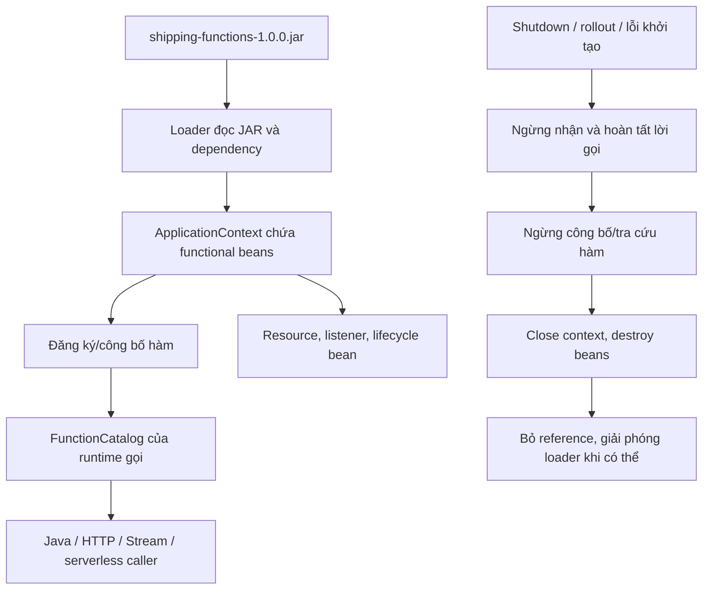
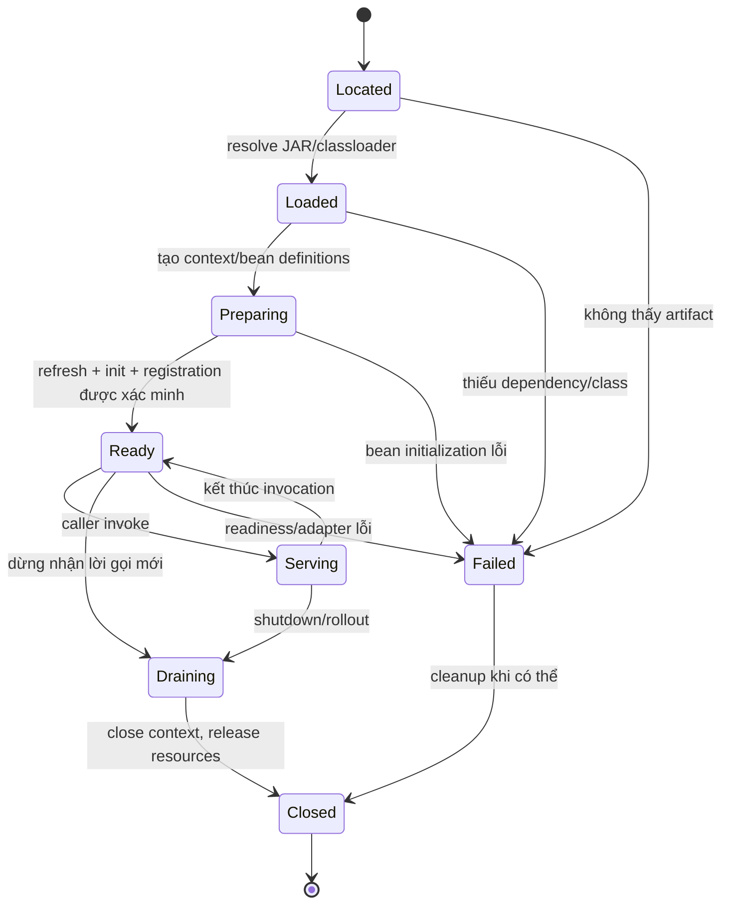
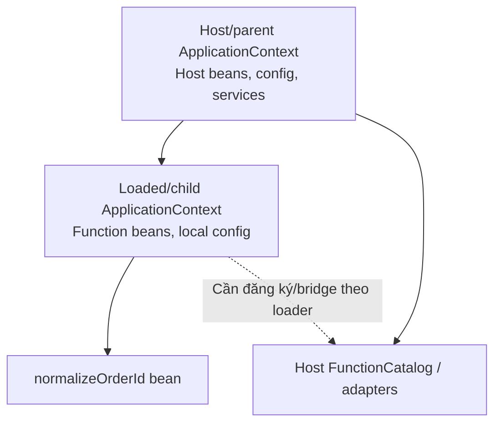
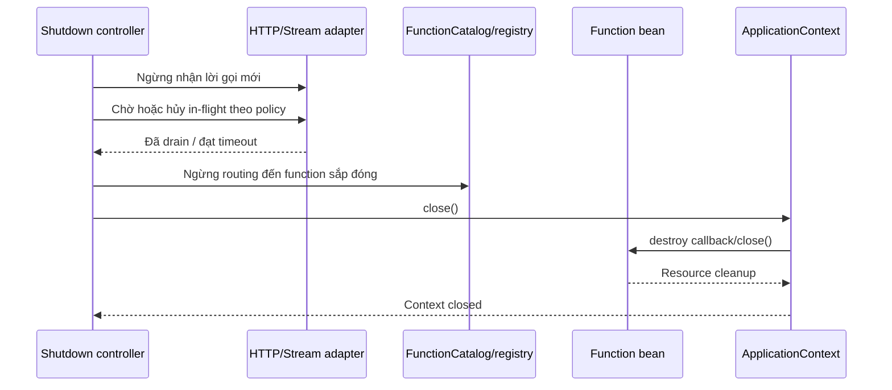
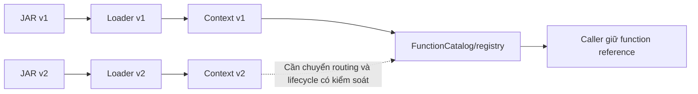

# Vòng đời ApplicationContext của gói được nạp

## 1. Bài toán: JAR đã nạp, nhưng ai khởi tạo và đóng những bean bên trong?

Giả sử một đội nghiệp vụ phát hành `shipping-functions-1.0.0.jar`. JAR này là ứng dụng Spring Boot chứa bean `Function<ShippingRequest,ShippingQuote>` cùng cấu hình, dependency và một tài nguyên kết nối ngoài. Đội vận hành có một Spring Boot **host** muốn nạp artifact, tra cứu hàm qua `FunctionCatalog` rồi cho HTTP client hoặc Kafka binder gọi hàm.

Khi chạy thử, nghiệp vụ trả kết quả đúng. Nhưng khi cập nhật JAR hoặc dừng host, những vấn đề khác xuất hiện: kết nối cũ chưa đóng, thread nền vẫn chạy, một `ApplicationRunner` gây side effect ngoài ý muốn, function cũ còn được gọi dù đã đổi artifact, hoặc một `@Bean` có trong ứng dụng nguồn nhưng không xuất hiện trong catalog của host.

Các vấn đề này thuộc **vòng đời `ApplicationContext` của gói được nạp**, không chỉ thuộc logic `Function.apply()`.

Trong module **Spring Cloud Function** (`SPRING_CLOUD_FUNCTION`), quy tắc nghiệp vụ được biểu diễn bằng `Supplier<T>`, `Function<T,R>` hoặc `Consumer<T>`, có thể được `FunctionCatalog` tra cứu và composition, chuyển đổi dữ liệu qua adapter rồi gọi từ HTTP, messaging hoặc serverless. Chủ đề này làm rõ cách khởi tạo, vận hành và giải phóng các thành phần Spring **khi hàm được phân phối dưới dạng JAR và đưa vào host**.

**Điểm quan trọng:** cần phân biệt ba vòng đời:

1. **Artifact/ClassLoader**: tìm JAR, nạp class và dependency, giữ hoặc giải phóng reference đến code.
2. **Spring ApplicationContext**: tạo bean definitions, refresh, khởi tạo singleton, phát sự kiện và đóng context.
3. **Invocation**: caller tra catalog, bắt đầu/hoàn tất `get()`, `apply()` hoặc `accept()`, xử lý lỗi và giao vận.

Đóng một context không mặc nhiên xóa bytecode của class khỏi JVM; nạp được class không mặc nhiên khởi tạo Spring bean; function tồn tại cũng không đồng nghĩa đã có người gọi.

> **Phạm vi phiên bản:** `spring-cloud-function-deployer` và khả năng nạp một *packaged Spring Boot application* phụ thuộc release. Cách tổ chức context (context ngoài, context riêng, quan hệ parent–child, cách bridge catalog và classloader) phải kiểm tra trên bản deployer thực tế. Ví dụ Spring dưới đây mô tả **vòng đời chuẩn của ApplicationContext** và các điều kiện cần xác minh, không khẳng định mọi bản Function Deployer đều tự động tạo child context theo đúng một mô hình duy nhất.

## 2. Bốn thành phần và quyền sở hữu vòng đời

| Thành phần | Nó sở hữu gì? | Ai phải quản lý? |
| --- | --- | --- |
| **Artifact/JAR** | Bytecode, resource, metadata và phiên bản phát hành. | Hệ thống build/repository và quy trình nạp của host. |
| **ClassLoader** | Namespace class, khả năng nhìn thấy dependency/resource. | Loader/framework đã nạp artifact; có thể có lifecycle riêng. |
| **ApplicationContext** | BeanFactory, singleton beans, bean post-processors, event listeners, bean lifecycle và environment. | Mã/runtime tạo context phải có trách nhiệm đóng nó. |
| **FunctionCatalog và adapter** | Đăng ký/lookup function, wrapper, composition và đường kích hoạt. | Spring Cloud Function context và host/adapter tương ứng. |

**Hai ý dễ gây nhầm:**

- Một `ClassLoader` có thể phục vụ nhiều `ApplicationContext`; một context cũng có thể dùng class do nhiều loader định nghĩa. Vì vậy **context không đồng nhất với classloader**.
- Hai Spring context cùng ở **một JVM** vẫn chia sẻ CPU, heap và quyền tiến trình. Việc tách context giúp tổ chức bean/namespace chứ **không phải sandbox bảo mật hay process isolation**.



Sơ đồ thể hiện **quy trình vận hành mong muốn**. Cách deployer thực hiện unregistration, draining, close và giải phóng classloader **không được suy đoán là tự động** nếu release chưa chứng minh các khả năng ấy.

## 3. Các trạng thái của một gói có functional bean

Một mô hình trạng thái khái niệm:



Các trạng thái là **mô hình để thiết kế và kiểm thử**, không phải API enum có sẵn của Spring Cloud Function. Trong thực tế, Spring `ApplicationContext.refresh()` và `close()` có quy tắc riêng; deployment/readiness, discovery/registration và invocation đều cần kiểm tra bổ sung.

| Giai đoạn | Câu hỏi cần xác minh |
| --- | --- |
| **Resolve** | JAR ở `file:///...` hoặc repository có thực sự truy cập được từ host không? |
| **Load** | Classloader đọc đúng layout simple/Boot JAR, đúng Java và dependency không? |
| **Create context** | Môi trường nào, bean definitions nào, configuration nào được dùng? |
| **Refresh/init** | Những singleton nào được tạo và chạy callback khởi tạo? |
| **Register** | Bean function nào được catalog công bố dưới tên gì? |
| **Serve** | Adapter nào đang gửi input, có converter và error contract đúng không? |
| **Stop** | Có chặn invocation mới và xử lý lời gọi đang chạy không? |
| **Close** | Có gọi destruction callbacks, đóng thread/client và bỏ registration không? |
| **Reload** | Có thật sự dùng artifact mới, không giữ classloader/resource cũ ngoài ý muốn không? |

## 4. Simple JAR và Spring Boot JAR có yêu cầu lifecycle khác nhau

| Thuộc tính | Simple library JAR | Spring Boot executable JAR có functional bean |
| --- | --- | --- |
| Nội dung | Thường có class `implements Function`/`Supplier`/`Consumer`. | Có `@SpringBootApplication`, `@Configuration`, `@Bean` và dependency. |
| Spring context trong JAR | Không bắt buộc. | Cấu hình Spring thường là phần thiết yếu của application. |
| Cách tạo implementation | Có thể khởi tạo class theo cơ chế loader của release. | Cần cơ chế nhận diện/khởi tạo functional beans trong một context thích hợp. |
| Layout | Classes thường nằm theo package path ở root archive. | Classes thường nằm ở `BOOT-INF/classes`; dependencies trong `BOOT-INF/lib`. |
| Callback Spring | Không mặc nhiên áp dụng nếu instance không được quản lý như Spring bean. | Có thể có init/destroy, events, runners, scheduling tùy cách Spring khởi động context. |
| Rủi ro | Sai FQCN, constructor, classloader. | Thêm auto-configuration, bean dependencies, startup side effects và resource lifecycle. |

**Không được mặc định nạp class Java bằng `function-class` tương đương chạy toàn bộ Spring Boot application.** Với simple JAR, một implementation được tạo trực tiếp có thể không có các callback Spring mà người viết class tưởng sẽ chạy. Với Boot JAR, loader phải hiểu Spring configuration/context và layout archive theo version hỗ trợ.

### 4.1. Chạy Boot JAR độc lập khác nạp JAR vào host

```text
Trường hợp A: java -jar shipping-functions-1.0.0.jar
  → JVM/process riêng
  → SpringApplication tạo context cho chính application
  → ứng dụng tự quản lý adapter và shutdown

Trường hợp B: Spring Boot host dùng Function Deployer
  → JAR được resolve trong tiến trình host theo loader hỗ trợ
  → context/bean registration theo cơ chế deployer release
  → host gọi function qua catalog/adapter
  → context/resource của gói phải được quản lý theo cơ chế đó
```

Khi chạy cách B, không tự suy ra SpringApplication.main của ứng dụng nguồn sẽ được gọi như một process riêng, hoặc mọi event của Spring Boot độc lập sẽ xuất hiện ở host. **Những gì có thể bảo đảm phải được quan sát từ host ở bản đang chạy.**

## 5. Bên trong quá trình `ApplicationContext.refresh()`

Trong một Spring `ConfigurableApplicationContext` thông thường, việc gọi `refresh()` bao gồm nhiều nhóm công việc:

1. **Chuẩn bị environment và bean factory** với property sources, profiles và settings phù hợp.
2. **Xử lý bean definitions**, `@Configuration` và các `BeanFactoryPostProcessor`/`BeanDefinitionRegistryPostProcessor`.
3. **Đăng ký BeanPostProcessor**, conversion, event multicast/handlers và các thành phần hỗ trợ khác.
4. **Khởi tạo non-lazy singleton beans**, giải quyết constructor/dependency, post-process, init callbacks và proxying.
5. **Hoàn tất refresh**; kích hoạt lifecycle components phù hợp và công bố `ContextRefreshedEvent`.

Đây là sơ lược ở mức khái niệm. Thứ tự chi tiết callback/phụ thuộc có thể khác theo bean configuration, proxying, lazy loading và Spring release. Đặc biệt **không phải mọi bean đều khởi tạo ngay**: bean `@Lazy` hoặc scope khác singleton có thể chỉ tạo khi được yêu cầu.

### 5.1. Các callback thường gặp

| Cơ chế | Thời điểm thường gặp | Điều cần tránh |
| --- | --- | --- |
| Constructor bean | Khi bean thực sự được tạo. | Gọi I/O, tạo thread khó cleanup trong constructor. |
| `BeanPostProcessor` | Trước/sau init theo chuỗi Spring processor. | Giả định bean reference luôn là implementation gốc thay vì proxy. |
| `@PostConstruct` | Trong pha khởi tạo bean đã được quản lý. | Viết side effect không idempotent chỉ vì context refresh. |
| `InitializingBean.afterPropertiesSet()` | Pha init callback của bean. | Dùng đồng thời nhiều cơ chế init gây duplicate side effect. |
| `@Bean(initMethod="open")` | Gọi method init nếu bean được tạo. | Giả định xảy ra khi mới đọc file JAR. |
| `ContextRefreshedEvent` | Khi một context hoàn tất refresh. | Coi event là “toàn bộ hệ thống đã nhận traffic”. |
| `SmartLifecycle.start()` | Lifecycle processor kích hoạt component theo phase/autoStartup. | Tự khởi động consumer/poller không được phép. |
| `@Bean(destroyMethod="close")` / `@PreDestroy` | Khi Spring destroy bean được quản lý và đủ điều kiện. | Dựa vào JVM class unloading để tự đóng kết nối. |

Với Spring Boot 3+, `@PostConstruct` và `@PreDestroy` sử dụng `jakarta.annotation`; các ứng dụng Boot 2 cũ thường dùng `javax.annotation`. Ví dụ xuyên suốt của bài chọn `@Bean(initMethod,destroyMethod)` để không phụ thuộc package annotation ở mã mẫu.

## 6. Ví dụ tự chứa: một functional bean có lifecycle rõ

Hàm minh họa chuẩn hóa mã đơn, không cần HTTP hay broker ở phần lõi. Ta bổ sung một trạng thái chỉ nhằm **quan sát lifecycle**, không coi đó là mutable business state cần lưu trong function.

### 6.1. Lớp OrderIdNormalizer

```java
// src/main/java/demo/functions/OrderIdNormalizer.java
package demo.functions;

import java.util.Locale;
import java.util.concurrent.atomic.AtomicBoolean;
import java.util.function.Function;

public final class OrderIdNormalizer
        implements Function<String, String>, AutoCloseable {

    private final AtomicBoolean active = new AtomicBoolean(false);

    // Method init được Spring gọi khi bean được tạo.
    public void open() {
        if (!active.compareAndSet(false, true)) {
            throw new IllegalStateException("Already opened");
        }
        System.out.println("OrderIdNormalizer OPEN");
    }

    @Override
    public String apply(String orderId) {
        if (!active.get()) {
            throw new IllegalStateException("Function not active");
        }
        if (orderId == null || orderId.isBlank()) {
            throw new IllegalArgumentException("Missing orderId");
        }
        return orderId.strip().toUpperCase(Locale.ROOT);
    }

    public boolean isActive() {
        return active.get();
    }

    @Override
    public void close() {
        if (active.getAndSet(false)) {
            System.out.println("OrderIdNormalizer CLOSE");
        }
    }
}
```

Trong ví dụ, `open()` và `close()` có tính chất có thể quan sát được. `AtomicBoolean` giúp kiểm tra trạng thái từ nhiều thread nhưng **không tự bảo đảm drain những invocation đang chạy**. Một lời gọi có thể vượt qua kiểm tra `active` trước khi shutdown bắt đầu; cần chính sách điều phối riêng khi phải bảo đảm không mất xử lý.

### 6.2. Đăng ký bean với tên tường minh

```java
// src/main/java/demo/functions/FunctionConfiguration.java
package demo.functions;

import org.springframework.context.annotation.Bean;
import org.springframework.context.annotation.Configuration;

@Configuration(proxyBeanMethods = false)
public class FunctionConfiguration {

    @Bean(
        name = "normalizeOrderId",
        initMethod = "open",
        destroyMethod = "close"
    )
    OrderIdNormalizer normalizeOrderId() {
        return new OrderIdNormalizer();
    }
}
```

`OrderIdNormalizer` triển khai `Function<String,String>`; vì vậy nó là một functional bean của ứng dụng. `@Bean` cung cấp **tên `normalizeOrderId`** và để **Spring context** chịu trách nhiệm gọi hai lifecycle methods.

Nếu dùng `new OrderIdNormalizer()` bên ngoài Spring mà không gọi `open()`, `apply()` sẽ báo chưa active; nếu chỉ nạp class bằng ClassLoader mà không tạo Spring bean, `@Bean` này không được áp dụng. Đây là sự khác nhau trực quan giữa **nạp bytecode** và **quản lý bean**.

### 6.3. Ứng dụng Spring Boot nguồn

```java
// src/main/java/demo/functions/PackagedFunctionApplication.java
package demo.functions;

import org.springframework.boot.SpringApplication;
import org.springframework.boot.autoconfigure.SpringBootApplication;

@SpringBootApplication
public class PackagedFunctionApplication {
    public static void main(String[] args) {
        SpringApplication.run(PackagedFunctionApplication.class, args);
    }
}
```

Vì `FunctionConfiguration` cùng package `demo.functions`, cấu hình được component scanning phát hiện theo cách tổ chức Boot thông thường. Không cần khởi động HTTP server chỉ để test lifecycle của bean:

```yaml
spring:
  main:
    web-application-type: none
```

Cấu hình `web-application-type: none` áp dụng khi **chạy ứng dụng nguồn ở chế độ console/test**. Nếu muốn chạy nó như provider HTTP độc lập, cần web adapter và không tắt web. Khi được nạp như packaged function trong host, cách loader tạo context và kế thừa configuration phải kiểm tra trên release deployer cụ thể.

## 7. Một bean Spring quản lý nhiều tài nguyên

Một function thực tế có thể cần API client, connection pool, cache hoặc một subscription. Khi ấy, nên tách **logic thuần** khỏi **resource lifecycle**:

```java
// src/main/java/demo/functions/FunctionResources.java
package demo.functions;

import java.util.concurrent.atomic.AtomicBoolean;

public final class FunctionResources implements AutoCloseable {
    private final AtomicBoolean opened = new AtomicBoolean();

    public void open() {
        if (!opened.compareAndSet(false, true)) {
            throw new IllegalStateException("Resource already open");
        }
        // Minh họa: mở một client/pool khi cần thực tế.
    }

    public boolean isReady() {
        return opened.get();
    }

    @Override
    public void close() {
        if (opened.getAndSet(false)) {
            // Minh họa: đóng client/pool và giải phóng resource.
        }
    }
}
```

```java
// Phần có thể thêm vào @Configuration riêng của ứng dụng nguồn:
@Bean(initMethod = "open", destroyMethod = "close")
FunctionResources functionResources() {
    return new FunctionResources();
}

@Bean("checkResource")
Function<String, Boolean> checkResource(
        FunctionResources resources) {
    return ignored -> resources.isReady();
}
```

Hai đoạn là mẫu **tùy chọn**; method `@Bean` phải nằm trong `@Configuration` có import `java.util.function.Function` thích hợp. `checkResource` chỉ minh họa dependency injection giữa beans, không phải endpoint health check production và không nên công bố tự do ra bên ngoài.

Với resource chứa thông tin nhạy cảm, không in secret vào log khi init/close. Đối với client có thể lỗi, phải thiết kế cleanup ngay cả khi init mới làm được một phần, không chỉ kỳ vọng `close()` luôn được gọi trong mọi trường hợp lỗi.

## 8. Kiểm chứng vòng đời khi chạy ứng dụng nguồn độc lập

Trước khi đưa JAR vào Function Deployer, nên kiểm chứng ứng dụng **tự chạy** tạo và destroy bean đúng. Một công cụ đơn giản là `ApplicationRunner` chỉ bật trong profile thử nghiệm:

```java
// src/main/java/demo/functions/CatalogSmokeRunner.java
package demo.functions;

import java.util.function.Function;

import org.springframework.boot.ApplicationRunner;
import org.springframework.cloud.function.context.FunctionCatalog;
import org.springframework.context.annotation.Bean;
import org.springframework.context.annotation.Configuration;
import org.springframework.context.annotation.Profile;

@Configuration(proxyBeanMethods = false)
@Profile("smoke")
public class CatalogSmokeRunner {
    @Bean
    ApplicationRunner verifyFunction(FunctionCatalog catalog) {
        return args -> {
            Function<String, String> fn =
                    catalog.lookup("normalizeOrderId");
            if (fn == null) {
                throw new IllegalStateException(
                        "Function not registered: normalizeOrderId");
            }
            String result = fn.apply("  od-204 ");
            if (!"OD-204".equals(result)) {
                throw new IllegalStateException(
                        "Unexpected result: " + result);
            }
            System.out.println("Catalog smoke PASS");
        };
    }
}
```

Giả sử POM có Spring Boot starter, Spring Cloud Function context và Maven Boot plugin với version tương thích, khi học viên đóng gói rồi chạy:

```bash
mvn package
java -jar target/shipping-functions-1.0.0.jar \
  --spring.profiles.active=smoke
```

Tên artifact cuối là **minh họa**, phụ thuộc `artifactId`/`version` của Maven project thực tế. Trong chế độ không có web server và không có thread non-daemon nào giữ JVM sống, ứng dụng có thể kết thúc sau startup. Khi Spring context được đóng bình thường, ta dự kiến thấy các thông điệp khởi tạo/kiểm tra/đóng resource (trật tự phụ thuộc bean dependencies):

```text
OrderIdNormalizer OPEN
Catalog smoke PASS
OrderIdNormalizer CLOSE
```

**Giới hạn phép thử:** `ApplicationRunner` thuộc vòng đời khi **SpringApplication.run(...)** thực hiện đầy đủ bootstrap Boot. Một deployer nạp Boot JAR vào một context riêng không nhất thiết chạy `SpringApplication` theo cùng đường, nên **không được mặc định runner trong JAR nguồn luôn chạy khi host nạp artifact**. Kiểm thử ứng dụng nguồn không thay kiểm thử loader/context của host.

### 8.1. Khác nhau giữa bean init và function invocation

`@Bean(initMethod="open")` có thể chạy trong lúc khởi tạo singleton; nó **không gọi `Function.apply()`**. `ApplicationRunner` trong ví dụ mới là code chủ động tra catalog và invoke. Sau khi tạo function, chưa có lý do nghiệp vụ nào khiến Spring tự gọi `apply()` nếu không có runner, request hoặc adapter.

Một `Supplier.get()` cũng không tự được chạy khi context refresh chỉ vì bean Supplier được đăng ký. Muốn phát dữ liệu định kỳ, cần poller/scheduler hoặc một điểm kích hoạt khác với lifecycle và permission rõ.

## 9. Các Spring event phải được hiểu theo đúng phạm vi

Spring và Spring Boot có những sự kiện startup/shutdown khác nhau. Những event sau **không thể thay thế nhau**:

| Event / callback | Điều nó báo hiệu | Giới hạn |
| --- | --- | --- |
| `ContextRefreshedEvent` | **Một** ApplicationContext hoàn tất refresh. | Chưa chứng minh tất cả remote dependencies, adapters và traffic đã ready. |
| `ApplicationStartedEvent` (Spring Boot) | Boot application đã start và context được refresh, nhưng chưa chạy `ApplicationRunner`/`CommandLineRunner`. | Chỉ áp dụng khi bootstrap qua SpringApplication theo lifecycle tương ứng. |
| `ApplicationReadyEvent` (Spring Boot) | SpringApplication đã qua runners và cho biết ứng dụng sẵn sàng theo vòng đời Boot. | Không chứng minh function plugin và mọi downstream dependency đều khỏe nếu không có readiness check. |
| `ApplicationFailedEvent` (Spring Boot) | Bootstrap Boot thất bại. | Không phải mọi lỗi nạp context qua API tùy biến đều phát event này. |
| `ContextClosedEvent` | ApplicationContext đang được đóng. | Thường phát **trước** bean destruction hoàn tất; không đồng nghĩa đã drain hết in-flight calls. |
| `ContextStartedEvent` | `ConfigurableApplicationContext.start()` được gọi. | **Không** phải tên khác của `ApplicationStartedEvent` trong Spring Boot. |

Một listener quan sát:

```java
package demo.functions;

import org.springframework.context.ApplicationListener;
import org.springframework.context.event.ContextClosedEvent;
import org.springframework.context.event.ContextRefreshedEvent;
import org.springframework.context.annotation.Bean;
import org.springframework.context.annotation.Configuration;

@Configuration(proxyBeanMethods = false)
public class LifecycleEventConfiguration {

    @Bean
    ApplicationListener<ContextRefreshedEvent> refreshed() {
        return event -> System.out.println(
                "Refreshed: " + event.getApplicationContext().getId());
    }

    @Bean
    ApplicationListener<ContextClosedEvent> closing() {
        return event -> System.out.println(
                "Closing: " + event.getApplicationContext().getId());
    }
}
```

Ví dụ trên là **listener phục vụ quan sát khi học**, không phải giải pháp logging production. Nếu có **parent–child context**, một số application events từ child có thể truyền lên parent; cần kiểm tra `event.getApplicationContext()` và tránh xử lý lặp. Không giả định listener có mặt trong tất cả context mà deployer tạo nếu cấu hình đó không được nạp.

### 9.1. Nguy cơ khi dùng startup event cho side effect

Ví dụ logic gửi hàng loạt message trong `@EventListener(ContextRefreshedEvent.class)` sẽ có rủi ro:

- Context được tạo lại khi reload hoặc test có thể gửi lại dữ liệu.
- Chạy nhiều replica khiến mỗi replica cùng phát sự kiện.
- Event có thể được phát cho nhiều context trong hierarchy.
- Mở kết nối/phụ thuộc ngoài trước khi sẵn sàng có thể khiến startup thất bại.
- Shutdown/retry có thể không có transaction với bên nhận.

Nếu cần tác vụ có vòng đời dài, sử dụng scheduler/job/Stream poller với idempotency và ownership rõ. Không coi refresh event là lời gọi nghiệp vụ được phép.

## 10. `SmartLifecycle` và các bean chạy nền

`SmartLifecycle` cho phép Spring quản lý thành phần có trạng thái running và thứ tự start/stop. Nó khác `@Bean(initMethod)`: một method init có thể chỉ thiết lập tài nguyên, trong khi `SmartLifecycle` dùng cho thành phần cần start/stop có kiểm soát.

Ví dụ skeleton **không tự khởi động poller**:

```java
package demo.functions;

import java.util.concurrent.atomic.AtomicBoolean;
import org.springframework.context.SmartLifecycle;

public final class FunctionPollerLifecycle implements SmartLifecycle {
    private final AtomicBoolean running = new AtomicBoolean();

    @Override
    public void start() {
        // Chỉ bắt đầu polling sau khi deployment cho phép.
        running.set(true);
    }

    @Override
    public void stop() {
        running.set(false);
        // Dừng nhận việc mới và xử lý resource của poller nếu có.
    }

    @Override
    public void stop(Runnable callback) {
        try {
            stop();
        } finally {
            callback.run();
        }
    }

    @Override
    public boolean isRunning() {
        return running.get();
    }

    @Override
    public boolean isAutoStartup() {
        return false;
    }

    @Override
    public int getPhase() {
        return 0;
    }
}
```

Đây là mã minh họa **giao thức lifecycle**, chưa có polling thật. `isAutoStartup()=false` có nghĩa không yêu cầu Spring tự gọi `start()` lúc refresh; code điều phối phải chủ động start nếu muốn nó hoạt động. Với những bean đặt `isAutoStartup()=true`, refresh có thể kích hoạt chúng, gây side effect ngay khi host nạp context.

Khi dùng `SmartLifecycle`, Spring quản lý thứ tự theo `phase`: **start từ phase thấp đến cao, stop theo chiều ngược lại** trong quy trình lifecycle tương ứng. Với stop bất đồng bộ, method `stop(Runnable)` phải gọi callback khi thực sự hoàn tất; nếu không, Spring có thể chờ đến timeout khi shutdown.

### 10.1. `@Scheduled`, listener và subscription không chỉ là bean thụ động

Một JAR chứa `@EnableScheduling` và `@Scheduled` có thể tạo job khi context được refresh. Một `@KafkaListener` hoặc binder có thể tạo consumer khi context hoạt động và component tương ứng được cấu hình. Nếu cùng JAR được nạp trong hai host, có nguy cơ chạy cùng tác vụ **hai lần**, không phải vì `FunctionCatalog` bị lỗi mà vì **lifecycle của những component ngoài function đã khởi động**.

Khi thiết kế packaged function, nên phân tách:

- **Bean nghiệp vụ**: các function tương đối thuần, gọi khi có input.
- **Resource bean**: mở/đóng client theo lifecycle Spring.
- **Source/consumer adapter**: listener, scheduler, poller, web handler; chỉ bật trong deployment thực sự cần.

Không nên để JAR nguồn tự mở một Kafka consumer chỉ để phục vụ một hàm mà host dự định gọi bằng HTTP. Nếu buộc phải đóng gói chung, cần profile/condition và test việc context không khởi động adapter ngoài ý muốn.

## 11. Parent–child ApplicationContext và phạm vi bean

Khi một ứng dụng host tích hợp code từ một packaged Spring Boot application, có thể xuất hiện nhiều context. **Quan hệ thực tế do loader/deployer quyết định**, nhưng mô hình parent–child của Spring giúp giải thích những hành vi thường gặp.



Nếu **thực sự có parent–child relationship**:

- Child thường có thể tra cứu bean ở parent theo cơ chế phân giải bean hierarchy nếu không có local bean cùng tên/type.
- Parent **không tự liệt kê toàn bộ bean của child** chỉ vì child có parent reference.
- Local bean của child có thể shadow bean cùng tên ở parent, tùy cách tra cứu/đăng ký.
- Property/environment có thể được cấu hình, kế thừa hoặc ghi đè; phải kiểm tra cách tạo context.
- Application events từ child có thể được propagate lên parent; listener phải xác định event source.

Những điều này **không bảo đảm** Spring Cloud Function Deployer dùng parent–child hierarchy trong mọi release. Deployer có thể sử dụng cơ chế khác để công bố function vào catalog của host.

### 11.1. Thí nghiệm thuần Spring về bean visibility

Ví dụ dưới đây chỉ là **Spring Framework ApplicationContext demo**, không phải cách triển khai bắt buộc của Function Deployer:

```java
import org.springframework.context.annotation.AnnotationConfigApplicationContext;

try (AnnotationConfigApplicationContext parent =
        new AnnotationConfigApplicationContext()) {

    parent.registerBean("sharedLabel", String.class,
            () -> "HOST");
    parent.refresh();

    try (AnnotationConfigApplicationContext child =
            new AnnotationConfigApplicationContext()) {
        child.setParent(parent);
        child.registerBean("loadedLabel", String.class,
                () -> "PLUGIN");
        child.refresh();

        System.out.println(child.getBean("sharedLabel"));
        // HOST — child nhìn thấy parent bean qua hierarchy.

        System.out.println(child.getBean("loadedLabel"));
        // PLUGIN — bean của chính child.

        System.out.println(parent.containsBean("loadedLabel"));
        // false — parent không tự nhìn ngược xuống child.
    }
}
```

Mẫu này sử dụng `AnnotationConfigApplicationContext` có thể `registerBean` trước `refresh()`. Không gọi `refresh()` hai lần trên cùng `AnnotationConfigApplicationContext`; việc đóng các context được minh họa bằng `try-with-resources`.

**Quan trọng:** `parent.containsBean("loadedLabel")` trả `false` trong thí nghiệm vì bean được đăng ký riêng trong child. Một deployer có thể **chủ động bridge/export** function sang host catalog; khi đó catalog thấy function **không đồng nghĩa parent BeanFactory tự chứa tất cả bean gốc từ child**.

## 12. ClassLoader khác ApplicationContext

Context quản lý bean; ClassLoader định nghĩa class. Khi nạp nhiều packaged functions, host có thể có cả hai loại ranh giới:

```text
JVM host
  ├─ Host ClassLoader
  │    ├─ FunctionCatalog
  │    └─ Shared API classes
  ├─ Plugin ClassLoader (nếu loader tạo riêng)
  │    ├─ Function implementation
  │    └─ Plugin-only dependencies
  ├─ Host ApplicationContext
  └─ Loaded ApplicationContext (nếu runtime tạo riêng)
```

Không suy ra “mỗi Spring context luôn có một ClassLoader riêng” hoặc “mỗi JAR luôn có một context riêng”. Loader và context có thể được chia sẻ hoặc tạo theo cách khác tùy cơ chế nạp.

### 12.1. Rủi ro trùng DTO giữa host và JAR

Nếu host và plugin đều có `demo.contract.OrderRequest` nhưng mỗi loader tự định nghĩa class:

```text
(demo.contract.OrderRequest, HostLoader)
    !=
(demo.contract.OrderRequest, PluginLoader)
```

Một function nhận `Function<OrderRequest,OrderQuote>` có thể hoạt động trong context của plugin nhưng ném `ClassCastException` khi host gọi với object tự tạo từ classloader khác. Spring context hoạt động hoàn hảo **không sửa được Java type identity**.

Hai hướng giải quyết:

1. **Shared API JAR** được cả hai phía nhìn thấy từ cùng defining loader, với dependency/version tương thích.
2. **Explicit conversion** qua JSON/message schema/bytes ở ranh giới, tạo object đúng lớp tại nơi cần.

Khi caller là **một ứng dụng/tiến trình khác** qua HTTP/Kafka, object Java không truyền nguyên reference qua mạng. Khi ấy giao thức và schema là boundary chính, không cần ép hai JVM dùng chung `Class<?>`.

## 13. Bean name, FunctionCatalog và thời điểm công bố hàm

Trong source application:

```java
@Bean(name = "normalizeOrderId", initMethod = "open",
      destroyMethod = "close")
OrderIdNormalizer normalizeOrderId() {
    return new OrderIdNormalizer();
}
```

Spring đặt tên bean `normalizeOrderId`. Với dependency Spring Cloud Function context phù hợp, functional bean có thể được `FunctionCatalog` tra cứu theo tên/definition:

```java
Function<String, String> fn =
        catalog.lookup("normalizeOrderId");
```

**Cần tách ba sự kiện:**

1. **Bean definition tồn tại**: Spring biết phải tạo function khi cần.
2. **Bean đã khởi tạo**: init callbacks đã chạy nếu bean không lazy và context đã refresh (hoặc bean được gọi lần đầu).
3. **Function được catalog công bố**: caller của đúng runtime/context tra cứu được tên function.

Không mặc định mọi bean trong source Boot JAR **được nhập nguyên vẹn vào host ApplicationContext**. Khi Function Deployer nạp packaged application, cách đăng ký và tên catalog trong **host** phải xác minh theo release. `FunctionCatalog.lookup(...)` có thể trả **wrapper** thay vì bean gốc. Wrapper, converter và composition có lifecycle phụ thuộc context/cache tương ứng.

### 13.1. `definition` chọn hàm, không tạo context

```yaml
spring:
  cloud:
    function:
      definition: normalizeOrderId
```

`spring.cloud.function.definition` thường được adapter/Stream dùng để chọn hàm hoặc pipeline **đã đăng ký**. Nó không tự khởi tạo một Boot application chưa được nạp, cũng không tự đóng context khi thay đổi tên.

Với packaged function loading, `spring.cloud.function.location` cho biết vị trí artifact trong những release hỗ trợ, còn `spring.cloud.function.function-class` có thể dùng cho cơ chế chọn class từ **simple JAR**. Đừng gán một method `@Bean` vào `function-class` rồi kỳ vọng nó thay thế bean discovery của Boot context.

### 13.2. Lazy initialization ảnh hưởng thời điểm “sẵn sàng”

Nếu bean `@Lazy`, việc context hoàn tất refresh **có thể xảy ra trước khi bean/function thực sự được tạo**. Catalog lookup hoặc lời gọi đầu tiên có thể kích hoạt initialization và làm lộ lỗi dependency/constructor sau startup.

Với hàm bắt buộc phải sẵn sàng trước khi nhận traffic, lựa chọn một trong các cách đã kiểm chứng: eager init, smoke lookup/invoke được phép, explicit warm-up hoặc readiness check khớp với lifecycle. Không nên gọi một `Consumer` có side effect để “warm up” nếu thao tác đó làm thay đổi dữ liệu thật.

## 14. Configuration, Environment, profiles và secrets thuộc context nào?

Một bean có thể đọc property thông qua constructor, `@Value` hoặc `@ConfigurationProperties`. Nhưng giá trị mà bean nhận phụ thuộc **Environment và property sources của context thực sự tạo bean**, không đơn giản là file `application.yml` nằm bên trong archive.

Ví dụ một function phụ thuộc cấu hình phiên bản chính sách:

```java
package demo.functions;

import java.util.function.Supplier;
import org.springframework.beans.factory.annotation.Value;
import org.springframework.context.annotation.Bean;
import org.springframework.context.annotation.Configuration;

@Configuration(proxyBeanMethods = false)
public class PolicyVersionFunctions {
    @Bean("policyVersion")
    Supplier<String> policyVersion(
            @Value("${shipping.policy.version:v1}") String version) {
        return () -> version;
    }
}
```

Khi source application chạy độc lập, property có thể lấy từ `application.yml`, environment hoặc command line. Khi **host nạp JAR**:

- Context của host và context được nạp **có thể** dùng chung, kế thừa hoặc được cấp property sources riêng theo loader/release.
- Không tự giả định `application.yml` trong Boot JAR được áp dụng y hệt khi chạy `java -jar`.
- Một profile bật trong host có thể không đồng nghĩa cùng profile được bật trong context nguồn, trừ khi cách khởi tạo xác nhận như vậy.
- Các biến cấu hình có tên quá chung dễ gây **va chạm** giữa hai plugin hoặc giữa plugin và host.

Nên dùng namespace đặc thù như `shipping.policy.version`, xác minh effective value **không chứa secret** khi khởi động, và phân biệt cấu hình **logic nghiệp vụ** với cấu hình **web/broker adapter**.

### 14.1. Không mặc định dùng bean của host trong child context

Giả sử function cần `OrderRepository` và constructor nhận bean đó. Nếu loader tạo context riêng **không có quan hệ parent** hoặc không bridge dependency, injection sẽ thất bại. Ngay cả khi có parent hierarchy, bean từ parent có thể dùng kiểu API do classloader khác định nghĩa.

Những lựa chọn tốt hơn tùy mục tiêu:

1. Cung cấp dependency trong context quản lý function theo cách được loader hỗ trợ.
2. Đưa interface contract vào shared API và kiểm soát classloader identity nếu cần inject bean từ host.
3. Tách function thành provider service độc lập, giao tiếp qua HTTP/broker nếu cần cách ly phiên bản/tài nguyên.
4. Giữ core function thuần Java, đưa I/O ra lớp adapter/service của deployment.

**Không giải quyết bean missing bằng cách copy toàn bộ class và dependency của host vào plugin** khi chưa hiểu classloader; việc này có thể gây `ClassCastException` hoặc `LinkageError` thay vì giải quyết injection.

### 14.2. Quản lý secret trong lúc refresh

Một bean tạo database client có thể cần secret ngay khi init. Nếu token hết hạn hoặc không có quyền, startup có thể thất bại trước khi function được đăng ký. Phải phân biệt lỗi **configuration/credentials** với lỗi **function implementation**. Không log token, JDBC password, API key hoặc nội dung secret qua exception message không được lọc.

## 15. Khi khởi tạo thất bại giữa chừng

Giả sử context có ba bean:

```text
shippingConfig      → tạo thành công
shippingClient      → mở connection thành công
shippingFunction    → tạo bean thất bại do thiếu dependency
```

Spring thường cố cleanup các singleton **đã được quản lý và khởi tạo thành công** khi refresh bị hủy, nhưng không thể cam kết tự thu hồi mọi tài nguyên đã mở **bên ngoài hệ thống quản lý bean** hoặc bên trong một init method bị lỗi giữa chừng.

### 15.1. Init method cần exception safety

Ví dụ pseudo-code cho một tài nguyên ngoài:

```java
public void open() {
    ExternalClient candidate = createClient();
    try {
        candidate.configure();
        candidate.checkConnection();
        this.client = candidate;
    } catch (RuntimeException failure) {
        candidate.close();
        throw failure;
    }
}
```

`ExternalClient`, `createClient()` và field `client` trong đoạn trên **chỉ biểu diễn một lớp client ứng dụng tự định nghĩa**. Ý quan trọng là: nếu mở client xong nhưng init tiếp tục thất bại, code phải đóng phần đã cấp phát trong `catch` thay vì kỳ vọng Spring sẽ gọi destroy callback cho một bean chưa khởi tạo thành công.

### 15.2. Không công bố function trước khi ready

Một host nên chỉ công bố hoặc cho adapter nhận traffic khi:

- Artifact và các dependencies đã giải quyết được.
- Context đã refresh, bean function bắt buộc đã khởi tạo.
- Tên trong `FunctionCatalog` có thể tra cứu được.
- Một kiểm tra hợp đồng **không gây side effect** đã qua nếu cần.
- Adapter cần thiết đã được cấu hình và downstream dependencies quan trọng đang sẵn sàng theo chính sách.

Nếu bất kỳ bước nào thất bại, đánh dấu not-ready và dọn resource. **Không tiếp tục phục vụ bằng nửa context mới/nửa function cũ** trừ khi runtime có chính sách fallback/versioned routing rõ ràng và được kiểm thử.

### 15.3. Logging lỗi theo đúng ranh giới

| Lỗi startup | Dấu hiệu điển hình | Hướng kiểm tra |
| --- | --- | --- |
| JAR không tồn tại | Resolve `file:///...` hoặc `maven://...` thất bại. | Vị trí artifact, repo, quyền. |
| `ClassNotFoundException` | Loader không tìm được implementation. | FQCN, simple vs Boot JAR layout. |
| `NoClassDefFoundError` | Lớp phụ thuộc không khả dụng. | Dependency scope, classloader, Maven metadata. |
| `BeanCreationException` | Constructor, config, init callback hoặc dependency bean lỗi. | Root cause, property, secret, startup I/O. |
| Function lookup trả `null` | Chưa đăng ký hoặc sai tên catalog. | Context/registry, definition, deployer release. |
| Bean active nhưng adapter lỗi | HTTP route/converter hoặc Stream binding/broker sai. | Kiểm tra adapter riêng. |

Không quy mọi lỗi phát sinh lúc startup thành lỗi `ApplicationContext.refresh()`: repository resolution hoặc classloader thất bại có thể xảy ra **trước khi context được tạo**.

## 16. Lời gọi đồng thời và shutdown có thứ tự

Một function bean singleton có thể được nhiều thread gọi đồng thời. `FunctionCatalog` và web/Stream adapters không làm mutable field trong implementation trở nên thread-safe. Trong ví dụ `OrderIdNormalizer`, `AtomicBoolean` chỉ phản ánh active flag; nghiệp vụ chuẩn hóa chuỗi không giữ mutable business state.

Nếu một function đang dùng một client resource và context bắt đầu shutdown, có thể xảy ra:

```text
Thread A: Function.apply() đang xử lý đơn hàng.
Thread B: Host quyết định ngừng hoặc reload function.
Thread B: close() đóng database/HTTP client.
Thread A: tiếp tục thao tác bằng client vừa bị đóng.
```

**Đóng context không tự bảo đảm mọi lời gọi đang chạy đã kết thúc**. Chính adapter/host phải quản lý việc ngừng traffic mới, drain in-flight calls, timeout, retry và cleanup.

### 16.1. Quy trình shutdown mong muốn



Đây là **một thiết kế vận hành cần tự triển khai/kiểm chứng**, không phải sequence tự động của mọi bản deployer. Đối với Stream, dừng consumer container/binder và quản lý acknowledgment/offset trước khi đóng client có thể rất quan trọng. Với HTTP, graceful shutdown/readiness chuyển sang not-ready trước khi ngắt tiếp nhận giúp giảm số request thất bại.

### 16.2. Mẫu đếm lời gọi đang xử lý

```java
// Thành phần minh họa trong một adapter chủ động điều phối.
AtomicInteger inFlight = new AtomicInteger();

String invoke(Function<String, String> function, String input) {
    inFlight.incrementAndGet();
    try {
        return function.apply(input);
    } finally {
        inFlight.decrementAndGet();
    }
}
```

Đoạn này chỉ mô tả **đếm một lời gọi đồng bộ**; cần khai báo field `inFlight` trong lớp và import `AtomicInteger`, `Function`. Nó **chưa đủ là graceful shutdown hoàn chỉnh**: còn phải có bước *atomically reject new requests*, chính sách chờ/hủy và tình huống bất đồng bộ `Mono`/`Flux` chưa hoàn tất sau khi method trả về. Một reactive function có thể trả publisher ngay nhưng xử lý thật diễn ra sau khi subscribe.

Vì thế, với ứng dụng thật, ưu tiên cơ chế graceful shutdown chính thức của server/binder và đo in-flight theo vòng đời thực tế của request/message, không chỉ bằng `try/finally` bao quanh method call.

## 17. `close()` và destruction callback bảo đảm điều gì?

Với một `ConfigurableApplicationContext` hoạt động bình thường, `close()` sẽ:

- Công bố `ContextClosedEvent`.
- Kích hoạt lifecycle processor dừng những thành phần đang running theo quy tắc Spring.
- Destroy các singleton bean do context quản lý và gọi destruction callbacks phù hợp.
- Giải phóng những resource nội bộ do context quản lý.

**Không nên suy ra:**

- Spring tự dừng mọi thread được tạo thủ công mà không đăng ký lifecycle.
- Spring tự đóng một resource tạo bằng `new` nhưng không được bean quản lý và không có cleanup.
- `prototype` bean được context tự destroy giống singleton sau khi được cấp cho caller.
- `close()` luôn chạy khi process bị `SIGKILL`, crash JVM hoặc bị hạ tầng kết thúc đột ngột.
- Đóng context đồng nghĩa ngay lập tức unload class, xóa JAR cache hoặc ngắt mọi external invocation.

### 17.1. Singleton, prototype và @Lazy

| Scope hoặc chế độ | Init | Destroy |
| --- | --- | --- |
| **Singleton thông thường** | Thường tạo lúc refresh nếu không lazy. | Spring gọi destruction callback khi context đóng bình thường. |
| **Lazy singleton** | Tạo khi thực sự được yêu cầu. | Nếu bean đã được tạo và quản lý, callback destroy được xử lý khi close. |
| **Prototype** | Tạo mỗi lần được yêu cầu theo scope semantics. | Sau khi cung cấp instance, Spring thường không tự quản lý destruction; caller phải dọn resource. |
| **Request/session scope** | Phụ thuộc web context và vòng đời scope. | Không nên giả định có sẵn trong non-web function host. |

Một function giữ connection pool không nên tùy tiện chuyển sang `prototype` để giải quyết state/thread safety; việc đó có thể tạo nhiều pool mà không có trách nhiệm cleanup rõ ràng.

### 17.2. Hai context không được tùy tiện đóng lẫn nhau

Nếu host sở hữu parent context còn loader có child context riêng, đóng child **không nên tự suy là đóng parent**. Ngược lại, khi host shutdown, framework cần quản lý mọi context/bean mà nó đã tạo. Đừng tự gọi `parent.close()` từ một function bean trong child chỉ vì nó đang được unload.

Một API `AutoCloseable` trên resource và context tạo ra ownership rõ ràng hơn: **đối tượng nào tạo/quản lý resource phải chịu trách nhiệm đóng**. Khi plugin yêu cầu “hủy hoạt động”, host cần biết context nào thực sự sở hữu bean để tránh đóng nhầm toàn bộ ứng dụng.

## 18. Reload JAR không đồng nghĩa refresh lại context đúng cách

Giả sử host đang chạy `shipping-functions-1.0.0.jar` và muốn chuyển sang `1.1.0.jar`. Một lần đổi URI hoặc ghi đè file **không tự động** bảo đảm:

- Loader cũ dừng định nghĩa class cho caller.
- Context cũ đóng và gọi `close()` cho resources.
- `FunctionCatalog` bỏ tên function cũ và công bố bản mới.
- Invocations đang chạy được chuyển tiếp/hoàn tất đúng.
- Thread, static registries, `ThreadLocal`, listener và converter caches không giữ classloader cũ.
- Callers đang dùng reference tới wrapper/function cũ ngừng gọi.



### 18.1. Vòng rollout an toàn hơn

1. **Phát hành** artifact v2 bất biến, kiểm tra checksum/dependency.
2. **Resolve/load** bản mới trong môi trường staging hoặc instance/pod mới.
3. **Refresh và smoke test** context/functional bean v2; kiểm tra type, schema, name, adapter.
4. **Đưa bản mới vào phục vụ** bằng rollout/routing đã kiểm thử.
5. **Ngừng traffic đến bản cũ** và drain in-flight theo timeout.
6. **Đóng context và resources cũ** bằng cơ chế runtime hỗ trợ.
7. **Loại reference cũ** khỏi registry/cache/listener; quan sát memory/thread/connection.
8. **Rollback** về artifact v1 khi có lỗi bằng quy trình deployment rõ ràng.

Nếu release deployer không cung cấp **hot replace** và lifecycle management an toàn, hãy thực hiện qua **restart/rolling deployment của host**. `URLClassLoader.close()` (nếu loader dùng loại đó) không bắt JVM unload ngay các class, và `System.gc()` không phải công cụ bảo đảm plugin đã biến mất.

### 18.2. Các nguồn giữ reference dẫn đến leak

| Reference còn giữ | Rủi ro khi unload context |
| --- | --- |
| `FunctionCatalog`/adapter cache giữ wrapper cũ | Tiếp tục gọi bean đã đóng hoặc giữ loader cũ. |
| Thread pool/thread riêng của plugin | JVM giữ task/loader/TCCL hoặc tiếp tục thực hiện nghiệp vụ cũ. |
| `ThreadLocal` trong worker thread | Giữ plugin class/object ngoài vòng đời context. |
| Scheduler/subscription/listener đăng ký ở hệ thống chung | Tiếp tục nhận sự kiện và giữ reference đến bean cũ. |
| Static registry/metrics/serializer cache | Giữ `Class<?>`/instance của loader trước. |
| Connection pool không đóng | Rò rỉ socket, thread, tài nguyên database. |

**Một context được đóng hợp lệ chưa đủ để kết luận không còn classloader leak**. Cần kiểm tra resource và reference xuyên context, nhất là trong host sống lâu và nạp nhiều phiên bản JAR.

## 19. Vòng đời context khi gọi qua HTTP, messaging và serverless

Spring Cloud Function cho phép tái sử dụng cùng business function qua những adapter khác nhau, nhưng **adapter có vòng đời riêng**. Context của gói được nạp không trực tiếp quyết định cách HTTP request, broker message hoặc cloud event được phân phối.

| Hình thức gọi | Thành phần bắt đầu/đóng | Điều cần kiểm tra |
| --- | --- | --- |
| **Java nội bộ** | Host application/runner gọi `FunctionCatalog.lookup(...)` rồi `apply()`. | Không giữ reference tới function sau khi context sở hữu đã đóng. |
| **HTTP** | Web server/Function Web adapter hoặc controller quản lý route và request. | Readiness, route, converter, graceful shutdown và in-flight HTTP calls. |
| **Spring Cloud Stream** | Binder, bindings, listener container, broker connection. | Stop consumer, acknowledgment/offset, retry/DLQ và xử lý message đang chạy. |
| **Serverless** | Cloud runtime/handler nhận event và quản lý container/instance. | Cold start, context reuse, timeout, event retries và cleanup không bảo đảm. |

### 19.1. HTTP: context active chưa bảo đảm endpoint đã sẵn sàng

Nếu host có Web adapter tương thích và function tên `normalizeOrderId` đã được đăng ký, một endpoint có thể được công bố theo cơ chế định tuyến của version:

```bash
curl -X POST http://localhost:8080/normalizeOrderId \
  -H "Content-Type: text/plain" \
  --data " od-204 "
```

Nội dung nghiệp vụ mong đợi là `OD-204`. Tuy nhiên, HTTP 404 có thể do route không tồn tại, server chưa bật hoặc tên function khác, **không phải cứ do bean chưa khởi tạo**. HTTP 415/400 có thể do content type hoặc payload contract, không phải do ClassLoader.

Khi host chuẩn bị dừng, nên chuyển readiness sang trạng thái không nhận traffic mới trước khi close resources. Với Spring Boot web server hỗ trợ, có thể sử dụng các cấu hình graceful shutdown như:

```yaml
server:
  shutdown: graceful
spring:
  lifecycle:
    timeout-per-shutdown-phase: 20s
```

Đây là **cấu hình minh họa cho Boot/runtime có hỗ trợ**, không thay thế việc quản lý catalog/loaded context. Nếu host đóng context của function trong khi HTTP server vẫn nhận request, function có thể bị gọi sau khi resource đã đóng. Thời hạn shutdown phải phù hợp thời gian xử lý nghiệp vụ thật.

### 19.2. Spring Cloud Stream: input binding có thể khởi động cùng context

Ví dụ **ở một provider app chọn đúng tên function**:

```yaml
spring:
  cloud:
    function:
      definition: normalizeOrderId
    stream:
      bindings:
        normalizeOrderId-in-0:
          destination: raw-order-ids
          group: order-normalizers
          content-type: text/plain
        normalizeOrderId-out-0:
          destination: normalized-order-ids
          content-type: text/plain
```

Đoạn cấu hình cần Spring Cloud Stream và một binder tương ứng mới có thể hoạt động. Nó **không tự nạp JAR** và không khẳng định host đã nhìn thấy bean `normalizeOrderId` từ artifact ngoài.

Khi binder khởi động input consumer, message có thể bắt đầu được phân phối; readiness và chức năng converter cần được kiểm chứng. Khi shutdown, dừng consumer/binding và đợi processing hoàn tất theo delivery policy trước khi đóng bean/resources. `Consumer.accept()` trả `void` không bảo đảm business transaction và broker acknowledgment đã đạt trạng thái nhất quán.

### 19.3. Serverless: cold start và warm invocation

Trong serverless, Spring context có thể được khởi tạo trong **cold start**, sau đó được runtime giữ lại để phục vụ các lời gọi tiếp theo trên một instance. Điều này tạo hai hệ quả:

1. Init callback và bean construction **không nhất thiết chạy cho từng event**; không được dựa vào chúng để đặt lại trạng thái nghiệp vụ theo request.
2. Runtime có thể freeze hoặc kết thúc instance mà **không bảo đảm callback `@PreDestroy`/`close()` được gọi theo cách giống shutdown bình thường**. Không đặt nghiệp vụ quan trọng như “ghi kết quả cuối cùng” chỉ trong destroy callback.

Serverless còn có handler, event envelope, timeout và IAM riêng. Một Boot JAR có functional bean không tự trở thành Lambda/function deployment chỉ vì `FunctionCatalog` tìm thấy hàm; phải chọn adapter/packaging phù hợp với cloud runtime.

## 20. Transaction, retry và lifecycle không thay thế nhau

Đặc biệt khi function có side effect:

```java
@Bean
Consumer<OrderEvent> storeOrder(OrderRepository repository) {
    return event -> repository.save(mapToEntity(event));
}
```

Đây là **trích đoạn minh họa**, giả định `OrderEvent`, `OrderRepository` và `mapToEntity` thuộc ứng dụng; method cần nằm trong `@Configuration` với imports thích hợp. Đưa `Consumer` vào Spring context **không tự bảo đảm** transaction của repository, idempotency của sự kiện hoặc exactly-once delivery.

### 20.1. Vòng đời bean so với vòng đời transaction

| Vòng đời | Bắt đầu khi nào? | Kết thúc khi nào? |
| --- | --- | --- |
| Bean singleton | Khi context tạo bean. | Khi context đóng bình thường và destruction callbacks được gọi. |
| Một lời gọi `Consumer.accept()` | Khi adapter/caller chuyển input cho function. | Khi xử lý trả về/lỗi theo kiểu synchronous hoặc reactive tương ứng. |
| Database transaction | Theo transaction manager/proxy và ranh giới đã khai báo. | Commit/rollback theo quy tắc transaction. |
| Broker message delivery | Khi broker đưa message tới consumer. | Theo acknowledgment/offset/retry policy. |

Một bean có thể sống hàng giờ và xử lý hàng triệu transaction. `@PreDestroy` không phải chỗ commit các transaction của từng message. Khi dùng Spring `@Transactional`, cần kiểm tra **proxy, transaction manager, context và cách hàm được gọi**; không mặc định annotation trên method trong JAR ngoài luôn được áp dụng khi function được nạp bằng một loader khác.

### 20.2. Bảo đảm an toàn khi dừng giữa xử lý

Giả sử một message đã ghi database nhưng consumer bị dừng trước khi broker xác nhận. Broker có thể gửi lại message cho instance khác. Cần **idempotency key/event ID**, transaction/outbox hoặc chính sách deduplication thích hợp; việc close đúng Spring context không làm biến mất tình huống này.

Với reactive `Function<Flux<T>,Flux<R>>` hoặc hàm trả `Mono<R>`, kết thúc lời gọi Java có thể khác thời điểm pipeline được subscribe/hoàn tất. Chính sách drain phải đo theo **subscription/completion thực tế**, không chỉ theo việc `apply()` đã return.

## 21. Quan sát vòng đời: log, metric, readiness

Trong host nạp packaged function, nên quan sát **gói nào**, **context nào** và **hàm nào** đang phục vụ:

| Dữ liệu quan sát | Giá trị ví dụ | Mục đích |
| --- | --- | --- |
| Artifact identity | `shipping-functions:1.0.0` / checksum | Xác nhận version code thực tế. |
| Context identity | `applicationContext.getId()` | Phân biệt context host và context được nạp. |
| Function name | `normalizeOrderId` | Biết function nào được catalog/adapter gọi. |
| Load/refresh duration | Thời gian resolve JAR, refresh context | Chẩn đoán startup/cold start chậm. |
| Bean init/close result | Thành công hoặc lỗi resource | Phát hiện startup/cleanup không hoàn chỉnh. |
| In-flight invocation | Số request/message chưa xong | Draining và capacity management. |
| Error category | Resolve / bean / catalog / conversion / adapter | Phân loại lỗi theo tầng. |
| Thread/connection metrics | Số pool, thread, socket | Phát hiện rò rỉ sau nhiều lần reload. |

Không gắn raw order ID, payload hoặc token vào metric labels; các giá trị đó có thể tạo cardinality quá lớn và lộ dữ liệu nhạy cảm.

### 21.1. Readiness tốt hơn chỉ kiểm tra “JVM còn chạy”

Một endpoint health có thể trả `UP` vì host Spring Boot vẫn sống, trong khi packaged function chưa được đăng ký hoặc resource đã đóng. Đối với một function quan trọng, readiness nên kiểm tra những điều **an toàn và chi phí thấp**:

1. Loader đã hoàn tất đưa artifact vào môi trường chạy.
2. Context/functional bean đã ở trạng thái phù hợp.
3. `FunctionCatalog.lookup(...)` tìm đúng tên.
4. Một phép kiểm tra dependency nếu cần được thiết kế không gây side effect quá mức.
5. Adapter cần thiết có route/binding/cấu hình đúng theo mục tiêu.

Đừng gọi một `Consumer` ghi database trong health endpoint. Với `Supplier` tạo công việc hoặc message, cũng không gọi `get()` tùy tiện chỉ để báo ready.

### 21.2. Phân biệt loaded, registered và serving

Một dashboard dùng ba tín hiệu riêng có ích hơn một chỉ báo “nạp thành công”:

```text
ARTIFACT_RESOLVED = true
FUNCTION_REGISTERED = true
FUNCTION_SERVING   = false

→ JAR và catalog đúng, nhưng adapter/traffic chưa sẵn sàng.
```

Đây là các tên trạng thái **do hệ thống tự định nghĩa**, không phải các metrics chuẩn của Spring Cloud Function. Chúng giúp đội vận hành nhận diện chính xác tầng hỏng.

## 22. Bảo mật và cách ly tài nguyên giữa host và gói nạp

Một Spring Boot JAR không chỉ chứa một lambda: nó có thể chứa auto-configuration, init callbacks, `@Scheduled` tasks, thread factories, network clients hoặc mã chạy ngay khi class được khởi tạo. Vì vậy, nạp artifact ngoài là **cho phép thực thi bytecode trong host**, không phải chỉ là đọc một file dữ liệu.

Các biện pháp cần có:

- **Chỉ nạp JAR được kiểm duyệt**, xác nhận nguồn, checksum/chữ ký và dependencies.
- Không lấy `spring.cloud.function.location`, Maven coordinates hoặc `function-class` trực tiếp từ input không tin cậy rồi nạp tùy ý.
- Giới hạn quyền của process host đối với filesystem, secret, network, database và IAM.
- Không coi parent–child context hoặc custom ClassLoader là **security sandbox**.
- Kiểm tra auto-configuration và background tasks của packaged app, tránh mở adapter/kết nối nhạy cảm ngoài mục đích.
- Giới hạn function được công bố qua HTTP/Stream; không expose một `Consumer` có side effect chỉ vì nó đã có trong catalog.
- Có cơ chế audit ai/phiên bản nào đã phát hành artifact và ai kích hoạt rollout.

Nếu artifact đến từ nguồn không tin cậy hoặc cần cách ly mạnh tài nguyên/quyền, **chạy provider process/container riêng** rồi giao tiếp qua HTTP/messaging là hướng thích hợp hơn. Cách ly context trong một JVM không ngăn code plugin sử dụng các quyền của tiến trình.

## 23. Khi nào nên chọn mỗi kiến trúc?

| Nhu cầu | Phương án đáng cân nhắc | Rủi ro vận hành chính |
| --- | --- | --- |
| Một ứng dụng chỉ cần vài hàm và deploy cùng nhau | Functional beans trong một Spring Boot context. | Coupling lifecycle khi cùng build/deploy. |
| Hàm thuần Java không phụ thuộc Spring | Simple JAR + bean registration rõ, hoặc deployer nạp class ở release hỗ trợ. | Constructor/dependency và tên catalog. |
| Packaged Spring Boot app có functional bean cần nạp từ artifact ngoài | Function Deployer **khi release hỗ trợ** Boot JAR/context. | Nested dependencies, context lifecycle và background tasks. |
| Muốn nhiều hàm chia sẻ connection trong cùng context | Resource bean singleton có owner/lifecycle rõ. | Shared resource bị đóng lúc còn in-flight calls. |
| Nhiều phiên bản cần cô lập dependency/lifecycle | Tách instance/host hoặc loader isolation được kiểm thử. | Class identity và cleanup khi reload. |
| Cần thay liên tục mà không mất request | Rolling deployment hoặc hot swap **được framework hỗ trợ thực sự**. | Draining, catalog wrapper cũ, classloader leaks. |
| Mã không đáng tin hoặc cần độc lập CPU/heap | Process/container/service riêng. | Network errors, serialization, timeout và monitoring. |
| Workflows dài có retry/compensation | Function là một bước; workflow/job engine quản lý vòng đời. | State, idempotency và recovery. |

**Không nên chọn dynamic loading chỉ vì mọi function đều viết bằng `java.util.function.Function`.** Nếu Maven library dependency và bean thường đã đáp ứng, việc thêm một lớp context/loader động có thể tăng độ phức tạp mà không cải thiện nhu cầu phát hành thực tế.

## 24. Kiểm thử vòng đời ApplicationContext

### 24.1. Test khởi tạo và đóng bean không cần deployer

Đây là test Java/Spring Framework cho `FunctionConfiguration` ở mục 6. Nó chứng minh bean được Spring quản lý, khác với việc chỉ dùng `new OrderIdNormalizer()`:

```java
// src/test/java/demo/functions/FunctionLifecycleTest.java
package demo.functions;

import static org.junit.jupiter.api.Assertions.assertEquals;
import static org.junit.jupiter.api.Assertions.assertFalse;
import static org.junit.jupiter.api.Assertions.assertThrows;
import static org.junit.jupiter.api.Assertions.assertTrue;

import org.junit.jupiter.api.Test;
import org.springframework.context.annotation.AnnotationConfigApplicationContext;

class FunctionLifecycleTest {
    @Test
    void initializesAndDestroysManagedFunction() {
        OrderIdNormalizer function;

        try (AnnotationConfigApplicationContext context =
                new AnnotationConfigApplicationContext(
                        FunctionConfiguration.class)) {

            function = context.getBean(
                    "normalizeOrderId", OrderIdNormalizer.class);
            assertTrue(function.isActive());
            assertEquals("OD-204", function.apply(" od-204 "));
        }

        // Context đã close; callback destroyMethod được gọi.
        assertFalse(function.isActive());
        assertThrows(IllegalStateException.class,
                () -> function.apply(" od-204 "));
    }
}
```

Phép thử dùng JUnit Jupiter và Spring Context. `AnnotationConfigApplicationContext` đủ để tạo Spring bean và gọi init/destroy; **nó không kiểm thử Function Deployer, HTTP, Kafka hay toàn bộ Boot startup**. `OrderIdNormalizer` cố ý có `isActive()` để kiểm tra trạng thái sau khi đóng; trong production, giữ reference tới bean sau close chỉ được dùng để debug/test, không phải mẫu vận hành nên làm.

### 24.2. Test FunctionCatalog của ứng dụng Spring Boot nguồn

Với dependency `spring-cloud-function-context` và Spring Boot test stack phù hợp:

```java
// src/test/java/demo/functions/FunctionCatalogContextTest.java
package demo.functions;

import static org.junit.jupiter.api.Assertions.assertEquals;
import static org.junit.jupiter.api.Assertions.assertNotNull;

import java.util.function.Function;
import org.junit.jupiter.api.Test;
import org.springframework.beans.factory.annotation.Autowired;
import org.springframework.boot.test.context.SpringBootTest;
import org.springframework.cloud.function.context.FunctionCatalog;

@SpringBootTest(
    classes = PackagedFunctionApplication.class,
    properties = "spring.main.web-application-type=none"
)
class FunctionCatalogContextTest {

    @Autowired
    FunctionCatalog catalog;

    @Test
    void findsNamedFunctionAndInvokesIt() {
        Function<String, String> fn =
                catalog.lookup("normalizeOrderId");
        assertNotNull(fn);
        assertEquals("OD-204", fn.apply(" od-204 "));
    }
}
```

Test xác minh **source Boot ApplicationContext** có functional bean mà catalog nhận diện được. Nó không chứng minh **host đã nạp executable JAR** và công bố chính function đó. Trong source app, bean name `normalizeOrderId` được đặt tường minh; trong host loader phải xác minh registration riêng nếu cơ chế nạp context thay đổi.

### 24.3. Test artifact/loader/context từ host

Trong **dòng Spring Cloud Function có hỗ trợ Function Deployer** và loại JAR đã chọn, một integration test thực tế cần:

1. Build **simple JAR** hoặc **Spring Boot executable JAR** đúng layout mà loader hỗ trợ.
2. Đặt artifact tại `spring.cloud.function.location` trong filesystem của host hoặc repository phù hợp; xác minh phiên bản và checksum.
3. Khởi động host với module deployer tương thích, xác nhận log resolve/classloading và context creation nếu cơ chế nạp sử dụng.
4. Quan sát bean init callbacks và các event của context **thực sự được tạo**.
5. Tra tên function **đã được host catalog đăng ký thực tế**; không suy tên từ file JAR.
6. Gọi một input an toàn và xác nhận output trước khi cho adapter nhận traffic.
7. Đóng/rollout host, xác minh destroy callbacks, client/pool/thread được thu hồi.
8. Kiểm tra sau nhiều lần rollout không có tăng liên tục memory, thread hoặc connection.

Với loaded context, đừng chỉ test `lookup(...) != null`. Một wrapper có thể được trả về trước khi function được dùng thật; hãy kiểm tra `apply()` bằng input phù hợp và phát hiện lỗi converter/classloader trong một môi trường thử nghiệm.

### 24.4. Các test lỗi có chủ đích

| Ca thử | Kỳ vọng cần kiểm chứng |
| --- | --- |
| Sai `location` | Không thấy artifact; không công bố một function chưa nạp. |
| Sai layout Boot JAR/dependency | Báo lỗi loader rõ, cleanup tài nguyên mở trước đó. |
| `initMethod="open"` ném exception | Startup thất bại an toàn; resource cấp phát một phần được dọn. |
| Bean `@Lazy` lỗi lúc gọi đầu tiên | Readiness/warm-up phát hiện trước khi traffic thật nếu chức năng bắt buộc. |
| Host catalog không có tên function | Adapter không tự chuyển sang gọi nhầm một function khác. |
| Nhiều context có listener trùng | Không thực hiện side effect duplicate do event được phát/propagate. |
| Gọi `apply()` đang chạy khi shutdown | Policy drain/timeout không đóng resource quá sớm. |
| Reload v1 → v2 | Catalog/route trỏ đúng version, bean v1 đóng đúng. |
| Serverless instance kết thúc đột ngột | Correctness không phụ thuộc destroy callback luôn chạy. |
| Bean prototype tạo resource | Caller có trách nhiệm close resource, không nhầm với singleton lifecycle. |

### 24.5. Test adapter riêng

Nếu có Spring Cloud Function Web adapter, test route, method, content type và HTTP shutdown; nếu có Spring Cloud Stream, test start/stop binder, retry, DLQ và khi consumer dừng giữa message. Serverless cần test cold start, warm invocation và event envelope/failure contract. Những test đó **bổ sung**, không thay test lifecycle bên trong context.

## 25. Ba tình huống thực tế và cách phân tích

### Tình huống A — Bean init chạy nhưng không có HTTP endpoint

Host log đã cho thấy `OrderIdNormalizer OPEN` và `FunctionCatalog.lookup("normalizeOrderId")` thành công, nhưng HTTP client nhận 404.

**Phân tích:** Bean lifecycle và catalog có thể đúng, nhưng Web adapter chưa được cài, HTTP route không được expose hoặc host đang ở `web-application-type: none`. Sửa ở **adapter/routing** thay vì nạp lại JAR ngẫu nhiên. Nếu định dùng HTTP, bỏ cấu hình tắt web và bổ sung dependency adapter phù hợp.

### Tình huống B — Nạp một Boot JAR làm tác vụ chạy hai lần

JAR nguồn có `@Scheduled` tạo message định kỳ. Hai host replica cùng nạp nó, kết quả message được phát hai lần.

**Phân tích:** Scheduler/listener là **component có lifecycle riêng**; hai context active ở hai replica có thể cùng chạy nó. `FunctionCatalog` không có lỗi. Giải pháp tùy nghiệp vụ: chuyển scheduling sang một service/poller được quản lý riêng, dùng leader election/distributed lock khi thực sự phù hợp hoặc thiết kế event idempotency. Nếu host chỉ cần function, tắt scheduler ngoài ý muốn bằng configuration/profile đúng.

### Tình huống C — Reload plugin xong vẫn dùng kết nối cũ

Host đổi `shipping-functions-1.0.0.jar` sang `1.1.0.jar`. Context mới refresh thành công nhưng số connection pool tiếp tục tăng; một số request vẫn thấy rule v1.

**Phân tích:** Có thể reference tới wrapper/function cũ chưa được loại khỏi routing, context cũ chưa close, thread/subscription còn giữ loader hoặc pool cũ không có destruction callback. Cần kiểm tra **ownership, unregistration, in-flight calls, close và resource leak**, chứ không chỉ checksum file v2. Nếu runtime không hỗ trợ hot replacement chuẩn, dùng rolling host deployment để khôi phục ranh giới lifecycle rõ.

## 26. Bài tập thực hành có tiêu chí đạt

Hãy chuẩn bị hai dự án: **`packaged-functions`** chứa bean `normalizeOrderId` và **`function-host`** chứa loader/adapter (nếu dòng Spring Cloud Function được chọn hỗ trợ).

1. Tạo `OrderIdNormalizer` và `FunctionConfiguration` theo mục 6. Viết unit test Java cho input `" od-204 "` và input rỗng.
2. Viết `FunctionLifecycleTest` dùng `AnnotationConfigApplicationContext`. Chứng minh `open()` chạy khi bean được tạo và `close()` chạy khi context được đóng.
3. Thêm `PackagedFunctionApplication`, Spring Cloud Function context và test `FunctionCatalog.lookup("normalizeOrderId")`.
4. Chạy source Boot application với profile `smoke`; ghi lại các callback/event bạn quan sát được. Phân biệt đây là Boot startup riêng.
5. Đóng gói JAR phù hợp: simple library JAR hoặc Spring Boot executable JAR. Dùng `jar tf` để kiểm tra package path hoặc `BOOT-INF`; giải thích vì sao loader phải hỗ trợ đúng loại artifact.
6. Chọn một release `spring-cloud-function-deployer` có hỗ trợ loại JAR đó; nạp artifact qua `location` đúng môi trường host, quan sát context/registry thực tế.
7. Xác minh tên host `FunctionCatalog` đã đăng ký, gọi function một lần và kiểm tra output. Nếu không nạp được Boot JAR ở release đang dùng, ghi nhận giới hạn và không ép cấu hình simple JAR.
8. Thêm một `FunctionResources` có `open()`/`close()`. Xác minh cleanup khi context đóng và mô phỏng init thất bại giữa chừng.
9. Thử `@Lazy` trên function và xem thời điểm init thay đổi; xây readiness an toàn để phát hiện lỗi trước traffic thật.
10. Thử hai context thuần Spring parent–child như mục 11 để quan sát bean visibility; **không suy đó là cấu trúc nội bộ bắt buộc của deployer**.
11. Tạo một lời gọi chậm trong môi trường test, cho host shutdown và đo xem đang có in-flight invocation nào bị ngắt; bổ sung draining policy phù hợp.
12. Triển khai v2 có checksum/tên version rõ, dùng rolling restart hoặc cơ chế reload được release kiểm chứng; theo dõi close callback, thread và connections của v1.
13. Tùy chọn thêm HTTP/Stream adapter, kiểm tra lỗi 404/415, conversion, binder start/stop, retry và idempotency.

**Tiêu chí hoàn thành:** người học phân biệt được **class đã nạp**, **bean đã khởi tạo**, **context đã refresh**, **function đã được đăng ký**, **adapter đang phục vụ** và **resource đã giải phóng**. Họ phải chỉ ra được callback nào do Spring quản lý, callback nào không được bảo đảm khi process dừng đột ngột, và vì sao close context chưa đồng nghĩa bytecode được unload.

## 27. Kết luận

**Vòng đời `ApplicationContext` của gói được nạp quyết định khi nào functional beans được tạo, init, đưa vào catalog, sử dụng và destroy.** Nó khác vòng đời file JAR, ClassLoader và vòng đời từng request/message. Một Spring Boot application có `@Bean Function` chạy độc lập qua `SpringApplication.run(...)` cũng không nhất thiết có cùng chuỗi lifecycle khi được host nạp bởi một phiên bản Function Deployer; cần kiểm chứng cơ chế context và registration trên runtime thật.

Với `Supplier`, `Function` và `Consumer`, cách tổ chức là **giữ lõi nghiệp vụ tách giao thức**, quản lý tài nguyên qua bean có ownership rõ, phân biệt name/definition trong `FunctionCatalog`, và để HTTP, messaging hoặc serverless adapter chịu trách nhiệm vòng đời giao vận. Khởi tạo thành công chưa bảo đảm hàm được chọn đúng hoặc request được xử lý; đóng context bình thường chưa tự bảo đảm mọi in-flight call và dependency ngoài đã an toàn.

Quy trình đáng tin cậy là **resolve artifact → tạo/refresh context → xác minh bean/catalog → mở traffic → drain invocation → đóng context/resources → loại reference cũ và rollout bản mới**. Khi các bước ấy được kiểm thử độc lập, Spring Cloud Function mới đạt mục tiêu tái sử dụng logic nghiệp vụ qua nhiều môi trường thực thi mà vẫn kiểm soát được **lifecycle, classloader, phiên bản, bảo mật và vận hành**.
