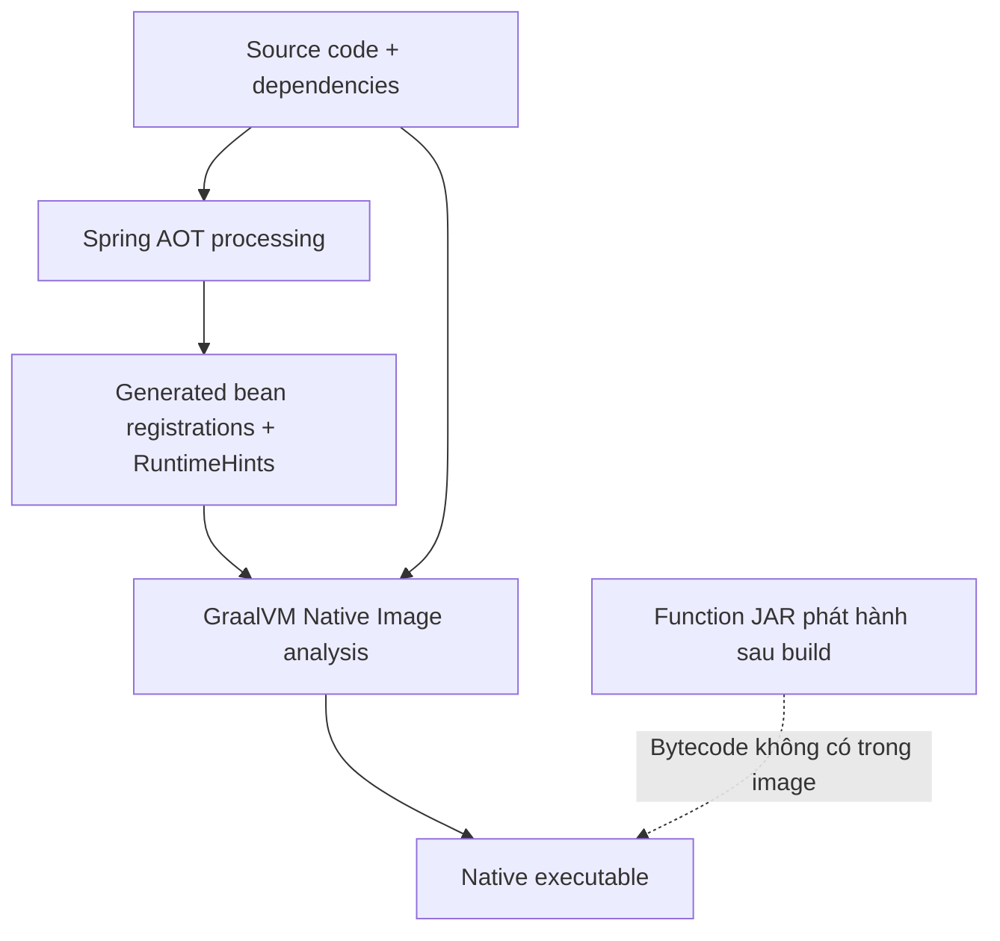
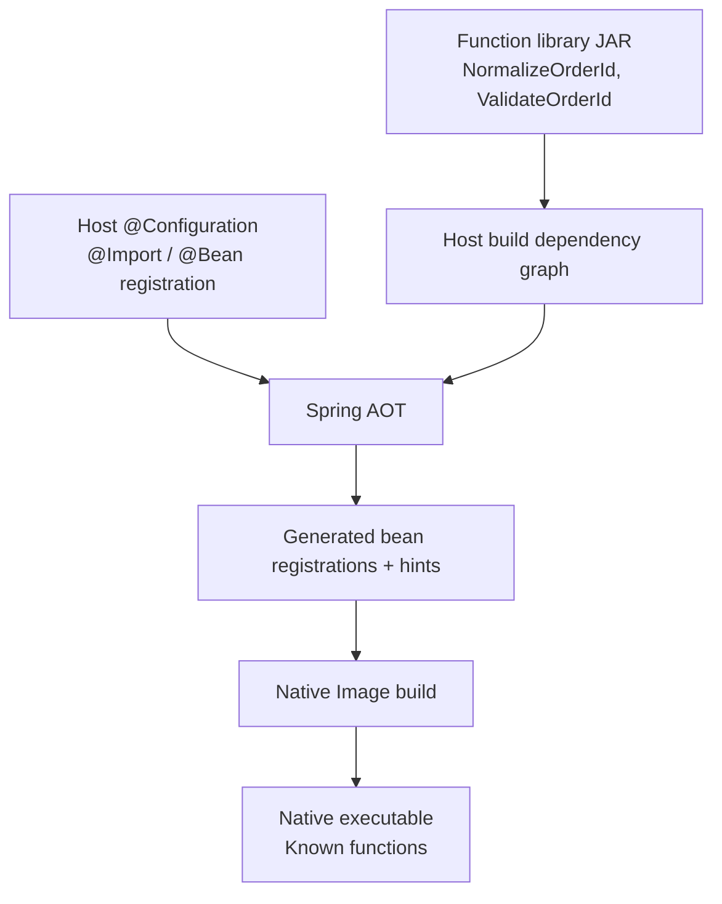
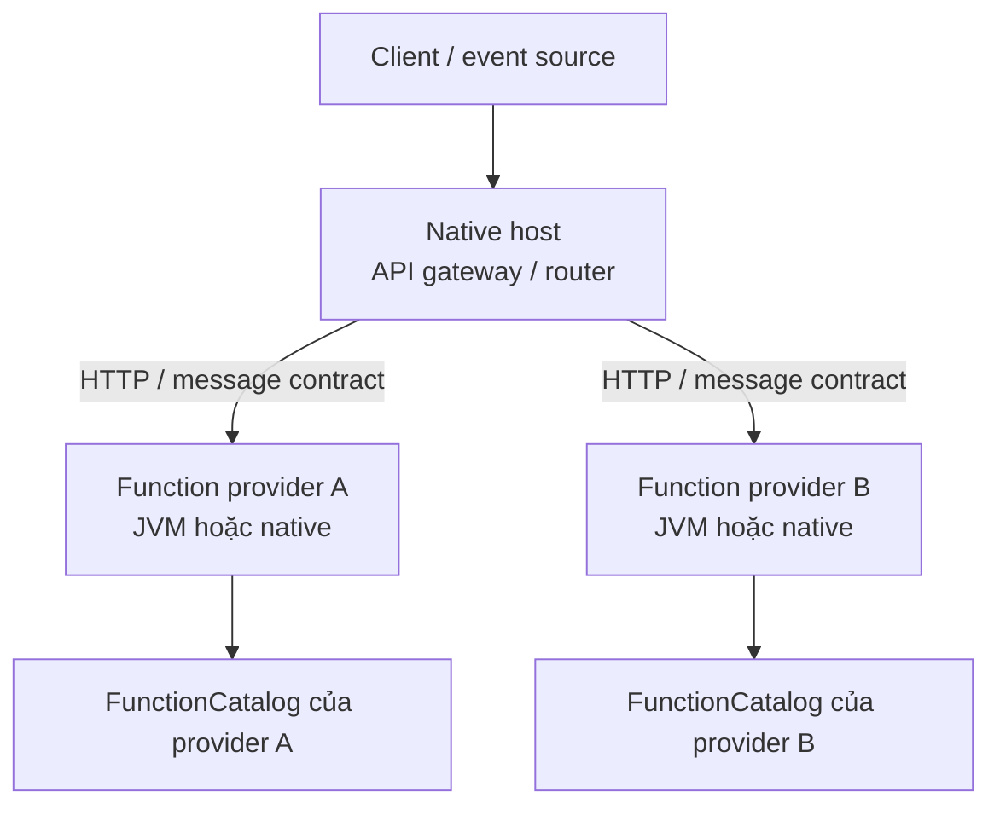

# Giới hạn nạp động khi dùng AOT hoặc native image

## 1. Bài toán: function JAR có thể nạp ở JVM nhưng không chạy được trong native image

Một nền tảng đơn hàng có **host** Spring Boot và một số function JAR được phát hành độc lập. Khi host chạy trên JVM, cơ chế deployer có thể phân giải artifact, tạo classloader phù hợp, nạp implementation và đưa hàm vào đường gọi của **Spring Cloud Function**. Đội vận hành muốn giảm thời gian khởi động và bộ nhớ bằng cách build host thành **native executable** với GraalVM Native Image.

Sau khi chuyển sang native image, một số chức năng không còn hoạt động như trước:

- Host không nạp được một JAR function chỉ được phát hành **sau khi native executable đã build**.
- `Class.forName` hoặc reflection không tìm thấy constructor/method/field cần thiết.
- Một resource như file JSON schema hoặc template không có trong executable.
- Dynamic proxy hoặc serializer không hoạt động vì thiếu metadata.
- `FunctionCatalog` không có function mà đội vận hành mong đợi được tải từ repository lúc khởi động.

Đây không đơn thuần là lỗi cấu hình JAR. **AOT và native image thay đổi thời điểm mà framework phân tích ứng dụng và cách runtime biết những class nào có thể được sử dụng.**

Trong module **Spring Cloud Function** (`SPRING_CLOUD_FUNCTION`), nghiệp vụ được biểu diễn bằng `Supplier<T>`, `Function<T,R>` và `Consumer<T>`, được tra cứu qua `FunctionCatalog`, composition, chuyển đổi message và triển khai qua HTTP, sự kiện hoặc serverless. Chủ đề này làm rõ giới hạn của **nạp code sau build** khi chuyển ứng dụng sang AOT/native, cách giữ các functional bean có thể chạy và những kiến trúc thay thế khi cần cập nhật function độc lập.

**Phân biệt trước khi bắt đầu:**

1. **Spring AOT trên JVM**: framework xử lý cấu trúc ứng dụng ở build time và sinh code/metadata hỗ trợ khởi động; ứng dụng vẫn chạy trên JVM.
2. **GraalVM Native Image**: tạo executable native từ code và tập reachability được xác định khi build; runtime không hoạt động như một JVM có thể tự do nạp bytecode JAR mới.
3. **Dynamic function deployment**: host tìm và nạp artifact/function ở runtime. Đây là mô hình có thể phù hợp JVM, nhưng xung đột với giả định closed-world của native image nếu code không có trong tập build.

## 2. AOT và native image là hai khái niệm liên quan nhưng không đồng nghĩa

| Khía cạnh | Spring AOT chạy trên JVM | GraalVM Native Image |
| --- | --- | --- |
| Thời điểm phân tích | Build time; Spring xử lý bean definitions, điều kiện cấu hình và tạo mã/metadata tối ưu. | Build time; native-image phân tích reachability và tạo executable cho một môi trường đích. |
| Runtime | Vẫn là JVM; bytecode và cơ chế classloading của JVM vẫn tồn tại. | Chạy executable native; không có đầy đủ khả năng nạp bytecode mới như JVM thông thường. |
| Class có trên runtime classpath nhưng không có khi AOT? | JVM vẫn có thể nạp class; nhưng Spring AOT-generated context không tự biết mọi bean mới hoặc cấu hình mới. Reflection/hints tùy cách truy cập. | Class không được đưa vào image/reachability metadata thường không thể được nạp và dùng tùy ý lúc runtime. |
| Plugin JAR phát hành sau build | Có thể nạp class bằng JVM nếu thiết kế loader hỗ trợ; việc đăng ký Spring bean/catalog phải xử lý riêng. | Không thể mặc định tải và thực thi bytecode mới sau build. |
| Reflection/resource/proxy | JVM hỗ trợ rộng; AOT vẫn có thể cần metadata để tối ưu context hoặc tương thích một số framework. | Cần khai báo reachability/hints cho những thao tác không được static analysis phát hiện. |
| Mục tiêu chính | Giảm công việc khởi động và tối ưu việc tạo context. | Giảm footprint, khởi động nhanh, đóng gói runtime thành native executable. |

**Không nên nói “AOT cấm mọi dynamic class loading”.** Khi ứng dụng AOT vẫn chạy trên JVM, Java ClassLoader vẫn là một phần của runtime. Hạn chế thường xuất hiện ở **Spring context đã được xử lý trước**: những bean/configuration được phát hiện sau giai đoạn AOT không tự động có generated bean registration. Native image còn có giới hạn mạnh hơn vì tập code/reachability được đóng tại build time.

## 3. Closed-world assumption của native image

Native Image thực hiện phân tích tĩnh để xác định phần code có thể được sử dụng từ các entry points và các đường đi có thể suy ra. Các class/method/resource cần thiết phải được **reachable** hoặc được khai báo bằng metadata/hints thích hợp.

Mô hình khái niệm:



Ví dụ: host được build thành native image hôm nay với các class `NormalizeOrderId` và `ValidateOrderId`. Tuần sau, đội nghiệp vụ phát hành `ShippingDiscountV2.class` trong một Maven artifact mới. Nếu class đó **không có trong tập code khi build native executable**, chỉ thêm `maven://...` vào configuration không thể biến executable thành một JVM đầy đủ để tải bytecode mới.

### 3.1. Reachability không phải là “mọi file trong JAR đều được đóng gói”

Việc một dependency có mặt trong Maven graph không đồng nghĩa mọi class, reflection member và resource của dependency đều được đưa vào native executable. Static analysis có thể loại phần không được nhận diện là reachable. Những đường truy cập động cần metadata bổ sung:

- Reflection gọi constructor, method hoặc truy cập field.
- Dynamic proxy tạo theo interface runtime.
- Serialization/deserialization dựa trên class metadata.
- Đọc resource bằng tên/path được tính toán.
- JNI hoặc thư viện native.
- Service provider discovery và resource metadata.

Một class có thể đã nằm trong image nhưng method/constructor cần reflection chưa được đăng ký đúng; ngược lại, một resource có trong source JAR nhưng không được include có thể không tồn tại ở executable runtime.

### 3.2. Hints mở rộng reachability, không mở runtime thành JVM plugin host

Spring AOT RuntimeHints và GraalVM reachability metadata giúp khai báo **những gì đã biết khi build nhưng static analysis không tự suy ra**. Hints có thể cho biết một DTO cần reflection, một resource cần đóng gói hoặc một interface cần dynamic proxy.

Hints **không**:

- Thêm bytecode của một JAR bất kỳ được tải về sau khi native executable đã build.
- Tự tạo bean definitions cho mọi plugin chưa biết.
- Tự bảo đảm function JAR tương thích với version Spring/Java trong image.
- Biến classloader thành sandbox hoặc runtime compiler.

## 4. Vì sao dynamic JAR loading của JVM khó chuyển thẳng sang native?

Trên JVM, một loader có thể mở một JAR ở filesystem:

```java
URL jarUrl = Path.of("/opt/functions/order-normalizer.jar")
        .toUri().toURL();
try (URLClassLoader loader = new URLClassLoader(
        new URL[] { jarUrl },
        Thread.currentThread().getContextClassLoader())) {
    Class<?> type = Class.forName(
            "demo.plugin.OrderIdNormalizer", true, loader);
    Object instance = type.getDeclaredConstructor().newInstance();
}
```

Đoạn code minh họa **JVM dynamic class loading**. Nó không phải cách nạp function production hoàn chỉnh: còn cần kiểm tra constructor, interface identity, dependencies, đăng ký function, lifecycle và giải phóng loader. Quan trọng hơn, **không thể mang nguyên giả định này sang native executable** rồi kỳ vọng `URLClassLoader` tải bytecode bất kỳ.

### 4.1. So sánh hai thời điểm

| Tình huống | JVM thường | Native image |
| --- | --- | --- |
| Class có trong app classpath khi build | Có thể nạp khi cần. | Có thể được đưa vào image nếu reachable/hints đúng. |
| JAR có trong filesystem khi app khởi động nhưng không có khi build | Có thể nạp nếu loader hỗ trợ. | Không mặc định được native runtime nạp thành code mới. |
| JAR phát hành sau khi app đã chạy | Có thể tạo loader mới và nạp nếu thiết kế cho phép. | Không thể coi executable native như JVM để tải code mới. |
| Thêm một bean Spring bằng class mới lúc runtime | JVM có thể đăng ký thủ công, nhưng AOT context và lifecycle cần xử lý. | Bean/class phải được biết và hỗ trợ từ build; không thể tùy ý thêm plugin mới sau build. |
| Đổi `spring.cloud.function.definition` giữa các hàm đã đóng gói | Có thể chọn trong catalog đã đăng ký. | Có thể chọn trong tập function đã được đưa vào image và được AOT hỗ trợ; cần test version. |

**Quy tắc thực hành:** nếu cần thay function bằng cách publish JAR mới mà không build lại host, hãy xem đó là yêu cầu dynamic deployment. Native image phù hợp hơn với mô hình **tập function đã biết và được đóng gói trước**, hoặc với provider service tách tiến trình.

## 5. Function Deployer, Maven URI và function-class trong native image

Với những phiên bản Spring Cloud Function có hỗ trợ deployer cho JVM, host có thể dùng cấu hình khái niệm:

```yaml
spring:
  cloud:
    function:
      location: "maven://demo.functions:order-id-normalizer:1.0.0"
      function-class: "demo.functions.OrderIdNormalizer"
```

Hoặc dùng `file:///...` cho một JAR ở filesystem host. Các cơ chế này cần **Maven/resource resolver, loader và khả năng nạp class tại runtime**.

Khi host là native executable:

- Resolver có thể vẫn truy cập repository/network như code đã được biên dịch hỗ trợ, nhưng **tải được file JAR không có nghĩa thực thi được bytecode bên trong**.
- `function-class` là tên class được cấu hình; nếu implementation class không được đưa vào native image từ build time, tên đó không làm class xuất hiện.
- Một native executable không thể tự động tạo Spring ApplicationContext hoàn chỉnh từ một Boot JAR tải sau build như một JVM host thông thường.
- Những bean/function được đóng gói từ đầu vẫn có thể được Spring AOT xử lý và đăng ký theo cách framework hỗ trợ.

**Không kết luận mọi chức năng Maven resolver đều không thể chạy trong native image.** Resolver có thể còn hữu ích cho việc lấy metadata/resource hoặc một số workflow đã biết trước; giới hạn cốt lõi là **thực thi class mới không có trong image**, không phải mọi network access đều bị cấm.

### 5.1. Simple JAR và Boot executable JAR

| Artifact | JVM host với deployer hỗ trợ | Native image |
| --- | --- | --- |
| Simple JAR, class được chọn qua `function-class` | Có thể nạp nếu version/dependency/loader phù hợp. | Chỉ khả thi khi class và dependency được đưa vào image từ build; không dựa vào tải JAR mới lúc runtime. |
| Spring Boot JAR có `@Bean Function` | Deployer phù hợp có thể nạp packaged application/context theo release. | Bean và cấu hình phải được xử lý ở build/AOT; không mặc định tạo context từ Boot JAR mới ở runtime. |
| Maven artifact phát hành sau khi host build | Có thể resolve và nạp nếu host/runtime hỗ trợ. | Không thể thêm bytecode mới vào image đang chạy bằng Maven URI. |

Nếu dự án yêu cầu native image, **đưa tất cả implementation function cần thiết vào build graph của host** hoặc chuyển chúng thành provider độc lập. Không dùng `function-class` như cơ chế plugin thay đổi tùy ý trong production native.

## 6. Spring Boot AOT xử lý ApplicationContext như thế nào?

Spring AOT phân tích bean definitions và configuration trong giai đoạn build, rồi sinh những thành phần cần thiết để khởi tạo application context hiệu quả hơn. Với native image, kết quả AOT còn đóng vai trò đầu vào cho native-image analysis và runtime hints.

Các loại hoạt động thường cần được xử lý:

- Component scanning, `@Configuration` và `@Bean` definitions được phát hiện trong build.
- Conditional configuration/profiles có ảnh hưởng đến tập bean được tạo.
- Constructor binding và property metadata.
- Reflection, serialization, resource, proxy và JNI hints khi cần.
- Những bean post-processors hoặc cơ chế đăng ký động phải có hỗ trợ AOT tương ứng.

**AOT không phải bản sao của quá trình khởi động JVM chạy bình thường.** Những hành vi chỉ xảy ra lúc runtime như tự quét một thư mục plugin, tải class mới, đăng ký bean theo tên lấy từ request có thể không được phản ánh trong generated context.

### 6.1. Functional bean được biết từ build time

Ví dụ host đóng gói sẵn hai function:

```java
package demo.host.functions;

import java.util.Locale;
import java.util.function.Function;
import org.springframework.context.annotation.Bean;
import org.springframework.context.annotation.Configuration;

@Configuration(proxyBeanMethods = false)
public class OrderFunctions {

    @Bean("normalizeOrderId")
    Function<String, String> normalizeOrderId() {
        return input -> input.strip().toUpperCase(Locale.ROOT);
    }

    @Bean("addOrderPrefix")
    Function<String, String> addOrderPrefix() {
        return input -> "ORD-" + input;
    }
}
```

Hai bean được khai báo trong source configuration và nằm trong build input. Spring AOT có thể phân tích các bean definitions này theo khả năng hỗ trợ của phiên bản. `FunctionCatalog` có thể tra cứu các function đã được đăng ký:

```java
Function<String, String> normalize =
        catalog.lookup("normalizeOrderId");
Function<String, String> prefix =
        catalog.lookup("addOrderPrefix");
```

Điểm cần kiểm chứng trong native image là **cả hai bean có nằm trong generated context và catalog có đăng ký đúng tên**. Không cần một JAR plugin mới ở runtime để thực hiện ví dụ này.

### 6.2. Definition có thể chọn trong tập function đã đóng gói

Ví dụ cấu hình:

```yaml
spring:
  cloud:
    function:
      definition: normalizeOrderId|addOrderPrefix
```

Đây là composition của **hai function đã được đăng ký**; kiểu input/output phải tương thích. Trong một native build, việc chọn definition có thể phụ thuộc cách property được cung cấp và thời điểm AOT phân tích. Nếu property thay đổi ở runtime, cần xác nhận adapter/catalog của release hỗ trợ lựa chọn trong tập bean đã đóng gói. **Không nhầm việc chọn tên function có sẵn với việc nạp class mới từ JAR.**

## 7. Các cơ chế động thường gặp và mức độ tương thích AOT/native

| Cơ chế trong ứng dụng | JVM không AOT | Spring AOT trên JVM | Native image |
| --- | --- | --- | --- |
| Gọi function bean được khai báo bằng `@Bean` | Thường hoạt động. | Phù hợp khi bean/configuration được AOT hỗ trợ. | Phù hợp nếu reachable và các hints cần thiết đã có. |
| `FunctionCatalog.lookup` tên function đã đăng ký | Thường hoạt động. | Có thể dùng với các function đã được đăng ký/được xử lý AOT. | Có thể dùng trong tập function đã đóng gói và hỗ trợ; test thực tế. |
| Composition các function đã biết | Thường hoạt động nếu type tương thích. | Phụ thuộc catalog/definition được xử lý. | Có thể khả thi nếu các function và code composition reachable; kiểm thử. |
| `Class.forName` một class có trong image | Thường hoạt động. | JVM vẫn hỗ trợ; Spring context không tự có bean mới. | Chỉ hoạt động nếu class/metadata cần thiết đã được đưa vào image. |
| Reflection lên constructor/method/field | JVM hỗ trợ rộng. | Thường vẫn chạy trên JVM; hints có thể cần cho native. | Cần reflection metadata phù hợp. |
| Đọc resource bằng tên cố định | Thường hoạt động nếu file có trên classpath. | Runtime hints/AOT có thể cần tùy cách truy cập. | Resource phải được include. |
| `URLClassLoader` nạp JAR không biết trước | Có thể hỗ trợ. | JVM vẫn có thể nạp code; generated Spring context không tự phát hiện bean mới. | Không thể dựa vào khả năng nạp bytecode JAR mới. |
| Tạo proxy/subclass runtime | Tùy API/thư viện. | Có thể cần AOT support. | Proxy/interface phải được đăng ký/hỗ trợ; runtime code generation bị hạn chế. |
| `ServiceLoader` tìm provider | Có thể hoạt động. | Có thể cần metadata/resource hints. | Provider và file `META-INF/services` phải được đưa vào image/metadata đúng. |
| Tải Maven artifact ở runtime | Có thể resolve và load bằng deployer. | JVM có thể tải file; bean discovery/AOT là vấn đề riêng. | Tải file không làm bytecode mới executable trong image. |

Bảng này là **hướng định hướng**, không phải compatibility matrix chính thức cho mọi release. Hãy kiểm tra tài liệu Spring Boot/Spring Cloud Function/GraalVM đúng phiên bản và chạy native executable thật.

## 8. RuntimeHints: khai báo những truy cập động đã biết

Khi dùng Spring AOT/native, một số đường truy cập không thể được phân tích đầy đủ bằng static analysis. **RuntimeHints** cho biết những thành phần đã tồn tại trong build cần được truy cập bằng reflection, resource lookup, proxy hoặc serialization ở runtime.

Các nhóm hint thường gặp:

| Nhóm hint | Khi cần |
| --- | --- |
| **Reflection** | Framework dùng reflection để gọi constructor, method hoặc truy cập field. |
| **Resources** | Đọc file theo path/name mà static analysis không suy ra được. |
| **JDK proxies** | Tạo proxy động cho một tập interface đã biết. |
| **Serialization** | Serialize/deserialize các type theo cơ chế cần metadata. |
| **JNI** | Gọi native method hoặc thư viện native khi môi trường hỗ trợ. |

### 8.1. Đăng ký reflection và resource bằng RuntimeHintsRegistrar

Ví dụ Spring Framework AOT API trên dòng hỗ trợ `RuntimeHints`:

```java
package demo.host.hints;

import demo.contract.OrderRequest;
import org.springframework.aot.hint.MemberCategory;
import org.springframework.aot.hint.RuntimeHints;
import org.springframework.aot.hint.RuntimeHintsRegistrar;
import org.springframework.context.annotation.ImportRuntimeHints;
import org.springframework.context.annotation.Configuration;

public class FunctionRuntimeHints implements RuntimeHintsRegistrar {
    @Override
    public void registerHints(
            RuntimeHints hints, ClassLoader classLoader) {

        hints.reflection().registerType(
                OrderRequest.class,
                MemberCategory.INVOKE_DECLARED_CONSTRUCTORS,
                MemberCategory.INVOKE_PUBLIC_METHODS,
                MemberCategory.DECLARED_FIELDS);

        hints.resources().registerPattern(
                "schemas/order-request.json");
    }
}

@Configuration(proxyBeanMethods = false)
@ImportRuntimeHints(FunctionRuntimeHints.class)
class NativeFunctionConfiguration {
}
```

Ví dụ giả định `OrderRequest` và schema **đã có trong build input**. Import/API và các member category cần đăng ký phải đối chiếu phiên bản Spring Framework/Boot. Không nên đăng ký mọi field/method theo thói quen; chỉ mở những member mà converter/framework thực sự cần.

### 8.2. Hints cho binding DTO

Một cách khai báo ngắn hơn trong các bản Spring hỗ trợ:

```java
import demo.contract.OrderRequest;
import demo.contract.OrderQuote;
import org.springframework.aot.hint.annotation.RegisterReflectionForBinding;
import org.springframework.context.annotation.Configuration;

@Configuration(proxyBeanMethods = false)
@RegisterReflectionForBinding({
        OrderRequest.class,
        OrderQuote.class
})
class FunctionBindingHints {
}
```

`@RegisterReflectionForBinding` giúp đăng ký metadata reflection cần thiết cho các type được biết lúc build, đặc biệt khi dùng binding/conversion. Nó **không tự đưa một DTO mới từ plugin JAR chưa có trong build vào native image**. Nếu type không nằm trong build input, không có cách dùng annotation trên class không tồn tại để tạo bytecode.

### 8.3. Proxy hints

Nếu ứng dụng cần JDK dynamic proxy cho một interface đã biết:

```java
hints.proxies().registerJdkProxy(
        OrderPolicy.class,
        java.io.Serializable.class);
```

Đây là đoạn minh họa đặt trong `registerHints(...)`, với `OrderPolicy` đã có trong build. Proxy type/interface cần đúng tập interface và classloader/runtime mà framework dùng. Hints cho JDK proxy **không giải quyết** mọi thư viện tạo subclass runtime bằng Byte Buddy/CGLIB hoặc runtime bytecode generation.

### 8.4. Hints không thay cho code generation/runtime dependency

| Nhu cầu | Hints có thể làm gì? | Hints không làm gì? |
| --- | --- | --- |
| Reflection lên DTO đã biết | Mở constructor/method/field cần thiết. | Không tạo một class mới không có trong image. |
| Đọc JSON schema | Đưa resource vào image. | Không tự cập nhật schema bằng cách tải file mới nếu logic không hỗ trợ. |
| JDK proxy interface đã biết | Đăng ký proxy configuration. | Không tạo arbitrary implementation class từ JAR bên ngoài. |
| Serialize type đã biết | Cung cấp metadata cho serializer. | Không biến mọi object không rõ kiểu thành payload tương thích. |
| Service provider đã biết | Giữ metadata/provider cần thiết. | Không nạp plugin provider mới phát hành sau build. |

## 9. Reflection, Class.forName và ServiceLoader trong native image

### 9.1. Class.forName không phải lệnh “nhét class vào executable”

`Class.forName("demo.plugin.OrderIdNormalizer")` chỉ yêu cầu runtime tìm một class có tên đó qua loader. Trên native image, class phải thuộc tập class đã được đưa vào executable và phải có metadata phù hợp nếu đường truy cập dùng reflection. Nếu class chỉ tồn tại trong JAR nằm trên filesystem sau build, `Class.forName` không thể tự thêm bytecode của JAR vào image.

Ví dụ **một class đã biết từ build**:

```java
Class<?> type = Class.forName(
        "demo.host.functions.NormalizeOrderId");
Object instance = type.getDeclaredConstructor().newInstance();
```

Trong native image, code này cần reachability/reflection support phù hợp; hơn nữa, tự khởi tạo object như vậy **bỏ qua Spring bean lifecycle**, dependency injection và đăng ký `FunctionCatalog`. Nếu function là Spring bean, hãy để Spring quản lý bean thay vì reflection instantiate thủ công.

### 9.2. ServiceLoader

`ServiceLoader` thường tìm provider qua metadata `META-INF/services` hoặc module descriptor. Trong native image, provider/resource và implementation cần được phát hiện/đăng ký ở build time hoặc thông qua metadata tương ứng. Một plugin JAR mới xuất hiện sau build không tự thêm provider vào native executable.

Nếu Spring Cloud Function hoặc một thư viện phụ thuộc SPI, hãy kiểm tra native build report/reachability metadata để xác nhận provider được đưa vào image. Đừng chỉ kiểm tra JAR plugin có file `META-INF/services` trên disk.

### 9.3. Proxy, serializer và resource

Những lỗi thường gặp không nhất thiết liên quan `FunctionCatalog`:

- JSON converter cần constructor/field access nhưng thiếu reflection hint.
- Proxy interface được tạo bằng reflection nhưng không có proxy hint.
- Serializer tìm type bằng tên nhưng type không reachable.
- Schema/resource có trong source JAR nhưng không được include trong image.
- SPI provider không được đưa vào executable.

Phân tích **stack trace và native-image build report** để xác định loại metadata thiếu; thêm hint đúng phạm vi, không mở toàn bộ reflection cho mọi package.

## 10. Bean registration và FunctionCatalog trong AOT

`FunctionCatalog` là cơ chế tra cứu function đã được đăng ký; nó không phải plugin scanner độc lập có thể đọc mọi JAR ở runtime. Khi build AOT/native, cần để Spring nhận diện các function beans **trong lúc phân tích ứng dụng**.

### 10.1. Khai báo function tường minh

```java
package demo.host.functions;

import java.util.function.Function;
import org.springframework.context.annotation.Bean;
import org.springframework.context.annotation.Configuration;

@Configuration(proxyBeanMethods = false)
public class NativeFunctions {
    @Bean("normalizeOrderId")
    Function<String, String> normalizeOrderId() {
        return value -> value == null
                ? null : value.strip().toUpperCase();
    }

    @Bean("validateOrderId")
    Function<String, Boolean> validateOrderId() {
        return value -> value != null
                && value.matches("[A-Z]{2}-[0-9]{3}");
    }
}
```

Các bean này là một phần **source configuration** và được phát hiện khi build. Sau khi build native, catalog có thể tra cứu các tên này nếu Spring Cloud Function version đang dùng hỗ trợ và bean registration/hints đầy đủ.

### 10.2. Lookup và composition giữa những function đã đóng gói

Ví dụ Java caller:

```java
Function<String, String> normalize =
        catalog.lookup("normalizeOrderId");
Function<String, Boolean> validate =
        catalog.lookup("validateOrderId");

if (normalize == null || validate == null) {
    throw new IllegalStateException("Function not registered");
}

String value = normalize.apply(" od-204 ");
Boolean valid = validate.apply(value);
```

Hoặc composition:

```java
Function<String, Boolean> pipeline =
        catalog.lookup("normalizeOrderId|validateOrderId");
```

Output `String` của bước normalize khớp input `String` của validate. Việc composition có chạy trong native executable phải được **test native thật**; không chỉ dựa vào test JVM. Các function và code wrapper cần có trong build/reachability graph.

### 10.3. Definition là lựa chọn, không phải plugin discovery

```yaml
spring:
  cloud:
    function:
      definition: normalizeOrderId|validateOrderId
```

Định nghĩa này chọn hai function **đã được đăng ký** và yêu cầu chúng tương thích. Nó không đọc repository, tải một class mới hoặc tạo bean definition bất kỳ sau khi native image đã build.

Nếu muốn đổi definition theo môi trường, kiểm tra thời điểm property được đọc và cách AOT/native support cấu hình đó trong release mục tiêu. Cấu hình thay đổi không thể đưa một function không có trong executable vào catalog.

## 11. Conditional beans, profiles và cấu hình lúc build

Spring AOT xử lý những điều kiện và profiles trong giai đoạn build theo cơ chế của phiên bản. Vì vậy cần chú ý:

- Bean được kích hoạt bởi `@Profile` hoặc `@ConditionalOnProperty` có thể phụ thuộc **environment lúc AOT processing**.
- Một profile bật chỉ khi chạy native executable không chắc làm generated context có thêm bean mà build chưa tạo.
- Một condition dựa trên classpath không thể nhìn thấy dependency chỉ được tải về sau build.
- Cấu hình function definition chọn bean có sẵn; không thay đổi reachability graph.

Ví dụ:

```java
@Bean
@Profile("shipping")
Function<String, String> normalizeOrderId() {
    return String::strip;
}
```

Nếu AOT build không dùng profile `shipping` và bean bị loại khỏi generated context, chỉ bật `spring.profiles.active=shipping` lúc chạy **không đảm bảo** function xuất hiện trong native executable. Cách chính xác phụ thuộc profile handling/AOT mode của Spring Boot release; hãy xác minh bằng build và test từng profile.

### 11.1. Những biến cấu hình nào có thể đổi runtime?

| Loại cấu hình | Khả năng thay đổi runtime |
| --- | --- |
| Endpoint, credential, topic, timeout của bean đã được đóng gói | Thường có thể cấu hình runtime nếu bean/configuration hỗ trợ và không bị AOT cố định. |
| Chọn một definition trong tập function đã có | Có thể khả thi; kiểm tra adapter/catalog và thời điểm đọc property. |
| Chọn profile làm xuất hiện bean chưa được AOT xử lý | Không mặc định; phụ thuộc build-time condition và generated context. |
| Đổi `function-class` sang FQCN không có trong image | Không thể chỉ bằng property. |
| Đổi Maven URI sang JAR chứa bytecode mới | Không thể biến JAR đó thành code executable của native image. |
| Đổi resource path sang resource đã include | Có thể nếu runtime lookup/hints và resource tồn tại. |

## 12. Resource hints cho function

Function có thể đọc schema, template, rule table hoặc file cấu hình riêng. Trên JVM, classpath/resource lookup thường linh hoạt; trong native image, resource cần được include theo cơ chế build.

Ví dụ đăng ký:

```java
@Override
public void registerHints(
        RuntimeHints hints, ClassLoader classLoader) {
    hints.resources().registerPattern(
            "shipping/rules/*.json");
}
```

Đoạn code giả định các file `shipping/rules/*.json` tồn tại trong build resources. Hãy dùng pattern hẹp; đăng ký toàn bộ filesystem hoặc mọi resource của dependency có thể làm executable phình lớn và giữ dữ liệu không cần thiết.

### 12.1. Resource bên ngoài image

Nếu nghiệp vụ cần thay **rule data** thường xuyên, không nhất thiết phải đóng gói chúng thành code plugin:

- Đọc file cấu hình ngoài qua path được quản lý, nếu runtime và policy cho phép.
- Lấy rule JSON từ object store/database hoặc config service.
- Đưa rule thành message/configuration được version hóa.

Điều này khác với việc tải class Java mới: **dữ liệu có schema cố định có thể thay đổi runtime** mà không cần native image chứa bytecode mới. Vẫn phải xác thực nguồn, schema, version, fallback và quyền truy cập.

## 13. Serialization và DTO trong native image

Một Spring Cloud Function có thể nhận `OrderRequest` từ JSON và trả `OrderQuote`. Native image cần đủ metadata cho converter/serializer mà adapter sử dụng.

Ví dụ:

```java
package demo.contract;

import java.math.BigDecimal;

public record OrderRequest(
        String orderId,
        BigDecimal amountVnd) {}

public record OrderQuote(
        String orderId,
        BigDecimal shippingFeeVnd) {}
```

Với những kiểu dữ liệu cần reflection-based binding, có thể khai báo:

```java
@RegisterReflectionForBinding({
        OrderRequest.class,
        OrderQuote.class
})
@Configuration(proxyBeanMethods = false)
class FunctionJsonConfiguration {
}
```

Hãy test converter **trong native executable**, vì một test chạy JVM thường có thể dùng reflection mà không cần metadata. Nếu dùng Jackson, protobuf, Avro hoặc serializer khác, kiểm tra native support/hints của thư viện và những type thực tế được serialize/deserialized.

### 13.1. Contract không nên phụ thuộc vào class được tải sau build

Nếu plugin v2 thêm một DTO `OrderQuoteV2` sau khi native image v1 đã được build, native image v1 không tự hiểu type đó. Các lựa chọn:

1. Đưa cả DTO/function v2 vào build mới.
2. Giữ schema payload ổn định và chuyển đổi version qua data contract.
3. Đưa provider v2 thành service độc lập.

Chỉ thêm một `@RegisterReflectionForBinding(OrderQuoteV2.class)` vào source sau khi executable đã build **không thay đổi executable hiện tại**; cần build lại.

## 14. Đưa function JAR vào build graph thay vì nạp sau build

Nếu muốn chạy native image nhưng vẫn chia sẻ code qua artifact Maven, hướng phù hợp hơn là **thêm function library vào dependency graph trước AOT/native compilation**.



Trong mô hình này, artifact vẫn có thể được phát hành độc lập bằng Maven và được host chọn theo version **khi build**. Sau khi nâng function library, host cần build native image mới để đưa bytecode và metadata mới vào executable.

### 14.1. Khai báo dependency Maven

Trong `pom.xml` của host:

```xml
<dependency>
    <groupId>demo.functions</groupId>
    <artifactId>order-id-normalizer</artifactId>
    <version>1.1.0</version>
</dependency>
```

Dependency này phải được resolve **trước AOT/native build**. Chỉ đưa JAR vào một thư mục runtime không thay thế Maven compile/runtime dependency graph.

### 14.2. Đăng ký bean bằng cấu hình được biết khi build

Giả sử library cung cấp class `demo.plugin.NormalizeOrderId`:

```java
package demo.host;

import demo.plugin.NormalizeOrderId;
import java.util.function.Function;
import org.springframework.context.annotation.Bean;
import org.springframework.context.annotation.Configuration;

@Configuration(proxyBeanMethods = false)
public class ImportedFunctionConfiguration {

    @Bean("normalizeOrderId")
    Function<String, String> normalizeOrderId() {
        return new NormalizeOrderId();
    }
}
```

Host **tạo bean registration tường minh**. Nếu library đã cung cấp một `@Configuration` có thể import, host cũng có thể `@Import` configuration đó; cần bảo đảm AOT processing nhìn thấy class/configuration ở build time.

```java
package demo.host;

import demo.plugin.PluginFunctionConfiguration;
import org.springframework.context.annotation.Configuration;
import org.springframework.context.annotation.Import;

@Configuration(proxyBeanMethods = false)
@Import(PluginFunctionConfiguration.class)
class IncludedPluginConfiguration {
}
```

Hai cách là **lựa chọn thay thế**, không khai báo trùng bean name. Khi dependency library đổi version, build pipeline phải chạy lại AOT/native và test catalog. Đây là **build-time extensibility**, không phải plugin runtime.

### 14.3. Quy trình nâng version

```text
Publish function library 1.2.0
        |
        v
Host đổi Maven dependency 1.1.0 -> 1.2.0
        |
        v
Maven resolve + compile
        |
        v
Spring AOT processing
        |
        v
GraalVM Native Image build
        |
        v
Test native executable + FunctionCatalog
        |
        v
Publish image mới và rollout
```

Nếu host cần cập nhật function **mà không rebuild/redeploy host**, không dùng quy trình này làm giải pháp dynamic loading; hãy chọn provider service độc lập hoặc JVM plugin host.

## 15. Build Spring Boot AOT và native executable

Quy trình cụ thể phụ thuộc Spring Boot, Spring Cloud Function, GraalVM và plugin build. Một dự án Boot 3.x thường cần:

- Dependency/version management tương thích cho Spring Boot và Spring Cloud Function.
- Spring Boot Maven/Gradle plugin có AOT processing phù hợp.
- GraalVM Native Build Tools hoặc buildpack/builder tương thích để tạo native executable.
- Các RuntimeHints và dependency metadata cần thiết.
- CI build trên môi trường target phù hợp (OS/architecture/libc).

### 15.1. Minh họa cấu hình Maven plugin

Đây là **trích đoạn cấu hình**; version và execution cần đồng bộ với parent/BOM dự án:

```xml
<build>
    <plugins>
        <plugin>
            <groupId>org.springframework.boot</groupId>
            <artifactId>spring-boot-maven-plugin</artifactId>
        </plugin>
        <plugin>
            <groupId>org.graalvm.buildtools</groupId>
            <artifactId>native-maven-plugin</artifactId>
            <extensions>true</extensions>
        </plugin>
    </plugins>
</build>
```

Một số Spring Boot parent/BOM cung cấp profile `native` và cấu hình plugin sẵn; dự án khác phải khai báo rõ. Không copy plugin version rời rạc mà không kiểm tra GraalVM JDK, Boot plugin và native build tools tương thích.

### 15.2. Lệnh build tham khảo

Khi POM đã cấu hình native profile/toolchain:

```bash
mvn -Pnative clean package
```

Hoặc với cấu hình native-maven-plugin có goal phù hợp:

```bash
mvn -Pnative native:compile
```

Đây là **lệnh tham khảo**, không phải lệnh dùng được cho mọi POM. Một số dự án dùng `spring-boot:build-image` với builder hỗ trợ native; một số dùng Maven/Gradle native plugin. Hãy theo đúng build profile của dự án và kiểm tra output executable.

### 15.3. AOT processing riêng với native compile

Có thể quan sát riêng giai đoạn Spring AOT (nếu Boot plugin/version cung cấp goal tương ứng):

```bash
mvn spring-boot:process-aot
```

Lệnh trên giúp phát hiện vấn đề ở quá trình phân tích/đăng ký bean trước khi chạy native-image. Nhưng việc AOT processing thành công **chưa chứng minh** native compile hoặc runtime invocation sẽ thành công. Phải test từng giai đoạn.

## 16. Kiểm thử JVM và native executable phải tách riêng

Một unit test chạy trên JVM có thể thành công nhờ reflection, classpath và classloader linh hoạt hơn native runtime. Vì vậy cần có ít nhất ba lớp test:

| Lớp test | Điều chứng minh | Không chứng minh |
| --- | --- | --- |
| Unit test Java | Logic `Function.apply()`, validation và rule nghiệp vụ. | AOT bean registration hoặc native reachability. |
| Spring context/AOT test trên JVM | Bean definitions, `FunctionCatalog`, conversion và AOT processing. | Native executable có đủ reflection/resource/proxy metadata. |
| Native executable integration test | Native startup, catalog lookup, function invocation và adapter cần thiết. | Khả năng nạp một JAR function mới chưa có trong image. |

### 16.1. Unit test function

```java
package demo.host.functions;

import static org.junit.jupiter.api.Assertions.assertEquals;
import demo.plugin.NormalizeOrderId;
import org.junit.jupiter.api.Test;

class NativeFunctionsTest {
    private final NormalizeOrderId function =
            new NormalizeOrderId();

    @Test
    void normalizesOrderId() {
        String result = function.apply(" od-204 ");
        assertEquals("OD-204", result);
    }
}
```

Test này gọi implementation thật từ function library. Tên package/import cần khớp với project thực tế; nếu implementation được tạo qua Spring bean có lifecycle hoặc dependency injection, hãy bổ sung context test thay vì chỉ khởi tạo trực tiếp.

### 16.2. Context test với FunctionCatalog

```java
import static org.junit.jupiter.api.Assertions.assertEquals;
import static org.junit.jupiter.api.Assertions.assertNotNull;
import java.util.function.Function;
import org.junit.jupiter.api.Test;
import org.springframework.beans.factory.annotation.Autowired;
import org.springframework.boot.test.context.SpringBootTest;
import org.springframework.cloud.function.context.FunctionCatalog;

@SpringBootTest
class NativeFunctionCatalogTest {
    @Autowired
    FunctionCatalog catalog;

    @Test
    void findsBuildTimeFunction() {
        Function<String, String> fn =
                catalog.lookup("normalizeOrderId");
        assertNotNull(fn);
        assertEquals("OD-204", fn.apply(" od-204 "));
    }
}
```

Đây là **test Spring trên JVM**. Nó xác nhận function bean được đăng ký trong context test, không thay cho native executable test.

### 16.3. Chạy native executable thật

Sau khi build native, chạy executable được tạo ra và gọi qua Java runner/HTTP test/broker integration tương ứng. Xác minh:

1. Startup thành công trên OS/architecture mục tiêu.
2. `FunctionCatalog` tra cứu được mọi function đã build vào image.
3. Composition giữa function đã biết hoạt động đúng.
4. JSON/message conversion hoạt động với DTO thực tế.
5. Reflection, proxy, resource và serialization không thiếu hints.
6. Adapter HTTP/Stream/serverless đã cấu hình có thể nhận/gửi payload.
7. Shutdown và resource cleanup hoạt động theo runtime.

**Không dùng một test JVM thành công làm kết luận native image đã sẵn sàng.**

### 16.4. Kiểm thử giới hạn dynamic loading có chủ đích

Trong môi trường lab:

1. Build native executable khi chỉ có `NormalizeOrderId`.
2. Sau khi build, đặt `ValidateOrderId` vào một JAR mới trong filesystem hoặc repository.
3. Thử cấu hình `location`/`function-class` để nạp class mới.
4. Quan sát lỗi/giới hạn thực tế của native runtime và deployer release.
5. Thêm `ValidateOrderId` vào build input, đăng ký bean rõ ràng và build lại.
6. Xác nhận native executable mới có cả hai function và composition.

Mục tiêu của bài thử là chứng minh **JAR tải được không đồng nghĩa bytecode mới có thể chạy trong native image**, không phải tìm cách lách closed-world bằng một cấu hình reflection hint.

## 17. Function thay đổi độc lập: chuyển sang provider service

Nếu yêu cầu nghiệp vụ là **publish function mới mà không build lại host**, cách tự nhiên hơn là tách function thành một service/process riêng. Host native gọi provider qua HTTP hoặc messaging; mỗi provider có thể được build thành JVM app hoặc native executable riêng.



Ở mô hình này:

- Mỗi provider nạp các functional bean đã có trong **build của chính nó**.
- Host không cần nhận bytecode plugin; nó chỉ biết endpoint/topic và schema.
- Nâng cấp function A có thể build/deploy provider A mà không thay host nếu contract giữ tương thích.
- Host và provider có thể dùng Java version, dependency hoặc runtime khác nhau miễn giao thức tương thích.

Đổi lại, phải xử lý **network latency, timeout, retry, authentication, service discovery, circuit breaker, schema evolution và distributed failure**. Một function call nội bộ nhanh và đồng bộ trở thành một lời gọi phân tán có khả năng timeout dù server đã xử lý xong.

### 17.1. Ví dụ function provider dùng Spring Cloud Function Web

Một provider có thể khai báo:

```java
@Configuration(proxyBeanMethods = false)
class ShippingFunctions {
    @Bean("quoteShipping")
    Function<ShippingRequest, ShippingQuote> quoteShipping(
            ShippingPolicy policy) {
        return policy::quote;
    }
}
```

Nếu provider dùng Spring Cloud Function Web adapter tương thích, nó có thể công bố function qua HTTP theo contract đã kiểm thử. Native image **có thể là lựa chọn** cho provider nếu dependency/adapter/version hỗ trợ và native test thành công; điều này khác với việc nạp JAR mới vào native host.

### 17.2. Giữ function name nội bộ, ổn định wire contract bên ngoài

Một service có thể đổi bean nội bộ từ `quoteShipping` sang implementation mới mà vẫn giữ route API/JSON contract bằng controller/gateway hoặc alias được quản lý. Đừng buộc caller bên ngoài phụ thuộc vào tên bean Spring nếu không cần. **Tên FunctionCatalog và tên HTTP route là hai lớp hợp đồng riêng**.

## 18. Các phương án kiến trúc và đánh đổi

| Nhu cầu | Phương án nên cân nhắc | Đánh đổi chính |
| --- | --- | --- |
| Khởi động nhanh/footprint nhỏ, function ít thay đổi | Native image với tất cả function được đóng gói từ build. | Mỗi thay đổi code cần build và rollout image mới. |
| Nạp plugin JAR độc lập sau khi host chạy | Host JVM thông thường với Function Deployer/loader hỗ trợ. | Footprint JVM, dependency/classloader/lifecycle phức tạp. |
| Host cần AOT tối ưu nhưng vẫn chạy JVM | Spring AOT trên JVM, artifact/plugin được biết hoặc được quản lý riêng. | Generated context không tự phát hiện bean chưa biết ở build; phải thiết kế registration. |
| Function thay đổi thường xuyên, host native ổn định | Provider service độc lập, host native gọi qua HTTP/messaging. | RPC/broker reliability, latency, security. |
| Bộ function thay đổi theo cấu hình nhưng tập code hữu hạn | Đóng gói toàn bộ function vào image, chọn qua catalog/definition. | Tăng kích thước image và phải test mọi biến thể. |
| Rule nghiệp vụ thay đổi thường xuyên nhưng thuật toán ổn định | Nạp dữ liệu rule/schema từ config/database/object store. | Validation, versioning và fallback của data. |
| Nhiều phiên bản plugin cần cô lập mạnh | Tách process/container cho từng provider. | Tăng vận hành và network boundaries. |

**Đừng dùng classloading động để giải quyết một vấn đề chỉ cần cập nhật dữ liệu.** Nếu logic thực thi không thay đổi nhưng bảng phí/threshold/rule đổi, lưu dữ liệu có schema rõ có thể giữ native executable bất biến.

## 19. Quy trình release cho host native có nhiều function

Khi mọi function được build vào một native image:

1. **Chọn version** function library và contract API trong Maven dependency graph.
2. **Compile/test** code trên JVM, gồm unit test cho `Supplier`/`Function`/`Consumer`.
3. **Spring AOT**: xác nhận bean conditions, profiles và catalog registrations.
4. **RuntimeHints**: khai báo reflection/resource/proxy/serialization cần thiết cho code đã biết.
5. **Native compile**: build cho OS/architecture/libc mục tiêu và giữ build report.
6. **Native integration test**: startup, lookup, composition, JSON/message conversion và adapter cần thiết.
7. **Publish artifact/image** bất biến, có version và checksum.
8. **Rollout** image mới; readiness kiểm tra các function bắt buộc.
9. **Observe/rollback** theo lỗi invocation, memory, latency và contract compatibility.

Khi một function mới được thêm, bước 3–6 cần chạy lại. Không chỉ cập nhật property `spring.cloud.function.location` rồi kỳ vọng executable đã có code.

## 20. Readiness và observability trong native function host

Một native executable có thể khởi động rất nhanh, nhưng **khởi động nhanh không đồng nghĩa mọi function đã sẵn sàng**. Với host có nhiều function, readiness nên phản ánh những tên quan trọng:

| Tín hiệu | Điều cần kiểm tra |
| --- | --- |
| Application started | Native process và Spring context đã khởi động. |
| Required function registered | `FunctionCatalog.lookup(name)` không trả `null` cho tên bắt buộc. |
| Function smoke result | Input kiểm tra an toàn cho kết quả mong đợi. |
| Adapter ready | HTTP route hoặc Stream binding đã được tạo và dependency thiết yếu sẵn sàng. |
| External dependency ready | Database/API/broker cần thiết đang có thể truy cập. |
| Build identity | Version native image, function library và contract được log/metric rõ. |

Không gọi `Consumer` có side effect để kiểm tra readiness. Với `Supplier` tạo dữ liệu, không gọi `get()` nếu việc gọi có thể tiêu thụ sequence hoặc phát message. Tạo health check riêng, idempotent và chi phí thấp.

Native image cũng cần theo dõi:

- Startup duration và memory baseline.
- Function invocation count/latency/error theo **tên function**.
- Lỗi conversion/serialization và reflection.
- Kích thước executable, native build time và dependency footprint.
- Phiên bản contract/function library thực tế trong build.

## 21. Lỗi thường gặp khi chuyển dynamic function host sang AOT/native

| Triệu chứng | Nguyên nhân có thể | Hướng xử lý |
| --- | --- | --- |
| JVM host nạp JAR mới, native host không nạp | Bytecode không có trong native image. | Đưa plugin vào build graph hoặc tách provider service. |
| Maven resolver tải JAR thành công nhưng function không xuất hiện | Tải file không tương đương nạp code/đăng ký bean trong image. | Kiểm tra closed-world và cách deployer hỗ trợ native; không chỉ đổi catalog name. |
| `ClassNotFoundException`/class không reachable | Class chưa được đưa vào image. | Thêm dependency/source trước native build và xác nhận reachability. |
| Reflection báo thiếu constructor/method | Thiếu RuntimeHints hoặc metadata. | Đăng ký đúng member của class đã biết. |
| JSON converter không deserialize DTO | DTO thiếu binding/reflection hints hoặc serializer chưa có native support. | Đăng ký type, kiểm tra converter/native metadata. |
| Resource không tìm thấy | File không được include vào image. | Resource hints hoặc build resource configuration. |
| Proxy tạo thất bại | Thiếu JDK proxy hint hoặc thư viện runtime code generation không tương thích. | Đăng ký proxy đã biết, chọn AOT-compatible library. |
| SPI provider không xuất hiện | Service metadata/provider không reachable. | Kiểm tra `META-INF/services` và native metadata. |
| Bean có trên JVM nhưng vắng trong native | AOT condition/profile hoặc configuration không được xử lý lúc build. | Kiểm tra generated context, build profiles và AOT reports. |
| Definition runtime đổi nhưng không tìm thấy function | Bean/function chưa được đóng gói hoặc property được xử lý ở thời điểm khác. | Chọn trong tập function đã build; test theo release. |
| Native compile thành công nhưng invocation lỗi | Thiếu metadata chỉ lộ khi chạy hoặc converter/adapter sai. | Native integration test bằng input thực tế. |
| Muốn cập nhật JAR không rebuild image | Yêu cầu dynamic plugin không phù hợp native executable. | Dùng JVM plugin host hoặc remote function provider. |

### 21.1. Chẩn đoán theo thứ tự

```text
Function đã nằm trong build dependency/source graph?
   |
   +-- Không --> Native image không thể thực thi class mới.
   |
   v
Spring AOT có thấy bean/configuration không?
   |
   +-- Không --> Điều chỉnh @Import/@Bean/profile/condition.
   |
   v
Native image có đủ reachability/hints không?
   |
   +-- Không --> Bổ sung reflection/resource/proxy/serialization metadata.
   |
   v
FunctionCatalog đăng ký đúng tên?
   |
   +-- Không --> Kiểm tra bean type/name và Function context.
   |
   v
Adapter/converter chạy được trên native?
   |
   +-- Không --> Kiểm thử HTTP/Stream/serverless và payload thực.
```

## 22. Checklist quyết định trước khi chọn native image

Trước khi build một host Spring Cloud Function thành native:

1. Tập function có thể biết **trước khi build** không?
2. Có yêu cầu nạp class JAR mới sau khi native executable đã phát hành không?
3. Những function bean có được khai báo rõ bằng `@Bean`/configuration được AOT nhận diện không?
4. Profile/condition nào phải có khi AOT processing?
5. Có reflection, resource, proxy, serialization hoặc SPI nào cần hints?
6. Tất cả adapter và dependency có native support trên version đã chọn không?
7. Có native integration test cho `FunctionCatalog`, composition và payload không?
8. Nếu cần cập nhật function thường xuyên, có thể tách thành service/provider không?
9. Nếu chỉ rule data thay đổi, có thể lưu rule ngoài executable thay vì tải code mới không?
10. Build/rollout có tái lập được version, checksum, OS/architecture và rollback không?

Nếu câu trả lời cho câu 2 là **có**, native image không nên được chọn làm dynamic JAR plugin host. Hãy thay đổi kiến trúc hoặc giữ host chạy JVM.

## 23. Bài tập thực hành

### Mức 1 — Phân biệt AOT và native image

1. Tạo Spring Boot app có hai bean `Function<String,String>` được khai báo bằng `@Bean`.
2. Chạy trên JVM bình thường và xác minh `FunctionCatalog.lookup`.
3. Bật Spring AOT nhưng vẫn chạy trên JVM; ghi nhận generated artifacts và xác minh function.
4. Build native executable bằng GraalVM Native Build Tools phù hợp.
5. Chạy native executable, test lookup/invocation và so sánh startup/memory.

### Mức 2 — Runtime hints

1. Thêm DTO `OrderRequest` và `OrderQuote` được JSON converter dùng.
2. Chạy native test để phát hiện thiếu reflection metadata nếu có.
3. Đăng ký `@RegisterReflectionForBinding` hoặc `RuntimeHintsRegistrar` đúng phạm vi.
4. Thêm một JSON schema resource và khai báo resource hint.
5. Test serialization/resource trong executable, không chỉ trên JVM.

### Mức 3 — Chứng minh giới hạn dynamic loading

1. Build native image chỉ có `NormalizeOrderId`.
2. Sau khi build, phát hành một function JAR mới chứa `ValidateOrderId`.
3. Cấu hình `spring.cloud.function.location`/`function-class` trỏ đến JAR mới và quan sát giới hạn.
4. Đưa function mới thành dependency/source của host, đăng ký bean tường minh và build native image mới.
5. Xác minh `FunctionCatalog` có cả hai function và composition chạy đúng.
6. So sánh với một provider JVM riêng được gọi qua HTTP; ghi nhận trade-off network/lifecycle.

**Tiêu chí đạt:** giải thích được vì sao **JVM có thể nạp bytecode mới**, vì sao **Spring AOT không tự nhận bean xuất hiện sau build**, vì sao **native image cần reachability/hints**, và vì sao **RuntimeHints không thêm plugin bytecode mới vào executable**.

## 24. Tài liệu tham khảo

Khi triển khai thực tế, đối chiếu đúng phiên bản:

- [Spring Boot — Ahead-of-Time Processing](https://docs.spring.io/spring-boot/reference/packaging/aot.html): cách Spring Boot xử lý ứng dụng và tạo AOT artifacts.
- [Spring Boot — GraalVM Native Images](https://docs.spring.io/spring-boot/reference/packaging/native-image/index.html): quy trình build/chạy native image và các giới hạn cần lưu ý.
- [Spring Framework — AOT processing and Runtime Hints](https://docs.spring.io/spring-framework/reference/core/aot.html): RuntimeHints, reflection, resource và các cơ chế AOT.
- [GraalVM Native Image — Reachability Metadata](https://www.graalvm.org/latest/reference-manual/native-image/metadata/): cách cung cấp metadata cho reflection, resource, proxy và các truy cập động.
- [Spring Cloud Function Reference](https://docs.spring.io/spring-cloud-function/reference/): function model, catalog, composition và adapters.

Tên goal Maven/Gradle, package API, cách khai báo hints và khả năng native của từng adapter phụ thuộc release. Các URL trên là điểm bắt đầu để kiểm tra version; không coi ví dụ trong bài là compatibility matrix cho mọi tổ hợp.

## 25. Kết luận

**AOT/native image tối ưu ứng dụng bằng cách chuyển nhiều công việc phân tích sang build time và giới hạn tập code/resource có thể dùng ở runtime.** Spring AOT tạo thông tin/registration cho cấu trúc ứng dụng đã biết; GraalVM Native Image đóng gói code reachable thành executable. Vì thế, một function JAR chỉ xuất hiện sau khi native image được build **không thể được nạp và thực thi tùy ý như trong JVM host có ClassLoader động**.

Điều đó không có nghĩa Spring Cloud Function không thể dùng native image. Các `Supplier`, `Function` và `Consumer` được đóng gói từ build, đăng ký bean rõ ràng và được AOT/reachability xử lý có thể chạy trong native executable nếu version, adapter, dependency và hints tương thích. `FunctionCatalog` vẫn có thể tra cứu/composition **trong tập function đã được đưa vào image**; nó không phải plugin downloader.

Hãy chọn theo yêu cầu cập nhật: **tập function ổn định** thì đóng gói từ build và test native; **plugin JAR thay đổi độc lập** thì dùng host JVM có cơ chế loader phù hợp; **host cần native nhưng function thay đổi độc lập** thì tách provider thành service HTTP/messaging; **chỉ rule data thay đổi** thì đưa dữ liệu ra ngoài executable theo schema rõ. Phân biệt đúng build time, runtime, class reachability và function registration giúp tận dụng AOT/native mà không nhầm một Maven download với khả năng nạp bytecode mới.
