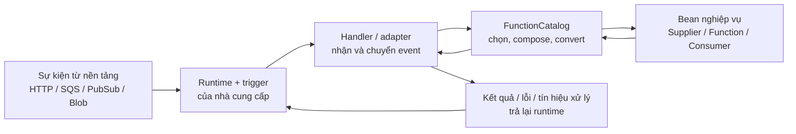
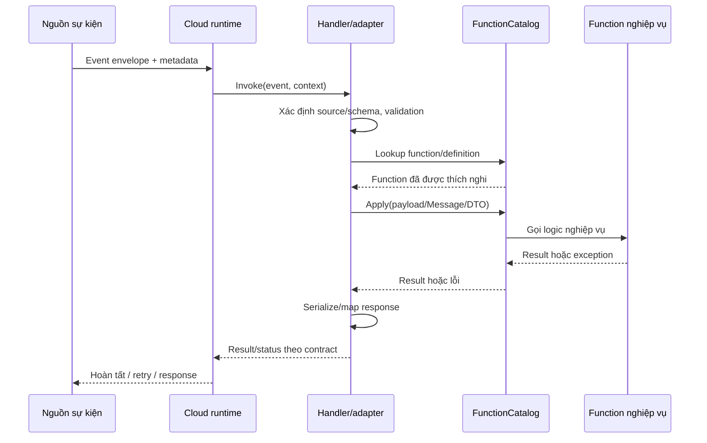
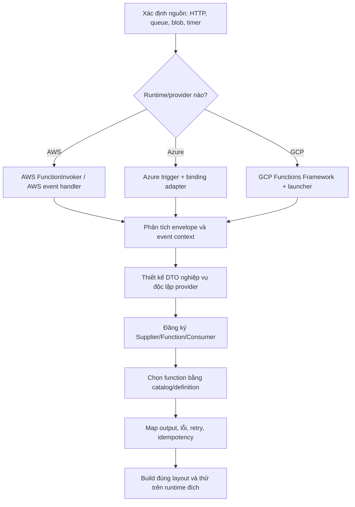

# Vai trò của adapter giữa sự kiện nền tảng và hàm nghiệp vụ

> **Chương:** Serverless  
> **Module:** SPRING_CLOUD_FUNCTION  
> **Trọng tâm:** Hiểu adapter như ranh giới chuyển lời gọi, dữ liệu, metadata và kết quả giữa runtime serverless với các hàm `Supplier`, `Function`, `Consumer` của Spring Cloud Function.  
> **Mốc tham chiếu:** 24/11/2026. Các ví dụ dùng Java 21, Spring Boot 4.2.0 và Spring Cloud release train 2026.0.0 (Spring Cloud Function 5.1.0). Khi triển khai thực tế, cần kiểm tra tài liệu đúng phiên bản adapter và runtime của nhà cung cấp.

## 1. Vì sao ứng dụng Spring Cloud Function cần adapter serverless?

Một hàm nghiệp vụ Java lý tưởng chỉ biết **đầu vào, quy tắc xử lý, đầu ra**:

```java
Function<String, String> normalizeCode =
        text -> text.trim().toUpperCase(Locale.ROOT);
```

Nhưng các nền tảng serverless lại đưa dữ liệu đến theo những cách khác nhau:

- **AWS Lambda:** runtime gọi một handler, truyền payload sự kiện và đối tượng execution context; nguồn kích hoạt có thể là API Gateway, SQS, S3 hoặc dịch vụ khác.
- **Azure Functions:** trigger và binding được mô tả qua annotation/configuration; Java worker gọi method handler có các tham số theo loại trigger.
- **Google Cloud Functions:** runtime/Functions Framework dùng entrypoint và hợp đồng HTTP hoặc event tương ứng với loại function đã triển khai.

Một payload cùng mang ý nghĩa “mã đơn hàng” có thể nằm ở HTTP body, trường `body` của một bản ghi queue, hoặc một trường đã mã hóa trong sự kiện pub/sub. Nếu đặt toàn bộ mã đọc event, khởi tạo SDK và chuyển metadata vào bean nghiệp vụ, hàm đó sẽ **phụ thuộc nền tảng**, khó dùng lại ở HTTP, event và một cloud khác.

**Adapter** là lớp kết nối hai thế giới: hiểu **hợp đồng gọi của nền tảng** và biết cách đưa dữ liệu vào **hợp đồng hàm của ứng dụng**. Spring Cloud Function cung cấp `FunctionCatalog` và các adapter để thực hiện một phần công việc này, tùy runtime và loại event.

### 1.1. Sơ đồ đường đi của một invocation



Luồng này biểu diễn **ranh giới trách nhiệm**, không khẳng định mọi provider đều tạo HTTP response hoặc tự động xác nhận (*acknowledge*) event theo một cách. Với request đồng bộ, kết quả có thể được trả thẳng cho caller. Với queue/stream, thành công hay thất bại có thể dẫn đến retry, tái giao message, dead-letter queue hoặc phản hồi batch theo quy tắc nguồn sự kiện.

### 1.2. Mục tiêu học tập

Sau bài học, bạn có thể:

1. Phân biệt **event envelope**, **payload nghiệp vụ**, **execution context** và **message headers**.
2. Giải thích adapter làm gì trước và sau khi gọi `FunctionCatalog`.
3. Đặt logic chuẩn hóa đơn hàng trong một `Function` độc lập với SDK/provider.
4. Viết một adapter mô phỏng để kiểm tra việc bóc tách event và dựng kết quả.
5. Nhận diện cách Spring Cloud Function tích hợp AWS Lambda, Azure Functions, Google Cloud Functions.
6. Hiểu vì sao việc chọn `spring.cloud.function.definition`, chuyển đổi dữ liệu, packaging và thiết kế lỗi vẫn cần được kiểm chứng trên từng nền tảng.
7. Lập kế hoạch kiểm thử, bảo mật, retry và idempotency cho hệ thống serverless.

## 2. Phân biệt event envelope với dữ liệu nghiệp vụ

### 2.1. Một event thường có nhiều lớp dữ liệu

Giả sử hệ thống gửi thông báo xử lý mã `" od-123 "`. Một **event envelope do ứng dụng giả định** có thể trông như sau:

```json
{
  "eventId": "evt-42",
  "source": "orders.created",
  "time": "2026-11-24T08:30:00Z",
  "attributes": {
    "correlationId": "corr-7",
    "contentType": "text/plain"
  },
  "payload": " od-123 "
}
```

Đây là **fixture minh họa**, không phải định dạng chuẩn áp dụng nguyên xi cho AWS, Azure hay GCP. Các trường có ý nghĩa khác nhau:

| Thành phần | Ví dụ | Có nên đưa thẳng vào nghiệp vụ? |
| --- | --- | --- |
| **Event ID** | `evt-42` | Có thể cần cho idempotency/audit. |
| **Nguồn sự kiện** | `orders.created` | Có thể dùng để chọn quy tắc/handler, nhưng không để client tùy ý gọi function. |
| **Thời gian sự kiện** | Timestamp ISO-8601 | Có thể quan trọng cho quy tắc hết hạn hoặc kiểm tra thứ tự. |
| **Correlation ID** | `corr-7` | Hữu ích để theo dõi, thường là metadata. |
| **Content type** | `text/plain` | Hướng dẫn chuyển đổi payload, không phải dữ liệu nghiệp vụ. |
| **Payload** | `" od-123 "` | Đầu vào trực tiếp cho logic chuẩn hóa. |
| **Execution context** | Request ID, deadline, logger | Thuộc runtime/provider; chỉ đưa vào nghiệp vụ khi thực sự cần. |

**Event envelope ≠ business DTO**. Một function `Function<OrderCommand, OrderResult>` mong đợi `OrderCommand`, không đương nhiên hiểu được toàn bộ JSON của SQS, API Gateway hoặc Pub/Sub. Trước khi gọi hàm, adapter hoặc một lớp mapping cần xác định đúng chỗ chứa mã đơn hàng.

### 2.2. Sự kiện thực tế từ các provider khác nhau

| Nguồn kích hoạt | Dữ liệu thường gặp | Ràng buộc riêng |
| --- | --- | --- |
| **AWS Lambda được gọi trực tiếp** | JSON payload người gọi cung cấp; thêm Lambda `Context` ở handler. | Cấu trúc phụ thuộc hợp đồng invocation do người gọi định nghĩa. |
| **AWS SQS → Lambda** | Envelope có tập `Records`; mỗi record có message ID, body, thuộc tính. | Một invocation có thể gồm nhiều record; cần nghĩ về xử lý từng record và partial batch failure. |
| **AWS S3 → Lambda** | Metadata object/bucket, event name, key. | Hàm có thể phải tải object trước khi có payload nghiệp vụ. |
| **Azure Queue/Blob/HTTP trigger** | Java handler nhận tham số theo annotation và binding. | Method signature, annotations và metadata do Azure worker/trigger quy định. |
| **Google Cloud Pub/Sub** | Dữ liệu message và attributes trong cấu trúc event. | Payload có thể được mã hóa; cách biểu diễn phụ thuộc runtime/trigger generation. |
| **Google Cloud HTTP** | HTTP request body, headers, URL. | Semantics đồng bộ khác với event nền. |

Các mục này là nhóm tình huống, **không phải mẫu JSON đầy đủ của provider**. Khi viết function thật, phải lấy sample event từ đúng nguồn, phiên bản runtime và trigger đã cấu hình rồi kiểm tra schema.

### 2.3. Không phải mọi event đều là một business command

Ví dụ một SQS event có 10 record; mỗi record lại chứa JSON đơn hàng. Nếu hàm nhận `Function<OrderCommand, OrderResult>` mà raw input là toàn bộ SQS envelope, không có cơ sở để cho rằng framework sẽ tự trích từng `body` rồi gọi hàm 10 lần theo ý nghiệp vụ.

Có ít nhất ba cách thiết kế:

1. Hàm nghiệp vụ nhận **một command**; adapter/bộ ánh xạ phân rã batch thành nhiều command rồi gọi riêng.
2. Hàm nhận **kiểu sự kiện của provider** (ví dụ `SQSEvent`), tự xử lý records. Cách này thuận tiện khi cần partial batch response nhưng làm chữ ký hàm phụ thuộc AWS.
3. Dùng một **lớp chống tham nhũng** (*anti-corruption layer*) chuyển provider envelope thành một kiểu batch trung lập do ứng dụng định nghĩa, rồi mới gọi nghiệp vụ.

Lựa chọn phụ thuộc yêu cầu batch, delivery semantics, hiệu năng và mức độ tái sử dụng. Adapter của Spring Cloud Function giúp nối runtime với hàm nhưng **không thể tự suy luận mọi quy tắc bóc tách nghiệp vụ**.

## 3. Năm trách nhiệm chính của adapter

### 3.1. Nhận invocation theo contract của runtime

Runtime cần một điểm vào cụ thể: Lambda handler, Azure annotated method hoặc Google Functions Framework entrypoint. Adapter làm cầu nối từ điểm vào đó tới Spring context/catalog.

Đây là chỗ chứa kiến thức về kiểu event/provider, không phải nơi lý tưởng để đặt quy tắc “mã đơn hàng phải có dạng AA-999”.

### 3.2. Khởi tạo và sử dụng Spring context/FunctionCatalog

Spring Cloud Function phát hiện các bean `Supplier`, `Function` và `Consumer`. `FunctionCatalog` cung cấp cách lookup được chuẩn hóa và bổ sung các khả năng như type conversion, message conversion, composition.

Ví dụ:

```java
Function<String, String> function =
        catalog.lookup("normalizeCode");

String result = function.apply("  od-123 ");
```

Với nhiều bean, adapter cần biết chọn cái nào. Có thể dùng:

```properties
spring.cloud.function.definition=normalizeCode
```

Và với composition:

```properties
spring.cloud.function.definition=normalizeCode|validateCode
```

Dấu `|` biểu thị thứ tự chạy, không phải dấu phân cách của một event envelope. Cấu hình definition **không khởi tạo trigger** trên cloud và không thay thế việc chọn event source trong console/IaC.

### 3.3. Chuyển đổi input và output

Một adapter có thể cần:

- Giải mã request/event ở ranh giới runtime.
- Chọn `MessageConverter` hoặc `ConversionService` thích hợp dựa trên kiểu function, metadata và content type.
- Chuyển dữ liệu thành `String`, DTO, `Message<T>` hoặc kiểu event provider cụ thể.
- Serialize kết quả thành đối tượng/byte stream/HTTP response theo contract của môi trường.

Ví dụ, `Function<OrderCommand, OrderResult>` có thể nhận JSON đã chuyển thành DTO. Nhưng nếu JSON thực tế là SQS envelope, converter không tự biết rằng `Records[0].body` mới là command mà bạn muốn xử lý.

### 3.4. Giữ và truyền metadata cần thiết

Một số metadata có thể được ánh xạ sang `MessageHeaders` để không phải thay đổi payload nghiệp vụ. Các trường như correlation ID, content type, source, trace ID hoặc provider-specific context được xử lý tùy adapter.

**Không mặc định mọi header sẽ đi nguyên vẹn qua mọi adapter.** Có header nội bộ không được phép gửi ra, có header do provider dành riêng và có dữ liệu quan trọng cần được đưa vào DTO một cách tường minh.

### 3.5. Ánh xạ kết quả, lỗi và hoàn tất invocation

Adapter trả kết quả theo contract của provider. Tùy trigger, kết quả có thể là:

- HTTP status/body/headers đối với function HTTP.
- Một giá trị JSON/byte stream cho lời gọi Lambda đồng bộ.
- Không có response nghiệp vụ đối với event bất đồng bộ; runtime dựa vào trạng thái handler hoặc cơ chế riêng để quyết định retry.
- Batch response chuyên dụng nếu nguồn sự kiện hỗ trợ xử lý thành công/thất bại một phần.

**Adapter không tự bảo đảm exactly-once.** Ngữ nghĩa retry, acknowledgement, timeout và dead-letter phụ thuộc trigger/provider và cách thiết kế ứng dụng.

### 3.6. Những điều adapter không nên tự quyết định

| Trách nhiệm | Chủ sở hữu phù hợp |
| --- | --- |
| Nhận event, chọn trigger, đọc execution context | Provider runtime/handler/adapter. |
| Bóc schema provider, ánh xạ trường dữ liệu | Adapter hoặc lớp mapping tại boundary. |
| Chọn function/composition và conversion phù hợp | Spring Cloud Function/FunctionCatalog cùng adapter. |
| Quy tắc chuẩn hóa và kiểm tra mã đơn hàng | Bean nghiệp vụ `Function`. |
| Quyết định idempotency key, giao dịch và side effect | Logic application/use-case và tầng lưu trữ. |
| Retry, DLQ, timeout, quyền truy cập nguồn sự kiện | Cấu hình cloud/IaC phối hợp với application. |
| Logs, traces, metrics, correlation | Hạ tầng quan sát và các lớp ứng dụng cần thiết. |

Ranh giới rõ ràng giúp tránh “một hàm biết tất cả”, đồng thời giữ được khả năng triển khai cùng nghiệp vụ qua HTTP, event và serverless.

## 4. Luồng end-to-end khi một event được xử lý

Để hình dung từng bước, xét một sự kiện chứa mã `od-123`:



Chi tiết quan trọng:

1. **Khởi tạo/cold start:** Khi runtime tạo một execution environment mới, Spring application context có thể phải được khởi tạo trước lời gọi đầu tiên. Những invocation sau có thể tái sử dụng môi trường khi provider còn giữ nó.
2. **Chọn function:** Với nhiều bean, dùng definition rõ ràng để tránh chọn sai handler. Spring Cloud Function có khả năng routing động, nhưng mở routing tùy ý cho input bên ngoài có rủi ro bảo mật.
3. **Chuyển kiểu:** Conversion chỉ hoạt động trong phạm vi converter và metadata được cấu hình; lỗi schema phải được nhận diện trước hoặc khi gọi function.
4. **Bắt lỗi:** Exception phải được ánh xạ đúng theo contract đồng bộ/bất đồng bộ. Không được biến lỗi xử lý thành thành công giả nếu runtime cần retry.
5. **Hoàn tất:** Với HTTP, caller quan tâm status và body; với queue, cần quan tâm acknowledgement, batch result và retry.

Một lớp adapter tốt không tự ý bỏ qua record thất bại, không nuốt exception mà không ghi nhận, và không làm rò rỉ dữ liệu nhạy cảm trong logs.

## 5. Ví dụ nghiệp vụ độc lập nền tảng

### 5.1. Xác định contract Java trung lập

Ta muốn nhận mã đơn hàng và trả mã đã chuẩn hóa, vẫn giữ `eventId` để tương quan với lời gọi. Hai DTO dùng Java record:

```java
public record OrderCommand(String eventId, String code) {}

public record OrderResult(String eventId, String normalizedCode) {}
```

Hai record trên là **minh họa kiểu dữ liệu**; trong project đầy đủ bên dưới, chúng được khai báo **lồng trong lớp ứng dụng**, nên không cần tạo hai file `public record` top-level riêng.

### 5.2. Ứng dụng Spring Boot với hai bean Function

Tạo `src/main/java/vn/example/serverless/ServerlessDemoApplication.java`:

```java
package vn.example.serverless;

import java.util.Locale;
import java.util.function.Function;

import org.springframework.boot.SpringApplication;
import org.springframework.boot.autoconfigure.SpringBootApplication;
import org.springframework.context.annotation.Bean;

@SpringBootApplication
public class ServerlessDemoApplication {

    public static void main(String[] args) {
        SpringApplication.run(ServerlessDemoApplication.class, args);
    }

    public record OrderCommand(String eventId, String code) {}

    public record OrderResult(String eventId, String normalizedCode) {}

    // Quy tắc nghiệp vụ dùng chung; không phụ thuộc AWS/Azure/GCP.
    private static String normalize(String raw) {
        if (raw == null || raw.isBlank()) {
            throw new IllegalArgumentException("Mã không được rỗng");
        }

        String normalized = raw.trim().toUpperCase(Locale.ROOT);
        if (!normalized.matches("[A-Z]{2}-[0-9]{3}")) {
            throw new IllegalArgumentException(
                    "Mã phải có dạng AA-999: " + normalized);
        }
        return normalized;
    }

    @Bean
    public Function<String, String> normalizeCode() {
        return ServerlessDemoApplication::normalize;
    }

    @Bean
    public Function<OrderCommand, OrderResult> normalizeOrder() {
        return command -> {
            if (command == null) {
                throw new IllegalArgumentException("Thiếu command");
            }

            return new OrderResult(
                    command.eventId(),
                    normalize(command.code()));
        };
    }
}
```

Trong lớp này:

- `normalizeCode` nhận/trả `String`, tiện thử với HTTP hoặc event có payload là chuỗi đơn giản.
- `normalizeOrder` nhận/trả DTO trung lập gồm mã và event ID.
- Quy tắc normalize nằm trong phương thức `private static`, dùng chung cho hai bean mà **không gọi API cloud nào**.
- Có hai bean Function nên khi đưa lên serverless cần chọn definition hoặc handler phù hợp để tránh nhầm route.

Đầu vào và đầu ra của `normalizeOrder`:

```json
{
  "eventId": "evt-42",
  "code": "  od-123 "
}
```

```json
{
  "eventId": "evt-42",
  "normalizedCode": "OD-123"
}
```

Đây là **hợp đồng JSON nghiệp vụ** nếu payload thực sự được adapter/converter truyền vào dưới dạng `OrderCommand`. Nó **không** được coi là hình dạng của mọi sự kiện AWS/Azure/GCP.

### 5.3. Chọn hàm cho deployment

Nếu deployment xử lý JSON dạng `OrderCommand`, cấu hình có thể là:

```properties
spring.cloud.function.definition=normalizeOrder
```

Nếu deployment chỉ nhận String:

```properties
spring.cloud.function.definition=normalizeCode
```

Property chọn **hàm** nhưng không xác định **event source**, không chỉ rõ JSON nằm ở trường nào của envelope, và không tự tạo IAM/binding. Những việc đó thuộc adapter và hạ tầng.

### 5.4. Maven tối thiểu để chạy thử catalog và adapter mô phỏng

Để dựng ví dụ Java ở mục 5–6 thành một Spring Boot project có thể chạy `@SpringBootTest`, tạo file `pom.xml` như sau:

```xml
<?xml version="1.0" encoding="UTF-8"?>
<project xmlns="http://maven.apache.org/POM/4.0.0"
         xmlns:xsi="http://www.w3.org/2001/XMLSchema-instance"
         xsi:schemaLocation="http://maven.apache.org/POM/4.0.0
           https://maven.apache.org/xsd/maven-4.0.0.xsd">
    <modelVersion>4.0.0</modelVersion>

    <parent>
        <groupId>org.springframework.boot</groupId>
        <artifactId>spring-boot-starter-parent</artifactId>
        <version>4.2.0</version>
        <relativePath/>
    </parent>

    <groupId>vn.example</groupId>
    <artifactId>serverless-adapter-boundary-demo</artifactId>
    <version>0.0.1-SNAPSHOT</version>

    <properties>
        <java.version>21</java.version>
        <spring-cloud.version>2026.0.0</spring-cloud.version>
    </properties>

    <dependencyManagement>
        <dependencies>
            <dependency>
                <groupId>org.springframework.cloud</groupId>
                <artifactId>spring-cloud-dependencies</artifactId>
                <version>${spring-cloud.version}</version>
                <type>pom</type>
                <scope>import</scope>
            </dependency>
        </dependencies>
    </dependencyManagement>

    <dependencies>
        <dependency>
            <groupId>org.springframework.boot</groupId>
            <artifactId>spring-boot-starter</artifactId>
        </dependency>
        <dependency>
            <groupId>org.springframework.cloud</groupId>
            <artifactId>spring-cloud-function-context</artifactId>
        </dependency>
        <dependency>
            <groupId>org.springframework.boot</groupId>
            <artifactId>spring-boot-starter-test</artifactId>
            <scope>test</scope>
        </dependency>
    </dependencies>

    <build>
        <plugins>
            <plugin>
                <groupId>org.springframework.boot</groupId>
                <artifactId>spring-boot-maven-plugin</artifactId>
            </plugin>
        </plugins>
    </build>
</project>
```

Đặt hai file `ServerlessDemoApplication.java` và `BoundaryAdapter.java` cùng package `vn.example.serverless`; test của mục 14 đặt trong `src/test/java/vn/example/serverless/`. Sau đó có thể chạy `mvn test` (hoặc `./mvnw test` **nếu project đã có Maven Wrapper**).

Project này chỉ kiểm tra **Spring context, catalog, nghiệp vụ và adapter mô phỏng**. Nó **chưa phải** gói triển khai AWS/Azure/GCP. Khi chọn một provider, thêm dependency và plugin packaging riêng theo tài liệu adapter, sau đó chạy kiểm thử runtime tương ứng. Không coi việc `mvn test` thành công là đã kiểm chứng cloud deployment.

## 6. Tự xây adapter mô phỏng để hiểu ranh giới

Trước khi dùng SDK thật, hãy thử một adapter **do ứng dụng viết để minh họa**. Nó nhận một event trung lập (không phải class AWS/Azure/GCP), bóc payload, tạo `OrderCommand`, gọi `FunctionCatalog`, rồi dựng response.

### 6.1. Event và response trung lập

Giả sử `PlatformEvent` có id, source, payload là mã đơn hàng và attributes. `PlatformResponse` trả event ID, mã chuẩn hóa và một số metadata đầu ra.

Đặt trong `src/main/java/vn/example/serverless/BoundaryAdapter.java`:

```java
package vn.example.serverless;

import java.util.Map;
import java.util.function.Function;

import org.springframework.cloud.function.context.FunctionCatalog;
import org.springframework.stereotype.Component;

import vn.example.serverless.ServerlessDemoApplication.OrderCommand;
import vn.example.serverless.ServerlessDemoApplication.OrderResult;

@Component
public class BoundaryAdapter {

    public record PlatformEvent(
            String id,
            String source,
            String payload,
            Map<String, String> attributes) {}

    public record PlatformResponse(
            String id,
            String normalizedCode,
            Map<String, String> attributes) {}

    private final Function<OrderCommand, OrderResult> businessFunction;

    public BoundaryAdapter(FunctionCatalog catalog) {
        this.businessFunction = catalog.lookup("normalizeOrder");

        if (businessFunction == null) {
            throw new IllegalStateException(
                    "Function normalizeOrder chưa được đăng ký");
        }
    }

    public PlatformResponse handle(PlatformEvent event) {
        if (event == null || event.id() == null ||
                event.id().isBlank()) {
            throw new IllegalArgumentException("Thiếu event ID");
        }

        // Boundary: chuyển envelope thành command nghiệp vụ.
        OrderCommand command =
                new OrderCommand(event.id(), event.payload());

        // Logic nghiệp vụ chạy qua FunctionCatalog.
        OrderResult result = businessFunction.apply(command);

        // Boundary: chuyển result về contract giả định của runtime.
        return new PlatformResponse(
                result.eventId(),
                result.normalizedCode(),
                Map.of("correlationId", event.id()));
    }
}
```

**Chú ý:** đây là adapter **mô phỏng phục vụ học tập**, không phải class Spring Cloud Function AWS/Azure/GCP adapter và không phải Lambda handler có thể upload trực tiếp. Cách làm này hữu ích vì phần mapping của từng provider có thể được kiểm thử mà không cần tài khoản cloud.

### 6.2. Phân tích từng dòng trách nhiệm

| Đoạn trong `BoundaryAdapter` | Trách nhiệm |
| --- | --- |
| `PlatformEvent` | Hợp đồng sự kiện giả định ở ranh giới. |
| Kiểm tra `event.id()` | Kiểm tra metadata tối thiểu ở boundary. |
| Tạo `OrderCommand` | Tách envelope thành DTO nghiệp vụ. |
| `catalog.lookup("normalizeOrder")` | Lấy function đã được Spring Cloud Function thích nghi. |
| `businessFunction.apply(command)` | Thực thi nghiệp vụ qua catalog. |
| Tạo `PlatformResponse` | Ánh xạ kết quả theo contract ngoài. |

Event mẫu:

```java
var event = new BoundaryAdapter.PlatformEvent(
        "evt-42",
        "orders.created",
        "  od-123 ",
        Map.of("correlationId", "corr-7"));
```

Kết quả kỳ vọng khi gọi `handle` là response có `normalizedCode="OD-123"`. Bản mô phỏng cố tình dùng `event.id()` cho correlation ID đầu ra để đơn giản; hệ thống thật có thể phải ưu tiên `correlationId` gốc, phân biệt event ID với request ID, và chỉ forward những thuộc tính được cho phép.

### 6.3. Chỉ thêm provider SDK tại ranh giới

Khi triển khai thật, thay input giả định bằng type của runtime/SDK. Ví dụ, một AWS SQS mapping layer có thể nhận `SQSEvent`, lặp `Records`, parse từng `body` thành command rồi gọi `FunctionCatalog`. Phần `normalizeOrder` không phải thay đổi.

Không cố chuyển `SQSEvent` thành `String` bằng cách gọi `toString()` trên event rồi mong kết quả chính là mã đơn hàng: `toString()` có thể trả debug representation không có ý nghĩa nghiệp vụ.

## 7. AWS Lambda: `FunctionInvoker` nối event với catalog

### 7.1. Vai trò của AWS adapter

Spring Cloud Function cung cấp dependency:

```xml
<dependency>
    <groupId>org.springframework.cloud</groupId>
    <artifactId>spring-cloud-function-adapter-aws</artifactId>
</dependency>
```

Adapter này cho phép một Spring Cloud Function application chạy theo mô hình AWS Lambda. Thay vì tự viết handler SDK cho mọi function đơn giản, tài liệu Spring khuyến nghị generic handler:

```text
org.springframework.cloud.function.adapter.aws.FunctionInvoker::handleRequest
```

`FunctionInvoker` triển khai hợp đồng handler Lambda, kết nối invocation AWS với các function đã đăng ký và hỗ trợ chuyển đổi kiểu trong phạm vi được tài liệu mô tả.

**Không nhầm:** `FunctionInvoker` là entrypoint cho AWS runtime; `FunctionCatalog` là registry/cơ chế gọi function trong Spring; bean `normalizeOrder` là nghiệp vụ.

### 7.2. Với direct invocation, JSON có thể gần với business DTO

Nếu caller trực tiếp invoke Lambda với payload:

```json
{
  "eventId": "evt-42",
  "code": "  od-123 "
}
```

và adapter được cấu hình chọn `normalizeOrder`, cơ chế chuyển kiểu có thể đưa payload vào record `OrderCommand` theo chữ ký function và converter đã cấu hình. Kết quả sau xử lý mang thông tin:

```json
{
  "eventId": "evt-42",
  "normalizedCode": "OD-123"
}
```

Đây là **kỳ vọng cho hợp đồng input/output của ví dụ**, không phải minh chứng một Lambda đã deploy thành công. Phải smoke test cả serializer/converter thật trên artifact AWS.

### 7.3. Với SQS/S3, event không giống direct invocation

AWS Lambda nhận payload khác nhau tùy event source:

- **SQS:** envelope chứa danh sách records, body, message ID và attributes; có thể cần partial batch response.
- **S3:** thông tin bucket/object, event name và object key; dữ liệu nghiệp vụ có thể phải lấy từ S3.
- **API Gateway:** cấu trúc HTTP request và metadata theo loại API tích hợp.
- **Kafka/event source mapping:** batch/partition/offset và semantics xử lý của broker/provider.

Vì vậy không mặc định `Function<OrderCommand,OrderResult>` sẽ xử lý mọi envelope. Nếu xử lý trực tiếp đối tượng AWS, Spring Cloud Function hỗ trợ các chữ ký như `Function<SQSEvent, SQSBatchResponse>` hoặc `Function<S3Event, ...>`; lợi thế là truy cập đầy đủ provider-specific fields, đổi lại hàm phụ thuộc SDK AWS. Một hướng khác là dùng mapping layer để chuyển đổi event sang DTO trung lập như mục 6.

### 7.4. Packaging và cấu hình là phần không thể bỏ qua

Một ứng dụng Spring Boot JAR chạy `java -jar` không nhất thiết là artifact phù hợp cho AWS Lambda. Cần kiểm tra:

1. Dependency `spring-cloud-function-adapter-aws` được resolve đúng với Spring Cloud BOM.
2. Gói JAR được tạo theo layout AWS mà bản adapter tài liệu hướng dẫn (ví dụ cấu hình shading/packaging và artifact chuyên dụng).
3. Runtime Java của Lambda hỗ trợ phiên bản bytecode đã build.
4. Handler đặt đúng `FunctionInvoker::handleRequest`.
5. `spring.cloud.function.definition` hoặc cơ chế routing lựa chọn function đúng khi có nhiều bean.
6. Event source, trigger, IAM permissions, timeout, memory và các biến môi trường được cấu hình thích hợp.
7. Có phép gọi thử với **sự kiện thật của trigger** và quan sát log/metrics, không chỉ test method `apply`.

Tài liệu chính thức: https://docs.spring.io/spring-cloud-function/reference/adapters/aws-intro.html

### 7.5. Một handler chung vẫn có thể chọn nhiều function

Spring Cloud Function có `RoutingFunction` (tên catalog `functionRouter`) và các cơ chế định tuyến qua config hoặc metadata. Trong AWS Lambda, generic `FunctionInvoker` có thể sử dụng routing để chọn bean đích khi ứng dụng chứa nhiều function.

Tuy nhiên, không cho phép nguồn event không tin cậy tự quyết định function tùy ý qua header hay biểu thức. Hãy dùng definition tĩnh hoặc một whitelist/callback định tuyến có kiểm soát và áp dụng quyền truy cập theo nguyên tắc **least privilege**.

## 8. Azure Functions: handler và binding là lớp ranh giới

### 8.1. Azure dùng annotation để định nghĩa trigger

Trong Azure Functions Java, một handler có thể khai báo `@FunctionName` và trigger như `@HttpTrigger`, queue trigger hay blob trigger. Azure Maven/Gradle plugin xử lý các annotation để tạo binding configuration và artifact phù hợp runtime.

Spring Cloud Function tích hợp qua:

```xml
<dependency>
    <groupId>org.springframework.cloud</groupId>
    <artifactId>spring-cloud-function-adapter-azure</artifactId>
</dependency>
```

Azure adapter hỗ trợ Spring dependency injection trong handler; nếu muốn dùng các khả năng của Spring Cloud Function như composition và type conversion, handler có thể inject `FunctionCatalog`.

### 8.2. Handler minh họa gọi một bean Java

Ví dụ dưới đây minh họa ý tưởng ở ranh giới Azure HTTP trigger, **không phải trọn bộ project Azure**:

```java
// Imports cần thiết gồm FunctionCatalog, Function, @Component,
// @FunctionName, @HttpTrigger, HttpMethod, AuthorizationLevel,
// HttpRequestMessage, ExecutionContext và Optional.

@Component
public class NormalizeAzureHandler {

    private final Function<String, String> normalize;

    public NormalizeAzureHandler(FunctionCatalog catalog) {
        this.normalize = catalog.lookup("normalizeCode");
    }

    @FunctionName("normalize")
    public String execute(
            @HttpTrigger(
                    name = "request",
                    methods = {HttpMethod.POST},
                    authLevel = AuthorizationLevel.FUNCTION)
            HttpRequestMessage<Optional<String>> request,
            ExecutionContext context) {

        String body = request.getBody()
                .orElseThrow(() ->
                        new IllegalArgumentException("Thiếu body"));

        return normalize.apply(body);
    }
}
```

Đặt lớp này vào project Azure có dependency Azure Java Functions SDK, plugin và cấu hình build phù hợp. Khi nhận request, **Azure handler** lấy body String và `FunctionCatalog` gọi bean `normalizeCode`. Nếu muốn truy cập `ExecutionContext` trong `Message<?>`, adapter có tiện ích `AzureFunctionUtil.enhanceInputIfNecessary` để bổ sung context vào message header theo tài liệu.

Điểm thiết kế: handler giải quyết **giao thức Azure**, không cần chứa quy tắc trim/uppercase. `normalizeCode` vẫn sử dụng được ở một runtime khác.

### 8.3. Azure Web adapter là trường hợp riêng

Spring còn có `spring-cloud-function-adapter-azure-web` cho tình huống triển khai mô hình Spring Web trên Azure HTTP trigger. Đây là lựa chọn khác với Azure adapter thông thường dùng annotated handlers. Không nên ghép hai cách khi chưa có mục tiêu kiến trúc rõ ràng.

**Cảnh báo packaging:** format ứng dụng Azure Functions không giống mặc định Spring Boot uber JAR. Cần các plugin Azure tạo cấu hình `function.json`, `host.json` và layout triển khai tương ứng; chỉ copy một JAR chạy được trên máy cá nhân lên Azure chưa chứng minh hệ thống hoạt động.

Tài liệu chính thức: https://docs.spring.io/spring-cloud-function/reference/adapters/azure-intro.html

## 9. Google Cloud Functions: entrypoint và Functions Framework

### 9.1. GCP adapter làm gì?

Spring Cloud Function cung cấp:

```xml
<dependency>
    <groupId>org.springframework.cloud</groupId>
    <artifactId>spring-cloud-function-adapter-gcp</artifactId>
</dependency>
```

Google Functions Framework for Java nhận HTTP/event và gọi entrypoint của ứng dụng. Adapter của Spring Cloud Function cung cấp launcher:

```text
org.springframework.cloud.function.adapter.gcp.GcfJarLauncher
```

Launcher kết nối runtime Google với Spring context/FunctionCatalog. Những ví dụ trong tài liệu hướng dẫn việc cấu hình plugin build, chạy thử bằng Functions Framework và đóng gói theo layout phù hợp GCP.

### 9.2. HTTP trigger và event trigger không cùng payload

**HTTP function:** có request/response theo semantics HTTP. Một bean `Function<String,String>` có thể minh họa trực tiếp phép chuyển đổi chuỗi nếu adapter nhận body phù hợp.

**Event/background function:** có event từ Pub/Sub, Cloud Storage hoặc nguồn khác, với envelope và metadata riêng. Một Pub/Sub message có thể chứa trường `data` mã hóa và attributes; cần xác định đúng dạng sự kiện của phiên bản Cloud Functions/Cloud Run functions đang dùng.

Một bean nghiệp vụ `Function<OrderCommand,OrderResult>` không được giả định tự đọc được mọi Pub/Sub event. Hãy dùng adapter hoặc lớp chuyển đổi biết cấu trúc event trước khi gọi.

### 9.3. Điều cần xác minh khi build/deploy

- Artifact GCP cần layout và entrypoint đúng theo adapter.
- Plugin build có thể phải cấu hình adapter như dependency của `spring-boot-maven-plugin` hoặc plugin Functions Framework theo hướng dẫn.
- Runtime Java, kiểu trigger và generation phải được GCP hỗ trợ tại thời điểm deploy.
- Quyền Pub/Sub/Storage/HTTP và network access cần được cấu hình riêng.
- Phép thử local qua Functions Framework không thay thế phép thử event thật trên cloud.

Một số tài liệu/samples cũ có ví dụ runtime Java đã lạc hậu so với phiên bản provider hiện tại. **Không sao chép `--runtime` hoặc thông số deploy từ sample cũ mà không kiểm tra danh sách runtime đang hỗ trợ.**

Tài liệu chính thức: https://docs.spring.io/spring-cloud-function/reference/adapters/gcp-intro.html

## 10. So sánh adapter serverless với Web adapter và Stream binder

Các kiểu tích hợp đều có thể gọi bean function, nhưng **chúng không phải cùng một tầng giao tiếp**.

| Công nghệ | Nguồn kích hoạt | Contract ngoài | Cách gắn với FunctionCatalog | Trường hợp phù hợp |
| --- | --- | --- | --- | --- |
| **Spring Cloud Function Web** | HTTP đến ứng dụng Spring Boot Web | URL, method, headers, body, HTTP status | Mapping endpoint theo tên/definition | API đơn giản chạy như một web service. |
| **Spring Cloud Stream + binder** | Broker event qua Kafka/RabbitMQ... | Message, destination, consumer group, retry | Functional binding theo definition | Xử lý stream/sự kiện trong ứng dụng liên tục chạy. |
| **AWS Lambda adapter** | AWS invocation và event source | Handler + AWS event/context | `FunctionInvoker` và routing/catalog | Chức năng ngắn hạn theo request/event AWS. |
| **Azure Functions adapter** | Trigger/binding Azure | Annotated handler, execution context | Spring injection/`FunctionCatalog` | HTTP, queue, blob, timer theo mô hình Azure. |
| **Google Cloud Functions adapter** | Google HTTP/event runtime | Functions Framework entrypoint | `GcfJarLauncher`/catalog | HTTP và sự kiện trên Google Cloud. |

**Không nhầm Java function với cloud function:** `Function<T,R>` là interface Java; AWS Lambda/Azure/GCP Function là **tài nguyên chạy trên hạ tầng**. Adapter giúp nối hai khái niệm này, nhưng tài nguyên hạ tầng còn cần được tạo và quản trị.

### 10.1. Một function có thật sự dùng được ở mọi nơi?

Có thể tái sử dụng logic khi:

1. Kiểu dữ liệu input/output được định nghĩa rõ.
2. Event/HTTP request có thể được ánh xạ vào hợp đồng ấy.
3. Function không phụ thuộc API provider khi không cần thiết.
4. Các side effect, transaction và retry được thiết kế cho môi trường mới.
5. Adapter của provider hỗ trợ phiên bản Java, Boot và Spring Cloud đã chọn.

**Không có nghĩa** chỉ đổi một Maven dependency là deployment tự hoạt động. Packaging, handler, trigger, credentials và hạ tầng vẫn khác nhau.

### 10.2. `Supplier` và `Consumer` trong serverless

| Functional bean | Ngữ nghĩa Java | Câu hỏi cần trả lời ở adapter/runtime |
| --- | --- | --- |
| `Supplier<T>` | `T get()`, tạo một giá trị. | Điều gì kích hoạt `get`? Có lịch/timer hay request? Output đi đâu? |
| `Function<T,R>` | `R apply(T)`, nhận và trả giá trị. | Input được chuyển đổi ra sao? Output/exception được trả về đâu? |
| `Consumer<T>` | `void accept(T)`, không trả result. | Runtime coi xử lý hoàn tất lúc nào? Retry và side effect trùng được xử lý thế nào? |

Ví dụ `Consumer` ghi database có thể bị gọi lại nếu provider giao lại cùng event. Chữ ký `void` không mang ý nghĩa “đã xử lý exactly-once”.

## 11. Message conversion và metadata: ranh giới dễ bị hiểu sai

### 11.1. `MessageConverter` và `ConversionService`

Spring Cloud Function dựa vào cơ chế Spring để chuyển đổi input:

- `MessageConverter` dùng khi đầu vào là một `Message<?>` cần chuyển payload dựa trên kiểu đích/content type.
- `ConversionService` hỗ trợ trường hợp dữ liệu không mang wrapper `Message<?>`.
- `FunctionCatalog` có thể trả wrapper hỗ trợ chuyển đổi và composition trong ngữ cảnh được cấu hình.

Chữ ký `Function<OrderCommand,OrderResult>` là thông tin quan trọng để framework biết **kiểu đích**. `contentType` và adapter quyết định dùng converter nào, nhưng không thể tự sửa JSON sai schema hoặc trích ra trường nghiệp vụ chưa được chỉ định.

### 11.2. Khi nào dùng `Message<T>`?

Nếu logic thực sự cần đọc metadata, có thể khai báo một bean như sau:

```java
@Bean
public Function<Message<String>, Message<String>> normalizeWithMetadata() {
    return input -> {
        String normalized = input.getPayload()
                .trim()
                .toUpperCase(Locale.ROOT);

        return MessageBuilder.withPayload(normalized)
                .copyHeaders(input.getHeaders())
                .setHeader("normalized", true)
                .build();
    };
}
```

Đoạn code cần import `org.springframework.messaging.Message`, `MessageBuilder`, `Function`, `Locale` và đặt trong lớp cấu hình Spring. Nó là **biến thể minh họa**, không phải bắt buộc cho ứng dụng `normalizeOrder` ở mục 5.

**Lưu ý:** `MessageHeaders` của Spring không đồng nhất với mọi header của AWS Lambda/Azure/GCP. Adapter có thể đưa một số metadata vào header, nhưng không hứa mọi thuộc tính provider đều được giữ hoặc tự động chuyển thành response headers.

### 11.3. Bảo vệ dữ liệu tại boundary

Không nên giữ toàn bộ raw event trong log nếu nó chứa token, dữ liệu cá nhân hoặc nội dung bí mật. Khi cần trace, ưu tiên các định danh/metadata cho phép. Với JSON, áp dụng giới hạn kích thước, độ sâu và số phần tử khi nguồn event không đáng tin cậy; không bật deserialization tùy ý class từ dữ liệu đầu vào.

Spring Cloud 2026.0.0 có các bản vá bảo mật liên quan Spring Cloud Function; vì vậy không nên ép module Function cũ lên một release train mới. Bảo mật dependency và kiểm thử payload phải đi cùng nhau.

## 12. Lỗi, retry, batch và idempotency

### 12.1. Phân loại lỗi theo nơi phát sinh

| Lớp lỗi | Ví dụ | Ai cần xử lý? |
| --- | --- | --- |
| **Trigger/runtime** | Không nhận event, handler sai tên, timeout khởi tạo. | Cấu hình hạ tầng và adapter. |
| **Event mapping** | Envelope thiếu `body`, base64 hỏng, không parse được JSON. | Boundary adapter/converter. |
| **Routing/catalog** | Definition trỏ tới bean không tồn tại hoặc kiểu compose sai. | Cấu hình Spring Cloud Function và test catalog. |
| **Validation nghiệp vụ** | Mã `AB-12` không đúng dạng `AA-999`. | Function nghiệp vụ; adapter ánh xạ lỗi ra contract ngoài. |
| **Side effect** | DB timeout, lỗi gọi API, record được giao lại. | Application + provider retry/DLQ. |
| **Output mapping** | Không serialize được DTO hoặc batch response sai schema. | Adapter/serializer và kiểm thử hợp đồng. |

Đừng tự động đổi tất cả lỗi thành thành công để “không retry”, vì điều đó có thể làm mất message. Ngược lại, đừng để lỗi validation cố định tạo vòng retry vô hạn: cần phân biệt **lỗi tạm thời** và **lỗi vĩnh viễn**, rồi cấu hình backoff, DLQ hoặc xử lý riêng.

### 12.2. Tư duy at-least-once và idempotency

Nhiều luồng sự kiện serverless có thể giao lại cùng event; ví dụ một lần xử lý timeout sau khi đã ghi DB, rồi provider retry. Nếu `Consumer` trừ tiền hoặc tạo đơn hàng mà không kiểm tra trùng, tác dụng phụ có thể xảy ra hai lần.

Một thiết kế an toàn thường cần:

1. Chọn **idempotency key** ổn định, như event ID hoặc business operation ID.
2. Lưu dấu đã xử lý ở bộ lưu trữ bền vững với điều kiện atomic/unique constraint.
3. Áp dụng transaction hoặc cơ chế tương đương để gắn kết việc ghi dấu với side effect.
4. Xử lý retry và partial failure theo contract event source.

`FunctionCatalog` và adapter không tự cung cấp exactly-once cho mọi backend. Đây là quyết định nghiệp vụ và hạ tầng.

### 12.3. Batch cần chính sách riêng

Nếu một invocation nhận nhiều records, hãy hỏi:

- Có cần dừng cả batch khi một record lỗi không?
- Nguồn hỗ trợ **partial batch failure response** hay không?
- Thứ tự/partition/offset có quan trọng không?
- Mỗi record có idempotency key riêng không?
- Xử lý song song có làm thay đổi thứ tự hoặc gây race condition không?

Với SQS Lambda, AWS có định dạng batch response riêng cho phần thất bại; nếu dùng `Function<SQSEvent,SQSBatchResponse>`, nghiệp vụ có thể trả kết quả phù hợp. Nếu dùng một adapter trung lập tự viết, chính lớp đó phải biết cách ánh xạ failure records về đúng định dạng AWS. Không nhầm `List<Result>` bất kỳ với một partial batch response mà runtime nhận diện được.

### 12.4. Đồng bộ, bất đồng bộ và thời điểm hoàn tất

Một HTTP caller có thể nhận response ngay; SQS event source mapping có thể đánh dấu batch thành công khi handler hoàn tất; Azure/GCP event triggers có các quy tắc riêng về retry/ack. **Không suy ra HTTP 200, Lambda invocation success và message acknowledgement là cùng một khái niệm.**

## 13. Bảo mật, vận hành và tối ưu runtime

### 13.1. Cấu hình quyền và bí mật

- Dùng IAM/managed identity/service account với quyền tối thiểu để đọc nguồn event và ghi tài nguyên đích.
- Không đưa credential vào bean Java hoặc event payload; dùng cơ chế quản lý secret được provider khuyến nghị.
- Xác thực nguồn HTTP event, signature hoặc quyền invoke phù hợp.
- Giới hạn những function/route có thể bị chọn từ dữ liệu bên ngoài; đặc biệt thận trọng với routing expression/SpEL.

### 13.2. Cold start và reuse

Một execution environment mới có thể phải tải JAR, khởi tạo Spring Boot context, khởi tạo `FunctionCatalog` và client SDK. Thời gian này là một phần của **cold start**; invocation tiếp theo có thể tái sử dụng môi trường nhưng provider không đảm bảo một instance sống mãi.

Giảm phụ thuộc không cần thiết, tránh tạo network client nhiều lần, đo latency ở cả cold/warm invocation và cấu hình memory/timeout phù hợp. Đừng lưu trạng thái bắt buộc giữa hai invocation trong biến static hoặc singleton bean vì môi trường có thể bị hủy và thay mới bất kỳ lúc nào.

### 13.3. Quan sát được end-to-end

Đối với mỗi event, ghi nhận khi có thể:

- Event ID và correlation/trace ID.
- Tên function/definition đã gọi.
- Loại trigger và phiên bản schema.
- Kết quả xử lý hoặc loại lỗi (không log payload nhạy cảm).
- Độ trễ adapter, conversion và nghiệp vụ nếu hệ thống đo được.
- Số retry, batch failure, DLQ/poison events.

Một request ID do AWS/Azure/GCP cấp không phải luôn trùng business event ID; nên phân biệt chúng trong logs/traces.

### 13.4. Kiểm tra khả năng tương thích khi nâng cấp

Version Spring Boot, Spring Cloud Function, adapter, provider runtime và SDK đều có vòng đời riêng. Trước khi nâng cấp:

1. Chọn cặp Boot–Cloud tương thích.
2. Để Spring Cloud BOM quản lý module Function tương ứng; tránh version override tùy tiện.
3. Kiểm tra adapter có hỗ trợ Java runtime/Functions Framework/worker phiên bản đích.
4. Đọc thay đổi liên quan serialization, routing, header mapping, packaging.
5. Chạy unit, integration và smoke test với **artifact thực tế**, không chỉ source.

## 14. Kiểm thử theo các lớp mà adapter đi qua

### 14.1. Unit test nghiệp vụ không cần cloud

Tạo một JUnit test cho hàm Java. Vì `normalizeOrder()` trả `Function`, có thể gọi factory method mà không khởi động Spring:

```java
package vn.example.serverless;

import static org.junit.jupiter.api.Assertions.assertEquals;
import static org.junit.jupiter.api.Assertions.assertThrows;

import org.junit.jupiter.api.Test;
import vn.example.serverless.ServerlessDemoApplication.OrderCommand;

class BusinessFunctionTest {

    @Test
    void normalizesOrder() {
        var fn = new ServerlessDemoApplication().normalizeOrder();

        var output = fn.apply(
                new OrderCommand("evt-42", "  od-123 "));

        assertEquals("evt-42", output.eventId());
        assertEquals("OD-123", output.normalizedCode());
    }

    @Test
    void rejectsInvalidCode() {
        var fn = new ServerlessDemoApplication().normalizeOrder();

        assertThrows(IllegalArgumentException.class,
                () -> fn.apply(
                        new OrderCommand("evt-42", "??")));
    }
}
```

Đây là test thuần Java. Nó chứng minh logic chứ **chưa** chứng minh `FunctionCatalog`, event mapping hay cloud handler.

### 14.2. Integration test catalog và adapter mô phỏng

Khi project có `spring-boot-starter-test` và `spring-cloud-function-context` phù hợp, có thể test Spring context:

```java
package vn.example.serverless;

import static org.junit.jupiter.api.Assertions.assertEquals;
import static org.junit.jupiter.api.Assertions.assertNotNull;

import java.util.Map;
import java.util.function.Function;

import org.junit.jupiter.api.Test;
import org.springframework.beans.factory.annotation.Autowired;
import org.springframework.boot.test.context.SpringBootTest;
import org.springframework.cloud.function.context.FunctionCatalog;

import vn.example.serverless.ServerlessDemoApplication.OrderCommand;
import vn.example.serverless.ServerlessDemoApplication.OrderResult;

@SpringBootTest
class AdapterBoundaryTest {

    @Autowired FunctionCatalog catalog;
    @Autowired BoundaryAdapter boundary;

    @Test
    void catalogFindsFunctionByName() {
        Function<OrderCommand, OrderResult> fn =
                catalog.lookup("normalizeOrder");

        assertNotNull(fn);
        var result = fn.apply(
                new OrderCommand("evt-42", " od-123 "));
        assertEquals("OD-123", result.normalizedCode());
    }

    @Test
    void eventEnvelopeIsMappedToBusinessCommand() {
        var event = new BoundaryAdapter.PlatformEvent(
                "evt-42",
                "orders.created",
                " od-123 ",
                Map.of("correlationId", "corr-7"));

        var response = boundary.handle(event);

        assertEquals("evt-42", response.id());
        assertEquals("OD-123", response.normalizedCode());
        assertEquals("evt-42",
                response.attributes().get("correlationId"));
    }
}
```

Test này chứng minh **lớp ranh giới do ứng dụng mô phỏng** và catalog hoạt động, nhưng **không xác nhận** Lambda handler, Azure binding hoặc GCP entrypoint. Cần test thêm với fixture có envelope thật của provider.

### 14.3. Contract test cho event và runtime

| Lớp test | Input | Điều cần xác nhận |
| --- | --- | --- |
| Unit test | `OrderCommand` thuần Java | Logic nghiệp vụ đúng, validation rõ. |
| Spring catalog test | Bean/function definition | Catalog tìm được và có thể gọi. |
| Boundary mapping test | `PlatformEvent` hoặc provider fixture | Trích đúng payload, metadata và kết quả. |
| Serializer/converter test | JSON với header/content type | DTO được parse/serialize đúng schema. |
| Provider emulator/local runtime test | Event thật theo loại trigger | Handler/entrypoint, SDK, config và packaging đúng. |
| Cloud integration test | Event gửi qua nguồn thật | Permissions, retry, logs, DLQ, batch và thực tế vận hành. |

Một **smoke test** chỉ chứng minh đường đi cơ bản. Trước khi production, thêm kiểm thử lỗi, batch, timeout, payload lớn, retry và bảo mật.

## 15. Quy trình chọn adapter cho một use case serverless



**Bước 1 — Xác định event source.** Ghi rõ trigger, schema, đồng bộ hay bất đồng bộ, single/batch, metadata và hành vi retry.

**Bước 2 — Chọn adapter/handler tương ứng.** AWS `FunctionInvoker`, Azure annotated handler/adapter hoặc GCP launcher; nếu event phức tạp, xác định cần provider-specific DTO hay lớp chuyển đổi riêng.

**Bước 3 — Thiết kế hợp đồng nghiệp vụ.** Chỉ giữ dữ liệu cần thiết trong `OrderCommand`, tránh lộ tất cả trường event vào hàm nghiệp vụ nếu không cần.

**Bước 4 — Đăng ký bean và definition.** Dùng `FunctionCatalog` để lookup/compose; với nhiều bean, chỉ định `spring.cloud.function.definition` rõ ràng và hạn chế dynamic routing.

**Bước 5 — Quy định chính sách lỗi.** Xác định lỗi tạm thời/vĩnh viễn, batch response, DLQ, side effect và idempotency.

**Bước 6 — Đóng gói và xác minh.** Build artifact theo hướng dẫn adapter, chạy test provider-specific và theo dõi logs/traces tại đích.

## 16. Bài thực hành cuối bài

### Bài 1 — Phân loại trách nhiệm

Với event giả định:

```json
{
  "eventId": "evt-42",
  "source": "orders.created",
  "payload": " od-123 ",
  "attributes": {"correlationId": "corr-7"}
}
```

Hãy xác định những thao tác nào thuộc adapter, những thao tác nào thuộc function nghiệp vụ:

1. Kiểm tra `eventId` có tồn tại.
2. Trích `payload` ra từ envelope.
3. Xóa khoảng trắng và viết hoa mã.
4. Dùng `FunctionCatalog` để gọi `normalizeOrder`.
5. Dựng response theo contract provider.
6. Quyết định có retry event không khi DB tạm thời lỗi.

**Gợi ý:** 1–2–4–5 thuộc boundary/integration, 3 thuộc nghiệp vụ, 6 là chính sách phối hợp giữa application và provider. Nếu phải lưu idempotency key, nó thuộc workflow nghiệp vụ và tầng persistence, không chỉ adapter.

### Bài 2 — Kiểm tra adapter mô phỏng

Dùng `ServerlessDemoApplication` và `BoundaryAdapter` ở mục 5–6. Viết thêm test cho:

- Event hợp lệ trả `OD-123` và giữ event ID.
- Event thiếu ID ném lỗi có ý nghĩa.
- Payload `"??"` bị từ chối bởi quy tắc nghiệp vụ.
- Attributes có correlation ID khác event ID: xác định policy mapping muốn áp dụng.
- Hai invocation trùng event ID: giải thích vì sao code hiện tại **chưa** ngăn được side effect lặp (hiện tại function thuần, chưa có lưu dấu).

### Bài 3 — So sánh ba event source

Giữ business function `normalizeOrder`. Mô tả cách tạo command từ:

1. HTTP body có `{"eventId":"evt-42","code":"od-123"}`.
2. SQS message chứa `body` là JSON đơn hàng, đặt trong một `Records` list.
3. Pub/Sub event có `data` và `attributes`, cần giải mã/parse theo schema.

Với mỗi trường hợp, chỉ ra **điểm cần biết provider schema**, nơi sẽ convert, nơi sẽ xử lý nghiệp vụ và cách báo lỗi.

### Bài 4 — Quyết định dùng adapter built-in hay mapping tùy chỉnh

Chọn phương án thích hợp cho các tình huống:

| Tình huống | Hướng tiếp cận |
| --- | --- |
| Direct Lambda invocation với JSON khớp DTO | Thử `FunctionInvoker` và conversion theo chữ ký function. |
| Lambda SQS batch cần partial failure | Dùng type AWS event/response hoặc lớp mapping tạo đúng batch response. |
| Azure HTTP trigger cần gọi composition | Inject `FunctionCatalog` vào annotated handler của Azure. |
| GCP HTTP function | Dùng GCP adapter/`GcfJarLauncher` và packaging tương ứng. |
| Cùng logic dùng đồng thời HTTP, Kafka, Lambda | Giữ function nghiệp vụ, mỗi môi trường có adapter/binder, schema và test riêng. |

### Bài 5 — Thiết kế bảng kiểm release

Tự lập checklist trước khi triển khai một `Consumer<OrderCommand>` ghi dữ liệu vào DB:

- Runtime Java + Boot/Cloud/adapter tương thích.
- Trigger, handler/entrypoint, packaging, IAM/identity đúng.
- Schema event, size limits, content type, metadata chính xác.
- Retry policy, dead-letter, batch semantics, idempotency key.
- Observability và logs không chứa dữ liệu bí mật.
- Test success, validation error, temporary failure, duplicate event và timeout.

## 17. Tổng kết và tài liệu tham khảo

**Adapter không phải nơi viết lại nghiệp vụ.** Nó là cầu nối giữa event/handler của nền tảng và cách gọi `Supplier`, `Function`, `Consumer` trong Spring Cloud Function. `FunctionCatalog` giúp đăng ký/tra cứu/compose hàm và hỗ trợ type/message conversion, còn provider adapter quản lý cách đi vào và đi ra của runtime.

Các ý quan trọng nhất:

- Tách **event envelope** khỏi **business payload**; đừng cho rằng event từ SQS, S3, Azure trigger hay Pub/Sub luôn khớp trực tiếp `Function<OrderCommand,OrderResult>`.
- Chọn đúng **function definition**, **adapter**, **handler/entrypoint** và **packaging** cho runtime.
- Không đánh đồng kết quả invocation đồng bộ với acknowledgement của event bất đồng bộ.
- Thiết kế **idempotency**, **retry**, **batch failure**, **security** và **cold start** như những vấn đề thật của triển khai serverless.
- Kiểm thử theo từng lớp từ Java thuần tới provider runtime; một unit test hoặc chạy `java -jar` chưa chứng minh deployment cloud thành công.

**Tài liệu chính thức để tra cứu khi thực hành:**

1. Spring Cloud Function — Programming Model, FunctionCatalog, message conversion và routing: https://docs.spring.io/spring-cloud-function/reference/spring-cloud-function/programming-model.html
2. Spring Cloud Function — AWS Lambda adapter và `FunctionInvoker`: https://docs.spring.io/spring-cloud-function/reference/adapters/aws-intro.html
3. Spring Cloud Function — Azure Functions adapter, handler/binding và Azure Web adapter: https://docs.spring.io/spring-cloud-function/reference/adapters/azure-intro.html
4. Spring Cloud Function — Google Cloud Functions adapter và `GcfJarLauncher`: https://docs.spring.io/spring-cloud-function/reference/adapters/gcp-intro.html
5. Spring Cloud Function — Function composition: https://docs.spring.io/spring-cloud-function/reference/spring-cloud-function/function-composition.html
6. Spring Cloud Stream — kết nối function với broker: https://docs.spring.io/spring-cloud-stream/reference/
7. Spring Cloud 2026.0.0 GA (20/11/2026), tương thích Spring Boot 4.2.0: https://spring.io/blog/2026/11/20/spring-cloud-2026-0-0-has-been-released/
8. AWS Lambda Java handler và event sources: https://docs.aws.amazon.com/lambda/latest/dg/java-handler.html
9. Azure Functions Java developer guide: https://learn.microsoft.com/en-us/azure/azure-functions/functions-reference-java
10. Google Cloud Functions Framework for Java: https://github.com/GoogleCloudPlatform/functions-framework-java
