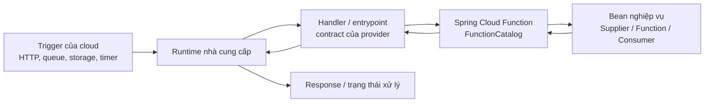
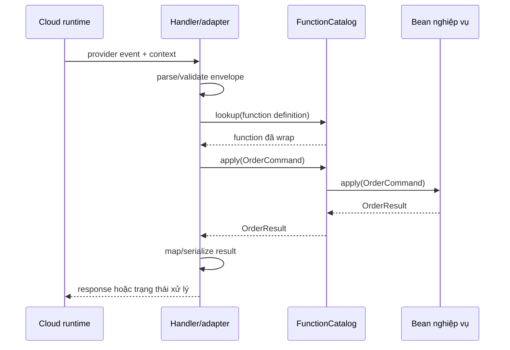
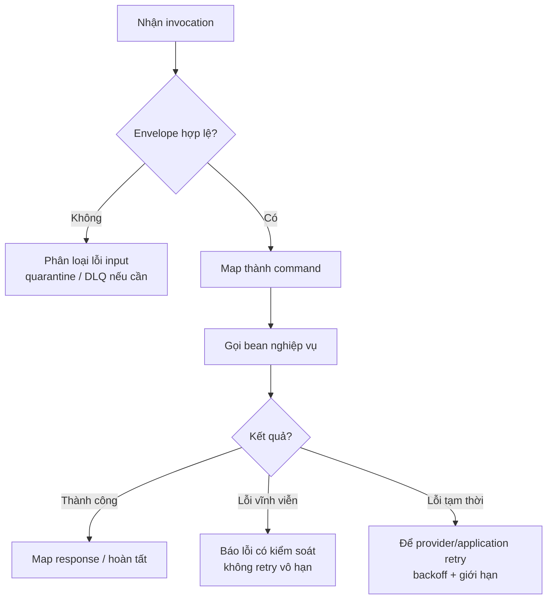

# Phân biệt hàm tiếp nhận của nền tảng (handler) với bean nghiệp vụ

> **Chương:** Serverless  
> **Module:** SPRING_CLOUD_FUNCTION  
> **Mục tiêu:** Phân biệt rõ **handler do nền tảng serverless gọi** với **bean `Supplier`/`Function`/`Consumer` do Spring quản lý**; thiết kế ranh giới giữa event, `FunctionCatalog` và logic nghiệp vụ sao cho có thể tái sử dụng qua HTTP, sự kiện hoặc môi trường serverless.  
> **Mốc tham khảo:** 24/11/2026. Ví dụ nền tảng dùng Java 21, Spring Boot 4.2.0, Spring Cloud release train 2026.0.0 (Spring Cloud Function 5.1.0). Tính tương thích của SDK, plugin và Java runtime đích phải được kiểm tra lại trước khi deploy.

## 1. Hai khái niệm thường bị gọi chung là “function”

Khi làm serverless với Spring Cloud Function, từ **function** xuất hiện ở hai tầng khác nhau:

- **Cloud function:** tài nguyên được triển khai trên AWS Lambda, Azure Functions hoặc Google Cloud Functions. Nhà cung cấp điều khiển thời điểm gọi, runtime, trigger, giới hạn thời gian, quyền truy cập và định dạng sự kiện.
- **Java/Spring function:** một đối tượng Java cài đặt `java.util.function.Function<T,R>`, `Supplier<T>` hoặc `Consumer<T>`, thường được đăng ký bằng `@Bean` trong Spring. Nó chứa quy tắc nghiệp vụ, ví dụ chuẩn hóa mã đơn hàng.

Giữa hai tầng còn có **handler/entrypoint**: điểm vào có chữ ký, annotation hoặc tên class mà runtime của nhà cung cấp biết cách gọi.

Ví dụ, một Lambda nhận JSON có mã đơn hàng và trả kết quả chuẩn hóa. Mã nghiệp vụ có thể chỉ là:

```java
@Bean
public Function<String, String> normalizeCode() {
    return raw -> raw.trim().toUpperCase(Locale.ROOT);
}
```

Nhưng AWS Lambda không “nhìn thấy” tên bean Java này như một handler độc lập theo mặc định. Runtime Lambda cần một **entry handler**, chẳng hạn `org.springframework.cloud.function.adapter.aws.FunctionInvoker::handleRequest` của Spring Cloud Function AWS adapter. Handler tiếp nhận invocation rồi đưa vào function được chọn trong catalog.

### 1.1. Sơ đồ trách nhiệm



Nhiều ứng dụng chỉ cần **generic handler** do adapter cung cấp; ứng dụng Azure với annotated handler lại có thể viết một lớp handler rất mỏng để gọi bean. Cả hai vẫn giữ nguyên tư tưởng: **handler xử lý biên giao thức; bean xử lý nghiệp vụ**.

### 1.2. Kết quả học tập

Sau bài này, bạn có thể:

1. Phát biểu sự khác nhau giữa Java `Function.apply(...)` và method handler được cloud runtime gọi.
2. Chỉ ra đúng vị trí xử lý **event envelope, runtime context, payload conversion, business validation và response mapping**.
3. Đăng ký bean `Function<OrderCommand,OrderResult>` độc lập với AWS/Azure/GCP.
4. Gọi bean qua `FunctionCatalog` từ một lớp cầu nối (*handler bridge*) để học luồng xử lý.
5. Giải thích khi nào AWS có thể dùng `FunctionInvoker`, khi nào Azure cần `@FunctionName`, khi nào GCP dùng `GcfJarLauncher`.
6. Phân biệt lỗi nghiệp vụ với lỗi runtime, packaging, routing và chuyển đổi thông điệp.
7. Thiết kế kiểm thử tách lớp trước khi deploy lên provider thật.

## 2. Handler là gì? Bean nghiệp vụ là gì?

### 2.1. Handler thuộc hợp đồng runtime

**Handler** là điểm vào được runtime khám phá và gọi khi xảy ra một trigger. Nó phải tuân thủ yêu cầu của nền tảng, có thể bao gồm:

- Tên class/method hoặc tên entrypoint được khai báo lúc triển khai.
- Chữ ký tham số cho event, context hoặc request/response.
- Annotation để mô tả trigger/binding.
- Cách trả giá trị, báo lỗi và hoàn tất invocation.
- Quy định đóng gói, plugin build, Java runtime và classpath.

Handler có thể là **mã adapter có sẵn** (AWS `FunctionInvoker`) hoặc **một method bạn khai báo** (Azure `@FunctionName`). Việc handler được gọi **không có nghĩa** bên trong phải chứa quy tắc nghiệp vụ.

### 2.2. Bean nghiệp vụ thuộc mô hình Spring

Bean nghiệp vụ là đối tượng được đăng ký trong `ApplicationContext`, ví dụ:

```java
@Bean
public Function<OrderCommand, OrderResult> normalizeOrder() {
    return input -> new OrderResult(
            input.eventId(), normalize(input.code()));
}
```

Bean này:

- Được Spring tạo và quản lý theo lifecycle/scope của Spring.
- Nhận kiểu Java do ứng dụng quyết định.
- Có thể unit test bằng `apply(...)` mà không cần cloud runtime.
- Có thể được tra cứu qua `FunctionCatalog.lookup("normalizeOrder")`.
- Có thể được adapter HTTP, broker hoặc serverless sử dụng nếu input/output được ánh xạ đúng.

Nó **không** tự khai báo Lambda trigger, Azure queue binding, IAM permissions hay Google Cloud entrypoint.

### 2.3. Bảng so sánh theo từng chiều

| Tiêu chí | Handler/entrypoint nền tảng | Bean nghiệp vụ Spring Cloud Function |
| --- | --- | --- |
| Ai gọi? | Runtime của AWS/Azure/GCP theo trigger. | Handler, adapter, `FunctionCatalog` hoặc code Spring. |
| Ai sở hữu contract? | Nhà cung cấp cloud và adapter tương ứng. | Ứng dụng Java: `Supplier`, `Function`, `Consumer`. |
| Input thường thấy | Event envelope, request, runtime context, headers. | Kiểu domain như `OrderCommand` hoặc `String`. |
| Output | Response/ack/status theo contract nền tảng. | `R` của `Function<T,R>`; không trả giá trị với `Consumer`. |
| Nơi khai báo | Handler class, annotation, entrypoint trong deployment. | `@Bean`, component hoặc functional bean registration. |
| Có bắt buộc dùng SDK provider? | Thường có ở handler viết tay; generic adapter có thể che phần này. | Không, nếu domain được thiết kế độc lập. |
| Có thể dùng lại trên provider khác? | Thường phải thay hoặc cấu hình lại. | Thường giữ nguyên nếu contract dữ liệu phù hợp. |
| Cách unit test | Fixture event và contract handler/adapter. | Gọi trực tiếp `apply` hoặc test domain. |
| Cách integration test | Emulator/provider runtime và artifact đã đóng gói. | `@SpringBootTest` cùng `FunctionCatalog`. |
| Nhiệm vụ kiểm soát retry | Phối hợp với contract event source. | Nghiệp vụ phải chịu được retry và side effect trùng. |

**Quy tắc thiết kế:** Nếu thay Azure bằng AWS mà phải sửa thuật toán tính tiền/chuẩn hóa mã, nhiều khả năng bạn đã để chi tiết provider lọt quá sâu vào logic nghiệp vụ.

## 3. Ví dụ xuyên suốt: chuẩn hóa mã đơn hàng

Ta chọn hợp đồng domain đơn giản: nhận mã chưa chuẩn hóa và event ID, trả mã chuẩn hóa. Quy tắc:

1. Từ chối code `null` hoặc rỗng.
2. Xóa khoảng trắng hai đầu.
3. Viết hoa bằng `Locale.ROOT` để không phụ thuộc locale của runtime.
4. Kiểm tra định dạng `AA-999` (hai chữ cái A–Z, dấu gạch ngang và ba chữ số).
5. Trả lại event ID cùng kết quả.

Ví dụ:

| Đầu vào | Kết quả nghiệp vụ |
| --- | --- |
| `eventId="evt-42", code="  od-123 "` | `eventId="evt-42", normalizedCode="OD-123"` |
| `eventId="evt-43", code=" ab-12 "` | `IllegalArgumentException`: sai định dạng |
| `eventId="evt-44", code=""` | `IllegalArgumentException`: mã rỗng |

**Event ID** được đưa vào domain command trong ví dụ để phục vụ tương quan. Trong dự án thật, nên phân biệt event ID, request ID của runtime và idempotency key; không nhất thiết chúng là một.

### 3.1. Payload nghiệp vụ không phải toàn bộ event

Một input gửi trực tiếp cho function có thể là:

```json
{
  "eventId": "evt-42",
  "code": "  od-123 "
}
```

Nhưng một nguồn sự kiện khác có thể dùng envelope:

```json
{
  "id": "evt-42",
  "source": "orders.created",
  "attributes": {
    "correlationId": "corr-7"
  },
  "payload": {
    "code": "  od-123 "
  }
}
```

JSON thứ hai là **định dạng minh họa do bài học tự định nghĩa**, không phải sự kiện chuẩn của AWS, Azure hay GCP. Một adapter/boundary mapping cần chuyển envelope thành `OrderCommand("evt-42", "  od-123 ")` trước khi gọi nghiệp vụ.

Không giả định `FunctionCatalog` hoặc JSON converter tự biết trường `payload.code` nào là nghiệp vụ. Chúng chỉ làm việc được khi **chữ ký, converter, metadata và schema** phù hợp.

## 4. Viết bean nghiệp vụ hoàn toàn độc lập provider

Tạo `src/main/java/vn/example/handler/OrderFunctionApplication.java`:

```java
package vn.example.handler;

import java.util.Locale;
import java.util.function.Function;

import org.springframework.boot.SpringApplication;
import org.springframework.boot.autoconfigure.SpringBootApplication;
import org.springframework.context.annotation.Bean;

@SpringBootApplication
public class OrderFunctionApplication {

    public static void main(String[] args) {
        SpringApplication.run(OrderFunctionApplication.class, args);
    }

    // Hai record là kiểu nghiệp vụ, không phải AWS/Azure/GCP event.
    public record OrderCommand(String eventId, String code) {}
    public record OrderResult(String eventId, String normalizedCode) {}

    private static String normalize(String raw) {
        if (raw == null || raw.isBlank()) {
            throw new IllegalArgumentException("Mã đơn hàng không được rỗng");
        }

        String code = raw.trim().toUpperCase(Locale.ROOT);
        if (!code.matches("[A-Z]{2}-[0-9]{3}")) {
            throw new IllegalArgumentException(
                    "Mã đơn hàng phải có dạng AA-999: " + code);
        }

        return code;
    }

    @Bean
    public Function<OrderCommand, OrderResult> normalizeOrder() {
        return input -> {
            if (input == null) {
                throw new IllegalArgumentException("Thiếu OrderCommand");
            }

            return new OrderResult(
                    input.eventId(),
                    normalize(input.code()));
        };
    }

    @Bean
    public Function<String, String> normalizeCode() {
        return OrderFunctionApplication::normalize;
    }
}
```

Ở đây có **hai bean nghiệp vụ**:

- `normalizeOrder` dùng DTO trung lập, phù hợp với event được mapping thành command.
- `normalizeCode` nhận/trả String, tiện dùng với handler HTTP hoặc direct invocation có payload chuỗi.

Hai bean dùng cùng phương thức `normalize(...)` nên quy tắc không bị nhân bản trong các handler cloud.

### 4.1. Vì sao `@Bean` không phải handler?

`@Bean` chỉ khiến Spring đăng ký đối tượng. Khi Spring khởi động, nó gọi `normalizeOrder()` để lấy một lambda; khi có input thực, tầng gọi mới chạy `apply(...)`.

Không có annotation nào trong ví dụ tạo một Azure trigger hay cho AWS biết entry method cần gọi. Để chạy serverless, cần adapter và cấu hình deployment riêng.

### 4.2. Đừng cho `Context` của provider vào domain nếu không cần

Không viết:

```java
// Tránh: domain bị buộc vào AWS Lambda runtime.
Function<SomeAwsEvent, SomeAwsResponse> normalizeOrder = event -> {
    // Ở đây còn phải hiểu SQS/S3/API Gateway envelope...
    return ...;
};
```

Đây là **pseudo-code minh họa anti-pattern**, không có các class `SomeAwsEvent`/`SomeAwsResponse` trong JDK. Có trường hợp nhận provider event ngay trong function là lựa chọn hợp lý (ví dụ cần thao tác batch response SQS), nhưng hãy chọn có chủ ý thay vì lẫn lộn contract cloud và nghiệp vụ.

## 5. Maven tối thiểu để test bean và catalog

Một project học tập có thể kiểm chứng **lõi Spring Cloud Function mà không deploy cloud**. Ví dụ Maven với bộ tương thích tại mốc tham khảo:

```xml
<?xml version="1.0" encoding="UTF-8"?>
<project xmlns="http://maven.apache.org/POM/4.0.0"
         xmlns:xsi="http://www.w3.org/2001/XMLSchema-instance"
         xsi:schemaLocation="
             http://maven.apache.org/POM/4.0.0
             https://maven.apache.org/xsd/maven-4.0.0.xsd">
    <modelVersion>4.0.0</modelVersion>

    <parent>
        <groupId>org.springframework.boot</groupId>
        <artifactId>spring-boot-starter-parent</artifactId>
        <version>4.2.0</version>
        <relativePath/>
    </parent>

    <groupId>vn.example</groupId>
    <artifactId>handler-vs-business-demo</artifactId>
    <version>0.0.1-SNAPSHOT</version>

    <properties>
        <java.version>21</java.version>
        <spring-cloud.version>2026.0.0</spring-cloud.version>
    </properties>

    <dependencyManagement>
        <dependencies>
            <dependency>
                <groupId>org.springframework.cloud</groupId>
                <artifactId>spring-cloud-dependencies</artifactId>
                <version>${spring-cloud.version}</version>
                <type>pom</type>
                <scope>import</scope>
            </dependency>
        </dependencies>
    </dependencyManagement>

    <dependencies>
        <dependency>
            <groupId>org.springframework.boot</groupId>
            <artifactId>spring-boot-starter</artifactId>
        </dependency>
        <dependency>
            <groupId>org.springframework.cloud</groupId>
            <artifactId>spring-cloud-function-context</artifactId>
        </dependency>
        <dependency>
            <groupId>org.springframework.boot</groupId>
            <artifactId>spring-boot-starter-test</artifactId>
            <scope>test</scope>
        </dependency>
    </dependencies>

    <build>
        <plugins>
            <plugin>
                <groupId>org.springframework.boot</groupId>
                <artifactId>spring-boot-maven-plugin</artifactId>
            </plugin>
        </plugins>
    </build>
</project>
```

**Phân biệt các dependency:**

- Spring Boot starter tạo nền application.
- `spring-cloud-function-context` cung cấp `FunctionCatalog` và tích hợp functional bean.
- `spring-cloud-dependencies` chỉ quản lý **version**, không tự thêm Function vào classpath.
- `spring-boot-starter-test` phục vụ kiểm thử.
- Chưa có `spring-cloud-starter-function-web`, Kafka binder hoặc AWS/Azure/GCP adapter, nên **chưa có HTTP endpoint/cloud handler**.

Tài liệu Java yêu cầu tối thiểu và cặp Boot–Cloud thay đổi qua các lần phát hành. Trước khi dùng trong hệ thống thật, kiểm tra ma trận tại https://spring.io/projects/spring-cloud/ và vòng đời hỗ trợ của từng bản.

### 5.1. Cấu trúc source

```text
handler-vs-business-demo/
├── pom.xml
└── src/
    ├── main/
    │   └── java/
    │       └── vn/example/handler/
    │           ├── OrderFunctionApplication.java
    │           └── HandlerBridge.java
    └── test/
        └── java/
            └── vn/example/handler/
                └── HandlerBridgeTest.java
```

Trong ví dụ này, `OrderCommand` và `OrderResult` là nested records bên trong `OrderFunctionApplication`. Nếu chuyển sang hai public records top-level, phải đặt chúng trong hai file Java riêng theo quy tắc ngôn ngữ.

## 6. Tạo một “handler bridge” để hiểu ranh giới

Để tách rõ handler với nghiệp vụ mà không cần SDK cloud, ta tạo một lớp **mô phỏng phần adapter**. Nó nhận envelope giả định, tạo command, gọi `FunctionCatalog` và dựng response. Đây là lớp của ứng dụng phục vụ học tập, **không phải** AWS Lambda handler hay Azure/GCP entrypoint có thể deploy trực tiếp.

### 6.1. Mã `HandlerBridge.java`

```java
package vn.example.handler;

import java.util.function.Function;

import org.springframework.cloud.function.context.FunctionCatalog;
import org.springframework.stereotype.Component;

import vn.example.handler.OrderFunctionApplication.OrderCommand;
import vn.example.handler.OrderFunctionApplication.OrderResult;

@Component
public class HandlerBridge {

    // Fixture của bài học, không phải định dạng event của provider.
    public record IncomingEvent(
            String id,
            String source,
            String body,
            String correlationId) {}

    public record OutgoingEvent(
            String id,
            String normalizedCode,
            String correlationId) {}

    private final Function<OrderCommand, OrderResult> businessFunction;

    public HandlerBridge(FunctionCatalog catalog) {
        this.businessFunction = catalog.lookup("normalizeOrder");
        if (this.businessFunction == null) {
            throw new IllegalStateException(
                    "Không tìm thấy function normalizeOrder");
        }
    }

    public OutgoingEvent handle(IncomingEvent event) {
        if (event == null || event.id() == null ||
                event.id().isBlank()) {
            throw new IllegalArgumentException("Thiếu event ID");
        }

        // Lớp biên biết event envelope.
        OrderCommand command =
                new OrderCommand(event.id(), event.body());

        // Bean nghiệp vụ chỉ biết OrderCommand.
        OrderResult result = businessFunction.apply(command);

        // Lớp biên ánh xạ domain result về contract bên ngoài.
        return new OutgoingEvent(
                result.eventId(),
                result.normalizedCode(),
                event.correlationId());
    }
}
```

### 6.2. Ai chịu trách nhiệm ở từng dòng?

| Thành phần | Chức năng | Lý do đặt tại đây |
| --- | --- | --- |
| `IncomingEvent` | Mô tả envelope mà boundary nhận. | Chỉ lớp bên ngoài cần biết event source và correlation ID. |
| Kiểm tra `event.id()` | Kiểm tra metadata tối thiểu. | Lỗi thiếu ID cần phát hiện trước khi gọi domain. |
| Tạo `OrderCommand` | Chuyển external contract sang domain contract. | Domain không cần parse provider envelope. |
| `catalog.lookup("normalizeOrder")` | Tìm function đã đăng ký. | Kết nối Spring Cloud Function với bên gọi. |
| `businessFunction.apply(command)` | Chạy nghiệp vụ. | Chữ ký và logic không phụ thuộc cloud. |
| Tạo `OutgoingEvent` | Chuyển kết quả/metadata về contract ngoài. | Response thuộc adapter hoặc integration boundary. |

**Điểm học thuật:** method `handle(...)` của `HandlerBridge` vẫn là **mã Java thông thường**, không phải entrypoint của AWS/Azure/GCP. Nó chỉ mô phỏng những việc mà handler/adapter thật cần thực hiện. Khi chuyển sang provider, bạn sẽ thay lớp nhận sự kiện và response mapping; `normalizeOrder` có thể giữ nguyên.

### 6.3. Phân biệt event ID, request ID, correlation ID

- **Event ID** nhận diện một sự kiện trong hệ thống nghiệp vụ.
- **Request/invocation ID** thường do provider tạo cho từng lần thực thi.
- **Correlation ID** nối nhiều bước trong một giao dịch/trace.

Khi retry, cùng event có thể đi qua **nhiều invocation ID**. Nếu dùng invocation ID làm idempotency key, bạn có thể bỏ sót trường hợp giao lại cùng business event. Với tác vụ có side effect, cần chọn khóa ổn định theo operation/event thực tế.

## 7. Kiểm thử riêng bean, catalog và handler bridge

### 7.1. Unit test bean không cần Spring

```java
package vn.example.handler;

import static org.junit.jupiter.api.Assertions.assertEquals;
import static org.junit.jupiter.api.Assertions.assertThrows;

import org.junit.jupiter.api.Test;

import vn.example.handler.OrderFunctionApplication.OrderCommand;

class PureBusinessTest {

    @Test
    void normalizesCommand() {
        var function = new OrderFunctionApplication().normalizeOrder();

        var result = function.apply(
                new OrderCommand("evt-42", "  od-123 "));

        assertEquals("evt-42", result.eventId());
        assertEquals("OD-123", result.normalizedCode());
    }

    @Test
    void rejectsWrongFormat() {
        var function = new OrderFunctionApplication().normalizeOrder();

        assertThrows(IllegalArgumentException.class,
                () -> function.apply(
                        new OrderCommand("evt-43", "ab-12")));
    }
}
```

Kết quả này chứng minh thuật toán domain hoạt động, nhưng chưa chứng minh Spring đã đăng ký bean hoặc handler mapping đúng.

### 7.2. Integration test Spring và handler bridge

Tạo `src/test/java/vn/example/handler/HandlerBridgeTest.java`:

```java
package vn.example.handler;

import static org.junit.jupiter.api.Assertions.assertEquals;
import static org.junit.jupiter.api.Assertions.assertNotNull;
import static org.junit.jupiter.api.Assertions.assertThrows;

import java.util.function.Function;

import org.junit.jupiter.api.Test;
import org.springframework.beans.factory.annotation.Autowired;
import org.springframework.boot.test.context.SpringBootTest;
import org.springframework.cloud.function.context.FunctionCatalog;

import vn.example.handler.OrderFunctionApplication.OrderCommand;
import vn.example.handler.OrderFunctionApplication.OrderResult;

@SpringBootTest
class HandlerBridgeTest {

    @Autowired
    FunctionCatalog catalog;

    @Autowired
    HandlerBridge bridge;

    @Test
    void catalogFindsBusinessBean() {
        Function<OrderCommand, OrderResult> function =
                catalog.lookup("normalizeOrder");

        assertNotNull(function);
        assertEquals(
                "OD-123",
                function.apply(
                        new OrderCommand("evt-42", " od-123 "))
                        .normalizedCode());
    }

    @Test
    void bridgeMapsEventAndResponse() {
        var event = new HandlerBridge.IncomingEvent(
                "evt-42",
                "orders.created",
                "  od-123 ",
                "corr-7");

        var response = bridge.handle(event);

        assertEquals("evt-42", response.id());
        assertEquals("OD-123", response.normalizedCode());
        assertEquals("corr-7", response.correlationId());
    }

    @Test
    void bridgeRejectsMissingEventId() {
        var event = new HandlerBridge.IncomingEvent(
                null, "orders.created", "od-123", "corr-7");

        assertThrows(IllegalArgumentException.class,
                () -> bridge.handle(event));
    }
}
```

Chạy kiểm thử bằng Maven (nếu project có wrapper thì dùng `./mvnw`):

```bash
mvn clean test
```

**Không đánh đồng các mức xác minh:** test catalog và `HandlerBridge` không chứng minh artifact đã được build đúng cho AWS Lambda, annotation Azure đã sinh binding, hay GCP runtime tìm được entrypoint. Đây là bước xác nhận lõi Java/Spring trước khi làm provider-specific test.

### 7.3. Ma trận kiểm thử

| Kiểm thử | Có cần cloud SDK? | Xác nhận điều gì? |
| --- | --- | --- |
| Unit test `normalizeOrder` | Không | Business rule và exception. |
| `@SpringBootTest` + catalog | Không | Bean registration và `FunctionCatalog`. |
| Test `HandlerBridge` | Không | Mapping fixture event → domain → response. |
| AWS/Azure/GCP handler test | Có thể | Type sự kiện thật, runtime/SDK behavior. |
| Chạy local provider runtime | Thường có | Entry point, trigger, serialization, package. |
| Integration test trên cloud | Có | IAM, network, retry, timeout, event source và observability. |

## 8. AWS Lambda: handler chung có sẵn, bean vẫn là của ứng dụng

### 8.1. Cấu hình handler và dependency

Spring Cloud Function cung cấp adapter:

```xml
<dependency>
    <groupId>org.springframework.cloud</groupId>
    <artifactId>spring-cloud-function-adapter-aws</artifactId>
</dependency>
```

Với AWS Lambda, tài liệu Spring khuyến nghị generic handler:

```text
org.springframework.cloud.function.adapter.aws.FunctionInvoker::handleRequest
```

**Đây là handler AWS**, không phải tên bean `normalizeOrder` hoặc `normalizeCode`. `FunctionInvoker` thực hiện kết nối với Lambda runtime, khởi tạo/tìm Spring application context và gọi function qua cơ chế catalog.

Còn các bean `@Bean` của ứng dụng giữ nguyên trong `OrderFunctionApplication`. Bạn không phải viết một class `NormalizeCodeLambdaHandler` chỉ để chuyển tiếp tới `normalizeCode` nếu generic `FunctionInvoker` đã đáp ứng contract của nguồn event.

### 8.2. Cấu hình chọn bean

Vì ví dụ có hai bean, cần nói rõ function nào được gọi:

```properties
spring.cloud.function.definition=normalizeCode
```

Hoặc cấu hình biến môi trường trong deployment (theo quy tắc Spring Boot):

```text
SPRING_CLOUD_FUNCTION_DEFINITION=normalizeCode
```

Khi đó AWS handler vẫn là `FunctionInvoker::handleRequest`; thay definition chỉ đổi **bean được chọn**, không đổi entrypoint runtime.

Với một Lambda khác muốn nhận DTO:

```properties
spring.cloud.function.definition=normalizeOrder
```

Input của Lambda phải được chuyển thành `OrderCommand` theo converter và JSON/event contract đã triển khai. Nếu event là SQS hoặc S3 envelope, không mặc định toàn bộ envelope đó khớp DTO. Cần xử lý mapping hoặc chọn provider event type phù hợp.

### 8.3. Vì sao không đặt tên bean làm AWS handler?

Nếu người triển khai nhập `normalizeOrder` vào trường Handler của AWS Lambda, runtime không biết đó là một class/method có hợp đồng AWS. Tên bean chỉ có ý nghĩa **sau khi Spring context đã khởi tạo** và được `FunctionCatalog` đăng ký.

Sự khác nhau là:

```text
AWS deployment configuration:
  Handler = org.springframework.cloud.function.adapter.aws.FunctionInvoker::handleRequest

Spring application/runtime configuration:
  spring.cloud.function.definition = normalizeOrder
```

Dòng đầu chọn **điểm vào runtime**; dòng thứ hai chọn **logic nghiệp vụ**.

### 8.4. Handler có thể phải biết provider event ở tình huống chuyên biệt

Ví dụ SQS có thể gửi một batch với nhiều `Records`. Nếu yêu cầu partial batch failure response, cần dùng đúng contract `SQSEvent`/`SQSBatchResponse` hoặc lớp mapping tương đương theo AWS. Một bean thuần `Function<OrderCommand,OrderResult>` không tự quyết định cách xác nhận record thất bại hay trả batch response.

Nếu bạn cần provider context sâu hơn (request ID, remaining time, stream records), có thể dùng các cơ chế adapter phù hợp hoặc viết handler chuyên dụng. Nhưng **đừng kéo SDK AWS vào thuật toán nghiệp vụ chỉ vì handler nhận event AWS**.

### 8.5. Đóng gói không giống Boot JAR thông thường

Một JAR chạy bằng `java -jar` trên VM chưa chắc đáp ứng layout của Lambda. Cần kiểm tra:

1. Artifact đã được đóng gói theo hướng dẫn AWS adapter (thường là JAR dành riêng cho AWS với cấu hình Maven Shade/Gradle tương ứng).
2. Lambda Java runtime phù hợp với bytecode Java 21.
3. Handler đúng `FunctionInvoker::handleRequest`.
4. `spring.cloud.function.definition` chọn đúng bean khi có nhiều function.
5. Sự kiện thực và serializer/converter khớp kiểu đầu vào.
6. IAM permissions, timeout, memory, event source mapping và log đã được cấu hình.

Tài liệu: https://docs.spring.io/spring-cloud-function/reference/adapters/aws-intro.html

## 9. Azure Functions: method `@FunctionName` là handler, bean nằm sau nó

### 9.1. Azure nhận diện handler bằng annotation và binding

Khác AWS generic `FunctionInvoker`, mô hình Azure Java thường khai báo method được đánh dấu `@FunctionName` kèm trigger như `@HttpTrigger`, `@QueueTrigger` hoặc `@BlobTrigger`. Azure Functions build plugin quét annotation và sinh các file binding/packaging tương ứng.

Spring Cloud Function hỗ trợ `spring-cloud-function-adapter-azure`, cho phép Spring quản lý class handler như một `@Component`, inject bean hoặc `FunctionCatalog` và gọi các hàm nghiệp vụ ở phía sau.

### 9.2. Handler Azure HTTP minh họa

Trong một **project Azure Functions Java được cấu hình đầy đủ với SDK, Azure plugin và Spring adapter**, một handler có thể có dạng:

```java
package vn.example.handler;

import java.util.Optional;
import java.util.function.Function;

import com.microsoft.azure.functions.AuthorizationLevel;
import com.microsoft.azure.functions.ExecutionContext;
import com.microsoft.azure.functions.HttpMethod;
import com.microsoft.azure.functions.HttpRequestMessage;
import com.microsoft.azure.functions.annotation.FunctionName;
import com.microsoft.azure.functions.annotation.HttpTrigger;

import org.springframework.cloud.function.context.FunctionCatalog;
import org.springframework.stereotype.Component;

@Component
public class NormalizeAzureHandler {

    private final Function<String, String> normalizeCode;

    public NormalizeAzureHandler(FunctionCatalog catalog) {
        this.normalizeCode = catalog.lookup("normalizeCode");
        if (this.normalizeCode == null) {
            throw new IllegalStateException(
                    "Không tìm thấy bean normalizeCode");
        }
    }

    @FunctionName("normalizeCodeHttp")
    public String run(
            @HttpTrigger(
                name = "req",
                methods = {HttpMethod.POST},
                authLevel = AuthorizationLevel.FUNCTION)
            HttpRequestMessage<Optional<String>> request,
            ExecutionContext context) {

        String body = request.getBody().orElseThrow(
                () -> new IllegalArgumentException("Thiếu request body"));

        return normalizeCode.apply(body);
    }
}
```

Trong ví dụ này có **ba tên khác nhau**:

| Tên | Thuộc tầng nào? | Tác dụng |
| --- | --- | --- |
| `normalizeCodeHttp` | Azure `@FunctionName` | Azure nhận diện function được deploy. |
| `run` | Method Java của class handler | Azure worker gọi method theo binding. |
| `normalizeCode` | Bean Spring Cloud Function | `FunctionCatalog` tra cứu logic nghiệp vụ. |

Đổi tên bean thành `canonicalCode` không tự đổi tên Azure function. Ngược lại, đổi `@FunctionName("normalizeCodeHttp")` không tự đổi tên bean trong catalog.

**Giới hạn của snippet:** đây là ví dụ minh họa cách viết handler Azure, không phải project deploy được chỉ với file Java này. Cần dependency Azure Java SDK và adapter, plugin tạo binding, host configuration, Java worker/runtime cùng cấu hình xác thực/HTTP response phù hợp.

### 9.3. Tại sao inject `FunctionCatalog` thay vì bean thẳng?

Bạn có thể inject trực tiếp `Function<String,String>` nếu biết chính xác bean cần gọi, như một Spring component thông thường. Tuy nhiên, `FunctionCatalog` hỗ trợ cơ chế Spring Cloud Function như:

- Lookup bằng bean name.
- Composition qua `lookup("normalizeCode|validateCode")` khi có nhiều bean tương thích.
- Conversion/wrapping theo chữ ký và kiểu message được framework hỗ trợ.

Ví dụ handler có thể dùng:

```java
Function<String, String> pipeline =
        catalog.lookup("normalizeCode|validateCode");
```

Nhưng khi đầu vào là `HttpRequestMessage<Optional<String>>`, **handler vẫn phải lấy/kiểm tra body** trước khi gọi catalog. `FunctionCatalog` không tự thay thế Azure trigger annotation.

### 9.4. Azure Web adapter là cách triển khai khác

`spring-cloud-function-adapter-azure-web` hỗ trợ đem mô hình Spring Web lên Azure HTTP trigger và che bớt sự phức tạp của annotation handler. Không nhầm việc “không tự viết một handler annotated method” với việc “không có handler”: Azure runtime vẫn có một điểm vào do adapter cung cấp ở tầng tích hợp.

Tài liệu: https://docs.spring.io/spring-cloud-function/reference/adapters/azure-intro.html

## 10. Google Cloud Functions: entrypoint không phải bean name

### 10.1. Adapter và launcher

Spring Cloud Function cung cấp `spring-cloud-function-adapter-gcp`. Theo tài liệu GCP adapter, entrypoint dùng cho ứng dụng Spring Cloud Function được cấu hình là:

```text
org.springframework.cloud.function.adapter.gcp.GcfJarLauncher
```

`GcfJarLauncher` là **entrypoint nối Functions Framework với Spring Cloud Function**. Nó không phải tên của bean `normalizeOrder`. Bean vẫn nằm trong Spring context và được chọn qua định nghĩa/cơ chế catalog.

### 10.2. Phân biệt ba lớp cấu hình

```text
Google Cloud deployment:
  entry point / target = GcfJarLauncher

Spring Cloud Function configuration:
  spring.cloud.function.definition = normalizeCode

Application business logic:
  @Bean Function<String, String> normalizeCode()
```

Nếu entrypoint sai, Functions Framework không gọi được ứng dụng đúng cách. Nếu entrypoint đúng nhưng definition không khớp bean, runtime có thể khởi động rồi lỗi khi gọi. Nếu cả hai đúng nhưng input là Pub/Sub event envelope khác String, cần chuyển đổi sự kiện.

### 10.3. Không sao chép runtime của ví dụ cũ

Một số tài liệu GCP cũ minh họa lệnh deploy với Java 11 hoặc mô hình background function thế hệ trước. Tại thời điểm triển khai, phải kiểm tra **runtime Java hiện đang được GCP hỗ trợ**, thế hệ Cloud Functions/Cloud Run functions, trigger type, Functions Framework và cách đóng gói adapter. Không lấy số runtime từ một sample lịch sử mà mặc định còn hợp lệ.

Tài liệu: https://docs.spring.io/spring-cloud-function/reference/adapters/gcp-intro.html

## 11. Vì sao chữ ký handler và chữ ký bean không cần giống nhau?

### 11.1. Handler nhận “đồ của nền tảng”; bean nhận “đồ của nghiệp vụ”

Một handler Azure có thể nhận:

```java
HttpRequestMessage<Optional<String>> request,
ExecutionContext context
```

Nhưng bean nghiệp vụ có thể là:

```java
Function<String, String> normalizeCode
```

Một AWS Lambda adapter có thể nhận `InputStream`, `OutputStream` và `Context` ở entrypoint, nhưng function ứng dụng là `Function<OrderCommand,OrderResult>`. Sự khác biệt chính là **lớp biên chuyển dữ liệu và điều phối invocation**.



Sơ đồ thể hiện trách nhiệm, **không** khẳng định mọi runtime đều gọi lookup cho mỗi event: generic adapter có thể cache function/bean sau lúc khởi tạo.

### 11.2. Khi nào chữ ký bean nên nhận provider event?

Có thể có yêu cầu hợp lý:

- SQS batch với partial batch failure.
- Một event S3 cần thông tin bucket/key/version.
- Cloud Storage/Pub/Sub event có attributes/headers cần giữ nguyên.
- Handler cần provider-specific context cho logging hoặc deadline.

Khi đó, một `Function<SQSEvent,SQSBatchResponse>` ở tầng integration có thể là quyết định đúng. Tuy nhiên, vẫn nên đưa **thuật toán nghiệp vụ** vào lớp domain/use-case nhận DTO trung lập, để chỉ lớp adapter/integration phụ thuộc provider SDK.

Không phải cứ dùng một type của AWS là “sai”; điểm cần tránh là để **quy tắc kinh doanh cốt lõi** dính chặt SDK khi không cần thiết.

### 11.3. Khi nào dùng `Message<T>`?

Nếu cần giữ một phần metadata mà không đưa tất cả vào DTO, Spring Cloud Function có thể nhận `Message<T>`:

```java
@Bean
public Function<Message<String>, Message<String>> normalizeMessage() {
    return message -> MessageBuilder
            .withPayload(
                    message.getPayload().trim()
                            .toUpperCase(Locale.ROOT))
            .copyHeaders(message.getHeaders())
            .setHeader("normalized", true)
            .build();
}
```

Đoạn này là **bean bổ sung**, cần import `Message`, `MessageBuilder`, `Function` và `Locale` trong một Spring configuration class. Đây không phải yêu cầu cho ví dụ chính.

Điều cần nhớ: `MessageHeaders` của Spring không tự đồng nhất với AWS `Context`, Azure `ExecutionContext` hay HTTP headers. Adapter quyết định metadata nào được ánh xạ; không giả định mọi header sẽ được forward giữa các giao thức.

## 12. Ai xử lý JSON, content type, validation và lỗi?

### 12.1. Chuyển đổi JSON/event envelope

Với direct invocation có JSON khớp `OrderCommand`, converter phù hợp có thể tạo DTO dựa trên chữ ký `Function<OrderCommand,OrderResult>`. Nhưng nếu input là:

```json
{
  "Records": [
    {
      "messageId": "m-1",
      "body": "{\"eventId\":\"evt-42\",\"code\":\"od-123\"}"
    }
  ]
}
```

thì đây là **fixture minh họa hình dạng SQS**, không phải toàn bộ event schema AWS. Không thể giả định converter sẽ tự lấy `Records[0].body` rồi tạo `OrderCommand`. Lớp biên cần parse/mapping hoặc bean phải nhận đúng kiểu provider event.

`Content-Type` và kiểu generic của function giúp converter chọn đường chuyển đổi, nhưng không tự giải quyết quy tắc bóc envelope hoặc xác thực schema nghiệp vụ.

### 12.2. Validation nằm ở đâu?

| Kiểm tra | Nơi phù hợp |
| --- | --- |
| Event envelope có phần `body`/`Records` đúng dạng không? | Handler/adapter hoặc event parser. |
| Trigger được phép gọi từ nguồn này không? | IAM/identity/gateway/provider. |
| JSON có parse được thành DTO không? | Serializer/converter/boundary. |
| Mã đơn hàng có đúng mẫu `AA-999` không? | Bean nghiệp vụ/domain validation. |
| Có được phép tạo đơn hàng trong trạng thái hiện tại không? | Business use-case/authorization logic. |
| Response cần HTTP status/batch failure nào? | Handler/adapter phối hợp contract provider. |

Một handler “mỏng” không có nghĩa **không xử lý gì**. Nó vẫn phải làm đúng những điều cần thiết tại boundary và không nên đẩy mọi trách nhiệm transport vào domain function.

### 12.3. Lỗi Java và lỗi runtime không tương đương

Giả sử bean ném `IllegalArgumentException` vì mã sai. Khi gọi Java trực tiếp, test bắt exception. Nhưng ở runtime:

- **HTTP:** adapter/error layer quyết định HTTP status và body, không tự mặc định luôn 400.
- **Queue/event:** exception có thể khiến invocation thất bại và event được retry theo chính sách nguồn; cần xác định lỗi vĩnh viễn hay tạm thời.
- **Batch:** một record lỗi có thể ảnh hưởng cả batch nếu không hỗ trợ/trả đúng partial batch result.
- **Serverless timeout:** provider dừng/đánh dấu invocation khi vượt giới hạn, dù code đang chờ I/O.

Không nên “nuốt” mọi exception trong handler rồi trả thành công giả, vì có thể làm mất dữ liệu. Cũng không nên retry vô hạn với lỗi dữ liệu cố định: cần phân loại, giới hạn retry và có DLQ/quarantine khi phù hợp.

## 13. Handler, Spring context và vòng đời serverless

### 13.1. Cold start khác thời điểm gọi bean

Khi cloud runtime tạo execution environment mới, nó có thể phải:

1. Tải artifact và runtime Java.
2. Khởi tạo handler/adapter.
3. Tạo Spring `ApplicationContext`, đăng ký bean và xây dựng `FunctionCatalog`.
4. Resolve function theo definition.
5. Chuyển event đầu tiên và gọi `apply(...)`.

Những invocation tiếp theo có thể sử dụng lại environment khi provider cho phép. Tuy nhiên, **không có cam kết một instance tồn tại mãi**. Đừng lưu dữ liệu nghiệp vụ bắt buộc giữa các invocation trong biến static/singleton chỉ vì môi trường local giữ chúng.

### 13.2. Singleton bean và tính an toàn đồng thời

Bean `@Bean` mặc định được quản lý với singleton scope trong Spring context. Một handler/serverless runtime có thể tái sử dụng bean và có thể xử lý nhiều lời gọi theo mô hình đồng thời do provider quyết định. Vì vậy:

- Ưu tiên function **stateless** và dễ kiểm thử.
- Không giữ một `ArrayList` mutable như “bộ nhớ transaction” mà thiếu đồng bộ và persistence.
- Tái sử dụng HTTP/DB client khi phù hợp, tránh tạo kết nối mới trên mỗi event.
- Quản lý close/cleanup của resource theo lifecycle Spring khi có khả năng.
- Thiết kế side effect idempotent khi source có retry.

### 13.3. Tối ưu cold start không có nghĩa bỏ hết Spring

Tùy mục tiêu latency, có thể giảm dependency, dùng cơ chế khởi tạo phù hợp, cấu hình memory, tối ưu packaging hoặc cân nhắc native image khi adapter/runtime hỗ trợ. Nhưng đừng hy sinh ranh giới nghiệp vụ-handler chỉ để giảm một vài dòng code. Trước tiên hãy đo **cold** và **warm** invocation dưới tải và runtime thật.

## 14. Trùng event, retry và hoàn tất invocation

### 14.1. Handler không đảm bảo exactly-once

Một event từ queue có thể được giao lại nếu invocation timeout hoặc lỗi sau khi ghi dữ liệu thành công nhưng trước khi provider ghi nhận hoàn tất. Nếu bean `Consumer<OrderCommand>` tạo đơn hàng mà không bảo vệ trùng lặp, cùng business operation có thể chạy hai lần.

Một giải pháp thực tế là idempotency:

1. Chọn idempotency key ổn định theo business operation/event ID.
2. Lưu trạng thái đã xử lý trong DB với unique constraint/conditional write.
3. Gắn việc ghi dấu với side effect bằng transaction hoặc cơ chế có tính nhất quán thích hợp.
4. Đảm bảo retry không làm phát sinh tác dụng phụ trùng.

Handler có thể chuyển event ID vào domain, nhưng **quy tắc “đã xử lý chưa?” thường thuộc application/domain workflow và persistence**, không phải một biến boolean nằm trong handler.

### 14.2. Trạng thái kết thúc khác nhau giữa provider

| Nguồn | Điều cần biết khi báo thành công |
| --- | --- |
| HTTP đồng bộ | Response status/body gửi cho caller. |
| AWS Lambda direct invoke | Payload/error theo contract Lambda invocation. |
| SQS → Lambda | Thành công batch hoặc partial batch response theo event source mapping. |
| Azure queue/blob trigger | Kết quả handler và chính sách retry/dead-letter theo trigger. |
| Google Pub/Sub event | Semantics retry/ack của trigger và generation tương ứng. |

Không suy ra “Java `apply` trả được một String” nghĩa là message đã được xác nhận hay consumer side effect đúng exactly-once.

### 14.3. Sơ đồ xử lý lỗi



Đây là **sơ đồ chính sách thiết kế**, không phải behavior tự động của mọi adapter. Cần chọn cách báo lỗi/partial failure mà **runtime thật hiểu**.

## 15. Đóng gói: đúng bean vẫn chưa đủ để deploy

| Nền tảng | Entry handler/target | Những thứ còn phải cấu hình |
| --- | --- | --- |
| **AWS Lambda** | `FunctionInvoker::handleRequest` hoặc handler riêng theo contract AWS. | AWS adapter, artifact Lambda đúng layout, Java runtime, event source, IAM, timeout. |
| **Azure Functions** | Annotated method `@FunctionName` + trigger/binding hoặc Azure Web adapter. | Azure Java SDK/adapter, Maven/Gradle plugin, binding files, worker/runtime, auth. |
| **Google Cloud Functions** | `GcfJarLauncher` cho GCP Spring Cloud Function adapter. | GCP adapter, Functions Framework/packaging, entrypoint, trigger, runtime, IAM. |
| **Spring Boot HTTP thông thường** | Web adapter mapping URL từ function. | `spring-cloud-starter-function-web`, web server, port, security. |
| **Spring Cloud Stream** | Binder/functional binding theo function definition. | Broker, binder dependency, destination, content type, retry. |

Điểm chung: function nghiệp vụ có thể là một bean duy nhất được dùng lại, nhưng **adapter/handler và artifact** phải phù hợp với môi trường.

### 15.1. Checklist trước deployment

- [ ] Chọn Java, Spring Boot, Spring Cloud BOM và adapter tương thích.
- [ ] Chốt tên handler/entrypoint theo đúng tài liệu của provider.
- [ ] Chốt `spring.cloud.function.definition` khi ứng dụng có nhiều bean.
- [ ] Kiểm tra event schema và kiểu Java function.
- [ ] Đóng gói đúng layout/plugin theo provider, không chỉ chạy được `java -jar`.
- [ ] Cấu hình IAM/managed identity, trigger và quyền network tối thiểu.
- [ ] Kiểm thử payload hợp lệ, payload sai, exception, timeout, retry và batch.
- [ ] Xác định idempotency key, chính sách DLQ và observability.
- [ ] Chạy thử trên artifact thực cùng runtime đích.

### 15.2. Vì sao không thêm mọi adapter vào một JAR?

Mỗi adapter có classpath, SDK, cấu hình bootstrap và cách đóng gói riêng. Thêm AWS, Azure, GCP và Web adapter đồng thời mà không có lý do làm tăng độ phức tạp và rủi ro xung đột. Hãy tách **module chứa domain function** khỏi **module đóng gói cho từng provider** khi hệ thống cần hỗ trợ nhiều môi trường. Các package triển khai có thể khác nhau nhưng cùng tham chiếu đến logic Java dùng chung.

## 16. Lỗi thường gặp khi nhầm handler và bean

| Triệu chứng | Nhầm lẫn/nguồn lỗi có thể có | Hướng xử lý |
| --- | --- | --- |
| AWS báo handler not found | Đặt tên bean `normalizeOrder` làm AWS handler. | Dùng `FunctionInvoker::handleRequest` hoặc custom handler hợp lệ, kiểm tra packaging. |
| Azure runtime không tìm thấy function | Chỉ có `@Bean` nhưng thiếu `@FunctionName`/binding hoặc Azure Web adapter. | Tạo annotated handler/adapter đúng và chạy Azure packaging plugin. |
| GCP không gọi được | Đặt bean name thay cho entrypoint `GcfJarLauncher` hoặc sai artifact. | Kiểm tra function target, layout, runtime và trigger. |
| Spring context chạy nhưng lookup thất bại | Sai bean name, thiếu Function context hoặc definition trỏ sai. | Kiểm tra `@Bean`, BOM, `FunctionCatalog.lookup(...)` và logs. |
| Handler nhận SQS envelope nhưng bean đòi `OrderCommand` | Chưa có mapping cho `Records[].body`. | Parse/convert tại boundary hoặc thiết kế provider-specific adapter. |
| Input JSON có `code` nhưng `apply` nhận String sai giá trị | Converter/content type/schema không khớp. | Kiểm tra kiểu generic, request payload và converter. |
| Unit test domain đạt nhưng deploy lỗi | Chưa test handler, plugin, IAM, entrypoint hoặc runtime. | Kiểm thử thêm provider emulator và cloud integration. |
| Bean giữ dữ liệu giữa các lần gọi và mất dữ liệu | Phụ thuộc state trong singleton/static khi environment bị tái tạo. | Dùng storage bền vững, thiết kế stateless. |
| Xử lý lặp tạo hai bản ghi | Provider retry/giao lại event; không có idempotency. | Unique key/atomic write, retry/DLQ hợp lý. |
| Handler bắt mọi exception rồi trả success | Che giấu lỗi, mất cơ hội retry/quarantine. | Phân loại lỗi và báo theo contract của trigger. |
| `FunctionCatalog.lookup` trả function ngoài mong đợi | Single-function fallback hoặc definition chưa rõ. | Dùng tên chính xác; với nhiều bean, cấu hình definition; test catalog. |
| Đổi tên `@FunctionName` nhưng `lookup` vẫn không tìm bean | Azure function name khác Spring bean name. | Kiểm tra và sửa đúng tầng tên tương ứng. |

### 16.1. Quy trình debug theo tầng

1. **Domain:** gọi Java `Function.apply` trực tiếp với DTO.
2. **Spring:** dùng `@SpringBootTest` và `FunctionCatalog.lookup`.
3. **Boundary:** cho handler bridge hoặc adapter nhận event fixture thật.
4. **Runtime local:** chạy provider emulator/Functions Framework/Core Tools phù hợp.
5. **Cloud:** kiểm tra artifact, handler, logs, permissions, trigger, retry và metadata.

Nếu domain test đạt nhưng cloud không invoke, hãy kiểm tra **entrypoint và packaging** trước khi thay thuật toán nghiệp vụ.

## 17. Bài thực hành

### Bài 1 — Xác định tầng của từng tên

Cho cấu hình Azure:

```java
@FunctionName("normalizeCodeHttp")
public String run(
        @HttpTrigger(
            name = "req",
            methods = {HttpMethod.POST},
            authLevel = AuthorizationLevel.FUNCTION)
        HttpRequestMessage<Optional<String>> request,
        ExecutionContext context) {
    return catalog.lookup("normalizeCode")
            .apply(request.getBody().orElseThrow());
}
```

Đây là **pseudo-snippet rút gọn**: giả định `catalog` đã được inject và function generic đã được xác định kiểu thích hợp, nên không copy trực tiếp làm project độc lập.

Hỏi:

1. `normalizeCodeHttp` là tên gì?
2. `run` là gì?
3. `normalizeCode` là tên gì?
4. Nếu đổi URL Azure nhưng giữ bean, lớp nào cần chỉnh?
5. Nếu đổi bean thành `canonicalCode` nhưng giữ Azure function name, lớp nào cần chỉnh?

**Gợi ý:** ba tên thuộc ba vai trò riêng: tên Azure function, tên Java handler method, tên bean catalog. Thay đổi ở tầng nào chỉ kéo theo những tham chiếu liên quan tầng đó.

### Bài 2 — Chọn AWS handler đúng

Một dự án có hai bean `normalizeCode` và `normalizeOrder`. Hãy viết:

- Giá trị Handler của AWS Lambda.
- Giá trị `spring.cloud.function.definition` khi muốn dùng `normalizeCode`.
- Giá trị definition khi muốn dùng `normalizeOrder`.
- Các ràng buộc input/output cần kiểm chứng nếu Lambda nhận SQS batch thay vì JSON invocation trực tiếp.

**Đáp án định hướng:** Handler dùng `org.springframework.cloud.function.adapter.aws.FunctionInvoker::handleRequest`. Bean được chọn bằng definition. Với SQS batch cần hiểu `Records`, per-record retry/partial batch response, không giả định tự chuyển thành một `OrderCommand`.

### Bài 3 — Sửa anti-pattern

Một handler viết như sau:

```java
// Pseudo-code: tên kiểu HTTP/AWS chỉ để mô tả vấn đề.
public AwsResponse handle(AwsEvent event) {
    String code = event.body().trim().toUpperCase();
    if (!code.matches("[A-Z]{2}-[0-9]{3}")) {
        throw new IllegalArgumentException("Invalid");
    }
    return new AwsResponse(code);
}
```

Hãy đề xuất thiết kế mới:

1. Tạo bean/domain function nhận `OrderCommand` hoặc `String`.
2. Đưa việc parse `AwsEvent` vào handler/boundary.
3. Gọi bean qua `FunctionCatalog` hoặc dependency injection.
4. Ánh xạ kết quả thành `AwsResponse` trong handler.
5. Test riêng domain và provider mapping.

**Lưu ý:** đây là pseudo-code để phân tích kiến trúc, không phải code compile bằng AWS SDK; trong project thật dùng class AWS tương ứng.

### Bài 4 — Thêm thử nghiệm cho event lỗi

Với `HandlerBridge` mục 6, viết test cho:

- Event hợp lệ trả `OD-123` và giữ `correlationId`.
- Event thiếu ID bị từ chối trước khi gọi bean.
- Body `"??"` gây lỗi nghiệp vụ.
- Hai event khác ID nhưng cùng mã có kết quả chuẩn hóa giống nhau.
- Hai lần gọi cùng event ID không được giả định là exactly-once.

### Bài 5 — Quyết định dùng lại logic thế nào

Hệ thống ban đầu nhận HTTP, sau đó bổ sung SQS và Pub/Sub. Hãy chia code thành:

- Module/domain: `OrderCommand`, `OrderResult`, quy tắc chuẩn hóa/validation.
- Module Spring Function: bean registration và `FunctionCatalog`.
- Adapter HTTP: request/response mapping.
- Adapter AWS: SQS envelope/partial batch response nếu cần.
- Adapter GCP: Pub/Sub event parsing và Functions Framework entrypoint.

Vẽ sơ đồ phụ thuộc sao cho các module cloud **phụ thuộc vào domain**, còn domain **không phụ thuộc vào provider SDK**.

### Tiêu chí hoàn thành

| Năng lực | Bằng chứng |
| --- | --- |
| Phân biệt handler và bean | Giải thích đúng AWS handler, Azure annotated method và Spring `@Bean`. |
| Hiểu role của catalog | Tra được `normalizeOrder` và gọi bằng `apply`. |
| Tách event khỏi domain | Có `HandlerBridge` và DTO trung lập. |
| Kiểm thử theo tầng | Có unit test nghiệp vụ, catalog test và kế hoạch test runtime. |
| Hiểu lifecycle/lỗi | Giải thích cold start, retry, batch và idempotency. |
| Triển khai có trách nhiệm | Chọn đúng entrypoint, artifact, runtime, permissions và trigger. |

## 18. Tổng kết và tài liệu chính thức

**Handler là cửa mà nền tảng biết cách gõ; bean nghiệp vụ là phần ứng dụng thực hiện khi cửa đã mở.** Spring Cloud Function giúp nối hai tầng qua `FunctionCatalog`, composition, type/message conversion và adapter tương ứng.

Những điểm cần ghi nhớ:

- `@Bean Function<T,R>` **không** tự là AWS/Azure/GCP handler.
- AWS có thể dùng generic `FunctionInvoker`; Azure thường dùng method `@FunctionName`/trigger; GCP có `GcfJarLauncher` làm entrypoint theo tài liệu adapter.
- Handler/adapter biết event, runtime context và response contract. Bean biết DTO và quy tắc nghiệp vụ.
- `spring.cloud.function.definition` chọn bean/pipeline trong catalog; **không** thay thế handler/trigger của provider.
- Tách boundary giúp cùng logic được gọi qua HTTP, Spring Cloud Stream hoặc serverless, nhưng mỗi môi trường vẫn cần packaging, runtime, serialization, retry và bảo mật riêng.
- Unit test Java hoặc `@SpringBootTest` không tự chứng minh deployment cloud thành công; cần test đúng artifact và sự kiện của provider.

**Tài liệu chính thức:**

1. Spring Cloud Function — Programming Model, `FunctionCatalog`, composition và conversion: https://docs.spring.io/spring-cloud-function/reference/spring-cloud-function/programming-model.html
2. Spring Cloud Function — AWS Lambda adapter, `FunctionInvoker` và packaging: https://docs.spring.io/spring-cloud-function/reference/adapters/aws-intro.html
3. Spring Cloud Function — Azure adapter, `@FunctionName`, injection và Azure Web adapter: https://docs.spring.io/spring-cloud-function/reference/adapters/azure-intro.html
4. Spring Cloud Function — Google Cloud Functions adapter, `GcfJarLauncher`: https://docs.spring.io/spring-cloud-function/reference/adapters/gcp-intro.html
5. Spring Cloud Function — tổng quan: https://docs.spring.io/spring-cloud-function/reference/
6. Spring Cloud Stream — dùng function với broker: https://docs.spring.io/spring-cloud-stream/reference/
7. Spring Cloud — bảng tương thích và hỗ trợ release train: https://spring.io/projects/spring-cloud/
8. AWS Lambda — Java handler: https://docs.aws.amazon.com/lambda/latest/dg/java-handler.html
9. Azure Functions — Java developer guide: https://learn.microsoft.com/en-us/azure/azure-functions/functions-reference-java
10. Google Functions Framework for Java: https://github.com/GoogleCloudPlatform/functions-framework-java
