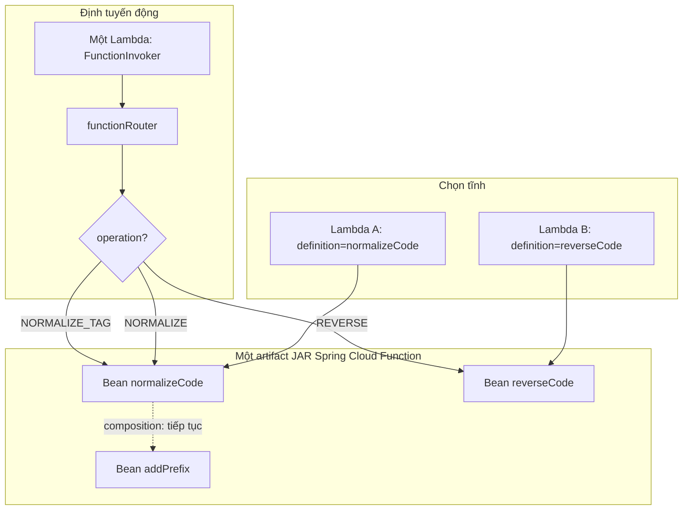
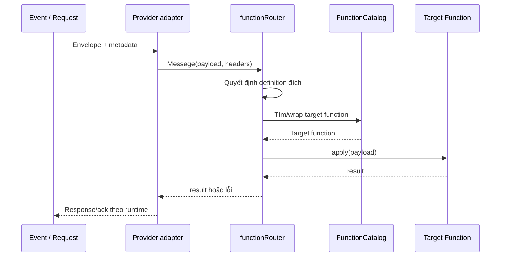
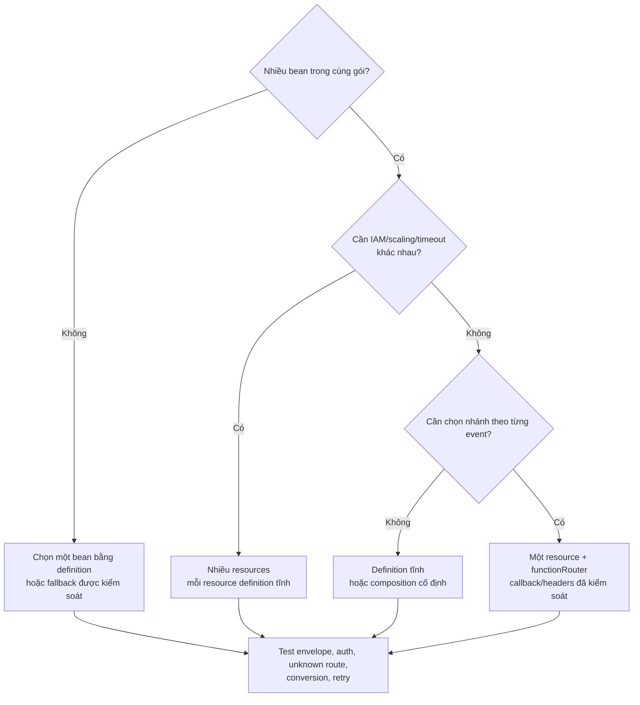
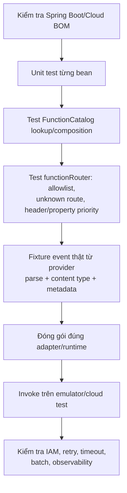

# Chọn một hàm hoặc định tuyến nhiều hàm trong một gói

> **Chương:** Serverless  
> **Module:** SPRING_CLOUD_FUNCTION  
> **Trọng tâm:** Chọn một functional bean cố định cho mỗi deployment hoặc dùng `functionRouter` để định tuyến nhiều `Supplier`, `Function`, `Consumer` trong cùng một gói Spring Cloud Function.  
> **Mốc minh họa (24/11/2026):** Java 21, Spring Boot 4.2.0, Spring Cloud BOM 2026.0.0, Spring Cloud Function 5.1.0. Đối chiếu tài liệu và runtime đang hỗ trợ trước khi deploy.

## 1. Vấn đề: một file JAR có nhiều chức năng

Một ứng dụng Spring Cloud Function có thể chứa nhiều bean nghiệp vụ:

```java
@Bean
public Function<String, String> normalizeCode() { /* ... */ }

@Bean
public Function<String, String> reverseCode() { /* ... */ }

@Bean
public Function<String, String> addPrefix() { /* ... */ }
```

Các bean chỉ tuân theo Java `Function<T, R>`. Spring Cloud Function phát hiện chúng, đưa vào `FunctionCatalog` và cho phép ghép thành pipeline. Nhưng khi một gói JAR chứa cả ba bean được đưa lên AWS Lambda, Azure Functions hoặc Google Cloud Functions, câu hỏi xuất hiện:

**Runtime phải gọi bean nào khi một sự kiện đến?**

Có ba phương án cơ bản:

1. **Chọn tĩnh một function:** mỗi cloud function resource có cùng mã nguồn/JAR nhưng cấu hình `spring.cloud.function.definition` riêng. Ví dụ Lambda A chạy `normalizeCode`, Lambda B chạy `reverseCode`.
2. **Định tuyến động trong một cloud function resource:** runtime gọi một handler chung; `functionRouter` quyết định bean đích theo message metadata, biểu thức cấu hình hoặc `MessageRoutingCallback`.
3. **Ghép nhiều function thành một pipeline:** một lời gọi chạy `normalizeCode` rồi `addPrefix` qua definition `normalizeCode|addPrefix`. Đây là **composition**, không phải lựa chọn một trong nhiều nhánh.

Điều cần tránh là nhầm **nhiều bean trong một JAR** với **nhiều cloud resources**, hoặc nhầm **routing** với **composition**.

### 1.1. Ba mô hình nhìn trên sơ đồ



Sơ đồ mô tả **khả năng cấu hình**, không khẳng định có ba Lambda chạy thật. Đường ghép nét đứt chỉ dùng khi definition là `normalizeCode|addPrefix`.

### 1.2. Mục tiêu học tập

Sau bài này, bạn có thể:

1. Giải thích quan hệ giữa **Spring bean**, **FunctionCatalog**, **FunctionInvoker**, **functionRouter** và **cloud function resource**.
2. Cấu hình `spring.cloud.function.definition` để chọn một function hoặc composition tĩnh.
3. Gọi `FunctionCatalog.lookup("functionRouter")` và điều hướng theo message.
4. So sánh ba nguồn chỉ dẫn router: `MessageRoutingCallback`, message headers và application properties; nêu được thứ tự ưu tiên.
5. Thiết kế **routing allowlist** thay vì cho payload bên ngoài quyết định tùy ý tên bean hoặc SpEL.
6. Phân biệt deployment nhiều Lambda từ một artifact với một Lambda có nhiều nhánh xử lý.
7. Kiểm thử logic, selection và routing độc lập với cloud, rồi lập kế hoạch kiểm thử adapter/provider.

## 2. Bốn lớp thường bị nhầm với nhau

| Thành phần | Ai tạo/quản lý? | Vai trò | Ví dụ |
| --- | --- | --- | --- |
| **Functional bean** | Spring `ApplicationContext` | Quy tắc xử lý nghiệp vụ | `@Bean Function<String,String> normalizeCode` |
| **FunctionCatalog** | Spring Cloud Function context | Đăng ký/lookup, wrapper, composition và chuyển đổi kiểu | `catalog.lookup("normalizeCode")` |
| **Handler/adapter** | Spring Cloud Function và nền tảng cloud | Nhận event theo contract provider, đưa dữ liệu tới catalog và trả kết quả | AWS `FunctionInvoker` |
| **Cloud function resource** | AWS/Azure/GCP/IaC | Runtime, trigger, IAM, memory, timeout, scaling, monitoring | `NormalizeLambda` |

**Một JAR có nhiều bean không tự tạo nhiều cloud function resources.** Ngược lại, **hai Lambda resources có thể trỏ tới cùng một JAR**, nhưng có handler, trigger, environment và IAM riêng. Logic Java vẫn giữ nguyên nếu payload đầu vào tương thích.

### 2.1. Handler không phải tên bean

Với AWS Lambda, cấu hình handler dùng generic adapter:

```text
org.springframework.cloud.function.adapter.aws.FunctionInvoker::handleRequest
```

Trong ứng dụng, property:

```properties
spring.cloud.function.definition=normalizeCode
```

chỉ chọn **bean trong catalog**, không đổi handler. Không khai báo `normalizeCode` trực tiếp làm Lambda handler nếu nó chỉ là bean `Function` do Spring quản lý.

Với Azure, có thể viết một method `@FunctionName` sử dụng `FunctionCatalog`; với GCP, adapter có entrypoint `GcfJarLauncher`. Các entrypoint đó vẫn khác tên bean nghiệp vụ.

### 2.2. Một số mặc định không nên dựa vào

Nếu chỉ có một functional bean, Spring Cloud Function hỗ trợ *single-function fallback* nên có trường hợp lookup không cần tên vẫn tìm được bean duy nhất. Nếu có nhiều bean, việc không chỉ định function có thể dẫn tới cơ chế chọn mặc định của adapter (AWS `FunctionInvoker` có khả năng chuyển sang router). Tuy nhiên **không nên dựa vào thứ tự mặc định khi có nhiều lựa chọn nghiệp vụ**.

Để kiểm tra nghiêm ngặt tên bean, có thể đặt:

```properties
spring.cloud.function.single-function-fallback-enabled=false
```

Trong hệ thống nhiều chức năng, hãy **chọn tĩnh rõ ràng hoặc xây chính sách route có kiểm soát**.

## 3. Ba ý nghĩa khác nhau của dấu phân cách definition

### 3.1. Chọn một bean theo tên

```properties
spring.cloud.function.definition=normalizeCode
```

Definition tĩnh này chọn function `normalizeCode` cho adapter đang sử dụng. Khi deployment chỉ cần thực thi một nghiệp vụ, đây là cách dễ hiểu, dễ giám sát và thường ít rủi ro nhất.

### 3.2. Composition qua `|` hoặc `,`

```properties
spring.cloud.function.definition=normalizeCode|addPrefix
```

Giá trị trên tạo **một pipeline**, áp dụng hai bước theo thứ tự: chuẩn hóa rồi thêm tiền tố. Có thể viết `normalizeCode,addPrefix` theo cú pháp composition được Spring Cloud Function hỗ trợ.

Giả sử input `"  od-123  "`:

```text
normalizeCode   : "  od-123  " -> "OD-123"
addPrefix       : "OD-123"     -> "ORDER:OD-123"
composition     : "  od-123  " -> "ORDER:OD-123"
```

Dấu `|` không có nghĩa chọn ngẫu nhiên một trong hai hàm. Nó luôn chỉ **chuỗi xử lý**.

### 3.3. Danh sách definition qua `;`

```properties
spring.cloud.function.definition=normalizeCode;reverseCode
```

Dấu `;` mô tả **danh sách nhiều definition riêng** trong các tích hợp hỗ trợ nhiều function, chẳng hạn function filtering ở Web adapter hoặc nhiều functional bindings trong Spring Cloud Stream. Nó không phải là biểu thức điều kiện và **không biến functionRouter thành router động**.

Trong trường hợp serverless có **một** entrypoint nhận từng event, đừng chỉ thêm `;` rồi mong provider tự biết event nào gọi bean nào. Dùng cơ chế route được runtime/adapter hỗ trợ, hoặc tạo nhiều cloud resources với definition riêng.

### 3.4. Bảng phân biệt

| Cấu hình | Ý nghĩa | Có tự route mỗi event không? |
| --- | --- | --- |
| `definition=normalizeCode` | Một function tĩnh. | **Không** |
| `definition=normalizeCode\|addPrefix` | Một pipeline cố định. | **Không** |
| `definition=normalizeCode;reverseCode` | Hai definition độc lập theo quy tắc adapter. | **Không** |
| `functionRouter` + route header được kiểm soát | Router chọn bean theo từng message imperative. | **Có**, khi adapter đưa message và chỉ dẫn phù hợp |
| `routing-expression` trong application properties | Biểu thức chọn route khi router được dùng. | **Tùy biểu thức và loại input**, không phải tự chạy chỉ vì property tồn tại |
| `MessageRoutingCallback` | Code Java quyết định definition đích từ message. | **Có**, khi `functionRouter` tham gia invocation |

**Đừng nhầm tên property với hành động:** `spring.cloud.function.definition` hoặc `routing-expression` không tự tạo AWS event source, HTTP endpoint hay trigger; vẫn cần adapter và runtime thích hợp.

## 4. Dự án Java đầy đủ để thử selection và routing

Bài này thiết kế **hai chế độ tách biệt** trong cùng project:

- **Chế độ mặc định:** không đăng ký `MessageRoutingCallback`; dùng `FunctionCatalog` và definition tĩnh.
- **Profile `dynamic-routing`:** bật `MessageRoutingCallback` và một lớp cầu nối (bridge) đã xác thực tên operation; khi gọi `functionRouter`, router chọn đích theo message.

Hai chế độ tách biệt để người học không vô tình để callback có độ ưu tiên cao **ghi đè** header/property trong bài thử definition tĩnh.

### 4.1. Maven `pom.xml`

Cấu hình đầy đủ cho project local dùng `spring-cloud-function-context` mà chưa cần HTTP hoặc AWS adapter:

```xml
<?xml version="1.0" encoding="UTF-8"?>
<project xmlns="http://maven.apache.org/POM/4.0.0"
         xmlns:xsi="http://www.w3.org/2001/XMLSchema-instance"
         xsi:schemaLocation="
             http://maven.apache.org/POM/4.0.0
             https://maven.apache.org/xsd/maven-4.0.0.xsd">
    <modelVersion>4.0.0</modelVersion>

    <parent>
        <groupId>org.springframework.boot</groupId>
        <artifactId>spring-boot-starter-parent</artifactId>
        <version>4.2.0</version>
        <relativePath/>
    </parent>

    <groupId>vn.example</groupId>
    <artifactId>serverless-routing-demo</artifactId>
    <version>0.0.1-SNAPSHOT</version>

    <properties>
        <java.version>21</java.version>
        <spring-cloud.version>2026.0.0</spring-cloud.version>
    </properties>

    <dependencyManagement>
        <dependencies>
            <dependency>
                <groupId>org.springframework.cloud</groupId>
                <artifactId>spring-cloud-dependencies</artifactId>
                <version>${spring-cloud.version}</version>
                <type>pom</type>
                <scope>import</scope>
            </dependency>
        </dependencies>
    </dependencyManagement>

    <dependencies>
        <dependency>
            <groupId>org.springframework.boot</groupId>
            <artifactId>spring-boot-starter</artifactId>
        </dependency>
        <dependency>
            <groupId>org.springframework.cloud</groupId>
            <artifactId>spring-cloud-function-context</artifactId>
        </dependency>
        <dependency>
            <groupId>org.springframework.boot</groupId>
            <artifactId>spring-boot-starter-test</artifactId>
            <scope>test</scope>
        </dependency>
    </dependencies>

    <build>
        <plugins>
            <plugin>
                <groupId>org.springframework.boot</groupId>
                <artifactId>spring-boot-maven-plugin</artifactId>
            </plugin>
        </plugins>
    </build>
</project>
```

`spring-cloud-dependencies` là **BOM** quản lý phiên bản, không đưa module vào ứng dụng nếu bạn chưa khai báo dependency. `spring-cloud-function-context` mới cung cấp `FunctionCatalog`. Khi triển khai AWS, bổ sung `spring-cloud-function-adapter-aws` và cấu hình đóng gói theo hướng dẫn AWS adapter; **JAR ở ví dụ Maven này chưa phải artifact AWS Lambda có thể upload trực tiếp**.

Cấu trúc thư mục:

```text
serverless-routing-demo/
├── pom.xml
└── src/
    ├── main/
    │   ├── java/
    │   │   └── vn/example/routing/
    │   │       ├── RoutingApplication.java
    │   │       ├── DynamicRoutingConfiguration.java
    │   │       └── TrustedEventBridge.java
    │   └── resources/
    │       └── application.properties
    └── test/
        └── java/
            └── vn/example/routing/
                ├── StaticSelectionTest.java
                └── DynamicRoutingTest.java
```

### 4.2. Ba bean nghiệp vụ trong cùng application

Tạo `src/main/java/vn/example/routing/RoutingApplication.java`:

```java
package vn.example.routing;

import java.util.Locale;
import java.util.function.Function;

import org.springframework.boot.SpringApplication;
import org.springframework.boot.autoconfigure.SpringBootApplication;
import org.springframework.context.annotation.Bean;

@SpringBootApplication
public class RoutingApplication {

    public static void main(String[] args) {
        SpringApplication.run(RoutingApplication.class, args);
    }

    @Bean
    public Function<String, String> normalizeCode() {
        return value -> value.trim().toUpperCase(Locale.ROOT);
    }

    @Bean
    public Function<String, String> reverseCode() {
        return value -> new StringBuilder(value.trim())
                .reverse()
                .toString();
    }

    @Bean
    public Function<String, String> addPrefix() {
        return value -> "ORDER:" + value;
    }
}
```

Các bean này cùng kiểu `Function<String, String>` nên có thể nhận cùng một input và trả String, dễ kiểm thử route theo tên. Trong sản phẩm thật, các bean có thể nhận DTO khác nhau; khi đó cần xét khả năng conversion và contract event trước khi đưa chúng vào một router.

Kết quả:

| Function/pipeline | Input | Output |
| --- | --- | --- |
| `normalizeCode` | `"  od-123  "` | `OD-123` |
| `reverseCode` | `"  od-123  "` | `321-do` |
| `addPrefix` | `"OD-123"` | `ORDER:OD-123` |
| `normalizeCode\|addPrefix` | `"  od-123  "` | `ORDER:OD-123` |

Hàm `reverseCode` chỉ đảo ký tự sau khi `trim()`, **không tự chuyển thành chữ hoa**. Vì vậy `"od-123"` đảo thành `"321-do"`, không phải `"321-DO"`.

### 4.3. Cấu hình mặc định

Tạo `src/main/resources/application.properties`:

```properties
spring.application.name=serverless-routing-demo
spring.main.web-application-type=none
spring.cloud.function.single-function-fallback-enabled=false
```

Ở đây không có Web server vì `spring-cloud-function-context` chỉ phục vụ catalog. Property tắt fallback giúp tên lookup sai không âm thầm trở về một bean duy nhất.

Để thử chọn tĩnh qua deployment, ta sẽ cung cấp `spring.cloud.function.definition` bằng môi trường hoặc test, **không ghi cứng** nó vào file chung của hai chế độ.

## 5. Phương án A: chọn một hàm tĩnh cho mỗi deployment

### 5.1. Chọn `normalizeCode`

Cấu hình tại runtime:

```properties
spring.cloud.function.definition=normalizeCode
```

Điều này cho adapter biết function nào sẽ xử lý invocation. Khi gọi catalog trực tiếp, vẫn có thể lookup theo tên:

```java
Function<String, String> fn = catalog.lookup("normalizeCode");
String result = fn.apply("  od-123  "); // OD-123
```

**Phân biệt:** `lookup("normalizeCode")` là lệnh gọi tường minh trong Java. Property `spring.cloud.function.definition` được adapter/tích hợp đọc để quyết định function được dùng trong triển khai, chứ nó không tự gọi `apply(...)` lúc khởi động.

### 5.2. Chọn composition cố định

Có thể chọn pipeline thay vì một bean:

```properties
spring.cloud.function.definition=normalizeCode|addPrefix
```

Khi một invocation được chuyển thành String `"  od-123  "`, pipeline mong đợi trả `ORDER:OD-123`.

Đây là lựa chọn thích hợp nếu mọi invocation của resource đều phải đi qua cùng hai bước. Nó khác với routing: **không có điều kiện quyết định nhánh**.

### 5.3. Cấu hình tĩnh bằng biến môi trường

Với Spring Boot, có thể dùng tên biến môi trường tương ứng để đặt definition. Trong ví dụ AWS Lambda bên dưới, tài liệu Spring Cloud Function minh họa dạng:

```text
spring_cloud_function_definition=normalizeCode
```

Tên này tuân thủ giới hạn tên environment variable của AWS và được Spring Boot ánh xạ tới property `spring.cloud.function.definition`. Trong các môi trường khác, `SPRING_CLOUD_FUNCTION_DEFINITION` cũng là dạng tên hay gặp theo quy tắc relaxed binding; hãy xác minh cách provider truyền biến và cấu hình được ứng dụng thực sự nhận.

Nếu dùng shell để thử tạm một Java application:

```bash
SPRING_CLOUD_FUNCTION_DEFINITION=normalizeCode \
  java -jar target/serverless-routing-demo-0.0.1-SNAPSHOT.jar
```

Lệnh này chỉ khởi chạy **Spring application không có Web/serverless handler**, nên không xuất endpoint. Nó minh họa cách truyền configuration, không phải cách triển khai AWS.

## 6. Cùng một artifact, triển khai hai Lambda resources

Một cách dùng Spring Cloud Function serverless phổ biến: **build một JAR**, sau đó tạo hai AWS Lambda function resources trỏ tới artifact đó.

| Lambda resource | Handler của AWS | Definition của Spring | Trigger |
| --- | --- | --- | --- |
| `NormalizeLambda` | `FunctionInvoker` | `normalizeCode` | Trigger A |
| `ReverseLambda` | `FunctionInvoker` | `reverseCode` | Trigger B |

Ở đây cùng một JAR chứa cả hai bean; **mỗi resource chỉ định hàm được chọn qua environment variable riêng**. Hai resource có thể có IAM policy, memory, timeout, reserved concurrency và event source mapping khác nhau.

### 6.1. Cấu hình AWS SAM minh họa

Sau khi đã đóng gói **artifact AWS tương thích** theo tài liệu `spring-cloud-function-adapter-aws`, một template AWS SAM có thể có dạng:

```yaml
AWSTemplateFormatVersion: '2010-09-09'
Transform: AWS::Serverless-2016-10-31

Resources:
  NormalizeLambda:
    Type: AWS::Serverless::Function
    Properties:
      Runtime: java21
      Handler: org.springframework.cloud.function.adapter.aws.FunctionInvoker
      CodeUri: target/serverless-routing-demo-0.0.1-SNAPSHOT-aws.jar
      MemorySize: 512
      Environment:
        Variables:
          spring_cloud_function_definition: normalizeCode

  ReverseLambda:
    Type: AWS::Serverless::Function
    Properties:
      Runtime: java21
      Handler: org.springframework.cloud.function.adapter.aws.FunctionInvoker
      CodeUri: target/serverless-routing-demo-0.0.1-SNAPSHOT-aws.jar
      MemorySize: 512
      Environment:
        Variables:
          spring_cloud_function_definition: reverseCode
```

**Đây là mẫu kiến trúc để học, chưa phải template triển khai hoàn chỉnh.** Đường dẫn `CodeUri` giả định bạn đã cấu hình Maven Shade/packaging AWS và tạo ra JAR có hậu tố `-aws.jar`. `pom.xml` ở mục 4 **chưa** có bước đó; không chạy template này rồi cho rằng artifact sẽ tự tồn tại. Trigger, IAM, logging, timeout và các policy cần thiết cũng phải được bổ sung phù hợp với use case.

Tài liệu AWS Lambda adapter còn có ví dụ Lambda console yêu cầu handler theo dạng method:

```text
org.springframework.cloud.function.adapter.aws.FunctionInvoker::handleRequest
```

Cách thể hiện handler trong console/IaC có thể khác ví dụ SAM dùng tên class; hãy theo đúng hướng dẫn của provider/adapter khi cấu hình thực tế.

### 6.2. Khi nào nên dùng hai Lambda resources?

Chọn nhiều resources, kể cả khi dùng chung JAR, khi:

- Một function đọc S3 còn function khác ghi DynamoDB, **quyền IAM khác nhau**.
- Trigger/queue, retry, reserved concurrency, memory, timeout hoặc yêu cầu scaling khác nhau.
- Muốn triển khai và giám sát riêng từng endpoint/nhánh nghiệp vụ.
- Muốn hạn chế blast radius của một event source.
- Cần tiêu chuẩn bảo mật hoặc release lifecycle riêng.

Điểm cần cân nhắc: dù cấu hình resource riêng, nếu **cùng một artifact version** thì cập nhật mã nguồn được chia sẻ có thể ảnh hưởng cả hai. Có thể tách build/deploy theo module hoặc ghim artifact version riêng cho từng resource khi yêu cầu độc lập lớn.

### 6.3. Khi nào một resource hợp lý hơn?

Một Lambda resource với nhiều nhánh có thể phù hợp khi các chức năng:

- Thuộc cùng phạm vi nghiệp vụ, cùng quyền truy cập và lớp dữ liệu.
- Có memory/timeout/concurrency tương tự.
- Có chung cơ chế xác thực, quan sát và quản lý thay đổi.
- Cần một entrypoint để điều hướng theo hành động của request.

Nhưng dùng một resource nghĩa là **cùng IAM role và giới hạn runtime** áp dụng cho mọi nhánh. Đừng gom một thao tác chỉ đọc và một thao tác xóa dữ liệu nhạy cảm vào cùng resource chỉ để giảm số lượng Lambda nếu chúng cần quyền khác biệt.

## 7. Phương án B: định tuyến động qua `functionRouter`

### 7.1. Router trong Spring Cloud Function là gì?

Spring Cloud Function đăng ký một `RoutingFunction` trong catalog dưới tên đặc biệt:

```text
functionRouter
```

Bạn cũng có thể dùng hằng `RoutingFunction.FUNCTION_NAME`. Về khái niệm, router là `Function<Object,Object>`: nó chọn một function definition đích rồi gọi function ấy.



Sơ đồ mô tả luồng logic; Spring có thể cache các wrapper/lookup, không nhất thiết tra catalog mới mỗi invocation.

### 7.2. Router không “đọc được mọi envelope” một cách thần kỳ

Nếu caller gửi JSON:

```json
{
  "operation": "NORMALIZE",
  "code": "  od-123  "
}
```

thì `functionRouter` **không mặc định suy luận** rằng `operation` phải thành Spring Message header và `code` phải thành String payload. Cần adapter/converter hoặc một lớp ánh xạ nhận envelope và tạo `Message<String>` phù hợp.

Đó là lý do ví dụ phần sau dùng một **TrustedEventBridge**: class này chuyển event do ứng dụng định nghĩa thành payload + header đã kiểm soát. Không xem bridge này là AWS/Azure/GCP handler có thể deploy trực tiếp.

### 7.3. Gọi trực tiếp router bằng message

Một khi có chỉ dẫn route thích hợp, có thể gọi router như sau:

```java
Function<Message<String>, String> router =
        catalog.lookup("functionRouter");

Message<String> message = MessageBuilder
        .withPayload("  od-123  ")
        .setHeader("operation", "NORMALIZE")
        .build();

String output = router.apply(message);
```

Với `MessageRoutingCallback` ở mục 8 được kích hoạt, output kỳ vọng là `OD-123`. `functionRouter` được phép dùng cùng tên bean đặc biệt dù bạn không tự khai báo một `@Bean` tên đó.

### 7.4. Routing khác với composition

Một message có `operation=NORMALIZE` dẫn đến `normalizeCode`; message có `operation=REVERSE` dẫn đến `reverseCode`. Đây là **chọn một nhánh**.

Một route khác có thể chọn definition `normalizeCode|addPrefix`. Khi đó router chọn **một pipeline**, và pipeline chạy hai bước. Vì vậy routing và composition có thể kết hợp:

```text
router:
  NORMALIZE      -> normalizeCode
  REVERSE        -> reverseCode
  NORMALIZE_TAG  -> normalizeCode|addPrefix
```

Điều kiện quan trọng: các kiểu đầu vào/đầu ra giữa các function trong composition phải tương thích.

## 8. Thực hành routing bằng `MessageRoutingCallback`

### 8.1. Vì sao dùng callback thay vì đọc trực tiếp bean name từ header?

Cho request bên ngoài gửi `route=deleteEverything` rồi truyền thẳng tên này vào catalog là rủi ro bảo mật. Spring Cloud Function có nhiều function/definition có thể được tìm trong catalog; người dùng **không nên được tự do gọi những bean mà họ không có quyền**.

Một chiến lược an toàn hơn là:

1. Nhận một **business operation** được phép: `NORMALIZE`, `REVERSE` hoặc `NORMALIZE_TAG`.
2. Xác thực/ủy quyền nguồn event ở adapter.
3. Ánh xạ operation sang **allowlist cố định** các definition được phép gọi.
4. Từ chối mọi operation không được biết đến; không tự động “fallback” sang một function có side effect.

`MessageRoutingCallback` cho phép thực hiện ánh xạ trong Java, phù hợp khi quyết định route phức tạp hơn một biểu thức cấu hình ngắn.

### 8.2. File `DynamicRoutingConfiguration.java`

Tạo `src/main/java/vn/example/routing/DynamicRoutingConfiguration.java`:

```java
package vn.example.routing;

import org.springframework.cloud.function.context.MessageRoutingCallback;
import org.springframework.context.annotation.Bean;
import org.springframework.context.annotation.Configuration;
import org.springframework.context.annotation.Profile;
import org.springframework.messaging.Message;

@Configuration(proxyBeanMethods = false)
@Profile("dynamic-routing")
public class DynamicRoutingConfiguration {

    @Bean
    public MessageRoutingCallback operationRoutingPolicy() {
        return new MessageRoutingCallback() {
            @Override
            public String routingResult(Message<?> message) {
                Object operation = message.getHeaders().get("operation");

                if (!(operation instanceof String action)) {
                    throw new IllegalArgumentException(
                            "Thiếu operation hợp lệ");
                }

                return switch (action) {
                    case "NORMALIZE" -> "normalizeCode";
                    case "REVERSE" -> "reverseCode";
                    case "NORMALIZE_TAG" -> "normalizeCode|addPrefix";
                    default -> throw new IllegalArgumentException(
                            "Operation không được hỗ trợ: " + action);
                };
            }
        };
    }
}
```

Đoạn này chọn route **từ ba giá trị đã được kiểm soát**, không trả về nguyên văn một bean name do caller tự nhập. `@Profile("dynamic-routing")` giúp chỉ bật callback trong bài thử định tuyến động; bài thử tĩnh không bật profile này.

**Ghi chú về phiên bản:** với Spring Cloud Function 5.1.0, interface `MessageRoutingCallback` có phương thức `String routingResult(Message<?> message)`. Các ví dụ rất cũ của Spring Cloud Function có thể dùng kiểu trả về khác; không sao chép đoạn mã từ tài liệu phiên bản cũ mà không đối chiếu API đang sử dụng.

### 8.3. Cầu nối đưa event vào router

Tạo `src/main/java/vn/example/routing/TrustedEventBridge.java`:

```java
package vn.example.routing;

import java.util.function.Function;

import org.springframework.cloud.function.context.FunctionCatalog;
import org.springframework.context.annotation.Profile;
import org.springframework.messaging.Message;
import org.springframework.messaging.support.MessageBuilder;
import org.springframework.stereotype.Component;

@Component
@Profile("dynamic-routing")
public class TrustedEventBridge {

    public record IncomingEvent(String kind, String code) {}

    private final Function<Message<String>, String> router;

    public TrustedEventBridge(FunctionCatalog catalog) {
        this.router = catalog.lookup("functionRouter");

        if (this.router == null) {
            throw new IllegalStateException(
                    "Không tìm thấy functionRouter");
        }
    }

    public String handle(IncomingEvent event) {
        if (event == null || event.kind() == null ||
                event.code() == null) {
            throw new IllegalArgumentException("Event không hợp lệ");
        }

        // Lớp biên chỉ công nhận ba business actions.
        String operation = switch (event.kind()) {
            case "order.normalize" -> "NORMALIZE";
            case "order.reverse" -> "REVERSE";
            case "order.normalize-and-tag" -> "NORMALIZE_TAG";
            default -> throw new IllegalArgumentException(
                    "Loại event không được phép: " + event.kind());
        };

        // Dữ liệu nghiệp vụ chỉ còn là chuỗi code.
        Message<String> message = MessageBuilder
                .withPayload(event.code())
                .setHeader("operation", operation)
                .build();

        return router.apply(message);
    }
}
```

Ví dụ:

```java
bridge.handle(new TrustedEventBridge.IncomingEvent(
        "order.normalize", "  od-123  "));  // OD-123

bridge.handle(new TrustedEventBridge.IncomingEvent(
        "order.reverse", "  od-123  "));    // 321-do

bridge.handle(new TrustedEventBridge.IncomingEvent(
        "order.normalize-and-tag", "  od-123  "));
        // ORDER:OD-123
```

**Không phải cloud handler hoàn chỉnh:** `TrustedEventBridge` nhận một `IncomingEvent` giả lập; AWS SQS, API Gateway, Azure queue hoặc Pub/Sub có envelope và serialization riêng. Ở runtime thật, phải đưa đúng payload và metadata vào bridge hoặc viết adapter provider-specific, đồng thời xác thực quyền invoke.

### 8.4. Tại sao phải có hai tầng allowlist?

Có **hai nguồn thông tin** dễ bị lẫn:

- `kind` ở event: giá trị bên ngoài, có thể giả mạo nếu nguồn không được xác thực.
- `operation` trong Spring Message: giá trị nội bộ đã ánh xạ, chỉ nằm trong tập giá trị ứng dụng cho phép.

Bridge từ chối loại event chưa hỗ trợ, còn callback từ chối operation không hợp lệ. Đây là *defense in depth*, **không thay thế** IAM/API authentication/authorization. Nếu hai operation có quyền khác nhau, router cần kiểm tra quyền theo identity, không chỉ dựa vào chuỗi operation.

## 9. Một cách routing khác: message headers và application properties

### 9.1. Header chọn function tĩnh cho từng message

Khi **không có `MessageRoutingCallback`**, `functionRouter` có thể nhận tên function hoặc composition qua message header `spring.cloud.function.definition`:

```java
Function<Message<String>, String> router =
        catalog.lookup("functionRouter");

Message<String> message = MessageBuilder
        .withPayload("  od-123  ")
        .setHeader("spring.cloud.function.definition", "normalizeCode")
        .build();

String result = router.apply(message); // OD-123
```

Với composition:

```java
Message<String> message = MessageBuilder
        .withPayload("  od-123  ")
        .setHeader(
            "spring.cloud.function.definition",
            "normalizeCode|addPrefix")
        .build();
```

**Cảnh báo bảo mật:** ví dụ này minh họa API routing, không khuyến khích truyền nguyên văn giá trị header từ HTTP client không đáng tin cậy. Nếu client kiểm soát tên function, họ có thể cố gọi những function không được dự kiến xuất ra ngoài. Hãy kiểm tra authorization/allowlist trước khi đưa header vào `functionRouter`.

### 9.2. Routing expression bằng SpEL

Spring Cloud Function hỗ trợ `spring.cloud.function.routing-expression`, sử dụng Spring Expression Language (SpEL) để quyết định definition. Ví dụ ứng dụng đã **tự tạo header đáng tin cậy** `routeTarget` chứa chính xác một bean name cho phép:

```properties
spring.cloud.function.routing-expression=headers['routeTarget']
```

Khi gọi `functionRouter` với `Message<?>` có header `routeTarget=normalizeCode`, biểu thức sẽ lấy giá trị làm definition đích. Điều này chỉ an toàn khi `routeTarget` đã được **xác minh và chuyển thành tên được phép ở lớp biên**. Không đưa raw HTTP header hoặc JSON field trực tiếp vào `routeTarget` nếu chưa kiểm tra.

Có thể dùng biểu thức chọn nhánh cố định:

```properties
spring.cloud.function.routing-expression=headers['kind'] == 'NORMALIZE' ? 'normalizeCode' : 'reverseCode'
```

Biểu thức này minh họa cú pháp SpEL, nhưng **không phù hợp làm policy production** nếu giá trị lạ bị đưa sang `reverseCode`. Một callback có nhánh `default -> throw` như mục 8 an toàn và dễ review hơn.

### 9.3. Độ ưu tiên của ba cơ chế

Theo tài liệu Spring Cloud Function 5.1.0, trong trường hợp router nhận message kiểu imperative:

1. **`MessageRoutingCallback`** — ưu tiên cao nhất; khi có callback thì chỉ dẫn header/property khác có thể không được dùng để chọn route.
2. **Message headers** — nếu không có callback; có thể chứa `spring.cloud.function.definition` hoặc `spring.cloud.function.routing-expression`.
3. **Application/system properties** — khi không có chỉ dẫn ưu tiên cao hơn.

| Có callback? | Có route header? | Có property? | Nguồn quyết định chính |
| --- | --- | --- | --- |
| Có | Có | Có | Callback |
| Không | Có | Có | Header |
| Không | Không | Có | Property |
| Không | Không | Không | Không có chỉ dẫn đầy đủ; dễ lỗi/không route như mong đợi |

**Không trộn các ví dụ trên vào một test rồi kết luận property bị lỗi.** Nếu profile `dynamic-routing` đang bật, callback ở mục 8 sẽ được router dùng trước header và property.

### 9.4. SpEL từ header và từ cấu hình có mức tin cậy khác nhau

Spring Cloud Function tài liệu nêu:

- Biểu thức SpEL lấy từ **Message headers** được đánh giá với `SimpleEvaluationContext`, giới hạn khả năng nhằm giảm nguy cơ lạm dụng.
- Biểu thức lấy từ **application/system properties** được đánh giá với `StandardEvaluationContext`, có khả năng biểu đạt cao hơn.

Đây không phải lời bảo đảm mọi SpEL đều an toàn. Cấu hình có thể bị rò rỉ hoặc bị sửa qua một số endpoint quản trị; cần khóa quyền cập nhật environment/config, không mở những endpoint có khả năng chỉnh config cho người không được phép.

Với dữ liệu event ngoài, **đề xuất ưu tiên callback và switch allowlist** thay vì cho caller cung cấp biểu thức SpEL.

## 10. Khi nào không nên dùng dynamic routing?

Định tuyến động có ích, nhưng không phải cách tốt nhất cho mọi hệ thống.

| Tiêu chí | Nhiều cloud resources, mỗi resource chọn tĩnh | Một resource với functionRouter động |
| --- | --- | --- |
| **Số artifact** | Có thể dùng chung một JAR. | Thường một JAR. |
| **Số Lambda resources** | Nhiều. | Một. |
| **Chọn function** | Environment/config riêng theo resource. | Metadata/callback/expression ở runtime. |
| **IAM** | Có thể cấp quyền khác nhau. | Một role/identity dùng chung, trừ thiết kế sâu hơn. |
| **Scaling/concurrency** | Quản lý theo từng resource. | Dùng chung giới hạn một resource. |
| **Timeout/memory** | Tùy chỉnh từng resource. | Chia sẻ cấu hình runtime của resource. |
| **Quan sát và alerting** | Metrics/logs từng resource rõ hơn. | Cần phân tách theo route trong telemetry. |
| **Độ phức tạp code** | Ít logic route. | Phải xác thực route, xử lý unknown, test nhiều nhánh. |
| **Cohesion** | Phù hợp nghiệp vụ khác nhau. | Phù hợp nhiều nhánh cùng bounded context. |
| **Blast radius** | Có thể giới hạn theo resource. | Một lỗi cấu hình có thể ảnh hưởng mọi nhánh. |

**Quy tắc thực dụng:** cùng một JAR **không có nghĩa** phải chạy trong cùng một Lambda resource. Nếu các chức năng khác đặc quyền hoặc khác yêu cầu vận hành, tách resources thường giúp đơn giản hóa bảo mật và cô lập sự cố.

### 10.1. Ví dụ quyền truy cập khác nhau

`ReadOrder` chỉ đọc DynamoDB; `DeleteOrder` xóa bản ghi. Nếu gom trong một Lambda resource, role có quyền xóa sẽ hiện diện trong cùng runtime xử lý request đọc. Nếu cơ chế route có lỗi, rủi ro tăng.

Với hai Lambda resources, có thể cấp role đọc và role xóa riêng, cấu hình xác thực mạnh hơn cho thao tác xóa. Bạn vẫn có thể dùng chung một module domain hoặc artifact thích hợp, nhưng **ranh giới quyền nằm ở resource**.

### 10.2. Quy trình quyết định ngắn



## 11. Kiểm thử tĩnh với `FunctionCatalog`

### 11.1. File `StaticSelectionTest.java`

Tạo `src/test/java/vn/example/routing/StaticSelectionTest.java`:

```java
package vn.example.routing;

import static org.junit.jupiter.api.Assertions.assertEquals;
import static org.junit.jupiter.api.Assertions.assertNotNull;

import java.util.function.Function;

import org.junit.jupiter.api.Test;
import org.springframework.beans.factory.annotation.Autowired;
import org.springframework.beans.factory.annotation.Value;
import org.springframework.boot.test.context.SpringBootTest;
import org.springframework.cloud.function.context.FunctionCatalog;

@SpringBootTest(properties = {
        "spring.cloud.function.definition=normalizeCode"
})
class StaticSelectionTest {

    @Autowired
    FunctionCatalog catalog;

    @Value("${spring.cloud.function.definition}")
    String definition;

    @Test
    void resolvesConfiguredFunction() {
        assertEquals("normalizeCode", definition);

        Function<String, String> fn = catalog.lookup(definition);

        assertNotNull(fn);
        assertEquals("OD-123", fn.apply("  od-123  "));
    }

    @Test
    void canStillLookupCompositionExplicitly() {
        Function<String, String> pipeline =
                catalog.lookup("normalizeCode|addPrefix");

        assertNotNull(pipeline);
        assertEquals("ORDER:OD-123",
                pipeline.apply("  od-123  "));
    }
}
```

Test xác nhận Spring Environment đã nhận definition và catalog tìm được bean. Test thứ hai chỉ ra rằng việc đặt definition tĩnh **không đồng nghĩa xóa các bean khác khỏi catalog**. Nó cũng chưa chứng minh AWS Lambda handler đã chạy; kiểm thử handler cần artifact/adapter AWS riêng.

### 11.2. Test Java thuần cho từng hàm

Ngoài Spring test, có thể gọi lambda để kiểm tra nghiệp vụ mà không cần khởi động context:

```java
var app = new RoutingApplication();

String a = app.normalizeCode().apply(" od-123 ");
String b = app.reverseCode().apply(" od-123 ");

assertEquals("OD-123", a);
assertEquals("321-do", b);
```

Đây là snippet đặt **bên trong một phương thức JUnit test** với static import `assertEquals`. Không dùng nó để suy ra configuration/adapter đã đúng.

## 12. Kiểm thử router động với profile riêng

### 12.1. File `DynamicRoutingTest.java`

Tạo `src/test/java/vn/example/routing/DynamicRoutingTest.java`:

```java
package vn.example.routing;

import static org.junit.jupiter.api.Assertions.assertEquals;
import static org.junit.jupiter.api.Assertions.assertNotNull;
import static org.junit.jupiter.api.Assertions.assertThrows;

import java.util.function.Function;

import org.junit.jupiter.api.Test;
import org.springframework.beans.factory.annotation.Autowired;
import org.springframework.boot.test.context.SpringBootTest;
import org.springframework.cloud.function.context.FunctionCatalog;
import org.springframework.messaging.Message;
import org.springframework.messaging.support.MessageBuilder;
import org.springframework.test.context.ActiveProfiles;

@SpringBootTest
@ActiveProfiles("dynamic-routing")
class DynamicRoutingTest {

    @Autowired
    FunctionCatalog catalog;

    @Autowired
    TrustedEventBridge bridge;

    @Test
    void routesNormalize() {
        Function<Message<String>, String> router =
                catalog.lookup("functionRouter");

        assertNotNull(router);

        Message<String> message = MessageBuilder
                .withPayload("  od-123  ")
                .setHeader("operation", "NORMALIZE")
                .build();

        assertEquals("OD-123", router.apply(message));
    }

    @Test
    void routesReverse() {
        assertEquals("321-do", bridge.handle(
                new TrustedEventBridge.IncomingEvent(
                        "order.reverse", "  od-123  ")));
    }

    @Test
    void routesComposition() {
        assertEquals("ORDER:OD-123", bridge.handle(
                new TrustedEventBridge.IncomingEvent(
                        "order.normalize-and-tag", "  od-123  ")));
    }

    @Test
    void rejectsUnknownExternalOperation() {
        assertThrows(IllegalArgumentException.class,
                () -> bridge.handle(
                    new TrustedEventBridge.IncomingEvent(
                        "order.delete-all", "OD-123")));
    }

    @Test
    void rejectsUnknownInternalOperation() {
        Function<Message<String>, String> router =
                catalog.lookup("functionRouter");

        Message<String> message = MessageBuilder
                .withPayload("OD-123")
                .setHeader("operation", "DELETE_ALL")
                .build();

        assertThrows(IllegalArgumentException.class,
                () -> router.apply(message));
    }
}
```

Có hai cách kiểm tra:

- `bridge.handle(...)` thử toàn bộ logic mapping giữa event giả định và router.
- `catalog.lookup("functionRouter").apply(message)` thử trực tiếp route theo message.

Nếu router gọi target nhưng trả kiểu khác với kỳ vọng (ví dụ một `Message<?>` thay vì `String` ở cấu hình converter/adapter khác), cần xác định contract thực tế và điều chỉnh test theo đúng kiểu trả. Các function trong ví dụ đều `String -> String`, nên kết quả nghiệp vụ kỳ vọng là String.

### 12.2. Chạy JUnit test

Trong thư mục có `pom.xml`:

```bash
mvn clean test
```

Nếu project có Maven Wrapper thì dùng `./mvnw clean test`. Test trên yêu cầu Java 21, Spring Boot và Spring Cloud dependency phù hợp đã được resolve. Nó **không** cần AWS CLI hay tài khoản cloud.

Với Gradle, cùng phần Java có thể được dùng nếu build đã khai báo Boot plugin, Spring Cloud BOM, `spring-cloud-function-context` và `spring-boot-starter-test`; tác vụ tương ứng là `./gradlew test`. Bài này không cung cấp song song một project Gradle độc lập để tránh trộn hai hệ build.

### 12.3. Cách đọc kết quả test

| Test | Bằng chứng đạt | Chưa chứng minh |
| --- | --- | --- |
| `StaticSelectionTest` | Definition được đọc, catalog tra đúng bean/composition. | AWS Lambda resource dùng đúng handler và environment. |
| `routesNormalize` | Callback chọn bean normalize. | Raw event AWS được chuyển thành Spring Message đúng header. |
| `routesReverse` | Bridge có mapping cho route reverse. | Runtime GCP/Azure có binding đúng. |
| `routesComposition` | Router có thể chọn một pipeline. | Retry/event acknowledgement đúng. |
| `rejectsUnknown...` | Unknown action bị từ chối thay vì gọi bean tùy ý. | Tất cả nguồn event đã được xác thực và phân quyền. |

## 13. Triển khai routing qua Azure và Google Cloud

### 13.1. Azure Functions

Azure Java runtime thường dùng method được khai báo `@FunctionName` cùng trigger/binding (`@HttpTrigger`, queue trigger...). Spring Cloud Function Azure adapter cho phép handler tích hợp Spring bean hoặc `FunctionCatalog`.

Với **chọn tĩnh**, một Azure handler có thể tra:

```java
Function<String, String> fn = catalog.lookup("normalizeCode");
String result = fn.apply(body);
```

Với **định tuyến động**, handler sau khi **parse và xác thực** request/event có thể tạo `Message<String>` với `operation` và gọi `catalog.lookup("functionRouter")` như bridge ở mục 8. Nhưng Azure handler vẫn phải đáp ứng chữ ký annotation/trigger, authorization và response mapping của Azure.

Không giả định `MessageRoutingCallback` khiến Azure tự sinh nhiều trigger hoặc tự chọn `@FunctionName`. Tên cloud function resource/handler thuộc Azure; tên `normalizeCode` và `functionRouter` thuộc Spring Cloud Function.

### 13.2. Google Cloud Functions

Spring Cloud Function GCP adapter dùng launcher `org.springframework.cloud.function.adapter.gcp.GcfJarLauncher` và Functions Framework. Tên entrypoint GCP khác tên bean Spring.

Khi có nhiều bean:

- Với một resource chỉ làm một nghiệp vụ, chọn definition rõ ràng trong Spring configuration/environment.
- Nếu thực sự cần một resource định tuyến nhiều loại event, phải thiết kế bridge/converter để đưa thông tin route vào Spring Message hoặc sử dụng cơ chế hỗ trợ tương ứng của adapter.
- Nếu các chức năng có trigger/IAM/scaling khác nhau, tách cloud resources phù hợp hơn.

**Không lấy thành công của `functionRouter` trong JUnit làm bằng chứng rằng GCP entrypoint tự biết trích field routing từ CloudEvent.** Cần kiểm thử đúng event schema, generation, Java runtime và packaging đích.

### 13.3. So sánh với Spring Cloud Stream

Trong Spring Cloud Stream, các bean Function/Consumer được nối với broker qua binder và functional binding. Stream cũng có cơ chế event routing; trong một số cấu hình, dùng:

```properties
spring.cloud.stream.function.routing.enabled=true
```

hoặc chọn `functionRouter` theo hướng dẫn Stream tương ứng. Đối với routing per-message, Stream có thể truyền header về definition hoặc routing expression. Cần binder và cấu hình input binding/destination đầy đủ; **chỉ thêm property routing không mở kết nối Kafka/RabbitMQ**.

Khác biệt lớn:

- **Cloud serverless:** handler và trigger của provider quyết định invocation.
- **Spring Cloud Stream:** binder nhận/gửi message từ broker.
- **Spring Cloud Function:** catalog/router quyết định lời gọi Java ở lớp nghiệp vụ.

Cùng một bean có thể phục vụ nhiều môi trường khi payload/headers được chuyển phù hợp.

## 14. Giới hạn định tuyến theo loại hàm và kiểu dữ liệu

### 14.1. Imperative `Function`

`Function<String,String>` trong ví dụ là imperative: mỗi lời gọi nhận một input và trả một output. Với message imperative, router có thể chọn function khác nhau cho **từng message**, dựa trên callback/header.

Ví dụ:

```text
Message #1: operation=NORMALIZE -> normalizeCode
Message #2: operation=REVERSE   -> reverseCode
Message #3: operation=NORMALIZE_TAG -> normalizeCode|addPrefix
```

### 14.2. Reactive `Function<Flux<T>, Flux<R>>`

Trong reactive model, một function có thể nhận cả publisher:

```java
@Bean
public Function<Flux<String>, Flux<String>> normalizeStream() {
    return flux -> flux.map(String::trim)
            .map(text -> text.toUpperCase(Locale.ROOT));
}
```

Đoạn này cần import `reactor.core.publisher.Flux`, `Locale` và `Function`, đặt trong lớp Spring configuration; là ví dụ **thay thế về kiểu xử lý**, không phải bean trong project chính.

Tài liệu Spring Cloud Function nêu: với reactive function, **không dùng header trên từng record để chọn route cho từng item trong stream** như imperative. Vì reactive function có thể được gọi một lần với publisher rồi xử lý cả stream, hướng route phù hợp thường là **application properties** định hướng toàn stream.

Đây là giới hạn quan trọng khi chuyển một ví dụ imperative routing sang Kafka reactive hoặc streaming workloads.

### 14.3. `Supplier` và `Consumer`

`Supplier<T>` không có input nên cách kích hoạt/polling thuộc adapter. `Consumer<T>` không trả result nghiệp vụ, nên cần quan tâm acknowledgement, retry và side effect.

Router có thể điều hướng tới `Consumer` khi contract cho phép, nhưng nếu trộn function có kết quả và consumer void trong cùng endpoint đồng bộ, cần xác định cách response được ánh xạ. Đừng giả định mọi nhánh đều trả một JSON DTO giống nhau.

### 14.4. Kiểu input khác nhau giữa các route

Giả sử:

```java
Function<OrderCreatedEvent, OrderResult> createOrder;
Function<CancelOrderEvent, CancelResult> cancelOrder;
```

Một router có thể chọn hai nhánh theo event type, nhưng adapter phải phân biệt và chuyển payload thành **đúng DTO đầu vào cho route đã chọn**. Không thể chỉ dựa vào `functionRouter` để tự biết raw JSON envelope cần được parse thành class nào mà không có đủ type metadata/converter.

Với event phức tạp, có thể dùng một envelope trung lập rồi cho mỗi handler thực hiện phần mapping riêng. Kiểm thử JSON null, missing fields, content type và type conversion trên artifact thật.

## 15. Lỗi định tuyến, retry và idempotency

### 15.1. Unknown route nên làm gì?

Nếu router không tìm thấy function được chọn, framework thông thường báo lỗi không thể route. Spring Cloud Function còn có `DefaultMessageRoutingHandler` để xử lý message không định tuyến được; implementation mặc định có thể ghi log và bỏ qua message.

**Không tự đăng ký handler bỏ qua message** trong luồng đơn hàng hoặc thanh toán nếu chưa có chính sách dữ liệu mất/không được xử lý. Route không xác định nên được xem xét như lỗi schema/authorization, rồi đưa vào quarantine/DLQ hoặc trả lỗi phù hợp theo contract nguồn.

### 15.2. Lỗi nghiệp vụ và lỗi hệ thống

| Tình huống | Cách phân loại | Hướng xử lý |
| --- | --- | --- |
| `operation=UNKNOWN` | Input/routing policy không hợp lệ. | Từ chối sớm, không chọn một bean mặc định có side effect. |
| Definition trỏ bean không tồn tại | Lỗi cấu hình/deploy. | Sửa tên bean/definition; test trước release. |
| JSON event không parse được | Lỗi envelope/conversion. | Ghi nhận an toàn, xử lý DLQ/quarantine theo nguồn. |
| `normalizeCode` nhận null | Lỗi input/validation. | Thống nhất hợp đồng null và lỗi nghiệp vụ. |
| Database timeout trong route cập nhật | Lỗi tạm thời. | Retry/backoff, giới hạn và idempotency. |
| Cloud invocation timeout | Lỗi runtime/provider. | Cấu hình timeout, theo dõi và xử lý giao lại. |
| Một record lỗi trong batch SQS | Batch/partial failure. | Trả đúng response AWS hoặc policy xử lý batch được hỗ trợ. |

### 15.3. Một router không tự đảm bảo exactly-once

Nhiều event sources có semantics *at-least-once* hoặc có thể giao lại event khi timeout. Nếu `Consumer<OrderCommand>` tạo đơn hàng, đặt router trước consumer không ngăn side effect trùng lặp.

Một thiết kế đúng thường cần **idempotency key ổn định**, unique constraint/conditional write, transaction hoặc cơ chế bảo đảm side effect hợp lý, và retry/DLQ rõ ràng. Event ID khác với invocation/request ID của cloud runtime; chỉ dùng request ID mới phát sinh mỗi lần retry có thể không ngăn được duplicate business operation.

### 15.4. Batch có thể chứa nhiều route

Một invocation SQS có thể mang nhiều records, mỗi record có operation khác nhau. Nếu adapter truyền nguyên cả SQS envelope vào một function, functionRouter không nhất thiết tự chia và route từng record. Cần xác định **đơn vị định tuyến** là message nào và adapter xử lý batch như thế nào.

Có thể bóc records tại boundary rồi tạo từng Spring Message với route metadata; hoặc dùng `Function<SQSEvent,SQSBatchResponse>` ở integration layer và chuyển từng business command vào domain. Khi đó phải trả partial batch response đúng contract của AWS nếu muốn tránh retry lại toàn bộ batch.

## 16. Bảo mật: route theo quyền, không theo tên do client tự đặt

### 16.1. Những điều tuyệt đối không nên giả định

- Không giả định mọi bean trong catalog đều an toàn để người ngoài gọi.
- Không cho HTTP headers không tin cậy quyết định arbitrary function definition hoặc SpEL.
- Không dùng `spring.cloud.function.definition` như giải pháp duy nhất cho authorization.
- Không xem `SimpleEvaluationContext` là sự bảo đảm rằng mọi expression từ header đều an toàn trong mọi tình huống.
- Không bật endpoint quản trị có khả năng đọc/sửa environment hoặc dynamic config nếu chưa có bảo vệ mạnh.
- Không gom các nghiệp vụ cần IAM khác nhau vào một Lambda chỉ vì routing thuận tiện.

### 16.2. Một policy tốt cho production

1. **Xác thực nguồn**: IAM, API authentication, signature hoặc event-source permission.
2. **Xác định identity/tenant**: tách trường nghiệp vụ khỏi header có thể giả mạo.
3. **Authorize operation**: người gọi có quyền `NORMALIZE`, `REVERSE` hay thao tác nhạy cảm nào.
4. **Map qua allowlist**: business action → bean/pipeline đã được duyệt.
5. **Validate payload**: kích thước, schema, kiểu dữ liệu, content type.
6. **Gọi router/target**: không truyền raw function name/SpEL tùy ý.
7. **Audit**: log action, target definition, event ID, kết quả và lỗi; tránh ghi bí mật.
8. **Giới hạn blast radius**: tách resource khi quyền/scaling khác nhau.

### 16.3. Observability cho router động

Mọi invocation nên có telemetry cho:

| Thuộc tính | Mục đích |
| --- | --- |
| `eventId` / `correlationId` | Liên kết nhiều bước xử lý và các retry. |
| `operation` đã chuẩn hóa | Biết caller yêu cầu hành động nào. |
| `targetFunction` | Xác định nhánh thực được gọi. |
| `trigger/source` | Phân biệt HTTP/SQS/PubSub/broker. |
| `resultStatus` | Thành công, validation error, technical error. |
| `duration` theo route | Tránh để một nhánh chậm bị che bởi trung bình của resource. |
| `retryCount` / DLQ outcome | Đánh giá duplicate/failure. |

Hạn chế số lượng giá trị metric label bằng một tập tên route cố định; không lấy chuỗi do client tùy ý làm tag có cardinality vô hạn.

## 17. Quy trình kiểm chứng trước khi deploy



**Bước 1 — Xác nhận phiên bản:** Spring Boot 4.2.0 và Spring Cloud 2026.0.0 là cặp minh họa; khi nâng cấp đối chiếu ma trận và artifact thực được BOM resolve.

**Bước 2 — Test nghiệp vụ:** gọi Java `Function.apply(...)` cho từng bean. Không cần cloud để xác minh `trim`, `uppercase` và `reverse`.

**Bước 3 — Test catalog và routing:** kiểm tra name, composition, callback, header, expression (nếu sử dụng) và lỗi route không hợp lệ.

**Bước 4 — Test event mapping:** dùng JSON/CloudEvent/SQS envelope **đúng trigger thực tế**, không chỉ fixture giả định. Kiểm tra payload/headers sau converter.

**Bước 5 — Build/packaging:** AWS Lambda cần adapter, handler và artifact layout tương ứng; Azure cần binding/plugin; GCP cần entrypoint/Functions Framework. Boot JAR chạy `java -jar` không tự bảo đảm đã đóng gói đúng cho cloud.

**Bước 6 — Cloud integration:** gửi event qua nguồn thật, xác minh IAM, rate/timeout, retry, partial batch response, DLQ và logs.

Không chạy Gradle/Maven chỉ để “thấy BUILD SUCCESS” rồi kết luận routing production đã an toàn; phải thử policy và vận hành theo từng nhánh.

## 18. Các tình huống thực hành

### Bài 1 — Chọn một bean trong nhiều bean

Với project ở mục 4, giả sử muốn tạo hai AWS Lambda resources dùng chung artifact:

1. Đặt `spring_cloud_function_definition=normalizeCode` cho Lambda A.
2. Đặt `spring_cloud_function_definition=reverseCode` cho Lambda B.
3. Giữ handler `FunctionInvoker` ở cả hai.
4. Giải thích vì sao không cần hai bản copy `RoutingApplication.java`.
5. Nêu lý do hợp lý để cấp IAM role khác nhau dù artifact giống nhau.

**Đáp án định hướng:** definition tĩnh chọn bean ở tầng Spring; handler/trigger của AWS vẫn thuộc tầng runtime. Hai Lambda resources có thể cô lập quyền, timeout và scaling.

### Bài 2 — Dynamic routing trong một resource

Bật profile `dynamic-routing`, gọi `TrustedEventBridge` với:

| `kind` | `code` | Kỳ vọng |
| --- | --- | --- |
| `order.normalize` | `" od-123 "` | `OD-123` |
| `order.reverse` | `" od-123 "` | `321-do` |
| `order.normalize-and-tag` | `" od-123 "` | `ORDER:OD-123` |
| `order.delete-all` | `"OD-123"` | `IllegalArgumentException` |

Giải thích vì sao `order.normalize-and-tag` chọn composition, còn các route khác chọn một bean.

### Bài 3 — Thứ tự ưu tiên

Giả sử cùng một message có:

```text
Header spring.cloud.function.definition = reverseCode
Property spring.cloud.function.routing-expression = 'normalizeCode'
MessageRoutingCallback = trả về normalizeCode|addPrefix
```

Khi `functionRouter` được gọi ở chế độ imperative và callback ở mục 8 đang có mặt, route nào được dùng? Vì sao?

**Đáp án:** callback có ưu tiên cao nhất, nên pipeline `normalizeCode|addPrefix` được chọn. Khi tắt profile callback, header có thể thắng property. Thiết kế test riêng cho mỗi trường hợp, không so sánh với một ứng dụng đang dùng định nghĩa tĩnh bypass router.

### Bài 4 — Tìm lỗ hổng bảo mật

Một handler nhận JSON:

```json
{
  "functionName": "deleteAllOrders",
  "payload": "..."
}
```

Sau đó gọi `catalog.lookup(functionName).apply(payload)` mà không kiểm tra quyền. Hãy:

1. Chỉ ra rủi ro gọi chức năng không được công khai.
2. Đề xuất action enum/allowlist và authorization theo identity.
3. Chuyển đổi JSON thành DTO hợp lệ trước khi gọi function.
4. Đề xuất lỗi dành cho unknown operation và cách ghi audit.
5. Quyết định có cần tách thao tác xóa sang resource/IAM role riêng không.

### Bài 5 — Thiết kế nhiều resources hay một router?

Hệ thống có ba nghiệp vụ:

- `getOrder`: truy vấn dữ liệu, QPS cao.
- `createOrder`: tạo đơn, ghi DB.
- `deleteOrder`: xóa nhạy cảm, QPS thấp.

Hãy chọn kiến trúc phù hợp, cân nhắc IAM, timeout, scaling và blast radius. Không bắt buộc ba source projects riêng; có thể dùng chung domain code nhưng chia cloud resources và release artifact thích hợp.

### Bài 6 — Chuyển event qua provider

Một SQS event có `Records`; mỗi `body` chứa JSON `{"operation":"NORMALIZE","code":"od-123"}`. Hãy mô tả:

- Nơi parse SQS envelope và JSON body.
- Nơi xác minh operation, tạo Spring Message và route.
- Cách xử lý record lỗi vĩnh viễn so với DB timeout tạm thời.
- Khi nào phải dùng `SQSBatchResponse`.
- Vì sao một unit test `functionRouter` không chứng minh được partial batch failure handling.

## 19. Tổng kết và tài liệu chính thức

**Một gói Spring Cloud Function có thể chứa nhiều functional beans, nhưng số bean không quyết định số cloud function resources.** Bạn có thể triển khai cùng một artifact thành nhiều resources với `spring.cloud.function.definition` tĩnh riêng, hoặc dùng `functionRouter` để chọn bean/pipeline cho từng invocation trong một resource khi các điều kiện vận hành và bảo mật cho phép.

Các nguyên tắc cần nhớ:

- **Definition tĩnh** chọn một bean hoặc composition; **routing động** chọn nhánh dựa trên message/callback/config khi router thực sự được gọi.
- `normalizeCode|addPrefix` là pipeline; `normalizeCode;reverseCode` là danh sách definition theo semantics adapter; chúng không tương đương router động.
- `MessageRoutingCallback` có ưu tiên cao hơn route headers và application properties khi áp dụng cho imperative routing.
- Không để dữ liệu bên ngoài trực tiếp quyết định bean name hoặc SpEL không kiểm soát. Dùng allowlist, xác thực và phân quyền.
- Reactive routing per-record có giới hạn khác imperative; phải hiểu unit-of-work của publisher.
- Tách resources khi IAM, concurrency, timeout, scaling hoặc lifecycle khác nhau.
- Test catalog/router **chưa đủ**: phải kiểm tra event envelope, handler, packaging, retry, batch, idempotency và observability trên runtime đích.

**Nguồn tham khảo chính thức:**

1. Spring Cloud Function 5.1.0 — Programming Model: FunctionCatalog, definition, composition, RoutingFunction, MessageRoutingCallback và priority: https://docs.spring.io/spring-cloud-function/reference/spring-cloud-function/programming-model.html
2. Spring Cloud Function — AWS Lambda adapter và AWS Function Routing, single vs multiple Lambda functions: https://docs.spring.io/spring-cloud-function/reference/adapters/aws-intro.html
3. Spring Cloud Function — Azure Functions adapter: https://docs.spring.io/spring-cloud-function/reference/adapters/azure-intro.html
4. Spring Cloud Function — GCP adapter: https://docs.spring.io/spring-cloud-function/reference/adapters/gcp-intro.html
5. Spring Cloud Stream — Event Routing: https://docs.spring.io/spring-cloud-stream/reference/spring-cloud-stream/event-routing.html
6. Spring Cloud Stream — Functional binding: https://docs.spring.io/spring-cloud-stream/reference/spring-cloud-stream/functional-binding-names.html
7. Spring Cloud — Release train và phiên bản tương thích: https://spring.io/projects/spring-cloud/
8. AWS Lambda Java Handler: https://docs.aws.amazon.com/lambda/latest/dg/java-handler.html
9. AWS Lambda event source mappings và batch failures: https://docs.aws.amazon.com/lambda/latest/dg/invocation-eventsourcemapping.html
10. Spring Boot — Externalized Configuration: https://docs.spring.io/spring-boot/reference/features/external-config.html
