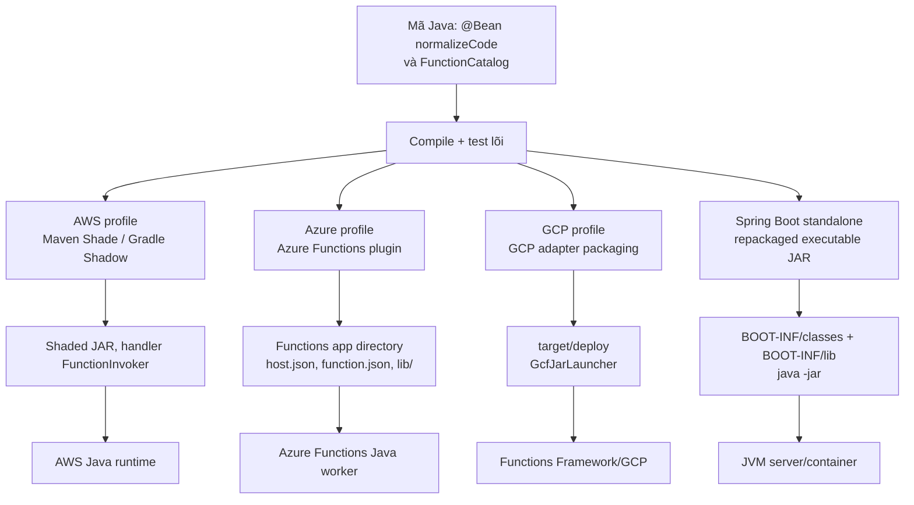
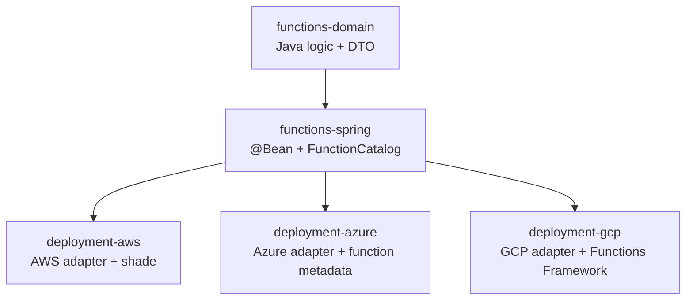
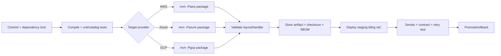
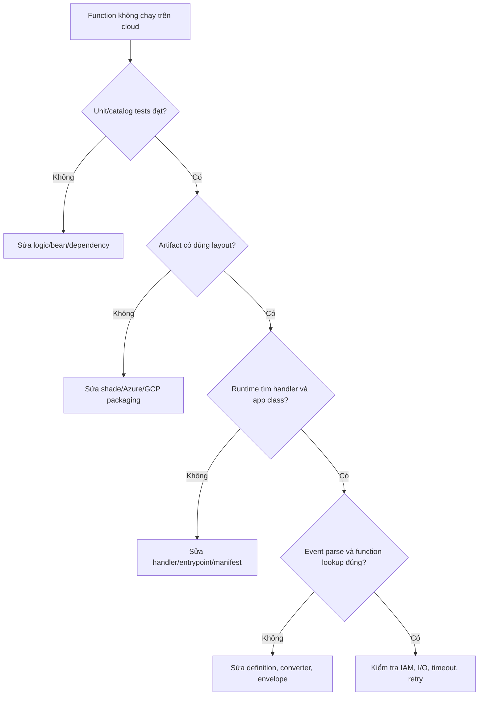

# Đóng gói artifact phù hợp với từng nhà cung cấp

> **Chương:** Serverless  
> **Module:** SPRING_CLOUD_FUNCTION  
> **Mục tiêu:** Chuyển cùng logic `Supplier`, `Function` và `Consumer` thành artifact đúng **classpath, layout, entrypoint, metadata, runtime và công cụ triển khai** của AWS Lambda, Azure Functions hoặc Google Cloud Functions; tránh nhầm executable Spring Boot JAR với gói deploy serverless.  
> **Bộ phiên bản minh họa, ngày 24/11/2026:** Java 21, Spring Boot 4.2.0, Spring Cloud 2026.0.0 (Spring Cloud Function 5.1.0). Các phiên bản plugin và runtime phải được đối chiếu theo môi trường thật trước khi sử dụng.

## 1. Một hàm Java có thể tái sử dụng, nhưng artifact không phải lúc nào cũng giống nhau

Spring Cloud Function cho phép đóng gói logic bằng các interface Java chuẩn:

- `Supplier<T>` tạo dữ liệu mà không nhận đầu vào từ lời gọi.
- `Function<T,R>` nhận dữ liệu, thực hiện phép biến đổi, trả kết quả.
- `Consumer<T>` nhận dữ liệu, thực hiện side effect nhưng không trả kết quả nghiệp vụ.

`FunctionCatalog` tra cứu và compose các bean. HTTP, Spring Cloud Stream, AWS Lambda, Azure Functions và Google Cloud Functions cung cấp những **adapter** để đưa event/request tới catalog. Nhờ vậy, **code nghiệp vụ** có thể giữ nguyên khi chuyển môi trường.

Tuy nhiên, artifact deploy còn có những quy tắc mà một Java interface không thể giải quyết:

- Runtime tìm **handler/entrypoint** ở đâu?
- Lớp của ứng dụng và dependency JAR nằm ở đâu trong package?
- Framework có đọc được metadata `META-INF/spring/...`, `META-INF/services` và manifest không?
- Cloud mong đợi một file JAR, ZIP có cấu trúc riêng, **thư mục source/JAR** hay container image?
- Plugin build nào tạo trigger/binding metadata?
- Java runtime của nhà cung cấp có chạy được bytecode đã biên dịch không?

Vì vậy, câu “một Function dùng lại ở mọi nơi” nghĩa là **có thể tái sử dụng logic**, chứ không có nghĩa gửi cùng một file `target/app.jar` lên cả ba nhà cung cấp là xong.

### 1.1. Sơ đồ: cùng nguồn, nhiều loại sản phẩm



**Mục đích của bài:** biết chọn đúng nhánh build, biết nhận diện sản phẩm đầu ra, biết test artifact trước deploy và biết vì sao một lỗi đóng gói có thể xuất hiện dù `FunctionCatalog` test đã đạt.

### 1.2. Những kết quả cần đạt

Sau bài học, bạn có thể:

1. Phân biệt **plain JAR**, **Spring Boot executable JAR**, **shaded JAR**, **Azure Functions package**, **GCP deployment directory** và **container image**.
2. Xây nền ứng dụng Java/FunctionCatalog chung, không buộc domain vào một provider.
3. Tạo chiến lược Maven/Gradle đóng gói riêng cho AWS, Azure và GCP.
4. Chọn handler/entrypoint đúng: `FunctionInvoker`, Azure `@FunctionName`/binding, `GcfJarLauncher`.
5. Kiểm tra manifest, service metadata, dependency graph, phiên bản Java và layout của artifact.
6. Đặt bộ kiểm thử unit → catalog → package → local runtime → cloud integration.
7. Xử lý lỗi thường gặp: `ClassNotFoundException`, lỗi bean scan, missing binding, runtime Java sai, JSON/event không tương thích.
8. Thiết kế quy trình CI/CD tách artifact, giữ khả năng truy xuất và rollback an toàn.

## 2. Phân biệt các hình thức đóng gói Java

### 2.1. Plain JAR: chỉ có class và resources của module

Một JAR Java bình thường do `maven-jar-plugin` hoặc tác vụ Gradle `jar` tạo thường chứa:

```text
META-INF/MANIFEST.MF
vn/example/scf/PackagingApplication.class
application.properties
...
```

Dependency bên ngoài **không** tự nằm trong file JAR này. Muốn chạy cần classpath gồm các JAR phụ thuộc. Plain JAR phù hợp làm module thư viện, nhưng nếu một cloud runtime chỉ nhận một artifact tự đủ classpath, nó có thể thất bại.

### 2.2. Spring Boot executable JAR

Khi Spring Boot Maven/Gradle plugin **repackage/bootJar**, artifact thường có cấu trúc:

```text
META-INF/MANIFEST.MF
org/springframework/boot/loader/...
BOOT-INF/classes/...
BOOT-INF/lib/<dependency>.jar
```

Boot loader biết cách nạp dependency JAR lồng trong `BOOT-INF/lib`. Đây là artifact lý tưởng để chạy:

```bash
java -jar target/scf-package-demo-0.0.1-SNAPSHOT.jar
```

Nhưng một runtime cloud với classloader/handler riêng không nhất thiết đọc được nested JAR đúng cách. **Đặc biệt với Spring Cloud Function AWS adapter, tài liệu yêu cầu shaded JAR cho cách deploy JAR truyền thống**. Azure lại yêu cầu thư mục/functions metadata do plugin tạo. GCP có cơ chế packaging tùy adapter.

### 2.3. Shaded JAR

*Shading* gộp class và resources từ dependency vào một JAR có classpath phẳng:

```text
META-INF/MANIFEST.MF
META-INF/services/...
META-INF/spring/...
vn/example/scf/PackagingApplication.class
org/springframework/cloud/function/adapter/aws/FunctionInvoker.class
org/springframework/...
...
```

Không còn chỉ phụ thuộc vào Boot loader để đọc `BOOT-INF/lib`. Maven Shade hoặc Gradle Shadow tạo artifact theo chiến lược này.

**Điểm khó:** khi gộp nhiều JAR, file resources có cùng tên có thể bị ghi đè. Với Spring, các file auto-configuration và service-loader metadata đặc biệt quan trọng. Vì vậy, shade không chỉ là “gộp mọi class vào một ZIP”; phải có resource transformers thích hợp rồi test.

### 2.4. Package theo contract provider

| Loại sản phẩm | Nội dung chính | Dùng ở đâu? | Ai tạo? |
| --- | --- | --- | --- |
| Plain JAR | Class/resources của module | Classpath/module nội bộ | Maven JAR plugin/Gradle jar |
| Spring Boot executable JAR | `BOOT-INF` và Boot loader | JVM server, container Boot, local `java -jar` | Spring Boot Maven/Gradle plugin |
| AWS shaded JAR | Class và dependency được ghép vào JAR phẳng | AWS Lambda Java handler theo Spring Cloud Function AWS adapter | Maven Shade hoặc Gradle Shadow |
| Azure Functions app package | Handler class/JAR, `host.json`, `function.json`, thư viện trong layout do Azure định nghĩa | Azure Functions Java worker | Azure Functions Maven/Gradle plugin |
| GCP adapter deployment directory | JAR và resources được adapter đóng theo format mong đợi, ví dụ `target/deploy` | Google Cloud Functions/Functions Framework | Spring Boot Maven plugin kết hợp GCP adapter |
| OCI container image | Filesystem + entrypoint + runtime/libraries | Dịch vụ nhận container image, theo runtime contract riêng | Container build tooling |

**Không sử dụng một artifact chỉ dựa vào đuôi file `.jar`**. Cần kiểm tra classpath, manifest, resources, bootstrap và cấu hình entrypoint.

## 3. Cặp phiên bản, toolchain và runtime cần nhất quán

### 3.1. Bộ minh họa tương thích

| Thành phần | Phiên bản ví dụ | Lưu ý |
| --- | --- | --- |
| Java source/target | **21** | Bytecode phải được runtime đích hỗ trợ. |
| Spring Boot parent/plugin | **4.2.0** | Quản lý Spring Boot build/libraries. |
| Spring Cloud BOM | **2026.0.0** | Release train tương thích Spring Boot 4.2.0. |
| Spring Cloud Function modules | **5.1.0** | Phiên bản module do Cloud BOM quản lý. |
| Maven Shade Plugin | **3.6.2** | Bản phát hành được xác minh trên Apache Maven tháng 11/2026. |
| Azure Functions Maven Plugin | **1.42.0** | Bản được Maven Central ghi nhận tại mốc tra cứu; xác minh với worker/runtime đích. |

Spring Cloud 2026.0.0 phát hành 20/11/2026, dựa trên Spring Boot 4.2.0 và chứa Spring Cloud Function 5.1.0. Các artifact ứng dụng dưới `org.springframework.cloud` nên lấy phiên bản từ `spring-cloud-dependencies`, tránh tự ghim từng adapter sang dòng khác.

**BOM không quản lý mọi plugin build.** Maven Shade, Azure Functions Maven Plugin và Google Functions Framework plugin cần version phù hợp được chọn/ghi nhận riêng. Một version plugin nhìn giống số phiên bản Spring Cloud không có nghĩa chúng đồng bộ.

### 3.2. Kiểm tra Java ở ba thời điểm

1. **Compile:** JDK Maven/Gradle dùng để sinh bytecode (`mvn -v`, Gradle toolchain).
2. **Test/packaging:** CI runner và plugin sử dụng JDK tương thích.
3. **Runtime:** AWS Lambda `java21`, Azure Functions Java 21 hoặc GCP `java21` đúng thế hệ môi trường được chọn.

Đừng lấy ví dụ cũ `--runtime java11` trong một số trang Spring GCP rồi áp dụng cho source biên dịch Java 21. Java 11 đã hết vòng đời trên một số môi trường Google và không thể chạy class file Java 21.

### 3.3. Các điểm kiểm tra trước build

```bash
java -version
javac -version
mvn -v
mvn help:effective-pom
mvn dependency:tree -Dincludes=org.springframework.cloud
```

Nếu project có Maven Wrapper, dùng `./mvnw` thay cho `mvn`. Trên Windows dùng `./mvnw.cmd`. Không cần chạy hết lệnh này trong bài đọc; chúng là quy trình mà người học sẽ thực hành trên dự án.

Nếu một adapter cần Java runtime hoặc plugin chưa tương thích với Boot 4.2.0, phải điều chỉnh **cả bộ phiên bản theo ma trận hỗ trợ**; không tắt compatibility verification chỉ để bỏ lỗi.

## 4. Tạo một nguồn nghiệp vụ tái sử dụng

### 4.1. Java application dùng chung

Tạo `src/main/java/vn/example/scf/PackagingApplication.java`:

```java
package vn.example.scf;

import java.util.Locale;
import java.util.function.Function;

import org.springframework.boot.SpringApplication;
import org.springframework.boot.autoconfigure.SpringBootApplication;
import org.springframework.context.annotation.Bean;

@SpringBootApplication
public class PackagingApplication {

    public static void main(String[] args) {
        SpringApplication.run(PackagingApplication.class, args);
    }

    @Bean
    public Function<String, String> normalizeCode() {
        return code -> {
            if (code == null || code.isBlank()) {
                throw new IllegalArgumentException("Mã không được rỗng");
            }

            return code.trim().toUpperCase(Locale.ROOT);
        };
    }

    @Bean
    public Function<String, String> validateCode() {
        return code -> {
            if (!code.matches("[A-Z]{2}-[0-9]{3}")) {
                throw new IllegalArgumentException(
                        "Mã phải có dạng AA-999: " + code);
            }
            return code;
        };
    }
}
```

Mã trên không import AWS/Azure/GCP SDK và không biết HTTP method, queue hay function handler. Hai bean được Spring Cloud Function đăng ký là `normalizeCode` và `validateCode`.

Ví dụ với input `"  od-123 "`:

| Definition | Kết quả |
| --- | --- |
| `normalizeCode` | `OD-123` |
| `validateCode` | Lỗi do chưa chuẩn hóa chữ thường/khoảng trắng. |
| `normalizeCode\|validateCode` | `OD-123` |
| `validateCode\|normalizeCode` | Lỗi vì chạy sai thứ tự. |

Từ đây, mỗi provider build chỉ cần **adapter/packaging khác**, không sửa thuật toán hai bean.

### 4.2. Vì sao cần `FunctionCatalog`?

Code Java có thể tự gọi `normalizeCode().apply(...)`, nhưng `FunctionCatalog` của Spring Cloud Function cho phép:

- Tra cứu hàm theo tên.
- Ghép pipeline `normalizeCode|validateCode` từ cấu hình.
- Áp dụng wrapper/conversion kiểu và message khi được hỗ trợ.
- Giữ một hợp đồng Spring Function dù adapter khác nhau.

Khi đóng gói serverless, handler provider gọi adapter, adapter chọn function/definition rồi đưa payload đã chuyển đổi tới catalog. Việc test trực tiếp catalog giúp tách lỗi nghiệp vụ khỏi lỗi deployment.

### 4.3. Test catalog trước khi đóng gói

Tạo `src/test/java/vn/example/scf/PackagingApplicationTest.java`:

```java
package vn.example.scf;

import static org.junit.jupiter.api.Assertions.assertEquals;
import static org.junit.jupiter.api.Assertions.assertNotNull;
import static org.junit.jupiter.api.Assertions.assertThrows;

import java.util.function.Function;

import org.junit.jupiter.api.Test;
import org.springframework.beans.factory.annotation.Autowired;
import org.springframework.boot.test.context.SpringBootTest;
import org.springframework.cloud.function.context.FunctionCatalog;

@SpringBootTest
class PackagingApplicationTest {

    @Autowired
    FunctionCatalog catalog;

    @Test
    void findsAndCallsFunction() {
        Function<String, String> fn = catalog.lookup("normalizeCode");

        assertNotNull(fn);
        assertEquals("OD-123", fn.apply("  od-123 "));
    }

    @Test
    void composesFunctions() {
        Function<String, String> pipeline =
                catalog.lookup("normalizeCode|validateCode");

        assertNotNull(pipeline);
        assertEquals("OD-123", pipeline.apply("  od-123 "));
        assertThrows(IllegalArgumentException.class,
                () -> pipeline.apply("???"));
    }
}
```

Đây là **integration test Spring context/catalog**, chưa xác minh layout AWS/Azure/GCP. Vì vậy pipeline CI cần ít nhất hai lớp: test Java/catalog và test package/runtime.

## 5. Maven nền tảng: một project, nhiều packaging profiles

### 5.1. Cấu trúc dự án thực hành

```text
scf-package-demo/
├── pom.xml
└── src/
    ├── main/
    │   ├── java/vn/example/scf/
    │   │   └── PackagingApplication.java
    │   └── resources/
    │       ├── application.properties
    │       └── host.json                  # dùng khi xây Azure profile
    └── test/
        └── java/vn/example/scf/
            └── PackagingApplicationTest.java
```

File `host.json` không cần thiết cho logic lõi hay AWS/GCP, chỉ được Azure packaging plugin tham chiếu khi chạy Azure profile.

### 5.2. `pom.xml` chung

Tạo POM nền sau. Các profile provider ở những mục tiếp theo được **chèn thêm vào bên trong cùng `<project>`**, không tạo ba file POM trùng nhau:

```xml
<?xml version="1.0" encoding="UTF-8"?>
<project xmlns="http://maven.apache.org/POM/4.0.0"
         xmlns:xsi="http://www.w3.org/2001/XMLSchema-instance"
         xsi:schemaLocation="http://maven.apache.org/POM/4.0.0
           https://maven.apache.org/xsd/maven-4.0.0.xsd">

    <modelVersion>4.0.0</modelVersion>

    <parent>
        <groupId>org.springframework.boot</groupId>
        <artifactId>spring-boot-starter-parent</artifactId>
        <version>4.2.0</version>
        <relativePath/>
    </parent>

    <groupId>vn.example</groupId>
    <artifactId>scf-package-demo</artifactId>
    <version>0.0.1-SNAPSHOT</version>

    <properties>
        <java.version>21</java.version>
        <spring-cloud.version>2026.0.0</spring-cloud.version>
        <spring-cloud-function.version>5.1.0</spring-cloud-function.version>
        <start-class>vn.example.scf.PackagingApplication</start-class>
    </properties>

    <dependencyManagement>
        <dependencies>
            <dependency>
                <groupId>org.springframework.cloud</groupId>
                <artifactId>spring-cloud-dependencies</artifactId>
                <version>${spring-cloud.version}</version>
                <type>pom</type>
                <scope>import</scope>
            </dependency>
        </dependencies>
    </dependencyManagement>

    <dependencies>
        <dependency>
            <groupId>org.springframework.boot</groupId>
            <artifactId>spring-boot-starter</artifactId>
        </dependency>
        <dependency>
            <groupId>org.springframework.cloud</groupId>
            <artifactId>spring-cloud-function-context</artifactId>
        </dependency>
        <dependency>
            <groupId>org.springframework.boot</groupId>
            <artifactId>spring-boot-starter-test</artifactId>
            <scope>test</scope>
        </dependency>
    </dependencies>

    <build>
        <plugins>
            <plugin>
                <groupId>org.springframework.boot</groupId>
                <artifactId>spring-boot-maven-plugin</artifactId>
            </plugin>
        </plugins>
    </build>

    <!-- Chèn các profile aws/azure/gcp từ mục 7/8/9 vào đây. -->
</project>
```

**Chú ý:** thuộc tính `spring-cloud-function.version=5.1.0` phía trên **chỉ dùng khi một Maven plugin cần explicit dependency version trên classpath của chính plugin**, ví dụ GCP packaging. Dependency ứng dụng vẫn lấy version từ Spring Cloud BOM, không khai báo `<version>5.1.0</version>` bên cạnh `spring-cloud-function-context`.

### 5.3. Cấu hình nền cho Function

Tạo `src/main/resources/application.properties`:

```properties
spring.application.name=scf-package-demo
spring.main.web-application-type=none
spring.cloud.function.definition=normalizeCode|validateCode
```

Đây là pipeline tĩnh. Nếu muốn một deployment chỉ chạy `normalizeCode`, hãy override definition qua biến môi trường hoặc profile; không cần thay code Java.

`spring.main.web-application-type=none` phù hợp với ví dụ serverless không cần khởi động embedded HTTP server. **Đừng dùng file này nguyên xi để kiểm thử Spring Cloud Function Web starter qua cURL**; HTTP standalone cần Web application context và dependency Web tương ứng.

### 5.4. Bài tập build nền trước khi thêm adapter

```bash
mvn clean test
mvn dependency:tree -Dincludes=org.springframework.cloud
mvn package
```

Với POM nền, Spring Boot plugin tạo JAR Boot executable ở `target/scf-package-demo-0.0.1-SNAPSHOT.jar`. **Đây chưa phải artifact đã đóng gói cho một cloud provider.** Nó chỉ xác nhận tầng nền trước khi thêm plugin/provider profiles.

## 6. Cần kiểm tra gì trong một artifact?

### 6.1. Tên file không đủ nói lên cấu trúc

Maven có thể tạo:

```text
target/scf-package-demo-0.0.1-SNAPSHOT.jar
target/scf-package-demo-0.0.1-SNAPSHOT-aws.jar
target/azure-functions/<function-app-name>/
target/deploy/
```

Đường dẫn mang tính ví dụ, phụ thuộc cấu hình plugin. Sau build, **liệt kê file thật** chứ không tự suy đoán từ tên.

```bash
ls -lh target/*.jar
jar tf target/scf-package-demo-0.0.1-SNAPSHOT.jar
```

Với PowerShell:

```powershell
Get-ChildItem -Path .\target -Filter *.jar
jar tf .\target\scf-package-demo-0.0.1-SNAPSHOT.jar
```

### 6.2. Các dấu hiệu nhận diện

| Dấu hiệu | Gợi ý | Có đủ để xác nhận deploy? |
| --- | --- | --- |
| Có `BOOT-INF/lib` | Boot executable JAR. | Chưa, AWS shaded JAR cần cách khác. |
| Class dependency nằm trực tiếp trong JAR | Có thể là shaded JAR. | Chưa, phải kiểm tra metadata/handler. |
| Có `org/springframework/cloud/function/adapter/aws/FunctionInvoker.class` | AWS adapter đã được gộp. | Chưa, handler và main class vẫn cần đúng. |
| Có `function.json`/`host.json` ở layout Azure | Package Azure đã sinh metadata. | Chưa, cần test Azure worker/triggers. |
| Có `target/deploy` và launcher GCP | GCP package có cơ sở đúng. | Chưa, cần test Functions Framework và provider. |
| `mvn test` thành công | FunctionCatalog và logic qua test đạt. | Không xác nhận artifact runtime. |
| `java -jar` chạy được | Boot loader và classpath của Boot app ổn. | Không xác nhận provider handler. |

### 6.3. Vì sao metadata khi shade quan trọng?

Spring Boot và hệ sinh thái Spring dùng các resources như:

```text
META-INF/services/...
META-INF/spring.factories
META-INF/spring/org.springframework.boot.autoconfigure.AutoConfiguration.imports
META-INF/spring.handlers
META-INF/spring.schemas
META-INF/spring.components
```

Các file cùng tên có thể xuất hiện ở nhiều JAR. Nếu Shade chỉ lấy bản cuối, auto-configuration hoặc service providers của dependency khác có thể biến mất. Vì vậy, cấu hình **resource transformer/merge** phải phù hợp Spring Boot và plugin version, đặc biệt khi chuyển major version của Boot.

**Tín hiệu lỗi:** test từ IDE thành công nhưng khi gọi cloud handler thì Spring context thiếu bean/auto-configuration hoặc gặp `ClassNotFoundException`. Kiểm tra cả metadata chứ không chỉ class files.

## 7. AWS Lambda: tạo shaded JAR dùng `FunctionInvoker`

### 7.1. Mô hình đóng gói của AWS Spring Cloud Function

Với AWS Lambda Java runtime, handler có thể là:

```text
org.springframework.cloud.function.adapter.aws.FunctionInvoker::handleRequest
```

Handler này nhận invocation của AWS rồi gọi function/pipeline được chọn trong `FunctionCatalog`. Một `@Bean` Java không tự là Lambda handler.

Theo tài liệu Spring Cloud Function AWS, đường deploy JAR truyền thống dùng **shaded JAR**. Tài liệu ví dụ tạo artifact gắn classifier `aws`:

```text
target/scf-package-demo-0.0.1-SNAPSHOT-aws.jar
```

Đây là **một file khác** với Spring Boot executable JAR và phải được tạo bằng profile AWS phù hợp. Không upload file Boot `BOOT-INF` thông thường nếu hướng dẫn adapter yêu cầu classpath đã shade.

### 7.2. Dependency AWS riêng

Trong một profile Maven dành cho AWS, thêm:

```xml
<dependency>
    <groupId>org.springframework.cloud</groupId>
    <artifactId>spring-cloud-function-adapter-aws</artifactId>
</dependency>
```

Dependency này nằm trong `<dependencies>` của profile, không phải trong `dependencyManagement`. Phiên bản được Cloud BOM quản lý.

### 7.3. Profile Maven AWS — bản hướng dẫn thực hành

**Chèn block `<profiles>` sau vào POM nền ở mục 5.** Đây là một mẫu build có các thành phần chính được Spring/AWS yêu cầu; **cần chạy thử trên toolchain thật** và điều chỉnh transformer nếu phiên bản Boot/adapter của dự án yêu cầu khác. Mẫu không thay thế toàn bộ POM.

```xml
<profiles>
    <profile>
        <id>aws</id>

        <dependencies>
            <dependency>
                <groupId>org.springframework.cloud</groupId>
                <artifactId>spring-cloud-function-adapter-aws</artifactId>
            </dependency>
        </dependencies>

        <build>
            <plugins>
                <!-- Không dùng Boot nested-JAR làm input deploy Lambda. -->
                <plugin>
                    <groupId>org.springframework.boot</groupId>
                    <artifactId>spring-boot-maven-plugin</artifactId>
                    <configuration>
                        <skip>true</skip>
                    </configuration>
                </plugin>

                <plugin>
                    <groupId>org.apache.maven.plugins</groupId>
                    <artifactId>maven-shade-plugin</artifactId>
                    <version>3.6.2</version>

                    <dependencies>
                        <!-- Cho phép Spring Boot transformer xử lý factories. -->
                        <dependency>
                            <groupId>org.springframework.boot</groupId>
                            <artifactId>spring-boot-maven-plugin</artifactId>
                            <version>4.2.0</version>
                        </dependency>
                    </dependencies>

                    <executions>
                        <execution>
                            <id>shade-for-aws</id>
                            <phase>package</phase>
                            <goals>
                                <goal>shade</goal>
                            </goals>
                            <configuration>
                                <shadedArtifactAttached>true</shadedArtifactAttached>
                                <shadedClassifierName>aws</shadedClassifierName>
                                <createDependencyReducedPom>false</createDependencyReducedPom>

                                <filters>
                                    <filter>
                                        <artifact>*:*</artifact>
                                        <excludes>
                                            <exclude>META-INF/*.SF</exclude>
                                            <exclude>META-INF/*.DSA</exclude>
                                            <exclude>META-INF/*.RSA</exclude>
                                        </excludes>
                                    </filter>
                                </filters>

                                <transformers>
                                    <transformer implementation="org.apache.maven.plugins.shade.resource.ServicesResourceTransformer"/>
                                    <transformer implementation="org.apache.maven.plugins.shade.resource.AppendingTransformer">
                                        <resource>META-INF/spring/org.springframework.boot.autoconfigure.AutoConfiguration.imports</resource>
                                    </transformer>
                                    <transformer implementation="org.springframework.boot.maven.PropertiesMergingResourceTransformer">
                                        <resource>META-INF/spring.factories</resource>
                                    </transformer>
                                    <transformer implementation="org.apache.maven.plugins.shade.resource.AppendingTransformer">
                                        <resource>META-INF/spring.handlers</resource>
                                    </transformer>
                                    <transformer implementation="org.apache.maven.plugins.shade.resource.AppendingTransformer">
                                        <resource>META-INF/spring.schemas</resource>
                                    </transformer>
                                    <transformer implementation="org.apache.maven.plugins.shade.resource.AppendingTransformer">
                                        <resource>META-INF/spring.components</resource>
                                    </transformer>
                                    <transformer implementation="org.apache.maven.plugins.shade.resource.ManifestResourceTransformer">
                                        <manifestEntries>
                                            <Start-Class>vn.example.scf.PackagingApplication</Start-Class>
                                        </manifestEntries>
                                    </transformer>
                                </transformers>
                            </configuration>
                        </execution>
                    </executions>
                </plugin>
            </plugins>
        </build>
    </profile>
</profiles>
```

**Điểm cần kiểm chứng ở Spring Boot 4.2:** lớp transformer `PropertiesMergingResourceTransformer` và các resource paths phải tồn tại/phù hợp plugin thực được resolve. Ví dụ chính thức trong tài liệu AWS có những đoạn còn dùng Spring Boot 3.x, vì vậy **không trộn máy móc tất cả version cũ vào POM Boot 4.2**. Nếu plugin transformer không được resolve, dùng sample chính thức được cập nhật cho version dự án hoặc điều chỉnh profile thay vì bỏ bước merge metadata.

Cũng cần kiểm tra xem build đang đồng thời chạy tác vụ Boot repackage ở một execution khác hay không. Mục đích của `<skip>true</skip>` ở AWS profile là tránh shade dựa trên Boot nested JAR.

### 7.4. Build, kiểm tra kết quả

```bash
mvn clean test
mvn -Paws clean package
ls -lh target/*aws.jar
jar tf target/scf-package-demo-0.0.1-SNAPSHOT-aws.jar
```

Đối chiếu:

- Có `FunctionInvoker.class` trong artifact.
- Có `PackagingApplication.class` và resources Spring.
- Class của dependency được đưa vào classpath đúng kiểu.
- Không bị mất `META-INF/spring.factories` hoặc auto-configuration imports cần thiết.
- Manifest/`MAIN_CLASS` trỏ đến lớp `@SpringBootApplication` thích hợp.
- Có đúng một artifact cần upload lên Lambda, không nhầm `original`/Boot JAR.

Đừng dùng `java -jar ...-aws.jar` làm phép kiểm thử duy nhất: shaded artifact phục vụ Lambda handler chứ không nhất thiết có cấu hình chạy standalone như Boot executable JAR.

### 7.5. Cấu hình AWS handler và function definition

Ví dụ AWS SAM mô tả cách dùng artifact `aws.jar` đã tồn tại:

```yaml
AWSTemplateFormatVersion: '2010-09-09'
Transform: AWS::Serverless-2016-10-31

Resources:
  NormalizeCodeLambda:
    Type: AWS::Serverless::Function
    Properties:
      Runtime: java21
      Handler: org.springframework.cloud.function.adapter.aws.FunctionInvoker
      CodeUri: target/scf-package-demo-0.0.1-SNAPSHOT-aws.jar
      MemorySize: 512
      Timeout: 30
      Environment:
        Variables:
          MAIN_CLASS: vn.example.scf.PackagingApplication
          spring_cloud_function_definition: normalizeCode|validateCode
```

Lưu ý: trong AWS Console, hướng dẫn Spring dùng dạng `FunctionInvoker::handleRequest`; một số ví dụ SAM dùng tên class `FunctionInvoker`. **Chọn cú pháp đúng theo hướng dẫn Lambda Java handler của cách deploy bạn sử dụng và xác minh bằng invocation**, không coi hai cách nhập luôn hoán đổi được ở mọi cấu hình.

SAM ở đây **chỉ minh họa những trường cốt lõi**, chưa có event source, IAM policy cụ thể, logs, network, tags, alarms, cơ chế quản trị secrets và packaging pipeline. Trước khi chạy `sam deploy`, cần bổ sung các phần đó và kiểm tra artifact tồn tại. Cấu hình ở `application.properties` cũng có thể được override bởi environment variables.

### 7.6. Các trường hợp AWS khác

AWS Lambda còn hỗ trợ container image và custom runtime:

- Với **container image**, phải đáp ứng Lambda Runtime API/entrypoint tương ứng. Một OCI image chạy Spring Boot Web bình thường không tự trở thành Lambda image.
- Với **GraalVM native image/custom runtime**, artifact có thể là ZIP chứa binary và `bootstrap` ở root, không còn là Java JAR.
- Với SQS/S3/Kafka trigger, input có envelope đặc thù; chỉ chọn đúng handler chưa bảo đảm converter tự biến mọi event thành `String`.

Trong bài học này, **đường chính là Java 21 + shaded JAR + FunctionInvoker**. Các lựa chọn image/native cần theo hướng dẫn riêng của runtime/provider.

## 8. Azure Functions: plugin tạo thư mục ứng dụng và binding metadata

### 8.1. Vì sao Boot uber-JAR không phải Azure Functions package?

Azure Java Functions chạy trong **Azure Functions Java worker**. Worker cần metadata về function name, trigger, input/output bindings và các thư viện Java đặt trong layout mà Azure hiểu.

Spring Cloud Function Azure adapter hỗ trợ Spring DI và `FunctionCatalog` nhưng không thay Azure runtime. Tài liệu Spring nhấn mạnh Azure packaging **không tương thích với mặc định Spring Boot uber-JAR**. Giải pháp thường là:

1. Dùng `azure-functions-maven-plugin` hoặc Azure Gradle plugin để tạo đúng package.
2. Dùng bean Spring tại handler được đánh dấu `@FunctionName`.
3. Vô hiệu hóa Boot repackage trong profile Azure, hoặc dùng chiến lược thin launcher phù hợp phiên bản.
4. Đảm bảo `Main-Class`/`Start-Class` hoặc biến `MAIN_CLASS` cho Spring application context.
5. Chạy thử bằng Azure Functions Core Tools trước khi deploy.

### 8.2. Dependency Azure và annotations

Trong Azure profile, thêm adapter và Java annotations API:

```xml
<dependencies>
    <dependency>
        <groupId>org.springframework.cloud</groupId>
        <artifactId>spring-cloud-function-adapter-azure</artifactId>
    </dependency>
    <dependency>
        <groupId>com.microsoft.azure.functions</groupId>
        <artifactId>azure-functions-java-library</artifactId>
        <version>3.3.0</version>
    </dependency>
</dependencies>
```

Hai dependency này phục vụ hai trách nhiệm khác nhau: Spring integration và type/annotations của Azure worker. `azure-functions-java-library:3.3.0` là phiên bản Maven Central công bố tại mốc tra cứu; cần kiểm tra khả năng tương thích với plugin/worker của dự án.

### 8.3. Azure handler được phát hiện từ annotation

Ví dụ **file chỉ tồn tại trong Azure-specific module/source set**:

```java
package vn.example.scf.azure;

import java.util.Optional;
import java.util.function.Function;

import com.microsoft.azure.functions.AuthorizationLevel;
import com.microsoft.azure.functions.ExecutionContext;
import com.microsoft.azure.functions.HttpMethod;
import com.microsoft.azure.functions.HttpRequestMessage;
import com.microsoft.azure.functions.HttpResponseMessage;
import com.microsoft.azure.functions.HttpStatus;
import com.microsoft.azure.functions.annotation.FunctionName;
import com.microsoft.azure.functions.annotation.HttpTrigger;

import org.springframework.cloud.function.context.FunctionCatalog;
import org.springframework.stereotype.Component;

@Component
public class AzureNormalizeHandler {

    private final Function<String, String> function;

    public AzureNormalizeHandler(FunctionCatalog catalog) {
        this.function = catalog.lookup("normalizeCode|validateCode");
    }

    @FunctionName("normalizeCodeHttp")
    public HttpResponseMessage handle(
            @HttpTrigger(
                name = "request",
                methods = {HttpMethod.POST},
                authLevel = AuthorizationLevel.FUNCTION)
            HttpRequestMessage<Optional<String>> request,
            ExecutionContext context) {

        String input = request.getBody()
                .orElseThrow(() ->
                    new IllegalArgumentException("Thiếu request body"));

        String output = function.apply(input);

        return request.createResponseBuilder(HttpStatus.OK)
                .body(output)
                .build();
    }
}
```

`@FunctionName("normalizeCodeHttp")` là tên **Azure function**, còn `normalizeCode|validateCode` là definition trong Spring Cloud Function. Plugin Azure xử lý annotation và tạo metadata. Ví dụ này chưa khai báo mapping lỗi `IllegalArgumentException` sang HTTP 400; hợp đồng lỗi thật cần được thiết kế và kiểm thử.

Nếu không muốn viết Azure annotations cho một ứng dụng Web phức tạp, Spring còn có `spring-cloud-function-adapter-azure-web`. Đó là một mô hình adapter khác, không nên ghép tùy tiện hai cách khi chưa rõ yêu cầu.

### 8.4. Profile Maven Azure — cấu hình plugin

**Chèn profile dưới vào block `<profiles>` cùng cấp với profile AWS trong POM.** Chỉ chọn một profile tại một lần build:

```xml
<profile>
    <id>azure</id>

    <properties>
        <start-class>vn.example.scf.PackagingApplication</start-class>
    </properties>

    <dependencies>
        <dependency>
            <groupId>org.springframework.cloud</groupId>
            <artifactId>spring-cloud-function-adapter-azure</artifactId>
        </dependency>
        <dependency>
            <groupId>com.microsoft.azure.functions</groupId>
            <artifactId>azure-functions-java-library</artifactId>
            <version>3.3.0</version>
        </dependency>
    </dependencies>

    <build>
        <plugins>
            <plugin>
                <groupId>org.springframework.boot</groupId>
                <artifactId>spring-boot-maven-plugin</artifactId>
                <configuration>
                    <skip>true</skip>
                </configuration>
            </plugin>

            <plugin>
                <groupId>com.microsoft.azure</groupId>
                <artifactId>azure-functions-maven-plugin</artifactId>
                <version>1.42.0</version>
                <configuration>
                    <appName>scf-package-demo-azure</appName>
                    <resourceGroup>REPLACE_RESOURCE_GROUP</resourceGroup>
                    <region>REPLACE_REGION</region>
                    <hostJson>${project.basedir}/src/main/resources/host.json</hostJson>
                    <runtime>
                        <os>linux</os>
                        <javaVersion>21</javaVersion>
                    </runtime>
                    <appSettings>
                        <property>
                            <name>FUNCTIONS_EXTENSION_VERSION</name>
                            <value>~4</value>
                        </property>
                        <property>
                            <name>MAIN_CLASS</name>
                            <value>vn.example.scf.PackagingApplication</value>
                        </property>
                    </appSettings>
                </configuration>
                <executions>
                    <execution>
                        <id>package-functions</id>
                        <phase>package</phase>
                        <goals>
                            <goal>package</goal>
                        </goals>
                    </execution>
                </executions>
            </plugin>
        </plugins>
    </build>
</profile>
```

**Bắt buộc điều chỉnh** `appName`, region, resource group, plan/hosting mode, storage/auth và các thuộc tính mà plugin/provider yêu cầu. Cấu hình profile trên là **đường dẫn thực hành**, không phải deployment template hoàn chỉnh. Phải chạy packaging và xác minh generated files; nếu plugin 1.42.0/worker yêu cầu thêm thông số theo hosting plan đã chọn, bổ sung theo tài liệu Azure mới nhất.

Với Spring Boot plugin, `<skip>true</skip>` trong profile Azure nhằm tránh Boot repackage biến package của Azure thành nested Boot JAR không phù hợp. Trong project dùng thư viện khác, bạn cũng có thể cần thiết lập `maven-jar-plugin` manifest Main-Class và/hoặc `MAIN_CLASS`.

### 8.5. `host.json` và `function.json` khác nhau

Tạo `src/main/resources/host.json` tối thiểu:

```json
{
  "version": "2.0"
}
```

`host.json` cấu hình chức năng ở cấp Function App. `function.json` biểu diễn trigger/bindings của **một function**, thường được Azure plugin sinh từ annotations như `@FunctionName`/`@HttpTrigger`.

Ví dụ cấu trúc sau packaging (tên thư mục cụ thể do plugin quyết định):

```text
target/azure-functions/scf-package-demo-azure/
├── host.json
├── normalizeCodeHttp/
│   └── function.json
├── scf-package-demo-0.0.1-SNAPSHOT.jar
└── lib/
    ├── spring-*.jar
    └── ...
```

**Không copy `BOOT-INF/lib` từ Boot JAR sang vị trí bất kỳ rồi cho rằng Azure worker sẽ nhận.** Hãy để Azure plugin tạo layout phù hợp.

### 8.6. Lệnh build và kiểm tra

```bash
mvn -Pazure clean package
mvn -Pazure azure-functions:run
```

Hoặc dùng Maven Wrapper nếu project có. Chạy local cần Azure Functions Core Tools; với một số trigger cần Azurite/storage emulator và `local.settings.json` tương ứng.

Trước deploy, xác minh:

- Function app folder có `host.json`.
- Mỗi Azure function dự định triển khai có `function.json`.
- JAR/thư viện của ứng dụng nằm ở layout đúng.
- `MAIN_CLASS` hoặc manifest trỏ đến `PackagingApplication`.
- Java worker/runtime đặt Java 21 tương thích.
- Handler annotation đã được plugin scan; endpoint/trigger xuất hiện khi khởi động Functions Core Tools.

**Đừng commit `local.settings.json` chứa secret** vào version control; dùng secret store/CI environment phù hợp.

## 9. Google Cloud Functions: GCP adapter và `GcfJarLauncher`

### 9.1. Cách GCP đóng gói khác AWS và Azure

Spring Cloud Function GCP adapter cung cấp launcher:

```text
org.springframework.cloud.function.adapter.gcp.GcfJarLauncher
```

Launcher nối Functions Framework/Google runtime với Spring Cloud Function context. Tài liệu Spring hướng dẫn thêm:

- `spring-cloud-function-adapter-gcp` vào dependency ứng dụng.
- Adapter GCP vào **dependency của `spring-boot-maven-plugin`** để điều chỉnh packaging đúng format.
- `function-maven-plugin` của Functions Framework để chạy local.
- Output directory `target/deploy`, rồi dùng deployment source tương ứng.

**Không dùng AWS shaded JAR hoặc Azure function folder làm GCP deployment source.**

### 9.2. GCP profile Maven

**Chèn vào `<profiles>` của POM chung:**

```xml
<profile>
    <id>gcp</id>

    <dependencies>
        <dependency>
            <groupId>org.springframework.cloud</groupId>
            <artifactId>spring-cloud-function-adapter-gcp</artifactId>
        </dependency>
    </dependencies>

    <build>
        <plugins>
            <plugin>
                <groupId>org.springframework.boot</groupId>
                <artifactId>spring-boot-maven-plugin</artifactId>
                <configuration>
                    <outputDirectory>target/deploy</outputDirectory>
                </configuration>
                <dependencies>
                    <dependency>
                        <groupId>org.springframework.cloud</groupId>
                        <artifactId>spring-cloud-function-adapter-gcp</artifactId>
                        <version>${spring-cloud-function.version}</version>
                    </dependency>
                </dependencies>
            </plugin>

            <plugin>
                <groupId>com.google.cloud.functions</groupId>
                <artifactId>function-maven-plugin</artifactId>
                <version>0.9.1</version>
                <configuration>
                    <functionTarget>org.springframework.cloud.function.adapter.gcp.GcfJarLauncher</functionTarget>
                    <port>8080</port>
                </configuration>
            </plugin>
        </plugins>
    </build>
</profile>
```

Tại đây, version `5.1.0` trong **plugin dependency** được nêu tường minh vì Maven plugin classpath không luôn nhận version management giống runtime dependencies. **Không dùng cách này để ép phiên bản module ứng dụng lệch BOM.**

Bản `function-maven-plugin:0.9.1` được tài liệu Spring Cloud Function 5.1.0 minh họa cho Functions Framework. Trước khi kết hợp Java 21 + runtime GCP thế hệ mới, cần thử local và xác minh plugin còn phù hợp; không khẳng định đoạn cấu hình trên đã được thực thi/đóng gói thành công trong tài liệu học này.

### 9.3. Manifest và main class

Tài liệu GCP nhấn mạnh cần xác định application main class. Ví dụ file `src/main/resources/META-INF/MANIFEST.MF`:

```text
Manifest-Version: 1.0
Main-Class: vn.example.scf.PackagingApplication

```

Với `spring-boot-maven-plugin` và `start-class` đã khai báo, cách ghi main/start class trong artifact có thể do build plugin tự xử lý. **Không đặt chồng hai manifest một cách máy móc** nếu plugin đã sinh manifest; kiểm tra JAR kết quả để đảm bảo `GcfJarLauncher` tìm được đúng Spring Boot application class.

Khi GCP launcher không tìm thấy main class, cần xem manifest, property/biến môi trường tương ứng và package location.

### 9.4. Build và chạy thử local

```bash
mvn -Pgcp clean package
mvn -Pgcp function:run
```

Nếu chức năng GCP được triển khai như HTTP function, gửi request tương ứng với input String:

```bash
curl -i -X POST http://localhost:8080/ \
  -H "Content-Type: text/plain" \
  --data-raw "  od-123  "
```

Kết quả phụ thuộc function definition và contract HTTP GCP adapter. Với `normalizeCode|validateCode`, business output kỳ vọng là `OD-123`. Nếu plugin không chạy local do version/API mismatch, phải xử lý cấu hình Functions Framework thay vì sửa bean logic khi catalog test đã đúng.

### 9.5. Kiểm tra `target/deploy`

```bash
ls -lh target/deploy
jar tf target/deploy/scf-package-demo-0.0.1-SNAPSHOT.jar
```

Tên JAR trong `target/deploy` chỉ là **ví dụ**; cần đọc tên thật mà Maven plugin tạo. Quan trọng là thư mục và nội dung đúng định dạng mà GCP adapter yêu cầu.

### 9.6. Deploy minh họa với Java 21

Đối với môi trường Cloud Run functions / Cloud Functions thế hệ mới có hỗ trợ Java 21, một lệnh minh họa có dạng:

```bash
gcloud functions deploy scf-normalize \
  --gen2 \
  --region=YOUR_REGION \
  --runtime=java21 \
  --entry-point=org.springframework.cloud.function.adapter.gcp.GcfJarLauncher \
  --source=target/deploy \
  --trigger-http
```

Đây là **lệnh tham khảo để hiểu các tham số**, không phải lệnh có thể chạy nguyên xi: phải thay vùng triển khai, project, quyền deploy/invoke, cơ chế xác thực, storage/build settings và kiểm tra CLI/runtime support thật. Cách triển khai Cloud Run functions có thể khác theo phiên bản gcloud/Functions Framework và chính sách tổ chức.

**Rất quan trọng:** tài liệu Spring Cloud Function GCP còn chứa ví dụ `--runtime java11` mang tính lịch sử. Không dùng Java 11 khi build Java 21; tại mốc hiện tại Google công bố `java21` cho Cloud Run functions, còn Java 11 đã hết vòng đời.

### 9.7. HTTP và Pub/Sub không dùng cùng event contract

GCP HTTP function nhận request HTTP; Pub/Sub/CloudEvents nhận event envelope/attributes có cấu trúc khác. Nếu cùng một bean `Function<String,String>` được tái sử dụng, adapter/bridge cần chuyển payload đến đúng String. Đúng JAR và entrypoint **chưa bảo đảm nội dung Pub/Sub `data` tự được giải mã thành business command**.

Test phải dùng event fixture và trigger thật tương ứng.

## 10. Gradle: mapping tương đương cho từng nền tảng

### 10.1. Nền Gradle Groovy DSL

Cấu hình nền Gradle để quản lý version:

```groovy
plugins {
    id 'java'
    id 'org.springframework.boot' version '4.2.0'
    id 'io.spring.dependency-management' version '1.1.7'
}

group = 'vn.example'
version = '0.0.1-SNAPSHOT'

repositories {
    mavenCentral()
}

java {
    toolchain {
        languageVersion = JavaLanguageVersion.of(21)
    }
}

ext {
    set('springCloudVersion', '2026.0.0')
}

dependencyManagement {
    imports {
        mavenBom "org.springframework.cloud:spring-cloud-dependencies:${springCloudVersion}"
    }
}

dependencies {
    implementation 'org.springframework.boot:spring-boot-starter'
    implementation 'org.springframework.cloud:spring-cloud-function-context'
    testImplementation 'org.springframework.boot:spring-boot-starter-test'
}

tasks.named('test') {
    useJUnitPlatform()
}
```

Đây chỉ là **build nền tương đương**, chưa khai báo provider packaging plugin. Không chạy `./gradlew bootJar` rồi đưa Boot JAR đó lên Azure/AWS và kỳ vọng đúng.

### 10.2. AWS: Gradle Shadow

- Thêm `spring-cloud-function-adapter-aws`.
- Áp dụng một phiên bản **Gradle Shadow Plugin** tương thích với Gradle/JDK/Boot đang dùng.
- Cấu hình `shadowJar` với classifier `aws`, merge `META-INF/services` và các Spring metadata resources.
- Tránh để `bootJar` lồng dependency vào artifact dùng cho Lambda.
- Xác minh output JAR và `FunctionInvoker` thật bằng local/cloud integration test.

Tên task thường là `shadowJar`. Tài liệu Spring AWS có ví dụ Shadow 8.x từ thời Spring Boot 3.x; không sao chép nguyên plugin ID/version cũ mà không kiểm tra compatibility với Gradle mới/Boot 4.2.

### 10.3. Azure: Gradle plugin

Tài liệu Spring/Azure hỗ trợ tác vụ:

```bash
./gradlew azureFunctionsPackage
./gradlew azureFunctionsRun
./gradlew azureFunctionsDeploy
```

Để có những task này, phải áp dụng `com.microsoft.azure.azurefunctions` plugin và khai báo settings về function app, Java runtime, trigger và packaging. Chúng **không tự tồn tại** chỉ vì bạn đã khai báo `spring-cloud-function-adapter-azure` trong dependencies.

### 10.4. GCP: Gradle cần chiến lược tương thích riêng

Tài liệu Spring GCP mô tả rõ quy trình Maven bằng plugin dependency của `spring-boot-maven-plugin`; không nên tự suy ra rằng `bootJar` Gradle sẽ tạo đúng artifact `target/deploy` tương đương.

Nếu tổ chức cần Gradle, hãy dùng plugin/packaging recipe GCP đã được kiểm chứng cho đúng version adapter/Functions Framework, hoặc chọn một module packaging Maven chuyên dụng. **Không trộn build output từ Gradle và Maven trong cùng job deploy** nếu không có quy trình chuyển artifact rõ ràng.

## 11. Tách module theo môi trường để tránh classpath xung đột

Với hệ thống lớn, một project Maven có nhiều profile là cách học nhanh, nhưng không nhất thiết là cấu trúc tốt nhất cho production. Bạn có thể thiết kế:

```text
orders-functions/
├── functions-domain/
│   └── OrderNormalizer.java
├── functions-spring/
│   └── FunctionBeans.java
├── deployment-aws/
│   └── pom.xml + AWS Shade config
├── deployment-azure/
│   └── pom.xml + Azure Functions config
└── deployment-gcp/
    └── pom.xml + GCP packaging config
```

Phụ thuộc nên đi một chiều:



Mũi tên biểu thị **module bên dưới phụ thuộc code dùng chung ở phía trên**. `functions-domain` không import AWS, Azure hay GCP SDK. Nhờ vậy:

- Dễ chia runtime classpath chỉ chứa adapter cần thiết.
- Dễ nâng version plugin riêng theo provider.
- Dễ cấp IAM/trigger/resources riêng cho từng deployment.
- Dễ tạo và lưu từng artifact với tên, version, checksum khác nhau.
- Dễ unit test domain chỉ một lần, nhưng test package theo từng runtime.

**Không cần sinh thêm ba artifact runtime cho một use case chỉ dùng AWS.** Tách module khi có mục tiêu triển khai nhiều provider, không phải vì framework bắt buộc.

## 12. Kiểm tra classpath và manifest sau đóng gói

### 12.1. Kiểm tra dependency tree trước build

```bash
mvn -Paws dependency:tree -Dincludes=org.springframework.cloud
mvn -Pazure dependency:tree -Dincludes=org.springframework.cloud
mvn -Pgcp dependency:tree -Dincludes=org.springframework.cloud
```

Đảm bảo:

- Không có nhiều major/minor Spring Cloud Function trộn trong cùng artifact.
- `spring-cloud-function-context` có mặt.
- Adapter đúng provider được thêm vào.
- Không lôi thêm Spring MVC/Stream/Kafka binder khi package không dùng chúng.
- Test dependencies không vô tình được đưa vào runtime artifact.

### 12.2. Kiểm tra manifest

Có thể dùng:

```bash
jar tf target/scf-package-demo-0.0.1-SNAPSHOT-aws.jar
```

Để xem manifest thực, dùng một công cụ giải nén JAR hoặc thao tác `jar xf` **trong thư mục tạm dành riêng**, rồi đọc `META-INF/MANIFEST.MF`. Không giải nén bừa vào thư mục project vì làm bẩn workspace và có thể ghi đè file.

Với AWS cần bảo đảm adapter tìm đúng application class qua `Start-Class`/`MAIN_CLASS`; với Azure cần `MAIN_CLASS`/manifest và annotated handler; GCP có `Main-Class`/entrypoint theo adapter.

### 12.3. Dấu hiệu classpath hỏng vì shade

| Tín hiệu | Khả năng nguyên nhân |
| --- | --- |
| `NoClassDefFoundError` ngay lúc handler khởi động | Class của dependency không nằm trong shaded JAR. |
| `BeanCreationException` chỉ xuất hiện sau shade | Spring metadata/auto-configuration resources bị ghi đè/mất. |
| `ServiceConfigurationError` | `META-INF/services` chưa merge đúng. |
| `UnsupportedClassVersionError` | Build bytecode trên JDK mới hơn runtime. |
| `ClassCastException` sau conversion | Function generic/schema không khớp input thực. |
| `FunctionCatalog` không tìm thấy bean | Main class/package scan hoặc definition/adapter config sai. |

Khi nghi ngờ shade lỗi, hãy so sánh **classpath từ `mvn test`** với **layout JAR deploy**, không vội sửa hàm nghiệp vụ.

### 12.4. Đo kích thước và dependency footprint

```bash
ls -lh target/*.jar
mvn dependency:tree
```

JAR lớn hơn có thể làm tăng thời gian tải artifact và cold start, nhưng **không có ngưỡng kích thước duy nhất** đảm bảo nhanh/chậm. Cần đo cold/warm latency trên provider, memory size, class loading và initialization. Loại bỏ dependency không cần thiết sẽ giúp giảm rủi ro và footprint, nhưng đừng exclude mù quáng các module Spring quan trọng.

## 13. Mẫu pipeline CI/CD: build một lần, test và phát hành đúng artifact

### 13.1. Phân tách các bước build



Một workflow đáng tin cậy không dừng ở chữ **BUILD SUCCESS**. Nó cần xác nhận artifact **được tạo ra đúng nơi**, không rỗng, có entrypoint/classpath và chạy thử trên runtime đích.

### 13.2. Ví dụ lệnh build tách biệt

```bash
mvn clean test
mvn -Paws clean package
mvn -Pazure clean package
mvn -Pgcp clean package
```

Đây là **ba build độc lập**, không dùng cả ba profile trong một command. Nếu chạy nối tiếp trên cùng workspace, mỗi lệnh `clean` xóa output trước; CI nên lưu/copy artifact mỗi target ngay sau khi build hoặc dùng job/workspace tách biệt. Không được build cả ba rồi trông chờ mọi output còn nằm trong `target` sau lệnh cuối.

### 13.3. Artifact identity

Mỗi artifact release nên ghi:

| Trường | Ví dụ |
| --- | --- |
| Git revision | Commit SHA cụ thể. |
| Java/Boot/Cloud | `21 / 4.2.0 / 2026.0.0`. |
| Provider target | `aws-lambda / azure-functions / gcp-functions`. |
| Artifact path | `target/...-aws.jar` hoặc package directory tương ứng. |
| Build plugin versions | Shade/Azure/GCP plugin version đã resolve. |
| Checksums | SHA-256 của file archive/manifest. |
| Dependency inventory | SBOM hoặc dependency report. |
| Test evidence | Unit/catalog test và integration test của provider. |
| Runtime/entrypoint | `java21` + tên handler/launcher. |

Nếu cần rollback, deploy lại **đúng artifact bất biến đã kiểm thử**, thay vì rebuild từ source cũ với dependency/plugin mới được resolve khác. Điều đó đặc biệt quan trọng với deployment phục vụ đơn hàng, thanh toán hoặc event processing.

### 13.4. Bảo vệ CI secrets

Chỉ cho job deploy truy cập credentials cloud tối thiểu (OIDC/workload identity khi được hỗ trợ). Job build/test không cần quyền tạo IAM, xóa bucket hay quản lý database. Đừng đặt access key trong `pom.xml`, `host.json`, file properties hay JAR.

Log CI và artifact metadata cũng cần tránh chứa secrets/PII. SBOM giúp theo dõi thư viện và CVE, nhưng không thay thế quét lỗ hổng và kiểm thử runtime.

## 14. Smoke test phải chạy trên cùng loại runtime

### 14.1. Ma trận kiểm thử

| Lớp kiểm thử | AWS | Azure | GCP |
| --- | --- | --- | --- |
| Java unit test | Chung | Chung | Chung |
| Spring `FunctionCatalog` test | Chung | Chung | Chung |
| Package structure check | Shade/metadata | `host.json`/`function.json` | `target/deploy`/launcher |
| Local runtime test | SAM local hoặc test handler tương ứng | Azure Functions Core Tools | Functions Framework |
| Cloud invocation | Lambda test/event source | Azure HTTP/queue/blob trigger | GCP HTTP/PubSub/CloudEvent |
| Failure/retry | Event source mapping, DLQ, batch | Trigger retry/dead-letter | Pub/Sub/event retry contract |
| Cold start | Lambda runtime init | Azure host/worker init | GCP/Cloud Run functions init |

Một test gọi trực tiếp `catalog.lookup(...).apply(...)` không kiểm tra AWS Java handler. Một `java -jar` thành công không kiểm tra Azure `function.json`. Một HTTP cURL thành công chưa kiểm tra Pub/Sub event envelope hoặc idempotency.

### 14.2. Test input/output theo đúng event contract

Ví dụ input nghiệp vụ:

```text
"  od-123  " -> "OD-123"
```

Khi deploy AWS **direct invoke**, raw event stream phải được converter chuyển đúng thành String. Khi deploy **SQS**, input có thể là một object có `Records`; khi deploy **Azure queue**, handler nhận type theo binding; khi deploy **GCP Pub/Sub**, event chứa data/attributes riêng.

**Không kết luận conversion đúng chỉ bằng cách test payload String trong catalog.** Phải dùng event fixture từ provider, kiểm tra JSON/base64, headers/content type và output/error contract.

### 14.3. Test trường hợp hỏng

Tối thiểu thử:

1. Function definition sai tên.
2. Missing or invalid payload.
3. Runtime Java không khớp target.
4. Thiếu dependency/manifest.
5. Trigger/handler/entrypoint sai.
6. Thất bại tạm thời sau khi đã ghi side effect.
7. Event bị giao lại và/hoặc batch có record thất bại.
8. Thiếu IAM/managed identity hoặc quyền network.

Kết quả mong muốn không chỉ là “server trả lỗi” mà còn là **không mất message**, retry đúng mức, không gây side effect trùng, log có correlation ID và không lộ bí mật.

## 15. Troubleshooting: từ triệu chứng đến đúng lớp lỗi

| Triệu chứng | Lớp nguyên nhân | Hành động |
| --- | --- | --- |
| AWS báo không tìm thấy `FunctionInvoker` | Upload Boot JAR thay vì shaded JAR hoặc adapter thiếu. | Kiểm tra `-aws.jar` và class entries. |
| AWS tìm thấy handler nhưng không load Spring | Main class/manifest, metadata shade, dependency mismatch. | Kiểm tra `Start-Class`, `MAIN_CLASS`, auto-configuration imports. |
| AWS không tìm thấy bean `normalizeCode` | Definition sai hoặc bean ngoài package scan. | Test `FunctionCatalog`, xem environment và logs. |
| Azure không thấy function nào | Annotation/`function.json` không được plugin sinh. | Kiểm tra Azure plugin và package directory. |
| Azure chạy Boot JAR nhưng worker không nhận class | Đóng gói nested uber-JAR sai layout. | Tắt Boot repackage hoặc dùng chiến lược packaging Azure hỗ trợ. |
| Azure `MAIN_CLASS` sai | Adapter không tìm được Spring Boot application. | Đặt main class/manifest theo hướng dẫn và kiểm tra package. |
| GCP entrypoint không tồn tại | `GcfJarLauncher` không nằm trong artifact hoặc target sai. | Kiểm tra adapter dependency, plugin và entrypoint. |
| GCP build thành công nhưng source deploy thiếu | `target/deploy` rỗng/sai artifact. | Xem outputDirectory và kết quả GCP adapter packaging. |
| `UnsupportedClassVersionError` | JDK build mới hơn runtime. | Đồng bộ Java 21 và runtime provider có hỗ trợ. |
| `NoSuchMethodError` giữa Spring libs | Version drift Boot/Cloud/adapter. | Kiểm tra BOM và resolved dependencies. |
| `ServiceConfigurationError` sau shade | META-INF/services không merge đúng. | Bổ sung/kiểm tra ServicesResourceTransformer. |
| `NoSuchBeanDefinitionException` chỉ trên cloud | Metadata bị mất, package scan hoặc context bootstrap khác. | So sánh shaded resources và main class. |
| JSON đúng nhưng function nhận sai kiểu | Converter/event envelope không đúng signature. | Kiểm tra input thực, content type, schema. |
| Invocation timeout hoặc cold start cao | JVM init, dependency footprint, client init, memory. | Đo cold/warm, tối ưu boot path, cấu hình runtime. |
| Retry tạo duplicate records | At-least-once delivery, thiếu idempotency. | Thiết kế idempotency key/atomic write và DLQ. |

### 15.1. Cách debug theo lớp



Cách debug này tránh việc sửa nghiệp vụ khi vấn đề thực tế nằm ở plugin/manifest.

## 16. Bài thực hành tổng hợp

### Bài 1 — Nhận diện artifact

Cho bốn kết quả build:

```text
A) app.jar chứa BOOT-INF/classes và BOOT-INF/lib
B) app-aws.jar chứa trực tiếp FunctionInvoker.class, Spring classes
C) target/azure-functions/myapp có host.json và foo/function.json
D) target/deploy có JAR do GCP adapter đóng, target GcfJarLauncher
```

Hãy cho biết:

1. Artifact nào phù hợp `java -jar` theo layout Spring Boot?
2. Artifact nào là ứng viên upload AWS Lambda Java runtime?
3. Artifact nào là package Azure Functions?
4. Artifact nào là source deploy GCP?
5. Vì sao vẫn cần test runtime dù cấu trúc trông đúng?

**Đáp án định hướng:** A cho standalone Boot; B cho AWS nếu resource metadata đầy đủ; C cho Azure; D cho GCP. Layout là điều kiện cần, chưa đủ cho handler/trigger, converter, auth và runtime.

### Bài 2 — Maven AWS

Dùng POM nền và AWS profile:

1. Kiểm tra `mvn -Paws dependency:tree`.
2. Chạy `mvn -Paws clean package`.
3. Xác định tên JAR có classifier `aws`.
4. Kiểm tra `FunctionInvoker.class`, class ứng dụng, manifest, Spring metadata.
5. Viết cấu hình Handler, Java runtime và definition cho Lambda chạy `normalizeCode|validateCode`.
6. Mô tả cách test direct invocation trước khi nối SQS/S3.

**Tiêu chí đạt:** chọn đúng artifact, không nhầm Boot JAR, giải thích được vì sao merge metadata quan trọng.

### Bài 3 — Azure packaging

Với Azure profile và handler annotated:

1. Đặt Java 21, appName/region/resource group theo môi trường test.
2. Chạy packaging bằng Azure plugin.
3. Tìm `host.json` và `normalizeCodeHttp/function.json`.
4. Xác nhận `MAIN_CLASS`/manifest.
5. Chạy local bằng Azure Functions Core Tools, gửi HTTP POST.
6. Giải thích vì sao một JAR có `BOOT-INF/lib` không thay thế package Azure.

**Tiêu chí đạt:** Azure worker nhận handler, conversion input thành công và HTTP response đúng, không chỉ `mvn package` trả success.

### Bài 4 — GCP packaging

Với GCP profile:

1. Xác minh dependency plugin GCP lấy version phù hợp Function 5.1.0.
2. Chạy `mvn -Pgcp clean package`.
3. Xem file trong `target/deploy`.
4. Chạy `mvn -Pgcp function:run` nếu plugin/runtimes tương thích.
5. Gửi HTTP request và xác nhận output.
6. Nêu tác hại của việc deploy Java 21 bytecode trên runtime `java11`.

**Tiêu chí đạt:** chỉ ra đúng entrypoint `GcfJarLauncher` và sự khác biệt với Azure `@FunctionName`, AWS `FunctionInvoker`.

### Bài 5 — Xây artifact matrix cho CI/CD

Thiết kế ba job độc lập:

| Job | Build command | Output bắt buộc | Runtime smoke test |
| --- | --- | --- | --- |
| AWS | `mvn -Paws clean package` | `*-aws.jar` đã shade | Lambda/SAM invocation |
| Azure | `mvn -Pazure clean package` | Functions app directory + bindings | Azure Core Tools |
| GCP | `mvn -Pgcp clean package` | `target/deploy` package | Functions Framework |

Thêm checksum, dependency report/SBOM, commit SHA, lưu artifact bất biến và cơ chế promote sang staging/production.

### Bài 6 — Tìm lỗi đóng gói trong tình huống thực tế

Một nhóm phát triển có test catalog thành công. Họ upload file `target/scf-package-demo-0.0.1-SNAPSHOT.jar` (chứa `BOOT-INF`) lên AWS Lambda nhưng dùng Handler `FunctionInvoker::handleRequest`. Lambda báo không tìm thấy class.

Hãy giải thích:

1. Vì sao catalog test vẫn đạt?
2. Khác biệt classpath giữa Boot executable JAR và shaded JAR?
3. Cần đổi file nào trong pipeline?
4. Vì sao không nên sửa bean `normalizeCode` trước khi sửa packaging?
5. Làm sao bổ sung một artifact validation step để tránh lặp lại?

### Bài 7 — Tư duy event và idempotency

Giả sử bản tiếp theo có `Consumer<OrderCommand>` ghi database và được kích hoạt bởi SQS.

- Tại sao JAR được shade đúng vẫn chưa bảo đảm xử lý record SQS đúng?
- Nếu cùng SQS message được giao lại, điều gì bảo vệ database khỏi ghi trùng?
- Khi một record lỗi trong batch, adapter/handler phải trả loại kết quả nào để tránh retry toàn batch nếu nguồn hỗ trợ?
- Tại sao phải cấu hình DLQ/retry và theo dõi failure rate riêng từng môi trường?

**Đáp án định hướng:** packaging chỉ giải quyết layout/entrypoint/dependency. Event semantics, idempotency, batch response và retry là lớp vận hành/nghiệp vụ riêng.

### Tiêu chí hoàn thành bài

| Năng lực | Bằng chứng cần có |
| --- | --- |
| Nhận diện đúng artifact | Phân biệt plain, Boot, AWS shade, Azure package, GCP package. |
| Hiểu plugin provider | Giải thích Maven Shade/Azure Functions plugin/GCP adapter plugin. |
| Đóng gói theo mục tiêu | Biết tạo output riêng, không dùng sai JAR. |
| Chọn entrypoint | AWS `FunctionInvoker`, Azure annotations/bindings, GCP `GcfJarLauncher`. |
| Kiểm tra binary | Biết xem class entries, manifest, resources, dependency version. |
| Kiểm tra runtime | Có kế hoạch test event/HTTP và retry/permissions trên provider. |
| Quản lý release | Có checksum, SBOM, artifact identity và rollback strategy. |

## 17. Tóm tắt và tài liệu chính thức

**Tái sử dụng Function không đồng nghĩa tái sử dụng nguyên file JAR.** Nền Spring Cloud Function giữ logic nghiệp vụ, `FunctionCatalog` và composition tương đối độc lập với giao thức; **provider adapter + build plugin** quyết định artifact, handler, entrypoint và cách chạy trên từng hạ tầng.

Những nguyên tắc cần nhớ:

- **AWS Lambda Java:** Spring Cloud Function khuyến nghị **shaded JAR**, handler `FunctionInvoker` và đúng main class/definition; Maven Shade/Gradle Shadow phải giữ Spring metadata.
- **Azure Functions:** dùng **Azure Functions Maven/Gradle plugin** để sinh bindings và package layout; không dùng mặc định Boot uber-JAR như package Azure.
- **Google Cloud Functions:** GCP adapter tích hợp với `spring-boot-maven-plugin` để tạo output như `target/deploy`, entrypoint `GcfJarLauncher`; kiểm tra runtime Java, plugin version và thế hệ trigger.
- **Java/toolchain/BOM:** Spring Boot 4.2.0 và Cloud 2026.0.0/Function 5.1.0 là bộ minh họa; version plugin được quản lý riêng và có vòng đời riêng.
- **Kiểm thử theo lớp:** unit/catalog test → package layout/manifest → local provider runtime → cloud integration, input/output, retry, idempotency.
- **CI/CD:** mỗi provider nên có artifact rõ ràng, checksum/SBOM, credentials tối thiểu, smoke tests và rollback được.

**Nguồn chính thức dùng để đối chiếu khi cập nhật dự án:**

1. Spring Cloud Function 5.1.0 — AWS Lambda Adapter / Notes on JAR Layout / Maven Shade / Gradle Shadow: https://docs.spring.io/spring-cloud-function/reference/adapters/aws-intro.html
2. Spring Cloud Function — Microsoft Azure Functions Adapter / Packaging / Plugins: https://docs.spring.io/spring-cloud-function/reference/adapters/azure-intro.html
3. Spring Cloud Function 5.1.0 — Google Cloud Functions Adapter / GcfJarLauncher / target/deploy: https://docs.spring.io/spring-cloud-function/reference/adapters/gcp-intro.html
4. Spring Cloud Function — Programming Model và FunctionCatalog: https://docs.spring.io/spring-cloud-function/reference/spring-cloud-function/programming-model.html
5. Spring Cloud release train 2026.0.0 và tương thích Boot: https://spring.io/blog/2026/11/20/spring-cloud-2026-0-0-has-been-released/
6. Spring Cloud — Release train support matrix: https://spring.io/projects/spring-cloud/
7. Apache Maven Shade Plugin — tài liệu chính thức: https://maven.apache.org/plugins/maven-shade-plugin/
8. Azure Functions — Java developer guide và runtime versions: https://learn.microsoft.com/en-us/azure/azure-functions/functions-reference-java
9. Google Cloud — Java runtimes cho Cloud Run functions: https://cloud.google.com/run/docs/runtimes/function-runtimes
10. AWS Lambda — Java handler: https://docs.aws.amazon.com/lambda/latest/dg/java-handler.html
11. Spring Boot — Maven Plugin documentation: https://docs.spring.io/spring-boot/maven-plugin/
12. Spring Boot — Gradle Plugin documentation: https://docs.spring.io/spring-boot/gradle-plugin/
