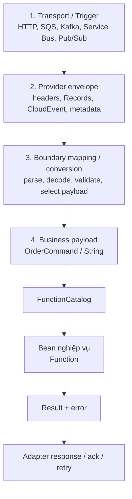
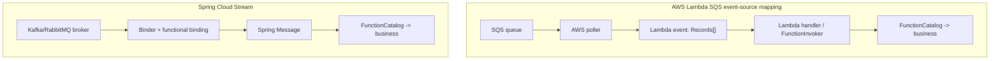
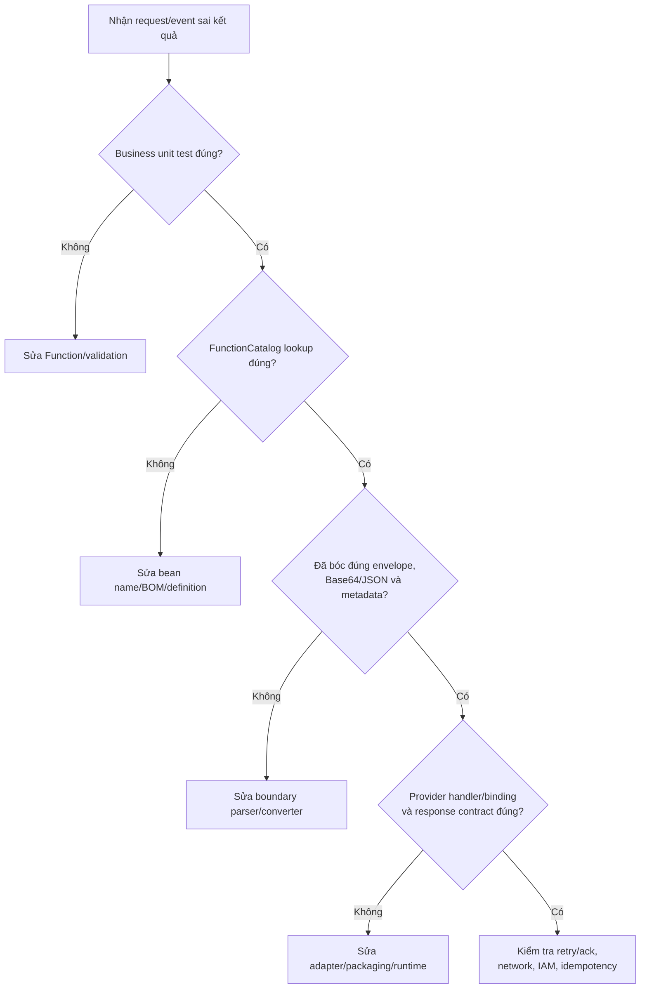

# Sự kiện HTTP, sự kiện broker và cấu trúc bao dữ liệu

> **Chương:** Serverless  
> **Module:** SPRING_CLOUD_FUNCTION  
> **Trọng tâm:** Nhận diện đúng sự khác nhau giữa HTTP request, message broker, event envelope và payload nghiệp vụ; chuyển từng loại dữ liệu vào `Supplier`, `Function`, `Consumer` qua adapter và `FunctionCatalog`, thay vì để logic kinh doanh phụ thuộc giao thức.  
> **Mốc minh họa:** 24/11/2026. Ví dụ dùng Java 21, Spring Boot 4.2.0, Spring Cloud BOM 2026.0.0 và Spring Cloud Function 5.1.0. Định dạng event phải luôn đối chiếu với phiên bản trigger/provider thực tế.

## 1. Một nghiệp vụ, nhiều “hình dạng” của đầu vào

Hãy xét chức năng chuẩn hóa mã đơn hàng: nhận `"  od-123  "`, trả `"OD-123"`. Trong Java, bản chất của nó có thể là:

```java
Function<String, String> normalizeCode =
        raw -> raw.trim().toUpperCase(Locale.ROOT);
```

Nhưng mã đó có thể đến từ nhiều nguồn:

1. **HTTP trực tiếp:** client gửi `POST /normalizeCode` với body `text/plain`.
2. **API Gateway → AWS Lambda:** Lambda nhận một JSON *proxy event* có `headers`, `requestContext`, `body`, `isBase64Encoded`.
3. **Amazon SQS → AWS Lambda:** Lambda nhận một JSON bao `Records`; mỗi record chứa `messageId` và `body`.
4. **Azure Service Bus → Azure Functions:** worker gọi method có `@ServiceBusQueueTrigger`, truyền message body và metadata theo binding.
5. **Google Pub/Sub → Eventarc/Cloud Run functions:** có CloudEvents `id`, `source`, `type`, còn Pub/Sub message nằm trong event `data`; payload con có thể là Base64.
6. **Kafka/RabbitMQ → Spring Cloud Stream:** binder nhận message và chuyển nó vào function theo bindings/configuration, khác với việc Lambda nhận raw event JSON.

**Từ `Function<String,String>` không thể suy ra “framework tự tìm đúng mã ở mọi envelope”.** Spring Cloud Function cung cấp contract và conversion, còn lớp nhận event phải biết schema cụ thể để tách đúng payload nghiệp vụ.

### 1.1. Bốn lớp dữ liệu



Bốn lớp này không đồng nghĩa nhau:

- **Transport** là cách thông điệp di chuyển và được kích hoạt.
- **Envelope** là cấu trúc bao chứa metadata do protocol/provider quy định.
- **Business payload** là dữ liệu mà bài toán cần để tính toán.
- **Spring `Message<T>`** là một mô hình trung gian **trong ứng dụng** gồm payload và headers, không phải một event format chung của mọi provider.

### 1.2. Mục tiêu học tập

Sau bài này, bạn có thể:

- Chỉ ra phần **HTTP method/path/headers/body** và phân biệt proxy event với body thực.
- Bóc một SQS batch thành từng record, phân biệt `messageId` với `receiptHandle` và kết quả partial failure.
- Đọc đúng cấu trúc Pub/Sub qua CloudEvents, xác định bước decode Base64 và lớp JSON lồng nhau.
- Thiết kế một `OrderCommand` trung lập rồi gọi cùng `Function` từ các loại event.
- Biết khi nào conversion của `FunctionCatalog`/`MessageConverter` đủ dùng và khi nào cần mapping riêng.
- Giải thích sự khác nhau giữa HTTP response, xử lý event bất đồng bộ, acknowledgement, retry và idempotency.
- Viết test ở từng tầng, không nhầm unit test với việc đã kiểm chứng cloud handler.

## 2. Từ vựng cần phân biệt trước khi xem JSON

| Khái niệm | Ý nghĩa | Ví dụ |
| --- | --- | --- |
| **Request** | Một lời gọi có phương thức, địa chỉ, headers và body. | HTTP `POST /normalize`. |
| **Event** | Bản ghi “đã xảy ra điều gì” hoặc một thông báo kích hoạt. | `orders.created`, SQS record. |
| **Envelope** | Cấu trúc bên ngoài bao payload và metadata. | API Gateway proxy JSON, SQS `Records`, CloudEvent. |
| **Payload** | Nội dung ứng dụng xử lý; đôi khi lại chứa JSON cần parse tiếp. | `"  od-123  "` hoặc `OrderCommand`. |
| **Message attributes/headers** | Metadata truyền kèm payload. | `contentType`, `correlationId`, `traceId`. |
| **Execution context** | Metadata do runtime cung cấp ở lúc gọi. | AWS Lambda `Context`, Azure `ExecutionContext`. |
| **Delivery attempt** | Một lần nguồn đưa message tới handler. | SQS `ApproximateReceiveCount`. |
| **Business event ID** | Định danh ổn định cho một sự kiện nghiệp vụ. | `evt-42`; dùng đúng phạm vi để chống trùng. |
| **Invocation/request ID** | Định danh lần chạy do runtime cấp. | Một retry có thể có request ID mới. |
| **Correlation ID** | Mã liên kết nhiều lời gọi/đoạn trace. | `corr-7`. |
| **Content type** | Mô tả định dạng phần dữ liệu tương ứng. | `text/plain`, `application/json`. |

Đặc biệt, **`Content-Type: application/json` ở lớp ngoài không có nghĩa payload nghiệp vụ bên trong cũng là JSON**. Một CloudEvent HTTP có body JSON mô tả Pub/Sub message, nhưng trường `message.data` có thể là Base64 của text thuần, JSON khác hoặc bytes.

### 2.1. Một event có thể chứa nhiều “lớp bọc”

```text
HTTP request to Eventarc receiver
└── CloudEvent context (ce-id, ce-type, ce-source...)
    └── HTTP body: Pub/Sub MessagePublishedData (JSON)
        └── message
            ├── messageId
            ├── attributes
            └── data: Base64 string
                └── decoded bytes
                    └── OrderCommand hoặc một mã chuỗi
```

Tương tự:

```text
AWS Lambda invocation
└── SQS event object
    └── Records[]            <-- có thể nhiều record trong một invocation
        ├── messageId
        ├── receiptHandle
        ├── attributes
        └── body: String
            └── có thể là JSON text hoặc text/plain nghiệp vụ
```

Không dùng `toString()` trên toàn bộ event để làm input cho `normalizeCode`. Hãy nắm rõ schema và trích đúng trường.

## 3. HTTP trực tiếp: request body không phải proxy event

### 3.1. Gọi Spring Cloud Function Web adapter

Với Spring Boot Web application có `spring-cloud-starter-function-web` và bean:

```java
@Bean
public Function<String, String> normalizeCode() {
    return raw -> raw.trim().toUpperCase(Locale.ROOT);
}
```

client có thể gửi request:

```http
POST /normalizeCode HTTP/1.1
Host: localhost:8080
Content-Type: text/plain
Accept: text/plain
X-Correlation-Id: corr-7

  od-123  
```

Response thường có `200 OK` và body `OD-123`. Điều quan trọng là Web adapter biết lấy **HTTP body** và chuyển vào function theo kiểu khai báo; lambda không cần nhận `HttpServletRequest`.

Kiểm thử bằng cURL (khi Web server đã chạy):

```bash
curl -i -X POST http://localhost:8080/normalizeCode \
  -H "Content-Type: text/plain" \
  -H "Accept: text/plain" \
  -H "X-Correlation-Id: corr-7" \
  --data-raw "  od-123  "
```

Đây là **Web adapter của Spring Cloud Function chạy HTTP trực tiếp**; không phải ví dụ payload Lambda proxy. HTTP header được đưa vào Spring Messaging thế nào còn tùy adapter và quy tắc headers, không tự bảo đảm `X-Correlation-Id` sẽ xuất hiện lại trong response.

### 3.2. Những phần trong HTTP request

| Vị trí | Giá trị ví dụ | Ý nghĩa |
| --- | --- | --- |
| Method | `POST` | Hành động giao thức. |
| URL/path | `/normalizeCode` | Route mà Web adapter ánh xạ. |
| `Content-Type` | `text/plain` | Định dạng request body. |
| `Accept` | `text/plain` | Dạng response client mong muốn. |
| `X-Correlation-Id` | `corr-7` | Metadata ứng dụng, nếu tin cậy và có policy. |
| Body | `"  od-123  "` | Payload để `Function<String,String>` xử lý. |

Method/URL là thông tin transport. Bean nghiệp vụ chỉ cần raw code. Việc xác thực người dùng, quyền gọi và ánh xạ HTTP status thuộc boundary, không nên nhét vào thuật toán chuẩn hóa.

### 3.3. Nếu body là JSON

Giả sử bean chuyển sang `Function<OrderCommand,OrderResult>`. HTTP client gửi:

```http
POST /normalizeCommand HTTP/1.1
Host: localhost:8080
Content-Type: application/json
Accept: application/json

{"eventId":"evt-42","code":"  od-123  ","correlationId":"corr-7"}
```

Khi JSON converter và chữ ký generic được cấu hình phù hợp, framework có thể tạo `OrderCommand`. Tuy nhiên:

- JSON sai cú pháp có thể thất bại **trước** lúc gọi bean.
- JSON parse thành DTO được nhưng `code` rỗng vẫn cần validation nghiệp vụ.
- `eventId` trong body là business metadata do bên gửi khai báo; phải xét mức tin cậy.
- DTO record/class phải tương thích với converter thực tế của phiên bản Spring Boot/Function.

**Không tự kết luận mọi JSON đều được chuyển được chỉ vì header là `application/json`.** Kiểu đầu vào và bộ converter mới quyết định.

## 4. API Gateway → AWS Lambda: HTTP bị bao thành một event khác

### 4.1. Vì sao Lambda nhận JSON chứa HTTP request?

Khi HTTP API của API Gateway tích hợp Lambda theo dạng proxy, runtime Lambda không trực tiếp gọi `@Bean` bằng HTTP body. API Gateway xây một **event JSON** mô tả HTTP request rồi truyền nó cho Lambda handler.

AWS hiện mô tả hai payload format version chính là `1.0` và `2.0` cho Lambda proxy integrations. Phải chọn đúng version ở integration; schema của chúng không hoàn toàn giống nhau.

### 4.2. Fixture rút gọn của HTTP API payload format 2.0

```json
{
  "version": "2.0",
  "routeKey": "POST /normalize",
  "rawPath": "/normalize",
  "rawQueryString": "",
  "headers": {
    "content-type": "text/plain",
    "x-event-id": "evt-http-42",
    "x-correlation-id": "corr-7"
  },
  "requestContext": {
    "http": {
      "method": "POST",
      "path": "/normalize"
    }
  },
  "body": "  od-123  ",
  "isBase64Encoded": false
}
```

Đây là **fixture rút gọn** các trường quan trọng, không phải JSON đầy đủ của một request API Gateway thực tế. Ở format 2.0, version, headers, `rawPath`, `requestContext.http`, `body` và `isBase64Encoded` có vai trò như đã mô tả trong tài liệu AWS.

Hàm nghiệp vụ cần nhận `"  od-123  "`, **không phải chuỗi JSON của toàn bộ object**.

### 4.3. Bước decode `isBase64Encoded`

`body` của proxy event có thể ở dạng text thường hoặc Base64. Adapter/handler phải kiểm tra:

```java
byte[] bytes = isBase64Encoded
        ? Base64.getDecoder().decode(body)
        : body.getBytes(StandardCharsets.UTF_8);

String rawCode = new String(bytes, StandardCharsets.UTF_8);
```

Đây là snippet minh họa, cần import `java.util.Base64` và `java.nio.charset.StandardCharsets`. Logic này chỉ đúng khi **business contract dùng UTF-8 text**; nếu request upload binary, cần xử lý bytes và content type, không ép sang String.

Không decode Base64 thêm lần thứ hai khi `isBase64Encoded=false`. Cũng không mặc định rằng mọi text body là JSON.

### 4.4. Response proxy không phải chỉ một Java String

Đối với response proxy format 2.0, Lambda có thể trả cấu trúc như:

```json
{
  "statusCode": 200,
  "headers": {
    "content-type": "text/plain"
  },
  "body": "OD-123",
  "isBase64Encoded": false
}
```

AWS API Gateway format 2.0 cũng có cơ chế suy diễn response trong một số trường hợp khi Lambda trả JSON không kèm `statusCode`. Nhưng để hợp đồng API rõ ràng về status, headers, cookies hoặc binary, hãy áp dụng đúng quy tắc response format của integration đang dùng.

**Không giả định generic `FunctionInvoker` luôn tự tạo response proxy theo đúng mọi cấu hình API Gateway.** Khi cần kiểm soát request context và HTTP status, có thể dùng kiểu event/response AWS thích hợp hoặc một mapping layer rõ ràng; kiểm thử với API Gateway integration thực tế.

### 4.5. Format 1.0 và 2.0 khác nhau thế nào?

| Chi tiết | HTTP API payload format 1.0 | HTTP API payload format 2.0 |
| --- | --- | --- |
| Đường dẫn request | `path` và trường liên quan. | `rawPath`. |
| Header trùng tên | Có thể có `multiValueHeaders`. | Gộp giá trị vào `headers`, không có `multiValueHeaders`. |
| Query parameter trùng | Có thể có `multiValueQueryStringParameters`. | Gộp vào `queryStringParameters`. |
| Cookies | Theo header/format 1.0. | Có trường `cookies` riêng. |
| Response | Proxy response có cấu trúc bắt buộc theo contract. | Có cả cơ chế suy diễn trong một số trường hợp. |

Bảng nói về **HTTP API Lambda proxy integrations**. Không đem nguyên schema đó áp cho **REST API**, Lambda Function URLs hay ALB mà không kiểm tra loại integration tương ứng.

Tài liệu AWS: https://docs.aws.amazon.com/apigateway/latest/developerguide/http-api-develop-integrations-lambda.html

## 5. Broker event: SQS/Kafka không có ý nghĩa giống HTTP response

### 5.1. Message broker là gì?

Một broker giữ/truyền message giữa producer và consumer theo hợp đồng của công nghệ đó. Với queue, một message có thể được giao lại; với log như Kafka, consumer quản lý offset/partition và thứ tự trong phạm vi nhất định. Trái với HTTP request/response đồng bộ, message thường được xử lý **bất đồng bộ**.

Một broker message thường có:

- **Payload/body**: bytes, String hoặc serialized DTO.
- **Message key / message ID**: định danh với ý nghĩa khác nhau tùy broker.
- **Headers/attributes**: content type, correlation ID, schema version...
- **Delivery metadata**: timestamp, offset, partition, receive count, lock token, receipt handle...
- **Delivery/ack contract**: cách xác định xử lý thành công và xử lý lại.

**Không có một “JSON chuẩn broker” dùng chung cho SQS, Kafka, RabbitMQ, Azure Service Bus và Pub/Sub.** Broker có thể truyền bytes/native records; JSON xuất hiện khi client/adapter serialize event, không phải lúc nào cũng là envelope do broker tạo.

### 5.2. Hai mô hình tích hợp cần phân biệt



**SQS → Lambda:** Lambda service poll queue, tạo một event bao records và invoke handler. **Spring Cloud Stream:** binder dùng consumer client/binding của ứng dụng để đưa message tới function. Cả hai có thể sử dụng logic Java giống nhau nhưng **không cùng contract đầu vào**.

## 6. Amazon SQS → Lambda: một invocation có thể chứa nhiều records

### 6.1. Fixture SQS rút gọn

```json
{
  "Records": [
    {
      "messageId": "m-1",
      "receiptHandle": "opaque-handle-1",
      "body": " od-123 ",
      "attributes": {
        "ApproximateReceiveCount": "1"
      },
      "messageAttributes": {},
      "eventSource": "aws:sqs",
      "awsRegion": "ap-southeast-1"
    },
    {
      "messageId": "m-2",
      "receiptHandle": "opaque-handle-2",
      "body": " ab-12 ",
      "attributes": {
        "ApproximateReceiveCount": "1"
      },
      "messageAttributes": {},
      "eventSource": "aws:sqs",
      "awsRegion": "ap-southeast-1"
    }
  ]
}
```

Đây là **sample rút gọn**; payload sự kiện thật còn có các trường khác như ARN và metadata broker. Hai `body` của ví dụ được giả định là **text/plain chứa mã**, không phải JSON domain DTO. Nếu producer gửi:

```json
{
  "eventId": "evt-42",
  "code": "  od-123  "
}
```

thì `body` của SQS record sẽ là **chuỗi JSON** (với dấu nháy được escape trong JSON ngoài), cần parse một lần nữa để trích `code`.

### 6.2. Các ID trong SQS event

| Trường | Vai trò | Có nên dùng làm idempotency key? |
| --- | --- | --- |
| `messageId` | Định danh message của SQS. | Có thể là một khóa kỹ thuật khi scope/retention phù hợp; không thay business operation ID trong mọi trường hợp. |
| `receiptHandle` | Token nhận message ở một lần delivery, dùng cho thao tác queue. | **Không**; có thể thay đổi khi message được giao lại. |
| `ApproximateReceiveCount` | Số lần nhận gần đúng, phục vụ chẩn đoán retry. | **Không**; không phải ID. |
| `eventId` trong body | Định danh do producer nghiệp vụ khai báo. | Thường tốt hơn nếu bảo đảm duy nhất và ổn định theo operation. |
| `awsRequestId` từ Lambda `Context` | Định danh một invocation runtime. | **Không** cho duplicate business event qua nhiều invocation. |

Lỗi phổ biến là dùng receipt handle hoặc invocation ID làm khóa chống trùng, khiến một message bị giao lại có khóa khác và side effect chạy lần nữa.

### 6.3. Batch semantics

AWS Lambda event source mapping cho SQS nhận và nhóm messages; một invocation có thể xử lý nhiều records. Mặc định, nếu function **thất bại cả batch**, các messages trong batch có thể được giao lại sau visibility timeout, kể cả record đã xử lý xong.

Để tránh retry lại record thành công khi chỉ một số record lỗi, AWS hỗ trợ **partial batch response** nếu event source mapping bật `ReportBatchItemFailures`.

Ví dụ response của một batch có record `m-2` thất bại:

```json
{
  "batchItemFailures": [
    {
      "itemIdentifier": "m-2"
    }
  ]
}
```

Trong AWS SDK for Java, Spring Cloud Function AWS adapter có thể dùng bean với provider types:

```java
@Bean
public Function<SQSEvent, SQSBatchResponse> processSqsBatch() {
    // Phân rã records, gọi logic chung rồi trả đúng failures.
    // Cần dependency aws-lambda-java-events và implementation thực tế.
    return event -> ...;
}
```

Đây là **pseudo-code về chữ ký**, không phải Java độc lập: `SQSEvent`/`SQSBatchResponse` thuộc AWS event library và phần xử lý batch còn phải viết. Tài liệu Spring Cloud Function AWS xác nhận generic `FunctionInvoker` có thể dùng với provider-specific event types khi cần partial batch response.

### 6.4. Lưu ý đặc biệt với FIFO

Với SQS FIFO, thứ tự và message groups quan trọng. Khi xử lý batch gặp record lỗi, chiến lược partial batch cần **dừng xử lý các record còn lại trong nhóm/thứ tự liên quan và báo cả các record chưa xử lý** theo khuyến nghị AWS, thay vì tiếp tục tùy ý như Standard queue.

Ví dụ demo trong mục Java ở dưới minh họa **Standard queue semantics** và không được sao chép nguyên xi để xử lý FIFO cần ordering.

Tài liệu AWS: https://docs.aws.amazon.com/lambda/latest/dg/with-sqs.html

## 7. Kafka/RabbitMQ qua Spring Cloud Stream: Message và binding

### 7.1. Binder đưa dữ liệu tới `FunctionCatalog`

Spring Cloud Stream cho phép gắn functional bean vào destinations. Ví dụ bean:

```java
@Bean
public Function<OrderCommand, OrderResult> normalizeCommand() {
    return command -> /* ... */;
}
```

Với Kafka binder (dependency/version tương thích) có thể cấu hình:

```properties
spring.cloud.function.definition=normalizeCommand
spring.cloud.stream.bindings.normalizeCommand-in-0.destination=raw-orders
spring.cloud.stream.bindings.normalizeCommand-out-0.destination=normalized-orders
spring.cloud.stream.bindings.normalizeCommand-in-0.content-type=application/json
spring.cloud.stream.kafka.binder.brokers=localhost:9092
```

Đây là **phác thảo cấu hình**, cần thêm dependency `spring-cloud-starter-stream-kafka`, Kafka broker, serializers/consumers và chính sách nhóm consumer, security, retry trước khi chạy. Nó không có nghĩa SQS `Records` sẽ xuất hiện ở input.

### 7.2. Kafka record khác với SQS Records[]

Một Kafka record có topic, partition, offset, timestamp, key, value và headers. Stream binder quản lý cách nhận record và đưa phần payload/metadata cần thiết vào Spring `Message<?>`. Điều đó khác với Lambda handler nhận một object SQS `{"Records":[...]}`.

Kafka `offset` không phải event ID nghiệp vụ. Nếu reprocess một record ở cùng offset, dedup có thể dùng topic/partition/offset trong phạm vi cụ thể, nhưng **business idempotency** thường cần khóa ở mức operation.

### 7.3. Header mapping và native serialization

Spring Cloud Stream có các cấu hình liên quan:

- `content-type` trên binding.
- `headerMode` để sử dụng native headers hoặc cơ chế embedded headers khi middleware phù hợp.
- `useNativeEncoding`/decoding để giao serializer/deserializer cho client của broker.

Không nên giả định mọi Kafka/RabbitMQ header tự động trùng tên với HTTP headers hoặc CloudEvent attributes. Với nhà sản xuất không dùng Spring, phải thống nhất **wire contract**, schema version, charset và tên header.

### 7.4. Consumer không trả HTTP response

`Consumer<OrderCommand>` có phương thức `accept(...)` trả `void`, không tương đương HTTP status 200. Broker/binder quyết định acknowledgement/commit/retry theo cơ chế đã cấu hình. Nghiệp vụ còn phải xử lý idempotency nếu event được giao lại.

Spring Cloud Stream reference: https://docs.spring.io/spring-cloud-stream/reference/

## 8. Azure Functions: HTTP trigger và Service Bus trigger

### 8.1. Azure HTTP trigger

Azure Java Functions dùng annotation `@FunctionName`, `@HttpTrigger` và kiểu như `HttpRequestMessage<Optional<String>>` để khai báo handler HTTP. Spring Cloud Function Azure adapter có thể inject Spring bean hoặc `FunctionCatalog` vào handler.

Đường đi logic:

```text
HTTP request
  -> Azure HTTP trigger / annotated Java handler
  -> trích body + headers + xác thực
  -> FunctionCatalog.lookup("normalizeCommand")
  -> normalizeCommand.apply(OrderCommand)
  -> Azure HttpResponseMessage
```

Tùy contract, handler cần đặt HTTP status và body rõ ràng. Việc dùng `@Bean` không tự tạo Azure HTTP trigger; plugin/worker vẫn cần nhận annotation và binding.

### 8.2. Service Bus queue/topic trigger

Azure Service Bus hỗ trợ message body và metadata như message ID, delivery count, enqueue time, correlation/application properties. Với Java Azure Functions, annotation `@ServiceBusQueueTrigger` hoặc `@ServiceBusTopicTrigger` gắn một handler với queue hoặc subscription.

Pseudo-handler chỉ minh họa boundary:

```java
@FunctionName("normalizeQueue")
public void onMessage(
        @ServiceBusQueueTrigger(
                name = "message",
                queueName = "raw-orders",
                connection = "ServiceBusConnection")
        String messageBody,
        ExecutionContext context) {

    // Parse messageBody theo schema producer,
    // tạo OrderCommand rồi gọi bean nghiệp vụ.
    // Chính sách hoàn tất/retry thuộc Azure Service Bus trigger.
}
```

Cần Azure Java SDK/annotations, plugin và cấu hình app settings thích hợp; đoạn này **không phải project Azure chạy độc lập**. `messageBody` là input của binding, không phải toàn bộ HTTP request hay CloudEvent.

### 8.3. Hoàn tất message và dead-letter

Với Service Bus, cơ chế **PeekLock**, delivery count, auto-completion và dead-letter phụ thuộc trigger extension/runtime và host configuration. Khi handler thất bại, message có thể bị abandon/được giao lại; việc settle message không đồng nhất với việc trả một chuỗi Java thành công.

Azure HTTP 200 và Service Bus message complete là **hai hợp đồng hoàn tất khác nhau**. Phải kiểm thử từng trigger với batch, retry, poison message và lock timeout phù hợp.

Tài liệu Azure: https://learn.microsoft.com/en-us/azure/azure-functions/functions-bindings-service-bus-trigger

## 9. Google Pub/Sub và CloudEvents: HTTP transport có thể chở một event

### 9.1. Eventarc dùng CloudEvents

Google Eventarc có thể chuyển sự kiện tới Cloud Run functions/service dưới dạng **CloudEvents 1.0 qua HTTP POST**. Đây là một trường hợp dễ nhầm: **transport bên ngoài là HTTP**, nhưng **ý nghĩa dữ liệu là một event từ broker**, không phải một request API nghiệp vụ thông thường.

Trong binding HTTP của CloudEvents, một số header có tên:

```http
ce-specversion: 1.0
ce-id: 10042
ce-source: //pubsub.googleapis.com/projects/demo/topics/orders
ce-type: google.cloud.pubsub.topic.v1.messagePublished
content-type: application/json
```

Các header `ce-*` là **event context**, không phải mã đơn hàng.

### 9.2. Pub/Sub message bên trong CloudEvent

Body HTTP minh họa cho Eventarc Pub/Sub message:

```json
{
  "message": {
    "messageId": "m-pub-1",
    "data": "b2QtMTIz",
    "attributes": {
      "contentType": "text/plain",
      "correlationId": "corr-7"
    },
    "publishTime": "2026-11-24T08:30:00Z"
  },
  "subscription": "projects/demo/subscriptions/orders-sub"
}
```

Trong ví dụ, `b2QtMTIz` là Base64 của `od-123`. Cần decode thành bytes rồi diễn giải bytes theo schema/charset của producer:

```java
byte[] decoded = Base64.getDecoder().decode("b2QtMTIz");
String code = new String(decoded, StandardCharsets.UTF_8);
System.out.println(code); // od-123
```

**Không gọi `normalizeCode.apply("b2QtMTIz")`** — đó là chuỗi Base64, không phải mã đơn hàng. Và **không kết luận `content-type: application/json` của HTTP ngoài nghĩa là `message.data` cũng là JSON**. JSON ngoài mô tả message; dữ liệu bên trong có định dạng riêng.

### 9.3. CloudEvents structured format khác binary HTTP binding

CloudEvents có thể biểu diễn context theo hai kiểu phổ biến:

- **Binary mode:** các thuộc tính `ce-id`, `ce-type`... nằm ở HTTP headers; body mang event data.
- **Structured mode:** object JSON chứa `specversion`, `id`, `source`, `type`, `data`.

Ví dụ structured representation:

```json
{
  "specversion": "1.0",
  "id": "10042",
  "source": "//pubsub.googleapis.com/projects/demo/topics/orders",
  "type": "google.cloud.pubsub.topic.v1.messagePublished",
  "datacontenttype": "application/json",
  "data": {
    "message": {
      "messageId": "m-pub-1",
      "data": "b2QtMTIz"
    }
  }
}
```

Đây là **một representation CloudEvent hợp lệ về mặt ý tưởng**, không phải tuyên bố rằng Eventarc luôn gửi nguyên object structured JSON này đến handler Java. Eventarc HTTP binding mà Google mô tả đặt `ce-*` trong HTTP headers; các môi trường trung gian có thể chuyển thành structured JSON cho consumer khác. Phải kiểm tra contract của trigger và framework cụ thể.

### 9.4. GCP adapter/launcher và business bean

Spring Cloud Function GCP adapter cung cấp launcher `org.springframework.cloud.function.adapter.gcp.GcfJarLauncher` cho loại triển khai được hỗ trợ. Còn Functions Framework Java có interface riêng cho HTTP/CloudEvents.

Không đánh đồng:
 
- GCP **entrypoint**.
- CloudEvent **event schema**.
- Spring Cloud Function **bean name**.
- `OrderCommand` **business schema**.

Một Java `Function<OrderCommand,OrderResult>` không tự hiểu Pub/Sub message envelope khi chưa có mapping từ `message.data` thành `OrderCommand`.

Nguồn Google: https://docs.cloud.google.com/eventarc/docs/cloudevents

## 10. Thiết kế envelope trung lập cho ứng dụng

### 10.1. Có cần một universal envelope?

Một tổ chức có thể muốn thống nhất schema nội bộ:

```json
{
  "eventId": "evt-42",
  "eventType": "orders.normalize.requested",
  "source": "order-api",
  "schemaVersion": 1,
  "occurredAt": "2026-11-24T08:30:00Z",
  "correlationId": "corr-7",
  "contentType": "text/plain",
  "payload": "  od-123  "
}
```

**Đây là schema nội bộ minh họa, không phải AWS/Azure/GCP chuẩn.** Nó giúp service nội bộ thống nhất contract, nhưng khi đi qua API Gateway/SQS/PubSub vẫn có **envelope của provider bọc bên ngoài**, hoặc cần converter riêng.

### 10.2. Ranh giới “ngoài → trong”

Một cách chia trách nhiệm:

| Lớp | Ví dụ | Ai sở hữu? |
| --- | --- | --- |
| Provider envelope | `Records`, `requestContext`, `ce-id` | Nhà cung cấp/binder. |
| Boundary DTO | `HttpEnvelope`, `SqsRecord`, `PubSubEnvelope` | Adapter của ứng dụng. |
| Canonical command | `OrderCommand(eventId,code,correlationId)` | Contract nghiệp vụ. |
| Domain result | `OrderResult(eventId,normalizedCode,correlationId)` | Logic nghiệp vụ. |
| Provider response | HTTP proxy status/body, SQS failures, event completion | Boundary/adapter/runtime. |

**Chỉ có `OrderCommand` và `OrderResult` thực sự cần giống nhau trên nhiều provider.** Các lớp envelope ở boundary có thể khác nhau và không nên nằm trong domain model nếu không cần.

### 10.3. Chọn event ID và schema version

- **`eventId`:** nên ổn định qua retry và duy nhất trong phạm vi event source; khi cần đảm bảo trên nhiều nguồn, kết hợp `source` hoặc business operation ID.
- **`schemaVersion`:** version của payload do producer/consumer thỏa thuận, không nhất thiết bằng version API Gateway 2.0 hay CloudEvents specversion 1.0.
- **`correlationId`:** phục vụ trace, có thể không duy nhất theo event.
- **`occurredAt`:** thời điểm producer tạo event, không phải thời điểm consumer xử lý.

Chọn một field từ provider làm khóa dedup có thể hữu ích, nhưng phải hiểu thời gian giữ khóa, phạm vi duy nhất và sự khác nhau giữa retry và một business event mới có payload giống nhau.

## 11. Chuyển đổi thông điệp trong Spring Cloud Function

### 11.1. `FunctionCatalog` không thay thế parser event

Spring Cloud Function phát hiện các bean `Supplier`, `Function`, `Consumer` và cung cấp `FunctionCatalog.lookup(...)`. Catalog có thể trả wrapper giúp composition và conversion theo chữ ký function.

Ví dụ:

```java
Function<OrderCommand, OrderResult> fn =
        catalog.lookup("normalizeCommand");
OrderResult result = fn.apply(
        new OrderCommand("evt-42", "  od-123  ", "corr-7"));
```

Nếu truyền một object `SQSEvent` trực tiếp vào hàm đòi `OrderCommand` mà không có mapping, chưa có lý do để conversion tự hiểu `Records[0].body`. Đó là **thay đổi schema có cấu trúc**, không chỉ chuyển byte[] sang String.

### 11.2. `Message<T>` gồm payload và headers

Spring Messaging có `Message<T>` và `MessageHeaders`:

```java
Message<OrderCommand> message = MessageBuilder
        .withPayload(new OrderCommand(
                "evt-42", "  od-123  ", "corr-7"))
        .setHeader(MessageHeaders.CONTENT_TYPE, "application/json")
        .setHeader("correlationId", "corr-7")
        .build();
```

Đoạn này cần import `org.springframework.messaging.Message`, `MessageHeaders` và `MessageBuilder`; `OrderCommand` là record nghiệp vụ ở phần code đầy đủ phía sau.

**Headers của Spring Message không đồng nghĩa mọi provider headers.** Adapter quyết định ánh xạ trường nào, kiểu dữ liệu gì, có lọc metadata bảo mật hay không.

### 11.3. `MessageConverter` và `ConversionService`

Theo tài liệu Spring Cloud Function:

1. Khi framework nhận **Spring Message** chứa raw payload, `MessageConverter` có thể chuyển nó thành kiểu đích do chữ ký `Function<T,R>` xác định.
2. Khi nhận **non-Message input**, Spring có thể dùng `ConversionService`.
3. Header `contentType` giúp chọn converter. Nếu thiếu content type, mặc định thường là `application/json` cho message conversion.
4. Converter có thể chuyển `byte[]`/String JSON thành POJO khi JSON library, schema và kiểu đích phù hợp.

Nhưng **content type là gợi ý, không phải phép đoán schema vô hạn**. Không có converter phù hợp hoặc dữ liệu sai cấu trúc thì invocation có thể thất bại.

### 11.4. Mỗi lớp có content type riêng

```text
HTTP API Gateway:
  request Content-Type: text/plain
  event.body: String (đã Base64 decode nếu flag true)
  business type: String

GCP Eventarc:
  outer Content-Type: application/json
  CloudEvent data: PubSub MessagePublishedData JSON
  PubSub message.data: Base64 bytes
  business type: String hoặc OrderCommand theo schema trong bytes

Kafka + Stream:
  native serializer/deserializer hoặc binding content-type
  Spring Message payload/header do binder chuyển
  business type: OrderCommand
```

Một lỗi debug thường gặp là sửa `@Bean Function<String,String>` khi thực tế dữ liệu đầu vào vẫn là một Base64 string hoặc JSON envelope ngoài chưa được bóc tách.

### 11.5. Đừng dùng client-provided class name để deserialize tùy ý

Đặc biệt nếu sử dụng `Content-Type: application/json;type=...` để chọn class động, Spring Cloud Function hiện có cơ chế **whitelist** kiểu được phép deserialize (`META-INF/deserializable.types`). Tránh cho nguồn event không tin cậy yêu cầu load class tùy ý. Với domain có schema ổn định, ưu tiên chữ ký generic cụ thể và DTO rõ ràng.

## 12. Dự án thực hành: một bean, ba boundary adapters mô phỏng

Mục tiêu ở phần này không phải deploy ba cloud cùng lúc. Ta tạo project **chạy và test được trong Spring Boot** mà không cần cloud account, để nhìn thấy bước mapping:

- HTTP proxy-style input → `OrderCommand`.
- SQS-like batch input → nhiều `OrderCommand`.
- Pub/Sub-like message → Base64 decode → `OrderCommand`.
- Tất cả đi vào một bean `Function<OrderCommand,OrderResult> normalizeCommand`.

**Các lớp envelope bên dưới là mô phỏng tối giản**, không phải class provider SDK. Vì vậy chúng không tự trở thành AWS Lambda/Azure/GCP handler. Khi deploy, thay mapping bằng event type/binding thật và test theo runtime.

### 12.1. Maven `pom.xml`

```xml
<?xml version="1.0" encoding="UTF-8"?>
<project xmlns="http://maven.apache.org/POM/4.0.0"
         xmlns:xsi="http://www.w3.org/2001/XMLSchema-instance"
         xsi:schemaLocation="http://maven.apache.org/POM/4.0.0
           https://maven.apache.org/xsd/maven-4.0.0.xsd">

    <modelVersion>4.0.0</modelVersion>

    <parent>
        <groupId>org.springframework.boot</groupId>
        <artifactId>spring-boot-starter-parent</artifactId>
        <version>4.2.0</version>
        <relativePath/>
    </parent>

    <groupId>vn.example</groupId>
    <artifactId>event-envelope-demo</artifactId>
    <version>0.0.1-SNAPSHOT</version>

    <properties>
        <java.version>21</java.version>
        <spring-cloud.version>2026.0.0</spring-cloud.version>
    </properties>

    <dependencyManagement>
        <dependencies>
            <dependency>
                <groupId>org.springframework.cloud</groupId>
                <artifactId>spring-cloud-dependencies</artifactId>
                <version>${spring-cloud.version}</version>
                <type>pom</type>
                <scope>import</scope>
            </dependency>
        </dependencies>
    </dependencyManagement>

    <dependencies>
        <dependency>
            <groupId>org.springframework.boot</groupId>
            <artifactId>spring-boot-starter</artifactId>
        </dependency>
        <dependency>
            <groupId>org.springframework.cloud</groupId>
            <artifactId>spring-cloud-function-context</artifactId>
        </dependency>
        <dependency>
            <groupId>org.springframework.boot</groupId>
            <artifactId>spring-boot-starter-test</artifactId>
            <scope>test</scope>
        </dependency>
    </dependencies>

    <build>
        <plugins>
            <plugin>
                <groupId>org.springframework.boot</groupId>
                <artifactId>spring-boot-maven-plugin</artifactId>
            </plugin>
        </plugins>
    </build>
</project>
```

`spring-cloud-dependencies` quản lý version module Spring Cloud; `spring-cloud-function-context` mới cung cấp catalog và tích hợp bean. Ví dụ không thêm Web starter hoặc cloud adapters vì **chỉ kiểm thử logic và boundary mapping mô phỏng**.

### 12.2. Cấu trúc file

```text
event-envelope-demo/
├── pom.xml
└── src/
    ├── main/
    │   ├── java/
    │   │   └── vn/example/envelope/
    │   │       ├── EventEnvelopeApplication.java
    │   │       └── EnvelopeBoundary.java
    │   └── resources/
    │       └── application.properties
    └── test/
        └── java/
            └── vn/example/envelope/
                └── EnvelopeBoundaryTest.java
```

Tạo `src/main/resources/application.properties`:

```properties
spring.application.name=event-envelope-demo
spring.main.web-application-type=none
spring.cloud.function.definition=normalizeCommand
```

`web-application-type=none` làm ứng dụng **không mở HTTP port**. Những HTTP request trong ví dụ được biểu diễn bằng record và test boundary; muốn gọi cURL thật, cần thêm Web adapter/handler sau.

### 12.3. Bean nghiệp vụ với record DTO

Tạo `src/main/java/vn/example/envelope/EventEnvelopeApplication.java`:

```java
package vn.example.envelope;

import java.util.Locale;
import java.util.function.Function;

import org.springframework.boot.SpringApplication;
import org.springframework.boot.autoconfigure.SpringBootApplication;
import org.springframework.context.annotation.Bean;

@SpringBootApplication
public class EventEnvelopeApplication {

    public static void main(String[] args) {
        SpringApplication.run(EventEnvelopeApplication.class, args);
    }

    public record OrderCommand(
            String eventId,
            String code,
            String correlationId) {}

    public record OrderResult(
            String eventId,
            String normalizedCode,
            String correlationId) {}

    @Bean
    public Function<OrderCommand, OrderResult> normalizeCommand() {
        return command -> {
            if (command == null || command.eventId() == null ||
                    command.eventId().isBlank()) {
                throw new IllegalArgumentException(
                        "Thiếu event ID");
            }
            if (command.code() == null ||
                    command.code().isBlank()) {
                throw new IllegalArgumentException(
                        "Mã đơn hàng không được rỗng");
            }

            String code = command.code()
                    .trim()
                    .toUpperCase(Locale.ROOT);

            if (!code.matches("[A-Z]{2}-[0-9]{3}")) {
                throw new IllegalArgumentException(
                        "Mã đơn hàng không đúng dạng AA-999");
            }

            return new OrderResult(
                    command.eventId(),
                    code,
                    command.correlationId());
        };
    }
}
```

Bean này **không import SDK AWS/Azure/GCP**, không parse JSON HTTP, không biết receipt handle và không cần decode Base64. Nó chỉ hiểu `OrderCommand`.

## 13. Code boundary: HTTP, SQS batch và Pub/Sub

Tạo `src/main/java/vn/example/envelope/EnvelopeBoundary.java`:

```java
package vn.example.envelope;

import java.nio.charset.StandardCharsets;
import java.util.ArrayList;
import java.util.Base64;
import java.util.List;
import java.util.Locale;
import java.util.Map;
import java.util.function.Function;

import org.springframework.cloud.function.context.FunctionCatalog;
import org.springframework.stereotype.Component;

import vn.example.envelope.EventEnvelopeApplication.OrderCommand;
import vn.example.envelope.EventEnvelopeApplication.OrderResult;

@Component
public class EnvelopeBoundary {

    // Các record mô phỏng contract ở lớp biên, không phải SDK types.
    public record HttpEnvelope(
            String method,
            String path,
            Map<String, String> headers,
            String body,
            boolean base64Encoded) {}

    public record HttpReply(
            int statusCode,
            Map<String, String> headers,
            String body) {}

    public record SqsRecord(
            String messageId,
            String body,
            Map<String, String> attributes) {}

    public record SqsEnvelope(List<SqsRecord> records) {}

    public record BatchItemFailure(String itemIdentifier) {}

    public record SqsBatchReply(
            List<BatchItemFailure> batchItemFailures) {}

    public record PubSubEnvelope(
            String eventId,
            String messageId,
            String dataBase64,
            Map<String, String> attributes) {}

    private final Function<OrderCommand, OrderResult> normalize;

    public EnvelopeBoundary(FunctionCatalog catalog) {
        this.normalize = catalog.lookup("normalizeCommand");
        if (this.normalize == null) {
            throw new IllegalStateException(
                    "Không tìm thấy normalizeCommand");
        }
    }

    // HTTP proxy boundary, không phải endpoint @RestController.
    public HttpReply handleHttp(HttpEnvelope request) {
        if (request == null) {
            return http(400, "Missing request");
        }
        if (!"/normalize".equals(request.path())) {
            return http(404, "Unknown path");
        }
        if (!"POST".equalsIgnoreCase(request.method())) {
            return http(405, "Method not allowed");
        }

        try {
            String contentType =
                    header(request.headers(), "content-type");
            if (contentType == null ||
                    !contentType.toLowerCase(Locale.ROOT)
                        .startsWith("text/plain")) {
                return http(415, "Unsupported content type");
            }

            String id = header(request.headers(), "x-event-id");
            if (id == null || id.isBlank()) {
                return http(400, "Missing event id");
            }

            String code = decodeUtf8(
                    request.body(), request.base64Encoded());

            OrderResult result = normalize.apply(
                    new OrderCommand(
                        id,
                        code,
                        header(request.headers(),
                               "x-correlation-id")));

            return http(200, result.normalizedCode());
        } catch (IllegalArgumentException exception) {
            // Không đưa raw body/stack trace ra HTTP response.
            return http(400, "Invalid input");
        }
    }

    // Chỉ minh họa SQS Standard queue và raw text bodies.
    public SqsBatchReply handleSqs(SqsEnvelope event) {
        if (event == null || event.records() == null) {
            throw new IllegalArgumentException(
                    "Thiếu SQS Records");
        }

        List<BatchItemFailure> failed = new ArrayList<>();

        for (SqsRecord record : event.records()) {
            if (record == null ||
                    record.messageId() == null ||
                    record.messageId().isBlank()) {
                // Không có messageId hợp lệ thì không thể
                // tạo partial failure response chính xác.
                throw new IllegalArgumentException(
                        "SQS record thiếu messageId");
            }

            try {
                String correlation = record.attributes() == null
                        ? null
                        : record.attributes().get("correlationId");

                normalize.apply(new OrderCommand(
                        record.messageId(),
                        record.body(),
                        correlation));
            } catch (RuntimeException exception) {
                // Batch response: provider sẽ retry record này
                // NẾU event source mapping đã bật feature tương ứng.
                failed.add(new BatchItemFailure(
                        record.messageId()));
            }
        }

        return new SqsBatchReply(List.copyOf(failed));
    }

    // Mô phỏng GCP Pub/Sub message nằm trong CloudEvent.
    public OrderResult handlePubSub(PubSubEnvelope event) {
        if (event == null ||
                event.eventId() == null ||
                event.eventId().isBlank() ||
                event.messageId() == null ||
                event.messageId().isBlank()) {
            throw new IllegalArgumentException(
                    "Thiếu CloudEvent/PubSub ID");
        }

        String code = decodeUtf8(
                event.dataBase64(), true);

        String correlation = event.attributes() == null
                ? null
                : event.attributes().get("correlationId");

        return normalize.apply(new OrderCommand(
                event.eventId(), code, correlation));
    }

    private static HttpReply http(int status, String body) {
        return new HttpReply(
                status,
                Map.of(
                    "content-type", "text/plain; charset=utf-8",
                    "cache-control", "no-store"),
                body);
    }

    private static String header(
            Map<String, String> headers,
            String wantedName) {

        if (headers == null) {
            return null;
        }
        for (Map.Entry<String, String> entry
                : headers.entrySet()) {
            if (wantedName.equalsIgnoreCase(
                    entry.getKey())) {
                return entry.getValue();
            }
        }
        return null;
    }

    private static String decodeUtf8(
            String body, boolean base64Encoded) {

        if (body == null) {
            throw new IllegalArgumentException(
                    "Thiếu body/data");
        }

        byte[] bytes = base64Encoded
                ? Base64.getDecoder().decode(body)
                : body.getBytes(StandardCharsets.UTF_8);

        return new String(bytes, StandardCharsets.UTF_8);
    }
}
```

### 13.1. Đường đi của ba input

| Method | Dữ liệu ngoài | Bước boundary | Business input |
| --- | --- | --- | --- |
| `handleHttp` | Method/path/header/body/flag | Kiểm tra method/path/content type, decode nếu cần, lấy event ID | `OrderCommand` |
| `handleSqs` | Danh sách records | Xử lý lần lượt, ánh xạ lỗi từng record thành `batchItemFailures` | Một `OrderCommand` mỗi record |
| `handlePubSub` | CloudEvent ID, Pub/Sub message ID, Base64 data | Xác minh metadata, decode Base64 | `OrderCommand` |

Trong project thật:

- HTTP handler phải chuyển `HttpReply` sang response format do API Gateway/Azure/GCP dùng.
- SQS handler phải trả `SQSBatchResponse` của AWS SDK **và bật `ReportBatchItemFailures`** trên event source mapping, không chỉ trả record `SqsBatchReply` mô phỏng.
- GCP handler phải parse một **CloudEvent thật** để lấy `message.data` và attributes; `PubSubEnvelope` ở đây chỉ là kết quả trích xuất sau parsing.
- Xử lý `RuntimeException` trong SQS đang mang tính sư phạm: cần phân loại lỗi, log an toàn, metrics và DLQ; không retry vô hạn cho poison messages.
- Với **FIFO**, phải điều chỉnh cách dừng sau lỗi/đánh dấu các record chưa xử lý để giữ thứ tự.
- Nếu body chứa JSON, không dùng raw String như ví dụ: phải parse đúng schema, giới hạn kích thước, validate trường trước khi gọi bean.

### 13.2. Vì sao vẫn gọi catalog?

`EnvelopeBoundary` chỉ biết tên `normalizeCommand` và contract `OrderCommand -> OrderResult`; nó không cần giữ một `@RestController`, Azure handler hay AWS handler trong domain bean. `FunctionCatalog` cho phép:

- Lookup theo tên.
- Dùng wrapper và conversion do Spring Cloud Function cung cấp.
- Trong tương lai chọn composition nếu giữa các function có kiểu tương thích.

Cách tách tầng này cho phép thay toàn bộ provider mapping mà không thay quy tắc xác minh mã.

### 13.3. Những giới hạn cố ý của demo

Để test chỉ cần JDK + Spring context, demo chưa có JSON deserializer và chưa có SDK provider. Không sao chép `HttpEnvelope`, `SqsEnvelope` hay `PubSubEnvelope` làm handler signature thật của AWS/Azure/GCP. Nhiệm vụ của chúng là **làm rõ đúng chỗ nào phải đọc envelope và chỗ nào gọi nghiệp vụ**.

## 14. Kiểm thử JUnit: cùng bean, nhiều kiểu input

Tạo `src/test/java/vn/example/envelope/EnvelopeBoundaryTest.java`:

```java
package vn.example.envelope;

import static org.junit.jupiter.api.Assertions.assertEquals;
import static org.junit.jupiter.api.Assertions.assertNotNull;
import static org.junit.jupiter.api.Assertions.assertThrows;

import java.nio.charset.StandardCharsets;
import java.util.Base64;
import java.util.List;
import java.util.Map;
import java.util.function.Function;

import org.junit.jupiter.api.Test;
import org.springframework.beans.factory.annotation.Autowired;
import org.springframework.boot.test.context.SpringBootTest;
import org.springframework.cloud.function.context.FunctionCatalog;

import vn.example.envelope.EventEnvelopeApplication.OrderCommand;
import vn.example.envelope.EventEnvelopeApplication.OrderResult;

@SpringBootTest
class EnvelopeBoundaryTest {

    @Autowired
    FunctionCatalog catalog;

    @Autowired
    EnvelopeBoundary boundary;

    @Test
    void businessFunctionIsInCatalog() {
        Function<OrderCommand, OrderResult> fn =
                catalog.lookup("normalizeCommand");

        assertNotNull(fn);

        OrderResult result = fn.apply(
                new OrderCommand(
                        "evt-42", "  od-123  ", "corr-7"));

        assertEquals("OD-123", result.normalizedCode());
        assertEquals("evt-42", result.eventId());
    }

    @Test
    void httpPlainTextMapsIntoSameFunction() {
        var request = new EnvelopeBoundary.HttpEnvelope(
                "POST", "/normalize",
                Map.of(
                    "Content-Type", "text/plain",
                    "X-Event-Id", "evt-h-1",
                    "X-Correlation-Id", "corr-7"),
                "  od-123  ",
                false);

        var reply = boundary.handleHttp(request);

        assertEquals(200, reply.statusCode());
        assertEquals("OD-123", reply.body());
    }

    @Test
    void httpBase64IsDecodedOnce() {
        String encoded = Base64.getEncoder()
                .encodeToString(
                    "  od-123  ".getBytes(
                        StandardCharsets.UTF_8));

        var reply = boundary.handleHttp(
                new EnvelopeBoundary.HttpEnvelope(
                    "POST", "/normalize",
                    Map.of(
                        "Content-Type", "text/plain",
                        "X-Event-Id", "evt-h-2"),
                    encoded, true));

        assertEquals("OD-123", reply.body());
    }

    @Test
    void httpRejectsUnsupportedMediaType() {
        var reply = boundary.handleHttp(
                new EnvelopeBoundary.HttpEnvelope(
                    "POST", "/normalize",
                    Map.of(
                        "Content-Type", "application/octet-stream",
                        "X-Event-Id", "evt-h-3"),
                    "od-123", false));

        assertEquals(415, reply.statusCode());
    }

    @Test
    void sqsBatchReportsOnlyFailedRecord() {
        var event = new EnvelopeBoundary.SqsEnvelope(
                List.of(
                    new EnvelopeBoundary.SqsRecord(
                        "m-1", "  od-123  ", Map.of()),
                    new EnvelopeBoundary.SqsRecord(
                        "m-2", "  ab-12  ", Map.of())));

        var reply = boundary.handleSqs(event);

        assertEquals(
                List.of(
                    new EnvelopeBoundary.BatchItemFailure("m-2")),
                reply.batchItemFailures());
    }

    @Test
    void pubSubBase64IsDecodedAndMapped() {
        String encoded = Base64.getEncoder()
                .encodeToString(
                    "  od-123  ".getBytes(
                        StandardCharsets.UTF_8));

        var event = new EnvelopeBoundary.PubSubEnvelope(
                "ce-42", "pub-m-42", encoded,
                Map.of("correlationId", "corr-7"));

        OrderResult result = boundary.handlePubSub(event);

        assertEquals("OD-123", result.normalizedCode());
        assertEquals("ce-42", result.eventId());
        assertEquals("corr-7", result.correlationId());
    }

    @Test
    void invalidPubSubDataIsRejected() {
        var event = new EnvelopeBoundary.PubSubEnvelope(
                "ce-43", "pub-m-43", "not*base64", Map.of());

        assertThrows(IllegalArgumentException.class,
                () -> boundary.handlePubSub(event));
    }
}
```

Chạy bằng Maven:

```bash
mvn clean test
```

Nếu repository đã có Maven Wrapper, dùng `./mvnw clean test` (Windows: `./mvnw.cmd clean test`). Bộ test này không mở HTTP port và không kết nối SQS/PubSub; nó xác minh **Spring context, catalog và mapping logic trong JVM**.

### 14.1. Đọc đúng mức chứng cứ

| Test | Chứng minh | Chưa chứng minh |
| --- | --- | --- |
| Catalog lookup | Bean được Spring đăng ký, xử lý DTO đúng. | Cloud handler/trigger đã chạy. |
| HTTP boundary | Body/header/flag mô phỏng được ánh xạ đúng. | API Gateway thực sự gửi format 2.0 hợp lệ. |
| SQS batch boundary | Record lỗi được gom thành `batchItemFailures` giả lập. | Event source mapping đã bật partial batch response. |
| Pub/Sub boundary | Base64 được decode và gọi domain. | Eventarc CloudEvent được parse đúng ở runtime. |
| Invalid media type/data | Một số lỗi input được phân loại. | Retry/DLQ của provider đã cấu hình chuẩn. |

**Không khẳng định bài đã chạy test trên máy chỉ vì code test đã được viết.** Kết quả thực tế phải được xác minh khi build project trên toolchain thích hợp.

## 15. Khi triển khai, thay mô phỏng bằng adapter thật

### 15.1. Spring Cloud Function Web chạy như HTTP server

Nếu muốn dùng HTTP trực tiếp, thêm:

```xml
<dependency>
    <groupId>org.springframework.cloud</groupId>
    <artifactId>spring-cloud-starter-function-web</artifactId>
</dependency>
```

và bỏ `spring.main.web-application-type=none`. Có thể `POST /normalizeCommand` với JSON phù hợp record `OrderCommand`; Web adapter/converter sẽ xử lý body theo chữ ký và môi trường. Ví dụ `EnvelopeBoundary.handleHttp` **không** được tự động đăng ký thành URL `/normalize`: nó chỉ là method của Spring component.

Để có route `/normalize` theo schema API Gateway, cần Web mapping/controller/gateway configuration phù hợp hoặc cloud handler thực.

### 15.2. AWS Lambda

Thêm `spring-cloud-function-adapter-aws`, dùng `FunctionInvoker` và đóng gói đúng dạng mà AWS adapter yêu cầu. Có hai hướng:

- **Direct invocation/JSON DTO:** function nhận dữ liệu khớp `OrderCommand` (sau converter).
- **SQS batch:** function integration nhận `SQSEvent`, lặp records rồi gọi `normalizeCommand`; trả `SQSBatchResponse` và bật `ReportBatchItemFailures` khi cần.

Một single-DTO function sẽ **không tự** xử lý mọi `SQSEvent. Hãy kiểm tra kiểu raw event và mapping đúng cách.

Tài liệu: https://docs.spring.io/spring-cloud-function/reference/adapters/aws-intro.html

### 15.3. Azure Functions

Thêm `spring-cloud-function-adapter-azure`, Java annotations, Azure Functions build plugin và annotated handler phù hợp với HTTP/Service Bus/queue trigger. Handler lấy input, tạo `OrderCommand` và gọi catalog; plugin tạo bindings và package cho Azure worker.

Nếu dùng Azure Web adapter, đó là mô hình dành cho Web app, **không đồng nghĩa mọi Service Bus event tự trở thành HTTP request**.

Tài liệu: https://docs.spring.io/spring-cloud-function/reference/adapters/azure-intro.html

### 15.4. GCP Cloud Run functions

Thêm `spring-cloud-function-adapter-gcp` với entrypoint/packaging theo hướng dẫn `GcfJarLauncher`, hoặc chọn một Functions Framework CloudEvents handler riêng khi cần xử lý CloudEvents provider-specific. Đầu vào từ Pub/Sub cần được parse đúng schema message rồi decode data.

**Lưu ý thế hệ runtime:** Cloud Functions thế hệ khác nhau hoặc Cloud Run functions có contract và config khác nhau; đọc hướng dẫn phù hợp trigger đích. Không mặc định code parse của Functions Framework CloudEvents handler là cùng bootstrap với Spring Cloud Function GCP adapter nếu chưa có integration layer.

Tài liệu: https://docs.spring.io/spring-cloud-function/reference/adapters/gcp-intro.html

## 16. HTTP success, broker ack và response của Function có giống nhau không?

Câu trả lời là **không**.

| Tình huống | Dấu hiệu hoàn tất bên ngoài | Kết quả `Function.apply` dùng thế nào? |
| --- | --- | --- |
| HTTP đồng bộ | HTTP status + headers + body. | Adapter serialize output, quyết định status/error. |
| Lambda direct invocation | Kết quả hoặc error theo Lambda invocation contract. | Adapter chuyển output thành response tương ứng. |
| Lambda SQS | Batch được đánh dấu thành công hoặc danh sách record thất bại. | Kết quả domain chưa đủ; cần batch response đúng contract khi xử lý từng record. |
| Azure Service Bus trigger | Message settlement/lock/retry theo trigger. | Bean có thể trả void/result, nhưng ack không phải HTTP response. |
| Kafka + Spring Cloud Stream | Offset/ack/retry theo binder/consumer config. | Output có thể được publish binding; commit độc lập với value Java. |
| Pub/Sub/Eventarc | Delivery success/retry theo trigger và HTTP event receiver. | Response Java cần được map theo framework; không có một JSON response chung cho mọi event. |

**Một `Consumer<T>` trả `void` không đồng nghĩa message đã được xử lý exactly-once.** Mọi nguồn event có thể gặp timeout, network failure, process crash hoặc retry sau khi side effect xảy ra.

### 16.1. Vì sao cần idempotency?

Giả sử consumer nhận lệnh trừ tồn kho rồi ghi DB thành công, nhưng handler timeout trước khi runtime xác nhận message. Nguồn giao lại event và consumer trừ kho lần nữa nếu không có cơ chế chống trùng.

Một thiết kế tối thiểu:

1. Chọn **idempotency key** từ business operation ID hoặc event ID ổn định, kèm source khi cần.
2. Lưu khóa đã xử lý trong storage bền vững, có unique constraint/conditional insert.
3. Gắn lưu khóa với side effect bằng transaction hoặc cơ chế tương đương.
4. Phân loại lỗi vĩnh viễn và tạm thời; có retry/backoff/DLQ.
5. Theo dõi duplicate, poison message và partial batch failures.

Không dùng bộ nhớ singleton Java làm nơi duy nhất lưu trạng thái đã xử lý: serverless instance có thể bị hủy hoặc tăng nhiều bản sao.

### 16.2. HTTP 400 không có bản tương đương tuyệt đối trong queue

Với HTTP, body thiếu/sai có thể trả 400. Với SQS, không có “HTTP 400 trả về producer đang đợi”; record sai thường cần policy quarantine, DLQ hoặc xử lý theo business rule. Nếu cứ báo failure, nguồn có thể retry nhiều lần dù dữ liệu không tự sửa được.

**Một lỗi domain giống nhau có thể có cách thông báo khác nhau theo transport.** Giữ rule ở domain, nhưng để adapter chọn chính sách báo lỗi/ack đúng.

## 17. Bảo mật dữ liệu trong envelope

### 17.1. Không tin mọi header và metadata

- `X-Correlation-Id`, custom operation hoặc `schemaVersion` do client gửi có thể bị giả mạo nếu không xác thực.
- Broker message attributes do producer kiểm soát; cần kiểm tra producer/ACL/identity.
- CloudEvents `source`/`type` chỉ đáng tin khi request đến từ kênh được xác thực và đúng validation.
- `isBase64Encoded` mô tả encoding, **không phải bằng chứng payload an toàn**.
- `contentType` là hint chuyển đổi, không chứng minh JSON đúng schema hoặc quyền gọi.
- Routing function trực tiếp theo tên bean do client truyền có thể lộ chức năng không muốn công khai.

### 17.2. Giới hạn dữ liệu và tránh log nhạy cảm

Ở boundary, nên kiểm tra:

| Kiểm tra | Vì sao |
| --- | --- |
| Kích thước body/event/batch | Giảm DoS, chi phí parsing và timeout. |
| Encoding/charset và Base64 hợp lệ | Tránh decode sai/garbled text. |
| Schema version, trường bắt buộc | Chặn payload không tương thích. |
| Số record tối đa và deadline | Tránh một invocation xử lý quá sức. |
| Authentication/authorization | Không cho caller không được phép kích hoạt nghiệp vụ. |
| Header allowlist | Tránh chuyển secret, token hoặc thông tin provider nhạy cảm vào output. |
| Log/redaction policy | Không ghi raw payload, credentials, receiptHandle hoặc PII không cần thiết. |
| Deserializer allowlist | Không cho class name/SpEL không đáng tin quyết định việc load code. |

### 17.3. Ghi log để lần theo cùng một message

Log/trace hữu ích nên có:

- Business event ID, source/trigger type.
- Delivery metadata cho phép (SQS message ID, Kafka partition/offset, Pub/Sub message ID).
- Correlation ID hoặc trace ID.
- Function definition đã chọn.
- Kết quả: success, validation failure, conversion error, retry/DLQ.
- Thời gian xử lý và số lần retry nếu biết.

**Đừng đồng nhất invocation ID với event ID.** Một business event bị giao lại có thể đi qua nhiều invocation.

## 18. Chẩn đoán lỗi theo từng lớp

| Triệu chứng | Nguyên nhân có thể | Kiểm tra trước |
| --- | --- | --- |
| HTTP body trả thành JSON envelope thay vì `OD-123` | Đưa cả API Gateway proxy event vào function String. | Trích `body`, decode flag và content type. |
| HTTP ký tự bị lỗi hoặc JSON parse fail | Sai encoding/`isBase64Encoded` hoặc content type. | So sánh raw bytes, charset và converter. |
| API Gateway trả lỗi dù Java unit test đạt | Handler/response proxy sai format, status/headers không phù hợp. | Test integration 1.0 vs 2.0. |
| SQS record hợp lệ bị xử lý lại | Batch còn record lỗi, chưa bật partial batch failures. | Event source mapping, response `batchItemFailures`. |
| SQS nhận JSON body nhưng code xử lý cả JSON như String | Chưa parse `record.body` thành command. | Test từng record body sau parser. |
| SQS FIFO sai thứ tự | Tiếp tục xử lý khi gặp failure trong message group. | FIFO partial batch handling/order policy. |
| Kafka function nhận `byte[]` khi đòi DTO | Serializer/content-type binding không khớp. | Native decoding, headers, type conversion. |
| Azure Service Bus trigger retry quá nhiều | Poison message, lock/retry/settlement chưa phù hợp. | Delivery count, DLQ/host settings. |
| GCP Pub/Sub output là `b2QtMTIz` | Chưa decode `message.data` từ Base64. | Schema CloudEvent và bytes. |
| `FunctionCatalog.lookup` trả `null` | Sai bean name, context thiếu, dependency khác version. | `@Bean`, BOM, `spring-cloud-function-context`. |
| Domain test đạt nhưng cloud không gọi | Entry handler/trigger/packaging không phù hợp. | Lambda handler, Azure binding, GCP launcher. |
| Dữ liệu trùng trong DB | Retry/giao lại event, khóa dedup không ổn định. | Business event ID, idempotency/persistence. |
| Correlation ID mất hoặc lộ | Header mapping tùy adapter, copy all headers. | Policy allowlist, `MessageHeaders`, logs. |
| Route sai function do metadata ngoài | Cho external header chọn bean tùy ý. | MessageRoutingCallback/authorization/allowlist. |

### 18.1. Quy trình debug ngắn



Thứ tự này giúp tránh sửa bean nghiệp vụ khi vấn đề nằm ở envelope hoặc provider runtime.

## 19. Bài thực hành và câu hỏi tự đánh giá

### Bài 1 — Bóc HTTP API Gateway event

Với fixture `version=2.0` ở mục 4:

1. Xác định HTTP method và URL thực tế.
2. Chỉ ra body cần đưa vào `normalizeCode`.
3. Giải thích vì sao cần xem `isBase64Encoded`.
4. Viết response proxy `200` với body `OD-123`.
5. Nếu body là JSON string đã escape, mô tả bước parse/deserialize tương ứng.

**Đáp án định hướng:** `requestContext.http.method=POST`, `rawPath=/normalize`, business body `"  od-123  "`; response theo contract API Gateway 2.0. Không đưa toàn event vào Function String.

### Bài 2 — SQS batch và partial failures

Cho hai record: `m-1` chứa `od-123`, `m-2` chứa `ab-12`.

1. Record nào pass/failed theo regex `AA-999`?
2. Partial batch response đúng là gì?
3. Tại sao phải bật `ReportBatchItemFailures`?
4. Nếu không bật, vì sao record `m-1` có thể bị retry?
5. Nếu queue FIFO, cần đổi policy thế nào để bảo vệ thứ tự?

**Đáp án định hướng:** `m-1` thành công, `m-2` không hợp lệ. Response gồm `{"batchItemFailures":[{"itemIdentifier":"m-2"}]}` khi feature được bật; với FIFO cần quản lý record chưa xử lý theo quy tắc ordering.

### Bài 3 — Pub/Sub CloudEvent

Với `message.data="b2QtMTIz"`:

1. Phân biệt `ce-id`, `messageId`, `correlationId`.
2. Decode Base64 được String gì?
3. Vì sao `Content-Type: application/json` ngoài không chứng minh message bên trong là JSON?
4. Nếu business payload là một JSON DTO, cần parse ở bước nào?
5. Nêu ít nhất hai test về malformed Base64 và missing `message.data`.

**Đáp án định hướng:** decode thành `od-123`, chuẩn hóa thành `OD-123`; lớp HTTP/CloudEvent, Pub/Sub message và domain payload cần tách riêng.

### Bài 4 — Nhiều giao thức, một bean

Dùng Maven/JUnit ở mục 12–14. Hãy thêm:

- Test HTTP thiếu `X-Event-Id` trả 400.
- Test HTTP sai method trả 405.
- Test SQS chỉ có record hợp lệ trả danh sách failures rỗng.
- Test Pub/Sub Base64 của `"  zz-999  "` cho `ZZ-999`.
- Test `FunctionCatalog.lookup("normalizeCommand")` vẫn hoạt động không cần cloud adapter.

Giải thích phạm vi chứng minh của test và các bước còn thiếu để deploy AWS/Azure/GCP.

### Bài 5 — Thiết kế schema versioned

Một producer phát message:

```json
{
  "eventId": "evt-101",
  "eventType": "orders.normalize.requested",
  "schemaVersion": 2,
  "payload": {
    "orderCode": "od-123",
    "tenantId": "tenant-1"
  }
}
```

Hãy thiết kế lớp mapping `schemaVersion=1` và `schemaVersion=2` sang cùng `OrderCommand`. Với unknown version, từ chối/quarantine theo policy, **không** đoán tên trường và không tự fallback sang version cũ.

### Bài 6 — Thiết kế vận hành

Một `Consumer<OrderCommand>` ghi DB nhận event từ queue, có thể bị retry. Hãy mô tả:

- Idempotency key nào đáng tin nhất?
- Khi nào ghi dấu “đã xử lý”?
- Cách xử lý poison message so với database timeout?
- Cách đảm bảo logs không chứa raw body hoặc secret headers?
- Cách monitor duplicate/retry/DLQ và batch latency?

### Checklist tự đánh giá

| Câu hỏi | Câu trả lời chính |
| --- | --- |
| HTTP request có luôn là business payload không? | Không; khi qua API Gateway, Lambda có thể nhận proxy event bọc request. |
| SQS `Records` và Kafka record giống nhau không? | Không; provider/binder tạo contract khác nhau. |
| `contentType` có tự trích `Records[0].body` không? | Không; converter không tự đoán domain mapping. |
| CloudEvent `ce-id` có phải Pub/Sub `messageId` không? | Chúng là hai định danh ở hai lớp, có thể liên hệ nhưng không nên mặc định tương đương trong mọi hệ thống. |
| Base64 là encryption hay encoding? | Encoding; không thay xác thực hoặc mã hóa bảo mật. |
| Function trả thành công có chắc broker ack exactly-once? | Không; phải xem trigger/retry/transaction/idempotency. |
| Có thể tái sử dụng một bean qua HTTP, broker, serverless không? | Có, nếu adapter/map đúng data contract và môi trường triển khai phù hợp. |

## 20. Tổng kết và tài liệu tham khảo

**Điều cần nhớ:** giao thức là một lớp, provider envelope là lớp thứ hai, payload nghiệp vụ là lớp thứ ba; `FunctionCatalog` và bean Java nằm sau ranh giới conversion. **Cùng một business `Function` có thể được gọi qua HTTP, event broker hoặc serverless**, nhưng mỗi nguồn cần xác định chính xác schema, headers, encoding, response, retry và idempotency.

- Với HTTP trực tiếp, Web adapter có thể chuyển body tới function; với API Gateway proxy, Lambda thường nhận **HTTP request đã được bao thành event JSON**.
- Với SQS, một invocation có thể chứa nhiều records; partial failure phải dùng đúng response contract và feature mapping của AWS.
- Với Kafka/Service Bus, broker/binder/trigger quản lý message/delivery theo semantics riêng; không tồn tại một schema `Records` chung cho mọi broker.
- Với Pub/Sub qua Eventarc, CloudEvents context và `message.data` là hai lớp khác nhau; Base64 phải được giải mã đúng và schema payload phải rõ.
- `MessageConverter` và `ConversionService` hỗ trợ chuyển kiểu theo signature/content type nhưng **không thay thế parser provider envelope**.
- Để vận hành an toàn, phải có validation, authorization, idempotency, retry/DLQ, observability và contract tests trên runtime thật.

**Nguồn chính thức:**

1. Spring Cloud Function — Programming Model, FunctionCatalog, message conversion: https://docs.spring.io/spring-cloud-function/reference/spring-cloud-function/programming-model.html
2. Spring Cloud Function — Web adapter, HTTP mappings: https://docs.spring.io/spring-cloud-function/reference/spring-cloud-function/standalone-web-applications.html
3. Spring Cloud Function — AWS adapter, FunctionInvoker và SQS event type: https://docs.spring.io/spring-cloud-function/reference/adapters/aws-intro.html
4. Spring Cloud Function — Azure adapter và handlers: https://docs.spring.io/spring-cloud-function/reference/adapters/azure-intro.html
5. Spring Cloud Function — GCP adapter/launcher: https://docs.spring.io/spring-cloud-function/reference/adapters/gcp-intro.html
6. Spring Cloud Stream — Reference, binder và functional messages: https://docs.spring.io/spring-cloud-stream/reference/
7. AWS API Gateway — HTTP API Lambda proxy payload format 1.0/2.0: https://docs.aws.amazon.com/apigateway/latest/developerguide/http-api-develop-integrations-lambda.html
8. AWS Lambda — SQS invocation, batches và retry: https://docs.aws.amazon.com/lambda/latest/dg/with-sqs.html
9. AWS Lambda — Partial batch response với SQS: https://docs.aws.amazon.com/lambda/latest/dg/services-sqs-errorhandling.html
10. Azure Functions — Service Bus trigger, metadata và settlement: https://learn.microsoft.com/en-us/azure/azure-functions/functions-bindings-service-bus-trigger
11. Google Eventarc — CloudEvents HTTP format: https://docs.cloud.google.com/eventarc/docs/cloudevents
12. Google Eventarc — CloudEvents JSON event format: https://docs.cloud.google.com/eventarc/docs/cloudevents-json
13. Google Cloud Run functions — Pub/Sub CloudEvent Java sample: https://docs.cloud.google.com/functions/docs/samples/functions-cloudevent-pubsub
14. Spring Cloud — Release train compatibility matrix: https://spring.io/projects/spring-cloud/
