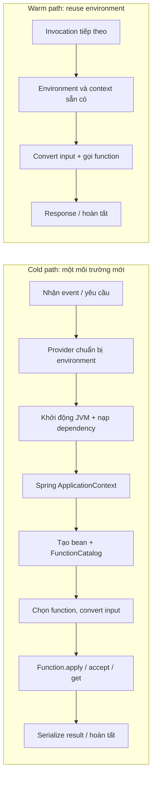
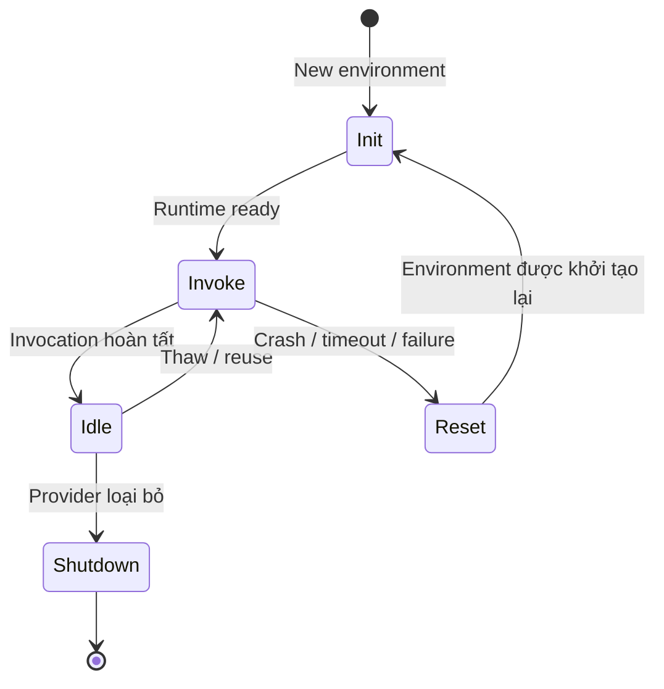

# Khởi động lần đầu và tái sử dụng môi trường thực thi

> **Chương:** Serverless  
> **Module:** SPRING_CLOUD_FUNCTION  
> **Trọng tâm:** Hiểu cold start, warm invocation và vòng đời execution environment khi triển khai các bean `Supplier`, `Function`, `Consumer` qua Spring Cloud Function; khai thác việc tái sử dụng `ApplicationContext`, `FunctionCatalog` và client an toàn mà không phụ thuộc vào trạng thái bộ nhớ của một instance.  
> **Mốc phiên bản minh họa:** 24/11/2026 — Java 21, Spring Boot 4.2.0, Spring Cloud BOM 2026.0.0, Spring Cloud Function 5.1.0. Các lựa chọn runtime, plan, concurrency và tối ưu cold start phải xác minh với nhà cung cấp tại thời điểm deploy.

## 1. Vì sao một function giống nhau lại có độ trễ khác nhau?

Giả sử bạn có bean:

```java
@Bean
public Function<String, String> normalizeCode() {
    return raw -> raw.trim().toUpperCase(Locale.ROOT);
}
```

Với cùng input `"  od-123  "`, hai invocation có thể trả cùng output `"OD-123"` nhưng **thời gian xử lý phía người gọi khác nhau**. Khi môi trường serverless chưa có execution instance sẵn sàng, provider phải chuẩn bị runtime, nạp class Java, khởi tạo Spring context và tìm function trước khi logic nghiệp vụ chạy.

Trong một instance đã sẵn sàng, nhiều phần trên có thể **không cần thực hiện lại** ở invocation tiếp theo. Chênh lệch này là cơ sở của khái niệm:

- **Cold start:** một execution environment cần được tạo/khởi tạo trước khi xử lý lời gọi; thời gian bổ sung có thể đi vào latency quan sát được.
- **Warm invocation:** provider tái sử dụng một environment đã khởi tạo trước đó, không phải bootstrap lại toàn bộ Spring context trong điều kiện bình thường.
- **Scale-out cold start:** lượng yêu cầu tăng khiến provider phải tạo thêm environment mới, dù đã có những environment đang hoạt động.
- **Instance lifecycle:** môi trường có thể bị freeze/idle, bị dừng, bị thay sau lỗi hoặc phiên bản deployment mới; khả năng tái sử dụng không phải cam kết dữ liệu tồn tại vĩnh viễn.

### 1.1. Sơ đồ thời gian ở hai đường đi



Sơ đồ thể hiện **ý tưởng**, không bảo đảm thứ tự tuyệt đối của mọi adapter/provider. Ví dụ AWS có khái niệm `Init` và `Invoke` rõ ràng; một số môi trường khác có cơ chế prewarming, snapshot restore hoặc concurrency riêng.

### 1.2. Mục tiêu học tập

Sau bài này, bạn có thể:

1. Phân biệt startup của **provider runtime**, **JVM**, **Spring Boot context**, **FunctionCatalog** và execution của **functional bean**.
2. Giải thích vòng đời **AWS Lambda Init–Invoke–Shutdown** và vì sao environment có thể được tái sử dụng hoặc reset.
3. So sánh cold-start mitigation ở AWS, Azure Functions và Google Cloud Run functions.
4. Viết một Spring Cloud Function project có bean stateless, probe quan sát lần gọi và test bằng `FunctionCatalog`.
5. Phân loại thứ gì **nên cache/reuse** và thứ gì **không được lưu** trong singleton/static hoặc `/tmp`.
6. Thiết kế client/pool an toàn khi instance được freeze, tái sử dụng, chạy song song hoặc được restore từ snapshot.
7. Đo đúng cold/warm latency và đánh giá p50/p95/p99, memory, cost, concurrency thay vì dựa vào một cURL.
8. Lập checklist kiểm thử, bảo mật, retry và idempotency trước khi deploy.

## 2. Execution environment khác gì Spring ApplicationContext?

### 2.1. Provider sở hữu execution environment

**Execution environment** là không gian mà nhà cung cấp tạo cho runtime function. Tùy nền tảng, nó gồm process/container, bộ nhớ, CPU, filesystem tạm, network và những tham số cấu hình (timeout, identity, memory, concurrency).

Provider quyết định khi nào tạo, giữ idle, đóng băng, tái kích hoạt hoặc loại bỏ môi trường. Ứng dụng **không được giả định** mọi invocation đều đến cùng một instance.

### 2.2. Spring sở hữu ApplicationContext

Bên trong runtime Java, Spring Boot tạo một `ApplicationContext`. Context phát hiện `@Bean`/`@Component`, khởi tạo dependencies, áp dụng auto-configuration và đăng ký các functional bean vào `FunctionCatalog`.

`FunctionCatalog` có thể:

- Tra bean `Supplier<T>`, `Function<T,R>`, `Consumer<T>` theo tên.
- Tạo composition như `normalizeCode|validateCode`.
- Sử dụng wrapper hỗ trợ type conversion và message conversion khi adapter cung cấp dữ liệu phù hợp.

**Một JVM execution environment có thể chứa một Spring context được tái sử dụng**; nhưng không nên quy đổi “một cloud function resource = một JVM = một context duy nhất suốt đời”. Khi scale-out, có thể có nhiều environment, mỗi environment có context và bean singleton riêng.

### 2.3. `@Bean` singleton có nghĩa chính xác là gì?

Một bean singleton trong Spring có **một instance trên mỗi Spring `ApplicationContext`**, không phải singleton toàn hệ thống phân tán.

Ví dụ:

```text
AWS Lambda resource "normalize-order"
├── Environment A
│   └── Spring context A
│       └── bean Client A + FunctionCatalog A
├── Environment B
│   └── Spring context B
│       └── bean Client B + FunctionCatalog B
└── Environment C
    └── Spring context C
        └── bean Client C + FunctionCatalog C
```

Nếu cả ba instance cùng nhận event, mỗi instance có thể sở hữu cache và counter khác nhau. Dữ liệu trong singleton **không** được tự động đồng bộ giữa A, B và C.

### 2.4. Function được gọi lúc nào?

Khi Spring tạo bean:

```java
@Bean
public Function<String, String> normalizeCode() {
    return raw -> raw.trim().toUpperCase(Locale.ROOT);
}
```

thì method `normalizeCode()` tạo và trả lambda trong quá trình xây context. **Lambda không tự chạy nghiệp vụ** chỉ vì bean đã được khởi tạo. Việc `apply(raw)` diễn ra khi adapter hoặc code Java gọi function.

Vì vậy có thể tách:

| Thời điểm | Công việc điển hình | Có chạy cho mọi invocation không? |
| --- | --- | --- |
| Provider environment startup | Tạo môi trường, tải artifact, chuẩn bị runtime. | Không, nếu một environment được reuse. |
| JVM/class loading | Nạp class, khởi tạo static members. | Không lặp lại trong cùng classloader trừ trường hợp đặc biệt. |
| Spring startup | Khởi tạo context, `@Bean`, `FunctionCatalog`. | Không lặp lại khi cùng context được reuse. |
| Adapter function resolution | Tìm/compose function, chuẩn bị wrapper. | Phụ thuộc adapter và cache implementation. |
| Business invocation | `apply`, `accept` hoặc `get`. | Có, theo từng lời gọi được kích hoạt. |
| Serialization/response | Convert payload, trả kết quả/lỗi. | Có, theo invocation/record. |

**Tránh khẳng định adapter luôn gọi `lookup(...)` lại cho mỗi event**; handler có thể giữ wrapper function sau lần khởi tạo.

## 3. Cold start có những thành phần thời gian nào?

Một cách phân rã phục vụ phân tích:

\[
T_{\text{observed}} \approx T_{\text{platform/setup}} +
T_{\text{JVM}} + T_{\text{Spring init}} + T_{\text{adapter/convert}} +
T_{\text{business}} + T_{\text{response/network}}
\]

Công thức là **mô hình khái niệm**: không phải tất cả thành phần luôn được đo tách rời và không phải mọi công việc chạy tuần tự. Warm invocation thường không cần trả lại toàn bộ chi phí `platform/JVM/Spring init` nhưng vẫn phải trả chi phí network, conversion và business logic.

### 3.1. Các yếu tố tăng startup latency

- JAR/container image lớn, nhiều dependency và class phải nạp.
- Nhiều Spring auto-configurations, bean không dùng đến, component scanning quá rộng.
- Khởi tạo client hoặc pool kết nối chậm trong constructor/`@Bean`.
- Gọi network tại startup (đọc config service, database migration, secret manager) và chờ timeout.
- Bật cả Web MVC, Spring Cloud Stream binders, nhiều provider adapters dù deployment chỉ cần một.
- JVM runtime/memory/CPU và điều kiện scale-out.
- Khác biệt giữa on-demand cold initialization, prewarmed instances và snapshot restore.

**Không mặc định** JAR càng lớn thì p99 luôn tệ hơn: tải artifact, CPU, classloading và lượng work lúc init đều quan trọng. Cần đo trên artifact và runtime thật.

### 3.2. Cold start xảy ra khi nào?

| Tình huống | Có thể khởi tạo environment mới? | Giải thích |
| --- | --- | --- |
| Invocation đầu tiên sau deploy | Có | Chưa có environment đã khởi tạo. |
| Ứng dụng ít traffic, scale-to-zero | Có | Provider có thể loại bỏ instance idle. |
| Traffic tăng đột biến | Có | Cần thêm capacity ngoài các instance đang chạy. |
| Đổi version/alias/revision | Có | Instance mới nhận code/cấu hình mới. |
| Crash, timeout, out-of-memory | Có | Provider có thể reset và tái khởi tạo runtime. |
| Invocation tiếp theo đến instance còn sống | Thường không | Context đã có thể được reuse. |
| Prewarmed/provisioned environment | Có initialization trước lời gọi | Chi phí khởi tạo có thể được dời khỏi critical path của request. |
| SnapStart restore | Có khôi phục snapshot, không cold init kiểu truyền thống | Vẫn có restore time và những vấn đề riêng về state. |

**Không đoán thời gian idle chính xác** để kết luận “sau N phút chắc chắn cold”. Provider có thể giữ instance idle trong một khoảng thời gian tùy tải và chính sách.

## 4. AWS Lambda: Init, Invoke, freeze, reset và Shutdown

### 4.1. Các pha chính thức

AWS Lambda tài liệu mô tả vòng đời environment thông thường:



- **Init:** AWS khởi động extensions, bootstrap runtime và thực thi function initialization (đặc biệt code tĩnh và bootstrap Spring).
- **Invoke:** runtime gọi handler cho event.
- **Freeze/idle:** Lambda có thể đóng băng environment sau invocation, giữ tài nguyên để reuse.
- **Shutdown:** runtime/extension được dừng theo lifecycle; không nên dựa vào shutdown hook như con đường bảo đảm ghi dữ liệu.
- **Reset/suppressed init:** sau một số lỗi Invoke, Lambda reset runtime; một lần initialization tiếp theo có thể bị “ẩn” trong log Invocation. `/tmp` có thể còn sau reset, nhưng Java heap/context không được giữ nguyên như warm invocation.

Đối với Spring Cloud Function, handler thường dùng:

```text
org.springframework.cloud.function.adapter.aws.FunctionInvoker::handleRequest
```

`FunctionInvoker` là điểm vào AWS; các bean Spring như `normalizeCode` nằm phía sau `FunctionCatalog`.

### 4.2. INIT và INVOKE không đồng nghĩa phương thức Java

Với handler do adapter cung cấp:

1. Lambda chuẩn bị execution environment.
2. Runtime Java nạp handler và khởi tạo Spring application context qua adapter.
3. Context tạo beans, FunctionCatalog và function wrapper phù hợp.
4. Handler nhận event, chuyển payload và gọi bean `Function.apply(...)`.
5. AWS có thể freeze environment.
6. Invocation tiếp theo có thể reuse bước 2–3.

Tuy nhiên, **có chế độ late initialization trong adapter** và cấu hình khác có thể dời một phần startup sang invocation đầu tiên. Vì thế, không dùng giả định “log init trùng tuyệt đối với thời gian tạo bean” như một công cụ tính toán chính xác; phải quan sát logs/telemetry.

### 4.3. AWS `Init Duration` và `REPORT`

CloudWatch Logs có thể ghi dạng:

```text
START RequestId: ... Version: ...
END RequestId: ...
REPORT RequestId: ... Duration: ... ms Billed Duration: ... ms
       Memory Size: ... MB Max Memory Used: ... MB
       Init Duration: ... ms
```

Ý nghĩa:

- `Duration` thường phản ánh thời gian invoke được AWS báo.
- `Init Duration` (khi xuất hiện) cho biết thời gian khởi tạo theo báo cáo AWS.
- Các báo cáo init có thể khác nhau với SnapStart, provisioned concurrency và reset.
- Khi có **suppressed init**, một số initialization có thể nằm trong duration của invocation mà không có một pha init rõ ràng trên log START/END.

**Không tính cold-start overhead bằng hiệu của hai cURL đơn lẻ**. Dùng CloudWatch metrics/logs, Telemetry API/X-Ray nếu phù hợp và thống kê đủ mẫu.

### 4.4. Reuse ở AWS không bảo đảm tương lai

AWS khuyến khích đặt SDK clients và kết nối có thể tái sử dụng **ngoài handler**. Khi một environment còn tồn tại, các object đó có thể tiếp tục được dùng. Nhưng:

- Provider có thể khởi tạo environment khác cho request kế tiếp.
- Network connection idle có thể bị đóng; client/pool cần health check, keep-alive và reconnect.
- Background tasks còn chạy dở có thể bị freeze; không được trông chờ chúng hoàn thành sau response.
- `/tmp` chỉ là storage tạm của environment, không phải database bền vững.
- Sau lỗi, Java runtime có thể bị reset, không phải warm reuse.

### 4.5. Concurrency trên Lambda và Spring singleton

Với mô hình Lambda Java execution environment thông thường, một environment xử lý một invocation tại một thời điểm, còn khi tải tăng Lambda tạo thêm environment độc lập. Tuy vậy:

- Không nên thiết kế toàn bộ thư viện Java chỉ dựa vào assumption này, vì code có thể dùng thread phụ, async clients hoặc được chạy trên Cloud Run/Azure với concurrency khác.
- **Singleton của Spring không được chia giữa nhiều environments.**
- Đọc dữ liệu/side effect tại một instance không ngụ ý instance khác đã thấy.

Tài liệu chính thức: https://docs.aws.amazon.com/lambda/latest/dg/lambda-runtime-environment.html

## 5. Azure Functions: cold start tùy hosting plan

Azure Functions không sử dụng các nhãn pha `Init`/`Invoke` giống hệt AWS trong mọi tình huống. Azure host và Java worker được tạo/kích hoạt theo **hosting plan**, trigger và scale controller.

### 5.1. Khi ứng dụng bị scale về zero

Nếu Function App idle trong một khoảng thời gian, ở các plan cho phép scale-to-zero, Azure có thể đưa số instance về 0. Event/request kế tiếp làm platform cấp instance/host/worker mới; Spring adapter và context cần khởi tạo lại. Điều này gây cold-start latency, đặc biệt dễ thấy ở HTTP trigger đồng bộ.

### 5.2. Các lựa chọn giảm cold start

| Azure hosting model | Cơ chế liên quan | Khi nào cần cân nhắc? |
| --- | --- | --- |
| **Flex Consumption** | `Always ready instances` theo nhóm function được hỗ trợ. | Khi muốn ít cold start nhưng vẫn dùng serverless scaling. |
| **Premium** | Prewarmed/always-ready instances. | Khi cần latency ổn định, VNET và tài nguyên/feature phù hợp. |
| **Consumption truyền thống** | Không có cơ chế always-ready như Flex/Premium. | Chấp nhận được khi workload ít nhạy với cold start. |
| **Dedicated/App Service plan** | `Always On`. | Khi đã có hạ tầng chạy liên tục và mục tiêu khác serverless thuần. |

Các tên plan/feature có thể thay đổi. **Không khẳng định bật always-ready sẽ bảo đảm 100% mọi request warm:** scale-out, recycle, rollout và host failure vẫn có thể làm tạo instance mới.

### 5.3. Java DI và tái sử dụng client

Azure Java Functions tích hợp dependency injection; Spring Cloud Function Azure adapter giúp handler dùng `FunctionCatalog` và beans. Một bean singleton/client được tạo ở context có thể reuse trong **cùng worker/context**, không phải singleton toàn Azure Function App.

Microsoft khuyến nghị **không tạo client SDK mới trên mỗi invocation**; có thể đăng ký shared client qua DI hoặc helper với vòng đời phù hợp. Điều này giúp hạn chế latency và socket exhaustion, nhưng client cần thread-safe nếu handler có thể xử lý song song.

Tài liệu:
- https://learn.microsoft.com/en-us/azure/azure-functions/event-driven-scaling
- https://learn.microsoft.com/en-us/azure/azure-functions/manage-connections

## 6. Google Cloud Run functions: instance reuse và concurrency

Google Cloud Run functions dựa vào cơ chế cấp instance và autoscaling của Cloud Run/Functions Framework theo generation/trigger. Khi không còn instance sẵn sàng, một request/event có thể phải đợi instance mới khởi động.

### 6.1. Min instances không đồng nghĩa trạng thái bền vững

Cloud Run hỗ trợ **minimum instances** để giữ một số environment sẵn sàng, giúp giảm cold starts do scale-to-zero. Nhưng:

- Instances có thể bị thay hoặc restart dù đã cấu hình min instances.
- Khi tải vượt capacity đã warm, autoscaler có thể tạo thêm instance lạnh.
- Chi phí giữ min instances cần được cân nhắc với độ nhạy latency.
- Không lưu đơn hàng, session hoặc transaction state chỉ trong RAM của một instance.

### 6.2. Concurrency là khác biệt quan trọng

Trên Cloud Run functions thế hệ mới, một instance có thể phục vụ **nhiều requests đồng thời** nếu cấu hình/concurrency cho phép. Điều này có hai mặt:

- **Lợi ích:** tận dụng instance đã warm để nhận thêm traffic, hạn chế số environment mới.
- **Rủi ro:** singleton beans, cache, connection pools và mutable fields phải **thread-safe**; một request không được làm rò payload của request khác.

Không áp dụng giả định “mỗi instance xử lý đúng một request” từ Lambda cho mọi Cloud Run function. Cần kiểm tra concurrency/CPU/instance settings cụ thể.

### 6.3. Khởi tạo ở global/context scope

Google khuyến nghị cache network clients và thư viện ở scope sống cùng instance, nhưng **không dùng background task chưa hoàn tất sau khi response đã kết thúc** để làm công việc nghiệp vụ quan trọng. Trong Spring, một `@Bean` quản lý client có thể tương đương ý tưởng global initialization.

Tài liệu:
- https://docs.cloud.google.com/run/docs/tips/functions-best-practices
- https://docs.cloud.google.com/run/docs/configuring/min-instances

## 7. Cái gì nên tái sử dụng và cái gì phải tạo theo invocation?

### 7.1. Bảng phân loại

| Tài nguyên | Reuse trong cùng environment? | Lưu ý |
| --- | --- | --- |
| `FunctionCatalog` và function wrappers | **Có** | Gắn với Spring context; adapter có thể cache lookup. |
| Immutable business rules/configuration | **Có** | Phải cập nhật qua deploy/config lifecycle có kiểm soát. |
| AWS/Azure/GCP SDK client thread-safe | **Thường có** | Tái tạo/reconnect nếu connection stale. |
| Java `HttpClient` / connection pool thread-safe | **Có** | Bảo đảm timeout, pool limits, TLS và credential refresh. |
| JSON mapper đã cấu hình, thread-safe | **Có** | Không thay đổi configuration khi đang xử lý concurrent requests. |
| Regex `Pattern` immutable | **Có** | Tránh compile regex giống nhau liên tục. |
| Static reference data ít biến động | **Có, có TTL/version** | Dùng cache invalidation; không giả định luôn mới. |
| `/tmp` cache file không nhạy cảm | **Có điều kiện** | Tạm theo instance; phải kiểm tra tồn tại/phiên bản/kích thước. |
| Event payload, thông tin người dùng, token bí mật trong static fields | **Không** | Nguy cơ rò dữ liệu giữa các invocation. |
| Transaction/DB session, request context, MDC | **Không để tồn dư** | Tạo/làm sạch đúng scope từng lời gọi. |
| Invocation ID, thời gian remaining, deadline | **Không** | Mỗi lần gọi có context mới. |
| Counter in-memory để quyết định nghiệp vụ | **Không** | Không đồng bộ và có thể mất bất kỳ lúc nào. |
| Idempotency state/order state bền vững | **Không lưu chỉ trong RAM** | Dùng database/atomic store. |

### 7.2. Stateless business function

Một bean tốt thường có dạng:

```java
@Bean
public Function<String, String> normalizeCode() {
    return raw -> raw.trim().toUpperCase(Locale.ROOT);
}
```

Mỗi lần gọi có output chỉ phụ thuộc input; nhiều invocations trên nhiều instances vẫn cho cùng kết quả. Các side effects như ghi database cần nằm trong use-case có transaction/idempotency rõ ràng.

### 7.3. Ví dụ anti-pattern: singleton lưu input cuối cùng

```java
// KHÔNG dùng trong production:
@Bean
public Function<String, String> unsafeEcho() {
    return new Function<>() {
        private String lastUserInput;

        @Override
        public String apply(String input) {
            lastUserInput = input;
            return lastUserInput;
        }
    };
}
```

Trong ví dụ này, field `lastUserInput` sống qua các invocations đến cùng instance, có thể tạo race condition khi concurrency được bật và chứa dữ liệu nhạy cảm không cần thiết. Việc không có race trong một lần chạy local **không chứng minh** thiết kế an toàn trong cloud.

### 7.4. Reuse không phải cache vô thời hạn

Một token, schema, feature flag, chứng chỉ, network connection hay DNS resolution có thể hết hạn/thay đổi ngay cả khi Spring context còn sống. Client/pool cần cơ chế refresh/timeout/retry tương ứng; cache data cần TTL hoặc version. Đừng lấy “singleton” làm bằng chứng dữ liệu bên trong không bao giờ stale.

## 8. Project thực hành: quan sát cùng Spring context qua nhiều lời gọi

Ta tạo ứng dụng có:

- Một bean `Function<String,String> normalizeCode` thuần nghiệp vụ.
- Một bean `Function<String,ProbeResult> normalizeWithProbe` để **quan sát** environment.
- Một bean `Supplier<String> runtimeState` trả thông tin probe khi debug.
- Một `RuntimeProbe` bean chứa **marker và counter chỉ phục vụ chẩn đoán** trong cùng Spring context.

Bản demo có thể chạy JUnit với `FunctionCatalog` và, khi bật profile Web của Maven, gọi bằng cURL. **Marker/counter là công cụ học tập, không phải định danh instance cloud đủ tin cậy cho production.**

### 8.1. Cấu trúc thư mục

```text
scf-cold-start-demo/
├── pom.xml
└── src/
    ├── main/
    │   ├── java/vn/example/coldstart/
    │   │   └── ColdStartApplication.java
    │   └── resources/
    │       └── application.properties
    └── test/
        └── java/vn/example/coldstart/
            └── ColdStartApplicationTest.java
```

### 8.2. Maven POM đầy đủ

```xml
<?xml version="1.0" encoding="UTF-8"?>
<project xmlns="http://maven.apache.org/POM/4.0.0"
         xmlns:xsi="http://www.w3.org/2001/XMLSchema-instance"
         xsi:schemaLocation="http://maven.apache.org/POM/4.0.0
           https://maven.apache.org/xsd/maven-4.0.0.xsd">
    <modelVersion>4.0.0</modelVersion>

    <parent>
        <groupId>org.springframework.boot</groupId>
        <artifactId>spring-boot-starter-parent</artifactId>
        <version>4.2.0</version>
        <relativePath/>
    </parent>

    <groupId>vn.example</groupId>
    <artifactId>scf-cold-start-demo</artifactId>
    <version>0.0.1-SNAPSHOT</version>

    <properties>
        <java.version>21</java.version>
        <spring-cloud.version>2026.0.0</spring-cloud.version>
    </properties>

    <dependencyManagement>
        <dependencies>
            <dependency>
                <groupId>org.springframework.cloud</groupId>
                <artifactId>spring-cloud-dependencies</artifactId>
                <version>${spring-cloud.version}</version>
                <type>pom</type>
                <scope>import</scope>
            </dependency>
        </dependencies>
    </dependencyManagement>

    <dependencies>
        <dependency>
            <groupId>org.springframework.boot</groupId>
            <artifactId>spring-boot-starter</artifactId>
        </dependency>

        <dependency>
            <groupId>org.springframework.cloud</groupId>
            <artifactId>spring-cloud-function-context</artifactId>
        </dependency>

        <dependency>
            <groupId>org.springframework.boot</groupId>
            <artifactId>spring-boot-starter-test</artifactId>
            <scope>test</scope>
        </dependency>
    </dependencies>

    <!-- Web adapter chỉ được thêm khi chạy ví dụ HTTP cục bộ. -->
    <profiles>
        <profile>
            <id>local-web</id>
            <dependencies>
                <dependency>
                    <groupId>org.springframework.cloud</groupId>
                    <artifactId>spring-cloud-starter-function-web</artifactId>
                </dependency>
            </dependencies>
        </profile>
    </profiles>

    <build>
        <plugins>
            <plugin>
                <groupId>org.springframework.boot</groupId>
                <artifactId>spring-boot-maven-plugin</artifactId>
            </plugin>
        </plugins>
    </build>
</project>
```

**Vì sao dùng Maven profile?** `spring-cloud-function-context` đủ cho catalog trong test và function runtime. `spring-cloud-starter-function-web` thêm Web adapter và HTTP server phục vụ quan sát trên máy local. Một deployment AWS Lambda xử lý SQS thường **không cần embedded Spring MVC server**, nên không nên vô tình để Web starter trong mọi artifact chỉ vì muốn thử cURL.

`spring-cloud-dependencies` là BOM quản lý version; không phải dependency để chạy function. Khi deploy cloud, thêm **adapter và profile packaging riêng** theo AWS/Azure/GCP, kiểm tra classpath và entrypoint của đúng provider.

### 8.3. File cấu hình

`src/main/resources/application.properties`:

```properties
spring.application.name=scf-cold-start-demo
server.port=8080
logging.level.vn.example.coldstart=INFO
```

Không đặt `spring.cloud.function.definition` khi thử Web adapter vì muốn truy cập cả `normalizeCode`, `normalizeWithProbe` và `runtimeState` theo tên. Khi triển khai một cloud function resource thực, chọn definition chính xác, ví dụ:

```properties
spring.cloud.function.definition=normalizeCode
```

Property chọn function/pipeline nhưng **không tự điều khiển** khi provider tạo environment mới.

## 9. Java code: đo việc tái sử dụng trong cùng context

Tạo `src/main/java/vn/example/coldstart/ColdStartApplication.java`:

```java
package vn.example.coldstart;

import java.time.Instant;
import java.util.Locale;
import java.util.UUID;
import java.util.concurrent.atomic.AtomicLong;
import java.util.function.Function;
import java.util.function.Supplier;

import org.slf4j.Logger;
import org.slf4j.LoggerFactory;
import org.springframework.boot.SpringApplication;
import org.springframework.boot.autoconfigure.SpringBootApplication;
import org.springframework.boot.context.event.ApplicationReadyEvent;
import org.springframework.context.annotation.Bean;
import org.springframework.context.event.EventListener;

@SpringBootApplication
public class ColdStartApplication {

    private static final Logger log =
            LoggerFactory.getLogger(ColdStartApplication.class);

    public static void main(String[] args) {
        SpringApplication.run(ColdStartApplication.class, args);
    }

    public record ProbeResult(
            String normalizedCode,
            String environmentMarker,
            long invocationIndex,
            long contextAgeMillis) {}

    // Chỉ dành cho minh họa và telemetry cục bộ.
    public static final class RuntimeProbe {

        private final String marker = UUID.randomUUID().toString();
        private final Instant createdAt = Instant.now();
        private final long createdAtNanos = System.nanoTime();
        private final AtomicLong calls = new AtomicLong();

        public String marker() {
            return marker;
        }

        public long nextInvocation() {
            return calls.incrementAndGet();
        }

        public long currentCount() {
            return calls.get();
        }

        public long ageMillis() {
            return (System.nanoTime() - createdAtNanos)
                    / 1_000_000;
        }

        public String summary() {
            return "marker=" + marker
                    + ", createdAt=" + createdAt
                    + ", calls=" + calls.get();
        }
    }

    @Bean
    public RuntimeProbe runtimeProbe() {
        return new RuntimeProbe();
    }

    @Bean
    public Function<String, String> normalizeCode() {
        return ColdStartApplication::normalize;
    }

    @Bean
    public Function<String, ProbeResult> normalizeWithProbe(
            RuntimeProbe probe) {

        return raw -> {
            String normalized = normalize(raw);
            long index = probe.nextInvocation();

            log.info("Function executed; context marker={}, index={}",
                    probe.marker(), index);

            return new ProbeResult(
                    normalized,
                    probe.marker(),
                    index,
                    probe.ageMillis());
        };
    }

    @Bean
    public Supplier<String> runtimeState(RuntimeProbe probe) {
        return probe::summary;
    }

    @EventListener(ApplicationReadyEvent.class)
    public void onReady() {
        log.info("Spring ApplicationContext ready");
    }

    private static String normalize(String raw) {
        if (raw == null || raw.isBlank()) {
            throw new IllegalArgumentException(
                    "Mã không được null/rỗng");
        }

        String code = raw.trim().toUpperCase(Locale.ROOT);
        if (!code.matches("[A-Z]{2}-[0-9]{3}")) {
            throw new IllegalArgumentException(
                    "Mã phải có dạng AA-999: " + code);
        }
        return code;
    }
}
```

### 9.1. Các điểm cần chú ý trong mã

- `RuntimeProbe` là **một Spring singleton bean trong một context**. Nó được tạo khi context khởi tạo, không phải global singleton mọi Lambda/GCP/Azure instances.
- `marker` là UUID dùng cho quan sát demo. Với **AWS SnapStart**, giá trị khởi tạo trước snapshot có thể xuất hiện ở nhiều restored environments. **Không dùng marker này làm định danh duy nhất hay idempotency key.**
- `calls` tăng bằng `AtomicLong`, an toàn ở mức phép tăng khi có nhiều threads nhưng không tự giải quyết transaction, request isolation, ordering hay distributed consensus.
- `contextAgeMillis` ước lượng thời gian từ khi bean được tạo trong tiến trình Java. Đây **không phải** metric cold start provider chính thức; snapshot/restore, JVM freeze và clock behavior có thể làm diễn giải phức tạp.
- `runtimeState` là `Supplier` chỉ phục vụ debug. Không xuất API chẩn đoán có marker hoặc thông tin vận hành nội bộ ra public internet.
- `normalizeCode` và `normalizeWithProbe` đều dùng cùng rule domain, nhưng chỉ bean thứ hai mới ghi counter phục vụ thí nghiệm.

### 9.2. Ví dụ kết quả từ một context

Giả sử gọi `normalizeWithProbe` hai lần **trong cùng Spring context**, ta có thể quan sát:

```json
{
  "normalizedCode": "OD-123",
  "environmentMarker": "demo-marker-1",
  "invocationIndex": 1,
  "contextAgeMillis": 1200
}
```

Sau đó:

```json
{
  "normalizedCode": "AB-999",
  "environmentMarker": "demo-marker-1",
  "invocationIndex": 2,
  "contextAgeMillis": 1700
}
```

Hai JSON là **kết quả minh họa**, không phải output đã chạy. Marker thực là UUID khác và số mili giây khác. Việc counter tăng và marker giữ nguyên trong một JVM chứng minh **có state trong context được reuse**, không chứng minh mọi invocation thật của cloud sẽ đi đến instance này.

Nếu khởi động ứng dụng thành **một JVM mới** và nhận marker khác/counter bắt đầu lại, đó là behavior bình thường.

## 10. Kiểm thử bằng JUnit và FunctionCatalog

Tạo `src/test/java/vn/example/coldstart/ColdStartApplicationTest.java`:

```java
package vn.example.coldstart;

import static org.junit.jupiter.api.Assertions.assertEquals;
import static org.junit.jupiter.api.Assertions.assertNotNull;
import static org.junit.jupiter.api.Assertions.assertThrows;
import static org.junit.jupiter.api.Assertions.assertTrue;

import java.util.function.Function;

import org.junit.jupiter.api.Test;
import org.springframework.beans.factory.annotation.Autowired;
import org.springframework.boot.test.context.SpringBootTest;
import org.springframework.cloud.function.context.FunctionCatalog;

import vn.example.coldstart.ColdStartApplication.ProbeResult;
import vn.example.coldstart.ColdStartApplication.RuntimeProbe;

@SpringBootTest
class ColdStartApplicationTest {

    @Autowired
    FunctionCatalog catalog;

    @Autowired
    RuntimeProbe probe;

    @Test
    void catalogFindsBusinessFunction() {
        Function<String, String> fn =
                catalog.lookup("normalizeCode");

        assertNotNull(fn);
        assertEquals("OD-123", fn.apply("  od-123 "));
        assertThrows(IllegalArgumentException.class,
                () -> fn.apply("invalid"));
    }

    @Test
    void sequentialCallsReuseOneSpringProbeBean() {
        Function<String, ProbeResult> fn =
                catalog.lookup("normalizeWithProbe");

        assertNotNull(fn);

        ProbeResult first = fn.apply("  od-123  ");
        ProbeResult second = fn.apply(" ab-999 ");

        assertEquals("OD-123", first.normalizedCode());
        assertEquals("AB-999", second.normalizedCode());
        assertEquals(first.environmentMarker(),
                     second.environmentMarker());
        assertEquals(first.invocationIndex() + 1,
                     second.invocationIndex());
        assertTrue(second.contextAgeMillis() >= 0);
        assertEquals(probe.marker(),
                     second.environmentMarker());
    }

    @Test
    void catalogCanComposeSimpleFunction() {
        Function<String, String> fn =
                catalog.lookup("normalizeCode");

        assertNotNull(fn);
        assertEquals("ZZ-111", fn.apply("  zz-111  "));
    }
}
```

Chạy:

```bash
mvn clean test
```

Nếu dự án có Maven Wrapper thì dùng `./mvnw clean test` (Windows dùng `./mvnw.cmd`).

**Phạm vi bằng chứng:** test này xác nhận `ApplicationContext`, `FunctionCatalog` và singleton probe **trong một JVM Spring Test**. Nó **chưa** kiểm chứng AWS Lambda Init, Azure scale-to-zero, Cloud Run concurrency, snapshot restore hoặc cloud p99.

### 10.1. Cẩn trọng khi test liên quan counter

Thứ tự chạy các `@Test` không được bảo đảm. Vì vậy phép thử reuse so sánh **hai lời gọi liên tiếp trong cùng một test**, không khẳng định counter phải luôn bằng `1` khi một test bắt đầu. Trong cloud, một invocation có thể đến môi trường đã nhận nhiều event trước đó.

Khi thêm test chạy song song, counter toàn cục chỉ có ý nghĩa **chẩn đoán instance**, không thể dùng làm nguồn xác nhận thứ tự event. Để kiểm tra domain, ưu tiên test `normalizeCode` stateless không phụ thuộc probe.

## 11. Chạy Web profile cục bộ và quan sát

### 11.1. Chạy từ Maven

Bật Web adapter chỉ cho thử nghiệm local:

```bash
mvn -Plocal-web spring-boot:run
```

Web server lắng nghe port 8080 nếu không bị chiếm. Mở terminal thứ hai:

```bash
curl -i -X POST http://localhost:8080/normalizeCode \
  -H "Content-Type: text/plain" \
  --data-raw "  od-123  "
```

Kỳ vọng business body: `OD-123`.

Gọi function có probe:

```bash
curl -i -X POST http://localhost:8080/normalizeWithProbe \
  -H "Content-Type: text/plain" \
  -H "Accept: application/json" \
  --data-raw "  od-123  "
```

Response với `ProbeResult` có thể được JSON-serialize như mục 9. Gửi lần nữa input `" ab-999 "` và so sánh `environmentMarker`/`invocationIndex`. Lưu ý: conversion/response headers thực tế phụ thuộc Spring Cloud Function Web adapter và media type, vì vậy luôn kiểm tra cả status và body.

### 11.2. Build executable JAR cho thử nghiệm HTTP

```bash
mvn -Plocal-web clean package
java -jar target/scf-cold-start-demo-0.0.1-SNAPSHOT.jar
```

Dừng lệnh `spring-boot:run` cũ trước khi chạy JAR, tránh cổng 8080 bị chiếm. Sau khi JAR chạy, gửi lại các cURL. Quá trình tạo **JVM mới** sẽ tạo `ApplicationContext` mới và `RuntimeProbe` mới.

**Đây không phải mô phỏng chính xác cloud cold start:** JVM/server local không có AWS environment allocation, Azure host, API Gateway, Google Cloud Functions Framework và autoscaler. Kết quả local chỉ cho thấy chi phí khởi động ứng dụng và behavior bean trong cùng process.

### 11.3. Không dùng cURL một lần để khẳng định warm

Một máy local có thể cache class/JIT/filesystem, còn JVM mới vẫn phải bootstrap Spring context. Ngược lại, một cloud resource có thể nhận request cùng lúc trên nhiều instances. Để phân biệt warm/cold thật, dùng telemetry provider kết hợp marker chỉ để **giúp giải thích**, không sử dụng marker làm nguồn sự thật.

## 12. Thực hành tối ưu: khởi tạo client đúng vòng đời

### 12.1. Tạo HTTP client một lần qua Spring bean

Java 21 có `java.net.http.HttpClient`:

```java
@Configuration(proxyBeanMethods = false)
public class ClientConfiguration {

    @Bean
    public HttpClient sharedHttpClient() {
        return HttpClient.newBuilder()
                .connectTimeout(Duration.ofSeconds(2))
                .build();
    }
}
```

Cần import `java.net.http.HttpClient`, `java.time.Duration`, `org.springframework.context.annotation.Bean` và `Configuration`. Đây là **đoạn bổ sung**, đặt vào một file cấu hình mới nếu thực hành mở rộng; không yêu cầu cho `ColdStartApplication` cốt lõi.

Lớp use-case nhận client bằng DI:

```java
@Service
public class PartnerGateway {

    private final HttpClient httpClient;

    public PartnerGateway(HttpClient httpClient) {
        this.httpClient = httpClient;
    }

    // Gửi HTTP request trong method nghiệp vụ;
    // không gọi external API ngay trong constructor.
}
```

`HttpClient` có khả năng reuse connection pool. Với request thực tế, còn cần request timeout, retry policy, authentication, circuit-breaker khi phù hợp và tránh blocking I/O ở đường xử lý reactive.

### 12.2. Không gọi network đắt đỏ trong `@Bean` nếu không bắt buộc

Anti-pattern:

```java
@Bean
public PartnerConfiguration partnerConfiguration() {
    // Đừng bắt buộc mọi cold start phải gọi API ngoài:
    return remoteService.fetchConfigurationWithLongTimeout();
}
```

Hậu quả: nếu remote service chậm hoặc outage, **Spring context có thể không khởi động được**, làm tăng cold start hoặc khiến mọi environment mới thất bại.

Lựa chọn tốt hơn tùy use case:

- Nạp configuration không nhạy cảm từ environment tại startup.
- Lazy initialization đối với tài nguyên chỉ dùng ở một số route.
- Fetch config khi thật sự cần, với timeout, TTL/cache và fallback được thiết kế.
- Warm-up có kiểm soát khi cần và khi plan/provider hỗ trợ.
- Không lazy-load một thành phần thiết yếu rồi che startup failure thành lỗi request hàng loạt; luôn test timeout/failure.

### 12.3. Database pool có thể nhân lên theo số instances

Nếu mỗi environment tạo một connection pool với tối đa `N` connections, và provider scale ra `M` environments, tổng tiềm năng:

\[
\text{connections}_{\max} \approx N \times M
\]

Đây là **ước lượng trần cấu hình**, không phải số connection thực tế luôn được mở. Khi một database có giới hạn thấp, tăng concurrency/resource có thể tạo connection exhaustion ngay cả khi mỗi Spring context chỉ có một pool.

Gợi ý:

1. Chọn max pool size phù hợp với autoscaling/concurrency.
2. Cân nhắc database proxy/pooler do provider hỗ trợ.
3. Tắt/giảm idle connections theo workload và cấu hình lifetime phù hợp.
4. Dùng connection validation và reconnect khi môi trường idle hoặc provider đóng socket.
5. Không chia sẻ transaction/session giữa các invocation.

### 12.4. Retry client không thay thế idempotency

Nếu gọi API partner bị timeout **sau khi phía partner đã xử lý**, việc retry có thể tạo side effect trùng. Cache HTTP client giúp tái sử dụng connection, nhưng phải có **idempotency key** và quy tắc retry tạm thời/vĩnh viễn riêng.

## 13. `/tmp`, memory cache và sự khác nhau với state bền vững

### 13.1. AWS Lambda `/tmp`

AWS Lambda cung cấp thư mục `/tmp` trong execution environment, có dung lượng cấu hình được. Files có thể tồn tại qua các warm invocations cùng environment, và tài liệu AWS còn lưu ý reset runtime sau lỗi **không nhất thiết xóa `/tmp`**.

Điều đó hữu ích với:

- Tệp reference/config không nhạy cảm có version/TTL.
- Artifact giải nén/model được kiểm tra checksum và chỉ dùng như cache.
- File tạm phục vụ một invocation, được dọn khi hết tác dụng.

**Không dùng `/tmp` làm hệ thống lưu đơn hàng**, vì provider có thể loại bỏ environment, instances không chia sẻ filesystem và không có giao dịch/replication.

### 13.2. Không ghi token hoặc dữ liệu nhạy cảm vào cache thiếu kiểm soát

AWS best practices cảnh báo không dùng execution environment để lưu dữ liệu người dùng hoặc thông tin có tác động bảo mật giữa các invocations. Một singleton Java field hoặc file tạm có thể bị tái sử dụng bởi request khác trong cùng môi trường.

Nên áp dụng:

- Tránh cache raw event/PII nếu không thực sự cần.
- Nếu phải dùng file tạm, đặt tên tránh va chạm, giới hạn quyền và xóa có kiểm soát.
- Không dùng mutable static state để chia sẻ session/token giữa tenants.
- Secrets phải lấy từ cơ chế bảo mật của provider và có TTL/refresh.
- Quét logs để tránh in request body và credentials.

### 13.3. Với Cloud Run/Azure cũng không giả định local disk là durable

Container/local filesystem có thể giữ cache trong lifetime của instance, nhưng **không thay thế object storage, queue, database**. Tùy provider, filesystem là ephemeral, có quota hoặc gắn với memory. Đừng xây contract dựa trên “file của event trước chắc chắn tồn tại”.

## 14. AWS SnapStart và Provisioned Concurrency

### 14.1. Hai cơ chế giảm chi phí cold start

**AWS Lambda SnapStart:** trong mô hình được hỗ trợ, Lambda khởi tạo function khi publish version, lưu snapshot của môi trường đã khởi tạo rồi restore snapshot cho execution environments mới. Điều này giúp giảm công việc initialization từ đầu, nhưng có **restore latency**, hook và vấn đề an toàn state riêng.

**Provisioned Concurrency:** Lambda giữ một số environments được khởi tạo trước để sẵn sàng cho invocation. Đây là lựa chọn khi cần độ trễ khởi động dự đoán được hơn, đổi lấy chi phí/capacity đã cấp.

Hai cơ chế có điều kiện hỗ trợ và giới hạn khác nhau; không giả định luôn bật cùng lúc được hoặc có cùng pricing/latency. Xem tài liệu AWS đúng loại function/runtime trước khi chọn.

### 14.2. Nguy cơ unique state sau snapshot

Nếu code chạy trong `Init` sinh:

```java
private final String environmentMarker =
        UUID.randomUUID().toString();
```

và object bị đưa vào snapshot, **nhiều restored environments có thể chia sẻ cùng marker**. Điều tương tự có thể xảy ra với một số trạng thái ngẫu nhiên, token hoặc kết nối được tạo trước snapshot.

Vì vậy:

- Tạo ID phải unique **sau restore / trong invocation** khi ý nghĩa uniqueness yêu cầu như vậy.
- Sử dụng nguồn random/entropy phù hợp và kiểm tra hướng dẫn Lambda SnapStart.
- Không giả định network sockets mở trước snapshot vẫn hợp lệ sau restore.
- Bổ sung before-checkpoint/after-restore lifecycle hooks nếu SDK/provider/runtime yêu cầu.
- Kiểm thử restore trên **published version có SnapStart**, không chỉ test `$LATEST`.

### 14.3. SnapStart không làm side effect chạy exactly-once

Snapshot/restore làm giảm phần startup, không đảm bảo dữ liệu event được giao đúng một lần. Một `Consumer<OrderCommand>` ghi DB vẫn cần idempotency key, transaction/outbox hoặc cơ chế tương ứng.

**Không dùng environment marker/counter từ demo làm idempotency key**, dù SnapStart có bật hay không: chúng không nhận diện một business operation ổn định.

Tài liệu:
- https://docs.aws.amazon.com/lambda/latest/dg/snapstart.html
- https://docs.aws.amazon.com/lambda/latest/dg/lambda-runtime-environment.html

## 15. Cách đo cold/warm đúng và tránh bẫy thống kê

### 15.1. Phân biệt bốn metric

| Metric | Đo ở đâu? | Có phải chỉ thời gian nghiệp vụ không? |
| --- | --- | --- |
| **Client end-to-end latency** | Từ caller/API Gateway đến response | Không; có network/transport/queue. |
| **Provider Init/Restore time** | AWS INIT_REPORT/RESTORE_REPORT; telemetry tương ứng Azure/GCP | Không; đo phần startup/restore của platform. |
| **Invocation runtime duration** | Cloud provider logs/metrics/tracing | Không; gồm adapter, conversion, I/O, business. |
| **Business function duration** | Timer trong logic/use-case | Chỉ một phần; cần đặt timer đúng chỗ. |

Đừng so `Duration` của một Lambda với tổng thời gian cURL rồi tuyên bố chênh lệch là cold start: API Gateway/network/serialization cũng góp phần.

### 15.2. Đo theo phân vị

Thu thập đủ mẫu và tính:

- **p50:** trải nghiệm trung vị.
- **p95/p99:** độ trễ đuôi, quan trọng với SLO.
- **Tỷ lệ cold starts:** phần invocations có init/restore theo cách provider ghi nhận.
- **Duration theo route:** hai function với logic khác nhau có thể che nhau nếu dùng metric trung bình chung.
- **Concurrency, instance count, memory, CPU và lỗi startup.**
- **Chi phí:** provisioned capacity, minimum instances, memory-time, request volume.

Phân tách **cold/warm cohorts** khi phân tích; không trộn tất cả số liệu thành một “startup benchmark” duy nhất.

### 15.3. Benchmark có thể bị sai ở đâu?

- Chạy vài request liên tục và mặc định request đầu là cold, các request sau là warm.
- Tăng parallel load rồi so sánh với sequential test (scale-out tạo thêm cold env).
- Không cố định artifact/JDK/config/region/trigger khi so sánh hai lần deploy.
- Chỉ nhìn log application, bỏ qua provider init/restore telemetry.
- Không warm-up JIT khi đánh giá business CPU performance.
- Không tính network/DB/broker latency.
- Dùng clock wall time trong process để suy ra toàn bộ platform cold start.
- Cache dữ liệu giữa các lần thử khiến logic xử lý không còn giống nhau.

**Cách đáng tin hơn:** đo trên đúng provider/region/plan, cùng payload và artifact, có trace/metric correlation; chạy ở nhiều mức tải và khoảng thời gian, ghi rõ cách phân loại cold/warm.

### 15.4. Log startup trong Spring Boot

Spring Boot log `Started ... in ... seconds` cho biết startup của ứng dụng theo Boot, hữu ích để phát hiện tăng chi phí `ApplicationContext`. Có thể thêm Spring Boot Actuator/observability instrumentation nếu deployment thực sự cần. Nhưng con số đó **không bao gồm chính xác mọi bước**: tải image/artifact, Java runtime bootstrap ngoài Boot, HTTP gateway, snapshot restore và queue delivery có thể nằm ngoài thời gian Boot đo.

## 16. Tối ưu cold start theo thứ tự ưu tiên

### 16.1. Giảm bootstrap work không cần thiết

1. Chọn dependency phù hợp: chỉ thêm `spring-cloud-function-context` và adapter cần dùng; tránh tự động kéo cả Web starter/Kafka binder nếu function không dùng.
2. Giới hạn component scanning đúng package để giảm bean ngoài ý muốn.
3. Không gọi API/DB nặng ngay trong `@Bean`/constructor trừ khi là điều kiện sẵn sàng bắt buộc.
4. Dùng functional bean registration hoặc các khả năng tối ưu Spring được phiên bản hỗ trợ khi đo thấy đáng làm.
5. Xem xét lazy initialization có chủ đích; cân nhắc **đẩy công việc từ init sang request đầu** có thể không cải thiện latency thực.
6. Giảm số clients/pools; tối ưu startup của serializers và các dependency.
7. Kiểm tra log cho thấy startup đang kẹt ở class scanning, bean wiring, DNS, TLS hay remote calls.

### 16.2. Tối ưu provider configuration

| Provider | Đòn bẩy chính | Trade-off |
| --- | --- | --- |
| AWS Lambda | Memory/CPU allocation, SnapStart, Provisioned Concurrency, artifact size, SDK reuse | Chi phí, snapshot/state constraints, concurrency limits. |
| Azure Functions | Flex always-ready, Premium prewarmed, Dedicated Always On, giảm dependencies, DI shared clients | Hosting plan cost và cấu hình scale. |
| Google Cloud Run functions | Min instances, concurrency, CPU/memory, dependency trimming, client reuse | Idle instance cost, race/throughput và memory pressure. |

Không có **một cấu hình tối ưu duy nhất**. Với queue consumer bất đồng bộ có thể chấp nhận cold start hơn một HTTP endpoint cần p99 thấp. Cần tối ưu theo SLO và chi phí của workload thật.

### 16.3. Giữ phần nghiệp vụ stateless để scale tốt

Đây là chiến lược nền tảng, không chỉ tối ưu latency:

- `Function<OrderCommand,OrderResult>` nhận DTO, trả DTO.
- Storage/database giữ business state.
- Idempotency dựa trên event/operation ID bền vững.
- Client được reuse nhưng không lưu request-specific data.
- Retry/timeout/circuit breaker có contract rõ.
- Logs/traces có correlation ID nhưng tránh raw payload nhạy cảm.

Một kiến trúc như vậy hoạt động ổn khi provider tạo ra 1, 10 hay 100 environments.

## 17. Lifecycle và lỗi: khi nào khởi tạo lại?

### 17.1. Các loại failure khác nhau

| Triệu chứng | Lớp phát sinh | Hướng kiểm tra |
| --- | --- | --- |
| First invocation chậm, sau đó nhanh | Cold initialization | Init/restore metrics, Boot startup, dependencies. |
| Một số request đang warm vẫn chậm | Business/DB/network hoặc contention | Tracing, pool, downstream latency. |
| Timeout lúc init | Framework hoặc remote init quá nặng | Bean constructors, memory/CPU, provider init timeout. |
| `ClassNotFoundException` ở handler | Packaging/entrypoint sai | Artifact layout, adapter, classpath. |
| `FunctionCatalog.lookup` không ra bean | Bean/definition/configuration sai | `@Bean`, component scan, Cloud BOM. |
| Connection lỗi sau thời gian idle | Socket/TLS/credentials stale | Health checks, reconnect, TTL/keep-alive. |
| Counter/marker đổi bất ngờ | Instance mới, context restart hoặc snapshot behavior | Provider instance lifecycle, reset/revision. |
| Cache mất dữ liệu | Environment mới / cache ephemeral | Dùng DB/object storage cho dữ liệu quan trọng. |
| DB hết connection khi traffic spike | Pool × number of environments quá cao | Pool limits, concurrency, proxy, max instances. |
| Duplicate side effect sau retry | At-least-once delivery và thiếu idempotency | Event ID, unique constraint, transaction/outbox. |
| Memory tăng dần qua warm invokes | Cache leak, giữ payload hoặc thread | Heap/GC, resource cleanup, cache TTL. |

### 17.2. Không khởi động Spring context cho mỗi record

Một anti-pattern là tạo `SpringApplication.run(...)` bên trong `handle(...)` của từng invocation/record. Nếu được phép trong cấu trúc handler, cách này thường phải trả lại chi phí Spring bootstrap cho mỗi lần gọi, mất lợi ích reuse và có thể rò resource.

Hãy để adapter/handler quản lý context theo runtime lifecycle; bên trong handler, tra/call bean đã sẵn sàng. Khi có batch, có thể xử lý nhiều records qua một context, nhưng vẫn phải đảm bảo error/batch contract của provider.

### 17.3. Reuse không đồng nghĩa ghi dữ liệu tạm là an toàn

Nếu handler trả thành công trong khi background worker chưa hoàn tất write, provider có thể freeze environment hoặc hủy process, khiến công việc bị bỏ dở. Với tác vụ quan trọng:

- Chờ hoàn tất operation trước khi báo success, hoặc
- Đưa công việc sang durable queue/workflow có acknowledgement rõ,
- Không trông chờ một daemon thread chạy mãi sau khi invocation kết thúc.

## 18. Triển khai lên AWS/Azure/GCP: ranh giới trách nhiệm

### 18.1. AWS Lambda với Spring Cloud Function

- Thêm `spring-cloud-function-adapter-aws`, đóng gói đúng dạng handler Lambda được tài liệu chỉ dẫn.
- Dùng `FunctionInvoker::handleRequest`; `spring.cloud.function.definition` chọn `normalizeCode` hoặc function khác.
- Test published version và runtime Java 21 phù hợp.
- Dùng CloudWatch/X-Ray/Telemetry API để quan sát Init/Invoke/Restore.
- Cân nhắc SnapStart hoặc Provisioned Concurrency theo latency SLO.

Một `@Bean` Spring không tự là Lambda handler, và `java -jar` thành công trên laptop chưa xác minh Lambda entrypoint.

### 18.2. Azure Functions

- Thêm Azure adapter và Azure Java annotations/Functions plugin.
- Handler `@FunctionName` hoặc Azure Web adapter đưa event vào catalog.
- Chọn hosting plan/always-ready phù hợp và kiểm tra Java worker startup.
- App Insights/metrics có thể giúp theo dõi cold start, invocation duration và lỗi scale.

Không mặc định mọi phương thức trong cùng Function App độc lập environment/DI lifecycle như các Lambda resources tách biệt.

### 18.3. Google Cloud Run functions

- Thêm GCP adapter và entrypoint `GcfJarLauncher` theo loại deployment được hỗ trợ.
- Build artifact đúng layout và chọn runtime Java 21/generation/trigger phù hợp.
- Kiểm tra min instances/concurrency/CPU settings.
- Dùng Cloud Logging/Monitoring/Tracing để đo instance startup và request latency.

Bản demo `RuntimeProbe` hoạt động ở lớp Spring context; nó **không** tự tiếp nhận raw Pub/Sub CloudEvent. Cần adapter chuyển payload/metadata đúng business type.

## 19. Bài thực hành

### Bài 1 — Phân loại cold và warm

Giả sử một cloud function có ba environment:

```text
Environment A: 1 invocation -> idle -> invocation thứ hai
Environment B: được tạo khi traffic spike
Environment C: được tạo sau deploy revision mới
```

Hãy xác định environment nào **có thể** warm, environment nào chắc chắn có startup mới, và giải thích vì sao không được kết luận bằng số thứ tự invocation trên toàn cloud resource.

**Gợi ý:** `A` có khả năng reuse nếu còn tồn tại; `B`/`C` là environment mới. Provider có thể không giữ A mãi, nên ngay cả lời gọi thứ hai cũng không được đảm bảo warm.

### Bài 2 — Quan sát bean trong JVM

Tạo project ở mục 8–10 và chạy `mvn test`. Thêm test:

1. Lấy cùng `RuntimeProbe` từ `ApplicationContext` hai lần và so instance.
2. Gọi `normalizeWithProbe` ba lần, kiểm tra sequence tăng từng bước.
3. Gọi `normalizeCode` và giải thích tại sao nó không làm tăng `RuntimeProbe.calls`.
4. Tạo context/JVM mới và giải thích marker/counter có thể thay đổi thế nào.

**Tiêu chí:** hiểu được ranh giới **một Spring context**; không gọi đó là “đếm số cold starts của AWS”.

### Bài 3 — Chạy local Web profile

Chạy:

```bash
mvn -Plocal-web spring-boot:run
```

Gọi `POST /normalizeWithProbe` nhiều lần. Dừng process rồi chạy lại và so markers. Sau đó gọi `GET /runtimeState` nếu Web adapter phiên bản đang dùng xuất Supplier theo đường dẫn tên function; chỉ dùng endpoint này trong môi trường debug.

Giải thích vì sao việc reboot JVM luôn tạo context mới nhưng không phản ánh trực tiếp chi phí cloud environment allocation.

### Bài 4 — Chọn cách reuse client

Với bốn loại dữ liệu:

- Thread-safe SDK HTTP client.
- `correlationId` của request hiện tại.
- Cached immutable product lookup table có TTL.
- Transaction token dùng để ghi database.

Chọn đối tượng nào có thể để ở singleton Spring bean, đối tượng nào phải nằm trong scope invocation/request và vì sao.

**Gợi ý:** client và immutable cache có thể reuse nếu có TTL/reconnect; correlation/transaction token không được giữ làm state chung giữa requests.

### Bài 5 — Thiết kế chống duplicate

Một queue gửi cùng event `evt-42` hai lần vì handler timeout sau khi ghi DB. Hãy thiết kế:

1. Idempotency key ổn định.
2. Unique constraint hoặc conditional write.
3. Transaction giữa side effect và đánh dấu xử lý.
4. Retry policy cho timeout tạm thời và DLQ/quarantine cho lỗi dữ liệu cố định.
5. Test với hai invocations trên **hai environments khác nhau**.

**Kết luận:** một `AtomicLong` trong Spring bean không thay thế cơ chế idempotency phân tán.

### Bài 6 — Tối ưu chi phí và latency

Giả sử HTTP API cần p99 thấp, traffic tăng mạnh vào giờ cao điểm, còn xử lý SQS là bất đồng bộ. Hãy so sánh:

- AWS SnapStart vs Provisioned Concurrency.
- Azure Flex always-ready vs plan cho phép scale-to-zero.
- GCP min instances + concurrency.
- Giảm dependency/remote initialization trước khi tăng chi phí provisioned capacity.

Không cần tính giá nếu chưa có bảng giá, vùng và tải cụ thể; thay vào đó lập một bảng **SLO, cold rate, p99, cost, operational risk** để quyết định.

### Bài 7 — Phân tích một sự cố

Quan sát:

```text
Unit test normalizeCode: PASS
FunctionCatalog lookup: PASS
Lambda REPORT: Init Duration lớn
Một số request sau thời gian idle: connection timeout
Concurrent traffic: database connection limit exceeded
```

Hãy chỉ ra ít nhất ba nguyên nhân **không nằm trong thuật toán normalizeCode** và kế hoạch điều tra cho mỗi nguyên nhân.

**Đáp án định hướng:** nhiều dependencies/bean startup, connection đã stale khi environment thaw, pool connections nhân theo số instances; thêm quan sát CPU/memory/concurrency và provider metrics.

### Checklist tự đánh giá

| Câu hỏi | Trả lời đúng |
| --- | --- |
| Cold start và lời gọi đầu tiên có phải luôn một? | Không; prewarming, snapshot, scale-out và reuse làm quan hệ phức tạp. |
| Spring singleton có tồn tại trên mọi cloud instance không? | Không; singleton theo `ApplicationContext`. |
| Cache Java field có phải persistent state không? | Không; environment có thể bị hủy. |
| Warm environment có bảo đảm connection sống không? | Không; idle socket/token có thể hết hạn. |
| Có thể reuse HTTP/SDK client không? | Có, khi client an toàn cho concurrency và có reconnect/refresh. |
| Một instance Cloud Run chỉ nhận một request một lúc? | Không nhất thiết; concurrency có thể lớn hơn một. |
| SnapStart có ảnh hưởng ID sinh lúc init không? | Có thể; restore nhiều environments từ snapshot chứa cùng state. |
| Provisioned/always-ready có thay thế idempotency? | Không. |
| JUnit context test có đo AWS cold start không? | Không; cần provider telemetry/runtime thật. |
| Tối ưu cold start có phải luôn chỉ giảm JAR size? | Không; gồm JVM, Spring beans, I/O, memory và provisioned capacity. |

## 20. Tổng kết và nguồn tham khảo

**Tái sử dụng môi trường thực thi là tối ưu hiệu năng, không phải hợp đồng lưu trữ trạng thái.** Spring Cloud Function giúp cùng một `Supplier`, `Function` hoặc `Consumer` chạy qua HTTP, event broker hoặc serverless, còn adapter/provider quyết định vòng đời handler, environment và cách chuyển sự kiện.

Nhớ các nguyên tắc:

1. **Cold start** thường bao gồm platform/runtime/JVM/Spring initialization trước khi logic nghiệp vụ chạy; **warm invoke** có thể tận dụng context/clients đã tạo.
2. **Spring singleton thuộc một `ApplicationContext`**, không thuộc toàn bộ cloud deployment. Scale-out có nhiều contexts.
3. Có thể reuse **FunctionCatalog, SDK clients, immutable cache** nhưng không dùng static fields/`/tmp` để lưu business state bền vững hoặc request secrets.
4. **AWS Lambda** có Init–Invoke–Shutdown, freeze/reuse, reset và suppressed init; SnapStart/Provisioned Concurrency thay đổi cách tối ưu startup.
5. **Azure Functions** có cold start phụ thuộc hosting plan; Flex always-ready/Premium prewarmed/Dedicated Always On là các lựa chọn giảm độ trễ.
6. **Google Cloud Run functions** hỗ trợ min instances và concurrency; bean/cache phải thread-safe nếu instance xử lý song song.
7. **Đo bằng provider telemetry và các phân vị latency**, không chỉ một cURL hay counter trong JVM.
8. **Idempotency, retry, transaction, bảo mật và event conversion** vẫn cần thiết dù environment warm và startup nhanh.

**Tài liệu chính thức để tra cứu:**

1. Spring Cloud Function — Programming Model / FunctionCatalog: https://docs.spring.io/spring-cloud-function/reference/spring-cloud-function/programming-model.html
2. Spring Cloud Function — AWS Lambda adapter / Performance considerations / FunctionInvoker: https://docs.spring.io/spring-cloud-function/reference/adapters/aws-intro.html
3. Spring Cloud Function — Azure adapter: https://docs.spring.io/spring-cloud-function/reference/adapters/azure-intro.html
4. Spring Cloud Function — GCP adapter / GcfJarLauncher: https://docs.spring.io/spring-cloud-function/reference/adapters/gcp-intro.html
5. AWS Lambda — Execution environment lifecycle, Init/Invoke/Shutdown, reset, logs: https://docs.aws.amazon.com/lambda/latest/dg/lambda-runtime-environment.html
6. AWS Lambda — Best practices for execution environment reuse, clients, `/tmp`: https://docs.aws.amazon.com/lambda/latest/dg/best-practices.html
7. AWS Lambda — SnapStart snapshot and after-restore considerations: https://docs.aws.amazon.com/lambda/latest/dg/snapstart.html
8. AWS Lambda — Concurrency & provisioned concurrency: https://docs.aws.amazon.com/lambda/latest/dg/provisioned-concurrency.html
9. Microsoft Azure Functions — Event-driven scaling and cold start by hosting plan: https://learn.microsoft.com/en-us/azure/azure-functions/event-driven-scaling
10. Microsoft Azure Functions — Connection management / reuse clients: https://learn.microsoft.com/en-us/azure/azure-functions/manage-connections
11. Microsoft Azure Functions — Java developer guide / dependency injection: https://learn.microsoft.com/en-us/azure/azure-functions/functions-reference-java
12. Google Cloud Run functions — Functions best practices, global reuse and cold starts: https://docs.cloud.google.com/run/docs/tips/functions-best-practices
13. Google Cloud Run — Configure minimum instances: https://docs.cloud.google.com/run/docs/configuring/min-instances
14. Google Cloud Run — Instance autoscaling and idle lifecycle: https://docs.cloud.google.com/run/docs/about-instance-autoscaling
15. Spring Cloud — release train compatibility matrix: https://spring.io/projects/spring-cloud/
