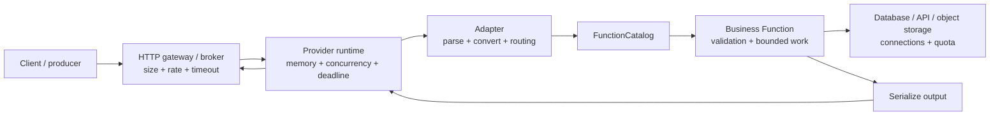
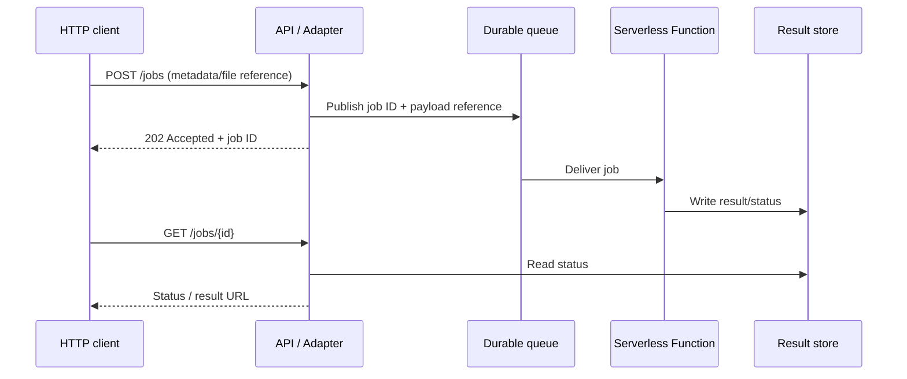
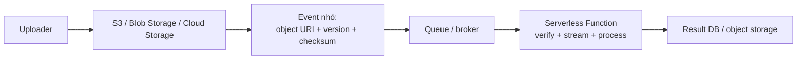
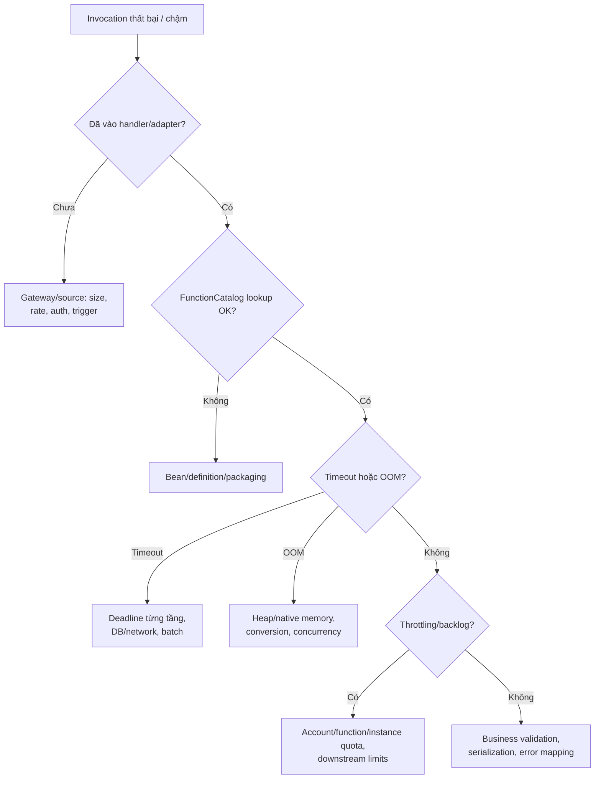

# Giới hạn thời gian, bộ nhớ, mức đồng thời và kích thước dữ liệu

> **Chương:** Serverless  
> **Module:** SPRING_CLOUD_FUNCTION  
> **Mục tiêu:** Thiết kế `Supplier`, `Function` và `Consumer` của Spring Cloud Function sao cho hoạt động trong **ngân sách thời gian, bộ nhớ, mức đồng thời và kích thước payload** của AWS Lambda, Azure Functions và Google Cloud Run functions; dùng `FunctionCatalog` để tái sử dụng logic nhưng không nhầm giới hạn nghiệp vụ với quota hạ tầng.  
> **Mốc đối chiếu hạn mức:** 24/11/2026. Ví dụ Java dùng JDK 21, Spring Boot 4.2.0, Spring Cloud BOM 2026.0.0 và Spring Cloud Function 5.1.0. Các quota có thể thay đổi theo region, tài khoản, hosting plan, loại trigger, thế hệ runtime và chính sách tổ chức; luôn kiểm tra tài liệu mới và quota thực của deployment.

## 1. Tại sao một bean Java chạy đúng vẫn có thể thất bại trên serverless?

Spring Cloud Function giúp tách logic nghiệp vụ khỏi cách gọi:

```java
@Bean
public Function<String, String> normalizeCode() {
    return code -> code.trim().toUpperCase(Locale.ROOT);
}
```

Cùng hàm trên có thể chạy qua HTTP adapter, Spring Cloud Stream hoặc một adapter serverless. Tuy nhiên, **thành công của `Function.apply(...)` trong unit test không chứng minh môi trường cloud có đủ tài nguyên** để xử lý một request thật.

Một invocation có thể bị chặn trước hoặc trong khi Java function chạy vì:

1. **Timeout:** deadline của API Gateway, HTTP gateway, provider runtime, message visibility timeout hay client đến trước khi công việc hoàn tất.
2. **Memory:** JVM heap, metaspace, thread stacks, direct buffers, JSON serialization, framework và payload cùng vượt quá RAM được cấp.
3. **Concurrency:** số lời gọi đồng thời, số instance đang scale hoặc connection pool tới database vượt quota.
4. **Payload size:** HTTP body, message broker, event envelope, Base64 hoặc response vượt hạn mức ở một tầng giao tiếp.
5. **Giới hạn khác:** CPU, file descriptors, threads, temporary storage, API rate limit và ngân sách downstream.

Giải quyết một giới hạn bằng cách tăng cấu hình không nhất thiết sửa được các giới hạn khác. Ví dụ tăng timeout Lambda không làm API Gateway chờ vô hạn; tăng số instances không làm database có thêm connections; tăng bộ nhớ không làm SQS chấp nhận message quá lớn.

### 1.1. Bốn ngân sách cần xác định trước khi viết logic

| Ngân sách | Câu hỏi thiết kế | Dấu hiệu khi bị vượt |
| --- | --- | --- |
| **Thời gian** | Toàn tuyến được phép chạy bao lâu? Có thời gian dự phòng để báo lỗi/ack không? | Timeout, 504, retry, invocation bị dừng. |
| **Bộ nhớ** | RAM cần cho JVM, Spring context, payload, threads và concurrency là bao nhiêu? | OOM, instance restart, tăng GC và latency. |
| **Đồng thời** | Bao nhiêu request/record đang chạy, bao nhiêu instance và bao nhiêu connection tới downstream? | Throttling, queue backlog, DB pool exhausted. |
| **Kích thước dữ liệu** | Input, envelope, headers, batch, response, artifact và object trung gian có giới hạn nào? | 413/oversize event, serialization failure, request bị từ chối. |

### 1.2. Bức tranh end-to-end



**Quy tắc:** giới hạn hiệu dụng của một request là giao của tất cả giới hạn trên tuyến, thường bị chi phối bởi **tầng chặt nhất**, không phải giá trị lớn nhất trong bảng quota của một provider.

## 2. Bốn loại giới hạn khác nhau: cứng, mềm, cấu hình, và ứng dụng

Không phải mọi con số trong tài liệu cloud đều có cùng ý nghĩa.

| Loại | Ý nghĩa | Ví dụ |
| --- | --- | --- |
| **Hard limit** | Provider không cho tăng qua giao diện quota thông thường. | Kích thước event tối đa ở một trigger. |
| **Soft/service quota** | Có mặc định, có thể yêu cầu tăng nếu region/tài khoản cho phép. | Account concurrency quota của Lambda. |
| **Per-resource configuration** | Người triển khai chọn trong khoảng provider hỗ trợ. | Timeout, memory, max instances, per-instance concurrency. |
| **Business/application limit** | Ứng dụng tự quy định để bảo vệ hệ thống. | Mỗi batch chỉ tối đa 32 mã; input tối đa 64 KiB. |

Ví dụ **limit nghiệp vụ 64 KiB** vẫn có ích ngay cả khi HTTP provider cho phép hàng chục MB: giới hạn sớm giúp tránh parse/allocate quá nhiều và có thể bảo vệ downstream tốt hơn.

### 2.1. Thay đổi quota không thay đổi hợp đồng kinh doanh

Nếu API nhận mã đơn hàng dài tối đa 16 ký tự, nâng RAM lên 4 GiB không làm một mã 200 MB trở thành hợp lệ. Ngược lại, nếu hệ thống cần xử lý file 2 GiB, không nên nới hạn mức JSON body thành 2 GiB; hãy lưu file vào object storage rồi gửi **tham chiếu có kiểm soát** cho function.

### 2.2. Đặt mốc thời gian cho con số

Ở mốc 24/11/2026, trang **AWS Lambda quotas** hiện ghi tối đa **1.800 giây (30 phút)** cho một invocation thông thường; một số nội dung/hướng dẫn lịch sử có thể còn ghi **900 giây (15 phút)**. Luôn dùng quota hiện hành của loại Lambda đang triển khai, không bê một con số cũ vào runbook.

Cũng cần phân biệt **Cloud Run services** và **Cloud Run functions thế hệ 2**, **Azure Consumption truyền thống** với **Flex/Premium**, hoặc **Lambda Event Function** với các lựa chọn Lambda Managed Instances. Các mô hình không nhất thiết có cùng timeout, memory, concurrency hay request limits.

## 3. Bảng hạn mức tham khảo: AWS, Azure và Google Cloud

Các số sau lấy từ tài liệu chính thức tại thời điểm soạn. Chúng dùng để **luyện cách đọc quota**, không thay thế xác minh trong project/region/tài khoản trước khi release.

| Hệ thống | Thời gian | Bộ nhớ mỗi instance | Điểm cần nhớ |
| --- | --- | --- | --- |
| **AWS Lambda thông thường** | Tối đa **1.800 giây / 30 phút** theo bảng quotas mới. | **128–10.240 MB** theo nấc 1 MB. | CPU tăng theo memory; account concurrency mặc định 1.000, có thể thấp hơn ở tài khoản mới. |
| **AWS Lambda Managed Instances, loại invocation phù hợp** | Có trường hợp hỗ trợ **5.400 giây / 90 phút** cho asynchronous/event source mappings được nêu rõ. | Phụ thuộc loại tài nguyên/runtime. | Không áp dụng 90 phút cho mọi Lambda hoặc mọi event source. |
| **Azure Functions Consumption truyền thống** | Mặc định **5 phút**, tối đa **10 phút**. | Hạn mức plan, thông thường tối đa **1,5 GB**/instance. | Mô hình cũ; cân nhắc Flex Consumption cho app mới. |
| **Azure Functions Flex Consumption** | Mặc định **30 phút**; cấu hình `functionTimeout` có thể không có mức trần cố định nhưng chịu giới hạn vòng đời platform. | Chọn **512 MB / 2.048 MB / 4.096 MB**. | HTTP vẫn có giới hạn chờ phản hồi khoảng **230 giây** qua Azure Load Balancer. |
| **Azure Premium/Dedicated** | Mặc định **30 phút**, có thể không bị áp trần execution khi cấu hình đúng plan; vẫn có grace period/recycle. | Tùy kích thước worker/plan. | Không hiểu “unbounded” là chạy mãi hoặc request HTTP chờ mãi. |
| **Google Cloud Run functions (thế hệ 2), HTTP** | Tối đa **60 phút**. | Tối đa **32 GiB**. | HTTP payload có giới hạn riêng. |
| **Google Cloud Run functions (thế hệ 2), event-driven** | Tối đa **540 giây / 9 phút** theo quota functions; scheduled/task queue có phạm vi riêng. | Tối đa **32 GiB**. | Eventarc event size nhỏ hơn HTTP request size. |

Nguồn đối chiếu: AWS Lambda quotas, Azure Functions hosting/scale, Google Cloud Run functions quotas (liên kết đầy đủ ở cuối bài).

**Đặc biệt:** Azure HTTP **230 giây** là giới hạn chờ phản hồi của tầng cân bằng tải, không phải `functionTimeout` chung. Nếu công việc dài hơn, trả **202 Accepted + job ID** và chuyển xử lý sang queue/workflow bền vững là một phương án phù hợp.

### 3.1. Payload quotas tham khảo

| Nơi truyền dữ liệu | Ngưỡng tài liệu | Phạm vi và điều kiện |
| --- | --- | --- |
| **AWS Lambda synchronous invocation** | **6 MB** request và **6 MB** response, mỗi bên. | Raw synchronous invoke; front door như API Gateway có giới hạn riêng. |
| **AWS Lambda asynchronous invocation** | **1 MB** event payload. | Không coi con số này là kích thước tối đa của mọi broker event. |
| **AWS Lambda streamed response** | Đến **200 MB** response streaming. | Chỉ áp dụng cho cơ chế response streaming được hỗ trợ; không biến mọi adapter thành streaming. |
| **Azure Functions HTTP request** | Giới hạn platform được ghi **210 MB**. | Host/app/front door có thể áp mức thấp hơn; đừng mặc định API nhận đủ 210 MB. |
| **Google Cloud Run functions (2nd gen) HTTP request** | **32 MB** uncompressed. | Response: 32 MB không stream, 10 MB stream theo quota functions. |
| **Google Cloud Run functions (2nd gen) event via Eventarc** | **512 KB**. | Khác legacy event và khác kích thước message gốc của Pub/Sub. |
| **Google Cloud Run functions (1st gen) HTTP request** | **10 MB**. | Không nhầm với thế hệ 2. |

**Quy tắc thận trọng:** lấy mức thấp nhất giữa **API gateway**, **cloud function**, **event source**, **serializer/envelope**, **tenant quota** và **business API contract**. Với binary data, Base64 và JSON envelope có thể làm kích thước truyền lớn hơn bytes gốc.

## 4. Ngân sách thời gian: timeout ở những tầng nào?

### 4.1. Deadline hiệu dụng là deadline ngắn nhất

Một lời gọi HTTP có thể chịu đồng thời:

- Timeout của browser/HTTP client.
- Timeout API Gateway/HTTP load balancer.
- Timeout cloud function invocation.
- Timeout của Spring adapter/message conversion.
- Timeout kết nối, đọc/ghi tới downstream API/DB.
- Timeout nội bộ của workflow hoặc business SLA.

Với tuyến đồng bộ, thời gian người gọi có thể chờ có thể xấp xỉ:

\[
T_{\text{effective}} \le
\min(T_{\text{client}}, T_{\text{gateway}},
T_{\text{function}}, T_{\text{business-SLA}})
\]

Đây là quan hệ **ngân sách**, không phải API mà framework tính tự động. Các tầng có thể start clock ở thời điểm khác nhau; cần dự phòng **thời gian serialize, ghi log cần thiết và hoàn tất response**.

### 4.2. Tách ngân sách theo công đoạn

Ví dụ API có SLO **8 giây** để trả kết quả:

| Công đoạn | Ngân sách minh họa |
| --- | ---: |
| Gateway + authentication | 0,5 giây |
| Adapter + JSON parse | 0,5 giây |
| DB + external API | 5 giây |
| Business CPU | 1 giây |
| Serialize + response + safety margin | 1 giây |
| **Tổng** | **8 giây** |

Đây là con số **minh họa của ứng dụng**, không phải quota cloud. Nếu downstream đã dùng 7,5 giây, business function không thể giả định còn toàn bộ 8 giây.

### 4.3. Không đặt timeout sát thời gian trung bình

Giả sử xử lý batch thường mất 20 giây nhưng đôi lúc 65 giây. Cấu hình function timeout 21 giây sẽ tạo nhiều lỗi với payload lớn, cold start hoặc network jitter. Nên đo p95/p99 với kích thước input thực tế, đặt timeout có headroom và có **early-abort/partial-progress policy** khi phù hợp.

Tăng timeout lên rất lớn lại có thể tạo chi phí đáng kể và kéo dài xử lý message lỗi. Cần giới hạn retry, số record và chính sách poison message.

### 4.4. Synchronous response không phù hợp tác vụ rất dài



Một task đọc file lớn, chuyển định dạng hoặc đồng bộ hàng triệu bản ghi nên dùng **durable workflow/chunking** thay vì giữ một HTTP request mở đến hết hạn tối đa của provider.

## 5. AWS Lambda: timeout, deadline và SQS visibility timeout

### 5.1. Cấu hình Lambda resource

Một AWS SAM fragment **minh họa** cho artifact AWS đã đóng gói:

```yaml
Resources:
  NormalizeLambda:
    Type: AWS::Serverless::Function
    Properties:
      Runtime: java21
      Handler: org.springframework.cloud.function.adapter.aws.FunctionInvoker
      CodeUri: target/scf-limit-demo-0.0.1-SNAPSHOT-aws.jar
      MemorySize: 2048
      Timeout: 120
      ReservedConcurrentExecutions: 50
      Environment:
        Variables:
          spring_cloud_function_definition: normalizeBatch
```

Fragment này **chưa phải template SAM hoàn chỉnh**: phải có `Transform`, artifact AWS đúng layout, IAM, event source, vùng triển khai và các chính sách bảo mật phù hợp. `Timeout: 120` là **giá trị do bài học chọn**, không phải hard max. `MemorySize` là bộ nhớ cấu hình cho function; `ReservedConcurrentExecutions` giới hạn đồng thời để bảo vệ downstream.

### 5.2. Deadline khi có AWS `Context`

Nếu viết **custom AWS handler** nhận `com.amazonaws.services.lambda.runtime.Context`, có thể kiểm tra:

```java
long remainingMs = context.getRemainingTimeInMillis();

if (remainingMs < 2_000) {
    // Dừng nhận thêm công việc, trả partial failure hoặc
    // báo lỗi theo đúng contract của event source.
    throw new IllegalStateException("Sắp hết thời gian xử lý");
}
```

Snippet dành cho handler AWS, **không phải bean nghiệp vụ dùng chung**. Generic `FunctionInvoker` có cơ chế nhận/đưa event và context riêng; không tự thêm `Context` vào chữ ký `Function<OrderBatch,BatchResult>` nếu converter không hỗ trợ.

Một cách tách lớp tốt hơn là handler chuyển deadline thành **budget trung lập** (ví dụ `Duration remaining`) rồi gọi use-case. Business rule không phải import AWS SDK.

### 5.3. Timeout của SQS và thời gian message visibility

Với SQS event source mapping:

- Function timeout phải phù hợp với **visibility timeout** của queue.
- Nếu visibility timeout quá ngắn, message đang xử lý có thể được nhận lại khi instance đầu còn chạy.
- Với batch window, tính cả thời gian chờ gom batch và retry/throttling theo tài liệu AWS.
- Nếu cần xử lý record lỗi riêng, bật **`ReportBatchItemFailures`** và trả đúng `SQSBatchResponse`.

AWS từng khuyến nghị visibility timeout tối thiểu bằng nhiều lần function timeout, cộng batch window trong một số tình huống. Khi viết hạ tầng, **đối chiếu hướng dẫn hiện hành của SQS event source mapping**, không áp một hệ số không rõ bối cảnh.

### 5.4. Đặt thời gian xử lý theo batch size

Giả sử batch có 100 records, mỗi record trung bình 200 ms gọi downstream tuần tự: phần I/O danh nghĩa đã khoảng **20 giây**, chưa kể cold init/serialization/retry. Nếu mỗi record đôi khi mất 2 giây, một batch lớn có thể dễ vượt timeout. Giảm batch size, song song có giới hạn hoặc checkpoint là những lựa chọn, nhưng **đừng tăng đồng thời quá mức** làm downstream bị throttling.

## 6. Azure Functions: `functionTimeout` và giới hạn HTTP 230 giây

### 6.1. `host.json` quy định execution timeout

Ví dụ `host.json`:

```json
{
  "version": "2.0",
  "functionTimeout": "00:05:00"
}
```

Cấu hình này minh họa timeout **5 phút** của Function App, có hiệu lực trong giới hạn plan. Tài liệu Azure Functions nêu:

- **Consumption truyền thống:** mặc định 5 phút, tối đa 10 phút.
- **Flex Consumption, Premium, Dedicated:** thường mặc định 30 phút; mức tối đa có thể không bị một hard execution timeout chung, nhưng vẫn chịu grace period khi scale-in/platform update.
- **HTTP trigger:** tối đa khoảng **230 giây** để hoàn tất phản hồi qua Azure Load Balancer, bất kể `functionTimeout` lớn hơn.

Vì vậy function HTTP xử lý 20 phút có thể vẫn chạy một phần theo plan nhưng **client không thể dựa vào kết nối HTTP đó để chờ 20 phút**. Phải tách thành asynchronous job hoặc Durable Functions nếu nghiệp vụ yêu cầu.

### 6.2. Worker startup cũng có ngân sách

Azure tài liệu còn mô tả giới hạn thời gian startup của language worker. Một ứng dụng Java/Spring khởi tạo context chậm có thể thất bại ở **startup**, trước khi business function nhận event. Đừng chỉ tăng `functionTimeout` để chữa lỗi Spring bean constructors gọi network quá lâu.

### 6.3. Bảo vệ Service Bus/queue workloads

Với Azure Service Bus trigger, cần xét:

- Message lock duration, auto-renewal/settlement và delivery count.
- Batch size, `maxConcurrentCalls` và session processing nếu dùng.
- Poison messages/dead-letter queue.
- Deadline gọi downstream và khả năng retry khi function bị dừng.

Cấu hình `functionTimeout` không đồng nghĩa **lock của broker sẽ tự kéo dài** theo function. Giữ side effects idempotent nếu message có thể bị giao lại.

## 7. Google Cloud Run functions: HTTP và event-driven có timeout khác nhau

### 7.1. Đọc đúng loại function

Theo Cloud Run functions quotas (2nd gen):

- **HTTP functions:** tối đa **60 phút**.
- **Scheduled / task queue functions:** tối đa **1.800 giây / 30 phút**.
- **Event-driven functions:** tối đa **540 giây / 9 phút**.
- **1st gen:** bảng quotas ghi tối đa **540 giây** nói chung.

Không tự áp giới hạn **60 phút** của HTTP lên một Pub/Sub/Eventarc trigger. Cũng không đồng nhất `Cloud Run service request timeout` với mọi background event source.

### 7.2. HTTP timeout không bảo đảm hủy toàn bộ công việc

Cloud Run service nếu vượt request timeout thường trả lỗi **HTTP 504** cho client. Tài liệu Cloud Run cảnh báo **đóng kết nối không nhất thiết kết thúc ngay container**; code có thể tiếp tục chạy trong một thời gian. Vì vậy không thiết kế “không nhận được HTTP response tức là chắc chắn chưa ghi DB”.

Nếu client retry một request ghi dữ liệu sau 504, **idempotency key** phải ngăn tạo trùng.

### 7.3. Với Pub/Sub/Eventarc cần cân nhắc cả kích thước event

Một function có thể đủ timeout xử lý file 100 MB nhưng event **Eventarc** bị giới hạn cỡ **512 KB**. Giải pháp: Pub/Sub event mang **URI, object version và metadata nhỏ**, dữ liệu lớn nằm trong Cloud Storage; function lấy theo quyền, kiểm tra checksum, xử lý theo chunk.

## 8. Bộ nhớ: Java heap không bằng tổng RAM của function

### 8.1. Những phần cùng sử dụng RAM

Một Java Spring Cloud Function runtime có thể cần:

- JVM heap chứa DTO, strings, collections, conversion buffers.
- Metaspace/class metadata, JIT code cache, JVM native memory.
- Thread stacks, direct/native buffers, TLS/network buffers.
- Spring `ApplicationContext`, `FunctionCatalog`, auto-configuration và dependencies.
- JSON/Jackson buffers, Base64 decoding, compression/decompression.
- SDK HTTP client, connection pools, TLS certificates, cache.
- Mỗi request/batch đang xử lý trong cùng instance.

Một giới hạn RAM cloud như **2 GiB** không có nghĩa bạn có thể đặt Java `-Xmx2g` và dùng hết 2 GiB heap mà không ảnh hưởng phần native.

### 8.2. Mô hình memory budget

Đối với một environment xử lý đồng thời nhiều requests:

\[
M_{\text{peak}} \approx M_{\text{JVM+Spring baseline}}
+ C \times M_{\text{per-inflight-request}}
+ M_{\text{shared caches}} + M_{\text{safety}}
\]

Trong đó `C` là số lời gọi đồng thời **trên instance**, không phải toàn account. Ví dụ minh họa:

- JVM + Spring + SDK baseline: **400 MiB**.
- Mỗi request cần tối đa **12 MiB** buffers/objects khi xử lý.
- Per-instance concurrency: **20**.
- Shared cache: **50 MiB**.
- Safety/headroom: **200 MiB**.

Mức đỉnh xấp xỉ `400 + 20 × 12 + 50 + 200 = 890 MiB`. Với workload này, cấu hình **1 GiB hoặc lớn hơn** có thể là điểm khởi đầu thử nghiệm, **không phải đảm bảo** vì GC peaks, direct buffers và payload tail có thể thay đổi.

### 8.3. Tăng memory có thể tăng CPU

AWS Lambda phân bổ CPU theo memory: tài liệu quota ghi khoảng **1 vCPU tương đương tại mức 1.769 MB**. Vì vậy nâng memory từ 512 MB lên 2.048 MB có thể giảm duration của workload CPU-bound hoặc Spring initialization, dù business payload không đổi. Tuy nhiên chi phí tính theo resource-time có thể tăng hoặc giảm tùy duration thực; phải benchmark.

Azure Flex có các **kích thước instance cố định**; Cloud Run cấu hình CPU/memory theo các cặp cho phép. Không giả định mỗi MB RAM tăng đều tạo cùng mức CPU ở ba provider.

### 8.4. `-Xmx` và container-aware JVM

Java 21 có khả năng nhận biết giới hạn container/cgroup trong nhiều môi trường; có thể cấu hình JVM heap bằng các tùy chọn như:

```text
-XX:MaxRAMPercentage=60.0
```

Đây là **ví dụ thử nghiệm**, không phải khuyến nghị luôn dùng 60%. Bạn còn phải dành RAM cho metaspace, threads, direct buffers, native SDK và peak allocations. Đừng đặt `-Xmx` hoặc percentage tùy tiện rồi coi đó là quota cloud.

### 8.5. OOM có thể xảy ra ngay cả khi payload nhỏ

- JSON payload 5 MB được parse thành nhiều object/string có footprint lớn hơn 5 MB.
- Base64 cần thêm bộ nhớ cho string encoded và byte[] decoded.
- Streaming input tốt hơn đọc toàn bộ file vào `byte[]`.
- Batch 10.000 records nhỏ có thể tạo nhiều DTO, lists và logs cùng lúc.
- Một cache không giới hạn có thể tăng qua các warm invocations rồi OOM.
- Concurrency lớn làm các buffers của nhiều invocation cùng tồn tại.

Dấu hiệu cần đo: RSS/memory utilization, max memory used, heap/GC pause, direct buffers, thread count và input-size distribution.

## 9. Đồng thời: requests, instances, threads và downstream là bốn con số khác nhau

### 9.1. Dùng Little's Law để ước lượng

Với lưu lượng trung bình `λ` requests/giây và duration trung bình `W` giây, số invocation đồng thời trung bình:

\[
L \approx \lambda \times W
\]

Ví dụ **120 requests/giây**, mỗi request chạy trung bình **2 giây**:

\[
L \approx 120 \times 2 = 240
\]

Nếu một Cloud Run instance được cấu hình tối đa **20 requests đồng thời**, cần ít nhất khoảng `240 / 20 = 12` instances để đáp ứng tải trung bình ở điều kiện lý tưởng, **chưa tính headroom, cold start, CPU, p99 và rate limits**.

Nếu mỗi instance có một DB pool tối đa **15 connections**, 12 instances có tiềm năng tới **180 connections**. Downstream DB chỉ có 100 connections thì tăng instance không giải quyết mà còn có thể làm vấn đề nặng hơn.

### 9.2. Ba kiểu giới hạn đồng thời

| Loại | Ảnh hưởng |
| --- | --- |
| **Account/region concurrency** | Quota tổng số invocations/environments đang chạy trong scope provider. |
| **Per-function/resource concurrency** | Giới hạn một cloud function resource để bảo vệ downstream hoặc chia tải. |
| **Per-instance concurrency** | Số request/record song song trên cùng JVM/context, ảnh hưởng race và RAM. |

Trong ứng dụng Java còn có giới hạn **threads/executor size, connection pool, semaphore, database rate limit**. Không được đánh đồng các số này với nhau.

### 9.3. AWS reserved vs provisioned concurrency

- **Reserved concurrency:** giữ và giới hạn capacity concurrency cho function, có thể dùng làm **upper bound** để không quá tải DB.
- **Provisioned concurrency:** cấp sẵn môi trường đã khởi tạo để giảm cold starts; không thay thế reserved concurrency hay idempotency.
- **Account concurrency:** quota tổng theo region/account, giá trị mặc định được AWS công bố là 1.000 nhưng tài khoản mới có thể thấp hơn.
- **Throttling:** khi chạm quota, hành vi tùy invocation mode; HTTP/synchronous có thể bị lỗi, async/event source có thể retry/backlog.

Một phép ước lượng initial capacity:

\[
\text{desired concurrency} \gtrsim
\text{peak request rate} \times \text{p95 duration}
\]

Đây là **heuristic với headroom**, không phải công thức AWS bảo đảm. Phải theo dõi concurrency/throttles/queue age thực tế.

### 9.4. Azure fixed/dynamic concurrency

Azure Functions có concurrency theo trigger/instance; một số extension như Queue Storage, Blob Storage và Service Bus hỗ trợ **dynamic concurrency**. Trong `host.json`:

```json
{
  "version": "2.0",
  "concurrency": {
    "dynamicConcurrencyEnabled": true,
    "snapshotPersistenceEnabled": true
  }
}
```

Khi bật tính năng này, host học mức concurrency phù hợp cho các trigger **được extension hỗ trợ** và có thể override manual settings tương ứng. **Không khẳng định dynamic concurrency tự áp cho mọi HTTP trigger hoặc mọi extension**.

Với **Flex Consumption**, HTTP per-instance concurrency và scale-out có cấu hình riêng. Tăng concurrency giảm nhu cầu số instances nhưng tăng memory/shared-client contention trong cùng worker.

### 9.5. Google Cloud Run per-instance concurrency

Cloud Run services hiện cho phép cấu hình **tối đa 1.000 concurrent requests mỗi instance** theo tài liệu dịch vụ; mặc định phụ thuộc phương thức triển khai và CPU, thường có giá trị 80 trong một số cấu hình. Đây là **khả năng nền Cloud Run**, không phải khuyến nghị đặt 1.000 cho mọi Java function.

Nếu một Spring bean giữ mutable fields, concurrency lớn có thể tạo race conditions giữa các request. Nếu code chặn I/O trong quá nhiều threads, tăng concurrency có thể làm memory/latency xấu đi. Với event-driven functions, còn phải xét trigger semantics riêng.

### 9.6. Backpressure và admission control

Thay vì nhận công việc vô hạn:

1. Giới hạn per-instance in-flight requests bằng cấu hình provider, thread pools hoặc semaphore.
2. Giới hạn batch size và memory per request.
3. Với HTTP, trả **429/503** và `Retry-After` khi phù hợp contract.
4. Với queue, dùng retry/backoff hoặc pause consumption theo binder/trigger.
5. Khi downstream có quota, giảm concurrency hoặc dùng rate limiter/circuit breaker.
6. Đừng trả thành công giả khi chưa thực sự xử lý; nếu event đã nhận mà chưa hoàn tất, cần durable state/ack phù hợp.

Một semaphore trong Spring singleton chỉ giới hạn **một context**, không phải quota toàn cluster. Muốn giới hạn toàn hệ thống cần cơ chế ở gateway, broker, database hoặc distributed rate limiting.

## 10. Kích thước dữ liệu: tính cả envelope, headers và encoding

### 10.1. Ba kích thước khác nhau

- **Logical business size:** kích thước mã, DTO hoặc file người dùng muốn xử lý.
- **Wire size:** bytes truyền qua HTTP/broker sau JSON, Base64, headers, metadata.
- **In-memory footprint:** Java objects/buffers sau deserialization và transformation.

Ví dụ chuỗi UTF-8 600 KiB được Base64-encode có kích thước khoảng **800 KiB** trước khi thêm JSON envelope/headers. Quy tắc:

\[
\operatorname{Base64Len}(n) =
4 \times \left\lceil \frac{n}{3} \right\rceil
\]

Đây là kích thước **encoded data** không bao gồm quote/escaping/metadata của JSON hay HTTP headers.

### 10.2. Vì sao giới hạn Pub/Sub khác giới hạn Eventarc?

Pub/Sub có message size limit riêng, nhưng khi Eventarc chuyển message thành CloudEvent, JSON envelope và Base64 có thể khiến event vượt **giới hạn Eventarc 512 KB** của Cloud Run functions thế hệ 2. Vì vậy một Pub/Sub message **hợp lệ ở nguồn** vẫn có thể không được chuyển tới function theo trigger đó.

Giải pháp: đặt object lớn vào **Cloud Storage**, publish event nhỏ chứa URI, generation/version và checksum. Function đọc object theo stream và xác minh quyền/size/chữ ký.

### 10.3. Vì sao giới hạn Lambda 6 MB không có nghĩa API nhận 6 MB?

AWS Lambda synchronous request/response 6 MB là quota của **Lambda invocation API**; API Gateway, Lambda Function URL, ALB hoặc event source có thể áp giới hạn và semantics khác. Một request có thể bị từ chối **trước khi** `FunctionInvoker` hoặc `FunctionCatalog` nhận dữ liệu.

Đừng sửa converter Spring khi gateway đã trả `413 Payload Too Large`; hãy sửa contract API, chuyển payload sang object storage hoặc dùng cơ chế streaming phù hợp.

### 10.4. Batch size không chỉ là số records

Một batch 500 records nhỏ có thể hợp lệ; một batch chỉ 5 records nhưng mỗi record cực lớn vẫn vượt payload cap. Do đó cần **hai giới hạn độc lập**:

- `maxItems`: số record tối đa.
- `maxBytes`: kích thước thực sau encoding/envelope hoặc một giới hạn bảo thủ phía application.

Với SQS Lambda, còn phải xét batch size, batch window, per-invocation payload quota và rule partial batch response. Không suy ra từ config `BatchSize=1000` rằng 1000 messages bất kỳ sẽ luôn vừa một invocation.

## 11. Chiến lược cho dữ liệu lớn: pointer, chunk và workflow

### 11.1. Chuyển payload lớn sang object storage



Ưu điểm:

- Event nhỏ hơn payload cap.
- Có thể đọc file theo chunks/stream, giới hạn peak memory.
- Dễ retry theo object version/checksum.
- Có thể tách quá trình upload với processing.

Rủi ro cần xử lý:

- Object permission, expiration, versioning và retention.
- Không tin object URL/raw path chưa được xác thực; chống SSRF và path traversal.
- Checksum, size và content type thực, không chỉ metadata do caller cung cấp.
- Object có thể bị thay đổi hoặc xóa trước khi worker đọc; dùng generation/version ID nếu provider hỗ trợ.
- Cần cleanup lifecycle và giới hạn chi phí lưu trữ.

### 11.2. Chunking có checkpoint

Nếu công việc dài hơn timeout, chia thành các chunks nhỏ:

1. Worker nhận một job ID và pointer.
2. Đọc một phần dữ liệu giới hạn bytes/records.
3. Xử lý và **ghi checkpoint bền vững**.
4. Publish job tiếp theo hoặc orchestration tiếp tục.
5. Ghi result cuối cùng có idempotency key.

Đừng lưu offset duy nhất trong static field hoặc `/tmp`. Khi instance bị thay hoặc event retry, checkpoint trong RAM không đủ để tiếp tục chính xác.

### 11.3. Không dùng một `Consumer<T>` làm “fire-and-forget” bất cẩn

`Consumer<T>` trả `void`; nếu handler trả success khi background thread chưa ghi xong, provider có thể freeze/terminate environment và mất công việc. Với tác vụ dài, hãy **ghi vào durable queue** hoặc đợi side effect hoàn tất trước khi ack theo contract.

### 11.4. Streaming khác buffering

Java:
 
```java
// Minh họa nguyên tắc: xử lý từng chunk thay vì đọc toàn bộ.
try (InputStream in = storage.openStream(objectKey)) {
    byte[] buffer = new byte[64 * 1024];
    int n;
    while ((n = in.read(buffer)) != -1) {
        processChunk(buffer, n);
    }
}
```

Đoạn này là **pseudo-code** vì `storage`, `objectKey`, `processChunk` thuộc API ứng dụng/provider; cần xử lý timeout, partial reads, checksum, retry, errors và security. Đặc biệt, `InputStream.read` có thể trả ít bytes hơn kích thước buffer; code phải dùng đúng `n`.

## 12. Spring Cloud Function: adapter/conversion tiêu thụ ngân sách ra sao?

### 12.1. FunctionCatalog không loại bỏ giới hạn provider

Một bean:

```java
@Bean
public Function<OrderBatch, BatchResult> normalizeBatch() {
    return batch -> /* nghiệp vụ */;
}
```

được đăng ký trong `FunctionCatalog` và có thể được các adapter gọi. Tuy nhiên:

- **AWS Lambda adapter** phải nhận event qua handler; HTTP/SQS envelope tùy nguồn.
- **Web adapter** deserialize request body theo content type và chữ ký function.
- **Spring Cloud Stream** binder chuyển message từ broker thành payload/headers.
- **Azure/GCP adapters** có runtime trigger và conversion khác.

`FunctionCatalog` giúp lookup, composition và message/type conversion trong phạm vi hỗ trợ, **không tự khắc phục một event vượt quota trước khi vào runtime**.

### 12.2. Conversion có thể nhân memory footprint

Giả sử HTTP body có JSON `OrderBatch`:

1. Gateway nhận bytes.
2. Adapter/runtime tạo byte/string buffer.
3. JSON converter tạo record/DTO và `List`.
4. Function duyệt, có thể tạo thêm list output.
5. Serializer tạo response bytes.

Một thời điểm có thể tồn tại **cả input bytes, decoded String, DTO và output**. Với nhiều concurrent requests, peak memory tăng nhanh. Nếu dùng DTO lớn, cần thử dữ liệu ở p95/p99 input size và cân nhắc streaming format, pagination hoặc object pointer.

### 12.3. Message headers không phải chỗ chứa file lớn

`Message<T>` của Spring có payload và headers. Các headers như `contentType`, `correlationId`, `traceId` hoặc routing definition nên **nhỏ và được kiểm soát**. Không nhét Base64 của file lớn vào header để “lách” payload size; header cũng có quota, có thể bị log/forward hoặc mất qua adapter.

### 12.4. Routing nhiều function trong một instance

Một artifact có thể chứa nhiều bean `Function`, `Supplier`, `Consumer`. `spring.cloud.function.definition` chọn một function/pipeline; `functionRouter` có thể chọn dựa trên metadata được cho phép.

Tuy nhiên, **nhiều bean không có nhiều quota tách biệt** khi chúng chạy trong cùng resource/instance. Một route xử lý file lớn có thể chiếm RAM/CPU và ảnh hưởng route nhẹ trong cùng worker. Nếu deadline, memory, IAM hoặc concurrency rất khác nhau, **tách cloud resources** thường giúp cô lập lỗi và cấp tài nguyên chính xác hơn.

## 13. Project Maven thực hành: giới hạn batch trước khi xử lý

Ta xây một Spring Cloud Function project nhận `BatchCommand` gồm nhiều mã đơn hàng. **Giới hạn 32 items và 64 KiB raw code UTF-8 là chính sách demo**, không phải giới hạn của AWS/Azure/GCP.

Mục tiêu:

- Tránh số items không giới hạn.
- Từ chối từng payload sai trước khi tạo quá nhiều kết quả.
- Giữ logic độc lập cloud.
- Kiểm tra `FunctionCatalog` bằng JUnit.
- Minh họa vì sao kiểm tra kích thước sau khi parse DTO **không thay thế** kiểm tra sớm ở gateway/adapter.

### 13.1. Cấu trúc thư mục

```text
scf-limit-demo/
├── pom.xml
└── src/
    ├── main/
    │   ├── java/vn/example/limits/
    │   │   └── LimitsApplication.java
    │   └── resources/
    │       └── application.properties
    └── test/
        └── java/vn/example/limits/
            └── LimitsApplicationTest.java
```

### 13.2. `pom.xml` dùng Spring Cloud BOM

```xml
<?xml version="1.0" encoding="UTF-8"?>
<project xmlns="http://maven.apache.org/POM/4.0.0"
         xmlns:xsi="http://www.w3.org/2001/XMLSchema-instance"
         xsi:schemaLocation="http://maven.apache.org/POM/4.0.0
           https://maven.apache.org/xsd/maven-4.0.0.xsd">
    <modelVersion>4.0.0</modelVersion>

    <parent>
        <groupId>org.springframework.boot</groupId>
        <artifactId>spring-boot-starter-parent</artifactId>
        <version>4.2.0</version>
        <relativePath/>
    </parent>

    <groupId>vn.example</groupId>
    <artifactId>scf-limit-demo</artifactId>
    <version>0.0.1-SNAPSHOT</version>

    <properties>
        <java.version>21</java.version>
        <spring-cloud.version>2026.0.0</spring-cloud.version>
    </properties>

    <dependencyManagement>
        <dependencies>
            <dependency>
                <groupId>org.springframework.cloud</groupId>
                <artifactId>spring-cloud-dependencies</artifactId>
                <version>${spring-cloud.version}</version>
                <type>pom</type>
                <scope>import</scope>
            </dependency>
        </dependencies>
    </dependencyManagement>

    <dependencies>
        <dependency>
            <groupId>org.springframework.boot</groupId>
            <artifactId>spring-boot-starter</artifactId>
        </dependency>
        <dependency>
            <groupId>org.springframework.cloud</groupId>
            <artifactId>spring-cloud-function-context</artifactId>
        </dependency>
        <dependency>
            <groupId>org.springframework.boot</groupId>
            <artifactId>spring-boot-starter-test</artifactId>
            <scope>test</scope>
        </dependency>
    </dependencies>

    <build>
        <plugins>
            <plugin>
                <groupId>org.springframework.boot</groupId>
                <artifactId>spring-boot-maven-plugin</artifactId>
            </plugin>
        </plugins>
    </build>
</project>
```

Cặp Boot/Cloud là ví dụ đối chiếu tại mốc tài liệu. BOM quản lý các **runtime dependencies**, không tự đưa adapter AWS/Azure/GCP vào project. Bài demo này **chưa có handler serverless, Web server hoặc broker binder** vì mục tiêu là giới hạn dữ liệu và catalog trong JVM.

### 13.3. Cấu hình

```properties
spring.application.name=scf-limit-demo
spring.main.web-application-type=none
spring.cloud.function.definition=normalizeBatch
```

`spring.main.web-application-type=none` ngăn khởi động HTTP server. Khi muốn test bằng cURL, phải thêm Web adapter và bỏ/tùy chỉnh property này trong một project hoặc Maven profile riêng. `spring.cloud.function.definition` chọn bean `normalizeBatch` cho adapter khi được tích hợp, **không đặt timeout hay memory của cloud**.

## 14. Java code đầy đủ: kiểm soát số lượng, bytes và dữ liệu

Tạo `src/main/java/vn/example/limits/LimitsApplication.java`:

```java
package vn.example.limits;

import java.nio.charset.StandardCharsets;
import java.util.ArrayList;
import java.util.List;
import java.util.Locale;
import java.util.function.Function;

import org.springframework.boot.SpringApplication;
import org.springframework.boot.autoconfigure.SpringBootApplication;
import org.springframework.context.annotation.Bean;

@SpringBootApplication
public class LimitsApplication {

    // Các giới hạn này là business/application limits.
    public static final int MAX_ITEMS = 32;
    public static final long MAX_INPUT_BYTES = 64L * 1024L;

    public static void main(String[] args) {
        SpringApplication.run(LimitsApplication.class, args);
    }

    public record WorkItem(String id, String code) {}

    public record BatchCommand(List<WorkItem> items) {}

    public record NormalizedItem(String id, String code) {}

    public record BatchResult(
            int count,
            long inputBytes,
            List<NormalizedItem> items) {}

    @Bean
    public Function<BatchCommand, BatchResult> normalizeBatch() {
        return batch -> {
            if (batch == null || batch.items() == null
                    || batch.items().isEmpty()) {
                throw new IllegalArgumentException(
                        "Batch không được rỗng");
            }

            if (batch.items().size() > MAX_ITEMS) {
                throw new IllegalArgumentException(
                        "Vượt số phần tử tối đa: " + MAX_ITEMS);
            }

            long totalBytes = 0L;
            List<NormalizedItem> output =
                    new ArrayList<>(batch.items().size());

            for (WorkItem item : batch.items()) {
                if (item == null || item.id() == null
                        || item.id().isBlank()
                        || item.code() == null) {
                    throw new IllegalArgumentException(
                            "Item thiếu id hoặc code");
                }

                byte[] encoded =
                        item.code().getBytes(StandardCharsets.UTF_8);

                // Giới hạn bằng byte, không chỉ String.length().
                totalBytes += encoded.length;
                if (totalBytes > MAX_INPUT_BYTES) {
                    throw new IllegalArgumentException(
                            "Vượt tổng số byte đầu vào");
                }

                String normalized = item.code()
                        .trim()
                        .toUpperCase(Locale.ROOT);

                if (!normalized.matches("[A-Z]{2}-[0-9]{3}")) {
                    throw new IllegalArgumentException(
                            "Code sai định dạng AA-999");
                }

                output.add(new NormalizedItem(
                        item.id(), normalized));
            }

            return new BatchResult(
                    output.size(),
                    totalBytes,
                    List.copyOf(output));
        };
    }
}
```

### 14.1. Vì sao kiểm tra số items trước khi cấp phát?

`batch.items().size()` giúp từ chối một danh sách quá dài **trước** khi tạo `ArrayList` output. Với workload thật, nếu inbound JSON đã được parse thành list 1 triệu phần tử trước bước này thì memory đã bị tiêu thụ; cần **giới hạn request size tại gateway/parser** để bảo vệ từ lớp ngoài.

### 14.2. Vì sao dùng bytes chứ không dùng độ dài chuỗi?

`String.length()` đo số UTF-16 code units trong Java, không phải số bytes trên wire. Một chuỗi UTF-8 có ký tự ngoài ASCII có thể chiếm nhiều bytes hơn. `getBytes(StandardCharsets.UTF_8).length` đo bytes của payload theo encoding này.

Trong demo, việc gọi `getBytes` trên từng item tạo **byte[] tạm**. Với input cực lớn, đó vẫn là cấp phát; application cần chặn request size **trước khi** parse và đưa vào business function.

### 14.3. Vì sao không đặt AWS `Context` trực tiếp trong bean?

Bean `Function<BatchCommand,BatchResult>` này không cần biết timeout Lambda hoặc GCP. Trong provider-specific handler, bạn có thể:

- Đọc remaining time/deadline của provider.
- Xác định budget records/bytes phù hợp.
- Dừng/publish checkpoint hoặc trả batch failure trước deadline.
- Gọi bean `normalizeBatch` theo từng chunk.

Nhờ vậy cùng logic có thể dùng qua HTTP, Stream và serverless, còn resource quotas nằm ở boundary/ops configuration.

### 14.4. Bài toán batch không nhất thiết all-or-nothing

Demo `normalizeBatch` từ chối toàn batch khi một item sai. **Đây là lựa chọn contract của bài học**, không phải quy tắc AWS SQS. Với SQS partial batch failures, adapter phải biết report từng `messageId` lỗi và quyết định xử lý FIFO/Standard queue cho đúng. Có thể chia SQS Records thành nhiều `BatchCommand` nhỏ, nhưng phải ánh xạ kết quả/exception về provider event response thật.

## 15. JUnit: test giới hạn dữ liệu và catalog

Tạo `src/test/java/vn/example/limits/LimitsApplicationTest.java`:

```java
package vn.example.limits;

import static org.junit.jupiter.api.Assertions.assertEquals;
import static org.junit.jupiter.api.Assertions.assertNotNull;
import static org.junit.jupiter.api.Assertions.assertThrows;

import java.util.ArrayList;
import java.util.List;
import java.util.function.Function;

import org.junit.jupiter.api.Test;
import org.springframework.beans.factory.annotation.Autowired;
import org.springframework.boot.test.context.SpringBootTest;
import org.springframework.cloud.function.context.FunctionCatalog;

import vn.example.limits.LimitsApplication.BatchCommand;
import vn.example.limits.LimitsApplication.BatchResult;
import vn.example.limits.LimitsApplication.WorkItem;

@SpringBootTest
class LimitsApplicationTest {

    @Autowired
    FunctionCatalog catalog;

    @Test
    void catalogFindsBoundedFunction() {
        Function<BatchCommand, BatchResult> fn =
                catalog.lookup("normalizeBatch");

        assertNotNull(fn);

        var result = fn.apply(
                new BatchCommand(List.of(
                    new WorkItem("e1", " od-123 "),
                    new WorkItem("e2", "ab-999"))));

        assertEquals(2, result.count());
        assertEquals("OD-123", result.items().get(0).code());
        assertEquals("AB-999", result.items().get(1).code());
    }

    @Test
    void rejectsBatchExceedingItemLimit() {
        var items = new ArrayList<WorkItem>();
        for (int i = 0; i <= LimitsApplication.MAX_ITEMS; i++) {
            items.add(new WorkItem("id-" + i, "AB-123"));
        }

        // Test trực tiếp factory method để kiểm chứng
        // exception nghiệp vụ, không phụ thuộc adapter mapping.
        var fn = new LimitsApplication().normalizeBatch();

        assertThrows(IllegalArgumentException.class,
                () -> fn.apply(new BatchCommand(items)));
    }

    @Test
    void rejectsInvalidCode() {
        var fn = new LimitsApplication().normalizeBatch();

        assertThrows(IllegalArgumentException.class,
                () -> fn.apply(new BatchCommand(List.of(
                    new WorkItem("e1", "code-too-long")))));
    }

    @Test
    void rejectsEmptyBatch() {
        var fn = new LimitsApplication().normalizeBatch();

        assertThrows(IllegalArgumentException.class,
                () -> fn.apply(new BatchCommand(List.of())));
    }
}
```

Chạy:

```bash
mvn clean test
```

Nếu project có Maven Wrapper, dùng `./mvnw clean test` hoặc `./mvnw.cmd clean test` trên Windows. Bộ test này **không đo quota AWS/Azure/GCP**, không tạo tải concurrent và không chứng minh handler serverless đã được đóng gói. Nó chỉ kiểm tra policy dữ liệu và `FunctionCatalog` trong Spring JVM.

### 15.1. Cần thêm những kiểm thử nào?

| Test cần bổ sung | Tại sao? |
| --- | --- |
| `MAX_ITEMS` và `MAX_ITEMS+1` | Kiểm tra biên số lượng. |
| Input tổng `64 KiB` và `64 KiB+1` | Kiểm tra biên theo UTF-8 bytes. |
| JSON body chứa nhiều nested objects | Phát hiện parser/memory amplification. |
| Batch có record null/sai schema | Bảo vệ conversion và validation. |
| Request 1 MB qua gateway cụ thể | Xác nhận quota ở tầng entrypoint thật. |
| Parallel invocations 1/10/50/100 | Quan sát CPU, GC, RSS, throttling. |
| Downstream chậm/hết connection | Kiểm tra timeout/retry/backpressure. |
| Provider runtime test | Kiểm tra handler, memory, deadline và event size thực. |

Đừng sinh 1 GB object trong unit test chỉ để “thử OOM”; điều đó có thể làm CI runner treo. Dùng boundary/unit tests theo kích thước nhỏ và các load tests có kiểm soát trên môi trường riêng.

## 16. Concurrency và deadline tại adapter: phác thảo thiết kế

### 16.1. Giới hạn in-flight trên một JVM

Ví dụ một lớp admission control:

```java
public final class LocalAdmissionGate {

    private final Semaphore permits = new Semaphore(8);

    public <T> T run(Callable<T> work) throws Exception {
        if (!permits.tryAcquire()) {
            throw new RejectedExecutionException(
                    "Instance đang quá tải");
        }

        try {
            return work.call();
        } finally {
            permits.release();
        }
    }
}
```

Đoạn này cần imports `java.util.concurrent.Semaphore`, `Callable` và `RejectedExecutionException`. Nó **giới hạn một JVM/process**, không đặt global concurrency quota AWS/Azure/GCP. Lớp adapter phải ánh xạ rejection thành HTTP 429/503 hoặc retry/defer theo contract event source; không coi việc ném exception là xử lý thành công.

### 16.2. Nếu chỉ kiểm tra timeout ở cuối là quá muộn

Khi một call I/O có thể mất 30 giây mà provider còn 5 giây, cần áp **per-call timeout nhỏ hơn remaining budget**. Không chờ call hết 30 giây rồi mới kiểm tra remaining time.

Pseudo-algorithm:

```text
remaining = deadline_from_provider_or_application
reserve = response_serialization + checkpoint + safety_margin

if remaining <= reserve:
    stop_before_starting_next_unit()

clientTimeout = min(remaining - reserve, configuredDownstreamTimeout)
call_downstream_with_timeout(clientTimeout)

checkpoint_if_needed()
complete_before_provider_deadline()
```

**Không dùng sleep/busy-spin để đợi tới deadline.** Việc kết thúc nên dựa vào thời gian còn lại, cancellation/interrupt, timeout của network client và bền vững hóa tiến độ.

### 16.3. Bounded retry

Thử lại một HTTP API 5 lần, mỗi lần timeout 10 giây, trong một Lambda chỉ có 30 giây có thể luôn thất bại. Retry cần giới hạn:

- Tổng thời gian dành cho retry.
- Số attempts và exponential backoff/jitter.
- Loại lỗi có thể retry (timeout, 429, 503) so với lỗi schema/authorization.
- Idempotency key cho side effect.
- Cách báo lỗi/ack cho trigger.

## 17. Tác động của giới hạn đến `Supplier`, `Function`, `Consumer`

| Functional type | Nguy cơ chính | Cách thiết kế |
| --- | --- | --- |
| `Supplier<T>` | Poll/schedule quá thường xuyên, output lớn, downstream không tiêu thụ kịp. | Giới hạn rate/size, phân trang hoặc reference, đúng lịch/triggers. |
| `Function<T,R>` | Request/response vượt size, timeout do I/O hoặc composition. | Contract DTO rõ, bounded input/output, time budget, stream/chunk khi cần. |
| `Consumer<T>` | Side effect lâu, retry tạo duplicate, ack không rõ. | Idempotency, DB transaction/outbox, bounded concurrency và retry policy. |

Composition `normalize|validate|enrich` phải tính **tổng duration và peak intermediate data**. Một function trả `Flux<T>`/`Mono<T>` không tự biến cloud invocation thành stream vô hạn; adapter/trigger có thể yêu cầu kết quả hữu hạn và có timeout riêng. Kiểm tra thư viện conversion và reactive runtime thực.

### 17.1. Một resource có nhiều functions vẫn dùng chung tài nguyên

Nếu deployment dùng `functionRouter` chọn nhiều beans trong một Lambda/Cloud Run resource, các route có thể chia:

- Memory/CPU allocation.
- Environment/server process.
- IAM role/service account.
- Concurrency quota.
- Downstream clients/pool.

Một route parse file lớn có thể làm route normalize nhỏ bị ảnh hưởng. Khi SLO, quyền IAM, payload size hoặc memory footprint khác biệt lớn, tách chúng thành **resources riêng** thường hợp lý dù logic dùng chung module.

## 18. Quan sát, cảnh báo và kiểm thử tải

### 18.1. Các metric cần thu

| Metric/đặc tính | Khi tăng bất thường nên kiểm tra |
| --- | --- |
| p50/p95/p99 duration theo route | Outliers, cold start, downstream latency. |
| Timeout count/rate | Deadline budget, input tail, retries. |
| Memory peak/RSS/GC pause | Heap, direct buffers, batch size, concurrency. |
| Concurrent invocations/instances | Scaling, reserved quota, traffic spike. |
| Throttles / HTTP 429 / 503 | Quota provider, gateway, app admission control. |
| Queue depth/oldest-message age | Consumer capacity thiếu, poison events, retry storm. |
| Payload size histogram/p95/p99 | Oversized event, Base64/envelope overhead. |
| Dead-letter/partial-batch failures | Validation errors, transient downstream failure. |
| DB pool active/waiters | Instance × pool oversubscription. |
| Cost/GB-seconds/vCPU-seconds | Memory/concurrency/time trade-offs. |

AWS: dùng CloudWatch metrics/logs (ví dụ `Duration`, `Max Memory Used`, `Throttles`, `ConcurrentExecutions`) và Event Source metrics. Azure: Application Insights/Monitor + scale/concurrency telemetry. Google: Cloud Monitoring/Logging + Cloud Run instance/concurrency/memory metrics.

### 18.2. Quy trình load test có kiểm soát

1. Chốt commit, artifact, Java version, provider/region/plan và trigger.
2. Dùng payload hợp lệ với phân phối kích thước thực tế, bao gồm p99.
3. Đo baseline ít tải, sau đó ramp 1 → 5 → 10 → 25 → 50 concurrent requests nếu môi trường cho phép.
4. Giữ mức tải đủ lâu để thấy autoscale, warm/cold mix và memory/GC ổn định.
5. Ghi throughput, errors/throttles, queue age, DB connections và cost.
6. Kiểm tra timeout/429/413/oversize, test retry/idempotency.
7. Chỉnh một tham số một lần (memory, batch size, concurrency, timeout).
8. Lặp lại trên cùng artifact và điều kiện gần tương đương.

**Không chạy stress test trên production hoặc hệ thống của người khác khi chưa có phạm vi/giới hạn được phê duyệt.** Dùng staging với data an toàn, budget và giới hạn lưu lượng rõ ràng.

### 18.3. Không suy “max concurrency” từ một đơn vị sai

Một Lambda resource đạt 50 concurrent executions khác với Cloud Run đặt concurrency=50 requests **mỗi instance**. Cần ghi đầy đủ: **scope** (account/function/instance) + **đơn vị** (executions/requests/instances) + **time window** (đỉnh, trung bình, rate).

## 19. Xử lý sự cố theo triệu chứng

| Triệu chứng | Khả năng nguyên nhân | Kiểm tra đầu tiên |
| --- | --- | --- |
| Lambda timeout dù Java function nhanh | Gateway, init, DB/network, payload conversion. | End-to-end trace, `Duration`, downstream latency. |
| Azure HTTP trả timeout trước `functionTimeout` | Azure Load Balancer ~230 giây. | Chuyển sang async job/Durable Functions. |
| GCP event 5 MB không đến function | Eventarc event size thấp hơn HTTP quota. | Eventarc quota, base64/envelope size. |
| Container bị OOM khi có 20 requests đồng thời | Per-request buffers × concurrency quá lớn. | RSS, heap, direct memory và concurrency config. |
| AWS báo `Throttles` | Account quota hoặc reserved function concurrency. | Service Quotas, reserved/provisioned config. |
| Queue backlog tăng dù memory còn | Downstream chậm, batch size nhỏ, concurrency cap. | Queue age, p95 duration, DB quotas. |
| DB hết connections khi scale-out | Pool size × instances lớn. | Per-instance pool, max instances, proxy. |
| Input 6 MB bị gateway từ chối | Giới hạn front door khác Lambda synchronous. | API Gateway/HTTP service quota. |
| Output quá lớn dù input nhỏ | Response serialization/aggregation không giới hạn. | Đếm output bytes, pagination/object storage. |
| Base64 data hợp lệ ở nguồn nhưng event oversized | Encoding + envelope khiến wire size tăng. | Đo encoded bytes toàn event. |
| Gặp `OutOfMemoryError` sau nhiều warm invocations | Cache leak hoặc giữ payload qua singleton/static. | Heap dump an toàn, cache TTL và GC logs. |
| SQS record tốt bị retry cùng record lỗi | Chưa bật/không trả đúng partial batch failure. | `ReportBatchItemFailures`, batch response. |
| Event bị xử lý hai lần sau timeout | At-least-once semantics, thiếu idempotency. | Unique business operation key, transaction. |
| `FunctionCatalog.lookup` không tìm thấy bean | Bean/definition/packaging lỗi, không phải quota. | Spring context, BOM và adapter handler. |

### 19.1. Sơ đồ chẩn đoán



## 20. Bài tập tình huống

### Bài 1 — Đọc đúng giới hạn theo runtime

Hệ thống gồm:

- AWS Lambda xử lý một request đồng bộ.
- Azure Functions Flex HTTP trigger.
- Google Cloud Run functions (2nd gen) Pub/Sub via Eventarc.

Hãy trả lời:

1. Vì sao không dùng cùng một timeout 60 phút cho cả ba?
2. Với Azure HTTP request dự kiến 10 phút, cần mô hình async nào?
3. Với Pub/Sub message lớn 800 KiB, nguy cơ nào xảy ra ở Eventarc?
4. Con số 30 phút của AWS theo tài liệu mới có nghĩa gì, và vì sao phải kiểm tra gateway timeout riêng?

### Bài 2 — Tính concurrency và DB connections

Một API có 150 requests/giây, trung bình xử lý 0,8 giây. Hãy:

1. Ước lượng concurrency trung bình theo Little's Law.
2. Nếu một Cloud Run instance dùng concurrency=20, cần tối thiểu khoảng bao nhiêu instances theo phép tính lý tưởng?
3. Nếu mỗi instance mở pool 20 connections, tổng connections tiềm năng là bao nhiêu?
4. Đề xuất cách bảo vệ DB nếu database chỉ có 80 connections.

**Gợi ý:** concurrency trung bình khoảng 120; số instances lý tưởng 6; tổng pool max 120. Đây chưa tính headroom và giới hạn autoscaler.

### Bài 3 — Tính Base64 overhead

Một producer phát 900 KiB raw binary dưới dạng Base64 trong event JSON.

1. Tính gần đúng bytes Base64 sau encoding.
2. Cộng envelope và headers sẽ làm kích thước tăng hay giảm?
3. Có phù hợp Eventarc 512 KB không?
4. Đề xuất message body chỉ chứa object URI, checksum và version.

**Gợi ý:** 900 KiB raw → khoảng 1.200 KiB Base64, chưa có JSON overhead.

### Bài 4 — Giới hạn business batch

Với `normalizeBatch`, viết thêm tests:

- 32 items hợp lệ và 33 items.
- `BatchCommand` rỗng.
- Item có code null.
- Một mã chứa Unicode multibyte và bị validation từ chối.
- Không ghi nhận “giới hạn 64 KiB” là quota provider, vì đó là policy ứng dụng.

Giải thích tại sao test kích thước **sau JSON parsing** chưa bảo vệ được parser khỏi input hàng trăm MB.

### Bài 5 — Giải pháp cho file lớn

Một endpoint nhận file 1 GiB, chuẩn hóa nội dung rồi trả file. Hãy thiết kế:

1. Upload trực tiếp vào object storage bằng cơ chế upload phù hợp, không gửi nguyên file trong Lambda JSON payload.
2. Gửi job ID + object version/checksum qua queue.
3. Chia công việc thành chunks, có checkpoint bền vững.
4. Ghi status/result vào DB/storage, client poll hoặc nhận callback.
5. Hạn chế concurrency để không quá tải DB và giới hạn retry/idempotency.

### Bài 6 — Sự cố SQS và timeout

Một Lambda có `Timeout=30` giây, xử lý batch 100 records nhưng một số record tốn 2 giây mỗi cái, queue visibility timeout quá ngắn. Hãy phân tích:

- Vì sao batch không thể luôn xử lý tuần tự hoàn tất trong 30 giây?
- Hệ quả của message visibility timeout ngắn?
- Cách giảm batch, tăng hợp lý timeout/visibility, dùng partial failure?
- Cách checkpoint hoặc chia nhỏ workflow khi input tail rất lớn?

### Bài 7 — Bảo vệ hệ thống khi tăng tải

Một Java `Function` gọi API downstream, client timeout 10 giây; trên Cloud Run concurrency từ 10 tăng lên 100 thì OOM/503 tăng. Hãy nêu:

- Thành phần memory nào tăng theo concurrent requests.
- Cách giảm concurrency và tăng instances/memory theo thử nghiệm.
- Cách giới hạn connection pool và request timeout.
- Vì sao retry không giới hạn làm tăng tải và tạo “retry storm”.
- Các metrics cần đưa vào dashboard trước khi rollout.

## 21. Checklist đưa Spring Cloud Function lên serverless

| Hạng mục | Việc cần xác nhận |
| --- | --- |
| **Provider/runtime** | AWS/Azure/GCP, loại function, generation, Java version và region. |
| **Entry point** | `FunctionInvoker` / Azure handler / `GcfJarLauncher` đúng adapter. |
| **Function definition** | `spring.cloud.function.definition` chọn bean/pipeline phù hợp. |
| **Timeout** | Runtime + gateway + broker visibility/ack + downstream + app SLA. |
| **Memory/CPU** | Baseline JVM/Spring, p99 payload, concurrency, GC/RSS/native buffers. |
| **Concurrency** | Account quota, resource cap, per-instance, threads, DB pool. |
| **Payload size** | HTTP/gateway/event source, envelope/Base64, response, batch, storage. |
| **Validation** | Giới hạn bytes/record count sớm, schema/content type rõ, auth. |
| **Failure semantics** | 413/429/503/504, retry, DLQ, partial batch, idempotency. |
| **Large jobs** | Object reference + async workflow + chunk/checkpoint. |
| **Observability** | p95/p99, memory peak, throttles, queue age, oversized events. |
| **QA/release** | Unit/catalog test, load test có kiểm soát, provider contract test. |

Một deployment chỉ đạt khi **logic đúng và cả bốn ngân sách đều đủ headroom** trong điều kiện tải thực tế, không phải chỉ khi bean chạy thành công trên máy lập trình.

## 22. Tổng kết và tài liệu chính thức

**Giới hạn thời gian, bộ nhớ, mức đồng thời và kích thước dữ liệu là bốn trục thiết kế độc lập.** Spring Cloud Function làm cho logic `Supplier`, `Function`, `Consumer` có thể tái sử dụng và `FunctionCatalog` giúp lookup/composition/conversion; nó không xóa hard limits của API Gateway, queue, cloud runtime hay database.

Các nguyên tắc quan trọng:

1. Xác định **đúng loại trigger/hosting plan/runtime** trước khi đọc quota.
2. Tính **deadline hiệu dụng ngắn nhất**, không chỉ xem function timeout.
3. Cấp memory cho **toàn bộ JVM + Spring + buffers + per-request concurrency**, không chỉ Java heap.
4. Điều chỉnh concurrency theo **thông lượng, memory và downstream capacity**, không chỉ để tăng throughput.
5. Đo **wire size** gồm encoding/envelope, không chỉ logical payload.
6. Dữ liệu lớn nên đi qua **object storage + pointer/event nhỏ + chunk/workflow**, không qua JSON inline.
7. Với broker, phải thiết kế retry, visibility/ack, partial batch failure và idempotency.
8. Mọi con số quota phải đi cùng **mốc ngày, scope và tài liệu nguồn**; các giới hạn có thể thay đổi qua các bản phát hành provider.

**Tài liệu chính thức:**

1. Spring Cloud Function — Programming Model và FunctionCatalog: https://docs.spring.io/spring-cloud-function/reference/spring-cloud-function/programming-model.html
2. Spring Cloud Function — AWS adapter/FunctionInvoker: https://docs.spring.io/spring-cloud-function/reference/adapters/aws-intro.html
3. Spring Cloud Function — Azure adapter: https://docs.spring.io/spring-cloud-function/reference/adapters/azure-intro.html
4. Spring Cloud Function — GCP adapter/GcfJarLauncher: https://docs.spring.io/spring-cloud-function/reference/adapters/gcp-intro.html
5. AWS Lambda — Quotas (timeout/memory/concurrency/payload): https://docs.aws.amazon.com/lambda/latest/dg/gettingstarted-limits.html
6. AWS Lambda — Configure timeout: https://docs.aws.amazon.com/lambda/latest/dg/configuration-timeout.html
7. AWS Lambda — Reserved and provisioned concurrency: https://docs.aws.amazon.com/lambda/latest/dg/configuration-concurrency.html
8. AWS Lambda — SQS event source mapping and batch behavior: https://docs.aws.amazon.com/lambda/latest/dg/with-sqs.html
9. Azure Functions — Hosting options, timeout, memory and service limits: https://learn.microsoft.com/en-us/azure/azure-functions/functions-scale
10. Azure Functions — Concurrency (fixed/dynamic): https://learn.microsoft.com/en-us/azure/azure-functions/functions-concurrency
11. Azure Functions — Flex Consumption plan: https://learn.microsoft.com/en-us/azure/azure-functions/flex-consumption-plan
12. Google Cloud Run functions — Quotas (1st/2nd generation): https://docs.cloud.google.com/functions/quotas
13. Google Cloud Run — Request timeout: https://docs.cloud.google.com/run/docs/configuring/request-timeout
14. Google Cloud Run — Memory limits: https://docs.cloud.google.com/run/docs/configuring/services/memory-limits
15. Google Cloud Run — Concurrency limits and scaling: https://docs.cloud.google.com/run/docs/about-concurrency
16. Spring Cloud Stream — Functional bindings and broker messages: https://docs.spring.io/spring-cloud-stream/reference/
17. Spring Cloud — Release train compatibility: https://spring.io/projects/spring-cloud/
