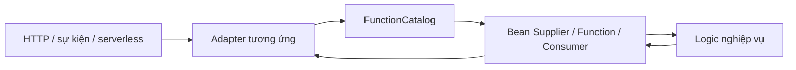

# Kiến thức nền về Java functional interface, Spring Boot và Reactor

> **Chương:** Khởi tạo  
> **Module:** SPRING_CLOUD_FUNCTION  
> **Trọng tâm:** Java functional interface, quản lý bean bằng Spring Boot và lập trình luồng dữ liệu với Project Reactor.

## 1. Vì sao cần ba nền tảng này?

**Spring Cloud Function** cho phép đóng gói logic nghiệp vụ thành các hàm tái sử dụng bằng `Supplier`, `Function` và `Consumer`, độc lập với giao thức gọi. Cùng một logic có thể được kết nối qua HTTP, hệ thống sự kiện hoặc adapter serverless khi cấu hình tầng tích hợp phù hợp. Để hiểu `FunctionCatalog`, composition, chuyển đổi thông điệp và cách đưa hàm ra môi trường thực thi khác nhau, trước hết cần phân biệt vai trò của ba nền tảng:

| Nền tảng | Trả lời câu hỏi | Vai trò trong Spring Cloud Function |
| --- | --- | --- |
| **Java functional interface** | Hàm nhận gì, trả gì và được gọi ra sao? | Định nghĩa hợp đồng của logic: tạo dữ liệu, biến đổi dữ liệu hoặc tiêu thụ dữ liệu. |
| **Spring Boot** | Ai tạo, cấu hình và quản lý các đối tượng chứa hàm? | Đưa hàm vào `ApplicationContext` dưới dạng bean để framework phát hiện và dùng lại. |
| **Project Reactor** | Điều gì xảy ra nếu dữ liệu đến theo luồng, bất đồng bộ hoặc có thể lỗi? | Biểu diễn xử lý bằng `Mono`/`Flux`; hỗ trợ composition theo luồng, tín hiệu lỗi và backpressure. |

`Spring Cloud Function` nằm ở lớp kết nối: nó tìm các bean hàm qua `FunctionCatalog` và phối hợp với adapter để bên ngoài có thể gọi hàm.



Sơ đồ mô tả đường đi khái niệm. Không phải mọi adapter đều hỗ trợ mọi kiểu hàm hoặc có cùng quy tắc chuyển đổi dữ liệu; phần tích hợp cụ thể phải được cấu hình cho từng môi trường.

Sau bài này, người học cần có thể:

1. Viết và kết hợp `Supplier<T>`, `Function<T, R>` và `Consumer<T>` bằng lambda hoặc method reference.
2. Giải thích vì sao một hàm Java thuần có thể trở thành bean trong Spring Boot và được tra cứu qua `FunctionCatalog`.
3. Phân biệt xử lý đồng bộ theo từng giá trị với xử lý theo `Mono`/`Flux` của Reactor.
4. Nhận biết lỗi thường gặp khi xử lý `null`, ngoại lệ, side effect và mã blocking.
5. Đọc được một ví dụ Spring Cloud Function gồm bean hàm, composition và kiểm thử.

## 2. Java functional interface: hợp đồng của logic

### 2.1. Single Abstract Method (SAM) là gì?

Một *functional interface* có đúng **một phương thức trừu tượng cần triển khai** (Single Abstract Method, viết tắt SAM). Vì thế Java có thể cung cấp phần triển khai bằng một biểu thức lambda hoặc method reference. Annotation `@FunctionalInterface` giúp trình biên dịch kiểm tra ràng buộc này, nhưng không bắt buộc để một interface trở thành functional interface.

```java
@FunctionalInterface
interface CodeFormatter {
    String format(String rawCode);

    default String describe() {
        return "Chuẩn hóa mã";
    }
}

CodeFormatter formatter = input -> input.trim().toUpperCase(Locale.ROOT);
String result = formatter.format("  od-123  "); // "OD-123"
```

Các phương thức `default` và `static` không làm mất tính chất SAM. Các phương thức tương ứng với phương thức public trong `Object` cũng không được tính thành một phương thức trừu tượng bổ sung.

Thông thường không cần tự khai báo interface mới: thư viện chuẩn `java.util.function` đã có nhiều hợp đồng phổ biến.

### 2.2. Ba interface cốt lõi

| Interface | Phương thức SAM | Ý nghĩa | Ví dụ nghiệp vụ |
| --- | --- | --- | --- |
| `Supplier<T>` | `T get()` | Cung cấp một giá trị, không nhận tham số đầu vào. | Sinh mã tham chiếu hoặc lấy dữ liệu từ nguồn. |
| `Function<T, R>` | `R apply(T value)` | Nhận một giá trị kiểu `T` và trả kết quả kiểu `R`. | Chuẩn hóa mã, tính điểm hoặc chuyển đổi DTO. |
| `Consumer<T>` | `void accept(T value)` | Nhận dữ liệu và thực hiện hành động, không trả kết quả. | Ghi nhật ký, gửi thông báo hoặc đẩy sự kiện. |

```java
import java.util.Locale;
import java.util.UUID;
import java.util.function.Consumer;
import java.util.function.Function;
import java.util.function.Supplier;

Supplier<String> newReference = () -> UUID.randomUUID().toString();

Function<String, String> normalizeCode =
        raw -> raw.trim().toUpperCase(Locale.ROOT);

Consumer<String> auditCode =
        code -> System.out.println("Đã xử lý: " + code);

String id = newReference.get();
String code = normalizeCode.apply("  od-123  "); // OD-123
auditCode.accept(code);                         // Đã xử lý: OD-123
```

Những điểm cần đọc đúng từ kiểu:

- `Supplier<String>` không tự tạo dữ liệu chỉ vì biến đã được khởi tạo; việc sinh giá trị xảy ra khi gọi `get()`.
- `Function<String, String>` có đầu vào và đầu ra cùng kiểu, nhưng `Function<T, R>` cũng có thể đổi kiểu, ví dụ `Function<String, Integer>`.
- `Consumer<T>` có kết quả `void`. Nó thường tạo *side effect*, nên cần cân nhắc khả năng gửi trùng, retry và tính idempotent trong hệ thống sự kiện.
- `Predicate<T>` (`boolean test(T value)`), `UnaryOperator<T>` (`T apply(T value)`) và `BiFunction<T, U, R>` cũng hữu ích trong Java, nhưng ba interface đầu tiên là hợp đồng cơ bản của Spring Cloud Function.

### 2.3. Lambda, method reference và composition

Lambda mô tả hành vi ngắn gọn; method reference chỉ đến một phương thức phù hợp về chữ ký.

```java
Function<String, String> trim = String::trim;
Function<String, String> upper =
        value -> value.toUpperCase(Locale.ROOT);

Function<String, String> normalize = trim.andThen(upper);

normalize.apply("  od-123  "); // "OD-123"
```

Với các hàm `f` và `g`:

- `f.andThen(g)` thực hiện `f` trước, rồi `g`: `g(f(x))`.
- `f.compose(g)` thực hiện `g` trước, rồi `f`: `f(g(x))`.
- Kiểu đầu ra của hàm trước phải tương thích với kiểu đầu vào của hàm sau.

**Ví dụ lỗi thứ tự:** kiểm tra biểu thức chính quy chỉ cho phép chữ hoa *trước khi* chuẩn hóa sẽ từ chối `"od-123"`, trong khi chuẩn hóa rồi kiểm tra sẽ chấp nhận. Thứ tự composition là một phần của quy tắc nghiệp vụ.

### 2.4. Hàm dễ tái sử dụng cần lưu ý gì?

Một hàm biến đổi lý tưởng có đầu ra phụ thuộc vào đầu vào và tránh sửa trạng thái dùng chung. Hai lần gọi cùng một mã sẽ cho cùng kết quả; điều này giúp kiểm thử và chạy đồng thời dễ hơn.

```java
Function<String, String> normalizeSafe = raw -> {
    String required = java.util.Objects.requireNonNull(raw, "rawCode");
    return required.trim().toUpperCase(Locale.ROOT);
};
```

Ví dụ trên có đầu vào rõ ràng, không giữ bộ đếm mutable bên ngoài lambda và dùng `Locale.ROOT` để tránh kết quả phụ thuộc locale máy chạy. Với đầu vào không hợp lệ, hàm có thể ném ngoại lệ có chủ đích. Trong luồng Reactor, lỗi tương tự sẽ trở thành tín hiệu `onError` khi xảy ra trong toán tử.

## 3. Spring Boot: từ lambda Java thành bean có thể khám phá

### 3.1. IoC, DI và `ApplicationContext`

Trong Java thuần, ta tự tạo và truyền đối tượng chứa hàm. Spring Boot dùng container Spring để quản lý vòng đời các **bean**. Cơ chế này dựa trên *Inversion of Control* (IoC): framework khởi tạo đối tượng và cung cấp phụ thuộc qua *Dependency Injection* (DI).

- `@SpringBootApplication` đánh dấu điểm khởi động, kết hợp cấu hình và quét thành phần theo phạm vi package.
- `@Bean` đánh dấu một phương thức factory: giá trị phương thức trả về được đăng ký làm bean.
- `ApplicationContext` giữ các bean và cho phép các thành phần khác lấy chúng thông qua DI.
- Spring Boot cung cấp auto-configuration và starter để giảm cấu hình lặp lại; Spring Cloud Function bổ sung cơ chế nhận diện và gọi bean hàm.

**Một đối tượng `Function` vẫn chỉ là Java object.** Nó trở thành hàm mà Spring Cloud Function có thể khám phá khi được đăng ký như bean và nằm trong ngữ cảnh ứng dụng phù hợp.

### 3.2. Ví dụ Spring Boot tối thiểu

Ví dụ dùng Java có `record` (Java 17+) không cần thiết: chỉ dùng `String` để tập trung vào hợp đồng hàm.

```java
package demo.function;

import java.util.Locale;
import java.util.Objects;
import java.util.function.Function;

import org.springframework.boot.SpringApplication;
import org.springframework.boot.autoconfigure.SpringBootApplication;
import org.springframework.context.annotation.Bean;

@SpringBootApplication
public class FunctionDemoApplication {

    public static void main(String[] args) {
        SpringApplication.run(FunctionDemoApplication.class, args);
    }

    @Bean
    public Function<String, String> normalizeCode() {
        return raw -> Objects.requireNonNull(raw, "rawCode")
                .trim()
                .toUpperCase(Locale.ROOT);
    }

    @Bean
    public Function<String, String> validateCode() {
        return code -> {
            if (!code.matches("[A-Z0-9-]{3,20}")) {
                throw new IllegalArgumentException("Mã không hợp lệ: " + code);
            }
            return code;
        };
    }
}
```

Hai phương thức được gọi để tạo hai bean có tên mặc định `normalizeCode` và `validateCode`. Khi ứng dụng chạy, Spring quản lý chúng; không cần viết controller hoặc broker listener chỉ để biểu diễn nghiệp vụ chuẩn hóa và kiểm tra mã.

**Lưu ý:** `@Bean` chỉ tạo ra bean trong Spring. Để tra cứu và composition bằng Spring Cloud Function, ứng dụng cần dependency Spring Cloud Function thích hợp. Để tiếp nhận HTTP, sự kiện hay serverless, còn cần adapter tương ứng; chỉ thêm `@Bean` không tự mở một endpoint HTTP.

### 3.3. `FunctionCatalog` và ghép hàm

`FunctionCatalog` là cơ chế đăng ký/tra cứu của Spring Cloud Function. Nó cho phép thành phần gọi hàm theo tên, tạo composition và xử lý thêm việc chuyển đổi kiểu/thông điệp ở lớp framework.

```java
import java.util.function.Function;
import org.springframework.cloud.function.context.FunctionCatalog;
import org.springframework.stereotype.Component;

@Component
public class CodeService {
    private final Function<String, String> pipeline;

    public CodeService(FunctionCatalog catalog) {
        this.pipeline = catalog.lookup("normalizeCode|validateCode");
    }

    public String handle(String raw) {
        return pipeline.apply(raw);
    }
}

// handle("  od-123  ") -> "OD-123"
// handle(" ? ")      -> IllegalArgumentException
```

Tên `normalizeCode|validateCode` thể hiện thứ tự **chuẩn hóa rồi kiểm tra**. Dấu `|` là cú pháp composition của Spring Cloud Function; nó gần với `andThen` trong Java, nhưng được giải quyết qua catalog theo tên bean.

Khi ứng dụng có nhiều bean hàm, có thể chọn một hàm hay chuỗi hàm làm definition qua cấu hình:

```properties
spring.cloud.function.definition=normalizeCode|validateCode
```

Definition được chọn sẽ được adapter sử dụng theo quy ước của adapter đó. Không nên dự đoán URL, tên binding hoặc lịch chạy của `Supplier` chỉ từ khai báo bean: chúng phụ thuộc vào adapter và cấu hình môi trường.

### 3.4. Dependency và ranh giới trách nhiệm

Trong dự án Maven, Spring Boot/Spring Cloud nên dùng bộ phiên bản tương thích và quản lý phiên bản Spring Cloud bằng BOM thích hợp. Chẳng hạn, ứng dụng cần HTTP adapter có thể thêm starter Spring Cloud Function Web:

```xml
<dependency>
    <groupId>org.springframework.cloud</groupId>
    <artifactId>spring-cloud-starter-function-web</artifactId>
</dependency>
```

Khai báo trên là **một dependency minh họa**, không phải `pom.xml` hoàn chỉnh; build thực tế còn cần Spring Boot plugin/dependency management cùng bộ phiên bản tương thích. Với hệ thống sự kiện, cần tích hợp/binding tương ứng (thường qua Spring Cloud Stream); với serverless, cần adapter cho nền tảng triển khai.

Khi thiết kế, hãy giữ logic nghiệp vụ trong hàm Java, còn giải mã request, xác thực, giao tiếp broker, retry ở tầng phù hợp. Nếu bản thân nghiệp vụ cần metadata của thông điệp, Spring Messaging có `Message<T>` để truyền cả payload lẫn header, nhưng việc giữ/chuyển đổi header phụ thuộc chữ ký hàm và adapter.

## 4. Reactor: khi dữ liệu được xử lý theo luồng

### 4.1. `Mono` và `Flux`

Project Reactor cung cấp kiểu reactive tuân theo Reactive Streams. Hai kiểu quan trọng nhất:

| Kiểu | Số phần tử thành công | Trường hợp dùng |
| --- | --- | --- |
| `Mono<T>` | 0 hoặc 1 | Tìm một bản ghi, thực hiện một lệnh hoặc biểu diễn không có kết quả. |
| `Flux<T>` | 0 đến N | Dòng nhiều bản ghi, nhiều sự kiện hoặc các phần tử từ nguồn dữ liệu. |

Ngoài dữ liệu (`onNext`), publisher còn phát tín hiệu **kết thúc** (`onComplete`) hoặc **lỗi** (`onError`). Một luồng lỗi sẽ không tiếp tục gửi các phần tử bình thường phía sau lỗi đó, trừ khi có toán tử khôi phục phù hợp.

Phần lớn luồng Reactor là *cold*: thao tác xử lý bắt đầu khi có subscriber. Cũng tồn tại *hot publisher* phát dữ liệu không phụ thuộc từng subscription. Vì thế không nên đồng nhất mọi `Flux` với một collection đã tính sẵn.

```java
import reactor.core.publisher.Flux;
import reactor.core.publisher.Mono;

Mono<String> oneCode = Mono.just("OD-123");
Mono<String> noCode = Mono.empty();

Flux<String> manyCodes = Flux.just("OD-123", "OD-124", "OD-125");
```

Reactor không cho phép phát `null` như một phần tử `onNext`. Khi không có dữ liệu, dùng `Mono.empty()`, `Flux.empty()` hoặc operator xử lý trường hợp rỗng; khi dữ liệu sai, phát tín hiệu lỗi có ý nghĩa.

### 4.2. Các toán tử cần biết

```java
import java.util.Locale;
import reactor.core.publisher.Flux;

Flux<String> normalized = Flux.just("  od-123  ", " ", " od-124 ")
        .map(String::trim)
        .filter(value -> !value.isBlank())
        .map(value -> value.toUpperCase(Locale.ROOT));

// Khi subscribe, luồng phát lần lượt "OD-123" và "OD-124".
```

| Toán tử | Tác dụng | Chú ý |
| --- | --- | --- |
| `map` | Biến đổi đồng bộ từng phần tử `T -> R`. | Hàm mapping không được trả `null`. |
| `filter` | Chỉ giữ phần tử thỏa điều kiện. | Phần tử bị loại không trở thành lỗi. |
| `flatMap` | Chuyển một phần tử thành publisher rồi làm phẳng kết quả. | Với công việc bất đồng bộ, thứ tự phát có thể khác thứ tự đầu vào. |
| `concatMap` | Làm phẳng các publisher theo thứ tự. | Hữu ích khi phải giữ thứ tự, có thể giảm mức đồng thời. |
| `onErrorResume` | Thay luồng lỗi bằng một publisher dự phòng. | Phải có chính sách lỗi rõ ràng, tránh âm thầm nuốt lỗi. |
| `doOnNext` | Quan sát phần tử để log/metric. | Là side effect; không dùng làm phép biến đổi nghiệp vụ. |

`map` phù hợp khi kết quả là giá trị thường. Nếu một phép tra cứu bất đồng bộ trả `Mono<R>`, dùng `flatMap` để tránh kiểu lồng như `Flux<Mono<R>>`.

```java
import reactor.core.publisher.Flux;
import reactor.core.publisher.Mono;

// Minh họa một hàm truy xuất trả về Mono, chưa phụ thuộc database thực.
java.util.function.Function<String, Mono<String>> loadCode =
        id -> Mono.just("CODE-" + id);

Flux<String> codes = Flux.just("1", "2")
        .flatMap(loadCode);
// Cung cấp luồng String, không phải Flux<Mono<String>>.
```

### 4.3. Lazy execution, subscription và backpressure

Gọi `map`, `filter` hoặc `flatMap` chủ yếu tạo mô tả pipeline; chúng không có nghĩa dữ liệu đã xử lý ngay. Một subscriber mới kích hoạt việc tiêu thụ đối với luồng cold. Trong ứng dụng dùng WebFlux hoặc adapter reactive, **framework thường là subscriber ở ranh giới I/O**; hàm nghiệp vụ nên trả publisher để framework điều phối.

```java
Mono<String> lazyCode = Mono.fromSupplier(
        () -> "  od-123  ".trim().toUpperCase(Locale.ROOT)
);

// Mô tả pipeline chưa phải là kết quả String.
// Giá trị được tạo khi có subscription.
```

Reactive Streams có cơ chế *backpressure*: subscriber có thể yêu cầu một lượng dữ liệu nhất định từ publisher. Điều này giúp điều phối tốc độ trong pipeline có hỗ trợ backpressure, nhưng **không đảm bảo** mọi nguồn bên ngoài (ví dụ một broker cụ thể) sẽ dừng phát khi downstream chậm. Cần hiểu giới hạn của connector và hệ thống vận chuyển.

**Tránh gọi `block()` hoặc `subscribe()` tùy tiện trong hàm reactive:** `block()` có thể chặn luồng xử lý, nhất là event-loop; `subscribe()` thủ công làm phân tán việc quản lý vòng đời, lỗi và backpressure. Thay vào đó, trả `Mono`/`Flux` cho tầng gọi. Reactor không tự biến một API chặn thành API không chặn; khi bắt buộc bọc mã legacy blocking, cần cô lập nó vào scheduler được thiết kế cho blocking, chẳng hạn `Schedulers.boundedElastic()`, và kiểm soát tài nguyên.

### 4.4. Xử lý lỗi trong stream

```java
Flux<String> validated = Flux.just("OD-123", "?", "OD-124")
        .map(code -> {
            if (code.length() < 3) {
                throw new IllegalArgumentException("Mã quá ngắn: " + code);
            }
            return code;
        })
        .onErrorResume(IllegalArgumentException.class, error -> {
            // Ví dụ chính sách: ghi nhận lỗi rồi kết thúc dòng này.
            System.err.println(error.getMessage());
            return Flux.empty();
        });
```

Trong ví dụ, khi gặp `"?"`, pipeline chuyển sang nhánh dự phòng và kết thúc; `"OD-124"` **không** tự động được xử lý tiếp. Nếu cần loại bỏ riêng từng phần tử lỗi và tiếp tục, hãy thiết kế xử lý lỗi ở mức từng item (ví dụ trong `flatMap` con) hoặc dùng cơ chế phù hợp với yêu cầu nghiệp vụ. Đặc biệt cẩn trọng với retry khi thao tác có side effect: lệnh gửi hoặc ghi có thể chạy lại.

## 5. Kết hợp Java, Spring Boot và Reactor trong Spring Cloud Function

### 5.1. Hàm imperative và reactive khác nhau ở đâu?

Spring Cloud Function làm việc với hàm imperative lẫn reactive, nhưng hợp đồng của chúng khác nhau:

| Kiểu bean | Cách hiểu | Dữ liệu tiêu biểu |
| --- | --- | --- |
| `Function<String, String>` | Mỗi lần gọi nhận một giá trị, trả một giá trị. | Chuẩn hóa một mã từ HTTP hoặc một bản tin. |
| `Function<Flux<String>, Flux<String>>` | Nhận một publisher và trả publisher đã biến đổi. | Lọc/chuẩn hóa dòng mã liên tục. |
| `Supplier<String>` | Mỗi lần gọi cung cấp một giá trị. | Lấy mã từ nguồn do adapter chủ động gọi/poll. |
| `Consumer<String>` | Tiêu thụ một giá trị, không trả giá trị. | Ghi log hoặc giao tiếp hệ thống đầu ra. |

Một hàm reactive thường không tự đăng ký subscriber. Nó xây dựng pipeline và trả về `Flux`/`Mono` để hệ thống gọi quản lý việc thực thi.

Có thể đăng ký reactive function như một bean bên cạnh `normalizeCode` và `validateCode`:

```java
import java.util.Locale;
import java.util.function.Function;
import org.springframework.context.annotation.Bean;
import reactor.core.publisher.Flux;

@Bean
public Function<Flux<String>, Flux<String>> normalizeStream() {
    return input -> input
            .map(String::trim)
            .filter(value -> !value.isBlank())
            .map(value -> value.toUpperCase(Locale.ROOT));
}
```

Đoạn trên là một **phương thức đặt bên trong lớp cấu hình Spring**, chẳng hạn `FunctionDemoApplication` ở mục 3; nó không phải một file Java độc lập. Khai báo generic `Flux<String>` cho biết ranh giới reactive của hàm; việc adapter chuyển payload HTTP/sự kiện thành publisher như thế nào còn tùy vào adapter và cách cấu hình.

### 5.2. Một logic, nhiều cách kích hoạt

Giả sử nghiệp vụ là chuẩn hóa và kiểm tra mã đơn hàng. Bản chất nghiệp vụ là:

```text
rawCode -> normalizeCode -> validateCode -> normalizedValidCode
```

Những môi trường gọi phổ biến:

- **HTTP:** Web adapter nhận request, chuyển payload sang kiểu đầu vào được hỗ trợ, gọi bean hàm và viết response.
- **Sự kiện:** Tầng tích hợp messaging nhận message từ broker, ánh xạ payload/header sang hợp đồng hàm, rồi gửi kết quả đến đích được cấu hình (nếu có).
- **Serverless:** Adapter của nhà cung cấp hoặc runtime nhận sự kiện kích hoạt, tạo lời gọi tương ứng đến hàm và chuyển kết quả về định dạng nền tảng yêu cầu.

Như vậy, nghiệp vụ có thể dùng lại, nhưng **cấu hình binding, serialization, bảo mật, retry và thời điểm invocation** thuộc về môi trường thực thi. Đây là lý do cần phân biệt Java function với adapter vận chuyển dữ liệu ngay từ đầu.

## 6. Kiểm thử theo từng lớp

### 6.1. Kiểm thử logic Java không cần khởi động Spring

Với hàm được khai báo đơn giản, có thể kiểm tra trực tiếp composition bằng JUnit 5:

```java
import static org.junit.jupiter.api.Assertions.*;
import java.util.function.Function;
import org.junit.jupiter.api.Test;

class FunctionUnitTest {

    @Test
    void normalizeThenValidate() {
        FunctionDemoApplication config = new FunctionDemoApplication();
        Function<String, String> pipeline =
                config.normalizeCode().andThen(config.validateCode());

        assertEquals("OD-123", pipeline.apply("  od-123  "));
        assertThrows(IllegalArgumentException.class,
                () -> pipeline.apply(" ? "));
    }
}
```

Kiểm thử này xác nhận thứ tự và quy tắc nghiệp vụ, nhưng chưa xác nhận Spring nhận diện bean hay Spring Cloud Function tra cứu được definition.

### 6.2. Kiểm thử composition qua `FunctionCatalog`

```java
import static org.junit.jupiter.api.Assertions.assertEquals;
import java.util.function.Function;
import org.junit.jupiter.api.Test;
import org.springframework.beans.factory.annotation.Autowired;
import org.springframework.boot.test.context.SpringBootTest;
import org.springframework.cloud.function.context.FunctionCatalog;

@SpringBootTest
class FunctionCatalogTest {

    @Autowired
    FunctionCatalog catalog;

    @Test
    void lookupComposedFunction() {
        Function<String, String> function =
                catalog.lookup("normalizeCode|validateCode");
        assertEquals("OD-123", function.apply("  od-123  "));
    }
}
```

Kiểm thử tích hợp này cần dependency Spring Boot Test và Spring Cloud Function trong classpath. Nó kiểm tra rằng bean được đăng ký và catalog thực hiện composition như mong đợi.

### 6.3. Kiểm thử pipeline Reactor bằng `StepVerifier`

```java
import static org.junit.jupiter.api.Assertions.*;
import org.junit.jupiter.api.Test;
import reactor.core.publisher.Flux;
import reactor.test.StepVerifier;

class ReactiveFunctionTest {

    @Test
    void normalizeStreamEmitsExpectedValues() {
        FunctionDemoApplication config = new FunctionDemoApplication();

        StepVerifier.create(config.normalizeStream()
                .apply(Flux.just(" od-123 ", " ", " od-124 ")))
            .expectNext("OD-123", "OD-124")
            .verifyComplete();
    }
}
```

`StepVerifier` thuộc dependency `io.projectreactor:reactor-test` (thường khai báo scope `test`). Nó thực sự subscribe và xác nhận chuỗi tín hiệu phát ra, gồm phần tử và hoàn tất. Với case lỗi, có thể dùng `expectError` hoặc `expectErrorMatches` để kiểm tra chính sách xử lý lỗi.

## 7. Lỗi thường gặp và cách nhận diện

| Hiện tượng | Nguyên nhân có thể | Hướng xử lý |
| --- | --- | --- |
| Lambda không biên dịch | Interface không thỏa SAM; chữ ký lambda không tương thích generic. | Kiểm tra kiểu đầu vào/đầu ra và số abstract method. |
| `FunctionCatalog.lookup(...)` không tìm thấy hàm | Bean chưa được đăng ký, tên definition sai hoặc thiếu cấu hình/dependency Spring Cloud Function. | Kiểm tra `@Bean`, phạm vi scan, tên bean và classpath. |
| Ghép hai hàm không chạy | Kiểu giữa đầu ra và đầu vào không tương thích, hoặc thứ tự composition sai. | Vẽ chuỗi `T -> R -> U` rồi kiểm tra từng bước. |
| Reactive pipeline không có kết quả | Không có subscriber hoặc publisher được tạo nhưng bị bỏ qua. | Trả publisher cho framework hoặc kiểm thử bằng `StepVerifier`. |
| Lỗi `NullPointerException` trong Reactor | Dùng `null` làm item, hoặc mapper trả `null`. | Dùng kiểu empty phù hợp, validate đầu vào và xử lý lỗi tường minh. |
| Mất thứ tự bản ghi | Sử dụng `flatMap` cho công việc bất đồng bộ. | Dùng `concatMap` nếu thứ tự là ràng buộc. |
| Luồng xử lý chậm hoặc bị treo | Gọi I/O blocking ngay trong pipeline/event-loop. | Dùng API không chặn hoặc tách blocking vào scheduler thích hợp. |
| Sự kiện bị xử lý hai lần | Retry hoặc broker giao lại khi side effect chưa idempotent. | Thiết kế idempotency key, xác nhận/commit theo adapter. |

## 8. Bài thực hành khởi tạo

Dùng một ứng dụng Spring Boot đã thêm các dependency Spring Cloud Function tương thích và thực hiện các bước sau:

1. Đăng ký `normalizeCode` và `validateCode` như hai `@Bean Function<String, String>`. Yêu cầu: `"  od-123 "` trả về `"OD-123"`; mã không hợp lệ gây `IllegalArgumentException`.
2. Inject `FunctionCatalog`, tra cứu `"normalizeCode|validateCode"` rồi gọi `apply` bằng một mã hợp lệ và một mã không hợp lệ.
3. Đăng ký `normalizeStream` dưới dạng `Function<Flux<String>, Flux<String>>`, loại chuỗi rỗng sau `trim()`, sau đó đổi phần tử còn lại sang chữ hoa.
4. Viết một unit test Java thuần, một test catalog và một `StepVerifier` test như mục 6.
5. Nếu đã thêm HTTP adapter, chọn một definition trong cấu hình và thử gọi qua HTTP theo route/contract được adapter công bố; đối chiếu kết quả với kiểm thử Java. Sau đó xem lại vì sao không cần đổi logic `normalizeCode` khi thay cơ chế gọi.

**Tiêu chí đạt:** phân biệt được ai *tạo* hàm (Spring), ai *định nghĩa chữ ký* (Java), ai *mô tả luồng* (Reactor), ai *tìm/compose* hàm (Spring Cloud Function), và ai *kết nối giao thức* (adapter).

## 9. Tóm tắt kiến thức nền

- **Java functional interface** định nghĩa hợp đồng dữ liệu và hành vi. `Supplier` cung cấp, `Function` biến đổi, `Consumer` tiêu thụ.
- **Spring Boot** đăng ký các implementation hàm thành bean, quản lý dependency và vòng đời; **Spring Cloud Function** bổ sung `FunctionCatalog` để tra cứu/compose các bean hàm.
- **Reactor** biểu diễn kết quả bất đồng bộ hoặc luồng qua `Mono`/`Flux`, với lazy subscription, completion/error và backpressure theo hợp đồng hỗ trợ.
- **Adapter** biến các hàm này thành điểm nhận/gửi dữ liệu HTTP, sự kiện hoặc serverless. Thay giao thức không bắt buộc thay logic nghiệp vụ, nhưng vẫn cần cấu hình adapter và kiểm tra semantics thực tế.

Đọc tiếp theo chủ đề: cách tổ chức `FunctionCatalog`, quy tắc composition theo tên, chuyển đổi `Message<?>` và triển khai cùng chức năng trên HTTP, sự kiện và runtime serverless.

**Tài liệu tham khảo chính thức:**

- Java `java.util.function`: https://docs.oracle.com/en/java/javase/17/docs/api/java.base/java/util/function/package-summary.html
- Spring Boot Reference: https://docs.spring.io/spring-boot/reference/
- Project Reactor Reference: https://projectreactor.io/docs/core/release/reference/
- Spring Cloud Function Reference: https://docs.spring.io/spring-cloud-function/reference/
