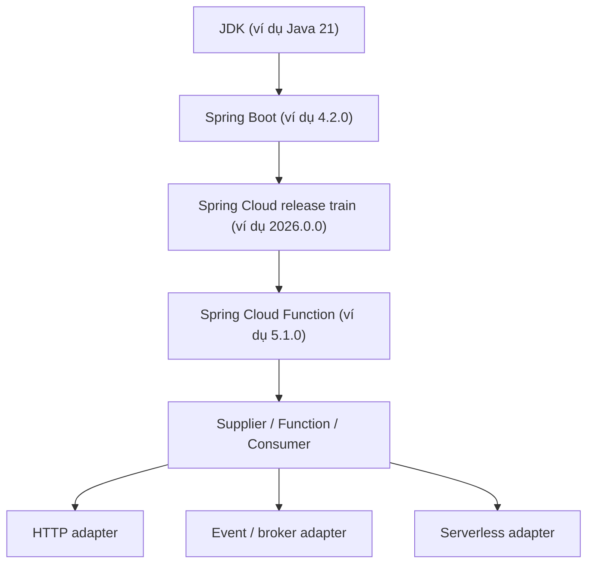
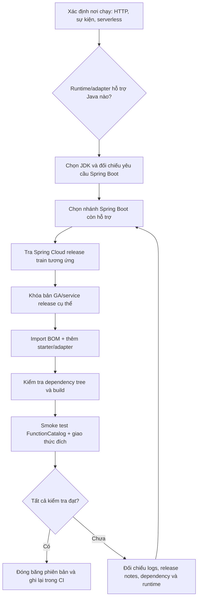

# Chọn phiên bản Java, Spring Boot và Spring Cloud BOM tương thích

> **Chương:** Khởi tạo  
> **Module:** SPRING_CLOUD_FUNCTION  
> **Mục tiêu:** Chọn được bộ phiên bản Java – Spring Boot – Spring Cloud đúng quan hệ tương thích, cấu hình BOM trong Maven/Gradle và kiểm tra rằng dự án Spring Cloud Function thực sự chạy được.  
> **Mốc tham chiếu:** 24/11/2026. Phiên bản và tình trạng hỗ trợ có thể thay đổi; luôn xác nhận lại với tài liệu chính thức trước khi khởi tạo hoặc nâng cấp dự án.

## 1. Vì sao cần chọn phiên bản theo cả một bộ?

Spring Cloud Function đóng gói nghiệp vụ thành `Supplier<T>`, `Function<T, R>` và `Consumer<T>`, độc lập với giao thức gọi. `FunctionCatalog` giúp tìm và kết hợp hàm (*composition*); adapter chuyển dữ liệu từ HTTP, sự kiện hoặc runtime serverless sang hợp đồng hàm, bao gồm những trường hợp cần chuyển đổi payload và `Message<?>`.

Để có được các tính năng đó, không chỉ cần một phiên bản thư viện Spring Cloud Function. Ứng dụng còn phụ thuộc vào Java, Spring Boot, Spring Framework và các module Spring Cloud cùng hệ sinh thái. Chọn sai một tầng có thể gây lỗi từ khi build, khi khởi động hoặc khi adapter bắt đầu chuyển đổi thông điệp.

| Thành phần | Quyết định điều gì? | Nơi cấu hình thường gặp |
| --- | --- | --- |
| **JDK** | Phiên bản Java dùng để biên dịch và chạy; API Java, bytecode và toolchain. | `java.version`, Maven compiler/Gradle toolchain, `JAVA_HOME`. |
| **Spring Boot** | Nền tảng application, auto-configuration, plugin build và tập phiên bản thư viện Spring/third-party. | Maven `spring-boot-starter-parent` hoặc Boot BOM; Gradle Boot plugin. |
| **Spring Cloud release train** | Bộ module Spring Cloud đã được phát hành thành nhóm tương thích với một thế hệ Spring Boot. | BOM `org.springframework.cloud:spring-cloud-dependencies`. |
| **Spring Cloud Function** | Runtime và adapter cho `Supplier`/`Function`/`Consumer`, `FunctionCatalog`, composition. | Starter hoặc module Function được BOM Spring Cloud quản lý. |
| **Adapter tích hợp** | Hàm được gọi bằng HTTP, message broker hay serverless. | Dependency và cấu hình cho Web, Stream/binder hoặc provider. |

Sơ đồ quan hệ:



Các con số trên là **một bộ minh họa có nguồn xác nhận** tại thời điểm soạn bài, không có nghĩa mọi phiên bản Spring Boot đều có thể ghép với mọi phiên bản Spring Cloud.

### 1.1. Release train khác gì phiên bản thư viện?

**Release train** là một nhóm phát hành đồng bộ các dự án Spring Cloud. Ví dụ:

- `2026.0.0`: phiên bản release train Spring Cloud.
- `5.1.0`: phiên bản Spring Cloud Function nằm trong release train `2026.0.0`.
- `4.2.0`: phiên bản Spring Boot tương ứng với release train đó.

Ba số này có vai trò **khác nhau**. Không lấy `5.1.0` làm phiên bản của `spring-cloud-dependencies` và không đặt `2026.0.0` thành phiên bản Spring Boot.

**BOM** (*Bill of Materials*) là POM tập trung các phiên bản dependency. Khi import `spring-cloud-dependencies` vào Maven hoặc dùng BOM tương ứng trong Gradle, build tool chọn các phiên bản Spring Cloud được nhóm phát hành quản lý. BOM **không tự thêm** dependency vào dự án và **không thay thế** cấu hình parent/plugin Spring Boot.

### 1.2. Ba cấp độ cần kiểm tra

Một bộ phiên bản chỉ được xem là sẵn sàng khi cùng lúc đáp ứng:

1. **Tương thích công bố:** Java đáp ứng yêu cầu Spring Boot; release train Spring Cloud hỗ trợ thế hệ Spring Boot đã chọn.
2. **Tương thích dependency/build:** Maven hoặc Gradle giải quyết được dependency, plugin; runtime classpath không có xung đột giữa các thư viện.
3. **Tương thích chức năng:** Ứng dụng khởi động; `FunctionCatalog` nhận diện được hàm; adapter dự kiến gọi hàm thành công. Với serverless, cần kiểm tra thêm phiên bản runtime của nhà cung cấp.

Chọn đúng ma trận là **điểm bắt đầu**, không thay cho kiểm thử.

## 2. Đọc ma trận Spring Boot ↔ Spring Cloud

### 2.1. Các bộ phiên bản tiêu biểu

Bảng dưới tổng hợp các nhánh để **nhận diện tương thích**, không đồng nghĩa mọi nhánh vẫn còn được hỗ trợ cho ứng dụng mới vào ngày 24/11/2026.

| Spring Boot | Spring Cloud release train | Spring Cloud Function theo train | Cách hiểu |
| --- | --- | --- | --- |
| **4.2.0** | **2026.0.0 (Paddington)** | **5.1.0** | Bộ GA được công bố ngày 20/11/2026; dùng làm ví dụ chính của bài. |
| **4.1.x** | **2025.1.2+ (Oakwood)** | 5.0.x theo BOM | Hỗ trợ Boot 4.1.x từ bản train `2025.1.2`. |
| **4.0.x** | **2025.1.x (Oakwood)** | 5.0.x theo BOM | Nhánh Boot 4.0; nên chọn service release mới nhất phù hợp. |
| **3.5.x** | **2025.0.x (Northfields)** | 4.3.x theo BOM | Cặp đã công bố, dành cho nhánh Boot 3.5. |
| **3.4.x** | **2024.0.x (Moorgate)** | 4.2.x theo BOM | Cặp lịch sử để bảo trì hệ thống còn sử dụng Boot 3.4. |
| **3.3.x** | **2023.0.2+ (Leyton)** | 4.1.x theo BOM | Với Boot 3.3 phải dùng train ít nhất `2023.0.2`. |
| **3.2.x** | **2023.0.x (Leyton)** | 4.1.x theo BOM | Cặp lịch sử của Boot 3.2. |

**Về tình trạng hỗ trợ:** tài liệu Spring Cloud đánh dấu các release train cũ đã hết vòng đời (EOL); ngay cả một cặp **tương thích kỹ thuật** cũng có thể **không còn được bảo trì**. Ưu tiên release train còn được hỗ trợ theo chính sách của dự án và nền tảng triển khai. Nếu phải duy trì nhánh cũ, xác định rõ cơ chế hỗ trợ và phương án nâng cấp.

Tài liệu đối chiếu:

- Spring Cloud release train và bảng tương thích: https://spring.io/projects/spring-cloud/
- Tài liệu train 2026.0.0, ghi rõ Spring Boot 4.2.0: https://docs.spring.io/spring-cloud-release/reference/
- Công bố 2026.0.0 và Spring Cloud Function 5.1.0: https://spring.io/blog/2026/11/20/spring-cloud-2026-0-0-has-been-released/

### 2.2. Không nhầm “tương thích” với “mới nhất”

Giả sử bạn đang có ứng dụng Boot `3.5.x`:

- Chọn Spring Cloud `2025.0.x` theo train tương ứng.
- Không nâng riêng Spring Cloud lên `2026.0.0` trong khi vẫn giữ Boot `3.5.x`.
- Nếu muốn dùng Spring Cloud `2026.0.0`, lập kế hoạch nâng **cả** Boot lên `4.2.0` và kiểm tra tác động của việc đổi thế hệ framework.

Ngược lại, nếu bắt đầu một dự án mới và toàn bộ adapter/SDK/serverless runtime của bạn hỗ trợ bộ mới, có thể chọn Boot `4.2.0` + Cloud `2026.0.0`. Đây là bộ dùng xuyên suốt các ví dụ bên dưới.

### 2.3. Quy tắc chọn maintenance release

Các ký hiệu `x` ở cuối đại diện cho patch/service release, ví dụ `2025.1.x`. Để chốt dự án thực tế:

1. Chọn **dòng** Boot/Cloud có quan hệ tương thích chính thức.
2. Chọn **bản GA/service release** được duy trì phù hợp trong dòng đó, không tự suy ra rằng số lớn nhất toàn hệ sinh thái luôn ghép được.
3. Kiểm tra release notes, Java requirements, lịch hỗ trợ và các thay đổi quan trọng.
4. Khóa phiên bản cụ thể trong build và cập nhật có kiểm soát bằng kiểm thử/CI.

Không dùng `SNAPSHOT`, `M1` hoặc `RC` trong môi trường vận hành thông thường nếu không có nhu cầu thử nghiệm rõ ràng.

## 3. Chọn phiên bản Java đúng cách

### 3.1. Yêu cầu tối thiểu và lựa chọn thực tế

Theo **Spring Boot 4.2.0 System Requirements**, Boot 4.2.0 yêu cầu tối thiểu **Java 17** và tài liệu tại thời điểm tham chiếu công bố tương thích đến Java 27. Tuy nhiên, một thư viện hoặc runtime bên thứ ba có thể đặt thêm giới hạn riêng.

Với dự án học Spring Cloud Function theo bộ Boot 4.2.0 + Cloud 2026.0.0, **Java 21 LTS** là một lựa chọn thực tế để làm ví dụ vì:

- Cao hơn mức tối thiểu Java 17.
- Có toolchain và hệ sinh thái phổ biến.
- Có thể giữ ổn định giữa máy phát triển và CI mà không nhất thiết chạy bản JDK mới nhất.

Java 17, Java 21 hoặc Java 25 có thể đáng cân nhắc tùy chuẩn tổ chức, vòng đời hỗ trợ và runtime đích. Đặc biệt với **serverless**, phải xác nhận nhà cung cấp có runtime Java tương ứng và adapter Function hỗ trợ tổ hợp đó. JDK cao hơn yêu cầu tối thiểu **không tự động** đảm bảo tương thích mọi adapter.

Nguồn: https://docs.spring.io/spring-boot/system-requirements.html

### 3.2. Phân biệt JDK chạy Maven, phiên bản source và runtime

Trong một ứng dụng Java có thể đồng thời xuất hiện:

- **JDK của build tool:** `mvn -v` hoặc `gradlew -version` cho biết Java dùng để chạy Maven/Gradle.
- **Language level/toolchain:** `java.version` (Maven qua Boot parent) hoặc `java.toolchain` (Gradle) chỉ định Java dùng khi compile.
- **Bytecode target:** bản class file mà JVM khi chạy cần hiểu; có thể được đặt bằng tùy chọn `--release`.
- **Runtime thực tế:** `java -version` trên server/container/serverless.

Ví dụ: biên dịch bytecode Java 21 rồi triển khai lên runtime chỉ có Java 17 sẽ gây lỗi `UnsupportedClassVersionError`, ngay cả khi Maven build thành công trên máy phát triển.

Các lệnh kiểm tra cơ bản:

```bash
java -version
javac -version
mvn -v
```

Với Maven Wrapper của dự án (Linux/macOS):

```bash
./mvnw -v
```

Trên Windows PowerShell:

```powershell
java -version
javac -version
./mvnw.cmd -v
```

Nếu các lệnh cho các phiên bản khác nhau, kiểm tra `JAVA_HOME`, `PATH`, cấu hình IDE và toolchain CI trước khi đổ lỗi cho Spring Cloud.

## 4. Ví dụ Maven hoàn chỉnh với bộ phiên bản tương thích

### 4.1. Quyết định phiên bản cho bài học

Ví dụ được cố định để người học có thể sao chép và kiểm chứng:

| Thuộc tính | Giá trị |
| --- | --- |
| JDK biên dịch/chạy | Java **21** |
| Spring Boot parent | **4.2.0** |
| Spring Cloud release train/BOM | **2026.0.0** |
| Spring Cloud Function do BOM quản lý | **5.1.0** |
| Adapter minh họa | `spring-cloud-starter-function-web` |
| Công cụ build | Maven đáp ứng yêu cầu Boot 4.2.0, ví dụ Maven 3.9.x |

Spring Boot 4.2.0 hỗ trợ Maven 3.6.3 trở lên. Ví dụ dùng Maven 3.9.x để thuận tiện, không khẳng định đây là phiên bản Maven tối thiểu.

### 4.2. `pom.xml`

```xml
<?xml version="1.0" encoding="UTF-8"?>
<project xmlns="http://maven.apache.org/POM/4.0.0"
         xmlns:xsi="http://www.w3.org/2001/XMLSchema-instance"
         xsi:schemaLocation="
           http://maven.apache.org/POM/4.0.0
           https://maven.apache.org/xsd/maven-4.0.0.xsd">
    <modelVersion>4.0.0</modelVersion>

    <parent>
        <groupId>org.springframework.boot</groupId>
        <artifactId>spring-boot-starter-parent</artifactId>
        <version>4.2.0</version>
        <relativePath/>
    </parent>

    <groupId>vn.example</groupId>
    <artifactId>scf-version-demo</artifactId>
    <version>0.0.1-SNAPSHOT</version>
    <name>scf-version-demo</name>

    <properties>
        <java.version>21</java.version>
        <spring-cloud.version>2026.0.0</spring-cloud.version>
    </properties>

    <dependencyManagement>
        <dependencies>
            <dependency>
                <groupId>org.springframework.cloud</groupId>
                <artifactId>spring-cloud-dependencies</artifactId>
                <version>${spring-cloud.version}</version>
                <type>pom</type>
                <scope>import</scope>
            </dependency>
        </dependencies>
    </dependencyManagement>

    <dependencies>
        <dependency>
            <groupId>org.springframework.cloud</groupId>
            <artifactId>spring-cloud-starter-function-web</artifactId>
        </dependency>

        <dependency>
            <groupId>org.springframework.boot</groupId>
            <artifactId>spring-boot-starter-test</artifactId>
            <scope>test</scope>
        </dependency>
    </dependencies>

    <build>
        <plugins>
            <plugin>
                <groupId>org.springframework.boot</groupId>
                <artifactId>spring-boot-maven-plugin</artifactId>
            </plugin>
        </plugins>
    </build>
</project>
```

**Giải thích từng vị trí:**

1. `spring-boot-starter-parent:4.2.0` quản lý phần cấu hình và dependency mặc định của Spring Boot.
2. `java.version=21` chọn mức Java dùng để biên dịch theo cấu hình của Boot parent.
3. `spring-cloud.version=2026.0.0` là **release train**, không phải phiên bản Function riêng lẻ.
4. `dependencyManagement` với `type=pom` và `scope=import` nạp các phiên bản Spring Cloud từ BOM.
5. `spring-cloud-starter-function-web` là dependency thực sự được đưa vào ứng dụng, để Spring Cloud Function được xuất qua HTTP trong ngữ cảnh Web được hỗ trợ.
6. Starter Function **không** có thẻ `<version>` riêng; Spring Cloud BOM xác định phiên bản phù hợp.
7. `spring-boot-maven-plugin` phục vụ đóng gói/chạy ứng dụng Boot; plugin do Boot parent quản lý phiên bản.

Không đưa `spring-cloud-dependencies` vào `<dependencies>` như một thư viện JAR; đó là BOM để quản lý phiên bản, không phải một starter.

### 4.3. Ví dụ bean Function để xác nhận cấu hình

Tạo lớp `src/main/java/vn/example/functiondemo/FunctionDemoApplication.java`:

```java
package vn.example.functiondemo;

import java.util.Locale;
import java.util.function.Function;

import org.springframework.boot.SpringApplication;
import org.springframework.boot.autoconfigure.SpringBootApplication;
import org.springframework.context.annotation.Bean;

@SpringBootApplication
public class FunctionDemoApplication {

    public static void main(String[] args) {
        SpringApplication.run(FunctionDemoApplication.class, args);
    }

    @Bean
    public Function<String, String> normalizeCode() {
        return raw -> raw.trim().toUpperCase(Locale.ROOT);
    }
}
```

Bean `normalizeCode` dùng interface `java.util.function.Function`, tách logic chuẩn hóa khỏi HTTP. Khi sau này thêm composition, một hàm `validateCode` có thể được đăng ký tương tự và tra cứu bằng `FunctionCatalog.lookup("normalizeCode|validateCode")`.

Ở bước khởi tạo này, ta chỉ cần chứng minh **cặp phiên bản và adapter** chạy ổn, không cần broker hay môi trường serverless.

### 4.4. Build và thử qua HTTP

Trong thư mục dự án có `pom.xml`:

```bash
./mvnw clean test
./mvnw spring-boot:run
```

Nếu dự án chưa có Maven Wrapper, dùng `mvn` đã cài tương ứng. Trên Windows thay `./mvnw` bằng `./mvnw.cmd`.

Sau khi ứng dụng chạy, mở terminal khác và gọi endpoint theo quy ước web adapter:

```bash
curl -X POST http://localhost:8080/normalizeCode \
  -H "Content-Type: text/plain" \
  --data "  od-123  "
```

Kỳ vọng response body:

```text
OD-123
```

`curl` trên Windows PowerShell có thể là alias khác tùy môi trường; nếu cần cú pháp tương tự cURL thật, dùng `curl.exe` và truyền tham số phù hợp với shell.

**Lý do endpoint hoạt động:** starter Web cung cấp lớp adapter nhận HTTP, tìm bean hàm tương ứng và chuyển payload String vào `Function<String, String>`. Lớp nghiệp vụ không cần khai báo controller. Chữ ký hàm, nội dung request và adapter quyết định chi tiết chuyển đổi.

Tài liệu Web adapter: https://docs.spring.io/spring-cloud-function/reference/spring-cloud-function/standalone-web-applications.html

## 5. Cấu hình Gradle tương đương

Không bắt buộc dùng Maven. Nếu dự án dùng **Gradle Groovy DSL**, có thể mô tả cùng bộ phiên bản bằng `build.gradle`:

```groovy
plugins {
    id 'java'
    id 'org.springframework.boot' version '4.2.0'
    id 'io.spring.dependency-management' version '1.1.7'
}

group = 'vn.example'
version = '0.0.1-SNAPSHOT'

repositories {
    mavenCentral()
}

java {
    toolchain {
        languageVersion = JavaLanguageVersion.of(21)
    }
}

ext {
    set('springCloudVersion', '2026.0.0')
}

dependencyManagement {
    imports {
        mavenBom "org.springframework.cloud:spring-cloud-dependencies:${springCloudVersion}"
    }
}

dependencies {
    implementation 'org.springframework.cloud:spring-cloud-starter-function-web'
    testImplementation 'org.springframework.boot:spring-boot-starter-test'
}

tasks.named('test') {
    useJUnitPlatform()
}
```

Các lưu ý:

- `org.springframework.boot` là **plugin Gradle**, phiên bản trùng với Spring Boot đã chọn.
- `io.spring.dependency-management` được dùng để import Spring Cloud BOM theo cách minh họa ở đây. Ví dụ dùng bản plugin `1.1.7` từ hướng dẫn công bố của release train; trước khi dùng dự án thực tế vẫn nên kiểm tra release mới nhất tương thích.
- `java.toolchain` chọn JDK 21 cho biên dịch; công cụ phải tìm được JDK này tại máy hoặc qua cấu hình toolchain provisioning.
- `spring-cloud-starter-function-web` không cần khai báo phiên bản do BOM quản lý.
- Spring Boot 4.2.0 hỗ trợ Gradle 8.14+ thuộc nhánh 8.x, hoặc Gradle 9.x theo tài liệu chính thức. Cần kiểm tra thêm phiên bản wrapper của dự án.

Chạy:

```bash
./gradlew --version
./gradlew clean test
./gradlew bootRun
```

Trong Windows PowerShell dùng `./gradlew.bat`. Đừng sử dụng đồng thời `pom.xml` và `build.gradle` làm hai nguồn cấu hình tách biệt cho cùng một bản build mà không có chiến lược rõ ràng.

### 5.1. Phân biệt BOM Maven và BOM Gradle

| Maven | Gradle |
| --- | --- |
| `<dependencyManagement>` + `<type>pom</type>` + `<scope>import</scope>`. | `dependencyManagement { imports { mavenBom(...) } }` nếu dùng plugin dependency-management. |
| Parent Spring Boot có thể cung cấp version/plugin mặc định. | Boot Gradle plugin quản lý tác vụ Boot; BOM/import giúp quản lý version dependency. |
| Kiểm tra bằng `help:effective-pom` và `dependency:tree`. | Kiểm tra bằng `dependencies` và `dependencyInsight`. |

Gradle còn hỗ trợ native `platform(...)`, nhưng nếu đổi cách import BOM cần hiểu cơ chế ưu tiên phiên bản giữa các platform và version constraints. Với bài học đầu tiên, dùng một cách import thống nhất để dễ xác minh.

## 6. Kiểm tra phiên bản đã thực sự được resolve

Chỉ nhìn vào thuộc tính version trong file build là chưa đủ: dependency có thể được kéo vào qua transitive dependency, BOM khác hoặc override bằng khai báo riêng.

### 6.1. Maven: kiểm tra effective POM và dependency tree

```bash
./mvnw help:effective-pom
./mvnw dependency:tree
```

Lọc dependency theo cách được build tool/shell hỗ trợ, ví dụ:

```bash
./mvnw dependency:tree -Dincludes=org.springframework.cloud
```

Các điểm phải đối chiếu:

- Spring Boot parent vẫn là `4.2.0`.
- Spring Cloud BOM được import phiên bản `2026.0.0`.
- `spring-cloud-function-context` và các module liên quan đến Function được resolve vào dòng `5.1.0` theo BOM.
- Không có một phiên bản Spring Framework/Function cũ bị ép bởi dependency khai báo thủ công.

Lệnh `dependency:tree` hiển thị **dependency thực sự đã thêm** vào project, không hiển thị toàn bộ thành phần được liệt kê trong BOM nếu chúng không được sử dụng.

### 6.2. Gradle: xem dependency đã chọn

```bash
./gradlew dependencies --configuration runtimeClasspath
./gradlew dependencyInsight --dependency spring-cloud-function-context --configuration runtimeClasspath
```

`dependencyInsight` giúp thấy dependency được chọn từ yêu cầu nào, lý do chọn và xung đột phiên bản (nếu có).

### 6.3. Kiểm tra bằng khởi động và một phép gọi thật

Nếu BOM đúng nhưng adapter sai hoặc classpath thiếu thành phần, app vẫn có thể lỗi khi chạy. Vì vậy thêm một kiểm thử tích hợp tối thiểu:

```java
package vn.example.functiondemo;

import static org.junit.jupiter.api.Assertions.assertEquals;

import java.util.function.Function;

import org.junit.jupiter.api.Test;
import org.springframework.beans.factory.annotation.Autowired;
import org.springframework.boot.test.context.SpringBootTest;
import org.springframework.cloud.function.context.FunctionCatalog;

@SpringBootTest
class FunctionCatalogTest {

    @Autowired
    FunctionCatalog catalog;

    @Test
    void normalizeCodeIsAvailable() {
        Function<String, String> f = catalog.lookup("normalizeCode");
        assertEquals("OD-123", f.apply("  od-123  "));
    }
}
```

Đặt tệp kiểm thử tại `src/test/java/vn/example/functiondemo/FunctionCatalogTest.java`. Test này chứng minh `FunctionCatalog` được nạp và nhận diện bean Function, nhưng cần thêm smoke test HTTP để kiểm chứng adapter Web thực sự phục vụ request.

Trong CI, nên kiểm tra đồng thời `test`, `package` (hoặc `bootJar`) và một smoke test khởi động thật. Chỉ chạy `mvn dependency:tree` không phải chứng nhận tương thích runtime.

## 7. Chọn bộ phiên bản theo môi trường triển khai

Spring Cloud Function được thiết kế để cùng logic nghiệp vụ có thể dùng qua HTTP, sự kiện hoặc serverless, nhưng ràng buộc hạ tầng của từng môi trường khác nhau.

| Môi trường | Cần kiểm tra thêm ngoài Boot/Cloud/JDK | Ví dụ rủi ro |
| --- | --- | --- |
| **HTTP** | Starter Function Web, Spring MVC/WebFlux phù hợp với adapter, content type, serialization. | App chạy nhưng không có mapping HTTP hoặc không chuyển được payload. |
| **Sự kiện/broker** | Spring Cloud Stream, binder Kafka/RabbitMQ, hình dạng message, serialization và retry. | Function bean tồn tại nhưng input/output binding không được nối với broker. |
| **Serverless** | Adapter chính xác của nền tảng, runtime Java được provider hỗ trợ, packaging/handler, cold start. | Build chạy local nhưng serverless runtime không khởi động được hoặc handler không tương thích. |

Ví dụ một hàm thuần:

```java
@Bean
public Function<String, String> normalizeCode() {
    return code -> code.trim().toUpperCase(Locale.ROOT);
}
```

Hàm này là logic nghiệp vụ có thể tái sử dụng. Để chạy trên HTTP cần Web adapter; để nhận sự kiện cần adapter/binder của hệ thống sự kiện; để chạy serverless cần bộ đóng gói và runtime mà provider công bố hỗ trợ. **Không thể suy ra khả năng chạy trên mọi nền tảng chỉ từ việc Spring Cloud BOM đúng phiên bản.**

### 7.1. Quy tắc khi triển khai serverless

- Đối chiếu **cả** version của provider adapter, Java runtime và Spring Cloud Function.
- Xem release notes về cách đóng gói fat JAR, handler class, native image và starter hỗ trợ.
- Nếu adapter của provider chưa hỗ trợ nhánh mới nhất, chọn một **bộ Boot/Cloud cũ nhưng còn hỗ trợ** hoặc lên kế hoạch nâng adapter; tránh ép thay riêng Function dependency.
- Test gói triển khai thực tế trong môi trường tương tự runtime đích trước khi publish.

### 7.2. Ranh giới chuyển đổi thông điệp

Trong HTTP/event adapter, Spring Cloud Function có thể xử lý chuyển đổi dữ liệu dựa vào chữ ký hàm. Nhưng điều này vẫn phụ thuộc vào codec, content type, metadata của `Message<?>` và phiên bản adapter. Việc nâng phiên bản có thể làm lộ các khác biệt về JSON serialization hoặc conversion. Khi đổi release train lớn, cần test ít nhất:

- Payload đơn giản (`String`/DTO) và payload lỗi.
- Header quan trọng của message.
- Composition (`normalizeCode|validateCode`).
- Retry/side effect của `Consumer` và cơ chế phát dữ liệu của `Supplier` nếu ứng dụng dùng.

## 8. Các lỗi phiên bản thường gặp

### 8.1. Spring Boot và Spring Cloud không cùng train

**Tình huống:** `spring-boot-starter-parent=4.2.0` nhưng Spring Cloud BOM vẫn là `2025.0.x` (dành cho Boot 3.5).

**Dấu hiệu:** khởi động thất bại do version verifier hoặc do lỗi binary incompatibility/auto-configuration.

**Sửa:** đối chiếu ma trận chính thức, đưa cả nhóm lên Boot `4.2.0` + Cloud `2026.0.0`. Đừng xử lý bằng cách tắt `spring.cloud.compatibility-verifier.enabled`; tắt kiểm tra không làm cho thư viện tự tương thích.

### 8.2. Dùng sai kiểu phiên bản của BOM

**Tình huống:** cấu hình `spring-cloud-dependencies:5.1.0` vì thấy Spring Cloud Function có phiên bản `5.1.0`.

**Nguyên nhân:** nhầm phiên bản module với release train. BOM đúng cho bộ ví dụ là `spring-cloud-dependencies:2026.0.0`.

### 8.3. Gắn phiên bản riêng cho từng dependency Spring Cloud

**Tình huống:** BOM dùng `2026.0.0` nhưng ép `spring-cloud-function-context` thành `4.3.x`.

**Rủi ro:** trộn API của hai thế hệ Spring Cloud Function, dẫn đến `NoSuchMethodError`, `ClassNotFoundException` hoặc lỗi tinh vi khi chuyển đổi message.

**Sửa:** bỏ version override không cần thiết; dùng version được BOM quản lý. Chỉ override khi có lý do cụ thể và đã thử nghiệm cùng release notes.

### 8.4. Lỗi Java/class file

- `UnsupportedClassVersionError`: runtime Java quá cũ so với bytecode.
- `invalid target release: 21`: JDK biên dịch không hỗ trợ target Java 21 hoặc compiler/toolchain sai.
- Build chạy trong IDE nhưng lỗi CI: JDK và toolchain khác nhau.

**Sửa:** xác nhận `java -version`, `mvn -v`/`gradlew -version`, `JAVA_HOME`, wrapper, runtime Docker/serverless; đồng bộ Java dùng cho build và deploy.

### 8.5. BOM được import nhưng thiếu starter

BOM chỉ quản lý version. Nếu không có dependency starter cần thiết, có thể không có `FunctionCatalog` hoặc không có HTTP handler.

**Sửa:** thêm starter Function theo nhu cầu. Với minh họa HTTP là `spring-cloud-starter-function-web`; với sự kiện và serverless cần adapter khác phù hợp.

### 8.6. Dependency tải không được

Lỗi `Non-resolvable import POM` hoặc `Could not resolve ...` có thể do tọa độ sai, bản chưa phát hành ở repository đã cấu hình, proxy/network, hoặc cache build.

**Sửa:** kiểm tra tọa độ BOM, bản GA có tồn tại trên Maven Central, cấu hình repository và thông báo lỗi cụ thể. Không thay sang SNAPSHOT chỉ để “thử build cho qua”.

### 8.7. Nâng major nhưng chưa kiểm tra thay đổi API

Nhảy từ Boot 3.x/Cloud 2025.0 sang Boot 4.x/Cloud 2026.0 kéo theo thay đổi nền Spring Framework 7, thư viện và có thể ảnh hưởng test, logging, JSON, package hoặc adapter. **Compile success** không có nghĩa quy trình business đã chạy đúng với dữ liệu thật.

**Sửa:** đọc migration guide/release notes, chạy unit/integration/adapter tests và rà lại đường đi của message.

## 9. Quy trình lựa chọn phiên bản cho dự án mới hoặc khi nâng cấp

Có thể dùng quy trình sau để không “đoán” số phiên bản:



**Bước 1 – Xác định ràng buộc hạ tầng.** Ghi rõ runtime Java, provider serverless, phiên bản broker/binder, build tool và yêu cầu hỗ trợ dài hạn.

**Bước 2 – Chọn Spring Boot.** Tham khảo https://spring.io/projects/spring-boot/ và tài liệu system requirements của đúng phiên bản Boot.

**Bước 3 – Chọn Spring Cloud BOM.** Dùng bảng tại https://spring.io/projects/spring-cloud/ hoặc tài liệu release train tương ứng. Ưu tiên dòng còn được hỗ trợ.

**Bước 4 – Để BOM quản lý Function.** Thêm `spring-cloud-starter-function-web` hoặc các dependency adapter khác theo nhu cầu; không tự trộn phiên bản Function từ train khác.

**Bước 5 – Xác minh.** Kiểm tra dependency resolution, chạy unit test `FunctionCatalog`, khởi động ứng dụng và thử thực tế với môi trường/giao thức dự kiến.

**Bước 6 – Ghi lại quyết định.** Lưu lại phiên bản Java, Boot, Cloud BOM, adapter, Maven/Gradle wrapper, lý do chọn và ngày đối chiếu tài liệu. Khi cập nhật, xem xét cả nhóm tương thích thay vì chỉ thay một số version.

## 10. Bài thực hành: chọn và chứng minh một bộ tương thích

### Bài 1. Khởi tạo dự án HTTP

1. Chọn Java 21, Spring Boot 4.2.0, Spring Cloud BOM 2026.0.0.
2. Tạo Maven project có `spring-cloud-starter-function-web` theo `pom.xml` ở mục 4.
3. Thêm bean `Function<String, String> normalizeCode`.
4. Dùng `dependency:tree` chứng minh Spring Cloud Function thuộc release train đã import.
5. Khởi động và gọi `POST /normalizeCode` với body `"  od-123  "`; ghi lại response `"OD-123"`.

### Bài 2. Giải thích một cấu hình sai

Cho dự án:

```xml
<parent>
    <groupId>org.springframework.boot</groupId>
    <artifactId>spring-boot-starter-parent</artifactId>
    <version>3.5.0</version>
</parent>
<!-- Sai: train 2026.0.0 dành cho Boot 4.2.0 -->
<properties>
    <spring-cloud.version>2026.0.0</spring-cloud.version>
</properties>
```

Hãy trả lời:

- Vấn đề nằm ở **mối quan hệ nào** giữa hai phiên bản?
- Nếu muốn giữ Spring Boot 3.5.x thì nên chọn nhánh Spring Cloud nào?
- Nếu muốn dùng Cloud 2026.0.0, cần thay đổi gì trước khi build/test?

**Gợi ý đáp án:** Boot 3.5.x ghép với Cloud 2025.0.x; Cloud 2026.0.0 đi với Boot 4.2.0. Khi đổi major Boot, cần kiểm tra Java/runtime và toàn bộ adapter/SDK sử dụng.

### Bài 3. Thay HTTP bằng sự kiện (phân tích thiết kế)

Giữ nguyên logic `normalizeCode`. Liệt kê các yếu tố phải chọn thêm để biến nó thành một bộ xử lý sự kiện: Spring Cloud Stream/binder thích hợp, broker, content type, retry, destination/binding và cách quản lý side effect. Giải thích vì sao **đổi adapter** không có nghĩa phải sửa quy tắc chuẩn hóa chuỗi.

### Tiêu chí hoàn thành bài

Người học có thể tự giải thích được:

- Vì sao Java, Boot và Cloud phải chọn theo một bộ tương thích.
- Vì sao `2026.0.0` là release train/BOM còn `5.1.0` là phiên bản Spring Cloud Function.
- Khác biệt giữa `dependencyManagement` (quản lý phiên bản) và `dependencies` (thêm thư viện).
- Cách xác minh Maven/Gradle đã resolve đúng dependency và ứng dụng thật sự gọi được hàm.
- Những kiểm tra bổ sung khi cùng một hàm được triển khai qua HTTP, sự kiện hoặc serverless.

## Tài liệu chính thức để cập nhật theo thời gian

1. **Spring Cloud – bảng tương thích và vòng đời hỗ trợ:** https://spring.io/projects/spring-cloud/
2. **Spring Cloud 2026.0.0 – công bố ngày 20/11/2026:** https://spring.io/blog/2026/11/20/spring-cloud-2026-0-0-has-been-released/
3. **Spring Cloud release train reference:** https://docs.spring.io/spring-cloud-release/reference/
4. **Spring Boot – các phiên bản phát hành:** https://spring.io/projects/spring-boot/
5. **Spring Boot – yêu cầu Java, Maven và Gradle:** https://docs.spring.io/spring-boot/system-requirements.html
6. **Spring Cloud Function – tài liệu phiên bản và lập trình hàm:** https://docs.spring.io/spring-cloud-function/reference/
7. **Spring Cloud Function – Web adapter và HTTP mappings:** https://docs.spring.io/spring-cloud-function/reference/spring-cloud-function/standalone-web-applications.html
8. **Spring Initializr – tạo dự án và BOM theo Boot đã chọn:** https://start.spring.io/
