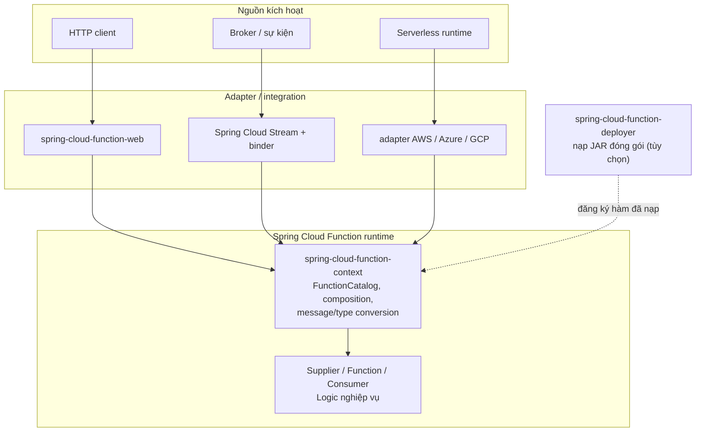
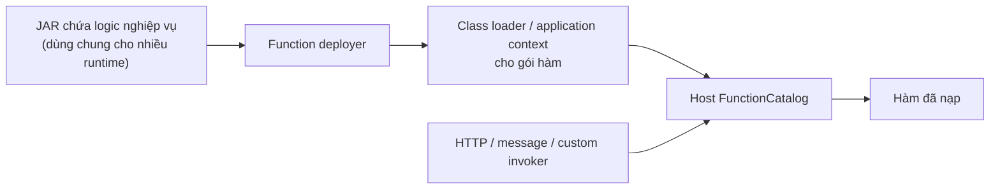
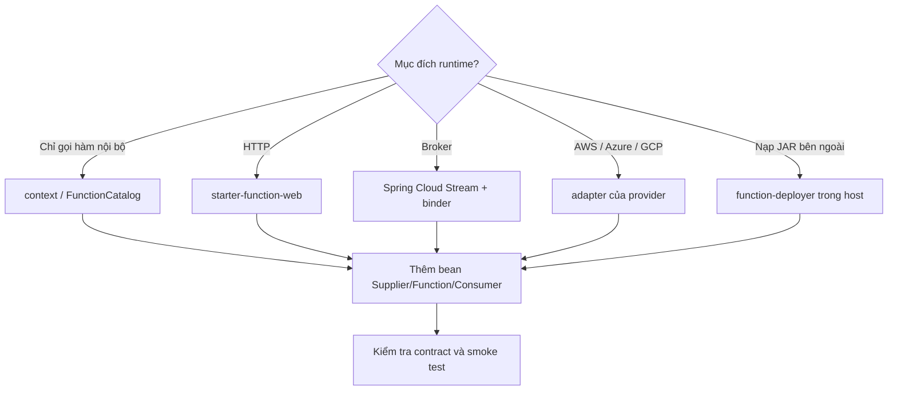

# Các module context, web, deployer và adapter nền tảng

> **Chương:** Khởi tạo  
> **Module học:** SPRING_CLOUD_FUNCTION  
> **Chủ đề:** Cấu trúc module Spring Cloud Function, vai trò của từng dependency và cách chọn module khi triển khai qua HTTP, sự kiện hoặc serverless.

## 1. Mục tiêu và bức tranh kiến trúc

Spring Cloud Function giúp phát triển logic nghiệp vụ có thể tái sử dụng bằng `Supplier<T>`, `Function<T, R>` và `Consumer<T>`. Các hàm Java được đăng ký, tra cứu và kết hợp qua `FunctionCatalog`; một adapter tương ứng sẽ tiếp nhận yêu cầu từ HTTP, sự kiện hoặc môi trường serverless. Vì vậy, để khởi tạo dự án đúng, cần hiểu **module nào chứa logic thực thi hàm, module nào cung cấp giao thức gọi và module nào nạp mã từ bên ngoài**.

Sau bài này, người học có thể:

1. Phân biệt `spring-cloud-function-context`, `spring-cloud-function-web`, `spring-cloud-function-deployer` và các `spring-cloud-function-adapter-*`.
2. Chọn dependency cho ứng dụng chạy trong JVM, HTTP, event/broker hoặc serverless; biết khi nào không cần deployer.
3. Đăng ký bean hàm, tìm hàm bằng `FunctionCatalog` và tạo composition.
4. Hiểu cách adapter truyền payload, header, content type vào hàm và vì sao vẫn phải cấu hình chuyển đổi thông điệp.
5. Dùng một logic nghiệp vụ không gắn giao thức để hình dung ba cách triển khai khác nhau.



Điểm mấu chốt: `context` chứa cơ chế thực thi và phát hiện hàm. `web` và adapter các nền tảng là **cổng giao tiếp** tới cơ chế đó. `deployer` giải quyết một bài toán khác: **nạp hàm đã được đóng gói ở ngoài ứng dụng chủ**.

## 2. Bảng phân biệt nhanh các module

| Module/thành phần | Maven artifact hoặc tên công nghệ | Trách nhiệm chính | Dùng khi nào |
| --- | --- | --- | --- |
| **Context** | `spring-cloud-function-context` | Tích hợp bean hàm với Spring, cung cấp `FunctionCatalog`, composition, điều phối invocation và hỗ trợ conversion. | Muốn gọi hàm qua catalog trong Spring application hoặc viết runtime adapter. |
| **Web** | `spring-cloud-function-web` | Auto-configuration xuất hàm thành endpoint HTTP trong ứng dụng Spring Boot Web/MVC thích hợp. | Muốn gọi hàm qua HTTP đơn giản. |
| **Web starter** | `spring-cloud-starter-function-web` | Gom dependency để sử dụng Web adapter thuận tiện. | Cách khởi tạo ứng dụng HTTP thường dùng. |
| **Deployer** | `spring-cloud-function-deployer` | Nạp JAR/archived application chứa hàm, có class loader tách biệt; đưa hàm tìm được vào catalog của host. | Host cần nạp gói hàm từ đường dẫn/tọa độ bên ngoài. |
| **AWS Lambda adapter** | `spring-cloud-function-adapter-aws` | Kết nối Spring Cloud Function với mô hình invocation của AWS Lambda. | Đóng gói/chạy hàm trên AWS Lambda. |
| **Azure Functions adapter** | `spring-cloud-function-adapter-azure` | Tích hợp Spring/FunctionCatalog với handler và binding của Azure Functions. | Viết Azure Function với Spring và Azure Java Worker. |
| **Azure Web adapter** | `spring-cloud-function-adapter-azure-web` | Hướng tích hợp ứng dụng Spring Web với Azure HTTP trigger. | Muốn đưa mô hình Spring Web lên Azure Functions theo adapter chuyên dụng. |
| **Google Cloud adapter** | `spring-cloud-function-adapter-gcp` | Kết nối hàm với Google Cloud Functions và Functions Framework. | Chạy hàm trên Google Cloud Functions. |
| **Spring Cloud Stream + binder** | Các artifact Spring Cloud Stream/binder tương ứng | Nhận/gửi thông điệp tới broker và ánh xạ binding với bean hàm. | Xử lý Kafka, RabbitMQ hoặc hệ thống message qua binder. |

**Không phải tất cả đều bắt buộc.** Một dự án HTTP tối thiểu thường chỉ cần Web starter và các cấu hình Spring Boot/BOM tương thích. Thêm AWS/Azure/GCP adapter hoặc deployer khi kiến trúc thực sự cần chúng.

Một số artifact có thể kéo dependency context *theo quan hệ bắc cầu* (transitive). Vì thế khi dùng starter, không cần cố tình khai báo lặp mọi module bên dưới. Hãy kiểm tra dependency tree trước khi quyết định thêm một module.

## 3. `spring-cloud-function-context`: lõi tích hợp hàm với Spring

### 3.1. Hợp đồng lập trình là Java chuẩn

Spring Cloud Function dùng interface từ `java.util.function`:

| Interface | Phương thức | Ý nghĩa |
| --- | --- | --- |
| `Supplier<T>` | `T get()` | Sinh hoặc cung cấp dữ liệu. |
| `Function<T, R>` | `R apply(T input)` | Biến đổi dữ liệu, có kết quả. |
| `Consumer<T>` | `void accept(T input)` | Tiêu thụ dữ liệu, thường có side effect. |

Để logic không phụ thuộc HTTP hoặc broker, hãy khai báo các bean như sau:

```java
package vn.example.function;

import java.util.Locale;
import java.util.function.Consumer;
import java.util.function.Function;
import java.util.function.Supplier;

import org.springframework.boot.SpringApplication;
import org.springframework.boot.autoconfigure.SpringBootApplication;
import org.springframework.context.annotation.Bean;

@SpringBootApplication
public class FunctionApplication {

    public static void main(String[] args) {
        SpringApplication.run(FunctionApplication.class, args);
    }

    @Bean
    public Function<String, String> normalizeCode() {
        return raw -> raw.trim().toUpperCase(Locale.ROOT);
    }

    @Bean
    public Function<String, String> validateCode() {
        return code -> {
            if (!code.matches("[A-Z]{2}-[0-9]{3}")) {
                throw new IllegalArgumentException("Mã không hợp lệ: " + code);
            }
            return code;
        };
    }

    @Bean
    public Supplier<String> exampleCode() {
        return () -> "OD-123";
    }

    @Bean
    public Consumer<String> auditCode() {
        return code -> System.out.println("Đã tiếp nhận: " + code);
    }
}
```

Ví dụ dùng mã đơn hàng dạng `OD-123`. Bản thân `normalizeCode` không biết chuỗi bắt nguồn từ body HTTP, bản tin Kafka hay sự kiện AWS Lambda. Chính phần **tiếp nhận và truyền dữ liệu** là trách nhiệm của adapter.

`Supplier` và `Consumer` trong ví dụ minh họa hợp đồng; trong ứng dụng thật, `Supplier` có thể truy vấn nguồn dữ liệu còn `Consumer` có thể ghi DB/phát sự kiện. Khi xử lý sự kiện, cần chủ động thiết kế idempotency để không phát sinh hiệu ứng phụ trùng khi retry.

### 3.2. `FunctionCatalog` có chức năng gì?

Spring Cloud Function khám phá các bean kiểu `Supplier`, `Function`, `Consumer`, chuẩn hóa cách gọi chúng và cung cấp API tra cứu theo tên. Bạn không cần giữ tham chiếu thủ công đến từng bean khi adapter quyết định tên hàm ở runtime.

```java
import java.util.function.Function;

import org.springframework.cloud.function.context.FunctionCatalog;
import org.springframework.stereotype.Service;

@Service
public class OrderCodeService {

    private final Function<String, String> pipeline;

    public OrderCodeService(FunctionCatalog catalog) {
        this.pipeline = catalog.lookup("normalizeCode|validateCode");
    }

    public String process(String rawCode) {
        return pipeline.apply(rawCode);
    }
}

// process(" od-123 ") -> "OD-123"
// process(" ? ")       -> IllegalArgumentException
```

Ở đây:

- `normalizeCode` và `validateCode` là **tên bean** từ phương thức `@Bean`.
- `|` là cú pháp composition của Spring Cloud Function: đầu ra hàm trước chuyển thành đầu vào hàm sau.
- `FunctionCatalog.lookup(...)` cung cấp hàm đã được framework thích nghi để gọi hoặc tích hợp với adapter.
- Điều kiện composition: các kiểu dữ liệu liền kề phải có khả năng tương thích, trực tiếp hoặc qua conversion do framework cung cấp.

Có thể chọn definition cho adapter qua cấu hình:

```properties
spring.cloud.function.definition=normalizeCode|validateCode
```

Khi dùng nhiều function, khai báo definition rõ ràng giúp tránh sự mơ hồ về lựa chọn mặc định. Tuy nhiên, **definition không tạo ra HTTP server, Kafka consumer hay AWS handler**; adapter mới tạo kết nối với nguồn kích hoạt.

### 3.3. `Message<?>`, header và chuyển đổi dữ liệu

Đầu vào từ giao thức thường gồm hai phần: **payload** (dữ liệu nghiệp vụ) và **metadata** (content type, correlation ID, nguồn sự kiện, v.v.). Spring Messaging biểu diễn chúng bằng `Message<T>`.

```java
import java.util.function.Function;

import org.springframework.context.annotation.Bean;
import org.springframework.messaging.Message;
import org.springframework.messaging.support.MessageBuilder;

@Bean
public Function<Message<String>, Message<String>> normalizeMessage() {
    return message -> {
        String normalized = message.getPayload().trim().toUpperCase();
        return MessageBuilder.withPayload(normalized)
                .copyHeaders(message.getHeaders())
                .setHeader("processedBy", "normalizeMessage")
                .build();
    };
}
```

> Phương thức `@Bean` trên là một phần của lớp `@Configuration` hoặc `@SpringBootApplication`; không phải toàn bộ file Java độc lập. Với logic chuẩn hóa chữ hoa không phụ thuộc vùng địa lý, sản phẩm thật nên dùng `toUpperCase(Locale.ROOT)`.

`context` hỗ trợ chuyển đổi dựa trên **kiểu đầu vào/đầu ra khai báo của hàm** và, khi có `Message<?>`, thông tin **contentType**. Ví dụ, khi hàm nhận một DTO, adapter HTTP có thể cung cấp payload JSON và header `Content-Type: application/json`; framework sẽ dùng bộ chuyển đổi thích hợp trước khi gọi hàm. Dữ liệu không hợp lệ hoặc không tìm được converter phù hợp sẽ gây lỗi.

Phải phân biệt:

- `MessageConverter`: sử dụng payload/headers khi đầu vào là message và cần chuyển kiểu.
- `ConversionService`: chuyển đổi kiểu đối với dữ liệu không mang wrapper `Message<?>`.
- `contentType`: gợi ý định dạng, **không thay thế** kiểu đích và không đảm bảo mọi payload đều chuyển đổi được.
- `Message<T>`: kiểu truyền cả payload và headers; giữ/chuyển header trong kết quả cần tuân theo quy tắc cụ thể và adapter.

Khi ứng dụng chuyển đổi thông điệp qua HTTP, sự kiện và serverless, cần kiểm thử schema, kiểu DTO, content type và các header quan trọng trên **từng adapter**.

### 3.4. Chỉ dùng context, không dùng web

Một Spring Boot application có thể chỉ cần Spring Cloud Function ở mức catalog để điều phối logic nội bộ. Ví dụ, trong một command-line/worker application có nhu cầu tra cứu `normalizeCode` từ cấu hình, bạn có thể dùng `spring-cloud-function-context` mà không thêm Web starter. Ứng dụng khi đó **không tự có endpoint HTTP** chỉ vì tồn tại bean hàm.

Khi dùng HTTP starter, dependency context thường đã được đưa vào theo dependency transitive. Tránh thêm mọi artifact một cách máy móc.

## 4. `spring-cloud-function-web`: đưa hàm lên HTTP

### 4.1. Web module khác gì context?

`context` biết tìm và gọi hàm; `web` biết ánh xạ yêu cầu HTTP tới hàm trong catalog và xây dựng response. Web module có auto-configuration dành cho ứng dụng Spring Boot Web có hỗ trợ Spring MVC. Nếu chỉ cần bắt đầu nhanh với HTTP, dùng `spring-cloud-starter-function-web` để gom các dependency thích hợp.

Ví dụ Maven với Spring Cloud BOM đã được import:

```xml
<dependency>
    <groupId>org.springframework.cloud</groupId>
    <artifactId>spring-cloud-starter-function-web</artifactId>
</dependency>
```

Không khai báo version riêng cho starter khi BOM Spring Cloud tương thích đã quản lý. Ở phần khởi tạo này, bạn có thể dùng Java 21 + Spring Boot 4.2.0 + Spring Cloud BOM 2026.0.0; khi nâng cấp về sau, phải đối chiếu lại ma trận tương thích chính thức.

### 4.2. HTTP mapping thường gặp

Với Web adapter được kích hoạt, tên hàm thường nằm trên đường dẫn. Những mapping điển hình theo tài liệu:

| Loại hàm | HTTP request ví dụ | Ý nghĩa |
| --- | --- | --- |
| `Function<String, String>` | `POST /normalizeCode` | Đưa request body vào `apply(...)` và trả kết quả. |
| `Function<String, String>` | `GET /normalizeCode/od-123` | Dùng path item làm đầu vào của function. |
| `Supplier<String>` | `GET /exampleCode` | Gọi `get()` để lấy dữ liệu. |
| `Consumer<String>` | `POST /auditCode` | Gửi dữ liệu tới `accept(...)`; response theo contract của adapter. |

Web adapter cũng hỗ trợ các phương thức/định dạng khác theo loại hàm; bảng trên chỉ liệt kê tình huống dễ thử. Nếu ứng dụng chỉ có một function thích hợp, mapping mặc định có thể cho phép bỏ tên hàm trong path, nhưng **nên gọi theo tên rõ ràng trong ví dụ nhiều bean**.

### 4.3. Thử HTTP bằng cURL

Với ứng dụng `FunctionApplication` tại mục 3 và Web starter, khởi chạy app rồi dùng terminal khác:

```bash
curl -i -X POST http://localhost:8080/normalizeCode \
  -H "Content-Type: text/plain" \
  --data "  od-123  "
```

Kết quả body kỳ vọng:

```text
OD-123
```

Gọi Supplier:

```bash
curl -i http://localhost:8080/exampleCode
```

Gửi dữ liệu cho Consumer:

```bash
curl -i -X POST http://localhost:8080/auditCode \
  -H "Content-Type: text/plain" \
  --data "OD-123"
```

Với endpoint Consumer, Web adapter thường phản hồi trạng thái `202 Accepted` cho POST theo tài liệu HTTP mapping; đừng giả định Consumer sẽ trả về dữ liệu nghiệp vụ vì `accept(...)` có kết quả `void`.

Nếu muốn đổi tiền tố endpoint, có thể dùng:

```properties
spring.cloud.function.web.path=/functions
```

Sau đó đường dẫn Function có dạng `/functions/normalizeCode`. Khi thay đổi base path hoặc dùng reverse proxy, hãy kiểm tra endpoint thực tế trong môi trường triển khai.

### 4.4. Composition và HTTP

Có thể bật pipeline mặc định:

```properties
spring.cloud.function.definition=normalizeCode|validateCode
```

Việc definition này được adapter ánh xạ ra endpoint cụ thể thế nào tùy quy tắc mapping của phiên bản adapter và cấu hình. Để tránh suy đoán sai URL composition, kiểm tra mapping của ứng dụng chạy thật hoặc gọi trực tiếp qua `FunctionCatalog` trong test.

### 4.5. Web adapter không thay thế Spring MVC

Spring Cloud Function Web rất hữu ích cho hàm nghiệp vụ có đầu vào/đầu ra đơn giản, đặc biệt khi muốn thử local hoặc cung cấp chức năng không trạng thái. Với API có nhiều resource, nghiệp vụ REST phức tạp, validation/security/pagination/caching chuyên biệt, Spring MVC/WebFlux với controller hoặc router vẫn có vai trò riêng.

Đừng đánh đồng **có HTTP adapter** với **đã thiết kế một API sản xuất hoàn chỉnh**. Cần bổ sung xác thực, phân quyền, giới hạn tải, mã lỗi chuẩn và quan sát vận hành ở tầng phù hợp.

## 5. `spring-cloud-function-deployer`: nạp hàm từ gói bên ngoài

### 5.1. Deployer giải quyết bài toán gì?

Giả sử có hai ứng dụng:

- **Host/invoker:** ứng dụng đang chạy, có `FunctionCatalog` và adapter đầu vào.
- **Function package:** JAR chứa implementation các hàm cần đăng ký và gọi.

`spring-cloud-function-deployer` cho phép host tìm và nạp function package từ một đường dẫn tài nguyên/JAR. Thư viện có thể nạp JAR đóng gói hoặc archive phù hợp bằng **class loader tách biệt** (theo mặc định), khởi tạo ngữ cảnh liên quan và đăng ký hàm được tìm thấy vào catalog của host.



Deployer **không tự động đẩy JAR lên AWS, Azure hay GCP**, không phải hệ thống release/rollout và cũng không cần cho mọi ứng dụng Spring Cloud Function. Tên “deployer” ở đây chủ yếu chỉ **cơ chế nạp và kích hoạt hàm đóng gói**.

### 5.2. Dependency và cấu hình cơ bản

Trong ứng dụng **host** có Spring Cloud Function và BOM phù hợp, thêm:

```xml
<dependency>
    <groupId>org.springframework.cloud</groupId>
    <artifactId>spring-cloud-function-deployer</artifactId>
</dependency>
```

Nếu dùng dependency management khác, cần chốt phiên bản deployer tương thích với các module Function của host; tránh lấy riêng bản từ dòng release khác.

Một cấu hình minh họa khi package là Spring Boot application đã đóng gói và chứa bean `normalizeCode`:

```properties
spring.cloud.function.location=file:/opt/functions/order-functions.jar
spring.cloud.function.definition=normalizeCode
```

Ý nghĩa:

- `spring.cloud.function.location` chỉ tới JAR/archive cần nạp; đường dẫn và quyền truy cập phải hợp lệ trên máy host.
- `spring.cloud.function.definition` chọn function được đăng ký/tra cứu theo tên bean trong **ứng dụng Spring Boot đóng gói**.
- Deployer dựa vào metadata và cấu trúc package thích hợp để khởi tạo ứng dụng chứa hàm.

Đây là cấu hình minh họa **phía host**. Để thực thi được, host phải có entrypoint, dependency và package hàm thực tế. Không thể chỉ viết hai dòng properties trên một dự án trống rồi mong function xuất hiện.

### 5.3. Package là class Java thuần hay Spring Boot application?

Có hai trường hợp cần phân biệt:

**Trường hợp A — JAR chứa các lớp triển khai interface:**

```java
package vn.example.dynamic;

import java.util.Locale;
import java.util.function.Function;

public class NormalizeCodeFunction implements Function<String, String> {
    @Override
    public String apply(String code) {
        return code.trim().toUpperCase(Locale.ROOT);
    }
}
```

Với cách đóng gói và classpath phù hợp, chỉ định tên lớp:

```properties
spring.cloud.function.location=file:/opt/functions/order-functions.jar
spring.cloud.function.function-class=vn.example.dynamic.NormalizeCodeFunction
```

**Trường hợp B — JAR là Spring Boot app có bean `@Bean`:**

```java
@Bean
public Function<String, String> normalizeCode() {
    return code -> code.trim().toUpperCase(Locale.ROOT);
}
```

Trong trường hợp này, deployer có thể khởi tạo ứng dụng đã đóng gói rồi chọn bean qua `spring.cloud.function.definition=normalizeCode`, như mục trước. Chọn `function-class` hay `definition` tùy hình thức package và tài liệu phiên bản deployer đang dùng.

### 5.4. Khi nào nên dùng deployer?

| Nhu cầu | Có cần deployer? | Lý do |
| --- | --- | --- |
| Một Spring Boot app chứa tất cả bean hàm, chạy local HTTP | **Không** | Catalog và Web starter đã đủ. |
| Một app dùng Kafka binder với bean hàm được build sẵn | **Không** trong trường hợp thông thường | Stream/binder xử lý kết nối broker. |
| Host cần nạp một JAR hàm được cung cấp ở ngoài bản build của host | **Có thể** | Deployer là cơ chế chuyên dụng để nạp package hàm. |
| Chỉ muốn đưa ứng dụng lên AWS Lambda | **Không bắt buộc** | Dùng AWS adapter và cách đóng gói đúng cho Lambda. |
| Muốn phát hành nhiều phiên bản hàm và chọn runtime theo nhu cầu | **Có thể**, nhưng cần thiết kế thêm | Deployer nạp hàm; hệ thống quản lý phiên bản, tin cậy, quyền, rollback vẫn do ứng dụng/hạ tầng đảm nhiệm. |

**Giới hạn cần nhớ:** class loader tách biệt hỗ trợ cô lập phụ thuộc ở mức Java nhưng **không phải ranh giới bảo mật** để chạy mã không tin cậy. Chỉ nạp package đã xác minh nguồn gốc và kiểm tra khả năng tương thích, memory/thread cleanup cùng lifecycle khi đổi hàm.

## 6. Adapter nền tảng: đưa cùng một hàm vào runtime cụ thể

### 6.1. Adapter xử lý phần việc nào?

Adapter là cầu nối từ mô hình invocation của nền tảng sang contract Spring Cloud Function. Thông thường nó có trách nhiệm:

1. Nhận sự kiện/request theo định dạng nền tảng.
2. Xác định bean hàm hoặc definition/routing cần gọi.
3. Tạo đầu vào thích hợp, gồm payload và metadata.
4. Gọi function từ `FunctionCatalog`.
5. Ánh xạ đầu ra, lỗi và metadata theo contract của môi trường.

Tầng này **phải** biết giao thức cụ thể, trong khi bean nghiệp vụ có thể chỉ cần `Function<String, String>`.

### 6.2. AWS Lambda — `spring-cloud-function-adapter-aws`

Spring Cloud Function cung cấp adapter cho AWS Lambda:

```xml
<dependency>
    <groupId>org.springframework.cloud</groupId>
    <artifactId>spring-cloud-function-adapter-aws</artifactId>
</dependency>
```

Adapter cung cấp handler tổng quát `org.springframework.cloud.function.adapter.aws.FunctionInvoker`. Trong cấu hình Lambda, handler được khai báo dạng:

```text
org.springframework.cloud.function.adapter.aws.FunctionInvoker::handleRequest
```

Ứng dụng Java vẫn chứa bean `normalizeCode` ở mục 3. Khi có nhiều bean, nên chọn rõ function:

```properties
spring.cloud.function.definition=normalizeCode
```

Trên AWS Lambda, cấu hình này có thể được truyền qua biến môi trường theo quy tắc đặt tên mà Spring Boot và tài liệu adapter yêu cầu.

**Điểm phải chuẩn bị ngoài dependency:** runtime Java được AWS hỗ trợ, artifact đóng gói theo yêu cầu Lambda (ví dụ shaded JAR với cấu trúc hợp lệ), handler, IAM permissions, memory/timeout và event source. Không thể giả định fat JAR chạy bằng `java -jar` cũng luôn là artifact Lambda hợp lệ.

Ví dụ ứng dụng nhận sự kiện SQS/S3 sẽ cần hiểu cấu trúc sự kiện và cách adapter chuyển đổi đầu vào; mã `Function<String, String>` chỉ phù hợp nếu payload có thể được chuyển về String theo contract đã thiết kế.

### 6.3. Microsoft Azure Functions — `spring-cloud-function-adapter-azure`

Azure Functions sử dụng mô hình Java handler/binding thông qua annotation và build plugin của Azure. Spring Cloud Function cung cấp tích hợp:

```xml
<dependency>
    <groupId>org.springframework.cloud</groupId>
    <artifactId>spring-cloud-function-adapter-azure</artifactId>
</dependency>
```

Trong handler Azure, có thể sử dụng dependency injection và `FunctionCatalog`:

```java
// Ví dụ minh họa một phần của Spring-managed Azure handler.
@Autowired
private FunctionCatalog catalog;

public String processPayload(String input) {
    Function<String, String> function = catalog.lookup("normalizeCode");
    return function.apply(input);
}
```

Để thành Azure Function hoàn chỉnh, cần khai báo `@FunctionName` cùng trigger/binding (ví dụ `@HttpTrigger`), cấu hình Azure Java Worker và đóng gói bằng plugin Azure tương ứng. Đoạn trên chỉ minh họa việc **handler gọi catalog**, không phải handler Azure có thể deploy độc lập.

Nếu đang đưa một **ứng dụng Spring Web** lên Azure với HTTP trigger, tài liệu còn mô tả module chuyên dụng `spring-cloud-function-adapter-azure-web`. Không đồng nhất adapter Azure thông thường với Azure Web adapter: lựa chọn tùy mô hình endpoint bạn muốn triển khai.

### 6.4. Google Cloud Functions — `spring-cloud-function-adapter-gcp`

Với Google Cloud Functions:

```xml
<dependency>
    <groupId>org.springframework.cloud</groupId>
    <artifactId>spring-cloud-function-adapter-gcp</artifactId>
</dependency>
```

Adapter tích hợp với môi trường Google Functions Framework for Java; tài liệu hướng dẫn cả chạy local và triển khai GCP. Gói triển khai thường cần cấu hình build/entrypoint theo tài liệu adapter; ví dụ chính thức còn đặt adapter GCP trong cấu hình plugin đóng gói phù hợp.

Cần kiểm tra:

- Java runtime được GCP hỗ trợ tại thời điểm deploy.
- Entry point/target và loại trigger HTTP hay event.
- Yêu cầu packaging/build plugin của adapter đang dùng.
- Content type, schema và quyền truy cập nguồn sự kiện.

Như trên AWS/Azure, **có adapter dependency chưa đồng nghĩa đã triển khai thành công**; nền tảng cần nhận đúng artifact và cấu hình trigger.

### 6.5. Hệ thống sự kiện/broker — Spring Cloud Stream

Đối với luồng sự kiện nội bộ, hướng tích hợp phổ biến là **Spring Cloud Stream + binder** cho Kafka, RabbitMQ hoặc broker được hỗ trợ. Đây là một dự án tích hợp liên quan của Spring Cloud, **không phải một trong các `spring-cloud-function-adapter-aws/azure/gcp`**.

Ví dụ giữ bean:

```java
@Bean
public Function<String, String> normalizeCode() {
    return code -> code.trim().toUpperCase(Locale.ROOT);
}
```

Với Stream binder đã được thêm và cấu hình, có thể chỉ định:

```properties
spring.cloud.function.definition=normalizeCode
```

Stream sẽ tạo binding theo quy ước của phiên bản đang dùng, sau đó bạn cấu hình destination, binder, serialization và nhóm consumer. Function có thể biến đổi payload, nhưng Spring Cloud Function **tự nó không mở kết nối Kafka/RabbitMQ**.

**Sự khác biệt quan trọng:**

- `context`: nhận diện và gọi function.
- `Stream`: nối function với source/sink thông điệp.
- `binder`: hiện thực giao tiếp với broker cụ thể.
- `adapter-aws/azure/gcp`: nối function với runtime của nhà cung cấp serverless.

## 7. Cùng một logic nghiệp vụ, nhiều phương thức kích hoạt

Giả sử muốn nhận một mã đơn hàng, bỏ khoảng trắng, viết hoa và kiểm tra mẫu `OD-123`.

### 7.1. Phần nghiệp vụ dùng chung

```java
@Bean
public Function<String, String> normalizeCode() {
    return raw -> raw.trim().toUpperCase(Locale.ROOT);
}

@Bean
public Function<String, String> validateCode() {
    return value -> {
        if (!value.matches("[A-Z]{2}-[0-9]{3}")) {
            throw new IllegalArgumentException("Invalid code: " + value);
        }
        return value;
    };
}
```

Có thể compose qua catalog:

```java
Function<String, String> chain =
        catalog.lookup("normalizeCode|validateCode");

String result = chain.apply(" od-123 "); // "OD-123"
```

### 7.2. Những phần thay đổi theo môi trường

| Thành phần | HTTP application | Event consumer/processor | Serverless function |
| --- | --- | --- | --- |
| Bean nghiệp vụ | `normalizeCode` + `validateCode` | Giữ nguyên nếu contract payload phù hợp | Giữ nguyên nếu contract payload phù hợp |
| Nguồn kích hoạt | Request HTTP | Broker destination / binding | Trigger của provider |
| Tích hợp cần thêm | Web starter | Stream + binder | Adapter AWS/Azure/GCP |
| Đầu vào | Body/path/header | Payload + message headers | Event payload + runtime context |
| Đầu ra | HTTP response | Message tới output binding, nếu có | Response/event theo contract runtime |
| Điều cần kiểm thử | URL, method, content type, HTTP status | Schema, ack/retry, ordering, consumer group | Handler/entrypoint, packaging, timeout, permissions |

Nếu input HTTP là một chuỗi đơn giản, `Function<String, String>` đủ để minh họa. Nhưng nếu sự kiện từ provider chứa JSON envelope như `{"order":{"code":"od-123"},"eventId":"..."}`, cần chuyển envelope đó thành DTO/message hoặc viết adapter chuyển đổi trước khi gọi logic. **Tái sử dụng nghiệp vụ** không có nghĩa mọi môi trường sẽ gửi dữ liệu cùng hình dạng.

### 7.3. Khi nào dùng `Message<T>` để giữ metadata?

Giả sử hệ thống cần lấy `correlationId` để theo dõi một đơn hàng qua HTTP và broker:

```java
@Bean
public Function<Message<String>, Message<String>> normalizeWithMetadata() {
    return incoming -> {
        String code = incoming.getPayload()
                .trim()
                .toUpperCase(Locale.ROOT);

        return MessageBuilder.withPayload(code)
                .copyHeaders(incoming.getHeaders())
                .setHeader("normalized", true)
                .build();
    };
}
```

Lớp kết nối thích hợp sẽ ánh xạ header từ HTTP/broker vào `MessageHeaders` và phản hồi theo quy tắc của adapter. Tuy nhiên, không phải mọi header đều được chuyển tiếp nguyên vẹn qua mọi broker hoặc provider. Các header dành cho routing, encoding và giao thức có thể được xử lý đặc biệt; cần kiểm tra bằng integration test.

### 7.4. Một giới hạn quan trọng: mô hình gọi của `Supplier` và `Consumer`

- `Supplier` chỉ khai báo `get()`. Việc gọi theo lịch/polling, kích hoạt theo request hay đăng ký reactive stream là do **framework/adapter** điều khiển.
- `Consumer` không trả giá trị nghiệp vụ. Trong event processing, cần quan tâm delivery semantics, xử lý lỗi và side effect thay vì dựa vào HTTP response.
- `Function` có kết quả đầu ra nhưng không đảm bảo nơi nhận tự có sẵn; với messaging, phải thiết lập output binding/destination; với serverless, phải xác định contract response.

## 8. Khởi tạo dependency đúng theo mục đích

### 8.1. BOM quản lý phiên bản, module triển khai chức năng

Spring Cloud phát hành theo release train. Chọn Java, Spring Boot và Spring Cloud BOM tương thích trước khi thêm starter. Ví dụ cấu hình **Maven** cho bộ Java 21, Spring Boot 4.2.0, Spring Cloud BOM 2026.0.0:

```xml
<parent>
    <groupId>org.springframework.boot</groupId>
    <artifactId>spring-boot-starter-parent</artifactId>
    <version>4.2.0</version>
    <relativePath/>
</parent>

<properties>
    <java.version>21</java.version>
    <spring-cloud.version>2026.0.0</spring-cloud.version>
</properties>

<dependencyManagement>
    <dependencies>
        <dependency>
            <groupId>org.springframework.cloud</groupId>
            <artifactId>spring-cloud-dependencies</artifactId>
            <version>${spring-cloud.version}</version>
            <type>pom</type>
            <scope>import</scope>
        </dependency>
    </dependencies>
</dependencyManagement>
```

Đoạn này là **phần cấu hình**, chưa phải `pom.xml` hoàn chỉnh. Nó dùng để minh họa: parent/BOM phải thuộc bộ tương thích; sau đó chọn một trong các dependency theo mục đích.

Ứng dụng gọi catalog trong JVM, không HTTP:

```xml
<dependency>
    <groupId>org.springframework.cloud</groupId>
    <artifactId>spring-cloud-function-context</artifactId>
</dependency>
```

Ứng dụng HTTP đơn giản:

```xml
<dependency>
    <groupId>org.springframework.cloud</groupId>
    <artifactId>spring-cloud-starter-function-web</artifactId>
</dependency>
```

Host nạp JAR hàm:

```xml
<dependency>
    <groupId>org.springframework.cloud</groupId>
    <artifactId>spring-cloud-function-deployer</artifactId>
</dependency>
```

Deploy lên một nền tảng serverless: chọn adapter tương ứng và bổ sung packaging/trigger theo tài liệu của nền tảng. Không cần thêm tất cả adapter vào cùng một artifact.

### 8.2. Lựa chọn dependency bằng câu hỏi đơn giản



Đối với kiến trúc phức tạp, một ứng dụng có thể cần kết hợp nhiều module, ví dụ host HTTP có khả năng nạp JAR ngoài. Khi đó mỗi module vẫn giữ đúng trách nhiệm: Web nhận HTTP, deployer nạp JAR, context cung cấp catalog.

### 8.3. Kiểm tra dependency tree

Maven:

```bash
./mvnw dependency:tree -Dincludes=org.springframework.cloud
./mvnw test
```

Gradle:

```bash
./gradlew dependencies --configuration runtimeClasspath
./gradlew test
```

Mục tiêu là xác nhận:

1. Các module Function được resolve theo BOM đã chọn.
2. Starter Web thực sự kéo các module cần thiết, không có nhiều bản Function xung đột.
3. Adapter được thêm đúng cho môi trường dự định.
4. Test ứng dụng khởi động và gọi function thành công.

Không dùng riêng kết quả dependency tree để khẳng định Web/Stream/serverless đã chạy được; cần smoke test **đường vào thực tế** của mỗi môi trường.

## 9. Kiểm thử ở ba lớp

### 9.1. Unit test logic không cần HTTP

```java
import static org.junit.jupiter.api.Assertions.assertEquals;

import java.util.function.Function;

import org.junit.jupiter.api.Test;

class PureFunctionTest {
    @Test
    void normalizesCode() {
        Function<String, String> fn = code ->
                code.trim().toUpperCase(java.util.Locale.ROOT);

        assertEquals("OD-123", fn.apply("  od-123  "));
    }
}
```

Test này giúp cô lập đúng/sai của nghiệp vụ, nhưng không chứng minh catalog hay adapter hoạt động.

### 9.2. Integration test với `FunctionCatalog`

Với dependency `spring-boot-starter-test` và Spring Cloud Function thích hợp:

```java
import static org.junit.jupiter.api.Assertions.assertEquals;

import java.util.function.Function;

import org.junit.jupiter.api.Test;
import org.springframework.beans.factory.annotation.Autowired;
import org.springframework.boot.test.context.SpringBootTest;
import org.springframework.cloud.function.context.FunctionCatalog;

@SpringBootTest
class FunctionCatalogTest {
    @Autowired
    FunctionCatalog catalog;

    @Test
    void composesFunctions() {
        Function<String, String> f =
                catalog.lookup("normalizeCode|validateCode");

        assertEquals("OD-123", f.apply("  od-123  "));
    }
}
```

Test phải đặt trong package phù hợp để `@SpringBootTest` tìm được Spring Boot application. Nếu `lookup` không tìm thấy tên, kiểm tra bean registration, dependency context và cấu hình function definition.

### 9.3. Smoke test qua adapter

- **HTTP:** khởi động app với Web starter, gửi POST bằng cURL, so sánh status/content type/response.
- **Event:** chạy binder với broker/test binder theo phạm vi kiểm thử, gửi message có header và payload mẫu, xác nhận output hoặc side effect.
- **Serverless:** chạy runtime emulator hoặc môi trường test của provider với **artifact đã đóng gói**, gửi event mẫu, so sánh response/log/error handling.
- **Deployer:** cấu hình JAR đóng gói tại đường dẫn thử nghiệm, khởi động host, xác nhận hàm xuất hiện trong `FunctionCatalog` và có thể `apply(...)`.

Việc cùng một unit test logic qua các môi trường là ưu điểm tái sử dụng. Nhưng unit test không thay thế các integration test khác nhau.

## 10. Lỗi thường gặp theo module

| Triệu chứng | Nguyên nhân có thể | Cách kiểm tra/sửa |
| --- | --- | --- |
| Có bean Function nhưng gọi HTTP báo 404 | Chưa thêm Web starter, chưa kích hoạt MVC Web, sai đường dẫn hoặc base path. | Xem classpath, Web starter và `spring.cloud.function.web.path`; thử đúng route. |
| `FunctionCatalog` không có bean mong muốn | Bean không được quét/đăng ký, tên không đúng hoặc context không được nạp. | Kiểm tra `@Bean`, package scan, tên bean và `lookup(...)`. |
| Composition thất bại | Kiểu giữa hai hàm không tương thích hoặc thứ tự sai. | Xác định chuỗi kiểu `T -> R -> U`; thử gọi từng hàm. |
| HTTP nhận JSON nhưng Function không đọc được DTO | Mismatch kiểu đích, content type hoặc converter. | Kiểm tra JSON hợp lệ, `Content-Type`, chữ ký hàm và converter. |
| Có dependency Function nhưng không nhận message từ Kafka | Chưa có Stream binder hoặc destination/binding cấu hình sai. | Kiểm tra Stream/binder, broker connectivity, function definition và binding. |
| Deployer không nạp được function JAR | Sai `location`, JAR không đúng layout, thiếu class/bean hoặc cấu hình class/definition không khớp. | Kiểm tra resource path, packaging, manifest, classpath và logs của host. |
| AWS Lambda không gọi được hàm | Handler sai, artifact không đúng package, không tương thích runtime Java hoặc thiếu definition. | Kiểm tra `FunctionInvoker`, JAR build, runtime, IAM và logs. |
| Azure/GCP không nhận diện function | Thiếu annotation/entrypoint/trigger hoặc build plugin/package của provider. | Đối chiếu hướng dẫn adapter đúng phiên bản và runtime. |
| Consumer tạo tác dụng phụ hai lần | Adapter/broker retry hoặc giao lại message. | Thiết kế idempotency key, xử lý lỗi và retry theo yêu cầu nghiệp vụ. |
| Ứng dụng chạy local nhưng lỗi khi triển khai | Runtime Java, môi trường, permissions hoặc cấu trúc package khác local. | Dùng smoke test trên artifact thực và môi trường sát runtime đích. |

Một lỗi phổ biến khác là dùng `spring-cloud-function-deployer` như “giải pháp triển khai tự động lên cloud”. Thư viện này thực hiện **nạp function package trong JVM**, còn vận hành cloud cần cơ chế build, phát hành, cấu hình và quan sát riêng.

## 11. Bài thực hành: quyết định module cho bốn tình huống

### Tình huống A — API chuẩn hóa mã đơn hàng

Yêu cầu: nhận POST chứa mã, trả mã đã chuẩn hóa.

1. Tạo một Spring Boot app có bean `Function<String, String> normalizeCode`.
2. Thêm `spring-cloud-starter-function-web`.
3. Chạy local và thử `POST /normalizeCode`.
4. Giải thích vì sao không cần `spring-cloud-function-deployer` hoặc adapter AWS.

**Đáp án định hướng:** Web starter cung cấp cầu nối HTTP; context được kéo vào theo dependency phù hợp; bean Java cung cấp nghiệp vụ.

### Tình huống B — Xử lý mã từ Kafka

Yêu cầu: mỗi message mang mã cần được chuẩn hóa và phát sang topic đầu ra.

1. Giữ nguyên `normalizeCode`.
2. Thêm Spring Cloud Stream và binder Kafka tương thích.
3. Chọn function definition, input/output bindings và destinations.
4. Kiểm tra content type, trường hợp payload lỗi và retry.

**Đáp án định hướng:** thay đổi ở lớp tích hợp broker; function nghiệp vụ có thể giữ nguyên nếu contract payload không đổi.

### Tình huống C — Một chức năng chạy trên AWS Lambda

Yêu cầu: nhận event từ AWS, áp dụng `normalizeCode`.

1. Giữ bean Function trong project.
2. Thêm adapter AWS.
3. Cấu hình handler `FunctionInvoker`, runtime Java và function definition.
4. Đóng gói theo format AWS Lambda, triển khai vào môi trường test và gửi event thử.

**Đáp án định hướng:** adapter chuyển invocation AWS vào catalog; cần kiểm tra payload event và packaging, không thể chỉ đổi Maven dependency.

### Tình huống D — Runtime nạp JAR hàm theo cấu hình

Yêu cầu: host không build lại mỗi khi có một JAR hàm mới.

1. Tạo host có Spring Cloud Function catalog; thêm `spring-cloud-function-deployer`.
2. Đặt JAR hàm ở một location được host truy cập.
3. Cấu hình `spring.cloud.function.location` và `definition` hoặc `function-class` phù hợp với package.
4. Khởi động host, tra cứu và gọi function qua catalog.
5. Giải thích cách kiểm tra xuất xứ JAR, version, classloader và cơ chế rollback.

**Đáp án định hướng:** deployer nạp và đăng ký hàm; cơ chế phân phối và tin cậy artifact phải do kiến trúc host xử lý.

### Câu hỏi tự đánh giá

1. Nếu một project có `spring-cloud-function-context`, nó đã có endpoint HTTP chưa? **Chưa**; cần Web adapter và môi trường phù hợp.
2. Nếu đã dùng `spring-cloud-starter-function-web`, có bắt buộc thêm `spring-cloud-function-context` riêng? **Thường không** vì starter kéo dependency cần thiết; xác minh bằng dependency tree.
3. `spring-cloud-function-deployer` có thay thế AWS Lambda adapter được không? **Không**; hai module giải quyết hai tầng khác nhau.
4. Khi gửi JSON vào `Function<OrderRequest, OrderResult>`, ai chuyển payload thành DTO? **Framework conversion dưới điều phối của context/adapter**, dựa vào kiểu dữ liệu và metadata phù hợp.
5. Cùng một `Function` có thể dùng với HTTP và Kafka không? **Có thể**, nếu contract dữ liệu tương thích và mỗi môi trường đã có adapter/binder cùng cấu hình riêng.

## 12. Tóm tắt và tài liệu tham khảo

- `spring-cloud-function-context`: lõi nhận diện, đăng ký và gọi hàm qua `FunctionCatalog`; hỗ trợ composition và chuyển đổi dữ liệu/thông điệp.
- `spring-cloud-function-web` và Web starter: đưa Function/Supplier/Consumer thành những endpoint HTTP khi web auto-configuration phù hợp được kích hoạt.
- `spring-cloud-function-deployer`: nạp một gói hàm bên ngoài (JAR/archive) vào host và đăng ký vào catalog.
- `spring-cloud-function-adapter-aws/azure/gcp`: tích hợp vào mô hình invocation/handler/trigger của từng provider.
- **Spring Cloud Stream + binder**: kết nối function với broker theo mô hình messaging.
- Logic `Supplier`, `Function` và `Consumer` giữ tính tái sử dụng; runtime, conversion, retry, security và packaging phải được kiểm tra theo từng môi trường.

**Tài liệu tham khảo chính thức:**

1. Spring Cloud Function – giới thiệu: https://docs.spring.io/spring-cloud-function/reference/spring-cloud-function/introduction.html
2. Spring Cloud Function – programming model, FunctionCatalog, composition, message conversion: https://docs.spring.io/spring-cloud-function/reference/spring-cloud-function/programming-model.html
3. Standalone Web Applications: https://docs.spring.io/spring-cloud-function/reference/spring-cloud-function/standalone-web-applications.html
4. Deploying a Packaged Function: https://docs.spring.io/spring-cloud-function/reference/spring-cloud-function/deploying-a-packaged.html
5. AWS Lambda adapter: https://docs.spring.io/spring-cloud-function/reference/adapters/aws-intro.html
6. Azure Functions adapter: https://docs.spring.io/spring-cloud-function/reference/adapters/azure-intro.html
7. Google Cloud Functions adapter: https://docs.spring.io/spring-cloud-function/reference/adapters/gcp-intro.html
8. Spring Cloud Stream: https://docs.spring.io/spring-cloud-stream/reference/
9. Spring Cloud release train và BOM tương thích: https://spring.io/projects/spring-cloud/
