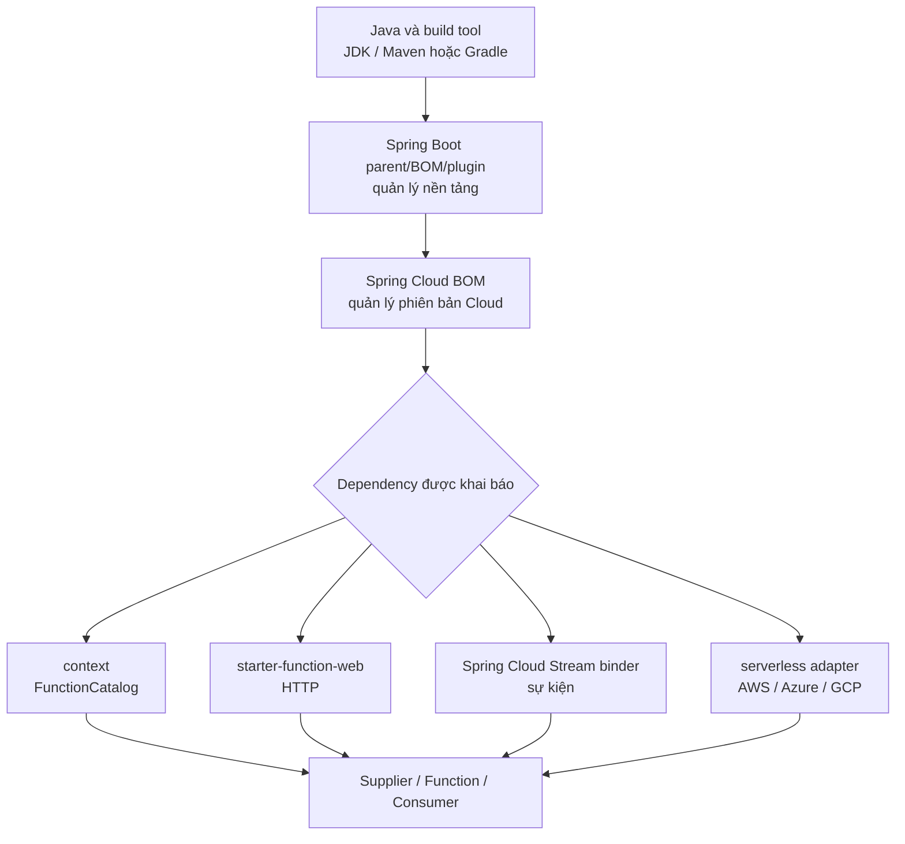

# Khai báo phụ thuộc bằng Maven hoặc Gradle

> **Chương:** Khởi tạo  
> **Module:** SPRING_CLOUD_FUNCTION  
> **Mục tiêu:** Khai báo đúng dependency Spring Cloud Function trong Maven hoặc Gradle, sử dụng Spring Cloud BOM để quản lý phiên bản, chọn starter/adapter theo môi trường triển khai và tự kiểm tra kết quả build.  
> **Mốc phiên bản minh họa:** 24/11/2026 — Java 21, Spring Boot 4.2.0, Spring Cloud 2026.0.0 (Spring Cloud Function 5.1.0). Khi áp dụng ở thời điểm khác, xác nhận lại ma trận tương thích và các bản vá được hỗ trợ.

## 1. Vì sao cần học cách khai báo dependency trước khi viết Function?

Spring Cloud Function cho phép đóng gói logic nghiệp vụ thành `Supplier<T>`, `Function<T, R>` và `Consumer<T>`, sau đó tra cứu và kết hợp chúng bằng `FunctionCatalog`. Cùng một hàm có thể được kết nối với HTTP, sự kiện hoặc runtime serverless thông qua adapter phù hợp. Tuy nhiên, ứng dụng cần có **đúng thư viện trên classpath** để các thành phần đó xuất hiện.

Ví dụ: bạn đã viết một `@Bean Function<String, String>` nhưng chưa thêm module Spring Cloud Function. Spring Boot vẫn có thể tạo bean Java đó, song ứng dụng không đương nhiên có `FunctionCatalog` hoặc endpoint HTTP để gọi hàm. Ngược lại, thêm BOM Spring Cloud không tự làm xuất hiện các thư viện Function: BOM chỉ **quản lý phiên bản của dependency được khai báo**.

Bài học giải quyết bốn câu hỏi:

1. Chọn phiên bản Java, Spring Boot và Spring Cloud như thế nào để khai báo hợp lệ?
2. Phần nào trong file build **quản lý phiên bản**, phần nào thực sự **đưa thư viện vào ứng dụng**?
3. Khác biệt giữa khai báo Maven `pom.xml`, Gradle Groovy `build.gradle` và Gradle Kotlin `build.gradle.kts` là gì?
4. Làm sao chứng minh ứng dụng đã nạp đúng FunctionCatalog và adapter, thay vì chỉ nhìn vào cấu hình?

Sơ đồ quan hệ:



**Kết quả cần đạt:** từ một dự án Java trống, bạn tạo được một Spring Boot application có hàm `normalizeCode`, chạy `mvn test` hoặc `gradle test`, rồi thử hàm qua HTTP hoặc `FunctionCatalog`.

## 2. Nắm chắc phiên bản và cấu trúc dependency

### 2.1. Ba phiên bản có ba vai trò khác nhau

Bộ minh họa dùng trong bài được công bố ở tháng 11/2026:

| Thành phần | Giá trị ví dụ | Vai trò |
| --- | --- | --- |
| Java | **21** | JDK dùng để biên dịch/chạy, là lựa chọn thực hành của bài. |
| Spring Boot | **4.2.0** | Quản lý nền Spring Framework, auto-configuration, plugin và nhiều thư viện khác. |
| Spring Cloud release train | **2026.0.0** | Phiên bản của BOM `spring-cloud-dependencies`, tương thích Spring Boot 4.2.0. |
| Spring Cloud Function | **5.1.0** | Phiên bản module Function nằm trong release train 2026.0.0. |

Thông báo Spring Cloud 2026.0.0 ngày 20/11/2026 xác nhận train này dựa trên Spring Boot 4.2.0 và dùng Spring Cloud Function 5.1.0. Vì vậy **không** khai báo BOM `spring-cloud-dependencies:5.1.0`; con số 5.1.0 là phiên bản module Function.

Tại các thời điểm khác, tra ma trận chính thức ở https://spring.io/projects/spring-cloud/ và ghi lại bộ phiên bản cụ thể đã chọn. Chỉ dùng release train tương thích với dòng Spring Boot thực tế của dự án. Tránh ghép một Spring Cloud train thuộc Boot 4.x với Boot 3.x.

### 2.2. BOM là gì?

BOM (*Bill of Materials*) là tệp POM chứa tập phiên bản dependency được quản lý đồng bộ. Với Spring Cloud, tọa độ dùng để import BOM là:

```text
groupId    = org.springframework.cloud
artifactId = spring-cloud-dependencies
version    = 2026.0.0
type       = pom
scope      = import   (khi import bằng Maven)
```

**BOM không tự cài mọi artifact**; bạn vẫn phải khai báo dependency mong muốn. Ví dụ:

- BOM chỉ quy định Spring Cloud Function nào sẽ được dùng nếu dự án phụ thuộc vào nó.
- `spring-cloud-starter-function-web` mới là dependency dùng để đưa Web adapter vào ứng dụng.
- Starter có thể kéo thêm `spring-cloud-function-context` và các thư viện cần thiết qua dependency bắc cầu (*transitive dependency*).

Tách hai vai trò này giúp kiểm soát phiên bản mà không phải tự ghim từng module.

### 2.3. Những artifact thường dùng

| Nhu cầu | Artifact gợi ý | Ghi chú |
| --- | --- | --- |
| Làm việc với catalog/hàm trong ứng dụng Spring | `org.springframework.cloud:spring-cloud-function-context` | Có `FunctionCatalog`; nếu muốn Boot app, vẫn cần nền Boot phù hợp. |
| Xuất hàm qua HTTP nhanh | `org.springframework.cloud:spring-cloud-starter-function-web` | Cách bắt đầu đơn giản với MVC Web adapter. |
| Dùng Web module trực tiếp | `org.springframework.cloud:spring-cloud-function-web` | Cần tự bảo đảm các dependency Web tương ứng. |
| Host nạp gói hàm JAR | `org.springframework.cloud:spring-cloud-function-deployer` | Phục vụ nạp package hàm, không tự triển khai lên cloud provider. |
| AWS Lambda | `org.springframework.cloud:spring-cloud-function-adapter-aws` | Cần thêm cấu hình handler và đóng gói Lambda. |
| Azure Functions | `org.springframework.cloud:spring-cloud-function-adapter-azure` | Cần Java worker, trigger/binding và packaging Azure. |
| Google Cloud Functions | `org.springframework.cloud:spring-cloud-function-adapter-gcp` | Cần runtime/entrypoint và packaging GCP tương ứng. |
| Kafka qua Spring Cloud Stream | `org.springframework.cloud:spring-cloud-starter-stream-kafka` | Gồm tích hợp binder Kafka; cần cấu hình broker/binding. |
| RabbitMQ qua Spring Cloud Stream | `org.springframework.cloud:spring-cloud-starter-stream-rabbit` | Gồm binder RabbitMQ; cần cấu hình broker/binding. |

Chọn **một điểm khởi đầu** theo môi trường, thay vì thêm mọi adapter vào cùng dự án. Các adapter có thể mang theo thư viện và cấu hình riêng, nên thêm thừa làm classpath phức tạp và tăng rủi ro xung đột.

## 3. Maven: khai báo ứng dụng Spring Cloud Function Web hoàn chỉnh

### 3.1. Cấu trúc dự án

Maven mặc định dùng `pom.xml` ở thư mục gốc:

```text
scf-demo/
├── pom.xml
└── src/
    ├── main/
    │   ├── java/
    │   │   └── vn/example/scf/ScfDemoApplication.java
    │   └── resources/
    │       └── application.properties
    └── test/
        └── java/
            └── vn/example/scf/FunctionCatalogTest.java
```

Dự án này dùng `spring-cloud-starter-function-web` để có thể thử hàm qua HTTP, đồng thời kiểm tra `FunctionCatalog` trong test.

### 3.2. `pom.xml` hoàn chỉnh

```xml
<?xml version="1.0" encoding="UTF-8"?>
<project xmlns="http://maven.apache.org/POM/4.0.0"
         xmlns:xsi="http://www.w3.org/2001/XMLSchema-instance"
         xsi:schemaLocation="
           http://maven.apache.org/POM/4.0.0
           https://maven.apache.org/xsd/maven-4.0.0.xsd">
    <modelVersion>4.0.0</modelVersion>

    <parent>
        <groupId>org.springframework.boot</groupId>
        <artifactId>spring-boot-starter-parent</artifactId>
        <version>4.2.0</version>
        <relativePath/>
    </parent>

    <groupId>vn.example</groupId>
    <artifactId>scf-demo</artifactId>
    <version>0.0.1-SNAPSHOT</version>
    <name>scf-demo</name>
    <description>Spring Cloud Function Maven example</description>

    <properties>
        <java.version>21</java.version>
        <spring-cloud.version>2026.0.0</spring-cloud.version>
    </properties>

    <dependencyManagement>
        <dependencies>
            <dependency>
                <groupId>org.springframework.cloud</groupId>
                <artifactId>spring-cloud-dependencies</artifactId>
                <version>${spring-cloud.version}</version>
                <type>pom</type>
                <scope>import</scope>
            </dependency>
        </dependencies>
    </dependencyManagement>

    <dependencies>
        <dependency>
            <groupId>org.springframework.cloud</groupId>
            <artifactId>spring-cloud-starter-function-web</artifactId>
        </dependency>

        <dependency>
            <groupId>org.springframework.boot</groupId>
            <artifactId>spring-boot-starter-test</artifactId>
            <scope>test</scope>
        </dependency>
    </dependencies>

    <build>
        <plugins>
            <plugin>
                <groupId>org.springframework.boot</groupId>
                <artifactId>spring-boot-maven-plugin</artifactId>
            </plugin>
        </plugins>
    </build>
</project>
```

Trong `pom.xml`:

1. **`<parent>`** dùng Spring Boot 4.2.0, cung cấp cấu hình Maven và quản lý nhiều dependency/plugin thuộc Spring Boot.
2. **`<java.version>`** đặt Java 21. Kiểm tra máy build thực tế dùng JDK phù hợp qua `mvn -v`.
3. **`<dependencyManagement>`** import Spring Cloud BOM 2026.0.0. Trường `type=pom` và `scope=import` là phần bắt buộc đối với import BOM bằng Maven.
4. **`<dependencies>`** thêm Web starter vào runtime classpath và Spring Boot Test vào test classpath.
5. **`spring-boot-maven-plugin`** hỗ trợ chạy/đóng gói ứng dụng Boot. Plugin là công cụ build; nó không thay thế dependency Function.

Không ghi thêm `<version>5.1.0</version>` bên trong `spring-cloud-starter-function-web`: hãy để BOM quyết định phiên bản, trừ khi đang kiểm chứng một trường hợp override có chủ đích.

### 3.3. Giải thích các loại dependency scope

| Maven scope | Có trên classpath lúc nào? | Khi nào dùng? |
| --- | --- | --- |
| Mặc định (`compile`) | Compile, test và runtime. | Starter, các thư viện Function dùng trong ứng dụng. |
| `test` | Compile/chạy test, không đóng vào runtime artifact thông thường. | `spring-boot-starter-test`, test libraries. |
| `runtime` | Runtime và test, không dùng để biên dịch code trực tiếp. | Một số driver/implementation chỉ cần lúc chạy. |
| `provided` | Compile/test nhưng được kỳ vọng môi trường cung cấp khi chạy. | Trường hợp container/runtime đặc thù; không tự áp dụng cho adapter nếu docs không yêu cầu. |
| `import` | Chỉ dùng trong `dependencyManagement` cho BOM có `type=pom`. | Nạp bảng phiên bản, không thêm JAR vào ứng dụng. |

Một lỗi điển hình là đặt `spring-cloud-starter-function-web` với `scope=test`. Khi đó test có thể nhìn thấy một số class liên quan, nhưng artifact chạy production sẽ thiếu Web adapter.

### 3.4. Maven không dùng Spring Boot parent

Nếu tổ chức có parent POM riêng, có thể import cả Spring Boot BOM và Spring Cloud BOM:

```xml
<dependencyManagement>
    <dependencies>
        <dependency>
            <groupId>org.springframework.boot</groupId>
            <artifactId>spring-boot-dependencies</artifactId>
            <version>4.2.0</version>
            <type>pom</type>
            <scope>import</scope>
        </dependency>
        <dependency>
            <groupId>org.springframework.cloud</groupId>
            <artifactId>spring-cloud-dependencies</artifactId>
            <version>2026.0.0</version>
            <type>pom</type>
            <scope>import</scope>
        </dependency>
    </dependencies>
</dependencyManagement>
```

Đây là **đoạn thay thế cho dependency management**, chưa phải toàn bộ `pom.xml`. Khác với Boot parent, import Boot BOM **không tự quản lý mọi cấu hình plugin build**. Bạn cần định nghĩa rõ phiên bản `spring-boot-maven-plugin`, cấu hình compiler plugin (Java 21) và các plugin khác theo tiêu chuẩn dự án. Thứ tự/ưu tiên BOM và mọi phiên bản đã override cần được kiểm tra trong effective POM.

## 4. Thêm logic Java để xác nhận dependency hoạt động

Tạo `src/main/java/vn/example/scf/ScfDemoApplication.java`:

```java
package vn.example.scf;

import java.util.Locale;
import java.util.function.Function;
import org.springframework.boot.SpringApplication;
import org.springframework.boot.autoconfigure.SpringBootApplication;
import org.springframework.context.annotation.Bean;

@SpringBootApplication
public class ScfDemoApplication {

    public static void main(String[] args) {
        SpringApplication.run(ScfDemoApplication.class, args);
    }

    @Bean
    public Function<String, String> normalizeCode() {
        return raw -> raw.trim().toUpperCase(Locale.ROOT);
    }

    @Bean
    public Function<String, String> validateCode() {
        return code -> {
            if (!code.matches("[A-Z]{2}-[0-9]{3}")) {
                throw new IllegalArgumentException("Invalid code: " + code);
            }
            return code;
        };
    }
}
```

Hai bean dùng interface `java.util.function.Function` từ JDK, không cần interface đặc biệt do Spring Cloud Function phát minh. Context của Spring Cloud Function phát hiện các bean này để đăng ký vào `FunctionCatalog`. Java lambda không biết nó sẽ được gọi từ HTTP hay từ một message broker.

Tạo `src/main/resources/application.properties`:

```properties
spring.application.name=scf-demo
```

Với cấu hình trên, Web adapter có thể xuất từng bean theo tên (ví dụ `/normalizeCode`). Khi muốn chọn composition làm hàm mặc định cho adapter, có thể **thêm** dòng `spring.cloud.function.definition=normalizeCode|validateCode`. Chuỗi này chuẩn hóa trước, kiểm tra sau và theo quy tắc Web adapter sẽ ánh xạ pipeline lên đường dẫn gốc `/`. Các adapter tích hợp như Spring Cloud Stream cũng nên được cấu hình definition rõ ràng.

**Cách kiểm tra HTTP đầu tiên:** khi ứng dụng chạy với Web starter và chưa cấu hình definition mặc định, dùng `POST /normalizeCode` để gọi bean trực tiếp. Web adapter còn cho phép gọi composition qua path dạng `/normalizeCode,validateCode`; việc bật definition mặc định thay đổi quy tắc ánh xạ root path như mô tả bên trên.

Tài liệu về HTTP adapter: https://docs.spring.io/spring-cloud-function/reference/spring-cloud-function/standalone-web-applications.html

## 5. Gradle Groovy DSL: viết `build.gradle` tương đương

### 5.1. Cấu hình với Spring dependency-management plugin

Gradle không có `<parent>` như Maven. Cách đơn giản để quản lý BOM Spring Cloud là dùng plugin Spring Boot và `io.spring.dependency-management`:

```groovy
plugins {
    id 'java'
    id 'org.springframework.boot' version '4.2.0'
    id 'io.spring.dependency-management' version '1.1.7'
}

group = 'vn.example'
version = '0.0.1-SNAPSHOT'
description = 'Spring Cloud Function Gradle example'

repositories {
    mavenCentral()
}

java {
    toolchain {
        languageVersion = JavaLanguageVersion.of(21)
    }
}

ext {
    set('springCloudVersion', '2026.0.0')
}

dependencyManagement {
    imports {
        mavenBom "org.springframework.cloud:spring-cloud-dependencies:${springCloudVersion}"
    }
}

dependencies {
    implementation 'org.springframework.cloud:spring-cloud-starter-function-web'
    testImplementation 'org.springframework.boot:spring-boot-starter-test'
}

tasks.named('test') {
    useJUnitPlatform()
}
```

Khi dùng `io.spring.dependency-management` cùng Boot plugin, Boot tự import BOM `spring-boot-dependencies` tương ứng với Boot plugin; block `dependencyManagement` import thêm BOM Spring Cloud. Nhờ vậy, dependency trong `implementation` và `testImplementation` thường không cần version riêng nếu đã được BOM quản lý.

**Vai trò của từng block:**

| Gradle | Ý nghĩa |
| --- | --- |
| `plugins` | Áp dụng Java, Spring Boot và dependency-management plugin. |
| `repositories { mavenCentral() }` | Chỉ định kho tìm dependency. |
| `java.toolchain` | Chọn JDK 21 dùng khi compile/test theo khả năng toolchain. |
| `ext.springCloudVersion` | Khai báo một giá trị version dễ chỉnh tập trung. |
| `dependencyManagement.imports.mavenBom` | Import bảng phiên bản Spring Cloud. |
| `implementation` | Thêm starter cần thiết cho ứng dụng lúc build/chạy. |
| `testImplementation` | Thêm test libraries. |
| `useJUnitPlatform()` | Chạy test JUnit 5/JUnit Platform. |

Phiên bản plugin `io.spring.dependency-management:1.1.7` được minh họa trong hướng dẫn phát hành Spring Cloud 2026.0.0. Khi nâng cấp phiên bản Spring Boot/Gradle, kiểm tra thêm khả năng tương thích plugin.

### 5.2. Gradle Kotlin DSL: `build.gradle.kts`

Với Kotlin DSL, cấu trúc tương đương có cú pháp type-safe khác một chút:

```kotlin
plugins {
    java
    id("org.springframework.boot") version "4.2.0"
    id("io.spring.dependency-management") version "1.1.7"
}

group = "vn.example"
version = "0.0.1-SNAPSHOT"

repositories {
    mavenCentral()
}

java {
    toolchain {
        languageVersion = JavaLanguageVersion.of(21)
    }
}

val springCloudVersion = "2026.0.0"

dependencyManagement {
    imports {
        mavenBom("org.springframework.cloud:spring-cloud-dependencies:$springCloudVersion")
    }
}

dependencies {
    implementation("org.springframework.cloud:spring-cloud-starter-function-web")
    testImplementation("org.springframework.boot:spring-boot-starter-test")
}

tasks.test {
    useJUnitPlatform()
}
```

**Không trộn cú pháp:** Groovy DSL dùng `id 'java'` và `implementation 'group:artifact'`; Kotlin DSL dùng `id("java")` hoặc `java` và `implementation("group:artifact")`.

Đừng dùng `$springCloudVersion` trong một đoạn Groovy với kỳ vọng giống Kotlin hoặc ngược lại mà không hiểu interpolation. Cả hai ví dụ đã cung cấp đúng cách tham chiếu chuỗi theo từng DSL.

### 5.3. Tùy chọn Gradle native BOM qua `platform(...)`

Gradle có cơ chế quản lý BOM **không bắt buộc** dependency-management plugin. Nếu chọn cách này, phải khai báo rõ các platform cần thiết, ví dụ `build.gradle`:

```groovy
plugins {
    id 'java'
    id 'org.springframework.boot' version '4.2.0'
}

group = 'vn.example'
version = '0.0.1-SNAPSHOT'

repositories {
    mavenCentral()
}

java {
    toolchain {
        languageVersion = JavaLanguageVersion.of(21)
    }
}

dependencies {
    implementation platform('org.springframework.boot:spring-boot-dependencies:4.2.0')
    implementation platform('org.springframework.cloud:spring-cloud-dependencies:2026.0.0')
    implementation 'org.springframework.cloud:spring-cloud-starter-function-web'

    testImplementation platform('org.springframework.boot:spring-boot-dependencies:4.2.0')
    testImplementation platform('org.springframework.cloud:spring-cloud-dependencies:2026.0.0')
    testImplementation 'org.springframework.boot:spring-boot-starter-test'
}

tasks.named('test') {
    useJUnitPlatform()
}
```

Cách này sử dụng *native Gradle platform constraints*. Spring Boot Gradle plugin tự tạo các task Boot, nhưng khi không dùng dependency-management plugin, bạn **phải** đảm bảo các BOM được áp dụng cho configuration thích hợp. Tùy quan hệ configuration thực tế, có thể tối giản các dòng `testImplementation platform(...)`; ở đây khai báo rõ để dễ học.

Chọn **một chiến lược quản lý phiên bản** cho project. Đừng đồng thời thêm plugin quản lý BOM, native platform và các version override rời rạc mà chưa hiểu quy tắc ưu tiên của Gradle.

Tài liệu: https://docs.spring.io/spring-boot/gradle-plugin/managing-dependencies.html

## 6. Maven và Gradle khác nhau ở đâu?

| Vấn đề | Maven | Gradle |
| --- | --- | --- |
| File build | `pom.xml` | `build.gradle` hoặc `build.gradle.kts` |
| Boot nền tảng | Thường dùng `spring-boot-starter-parent` | Dùng `org.springframework.boot` plugin |
| Import Spring Cloud BOM | `dependencyManagement` + `type=pom` + `scope=import` | `mavenBom(...)` hoặc native `platform(...)` |
| Dependency chính | `<dependencies><dependency>...` | `dependencies { implementation(...) }` |
| Dependency test | `<scope>test</scope>` | `testImplementation(...)` |
| Build thử | `./mvnw clean test` | `./gradlew clean test` |
| Chạy ứng dụng | `./mvnw spring-boot:run` | `./gradlew bootRun` |
| Xem dependency | `dependency:tree` | `dependencies` và `dependencyInsight` |
| Đóng gói Boot | `./mvnw package` | `./gradlew bootJar` |

Chỉ cần dùng một hệ build cho dự án học. Nếu repository có cả Maven và Gradle do quá trình di trú, phải xác định hệ nào là nguồn sự thật ở CI và không duy trì hai bộ version khác nhau.

## 7. Đổi dependency theo môi trường triển khai

Cùng một bean nghiệp vụ có thể được nối với nhiều cách gọi, nhưng **dependency và cấu hình adapter** cần thay đổi theo môi trường.

### 7.1. Chỉ cần `FunctionCatalog` trong ứng dụng nội bộ

Nếu không cần HTTP hoặc broker, thay Web starter bằng context và nền Spring Boot:

**Maven — bên trong `<dependencies>`:**

```xml
<dependency>
    <groupId>org.springframework.boot</groupId>
    <artifactId>spring-boot-starter</artifactId>
</dependency>
<dependency>
    <groupId>org.springframework.cloud</groupId>
    <artifactId>spring-cloud-function-context</artifactId>
</dependency>
```

**Gradle:**

```groovy
dependencies {
    implementation 'org.springframework.boot:spring-boot-starter'
    implementation 'org.springframework.cloud:spring-cloud-function-context'
}
```

Khi chạy trong Spring Boot application, bạn có thể inject `FunctionCatalog` rồi tra cứu bean hàm. Context không tự tạo REST endpoint.

### 7.2. HTTP: Web starter

**Maven:**

```xml
<dependency>
    <groupId>org.springframework.cloud</groupId>
    <artifactId>spring-cloud-starter-function-web</artifactId>
</dependency>
```

**Gradle:**

```groovy
dependencies {
    implementation 'org.springframework.cloud:spring-cloud-starter-function-web'
}
```

Web starter gom các dependency cần thiết cho Web integration. Khi chỉ muốn thử chức năng nhận/trả HTTP, đây là lựa chọn đơn giản hơn việc lắp từng module thủ công. Nó không thay thế một API REST phức tạp cần resource/controller, security, pagination hoặc kiểm soát contract.

### 7.3. Sự kiện Kafka hoặc RabbitMQ: Stream và binder

Spring Cloud Function tập trung vào mô hình hàm. Muốn nối với broker, thêm Spring Cloud Stream cùng binder tương ứng, ví dụ Kafka:

**Maven:**

```xml
<dependency>
    <groupId>org.springframework.cloud</groupId>
    <artifactId>spring-cloud-starter-stream-kafka</artifactId>
</dependency>
```

**Gradle Groovy:**

```groovy
dependencies {
    implementation 'org.springframework.cloud:spring-cloud-starter-stream-kafka'
}
```

Một cấu hình ví dụ khi function tên `normalizeCode`:

```properties
spring.cloud.function.definition=normalizeCode
spring.cloud.stream.bindings.normalizeCode-in-0.destination=raw-codes
spring.cloud.stream.bindings.normalizeCode-out-0.destination=normalized-codes
spring.cloud.stream.kafka.binder.brokers=localhost:9092
```

Ở đây:

- `normalizeCode-in-0` là binding đầu vào theo quy ước của Spring Cloud Stream.
- `normalizeCode-out-0` là binding đầu ra, vì Function trả kết quả.
- `destination` ánh xạ đến topic/đích được cấu hình.
- `binder.brokers` chỉ nơi kết nối Kafka; broker phải đang chạy và người dùng có quyền truy cập.

Nếu dùng RabbitMQ, thay bằng `spring-cloud-starter-stream-rabbit` và cấu hình binder Rabbit tương ứng. **Không cần** cài đồng thời Kafka và RabbitMQ binder khi chỉ sử dụng một broker.

### 7.4. Serverless: AWS, Azure, Google Cloud

Để giữ nguyên business function nhưng chạy trên cloud provider, chọn adapter riêng:

**Maven — chọn đúng một adapter theo nền tảng:**

```xml
<!-- AWS Lambda -->
<dependency>
    <groupId>org.springframework.cloud</groupId>
    <artifactId>spring-cloud-function-adapter-aws</artifactId>
</dependency>

<!-- Azure Functions: thay AWS dependency bằng dependency sau -->
<!--
<dependency>
    <groupId>org.springframework.cloud</groupId>
    <artifactId>spring-cloud-function-adapter-azure</artifactId>
</dependency>
-->

<!-- Google Cloud Functions: thay AWS dependency bằng dependency sau -->
<!--
<dependency>
    <groupId>org.springframework.cloud</groupId>
    <artifactId>spring-cloud-function-adapter-gcp</artifactId>
</dependency>
-->
```

**Gradle — chỉ chọn dependency phù hợp:**

```groovy
// Ví dụ mục tiêu AWS Lambda
dependencies {
    implementation 'org.springframework.cloud:spring-cloud-function-adapter-aws'
}
```

Adapter dependency không tự cấu hình hết runtime đích. Với AWS còn cần handler và gói JAR đúng định dạng Lambda; với Azure cần trigger/binding và plugin deploy; với Google Cloud cần entrypoint/Functions Framework phù hợp. Tất cả cần runtime Java và phiên bản adapter tương thích.

Đặc biệt, **không** đổi Boot/Cloud BOM sang bản cũ hoặc mới hơn chỉ vì phát hiện một adapter có artifact khác; trước tiên đối chiếu tài liệu adapter theo đúng release train.

### 7.5. Khi nào thêm `spring-cloud-function-deployer`?

Nếu host cần nạp một JAR chứa function từ ngoài bản build, có thể thêm:

```xml
<dependency>
    <groupId>org.springframework.cloud</groupId>
    <artifactId>spring-cloud-function-deployer</artifactId>
</dependency>
```

Hoặc trong Gradle:

```groovy
implementation 'org.springframework.cloud:spring-cloud-function-deployer'
```

Deployer xử lý **nạp function package vào host**, không phải adapter tự động đưa ứng dụng lên cloud. Nó cần cấu hình location, packaging và cơ chế quản lý artifact phù hợp; ứng dụng HTTP thông thường không cần thư viện này.

### 7.6. Project Reactor và chữ ký reactive

Spring Cloud Function có thể nhận hàm kiểu `Function<Flux<T>, Flux<R>>`, `Function<Mono<T>, Mono<R>>` hoặc nhiều tổ hợp phù hợp khác. Reactor thường nằm trong dependency graph khi dùng các module hỗ trợ reactive, nhưng không nên mặc định classpath luôn có đủ mọi thư viện bạn muốn.

Nếu một ứng dụng tự dùng Reactor và chưa có thư viện này, có thể khai báo `io.projectreactor:reactor-core` với phiên bản do Spring Boot quản lý. Với test cần `StepVerifier`, thêm `io.projectreactor:reactor-test` trong test scope:

```xml
<dependency>
    <groupId>io.projectreactor</groupId>
    <artifactId>reactor-test</artifactId>
    <scope>test</scope>
</dependency>
```

Gradle tương đương:

```groovy
testImplementation 'io.projectreactor:reactor-test'
```

Việc đổi bean thành reactive **không tự biến** HTTP, Kafka, AWS hoặc Azure thành luồng end-to-end non-blocking; phải hiểu khả năng adapter và thư viện I/O tương ứng.

## 8. Build, chạy thử và kiểm tra `FunctionCatalog`

### 8.1. Dùng wrapper để giữ phiên bản build tool

Trong CI và nhóm phát triển, ưu tiên `mvnw` hoặc `gradlew` đã được tạo và commit trong dự án. Nếu chưa có wrapper, sử dụng Maven/Gradle được cài tương thích rồi tạo wrapper theo quy trình dự án.

**Maven (Linux/macOS):**

```bash
java -version
./mvnw -v
./mvnw clean test
./mvnw spring-boot:run
```

**Gradle (Linux/macOS):**

```bash
java -version
./gradlew --version
./gradlew clean test
./gradlew bootRun
```

Trên Windows PowerShell, dùng `./mvnw.cmd` hoặc `./gradlew.bat` tương ứng. Nếu không có wrapper, dùng lệnh `mvn` hoặc `gradle` đã được cài trong PATH.

Nếu JDK chạy Maven/Gradle khác Java toolchain khai báo trong build, phải kiểm tra lại `JAVA_HOME`, toolchain và runner CI. Build có thể thành công ở máy lập trình nhưng lỗi trên môi trường triển khai dùng Java thấp hơn.

### 8.2. Test catalog bằng JUnit

Thêm file `src/test/java/vn/example/scf/FunctionCatalogTest.java`:

```java
package vn.example.scf;

import static org.junit.jupiter.api.Assertions.assertEquals;
import static org.junit.jupiter.api.Assertions.assertThrows;

import java.util.function.Function;

import org.junit.jupiter.api.Test;
import org.springframework.beans.factory.annotation.Autowired;
import org.springframework.boot.test.context.SpringBootTest;
import org.springframework.cloud.function.context.FunctionCatalog;

@SpringBootTest
class FunctionCatalogTest {

    @Autowired
    FunctionCatalog catalog;

    @Test
    void canComposeAndValidate() {
        Function<String, String> chain =
                catalog.lookup("normalizeCode|validateCode");

        assertEquals("OD-123", chain.apply("  od-123  "));
        assertThrows(IllegalArgumentException.class,
                () -> chain.apply("??"));
    }
}
```

Test kiểm tra:

- Context Spring Boot khởi động.
- Spring Cloud Function cung cấp được bean `FunctionCatalog`.
- Hai bean Function được tìm theo tên và composition hoạt động.
- Hàm trả kết quả đúng cho đầu vào hợp lệ và báo lỗi với mã sai.

Kiểm thử catalog không thay cho kiểm thử HTTP adapter, Kafka binder hay serverless handler. Nó xác nhận được **lớp lõi** độc lập với giao thức.

### 8.3. Gửi HTTP request

Khi đã chạy `spring-boot:run` hoặc `bootRun` với Web starter, có thể gọi trực tiếp bean `normalizeCode`:

```bash
curl -i -X POST http://localhost:8080/normalizeCode \
  -H "Content-Type: text/plain" \
  --data "  od-123  "
```

Body mong đợi:

```text
OD-123
```

Nếu muốn kiểm tra composition trực tiếp, test `FunctionCatalog` ở mục 8.2 đáng tin cậy hơn việc đoán URL chứa dấu `|`. URL composition, route base path và quy tắc chọn definition phải được kiểm tra theo Web adapter và cấu hình thực tế.

Với Web adapter và hai bean ở mục 4 (không đặt definition mặc định), có thể gọi composition bằng dấu phẩy trên URL:

```bash
curl -i -X POST http://localhost:8080/normalizeCode,validateCode \
  -H "Content-Type: text/plain" \
  --data "  od-123  "
```

Kết quả mong đợi vẫn là `OD-123`. Đây là cú pháp Web adapter được tài liệu Spring Cloud Function mô tả; dấu `|` được dùng trong `FunctionCatalog.lookup(...)` và property definition.

### 8.4. Quan sát danh sách function qua Actuator (tùy chọn)

Có thể bổ sung:

```xml
<dependency>
    <groupId>org.springframework.boot</groupId>
    <artifactId>spring-boot-starter-actuator</artifactId>
</dependency>
```

Trong cấu hình môi trường local:

```properties
management.endpoints.web.exposure.include=health,info,functions
```

Khi được hỗ trợ và kích hoạt, endpoint `/actuator/functions` cho phép quan sát các hàm trong catalog. **Chỉ mở endpoint quản trị phù hợp với yêu cầu bảo mật của môi trường**; không nên mở toàn bộ actuator endpoints ra công khai chỉ để debug.

## 9. Kiểm tra dependency đã được resolve thực tế

### 9.1. Maven: `dependency:tree` và effective POM

```bash
./mvnw dependency:tree
./mvnw dependency:tree -Dincludes=org.springframework.cloud
./mvnw help:effective-pom
```

Trong kết quả, hãy kiểm tra:

1. Spring Cloud BOM đã được import phiên bản `2026.0.0`.
2. `spring-cloud-function-context`, Web starter và các dependency liên quan được resolve về cùng dòng phiên bản được BOM quản lý.
3. Không có phiên bản Spring Framework/Function khác bị kéo vào hoặc override không có chủ đích.
4. Các dependency test được đặt đúng scope; classpath runtime không chứa thư viện chỉ dành cho test.

Đặc biệt, `dependency:tree` cho thấy **các dependency được sử dụng**. Nó không liệt kê mọi thư viện nằm trong BOM nếu ứng dụng không dùng chúng. Để tìm version được quản lý cho một artifact chưa được khai báo, xem effective POM hoặc metadata BOM.

### 9.2. Gradle: `dependencies` và `dependencyInsight`

```bash
./gradlew dependencies --configuration runtimeClasspath
./gradlew dependencyInsight \
  --dependency spring-cloud-function-context \
  --configuration runtimeClasspath
```

Với PowerShell, có thể đặt lệnh `dependencyInsight` trên một dòng:

```powershell
./gradlew.bat dependencyInsight --dependency spring-cloud-function-context --configuration runtimeClasspath
```

`dependencyInsight` giúp xác định dependency vào theo nhánh nào, version nào được chọn và vì sao. Nếu không tìm thấy dependency, có thể là nó không nằm trên runtime classpath; kiểm tra bạn đã khai báo starter đúng chưa.

### 9.3. Bộ kiểm tra khởi tạo tối thiểu

| Kiểm tra | Tín hiệu đạt | Lỗi nào được phát hiện? |
| --- | --- | --- |
| `java -version` và build tool version | JDK/toolchain đáp ứng yêu cầu Boot/Cloud. | Sai JDK, compiler không hỗ trợ target. |
| `mvn dependency:tree` / Gradle runtimeClasspath | Module Function lấy đúng version BOM. | Lệch version, thiếu starter, transitive conflict. |
| `mvn test` / `gradlew test` | Test catalog và Java logic thành công. | Không load context, bean function không được tìm thấy. |
| `spring-boot:run` / `bootRun` | Ứng dụng khởi động ổn định. | Lỗi auto-configuration, classpath, port. |
| `curl POST /normalizeCode` | Trả về `OD-123`. | Thiếu Web adapter hoặc mapping/converter sai. |
| Smoke test broker/serverless (nếu dùng) | Event đi qua binding/handler với payload đúng. | Packaging, binding, runtime, permissions và message conversion sai. |

Đừng đánh giá thành công chỉ dựa trên **BUILD SUCCESSFUL** hoặc **BUILD SUCCESS**. Một ứng dụng có thể biên dịch nhưng vẫn thiếu HTTP handler, broker hoặc runtime provider khi chạy.

## 10. Lỗi thường gặp khi khai báo Maven/Gradle

| Triệu chứng | Nguyên nhân phổ biến | Cách khắc phục |
| --- | --- | --- |
| `Non-resolvable import POM` | BOM sai tọa độ/version, chưa phát hành ở repo cấu hình, lỗi mạng/proxy. | Đối chiếu `spring-cloud-dependencies` và release train; kiểm tra Maven Central, proxy, repository. |
| `Could not find ...` trên Gradle | Chưa khai báo `mavenCentral()`, artifact sai tên hoặc repository không có bản yêu cầu. | Kiểm tra repositories và tọa độ; tránh đổi bừa sang SNAPSHOT. |
| `FunctionCatalog` không tồn tại | Chỉ có Java bean nhưng thiếu thư viện Function hoặc starter phù hợp. | Thêm `spring-cloud-function-context` hoặc Web starter. |
| `/normalizeCode` trả 404 | Chưa có Web adapter, ứng dụng không chạy dạng Web hoặc route/base path sai. | Kiểm tra Web starter, `spring.cloud.function.web.path` và mapping được kích hoạt. |
| Maven báo thiếu version dependency | BOM chưa import hoặc dependency không thuộc BOM đang dùng. | Kiểm tra `dependencyManagement`, `type=pom`, `scope=import` và effective POM. |
| Gradle báo thiếu version dependency | Chưa áp dụng dependency-management plugin/native platform đúng configuration. | Kiểm tra `dependencyManagement` hoặc `platform(...)` trên đúng classpath. |
| `NoSuchMethodError` hoặc `ClassNotFoundException` | Trộn nhiều thế hệ Spring Boot/Cloud/Function, hoặc override transitive dependency không phù hợp. | Xem dependency tree/insight; quay về cặp phiên bản tương thích. |
| `UnsupportedClassVersionError` | Runtime Java quá cũ so với bytecode được build. | So khớp Java toolchain với runtime máy chủ/container/serverless. |
| Hàm chạy HTTP nhưng không nhận Kafka message | Đã có Web starter nhưng chưa có Spring Cloud Stream binder/binding. | Thêm binder cần thiết; cấu hình destination và broker. |
| AWS Lambda upload thành công nhưng không chạy | Thiếu handler/packaging thích hợp hoặc runtime Java không khớp. | Dùng hướng dẫn adapter AWS và thử artifact thực trong Lambda. |
| Build ở CLI khác IDE | IDE dùng JDK hoặc trình nhập Gradle/Maven khác. | Đồng bộ wrapper, toolchain và `JAVA_HOME`. |
| Đặt version Function trực tiếp | Ghi đè BOM bằng `5.0.x` trong project dùng Cloud 2026.0.0. | Bỏ version override và kiểm tra BOM giải quyết về dòng 5.1.x. |

### 10.1. Đừng khắc phục sai version bằng cách tắt compatibility verifier

Nếu Spring Cloud phát hiện cặp Boot/Cloud không được hỗ trợ, ứng dụng có thể từ chối khởi động hoặc đưa cảnh báo. Tắt cơ chế kiểm tra (chẳng hạn qua `spring.cloud.compatibility-verifier.enabled=false`) chỉ **bỏ qua cảnh báo**, không sửa tương thích nhị phân. Cách đúng là chọn lại cặp release train theo tài liệu và chạy kiểm thử.

### 10.2. Không lạm dụng `exclusions`

Maven và Gradle cho phép loại trừ dependency bắc cầu. Ví dụ, nếu xóa nhầm module do Web starter kéo vào, có thể mất `FunctionCatalog` hoặc cơ chế Web conversion. Chỉ dùng exclusion khi xác định rõ xung đột và đã thay bằng dependency tương đương phù hợp. Sau đó chạy test và kiểm tra classpath thực tế.

### 10.3. Thay đổi BOM có thể thay đổi hành vi ở runtime

Nâng từ một release train sang train lớn hơn sẽ kéo nhiều thư viện cùng lúc. Ngoài lỗi compile, còn cần kiểm tra JSON/message conversion, headers của `Message<?>`, composition, retry, backpressure và phản hồi của HTTP/event/serverless adapter. Vì vậy nâng BOM là một thay đổi hệ sinh thái, cần chạy integration test.

## 11. Bài thực hành cuối bài

### Bài 1 — Maven với HTTP adapter

**Yêu cầu:** dựng `pom.xml` theo mục 3, chạy JDK 21, Boot 4.2.0 và Cloud BOM 2026.0.0.

Các bước:

1. Tạo `ScfDemoApplication` và hai hàm `normalizeCode`, `validateCode`.
2. Thêm `spring-cloud-starter-function-web`, không ghi version riêng.
3. Chạy `./mvnw clean test` và `./mvnw spring-boot:run`.
4. Gửi `POST /normalizeCode` với `"  od-123  "`; đối chiếu `"OD-123"`.
5. Kiểm tra `dependency:tree` để chứng minh Function dependency được BOM quản lý.

**Tiêu chí đạt:** test catalog thành công, HTTP trả body chính xác và không có dependency Function bị override ngoài ý muốn.

### Bài 2 — Chuyển từ Maven sang Gradle

Tạo `build.gradle` hoặc `build.gradle.kts` tương đương `pom.xml` ban đầu.

- Boot plugin vẫn là `4.2.0`, Cloud BOM là `2026.0.0`.
- Dùng `java.toolchain` chọn Java 21.
- Starter Function Web được khai báo qua `implementation`.
- `spring-boot-starter-test` nằm trong `testImplementation`.
- Chạy `dependencies --configuration runtimeClasspath` và xác nhận không có bản Function ngoài dòng tương thích.

Giải thích sự khác biệt giữa Maven `scope=test` và Gradle `testImplementation`; giữa BOM Maven import và `mavenBom(...)` hoặc `platform(...)` của Gradle.

### Bài 3 — Chọn đúng dependency cho bốn kịch bản

| Kịch bản | Dependency chủ đạo nên chọn |
| --- | --- |
| Chỉ dùng FunctionCatalog bên trong một Spring Boot worker | `spring-cloud-function-context` và nền Boot phù hợp. |
| Nhận request HTTP, trả về mã đã chuẩn hóa | `spring-cloud-starter-function-web`. |
| Đọc mã từ Kafka và phát kết quả sang topic khác | `spring-cloud-starter-stream-kafka` cùng cấu hình Stream binding/broker. |
| Đưa cùng function lên AWS Lambda | `spring-cloud-function-adapter-aws` và packaging/handler AWS. |

**Câu hỏi mở:** vì sao cả bốn phương án vẫn dùng được `Function<String, String> normalizeCode`, nhưng phải có dependency và cấu hình runtime khác nhau? Hãy liên hệ vai trò `FunctionCatalog`, chuyển đổi payload/message và adapter.

### Bài 4 — Phân tích cấu hình sai

Cho Maven:

```xml
<properties>
    <spring-cloud.version>2026.0.0</spring-cloud.version>
</properties>

<dependencies>
    <dependency>
        <groupId>org.springframework.cloud</groupId>
        <artifactId>spring-cloud-starter-function-web</artifactId>
        <version>5.0.4</version>
    </dependency>
</dependencies>
```

Hãy xác định ba vấn đề:

1. Có khai báo `spring-cloud.version` nhưng chưa **import** `spring-cloud-dependencies`, nên thuộc tính này không tự quản lý version.
2. Starter bị ép `5.0.4`, khác dòng Function 5.1.0 của Cloud 2026.0.0.
3. Nếu dự án thiếu nền Boot tương thích thì thêm starter đơn lẻ không đủ bảo đảm ứng dụng khởi chạy.

**Cách sửa:** chọn Boot 4.2.0 tương ứng, import Cloud BOM 2026.0.0 trong `dependencyManagement` rồi bỏ thẻ `<version>` của Function starter. Sau đó kiểm chứng bằng effective POM, dependency tree và test.

## 12. Tổng kết và tài liệu chính thức

- **Maven:** dùng Boot parent (hoặc Boot BOM + cấu hình plugin tương đương), import Spring Cloud BOM trong `dependencyManagement`, sau đó thêm starter/adapter dưới `dependencies`.
- **Gradle:** dùng Boot plugin, quản lý Spring Cloud BOM bằng `io.spring.dependency-management` hoặc native `platform(...)` rồi khai báo `implementation`/`testImplementation` đúng scope.
- **Starter/adapter:** `context` cho catalog, Web starter cho HTTP, Stream binder cho broker và adapter nền tảng cho serverless; deployer chỉ cần khi muốn nạp package hàm ngoài host.
- **Kiểm chứng:** đọc dependency tree/insight, chạy test `FunctionCatalog` và smoke test giao thức thật. Một BOM đúng không thay thế dependency hoặc cấu hình adapter.
- **Nguyên tắc tái sử dụng:** hàm nghiệp vụ bằng `Supplier`, `Function`, `Consumer` có thể giữ nguyên; dependency và môi trường gọi quyết định cách dữ liệu được chuyển đến hàm.

**Nguồn tham khảo chính thức (kiểm tra mốc phiên bản khi dùng về sau):**

1. Spring Cloud 2026.0.0 GA, công bố ngày 20/11/2026: https://spring.io/blog/2026/11/20/spring-cloud-2026-0-0-has-been-released/
2. Bảng tương thích Spring Boot/Spring Cloud: https://spring.io/projects/spring-cloud/
3. Spring Cloud Function programming model: https://docs.spring.io/spring-cloud-function/reference/spring-cloud-function/programming-model.html
4. Spring Cloud Function Web adapter: https://docs.spring.io/spring-cloud-function/reference/spring-cloud-function/standalone-web-applications.html
5. Spring Boot Gradle dependency management: https://docs.spring.io/spring-boot/gradle-plugin/managing-dependencies.html
6. Spring Boot Maven Plugin: https://docs.spring.io/spring-boot/maven-plugin/
7. Spring Cloud Stream Kafka binder: https://docs.spring.io/spring-cloud-stream/reference/kafka/kafka-binder/usage.html
8. Spring Cloud Function AWS adapter: https://docs.spring.io/spring-cloud-function/reference/adapters/aws-intro.html
9. Spring Initializr (khởi tạo dự án với nền Boot thích hợp): https://start.spring.io/
